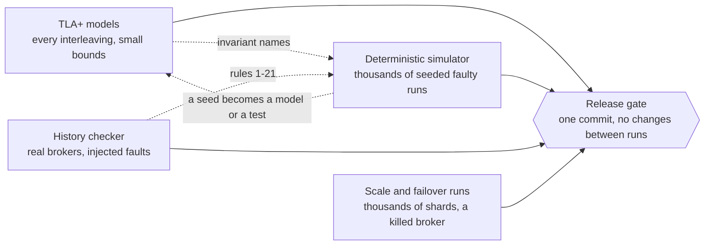

[How Felix Is Tested](/architecture/testing/) explains how each test layer
works. This page is the evidence: what each layer checks, how much of it runs
and how often, which real defects it found, and how to rerun it yourself. The
counts below were taken from the repository at the commit this page was
written, and the command that produces each one is in the section it belongs to.

Four layers cover replication, failover and placement, and the release gate
requires all four to be clean on the exact commit that gets tagged.



## What is checked

**TLA+ models.** `docs/formal/` holds twelve modules. `FelixShard` models one
shard on three brokers with a control plane, leases, majority acknowledgement,
promotion fences, planned and cancelled moves, and replicas electing themselves
under ballots. Others cover the generation-start record against the "Figure 8"
loss from the Raft paper (a new leader that counts an older leader's entries as
committed can lose them), reads and group sessions, atomic commit, head trim,
consumer groups, placement pacing across shards, and the unified fence used by
every change of leader. TLC checks every interleaving within the configured
bounds. The invariants include `AckedHeldByLeader` (whoever serves a shard holds
every record that was acknowledged), `AckedOnMajority`, `AckedSurvive`,
`AtMostOneServing`, `OneLeaderPerGeneration`, `NoStaleRead`, `NoDuplicate` (a
re-sent write is never in a log twice), `NoPartialCommit` and `CopiesWithinLimit`.
The faults are in the model's actions: lease expiry and clock drift, crashes
with and without storage surviving, message loss, a stale control-plane
instance, a cancelled move, and a promotion racing a fence.

**Deterministic simulator.** `felix-sim` runs three to five real brokers and a
control plane in one process on a virtual clock. Everything random, the faults,
the clients' operations and the retry jitter, comes from one seed, so replaying a seed
replays the same faults and operations at the same virtual times. The nemesis crashes and freezes brokers, partitions and
delays links, pauses and downs the control plane, and in opt-in modes skews
clocks, cuts the power inside an append, and acts as an operator (moves, drains,
removals, abandons). Six cluster checkers are named after model invariants:
`OneLeaderPerGeneration`, `AtMostOneServing`, `AckedHeldByLeader`,
`AdoptedMatchesOpened`, `ElectionSettles` (every shard is served by exactly one
broker 60 virtual seconds after the faults heal) and `TornTailRepaired`. The
history rules below run on the clients' operations as well.

**History checker.** Six clients append to and read three replicated streams
and a replicated cache on a real three-broker cluster of `felix-broker`
processes while a nemesis kills, pauses and partitions brokers, drops and delays
peer links, skews lease clocks, slows or fails fsyncs, moves shards and drains
brokers. Afterwards it checks twenty-one rules, among them: no acknowledged
append is missing (rule 1), no value sits at two offsets (2), no cycle of
the kinds the isolation literature names G0, G1c, G-single and G2 (writes or
reads that order each other in a circle, which no serial order can explain),
each also with real-time edges (12 to 19), cache
operations are linearizable per key (20), and no two brokers open one shard at
the same generation (21). It also checks that every shard serves again within 60
seconds of the heal. The adversarial nemesis adds compound faults on four
brokers, including cutting power to every broker at once and crashing the
control plane mid-move. The election nemesis kills leaders while the control
plane is down and requires another broker to open each shard.

**Scale and failover runs.** Some failures need size. The `felix-cluster`
`scale` suite creates streams in bulk and checks that lease renewals stay inside
their TTL. Its failover variant kills the broker leading a third of the streams
while a client keeps publishing to every stream, and requires every shard to
serve again during the outage and again after the broker restarts. felixd, a
workload runner built on Felix, runs the same shape with its own workloads: a
broker is killed with the control plane up, and again with the control plane
paused.

## How much runs

| Layer | What exists | When it runs |
| --- | --- | --- |
| TLA+ | 12 modules, 451 configurations. 349 are registered for the per-push check: 169 must pass and 180 must fail, 26 of those for a liveness property. A further 24 are random walks: 14 must pass and 10 must fail. | A pull request that touches the specs runs the quick configurations and any it changes. Main runs all registered ones. Walks and the largest exhaustive configurations run nightly. |
| Simulator | 120 s of virtual time per seed, in four modes: default, clock skew, placement faults, power loss. | Per pull request: 4 seeds in their own job, and seeds 1 to 20 run twice each to check determinism, which blocks merging. Nightly: 2000 seeds, plus 250 each in the other three modes. Release gate: 2000 seeds in every mode, 8000 runs. |
| History checker | 21 rules. Campaigns: single faults, compound faults on four brokers, election with the control plane down. | Per pull request, each with a fixed seed: 45 s of single faults, 75 s that injects every fault family, 150 s of compound faults, and 90 s of the election campaign. Nightly: 20 minutes each of the single-fault and the compound campaign, each with a random seed. The election campaign also runs on dispatch, as the gate does. |
| Scale and failover | Lease canary at 600 streams (debug build) and 1500 streams (release build). Failover variant, two tests (election on and off). felixd at 1000 workloads, about 2010 replicated streams. | Per pull request: the 600-stream canary. Nightly: the 1500-stream canary. Failover and felixd runs are dispatched and are part of the gate. |

The 180 configurations that must fail are the part to look at. Each removes one
piece of the design, such as the fence, the start record or the read round, and
TLC must find a violation of one named invariant, not just any failure. If a
configuration stopped finding its violation, the check would fail, so the model
cannot go quiet without anyone noticing. In total 37 distinct property names are
asserted this way. The 81 configurations in neither list are not part of the
per-push check. Twenty of them are not referenced by any job, and
[issue #2142](https://github.com/GetFelix/felix/issues/2142) tracks registering
or deleting each one.

The counts come from `scripts/check_tla.sh` (the `expectations` and `walks`
lists), `ls docs/formal/*.cfg`, `.github/workflows/dst-nightly.yml`,
`.github/workflows/history.yml` and `.github/workflows/scale-nightly.yml`.

## What it caught

Each row is a defect that was found by the layer named and fixed in the pull
request linked. Several came from a seed or a model trace that is quoted in
the pull request or its issue.

| Found by | Defect | Fix |
| --- | --- | --- |
| TLC | After a replica set changed, a leader acknowledging by its followers could offer a follower that lacked inherited records for promotion, so a majority of the next leader's sets need not hold an acknowledged write (`AckedHeldByLeader`, issue #1922). | [#1924](https://github.com/GetFelix/felix/pull/1924) |
| TLC | A failover did not fence the set that an unopened joint fence was leaving, so it could open without a write acknowledged before the change. The counterexample was 11 states (issue #1878). | [#1880](https://github.com/GetFelix/felix/pull/1880) |
| Scale | With election on, shards moved off a killed broker never healed, even after it returned, with 670 of 2010 shards on the killed broker. Found by felixd's scale run (issue #1914). | [#1916](https://github.com/GetFelix/felix/pull/1916), [#1928](https://github.com/GetFelix/felix/pull/1928) |
| Cluster | A just-promoted `Quorum` leader could answer a read with an empty page instead of refusing it as not ready (issue #1718). | [#1722](https://github.com/GetFelix/felix/pull/1722) |
| History | A rule 8 violation: a reader saw a commit's event at offset 186 and then read state from an older commit, after a move with a mid-move leader kill (issue #2010). | [#2011](https://github.com/GetFelix/felix/pull/2011) |
| Simulator | The replication driver spun on a zero retry delay when a failed fence could not be retried (seed 1, issue #1941). | [#1959](https://github.com/GetFelix/felix/pull/1959) |
| Simulator | A cache delete answered with the value from before a put that was staged just ahead of it, so the client was told the delete removed the wrong value (issue #1943). | [#1956](https://github.com/GetFelix/felix/pull/1956) |
| Simulator | Two brokers served one `Quorum` cache shard after the control plane marked a frozen broker down and it came back on old routes (seed 4, issue #1955). | [#1957](https://github.com/GetFelix/felix/pull/1957) |
| Simulator | A shard whose leader was ended for silence refused every reader for good at that generation, while still acknowledging writes (seed 2, issue #1964). | [#1973](https://github.com/GetFelix/felix/pull/1973) |
| Simulator | A follower holding a stale record larger than the leader's at the same offset took the batch's suffix after it, and the replicas diverged (seed 1, issue #2062). | [#2063](https://github.com/GetFelix/felix/pull/2063) |
| Simulator | A pending set change was kept when a member came back on new storage, leaving the shard unable to reach a majority after a move (seed 2). | [#2110](https://github.com/GetFelix/felix/pull/2110) |
| Simulator | After a fenced move toward the one follower holding the log, losing the leader left the shard with no caught-up replica forever (seed 3, placement). | [#2112](https://github.com/GetFelix/felix/pull/2112) |
| Simulator | A copy whose storage id rotated after an unclean crash answered a move's fence as a wiped learner, leaving the cut-over one promise short for good (seed 2). | [#2119](https://github.com/GetFelix/felix/pull/2119) |
| Simulator | A fenced move whose leader crashed before reporting drained waited out a two-minute timeout, restarting with every control-plane restart (seed 3). | [#2125](https://github.com/GetFelix/felix/pull/2125) |
| Checker wrong | The simulator recorded a read from a frozen, deposed leader as if it were the log's tail and reported G-single-realtime. The product was right: a deposed leader's readers may see less. The recorder now waits for a confirming round. | [#1967](https://github.com/GetFelix/felix/pull/1967) |
| Checker wrong | The cache linearizability search hit its state cap on keys with many unknown-outcome puts and left them undecided. It now drops unknown puts nobody read before searching. | [#2064](https://github.com/GetFelix/felix/pull/2064) |
| Spec defect | Two shards of main's TLA run failed because two hand-written `UNCHANGED` lists in the spec predated newer variables, so TLC reported an incompletely specified next-state relation. | [#2127](https://github.com/GetFelix/felix/pull/2127) |
| Harness bug | A fault woke at the heal, crashed a broker after the heal had restarted all of them, and left it down. Power-loss seeds 210 and 216 stalled, and the harness, not the broker, was at fault. | [#2129](https://github.com/GetFelix/felix/pull/2129) |
| Checker wrong | `TornTailRepaired` demanded a repair when nothing had opened the torn segment again, failing 17 power-loss seeds of a 2000-seed sweep while the history checker found nothing. | [#2130](https://github.com/GetFelix/felix/pull/2130) |

The last five rows are defects in the checks themselves: three checkers that
flagged correct behavior, a simulator harness that broke its own fault model,
and a spec whose frame conditions fell behind the model. They are listed
because a check that fails for the wrong reason teaches people to ignore it.
Each checker was made more precise, not looser: a violation the code really
causes still fails.

## The release gate

A release candidate is tagged when the failover gate is clean, not when the
list of merged pull requests is done. Every item below runs on one commit, with
no code change between runs:

- The failover scale test passes three times in a row, with and without replica
  election, with no silent shard after the kill and none after the restart.
- The felixd scale run, with election on, recovers every workload after a broker
  kill and after the restart, twice with the control plane up and twice with it
  paused, and the control plane adopts the elected leaders when it returns
  without churn.
- The election history campaigns pass, and the model configurations for any
  rule changed since the last release pass their declared outcomes.
- The simulator sweep of 2000 seeds in every mode is clean, and the per-pull-request
  seeds are green.
- A performance comparison against the previous release shows no regression
  beyond noise.

A failure resets the count and gets a root cause. Running again until it goes
green does not count.

## Reproduce it

Replay a simulator seed. A failing seed prints this command with its modes:

```bash
FELIX_SIM_SEED=<n> task sim:replay
FELIX_SIM_SEED=<n> FELIX_SIM_PLACEMENT=1 task sim:replay    # placement faults
FELIX_SIM_SEED=<n> FELIX_SIM_POWER_LOSS=1 task sim:replay   # power cuts
FELIX_SIM_SEED=<n> FELIX_SIM_CLOCKS=bounded task sim:replay # clock skew
```

Run a batch, or start the full sweep in Actions:

```bash
FELIX_SIM_SEEDS=20 FELIX_SIM_SEED_START=1 cargo test -p felix-sim --test seeds -- --ignored --exact seeds
gh workflow run dst-nightly.yml -R GetFelix/felix -f seeds=2000 -f modes=all
```

Check the models. TLC needs Java 11 or later, or Docker or Podman:

```bash
scripts/check_tla.sh FelixShardFigure8 FelixShardFigure8NoStartRecord   # a pass and its twin
scripts/check_tla.sh                                                   # every registered configuration
scripts/check_tla.sh --simulate                                        # the random walks
```

The first command passes both because the second is expected to violate
`AckedOnMajority`, and the script fails if it does not. The full run is long, so run it in Actions.

Run the history campaigns:

```bash
gh workflow run history.yml -R GetFelix/felix -f nemesis=election -f duration_secs=1200
cargo build -p felix-broker-service --bin felix-broker
FELIX_HISTORY_SEED=<seed> FELIX_HISTORY_MODE=lease-free FELIX_HISTORY_NEMESIS=adversarial \
    FELIX_HISTORY_DURATION_SECS=1200 cargo test -p felix-cluster --test history -- --nocapture
```

Run the failover scale test:

```bash
gh workflow run scale-nightly.yml -R GetFelix/felix -f variant=failover -f streams=2100
```

## What this does not cover

The history checker is Felix's own Jepsen-style harness. It uses Elle's
list-append model and checks the same kind of cycles, but it is not Jepsen and
it does not run Elle. [Issue #2140](https://github.com/GetFelix/felix/issues/2140)
tracks checking Felix histories with Elle and then a Jepsen test, and
[issue #1903](https://github.com/GetFelix/felix/issues/1903) tracks an
independent analysis by an outside team.

The TLA+ models abstract the code. The configurations explore small bounds: a
move or two and a promotion or two. The random walks sample longer behaviours
but do not prove them. Some cases are not checked yet, such as failover from a
replica set of four
([issue #2136](https://github.com/GetFelix/felix/issues/2136)), and a model that
still passes does not show the code matches it. The spec-pairing check only
forces a spec change when code the model covers changes.

The simulator finds what its nemesis injects, on the shard counts and payload
sizes it uses. A seed that passes shows nothing was found, not that nothing is
there. Some faults only the real cluster layers inject, such as a `SIGSTOP`ed
process and slow real fsyncs, and the reverse is also true. Scale runs cover a
kill and a restart of one broker, not every combination of faults at that size.
