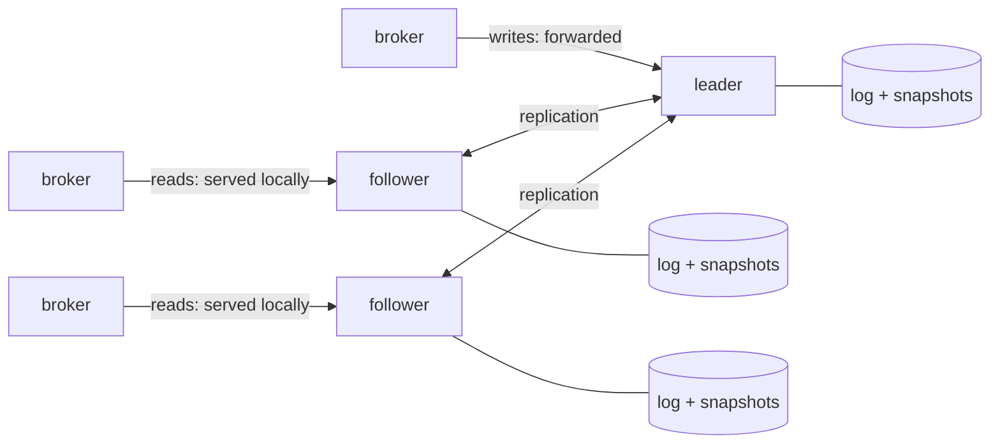

## What it is

Every control-plane instance embeds a Raft node; three instances form a
group. Metadata (tenants, streams, shard assignments, membership, auth
configuration) becomes a Raft-replicated state machine, persisted as a log
and snapshots on each instance's own volume. No external database is needed.
[Control-plane HA](/deployment/control-plane-ha/) covers running it.

The failure handling is covered by tests. Three instances under continuous
broker traffic come through rolling restarts, a leader killed with SIGKILL, a
leader frozen past several elections and then thawed, and a member whose
volume is wiped, with **zero failed calls, and every acknowledged write
present on every member afterwards**. The faults injected are the ones a single
machine can produce; multi-machine fault injection is not covered. The design
record, with the alternatives considered and the problems found while building
it, is
[`docs/metadata-raft-design.md`](https://github.com/GetFelix/felix/blob/main/docs/metadata-raft-design.md).



## Design choices

- **The broker contract is frozen.** Snapshots, change feeds, heartbeats and
  leases keep their shape. The design lives entirely behind the store
  traits where the memory/Raft split already lives, and the same
  contract test suites run against both backends.
- **The state machine is the in-memory store.** `InMemoryStore` already
  implements every store trait; Raft puts a command log in front of it.
  Commands are API-shaped (`CreateStream`, `RegisterNode`,
  `BootstrapTenantAuth`), so every check-then-act race is closed by the log's
  total ordering.
- **Apply is deterministic.** Timestamps are stamped at propose time and
  generated values are carried in the command, so three instances applying
  the same log reach byte-identical state. A test asserts exactly that.
- **Reads stay local; writes go through the leader.** Broker watches are
  pull-based and eventually consistent by contract, so followers serve them.
  The expiry sweep and shard placement run only on the leader, so there is
  only ever one sweep.
- **Leases keep their arithmetic.** The Raft leader is the lease grantor; a
  new leader learns every outstanding grant from the log and waits out the
  same safety margin before granting again. Data-plane fencing is
  unchanged: it still rests on the assignment generation.
- **Raft is fine here even though stream replication rejected it.** The
  [replication design](https://github.com/GetFelix/felix/blob/main/docs/replication-design.md)
  rejected Raft for stream payloads because Raft truncates divergent log
  suffixes and the segment store never rewrites. The metadata Raft log is a
  separate, kilobyte-scale log that never touches `felix-storage`, so the
  two don't conflict.

## What operators would see

| Event | Behaviour |
| --- | --- |
| One instance of three dies | Writes pause for one election timeout; reads keep serving; no broker call fails |
| An instance loses its volume | Rejoins empty and does not vote or stand for election until it has caught up with the group, so an empty log cannot elect a member missing acknowledged writes. Caught up by snapshot install; no data surgery |
| Quorum lost | Survivors fail readiness rather than serve writes that cannot commit; brokers keep serving on their catalogs and leases, as during any control-plane outage |

Library: [openraft](https://github.com/databendlabs/openraft), pinned to one
exact version (0.10.0), wrapped behind a seam so its pre-1.0 API churn stays
contained. What members send each other and store is Felix's own format,
unchanged from the releases that ran openraft 0.9, so a group is upgraded
one member at a time and a member can be rolled back.

## Configuring it

Three environment variables select the backend, and three more are required
with them: the peer listener,
the cluster id and the peer token. `FELIX_RAFT_INITIAL_CLUSTER_STATE` is
optional and defaults to `existing`.

```
FELIX_RAFT_NODE_ID=1
FELIX_RAFT_DATA_DIR=/var/lib/felix/raft
FELIX_RAFT_PEERS=1=cp-0:8444,2=cp-1:8444,3=cp-2:8444
FELIX_RAFT_BIND_ADDR=0.0.0.0:8444
FELIX_RAFT_CLUSTER_ID=prod-metadata
FELIX_RAFT_PEER_TOKEN=<at least 32 random characters, from a Secret>
FELIX_RAFT_INITIAL_CLUSTER_STATE=new   # first start of the cluster only
```

Every member must carry the **same** peers map (initializing two disjoint
member sets is how split brain is manufactured), and the data directory
must survive restarts, because that is what makes a restart a rejoin.

The Raft RPCs are served on their own **peer listener**
(`FELIX_RAFT_BIND_ADDR`), and `FELIX_RAFT_PEERS` names each member's peer
listener, not its API port. Every peer request must name the cluster and
carry the peer token, or it is refused before any route runs. That token is
the cluster-admin credential (the `propose` route behind it can replace the
whole store), so keep it in a Secret, expose the peer port to the other
members only, and give the token to nothing but the members. A member refuses to start without one unless
`FELIX_RAFT_INSECURE_PEERS=true`, which is for a throwaway local group. Add
`FELIX_RAFT_TLS_CERT`, `FELIX_RAFT_TLS_KEY` and `FELIX_RAFT_TLS_CA` for peer
mTLS on top.

`FELIX_RAFT_CLUSTER_ID` is recorded in the data dir on first start; a member
refuses to start on a data dir from another cluster. Empty members form a
new group only under `FELIX_RAFT_INITIAL_CLUSTER_STATE=new`, and only once
every configured member has answered that it is empty, so start all of them
for the cluster's first start. A member that is down blocks the first start:
it may be the one holding the data. With the default, `existing`, members
that lost their volumes wait for the group instead of quietly starting an
empty control plane, so set `new` for the cluster's first start and nothing
else.

Before a member casts its first vote it has every other member write down
that it set out to form the group. A member that loses its volume in the
cluster's first moments, before any leader has written an entry, is then
recognised by its peers and does not form a second time: it waits for a
leader, catches up and votes again. A member also records, before it
votes, that it has voted; one that finds that record and an empty log lost
its log, and catches up the same way. For that, a first start needs every
member on a release that can take the record. A member on an older release
blocks the first start, and the others log which one it is. A group that
already runs is not affected. The steps are in
[the design doc](https://github.com/GetFelix/felix/blob/main/docs/metadata-raft-design.md#forming-the-group).

If a member's machine is lost for good before the group has ever formed,
stop the others and run this on each, naming the absent member's
`FELIX_RAFT_NODE_ID`:

```bash
felix-controlplane raft form-without --data-dir /var/lib/felix/raft \
  --cluster-id prod-metadata --slot 3
```

The next start of each forms the group without that member's answer, once.
The absent member stays in the group, so it runs two of three until a
machine with an empty volume takes its place. Use this only under a cluster
id that no volume has held: it cannot tell whether the absent machine holds
data.

Upgrading an existing Raft group to a release with the peer listener is not
a rolling change: old members send unauthenticated RPCs to the API port, and
new ones only answer authenticated ones on the peer port. Restart every
member together (set `FELIX_RAFT_CLUSTER_ID` to any stable name; existing
data dirs adopt it). Metadata writes pause for the restart; brokers keep
serving. A release that adds a Raft command has its own rule, in
[the design doc](https://github.com/GetFelix/felix/blob/main/docs/metadata-raft-design.md#upgrading). Writes reaching
a follower forward to the leader invisibly; the expiry sweep and shard
placement run only on the leader, confirmed by a linearizable check each
tick. A proposal that cannot commit (no leader, quorum lost) fails after a
bounded deadline (default 10s) rather than hanging, and the API answers it
`503` with code `unavailable`. The write
may still have committed after the deadline, so a retried create can answer
`409`.

Timings are tunable when the defaults (150ms heartbeat, 600–1200ms election
window, snapshot every 500 entries) don't fit: `FELIX_RAFT_HEARTBEAT_MS`,
`FELIX_RAFT_ELECTION_TIMEOUT_MIN_MS` / `_MAX_MS`,
`FELIX_RAFT_SNAPSHOT_LOGS_SINCE_LAST`, `FELIX_RAFT_LOGS_KEPT_BEHIND_SNAPSHOT`,
`FELIX_RAFT_WRITE_TIMEOUT_MS`. An election window at or below the heartbeat
is refused at startup, because it would elect against healthy leaders.

### Probes under raft

`/v1/system/ready` answers from consensus state, all read locally (a probe
never costs a consensus round trip): the member knows a leader, its applied
state trails its own log by no more than a bound, and, when it *is* the
leader, a quorum has acknowledged it within the last 5s. That last check
takes a partitioned, quorumless leader out of rotation before it serves
stale reads, and a test covers it. `/v1/system/live` stays
process-local, exactly as before: losing quorum is not fixed by a restart.
The probe settings on [Control-plane HA](/deployment/control-plane-ha/)
(intervals, thresholds) carry over unchanged.

Consensus position ships as metrics: `felix_meta_raft_term`,
`_is_leader`, `_leader_known`, `_last_log_index`, `_last_applied_index`,
`_snapshot_index` (gauges), plus `felix_meta_raft_forwarded_proposals_total`
(informational: the LB is handing writes to followers) and
`felix_meta_raft_write_timeouts_total`, the counter to alert on, because it
means no leader or no quorum. `felix_meta_raft_peer_rejected_total{reason}`
counts peer requests refused for the wrong cluster id or token.
`felix_meta_raft_deduplicated_proposals_total` counts retried writes answered
from the first attempt's result. `felix_meta_raft_unsupported_commands_total`
counts committed commands this build could not apply, which in a mixed-version
group means this member has fallen behind the leader; the upgrade runbook
watches it. `felix_meta_raft_member_below_floor{member}`, on the leader, is 1
while it holds a member back because that member reported a build below the
metadata version the group already uses, or lost its log and has not
reported since; upgrade that member. The leader holds only on that
evidence, read from levels it refreshes in the background, so a member it
cannot reach or has not asked yet is fed as usual. One exception is short:
a member that conflicts before accepting anything after a leader or
membership change is held until a probe of it alone settles it, at most
200 ms, or about a second more if it is slow to answer, released if it
answers at the group's version or does not answer. A held member that is
behind gets no heartbeats either, so it may call elections; the others refuse
them while they hear from the leader, but after a long hold the member's
first answer can cost one extra election. The gauge returns to 0 when the member leaves
the group or this member stops leading.

### Leader deploys pause writes for one election

The control plane does not hand leadership over before a member stops, so a
rolling deploy that restarts the current **leader** pauses metadata writes
for one election timeout (~1.2s at defaults) while a successor elects
itself. Reads keep
serving, followers restart with no pause, and brokers are unaffected: they
retry heartbeats and keep their catalogs through far longer outages than
this. openraft 0.10, which the control plane now runs, can transfer
leadership, and the seam owns the shutdown path, so adopting it is a
contained change that comes after the move to the segment store. Until then
the pause is expected behaviour.

### Deploying on Kubernetes

The design assumes a StatefulSet with one PVC per member and a headless
service for stable peer names:

```yaml
apiVersion: apps/v1
kind: StatefulSet
metadata:
  name: felix-controlplane
spec:
  serviceName: felix-controlplane      # headless: stable per-pod DNS
  replicas: 3
  template:
    spec:
      containers:
        - name: controlplane
          env:
            - name: POD_NAME
              valueFrom: { fieldRef: { fieldPath: metadata.name } }
            # Ordinal → node id (an initContainer or entrypoint derives
            # FELIX_RAFT_NODE_ID = ordinal + 1 from POD_NAME).
            - name: FELIX_RAFT_DATA_DIR
              value: /var/lib/felix/raft
            - name: FELIX_RAFT_PEERS
              value: "1=felix-controlplane-0.felix-controlplane:8444,2=felix-controlplane-1.felix-controlplane:8444,3=felix-controlplane-2.felix-controlplane:8444"
            - name: FELIX_RAFT_BIND_ADDR
              value: "0.0.0.0:8444"
            - name: FELIX_RAFT_CLUSTER_ID
              value: felix-controlplane
            - name: FELIX_RAFT_PEER_TOKEN
              valueFrom: { secretKeyRef: { name: felix-raft-peer, key: token } }
            # `new` on the cluster's first start only.
            - name: FELIX_RAFT_INITIAL_CLUSTER_STATE
              value: existing
          volumeMounts:
            - name: raft
              mountPath: /var/lib/felix/raft
          readinessProbe:
            httpGet: { path: /v1/system/ready, port: 8443 }
            periodSeconds: 2
          livenessProbe:
            httpGet: { path: /v1/system/live, port: 8443 }
            periodSeconds: 10
  volumeClaimTemplates:
    - metadata: { name: raft }
      spec:
        accessModes: ["ReadWriteOnce"]
        resources: { requests: { storage: 1Gi } }
```

The PVC is what makes a pod restart a rejoin; a member whose volume is lost
rejoins empty and is rebuilt by snapshot install. The
[Helm chart](/deployment/kubernetes/) renders exactly this with
`controlplane.storage.backend=raft`, deriving each member's id from its pod
ordinal and the peers map from the replica count. It lets empty members
start with `new` only until a post-install hook has seen the group form and
recorded that in a ConfigMap; every start after that is `existing`.

## Restoring beyond quorum loss

The group can load a state-machine snapshot with the `ImportState` command on
its peer listener, refused unless the group is empty or `overwrite` is set.
No shipped command writes or proposes such a snapshot, so a restore beyond
quorum loss has no operator path today; recover by bringing members back.

A broker kept running across a restore to an earlier point refuses a stream
whose restored incarnation is below the one it holds, since it never moves a
name back; run `felixctl data restore-point` with the matching backup point, or
delete and recreate the stream (see `docs/durable-storage.md`, "Deleting a
stream"). A restore also rewinds node incarnations and replica reports
together, which lets placement replace a running leader on an old report while
it still serves on its lease, so stop every broker before an import.

## How it is built

`MetadataStateMachine` wraps the same in-memory store the control plane has
always had, fed by a versioned command set with one API-shaped command per
mutation. Heartbeat and expiry carry their timestamps and bootstrap carries
its candidate signing keys, so nothing inside apply reads a clock or
generates a value. The determinism harness applies a
full-coverage command script to two machines and requires **byte-identical
snapshots**, so change events published in HashMap order, or anything else
that differs between members, fails the test. On a real three-node group, eight
concurrent tenant bootstraps come out with exactly one winner and three
byte-identical replicas, settled by nothing but the order the log assigned.

### The consensus core underneath

`services/felix-controlplane-service/src/raft/` is the whole openraft surface;
no consensus type escapes it. Outside the seam there are exactly two things: a
`RaftHandle` (start, initialize, write, add-learner, promote, snapshot,
status, shutdown) and an `AppStateMachine` trait whose contract is the
determinism rule above. Consensus state (log, vote, current snapshot)
lives in one crash-safe [redb](https://github.com/cberner/redb) file per
instance. An embedded ACID store was chosen over hand-rolled files because
votes and entries that get acknowledged and then lost are how one term
elects two leaders, and that is no place for custom plumbing.
The store passes openraft's own storage conformance suite on every test
run, just as the node/shard contract suites run against every metadata
backend.

The same group can be built on Felix's own segment store instead, so a node
has one storage engine. That build exists and CI tests it, but no release
turns it on: it needs `RUSTFLAGS="--cfg felix_segment_store"`, and a group
on redb has no conversion tool yet. Members of the two builds serve their
peer routes under different prefixes and never exchange Raft messages. The
plan is in
[the design document](https://github.com/GetFelix/felix/blob/main/docs/metadata-raft-design.md#moving-to-the-segment-store).

## Why not SWIM gossip

Replacing heartbeat-to-control-plane liveness with SWIM-style gossip
membership was evaluated alongside this design and rejected for now. The
heartbeat is also the lease renewal, so liveness and serving authority
deliberately travel one channel to one authority. The 15 s liveness timeout is the
lease, and a `Leader` shard has to wait it out (plus a 3.75 s margin) before
another broker may lead, so faster detection buys nothing safety uses. A
lease-free `Quorum` stream already fails over in about 5 s on its followers'
word. And SWIM's constant-load advantage pays off at
hundreds of nodes rather than tens. The full decision, including the asymmetric
reachability gap that peer-reachability reports would cover more cheaply and
the triggers for reopening, is in
[`docs/control-plane.md`](https://github.com/GetFelix/felix/blob/main/docs/control-plane.md#why-liveness-stays-centralized-swim-considered).
