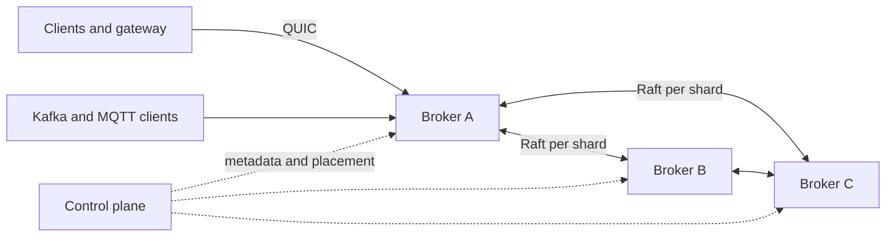
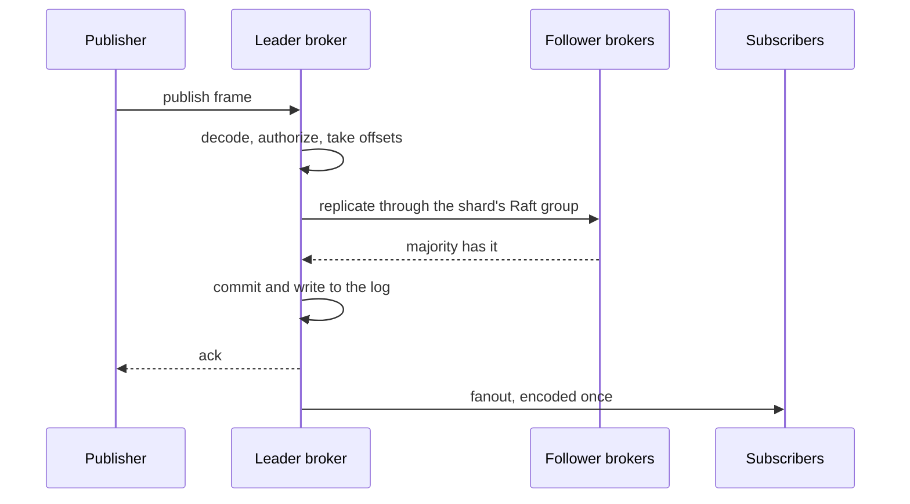

This page is the whole system on one screen of attention. It names the pieces,
follows one publish through them, and says what each guarantee rests on. Each
section ends with the page that holds the detail and the reasoning. If a claim
here and a deep page disagree, the deep page is right and this one is stale.

## The idea

Felix keeps one append-only log per shard. A stream, a cache and a queue are
three ways of reading that log, so there is one storage engine, one replication
protocol and one set of failure behaviours to understand. A stream reads the
log forward by offset. A cache reads it through a key index. A queue reads it
through a cursor that a consumer group shares. See
[`projections.md`](https://github.com/GetFelix/felix/blob/main/docs/projections.md).

## The pieces

A **broker** is the data-plane process. It speaks QUIC to clients, stores
records on local disk and replicates them to other brokers. A cluster is
several brokers, each holding many shards.

The **control plane** is a small service that holds metadata: which brokers
exist, which streams and caches exist, and where each shard's copies are
placed. It runs its own Raft group, so it needs no external database. Brokers
fetch their metadata from it at startup and do not accept traffic for a stream
they have not yet been told about. See [`control-plane.md`](https://github.com/GetFelix/felix/blob/main/docs/control-plane.md).

**Clients** are the SDKs (Rust, Python, TypeScript, C and C#). They open one
QUIC connection and multiplex streams over it. A browser cannot open QUIC, so
it goes through a WebSocket gateway. **Front-ends** let existing tools talk to
the same data: the broker also serves Kafka and MQTT listeners, which map those
protocols onto the same streams and queues. See
[`protocol.md`](https://github.com/GetFelix/felix/blob/main/docs/protocol.md), [`kafka-compatibility.md`](https://github.com/GetFelix/felix/blob/main/docs/kafka-compatibility.md)
and [`mqtt-compatibility.md`](https://github.com/GetFelix/felix/blob/main/docs/mqtt-compatibility.md).

The dotted lines carry metadata, not records. Records never pass through the
control plane.

## A shard is a Raft group

Every shard is its own Raft group, with one member on each broker that holds a
copy. The members elect a leader, the leader appends to its log and replicates,
and a record is committed once a majority has it. A broker carries many
members, and one timer per broker drives all of them, so thousands of small
groups stay affordable. See [`per-shard-raft.md`](https://github.com/GetFelix/felix/blob/main/docs/per-shard-raft.md) and
[`replication-engine.md`](https://github.com/GetFelix/felix/blob/main/docs/replication-engine.md).

The control plane decides **placement**: which brokers hold a shard's copies and
which of them should lead. It does not decide who actually leads. Raft elects
the leader, and the Raft term is the generation. Placement only influences the
outcome by moving copies and by asking a group to hand leadership to a
preferred member.

A cache shard and a counter shard are groups of the same kind. Their log holds
puts, deletes and counter deltas. The cache index and the counter sums are
rebuilt from a snapshot plus that log. A queue's consumer-group position is
stored the way a cache key is, as the latest value for a key, so it replicates
and recovers through the same machinery. See [`cache-on-log.md`](https://github.com/GetFelix/felix/blob/main/docs/cache-on-log.md).

## How a publish travels

1. **Decode.** The broker's QUIC handler decodes the frame, checks the
   credential and finds the shard for the key.
2. **Offsets.** The batch takes its offsets before it waits for durability.
   That fixes its place in the stream's order. Later publishes wait behind it
   whether it succeeds, fails or is cancelled, so acknowledged records never
   reorder.
3. **Commit.** The leader proposes the batch to its Raft group. It is committed
   when a majority holds it, and the publisher is acknowledged according to the
   stream's fsync policy.
4. **Fanout.** After the commit, the record goes to every subscriber. One
   encoded frame is shared by all of them, so a publish is encoded once however
   many subscribers there are.

Reordering these steps is almost always a bug. Reading history before
registering a subscriber, for example, loses any publish that lands in between.
See [`durable-storage.md`](https://github.com/GetFelix/felix/blob/main/docs/durable-storage.md) for the publish path and what
each durability policy waits for.

## Subscribers cannot slow a publisher

Each subscriber has a bounded queue. When it is full, the default policy
(`DropNew`) drops the new record for that subscriber and nothing else. A
publisher never waits for a subscriber.

A drop is never silent on a durable stream. Delivered events carry their log
offsets, so a jump in offsets is a drop. A client that negotiated the feature
is also told: the subscription ends with `subscription_lagged` at its first
drop, naming the offset to resume from, and the client resumes by reading the
log. See the subscribe section of [`protocol.md`](https://github.com/GetFelix/felix/blob/main/docs/protocol.md).

New wire features are negotiated with flag bits during authentication, not with
version numbers. An old peer that never negotiates gets the original behaviour
and byte-identical frames.

## Storage

Each broker stores a shard's log as a series of segment files. Records are only
ever appended and never rewritten, so recovery can trust that valid bytes run
to the end of the file. Indexes are derived from the segments and rebuilt if
they are missing or stale.

At startup, a torn tail from a crash is repaired. Corruption anywhere before
the tail is fatal: the broker refuses to start rather than quietly lose records
it acknowledged. Group commit lets one flush serve many waiting publishers,
which is the biggest lever on throughput when every acknowledgement waits for
an fsync. See [`durable-storage.md`](https://github.com/GetFelix/felix/blob/main/docs/durable-storage.md) and
[`storage-format.md`](https://github.com/GetFelix/felix/blob/main/docs/storage-format.md).

## A shard's life and failover

A shard is created through the control plane, which places its copies on
brokers. Each broker starts a Raft member for it, and the members elect a
leader. Writes go to the leader. A broker that does not own a shard's leader forwards
the request to the broker that does.

If the leader dies, the followers stop hearing its heartbeats, hold an election
and choose a new leader from the members with the most complete logs. The new
leader opens for writes once it has committed an entry of its own term, and a
leader serves only while a majority has recently acknowledged it. That
lease is what stops an old leader that was cut off from answering reads while
a new one is accepting writes.

If a broker is gone for good, a placement change puts a new copy elsewhere and
the group adds it as a member.

## What needs the control plane

Raft elects without it. If the control plane is down, brokers that stayed up
keep serving, and a failed leader is still replaced. What waits is narrower. A
broker that was restarted while the control plane is down has to check its
data directory against the control plane's record before it votes, so it
stays out of elections until the control plane answers. No new streams or
placement changes happen while it is away. See the restore check in
[`per-shard-raft.md`](https://github.com/GetFelix/felix/blob/main/docs/per-shard-raft.md).

## What is guaranteed

- A record that a durable publish acknowledged is readable after a restart,
  within the window the fsync policy allows.
- Within one shard, records have one order, and every member that applies the
  log reaches the same state.
- One key always lands on one shard.
- A subscriber that misses a record can tell that it did.
- A publisher is not slowed by subscribers.

The exact wording of each, and where it stops, is in
[`semantics.md`](https://github.com/GetFelix/felix/blob/main/docs/semantics.md).

## Where to go next

| To learn | Read |
| --- | --- |
| How the three readings differ | [`projections.md`](https://github.com/GetFelix/felix/blob/main/docs/projections.md) |
| The wire format and negotiation | [`protocol.md`](https://github.com/GetFelix/felix/blob/main/docs/protocol.md) |
| What an acknowledgement means | [`semantics.md`](https://github.com/GetFelix/felix/blob/main/docs/semantics.md) |
| How shards replicate | [`per-shard-raft.md`](https://github.com/GetFelix/felix/blob/main/docs/per-shard-raft.md) |
| What the control plane does | [`control-plane.md`](https://github.com/GetFelix/felix/blob/main/docs/control-plane.md) |
| How records sit on disk | [`durable-storage.md`](https://github.com/GetFelix/felix/blob/main/docs/durable-storage.md) |
