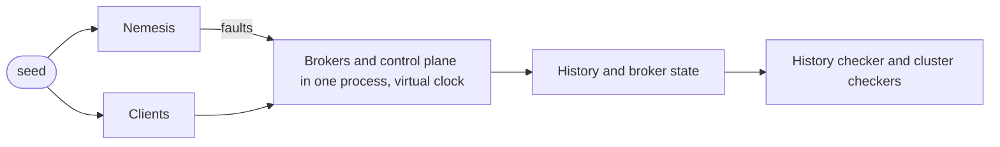

The replication rows on [What Felix Is For](/getting-started/what-felix-is-for/)
rest on four kinds of evidence. A history checker runs clients against a real
three-broker cluster while it injects faults, then checks what the clients saw.
The cluster harness runs those brokers and injects the faults, and individual
tests use it to pin one scenario at a time. A simulator runs a whole cluster
inside one process on a seeded random number generator and a virtual clock, so
a faulty run can be started again from its seed. TLA+ models cover the
interleavings no injected fault reliably reaches. This page says what each one
does and where the detail lives.

## The history checker

The checker is a Jepsen-style test in `crates/testing/felix-cluster/src/history/`.
Six clients append unique values to three single-shard `Quorum` streams and
read them back, and put and get three keys of a `Quorum` cache, while a
nemesis injects faults. Every operation is recorded
with its start time, its end time and its result. Once the faults are healed,
the checker takes a final read of each stream from its leader and compares the
history with what a replicated append-only log promises.

The model is Elle's list-append. Felix hands a reader the offset of every
record, so the checker reads positions directly and does not have to infer an
order. An append ends as acknowledged, as a definite failure (only a typed
refusal that says the broker applied nothing), or as unknown (a timeout, a lost
connection, `outcome_unknown`). Half the clients are idempotent producers that
re-send under the same sequence, so the campaign also exercises deduplication
across leader changes.

It checks twenty-one rules:

1. No acknowledged append is missing from the final read.
2. No value sits at two offsets.
3. Every read agrees with the final log at the offsets it holds.
4. An append acknowledged before another was sent sits at an earlier offset.
5. A read never sees a value nobody appended, or appended to another stream.
6. A value whose append definitely failed never appears.
7. A cache get never returns a value that a later put had already replaced
   before the get began, whether that put was acknowledged or an earlier get
   saw it.
8. No reader sees an atomic commit's event without its state, or the other
   way round.
9. A live subscriber is delivered offsets in increasing order, across
   reconnects too.
10. Every record a subscriber was delivered is in the final log at the same
    offset.
11. Every record in the final log reaches a subscriber or shows up as a gap
    in its offsets, up to the end of the log.
12. No G0: append order alone forms no cycle.
13. No G1c: append order and what reads saw form no cycle.
14. No G1c-realtime: as 13, with real-time order as one of the edges.
15. No G-single: no cycle has exactly one read that missed an append.
16. No G-single-realtime: as 15, with real-time order as one of the edges.
17. No G2: no cycle has two or more reads that missed an append.
18. No G2-realtime: as 17, with real-time order as one of the edges.
19. No G0-realtime: as 12, with real-time order as one of the edges.
20. The puts, gets and deletes on a cache key can be put in one order that
    respects real time and behaves like a single variable.
21. No two brokers open one shard for writes at the same generation. This
    one is read from the broker logs, and only in the election campaign
    below.

A cycle rule draws an edge from each operation that must come first to the
one that follows it, and reports any loop, because then no single order of the
stream explains what the clients saw. A stale read is the common case: an
append returned, a read began afterwards, and the read stopped before it.
Rule 20 searches for an order of a key's operations the way a linearizability
checker does, so it also catches an anomaly that needs several operations to
show, such as two conditional puts on an absent key that both applied. A key
too tangled to decide within the search budget is reported as undecided, which
is neither a pass nor a failure. The cycle rules need reads that end at the
true end of the log. A live subscriber may drop its newest records, so the
cluster campaigns leave the anti-dependency edges out. The simulator turns
them on.

A read that is missing records is allowed, because a subscriber may drop under
`DropNew` and the offsets show the gap. What a read does hold has to match.
Rules 9 to 11 come from one subscriber per stream that stays subscribed for
the whole run and resumes after its last offset whenever its connection is
lost; once the final reads are taken, it has up to 60 seconds to catch up.

The nemesis waits 1-4 s, injects one fault for 2-6 s, heals it, and repeats.
The single faults never overlap, so a majority is always one fault from whole.
The per-PR
run lasts 45 seconds with a fixed seed and uses process faults only: kill,
pause (`SIGSTOP`) and partition. The nightly workflow
(`.github/workflows/history.yml`) runs for 20 minutes with a random seed and
adds link faults (dropped or delayed peer traffic, lost control-plane replies),
clock faults (a broker's lease clock at 0.5x or 20x, the control plane's wall
clock stepped 15 s forward), disk faults (slow fsyncs, one failed fsync) and
assignment faults (an operator moving a shard to another replica, a broker
drained and put back).

A second nemesis, the adversarial one, injects compound faults on four
brokers: two brokers killed at once, a leader cut off from its peers and the
control plane until its shards fail over, a partition beside a delayed link,
two random faults together, a move whose source or destination is killed
300 ms in, a broker restarted and killed again before it catches up, a torn
segment write, and a drain that replaces follower copies on the spare broker.

It also cuts the power to every broker at once. Each debug broker runs its
storage under the same power-loss model the storage suite uses, so on the
directive it builds the directory a reboot would find, with unflushed writes
lost, torn or zeroed, and dies; the harness swaps that image in and restarts
the whole cluster. The campaign then runs with fsync and acknowledgement on
commit, so any acknowledged append or cache put that goes missing is a write
acknowledged before it was durable. This needs Linux.

And it crashes the control plane 300 ms after starting a move, a drain or the
kill of a leader, keeping its state, and brings it back after the hold with
placement running again. The heal waits for any move it had started to
finish or be dropped.

A third nemesis tests leader election without the control plane. With the
`replica_election` fleet feature on, it crashes the control plane, then kills
a leader while the clients keep writing and the subscribers keep reading.
Within 20 s, with the control plane still down, another broker must open each
of the dead leader's shards at a later generation and take a write or answer
a get. Half the time the killed broker is started again before the control
plane returns, and nothing waits for it to rejoin until then. A 90-second
campaign of these runs on every pull request, and a manual run of the nightly
workflow can pick it with `nemesis=election`.

The nightly workflow runs it for 20 minutes beside the single-fault one, each
with its own seed, and also goes round each compound kind once in a
two-and-a-half-minute campaign. A one-minute campaign on every pull request
alternates the power loss and the control plane crash.

After every heal the campaign also checks liveness. Within 60 s each shard
must have a running leader that takes a write or answers a get, no move or
follower replacement in flight, no replica its leader has stopped shipping
to, and a replica reported caught up so it could fail over again. If one does not get there, the run fails with a line per
stuck shard that names its leader, its generation and the transition it is
stuck in.

`FELIX_HISTORY_MODE` picks the replication path. In `lease` mode the campaign
tests the report and lease path every stream uses by default. In `lease-free`
mode it finalizes `generation_start`, `majority_ack`, `lease_free_reads` and
`fenced_caches` after start-up and fails at once if any broker does not turn them on. The
nightly run and the per-PR main campaign use `lease-free`; the per-PR
every-family campaign uses `lease`, so each pull request covers both.

```bash
cargo build -p felix-broker-service --bin felix-broker
cargo test -p felix-cluster --test history -- --nocapture
```

`FELIX_HISTORY_SEED` takes a number or `random`. Setting
`FELIX_HISTORY_DURATION_SECS` changes how long the nemesis runs and also
switches the main campaign to the long schedule: every single fault family,
or the compound faults with `FELIX_HISTORY_NEMESIS=adversarial`. The nightly
jobs print their seed, mode and nemesis first, so a red night replays with:

```bash
FELIX_HISTORY_SEED=<seed> FELIX_HISTORY_MODE=lease-free FELIX_HISTORY_NEMESIS=adversarial \
    FELIX_HISTORY_DURATION_SECS=1200 cargo test -p felix-cluster --test history -- --nocapture
```

The seed fixes the fault schedule and the clients' choices but not thread
interleaving, so a failing seed makes the failure likely to recur, not certain.
Run it a few times.

Detail, including how to read a violation and how to add a fault:
[`docs/history-checker.md`](https://github.com/GetFelix/felix/blob/main/docs/history-checker.md).

## Deterministic simulation

A real cluster finds bugs slowly. A failover takes seconds of wall time, and a
fault that has to land between two particular messages can take hundreds of
runs to hit. `crates/testing/felix-sim` runs the whole cluster in one test
process instead: three to five real brokers and a control plane, with the
network, the clocks and the faults under the test's control. It runs on tokio's
virtual time, so waiting costs nothing, and the faults, the clients'
operations and the retry jitter are all drawn from one number, the seed.



The brokers are the real shard, replication and election code. Their peer
traffic goes through an in-memory network that can partition a link, drop its
messages in one direction or delay them. The control plane is the real router
called in the same process, and it can be slow, paused or down. A broker can be
crashed and restarted, which reopens its data directory, or frozen, which cuts
it off from every peer and from the control plane while it keeps running. Each
broker's data directory lives in an in-memory filesystem that keeps a second,
durable copy of every file and directory, so it can rebuild what a power loss
would have left, with unsynced pages lost, torn or zeroed. A crash is a
process crash, half of them kills that leave the run state unclean so the
restart runs the unclean-start handling. With power loss on
(`FELIX_SIM_POWER_LOSS=1`), brokers fsync on commit and those kills become
power cuts that land inside an append, and the run fails unless recovery
repairs the torn tail. `FELIX_SIM_POWER_LOSS=relaxed` cuts the power under
brokers that do not sync first, so acknowledged bytes are really lost and the
restart takes a new storage id; `FELIX_SIM_MAJORITY_CUT=1` cuts several
brokers at once and `FELIX_SIM_WIPE=1` empties shard or data directories. A
checker holds each to what it may lose: nothing acknowledged under
sync-on-commit, and under a relaxed mode or a wipe only records that every
disk holding them lost. With placement
faults on (`FELIX_SIM_PLACEMENT=1`), the nemesis also acts as an operator
through the control plane's API: it moves shards, drains and removes brokers so
follower seats are replaced, abandons held shards' logs, and stops a broker
between its promotion and its open.

A run lasts 120 seconds of virtual time. Faults go in for the first 90, then
everything heals and the cluster has 60 seconds to serve every shard again.
Then the clients stop, a last read takes each shard, and the checkers run. The
history checker above judges the clients' history with `exact_tails` on. The
simulator's reads end at the real tail of the log, never at wherever a dropped
delivery stopped, so a read that missed a record can be told from a record that
did not exist yet, and the rule 12 to 19 cycles can use anti-dependency edges.
Cluster checkers, each named after an invariant in the TLA+ model, also look at
the brokers: one leader per generation, at most one broker serving a shard at a
time, every acknowledged append held by the leader, and every shard served
again after the heal.

Run a batch of seeds, or replay one:

```bash
cargo test -p felix-sim --test seeds -- --ignored --exact seeds
FELIX_SIM_SEED=<n> task sim:replay
```

`FELIX_SIM_SEEDS` sets how many seeds the batch runs (default 4) and
`FELIX_SIM_SEED_START` the first (default 1). `FELIX_SIM_HISTORY=<file>` writes
a run's trace, one event per line, so two runs can be diffed. A failing seed prints the replay
command. Each seed takes one to ten seconds of real time in a release build
and longer in a debug one, because starting 50 to 200 shards on every broker
is CPU work no virtual clock skips, so run them one at a time on a busy
machine. A run that stops making progress ends
with a `stalled` finding instead of hanging.

A nightly workflow, `dst-nightly.yml`, runs 2000 seeds, and 250 more with each of
clock skew, placement faults and power loss. It lists history violations and
safety findings, which are bugs, apart from the tracked liveness stalls, and
prints the command that replays each failing seed. It can also be started by
hand with 2000 seeds in every mode, which is how the release gate runs it.
`docs/simulation.md` has the inputs.

A replay injects the same faults at the same virtual times and sends the same
client operations. `task sim:replay` builds with
`RUSTFLAGS="--cfg tokio_unstable"`, which lets tokio seed `select!`, so the
replay is the same run event for event. A plain `cargo test` build leaves
`select!` unseeded and the brokers' interleaving can differ, so a failure may
take a few replays to show again. CI runs `task sim:determinism` on every pull
request: seeds 1 to 20 run twice each in one process, seed 1 is replayed in two
separate processes, and the job fails on the first event that differs. It
blocks merging. The `seeds` test, seeds 1 to 4, is ignored in the workspace
tests and runs in its own job, which does not block merging until the open
liveness bugs it finds are fixed.
Seeds that expose a bug are pinned as ignored tests named after their issue,
and [`docs/simulation.md`](https://github.com/GetFelix/felix/blob/main/docs/simulation.md)
lists the ones that fail today.

## The cluster harness

`crates/testing/felix-cluster` starts a cluster on one machine. Brokers are
real `felix-broker` processes, each with its own ports, identity, credential
and data directory. The control plane runs inside the harness process so it can
mint node and client tokens.

```bash
task cluster:up        # start three nodes and hold until Ctrl-C
task cluster:status    # start, print membership and shard ownership, tear down
task cluster:failover  # kill the leader and keep publishing
task cluster:test      # cargo test -p felix-cluster
```

The harness runs the prebuilt `target/<profile>/felix-broker` and never
rebuilds it. `cluster:up` and `cluster:status` build it first, and so does
`task test`. `cluster:failover` and `cluster:test` do not, so after a broker
change run `cargo build -p felix-broker-service --bin felix-broker` or the
tests exercise the old binary.

Cluster tests are `#[serial]`, since each starts several brokers. Start-up
returns only once every shard has a leader, a publish has succeeded and every
leader has a caught-up replica, so a test can fail over straight away.
`FELIX_TEST_TIMEOUT_SCALE` multiplies every harness deadline for slow machines;
CI sets it to 3. With `FELIX_TEST_CLUSTER_LOG_DIR` set, each cluster copies its
broker logs there when it is torn down, and the in-process control plane logs
to a file there too. That control plane runs on its own runtime, so a test
that keeps its own runtime busy can't delay heartbeat answers and lapse a
broker's lease. CI sets it and uploads the logs of the tests that failed
as the `failed-cluster-logs` artifact, kept for a week.

### Faults

Tests inject faults as values. `Cluster::inject` applies one and returns once
it is in effect, `Cluster::heal` undoes it, and `Cluster::heal_all` undoes
everything still injected. Faults from different families compose, so one
scenario can cut a leader's links and speed up its clock at once.

| Fault | Effect | Mechanism |
| --- | --- | --- |
| `Drop`, `Delay` | Traffic on one link, one direction, lost or late | Harness-owned proxies (`ClusterConfig::proxy_links`) |
| `Refuse` | A broker's requests to chosen peers fail at once | `FELIX_PEER_PARTITION_FILE` |
| `Suspend` | `SIGSTOP`: the broker stays alive, holds its lease and answers nothing | Signal (Unix only) |
| `Clock` | Time stepped or running at a different rate | `FELIX_CLOCK_FAULT_FILE` |
| `Fsync` | Flushes delayed, failing with `EIO`, or failing once | `FELIX_STORAGE_FAULT_FILE` |
| `Write` | Segment writes failing with `ENOSPC` or `EIO`, or failing once | `FELIX_STORAGE_FAULT_FILE` |

Process-level faults are methods: `stop_node`, `kill_node`, `pause_node`,
`partition_node`, `restart_control_plane`, `crash_control_plane` with
`recover_control_plane`, `pause_control_plane` with `resume_control_plane`, `power_off` with `restart_stopped_nodes`,
`drain_node` and `add_node`. `power_off` needs a cluster started with
`ClusterConfig::power_loss`, which sets `FELIX_STORAGE_POWER_LOSS_ROOT` on
every broker, and writes a `power_loss` directive to each broker's
`FELIX_STORAGE_FAULT_FILE`.

The clock and storage seams exist only in debug builds and builds with the
`fault-injection` feature; a release broker ignores those files. A broker's
lease clock never goes backwards, so the harness refuses a backward step on a
broker. `crates/testing/felix-cluster/tests/failures/` has one module per
fault family plus failover, fencing, promotion and quorum scenarios, and each
fault test first checks that its fault took effect, so a fault that silently
did nothing fails the test instead of passing it.

The same crate holds a conformance suite that runs one set of assertions
against a single broker and a three-node cluster: a client must not be able to
tell how many brokers there are or which one it reached.

Detail: [`docs/cluster-harness.md`](https://github.com/GetFelix/felix/blob/main/docs/cluster-harness.md).

### Shard starvation

Some failures need size, not faults. felixd, a workload runner built on Felix,
keeps its leases in a Felix cache. In its scale test (1000 workloads, about 2000
replicated streams) the lease renewals waited longer than the lease TTL while
every broker stayed up and nothing was logged at ERROR. Each broker ships at
most 16 shards at a time and kept picking the same busy ones, and lease reads
waited behind other shards' work on the broker-to-broker connections.

The `scale` suite rebuilds that load on three brokers. A canary renews four
keys in a one-shard `Quorum` cache every 2 s with a 6 s TTL while the test
creates hundreds of single-shard streams with three replicas and appends
steadily to some of them. It fails if any lease lapses, if a renewal under
load takes over 4 s (the TTL minus the interval, after which the lease has run
out), or if a read under load takes over 2 s. The 600-stream
size runs on every pull request. `scale-nightly.yml` runs it at 1500 streams on a
release build and opens an issue labelled `scale-nightly` when it fails.
[`docs/cluster-harness.md`](https://github.com/GetFelix/felix/blob/main/docs/cluster-harness.md#shard-starvation)
says how to read a failure.

## TLA+ models

The models in `docs/formal/` cover one shard: three brokers, one control plane
and discrete time, with clocks that may drift. TLC explores every interleaving
within the configured bounds.

- `FelixShard.tla` models the lease, replication to a majority, promotion, the
  promotion fence, planned moves and cancelled moves, fenced or not, and
  replicas electing themselves under ballots. Its invariants include
  that no two brokers serve the shard at once, that whoever serves holds every
  acknowledged record, that two brokers never disagree on an acknowledged
  record, and that no log holds a re-sent write twice.
- `FelixShardFigure8.tla` starts the same model from a history two
  leaderships in, to check the generation-start record against the loss Raft's
  paper shows in its Figure 8.
- `FelixShardReads.tla` adds reads, and checks that a `Quorum` read confirmed by
  a majority round never returns a stale value.
- `FelixPlacementPacing.tla` checks that concurrent moves across shards stay
  within the copy limits, including with two control-plane instances.
- `FelixRaft.tla` models the engine planned for 0.8: one Raft group whose log
  is the segment log. It checks Raft's safety properties, that an
  acknowledged record is on a majority's disks, and that the offsets a
  subscriber sees have no gap and are never reused, under the crash rules the
  log storage must keep. That storage is not built yet.

Each configuration declares whether it must pass or which invariant it must
break. The breaking ones remove one piece of the design, such as the fence, the
start record or the read round, and exist to show that piece is load-bearing.
If one of them stopped finding its violation, the check would fail.

CI runs TLC when the spec changes (`task tla:check`; it needs Java, Docker or
Podman): a pull request checks the configurations of ten minutes or less and
the ones whose `.cfg` it changes, each changed one over 30 minutes on a runner
of its own. Main checks all of them, about an hour across seven four-core
runners. Model
checking shows the spec is consistent, not that it still describes the code,
so CI also runs
`scripts/check_spec_pairing.py` on every pull request that changes code: a change to code the model covers must change
the spec too, or carry a `Spec-Unaffected:` line in a commit message or the PR
description saying why not. `task tla:pairing` runs that check locally, and
`scripts/check_spec_evidence.py`, part of `task docs:evidence`, checks that
every test the spec cites still exists.

The exhaustive configurations stop at a move or two and a promotion or two.
A nightly job (`tla-walk.yml`, `task tla:walk`) runs TLC in simulation mode
over `FelixShardWalk*.cfg`, which lift those bounds and sample behaviours a
few hundred steps long that grow the set, replace followers, move the shard
and fail over many times. That is sampling, not proof. Each walk has a
negative twin that must find its violation within the same budget.

Detail, with every configuration and its state count:
[`docs/formal/README.md`](https://github.com/GetFelix/felix/blob/main/docs/formal/README.md).

## Elsewhere

The decoders that parse input from outside the process are fuzzed; see
[Fuzzing](/development/fuzzing/). The wire-protocol conformance runner
(`task conformance`) holds a catalogue of required scenarios, and CI checks the
Python, TypeScript, C and C# clients' results against it.

The storage power-loss suite rebuilds the directory a reboot could find after
each flush and checks that recovery keeps every acknowledged record. Pull
requests run eight workload seeds per scenario plus pinned ones that once caught
a bug the eight missed; `power-loss-nightly.yml` runs 110 per scenario from a
random base. See [Durable storage](https://github.com/GetFelix/felix/blob/main/docs/durable-storage.md).
