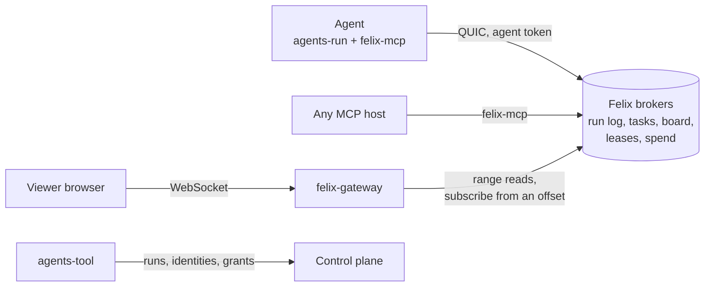

[felix-agents](https://github.com/GetFelix/felix-agents) models a swarm of
workers, here AI agents, with Felix as their data backend. A planner splits a
job into tasks, the tasks flow out to many workers, and the results flow back.
Workers claim tasks, share what they find, lock what they change and spend
from a budget. Felix hands out the work, holds the shared state, enforces who
may write what and keeps every step in one durable log.

The viewer in the browser is a live picture of the swarm: workers claiming
tasks, sending and receiving work, and results coming back. Any run can be
replayed by scrubbing back to any moment of it.

It is in design. Nothing runs yet. The sections below describe the design.

## How it uses Felix

Agents reach Felix through `felix-mcp`, an MCP server that holds one agent's own
Felix token. Its tools are Felix operations: claim a task, write the board, take
a lease, send a message, store an artifact. The model only acts through those
tools, so what it can do is what the agent's token allows. Any MCP host, such as
Claude Code, can join a run by adding `felix-mcp` to its config.

| Resource | Kind | What it holds |
|---|---|---|
| Run log | Durable stream, one shard | Every step of the run, in one order, with the publisher Felix recorded |
| Tasks | Durable stream with a consumer group | Tasks posted by the planner, claimed by workers |
| Messages | Durable stream | Agent to agent messages, keyed by recipient |
| Board | Log-backed cache | Shared findings, one key per entry |
| Leases | Log-backed cache with a TTL | One key per thing that can be locked |
| Presence | Log-backed cache with a TTL | One key per agent, refreshed by its runtime |
| Results | Log-backed cache | One key per task, first write wins |
| Spend | Counters | Tokens and cost, per run and per agent |

Workers take tasks from a [consumer group](/features/queues/). A worker extends
its claim while a long model call runs, and a worker that dies stops extending,
so its task goes to another worker when the visibility timeout lapses. The
result is written with a [conditional write](/features/cache/#9-conditional-writes)
that only succeeds if the task has no result yet, so a redelivered task is
recorded once. A task that keeps failing is dead-lettered.

The board and the leases are conditional writes too. An agent writes a board
entry at the version it read, and if someone changed it first the write is
refused and the agent sees the new value. A lease is a key taken only if absent,
with a TTL, and renewed at the version it was taken. A lapsed entry is deleted
on the log, so every [watcher](/features/cache/#7-keyed-watch) sees a dead
agent's lease and presence go.

A budget is a reservation on a [counter](/features/cache/#8-counters): before
each model call the runtime adds the call's worst case and backs off if the sum
passes the limit, so racing workers stop the run early, never late.

Each agent has its own principal, and Felix [RBAC](/features/security/) grants
cache access down to a key prefix. A worker can write its own board entries and
nothing of the planner's, and has no grant on the spend counters at all. If a
prompt injection makes the model try, Felix refuses the write and the refusal
is on the run log under that agent's identity.

The viewer reads the run log through [felix-gateway](/clients/browsers/) and
folds it into the state of the run at any offset. To follow live it subscribes
from the offset after the last record it read, so the replay and live delivery
meet with no gap.

Some of this is planned work rather than something Felix offers today.
felix-gateway's TypeScript client has no range read yet, the gateway has no
time lookup and does not pass on the recorded publisher, so scrubbing and
verified authorship in the viewer wait on those. The attempt limit before a
task is dead-lettered is one broker setting, so workers also count attempts
themselves. Agent identities need an outside OIDC issuer, which `agents-tool`
runs for now. There is no request and reply between clients, so `ask` is built
on the messages stream, and there is no bounded counter add, so a budget takes
a reserve, a check and a refund. Each gap has an
[issue](https://github.com/GetFelix/felix-agents/labels/felix-gap).

## What it demonstrates

- **Each task is done once, even when workers die.** A dead worker's task goes to another, and a task done twice is recorded once.
- **Agents don't overwrite each other.** A stale board write or lease is refused, and the agent sees what changed.
- **The run is a record you can replay.** Every claim, write, message, model call and refusal is on one log, in one order.
- **Budgets hold under a race.** A run never spends past its limit plus one reservation per worker in flight.
- **A prompt-injected agent stays in its lane.** Felix refuses writes outside the agent's grants, whatever the model asks for.

## More

- [README](https://github.com/GetFelix/felix-agents#readme)
- [Design](https://github.com/GetFelix/felix-agents/blob/main/docs/design.md): the data model, the Felix mapping, the gaps and the build order
