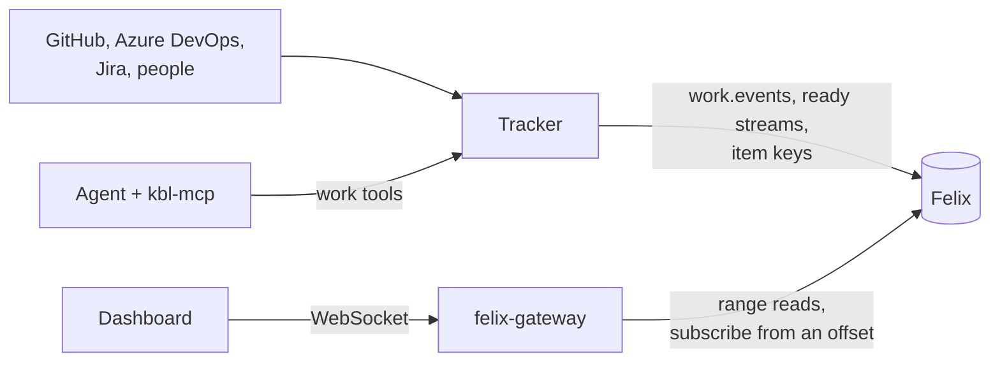

[KBL](https://github.com/GetFelix/KBL) (Kanban By Log, pronounced Kibble) is a
work tracker for coding agents. It pulls bugs in from GitHub, Azure DevOps or
Jira, hands each item to one agent, and keeps dependencies and priorities.
People guide it from a dashboard. Agents from any vendor take work from it
through an MCP server, `kbl-mcp`.

KBL makes no model calls itself. Triage, gathering context, splitting,
answering questions and fixing are all work items that an agent or a person
completes. The tracker, `kbl-mcp` and the dashboard only store, order, hand
out and display work.

## What it is for

A coding agent has no way to ask for the most important item it can start and
know nobody else got it. Nobody can see what is waiting, what is blocked or
who holds what. And item B cannot start until item A is done. KBL answers
those three.

With KBL you can bring bugs in once each, see the queue, let any MCP host ask
for its next item, and accept, edit or reject what an agent proposes. You can
also open a fix's decision replay, scrub through what the agent decided, and
redo from a past decision as new work. The first attempt stays as it was.

## How it uses Felix

KBL has no database. Everything it keeps is in Felix.

| Need | Felix feature |
|---|---|
| One agent per item, and redelivery when an agent dies | A [consumer group](/features/queues/) with a visibility timeout, claim extension, max attempts and dead letters |
| Priority | One ready stream per tier, polled in order |
| Items, dependencies, context and budgets | A log-backed [cache](/features/cache/) with [conditional writes](/features/cache/#9-conditional-writes) |
| Importing an upstream bug once | A conditional write on the upstream id that succeeds only if the key is absent |
| The record | One durable stream, `work.events`, with the publisher recorded |
| Replay and the live dashboard | Range reads, and subscribe from an offset, through [felix-gateway](/clients/browsers/) |
| What each principal may write | [RBAC](/features/security/), down to a cache key prefix |

The consumer group is what keeps two agents off the same item. An agent asks
`kbl-mcp` for its next item, and the tracker claims it from the group as a
member named after that agent. While the agent works, `kbl-mcp` extends the
claim every 30 seconds. A dead agent stops extending, so its claim lapses and
the item goes to another agent.

Conditional writes keep people and agents from overwriting each other. A write
that lost a race is refused, and the writer sees the newer value. They also
make an import safe to repeat: an upstream bug is written once, so a second
sync does not create a second item.

The log is the record. The tracker is the only writer of `work.events`, and
it appends a record only if the current state allows it. The dashboard is a
fold of that log, so it can show the state at any earlier offset. That is the
replay. To follow live it subscribes from the offset after the last record it
read, so replay and live delivery meet with no gap.

Some of this is not yet reachable the way the design wants. Each gap has an
issue labelled
[`felix-gap`](https://github.com/GetFelix/KBL/labels/felix-gap).



## Status

KBL is early. The tracker is still being built, and the dashboard shows hand-written data, not a live queue.

- Done: the task tools, scripted planner and workers, the death and poison
  checks, and the dashboard and replay style frames.
- In progress: the tracker itself. That covers GitHub ingest, items and
  dependencies, ready tiers, `work_next` and the rest of the work tools.
- Not built: Claude Code fixing real issues end to end, the live dashboard,
  the reference worker with a model API and spend limits, and a release with a
  quick start.

The
[threat model](https://github.com/GetFelix/KBL/blob/main/docs/threat-model.md)
also lists gaps that are still open, such as plain HTTP between the tracker
and its callers.

## Try it

The dev stack runs Felix in containers. You need Docker with Compose v2, or
Podman with a compose provider that honors `depends_on` conditions, and
Node 22.

```bash
git clone https://github.com/GetFelix/KBL
cd KBL
dev/up.sh            # start Felix from scratch and wait until it serves
node dev/check.mjs   # create a run's log and read it back through the gateway
dev/down.sh          # stop it and delete its data
```

The stack has a control plane, one broker, felix-gateway and a stand-in
identity provider. It keeps nothing between starts. The stand-in provider
signs in anyone, so keep its ports on localhost.

With the stack up, `kbl-tool` creates a run's streams and caches, and
`kbl-mcp` gives an MCP host the task tools. The README has the commands.

## More

- [README](https://github.com/GetFelix/KBL#readme)
- [Work tracker](https://github.com/GetFelix/KBL/blob/main/docs/work-tracker.md): the tools, kinds of work and the flow
- [Design](https://github.com/GetFelix/KBL/blob/main/docs/design.md): the data model, the Felix mapping and the gaps
- [Threat model](https://github.com/GetFelix/KBL/blob/main/docs/threat-model.md)
- [Dashboard mockup](https://github.com/GetFelix/KBL/blob/main/prototype/intake-frame.html)
