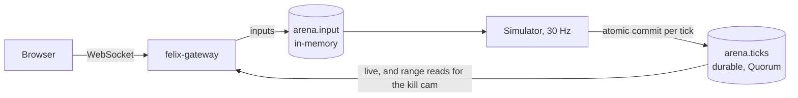

[felix-arena](https://github.com/GetFelix/felix-arena) is a team deathmatch
for up to eight players flying hover-craft in a walled arena, played in the
browser and self-hosted. When a player dies, the last few seconds replay from
the match's Felix log, and spectators can join a match in progress.

It is playable. A match runs through Felix from warmup to results: the
simulator commits every tick, writes the `keyframe` key, and applies inputs
from the input stream, and browsers reach it through felix-gateway. Players
and spectators join a match in progress from the `keyframe` key, and the kill
cam replays kills from the log. The member and lobby caches, the epoch counter,
three-replica `Quorum` streams and per-arena token narrowing are designed but
not built yet; the development stack runs one broker with a stand-in identity
provider. The sections below describe the full design and say which parts run
today.


## How it uses Felix

An arena is a persistent room that runs match after match. Its resources are
created once, at deployment:

| Resource | Kind | What it holds |
|---|---|---|
| `arena.ticks.<arena>` | Durable stream, one shard, `Quorum`, three replicas | The match: one record per simulation tick, 30 a second |
| `keyframe`, `match/<n>` | Stream state keys on the tick stream | The latest keyframe tick and each match's first offset |
| `arena.input.<arena>` | In-memory stream | Player inputs |
| `arena.members.<arena>`, `arena.lobby` | Caches with a TTL | Who is connected, and every arena's status |
| `arena.epoch.<arena>` | Counter | The simulation's epoch, so readers can ignore a stale simulator |

One simulator per arena is the authority. It writes each tick as an
[atomic commit](/features/atomic-commits/) and waits for the answer before the
next, so ticks land in order and the simulator learns each tick's offset from
the commit's answer. Every 30th tick is a keyframe holding the whole match
state, and the same commit updates the `keyframe` state key, so the keyframe
and the pointer to it can never disagree. On a `Quorum` stream, a state read
never reflects a commit that a failover could take back.

Joining mid-match is a read of the `keyframe` key, whose version is the
keyframe's offset, followed by a subscription from that offset. The keyframe is
in the log, so the subscription continues into live ticks without a gap.

The kill cam is the same stream read from an earlier offset. A kill event names
`replay_from`, the offset of the tick three seconds before it, which the
simulator knows from its commit answers. The victim's client fetches that
slice of the stream with a
[range read](/features/pubsub/#reading-a-range-without-subscribing) and plays
the ticks back through the same renderer with a different camera, while its
live subscription keeps running. Recent records come from the broker's
in-memory replay ring, so a kill cam does not read from disk. Any kill in the
feed can be replayed the same way, from this match or an earlier one, until
retention trims the records.


Inputs go on an in-memory stream because an input 40 ms old is worthless and
the next one replaces it. Each input repeats the previous two, so a dropped
record is almost always covered by the next.

Browsers reach Felix through [felix-gateway](/clients/browsers/) 0.6.0 or
later, using three opt-in features: binary event frames, `state_get` for the
`keyframe` key, and `read` for the kill cam's range reads.
The gateway stamps each input with the session's principal, and the simulator
accepts an input only when that stamp matches the publisher the broker
recorded on the event. In the design, each session's token is narrowed to one
arena, with RBAC roles for who may play and who may only watch.



## Quick start

Each release carries the built web client. Serve it and play against bots in
the page, with no servers:

```bash
gh release download -R GetFelix/felix-arena -p 'felix-arena-web-*'
tar -xzf felix-arena-web-*.tar.gz && cd felix-arena-web-*/
python3 -m http.server 5173
# open http://localhost:5173/play.html?offline
```

To play through Felix, start the development stack from a clone with
`dev/up.sh` (Docker or Podman), then open
`play.html?arena=alpha&as=ana` and, in a second window, `as=ben`.

## More

- [README](https://github.com/GetFelix/felix-arena#readme)
- [Design](https://github.com/GetFelix/felix-arena/blob/main/docs/design.md), including the kill cam, failure modes, the build order and what the game would surface in Felix
- [Art direction](https://github.com/GetFelix/felix-arena/blob/main/docs/art.md)
