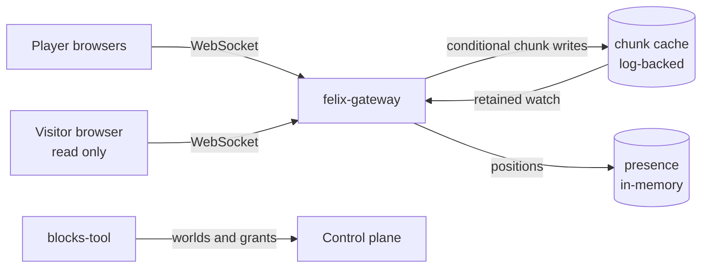

[felix-blocks](https://github.com/GetFelix/felix-blocks) is a voxel building
game for the browser. You walk around a world generated from a seed, dig blocks
out and place new ones, alone or with friends, and everyone in the same world
sees each change as it lands. There is no game server. The browsers write the
world, and Felix stores it, orders the writes and tells everyone what changed.

It is in design. The [style frame](https://github.com/GetFelix/felix-blocks/blob/main/prototype/style-frame.html)
fixes the look, by day and by night, and nothing is playable yet. The sections
below describe the design.

| Day | Night |
|---|---|
|  |  |

## How it uses Felix

A world is split into chunks of 16 × 16 × 16 blocks. Every client generates the
terrain from the world's seed, so a chunk nobody has touched is not stored
anywhere. A chunk someone changed is one key in the world's log-backed
[cache](/features/cache/), holding its difference from the generated terrain.

| Resource | Kind | What it holds |
|---|---|---|
| The world's chunk cache | Log-backed cache, one shard | One key per edited chunk, holding that chunk's edits |
| The presence stream | In-memory stream | Player positions, ten times a second while they move |
| The online list | Cache with a TTL | One entry per connected player, refreshed every 10 seconds |

Placing a block is a [conditional write](/features/cache/#9-conditional-writes)
on the chunk's key. The client holds each chunk's value and the version it last
saw, and every 100 ms writes its pending changes with `cache_put_if` at that
version. If another player wrote the chunk first, the write is refused, the
client takes the newer value from its watch, puts its own changes on top and
tries again. Two players digging in the same chunk at the same moment both keep
their blocks.

Every client [watches](/features/cache/#7-keyed-watch) the world's cache. A
retained watch delivers every edited chunk on join and then each change as it
lands, so a player sees the world as it is the moment they arrive. Compaction
keeps the cache at each chunk's current value, so a world that has seen a
million edits stores only what is built now.

Positions go on the in-memory stream, where a lost one is replaced 100 ms later.
Who is online is the TTL cache: an entry that stops being refreshed expires and
every watcher sees the player leave.

Who may change a world is decided by Felix [RBAC](/features/security/). A world
has builders, who may write its cache, and visitors, who may only read and watch
it, so a visitor's browser cannot change a world whatever it sends. A single
player world is a world with one builder, and opening it to a friend is a grant.

Browsers reach Felix through [felix-gateway](/clients/browsers/). The gateway
relays cache puts, gets, deletes and watches today. Conditional writes through the gateway
are planned ([felix-gateway#31](https://github.com/GetFelix/felix-gateway/issues/31)),
and multiplayer waits for them; single player works without them. A gateway
watch also covers the whole cache from the start, so until region watches
arrive a client watches the whole world and downloads it again on reconnect.

## What it demonstrates

- **Concurrent edits resolve cleanly.** The second write to a chunk is refused and rebased, never applied over the first.
- **Join and see the world at once.** One retained watch gives every edited chunk, then live changes.
- **Storage is what was built.** Untouched terrain costs nothing, and compaction keeps the world at its current blocks.
- **Solo and shared worlds are the same thing.** Sharing a world is a grant, with no export or copy.
- **Permissions are enforced by Felix**, not by the browser.

## More

- [README](https://github.com/GetFelix/felix-blocks#readme)
- [Design](https://github.com/GetFelix/felix-blocks/blob/main/docs/design.md): the data model, the Felix mapping, the gaps and the build order
- [Art direction](https://github.com/GetFelix/felix-blocks/blob/main/docs/art.md): day and night, the asset packs and the style frame
