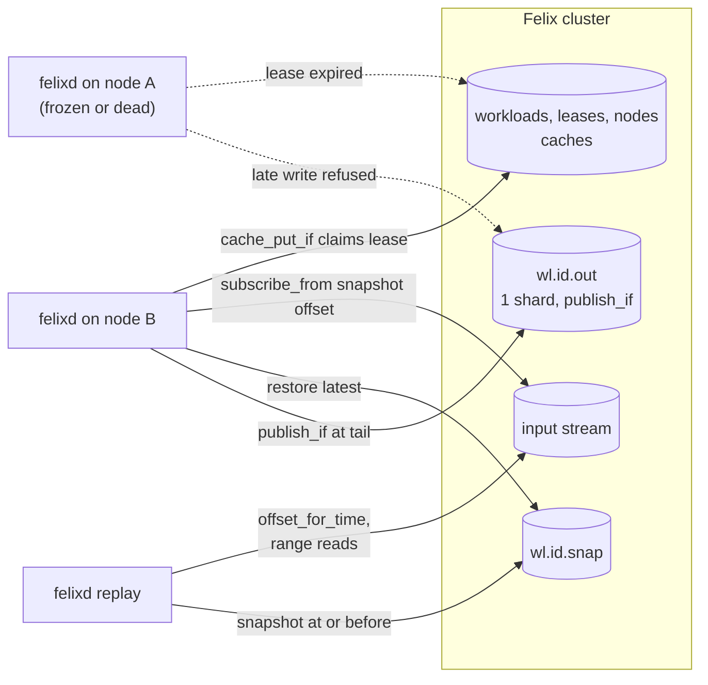

[felixd](https://github.com/GetFelix/felixd) is a node agent. It runs on every
machine in a cluster and runs WebAssembly programs, called workloads, whose
only inputs and outputs are Felix streams. Felix is the only backend: there is
no etcd, no workflow database and no job manager beside it. Kill a node and each
of its workloads continues on another node from the last record it handled,
with no gaps and no duplicates in its output. Any workload can be rebuilt as it
was at a past offset or time, and inspected.

It is in design. Nothing runs yet. The repository holds the
[design](https://github.com/GetFelix/felixd/blob/main/docs/design.md), a
build order of six milestones and open issues, and the plan is still open for
change. The sections below describe the design.

## Where it is going

felixd is the first step toward a distributed operating system whose state is a
log. Every change to the system is a durable, ordered record: what should run,
where it runs, what each program received and what it produced. Everything else
is derived from that log and can be rebuilt from it. That is what makes
failover, migration, time travel and an audit trail the same mechanism rather
than four features.

The design lists the steps: deterministic workloads (felixd), then placement
decided through records on the log, then services that answer requests, then
controlled access to the outside world with every response recorded, then
native processes with checkpoint and restart. Each later step is a separate
design. Felix is the system bus and journal, not the kernel. A round trip
through a broker costs far more than local IPC, so Felix carries coordination
and program input and output, never memory traffic. The design says plainly
that this is an OS for services, data processing, fleets and simulations, not
for desktops or tight loops.

The operating system has a proposed name, NineLives, under
[discussion](https://github.com/GetFelix/felixd/discussions/42). It is not
decided, and felixd would stay the name of the agent on each node.

## Why WebAssembly first

felixd's guarantees rest on one property: a workload given the same input
records produces the same outputs and the same state, every time, on any node.
Failover is a second node running the same inputs from the last offset handled.
Exactly-once output holds because a stale owner that writes after a takeover
writes exactly what the new owner would have, so the new owner skips past it.
Replay rebuilds a past state by running the recorded inputs again. A program
that could behave differently the second time breaks all three.

WebAssembly is how felixd enforces that rather than asks for it. A workload gets
no WASI imports, so it has no clock, randomness, files or network, and anything
it needs from outside, the current time included, arrives as an input record.
Wasm floating point is deterministic apart from NaN bit patterns, which the
runtime canonicalizes. Each step runs under fuel and memory limits, and the
same module runs on any CPU in the cluster.

Wasm is where felixd starts, not the only kind of program the design runs.
Programs that need the outside world come later, with every response recorded
as an input so they replay exactly, at the cost of a round trip through the
log per effect. Existing native binaries, databases and GPU work come last:
they can't be replayed, so they get checkpoint and restart, with their input
and output recorded.

## How it uses Felix

A workload is a Wasm component with no clock, randomness, files or network. It
exports four functions: `step` handles one input record and returns the
outputs, `snapshot` and `restore` save and load its state, and `inspect`
prints the state as JSON. Anything it needs from the world, including the time,
arrives as an input record. Given the same records it always reaches the same
state, and that is what makes takeover and replay safe.

| Need | Felix feature |
|---|---|
| What should run | A [cache](/features/cache/) of workload specs, watched with retained values |
| Which node runs a workload | A cache entry with a TTL, taken and renewed with [`cache_put_if`](/features/cache/#9-conditional-writes) |
| Which nodes are alive | A cache with a TTL, one key per node |
| A workload's input | A durable stream, read with `subscribe_from` an offset |
| Output a stale owner cannot write | [`publish_if`](/features/atomic-commits/#a-commit-at-an-expected-offset) against the tail of the workload's single-shard output stream |
| Snapshots | A durable stream per workload |
| Surviving a broker's loss | `Quorum` streams and caches |
| Replay to a time | `offset_for_time` and range reads |
| What each node may write | [RBAC](/features/security/) grants on the node's token |

A node claims an unowned workload by writing a lease with `cache_put_if` on
"absent", and renews it every third of the TTL at the version it last wrote. A
refused renewal means the lease is gone and the node stops the workload at
once. While it holds the lease the node feeds the workload its input, appends
each step's outputs as one batch with `publish_if` at the output stream's
expected tail, and writes a snapshot every so often.

If the node stops renewing, the lease expires and another node claims the
workload. It restores the latest snapshot, then subscribes to the input from the
offset after the snapshot. Each output record carries the input offset that
produced it, so the new owner runs `step` over inputs whose outputs already
exist, drops those outputs and writes from the first one that is missing.

The lease only decides who should run. It is not what keeps output correct.
That is the job of `publish_if`: if a frozen node wakes up after another has
taken over, its write is refused. If the stale node writes first, the new
owner's write is refused and it rereads the tail. Because the workload is
deterministic, the stale node wrote exactly what the new one would have, so the
new owner skips past it.

Replay is the same fold. `felixd replay <workload> --to <offset or time>` turns
a time into an offset, restores the closest earlier snapshot in a local runtime,
reads the inputs up to the target, runs `step` and prints the state. It takes no
lease and writes nothing, so it runs anywhere with read grants. The same
command over a different module, or with `--diff`, compares what the code
produces now with what is on the output stream, which checks determinism and
lets you try an upgrade against recorded inputs before it goes live.

A workload's input can be any stream, including another workload's output, so
workloads chain into pipelines and failover in the middle of a chain loses
nothing.

## What it is for

felixd is aimed at work that keeps state, reacts to a stream of events, and must
not lose or repeat results when a machine fails.

- Stateful stream processing without a separate cluster: running totals, sessions, fraud scores, deduplication.
- State machines where history matters, such as a ledger or inventory, where you need to say what the system believed at a given time and why.
- Fleets of unreliable machines, where a workload moves to a machine that is up and continues without an operator.
- Authoritative game and simulation servers that can be replayed afterwards.
- Reproducing a production bug by replaying the workload to the offset before the bad output.

It is not a fit for low-latency request and reply, programs that need the
network or files directly, or heavy compute where replaying from a snapshot
takes too long. Those wait on later steps of the path.

## Status

| Milestone | What it proves | State |
|---|---|---|
| One node, one workload | The workload contract works and a restart resumes where it stopped | Planned |
| Leases and failover | Kill a node and its workloads continue elsewhere | Planned |
| Exactly-once output | A frozen node that comes back cannot write | Planned |
| Replay | Rebuild any workload at any offset or time | Planned |
| Pipelines and operations | Chained workloads, drain, status, metrics | Planned |
| Self-hosting | Anyone can run a cluster from the docs | Planned |

Two of the design's assumptions about Felix are still to be checked, and each
has a `felix-gap` issue. The exactly-once argument needs a `publish_if` batch to
be all or nothing, which has to be confirmed against Felix. The design also
needs many single-shard streams, one per workload, so how well that scales has
to be measured. Workloads with several inputs, where placement lives and how
effects reach the outside world are open design questions.

## Follow along

The best time to change the plan is now. Start with
[what to build first](https://github.com/GetFelix/felixd/discussions/31) and the
[open design questions](https://github.com/GetFelix/felixd/discussions/33), or
browse all [discussions](https://github.com/GetFelix/felixd/discussions) and
[issues](https://github.com/GetFelix/felixd/issues).

## More

- [README](https://github.com/GetFelix/felixd#readme): the goal, prior work and use cases
- [Design](https://github.com/GetFelix/felixd/blob/main/docs/design.md): the data model, leases, exactly-once output, resume, replay and the long-term picture
