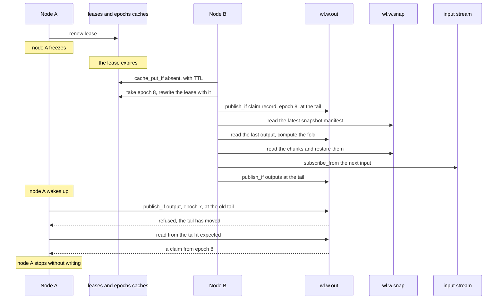
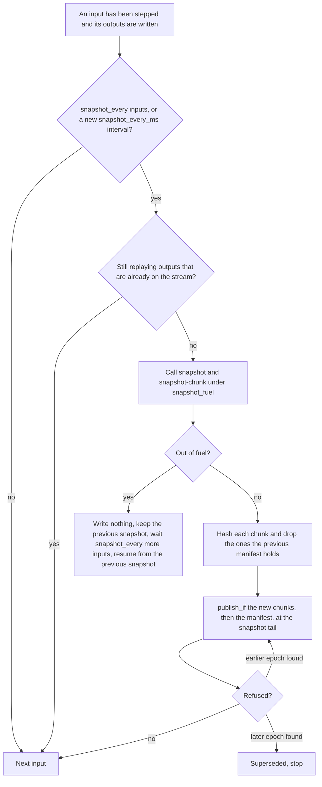
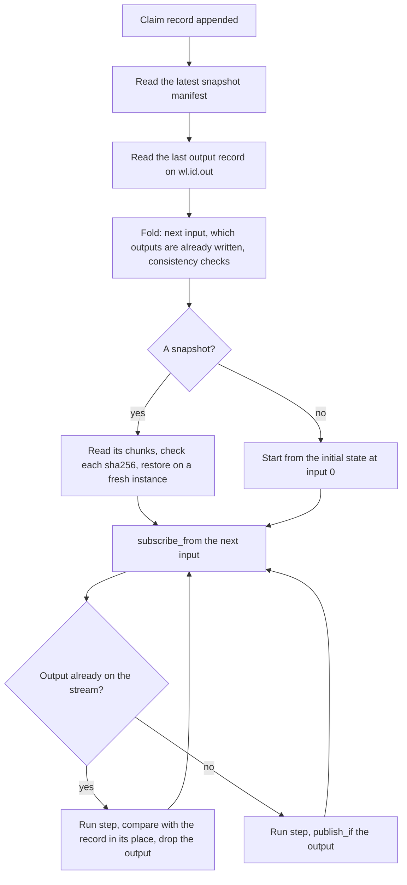

This page follows one workload from the moment it is submitted to the moment a
second node takes it over and an operator replays it. Each part says what
happens and why it is built that way. Terms are defined in
[Terminology](/built-on-felix/felixd/terminology/).

Two ideas carry everything. The first is that a workload is
[deterministic](#why-the-guarantees-hold): the same inputs give the same
outputs and the same state on any node. The second is that every write a node
makes to a workload's streams is a [`publish_if`](/features/atomic-commits/#a-commit-at-an-expected-offset)
at the tail the node expects, so a node that is behind is refused instead of
interleaving with the node that took over.

## What lives where

Everything is in one Felix tenant, in one namespace.

| Resource | Kind | Key or name | Holds | Written by |
|---|---|---|---|---|
| `workloads` | cache | workload id | the [spec](#the-spec) | `felixd run`, and the owner when the workload fails |
| `modules` | cache | sha256 of the module | the module's bytes | `felixd run` |
| `leases` | cache, with a TTL | workload id | owner node id and [epoch](/built-on-felix/felixd/terminology/#epoch) | agents, with `cache_put_if` |
| `epochs` | cache | workload id | the last epoch handed out, as a decimal number | agents, with `cache_put_if` |
| `nodes` | cache, with a TTL | node id | felixd version, `max_workloads`, workloads held | each agent |
| `wl.<id>.out` | durable stream, one shard | | output, claim, failure and rejection records | the lease holder, with `publish_if` |
| `wl.<id>.snap` | durable stream, one shard | | snapshot chunks and manifests | the lease holder, with `publish_if` |

A workload's input is any durable stream that exists before the workload is
submitted. It can be another workload's `.out` stream.

`felixd run` creates the caches and the two streams through the control plane,
with three replicas and `Quorum` consistency unless `--replication-factor` says
otherwise. Agents never create streams. Both workload streams have one shard
because `publish_if` orders one shard only.

## The spec

A workload is a spec in the `workloads` cache, a JSON value with the fields
below.

| Field | Meaning |
|---|---|
| `module` | sha256 of the module in hex, the key in the `modules` cache |
| `input` | the stream the workload reads |
| `output` | `wl.<id>.out` |
| `snapshot_every` | a snapshot after this many inputs, 1000 by default |
| `snapshot_every_ms` | also a snapshot at the first input of each interval of this many milliseconds, absent unless set |
| `state` | `running`, `stopped` or `failed` |
| `limits` | `fuel_per_call` (50,000,000), `max_memory_bytes` (64 MiB) and `snapshot_fuel` (500,000,000), the defaults |
| `failure` | why the workload failed, present only when `state` is `failed` |

The limits live in the spec and not in node configuration, so every node runs the
workload under the same ones and fails it at the same step. `felixd run` writes
the spec last, after the module, the streams and the caches exist, so an agent
that sees the spec finds everything else.

Running `felixd run` again for the same id replaces the spec, and a running
workload restarts under the new one. A new module or a new input is refused
once the output or snapshot stream holds a record, because the next owner would
find the streams diverged from what the new code produces. New code goes under
a new id.

## Claiming a workload

Every agent watches the `workloads` cache. For each spec in state `running` it
waits until the workload's lease looks free, then tries to claim it.

**Placement is first claim wins.** Before a claim an agent waits a random time of
up to `--claim-delay-ms` (1 second by default), so the first agent to see a
workload does not take everything. An agent that already holds `--max-workloads`
(64 by default) claims nothing more until one of its workloads ends. The agent
sees placement through one trait, so a smarter policy can replace it without
touching the lease code. `nodes` records which agents are up and how full they
are, but nothing reads it to decide yet.

**The claim is a conditional put.** The agent writes a lease with
`cache_put_if` on "absent", with the lease TTL (10 seconds by default, at least
2 seconds). The broker grants it only once it counts the previous lease as
expired or deleted. If the answer to a claim is lost, the agent does not adopt
the lease. It expires unused and the workload waits one TTL.

**The winner then takes an epoch.** The epoch is one more than the larger of the
last number in the `epochs` cache and the epochs on the last records of the
workload's output and snapshot streams. The claimer writes it to `epochs` with
`cache_put_if` at the version it read, then rewrites the lease to carry the
epoch, again with `cache_put_if`, and only then runs anything. A claimer that
was frozen after winning, and lost its lease meanwhile, fails one of the two
writes and gives up. The counter makes epochs unique and growing. Taking the
maximum with the streams keeps a new epoch above everything already written even
if the `epochs` cache is recreated.

**The holder renews every third of the TTL**, with `cache_put_if` at the version
it last wrote. A refused renewal means the lease is gone and the agent stops the
workload at once. A renewal whose answer is lost is read back. The agent also
stops on its own if two thirds of the TTL have passed, by a monotonic clock,
since it sent its last successful renewal. That is a third of a TTL before any
other node can claim, which covers a renewal's round trip and the scheduler's
delay.

**Takeover does not depend on an expiry event.** Agents watch `leases` with
retained values and know when each lease expires. After that time each tries a
claim, waiting at most one TTL between tries, so a missed event or a slow local
clock costs at most a TTL. A clock ahead of the broker's costs a refused claim,
never a second owner, because only the broker decides that a lease is gone.

**Restart and shutdown.** An agent never adopts a lease it finds under its own
node id. A restarted agent waits for its old leases to expire, so two processes
configured with the same id cannot both believe they hold a workload. On Ctrl-C
an agent deletes its leases with `cache_delete_if`, waiting up to two seconds
for its workloads to let go, so other nodes can claim at once.

## Epochs and the fence

The lease is not what keeps the output correct. Lease exclusivity depends on
clocks: the broker leading the `leases` shard decides when a TTL has passed, and
a leader whose clock jumps forward expires leases early. Two agents can
therefore each believe they hold the same workload for a while. What keeps the
output right is a fence on the output stream itself.

Before a new owner reads anything to resume from, it appends a **claim record**
carrying its epoch to `wl.<id>.out`, with `publish_if` at the output tail it read
along with the epoch floor. After that:

- If a stale owner wakes up and writes, its write is refused, because the claim
  moved the tail past what the stale owner expects. The records it finds there
  include the claim, from a later epoch, so it stops without writing anything
  more. This holds even when the new owner has written no output, for example
  because its input is idle.
- If the stale owner wrote before the claim landed, the claim is refused and
  lands after those outputs. The new owner then resumes past them like any
  others. Because the workload is deterministic they are what it would have
  written.

Writing the claim at the tail read with the floor, not at a fresh tail, matters:
a claimer frozen between taking its epoch and writing its claim would otherwise
land its claim after a later owner's.

## One step, and exactly-once output

For each input record the owner runs the workload's `step` and gets back outputs
or a rejection. Each output becomes a record on `wl.<id>.out` with a small
header: the **input offset** that produced it, its **index** among that step's
outputs, and the owner's epoch. Its name and key come from the workload. A
rejection is written as that input's only output, at index 0.

The owner appends all of one step's records as one batch with `publish_if` at
the tail it expects. If the write is acknowledged, it moves its tail. If it is
refused, or the answer is lost, the owner never retries blindly. It reads the
stream from the offset it expected and decides on what is there:

- Its own records, or an earlier owner's identical ones: the write landed. It
  skips them and writes the rest.
- A record from a later epoch: someone else owns the workload. It stops and
  writes nothing more. A later epoch wins over everything else, including
  identical records, because otherwise a stale owner would skip the new owner's
  records and write after them, and the two would take turns on the stream.
- A failure record for its spec: the workload has failed, and it stops.
- Nothing: the write did not land, or has not yet. It sends the batch again at
  the same offset. If the first lands after all, one of the two is refused and
  the next read finds it.

**A batch is not all or nothing.** Felix ships a `Quorum` stream's records to
followers by bytes, so a follower promoted mid-batch can keep part of a batch.
The writer gets an error. felixd relies on two things. An owner whose append
fails reads the tail it expected and skips the records of its batch that it
finds there. An owner that dies leaves the prefix to the next one: the resume
skips outputs by input offset and index, not by whole inputs, so the next owner
runs that step again, drops the outputs already on the stream and writes the
rest. A resume can start in the middle of a step. Whether Felix should make a
conditional batch all or nothing is
[GetFelix/felix#1630](https://github.com/GetFelix/felix/issues/1630); see also
[what atomic covers](/features/atomic-commits/#what-atomic-covers-and-what-it-does-not).

A step whose outputs total more than 8 MiB cannot be written in one
`publish_if` and fails the workload.

## Snapshots

A snapshot is the workload's state saved so that a new owner does not have to
run the whole input again.

**When one is taken.** After every `snapshot_every` inputs (1000 by default), and
with `snapshot_every_ms` also at the first input of each interval of that
length. An interval is counted from the Unix epoch, and an input starts a new one
when its append time falls in a later interval than the previous input's. The
time is the broker's stamp on the input record, not the node's clock, so every
node picks the same inputs and a slow input still gets snapshots. Taking a
snapshot for either reason restarts the count of inputs.

**Never while replaying.** After a takeover the owner may run inputs whose
outputs are already on the stream. During that time the output stream's tail is
ahead of the workload's state, so a snapshot would claim outputs it does not
cover, and an owner that crashed right after writing it would resume past them
and write them again. The owner takes no snapshot until it has passed the last
output on the stream.

**Chunks and a manifest.** The workload returns its state as a list of chunks,
each at most 4 MiB, at most 65,536 of them. The host takes the sha256 of each
chunk and compares it with the previous snapshot's manifest, so a chunk that did
not change is not written again. New chunks go to `wl.<id>.snap` as chunk
records, as many to one `publish_if` as fit in 8 MiB. The **manifest** goes last,
in the same write as the last chunks when it fits. It records the input offset the
state includes, the output stream's next offset at that moment, and for each chunk
its sha256 and the offset on `.snap` of a record holding it. Only a manifest makes
a snapshot. Chunks that land without one, after a crash or a partial batch, are
never read. A manifest may point at chunk records written for an earlier
snapshot.

**The same fence.** Every snapshot record carries the writer's epoch and is
written with `publish_if` at the snapshot stream's tail. A refused write rereads
the records past that tail. A record from a later epoch means this owner is
superseded and stops. Records from its own epoch or earlier are a stale owner's
that landed first, which determinism makes correct, so it writes after them.
The snapshot stream has no claim record of its own, so a stale owner can still
append a snapshot after a new owner's claim until the new owner writes one. That
snapshot is of a correct state.

**Running out of fuel.** A snapshot, every `snapshot` and `snapshot-chunk` call
together, runs under `snapshot_fuel`, separate from the fuel a step gets. A
snapshot that runs out is abandoned, not a failure. Nothing is written, the
previous snapshot stays current, the agent logs it and counts it, and it will not
try again until `snapshot_every` more inputs have passed. The trap leaves the
instance unusable, so the agent drops it and resumes from the previous snapshot.
Fuel is metered deterministically, so every node skips the same snapshots. A
restore that runs out of fuel is different, and is described under
[Resume](#resume).

## Resume

A new owner picks a workload up in this order.

1. Append the claim record, as above.
2. Read the latest manifest on `wl.<id>.snap`, passing over chunk records, and
   stop if its last record is from a later epoch than the owner's own. No chunk
   is read yet.
3. Read the last output or rejection record on `wl.<id>.out`, passing over
   claims and failures, and stop if it is from a later epoch.
4. Compute the **fold**: which input offset to subscribe from (the snapshot's
   input offset plus one, or 0 with no snapshot), and which outputs the stream
   already holds, those at or before the last record's input offset and index,
   starting at the snapshot's output tail. The fold's checks below run here,
   before any chunk is read.
5. With a snapshot, restore it: read each chunk at the offset the manifest
   names, check its sha256, and hand the chunks to `restore` on a fresh
   instance. A chunk that does not match its hash fails the workload. Without
   one the workload starts from its initial state.
6. Subscribe to the input with `subscribe_from`. For inputs the stream already
   has outputs for, run `step`, compare each output with the record in its place,
   and drop it. From the first missing output on, write.

The fold refuses a state no correct owner could have produced: an output stream
shorter than the snapshot expects, or whose newest output belongs to an input the
snapshot already covers. A replayed output that differs from the record in its
place also fails the workload, because it means the workload is not
deterministic or something else wrote the stream.

The fold compares the last output's offset, never the stream's tail, with the
snapshot's output tail. The tail can be past the last output because claims, and
the generation-start record Felix appends when a broker starts leading a shard,
take offsets that hold no output.

**Dropped inputs.** Felix drops records for a slow subscriber by default, and a
jump in offsets is how that shows. Offsets that hold no event jump too, so when
the next input offset is past the expected one, the owner reads the range in
between and runs whatever records it finds first. It never steps past a missing
record. A read that makes no progress is tried again and is an error after 20
seconds.

**A restore that runs out of fuel** puts the workload in the
[needs-operator](/built-on-felix/felixd/terminology/#needs-operator) state, not
failed: the limit can be raised and the workload resumed. Today that is a logged
error on the node. It is not yet a recorded state
([#73](https://github.com/GetFelix/felixd/issues/73)). Raising
`--snapshot-fuel` with `felixd run` for the same id writes a new spec, and the
agent restarts the workload under it.

## When a workload fails

A workload fails when its `step` traps, runs out of fuel, returns `poison`,
breaks the contract, or when its streams are in a state no node can resume from
(a record that does not decode, a replayed output that differs, a chunk with the
wrong hash). It would fail the same way on any node, so it is not retried.

Only the holder fails a workload, and the failure is fenced like an output. The
holder first renews its lease and gives up if that is refused. Then it appends a
**failure record** to the output stream with `publish_if` at the tail it just
read, unless the last record there is from a later epoch. The record names the
spec version and the reason. Only after it lands does the holder write `failed`
and the reason into the spec, with `cache_put_if` on that version so a later
edit is not overwritten. A node frozen after its renewal while another took over
cannot fail the workload the other now runs, because its append is refused. An
owner that finds a failure record for its own spec version while claiming writes
`failed` into the spec instead of running, which covers a holder that crashed
between the two writes. A failure record under an older spec version is from a
run before `felixd run` wrote the spec again, and is passed over.

A failed workload stays failed until `felixd run` writes a new spec for it.

A module built against contract 0.1 is a different case. No node claims the
workload and nothing is marked failed. Each agent logs that the workload needs an
operator and leaves it alone until its spec changes.

## Replay

`felixd replay` rebuilds a workload's state at a past point. It takes no lease and
writes nothing.

`felixd replay --id <workload> --to <offset or time>`:

1. Turns a time into an input offset with `offset_for_time`. The state as of a
   time includes every input appended before it. An offset includes that input.
2. Picks the snapshot with the highest input offset at or before that point and
   restores it on a fresh instance, under the limits in the spec. Without one it
   starts from the initial state.
3. Range-reads the inputs after the snapshot up to the target, runs `step` on
   each, and prints what `inspect` returns.

It uses the same fold as a failover, so a replay lands on the state the live
workload had.

`--diff` replays a range (`--from`, `--to`, by default every input with a recorded
output) and compares each output it produces with the one on the stream, by input
offset, index, name, key and the sha256 of the payload. It stops at the first
divergence and reports the input offset, the record's epoch, the node its epoch's
claim names, and both digests, and the command exits with 1. That checks
determinism. CI runs it on every example workload after a takeover.

`--module <hash>` runs a different module from the `modules` cache over the
recorded inputs instead, from its initial state, because the snapshots hold the
old version's state. With `--diff` it shows where the new version's outputs
differ from what is recorded, which checks an upgrade before it goes live. Without
`--diff` it prints the new version's state.

Until Felix can report a stream's tail to a reader
([Felix #1621](https://github.com/GetFelix/felix/issues/1621)), replay needs
publish grants on the streams it reads, as `check` does.

## Checking

`felixd check` replays each workload's module over its whole input, from the
initial state, and lines the outputs it produces up with the records on the
output stream by their headers. It reports:

- a **gap**: a replayed output missing from the stream while a later one is there;
- a **duplicate**: a second record for the same input offset and index;
- a record **out of order**;
- an **epoch regression**: a record whose epoch is below an earlier record's;
- a record that **differs** from the replay, one the replay did not produce, or
  one that does not decode;
- a **snapshot** whose output tail does not split the output stream at its input
  offset, which would make a resume skip or repeat outputs.

Claims hold no output, so only their epochs are checked. With `--complete` it
also reports outputs missing from the end of the stream, for when the workloads
should have caught up. It exits with 1 if it finds anything and writes nothing.

## Why the guarantees hold

The safety argument has two layers.

**The fence alone** guarantees that nothing from a lower epoch lands after a
claim, so the epochs on the stream never decrease and two owners never take
turns.

**Determinism** adds that what a stale owner wrote before the claim equals what
the new owner would have written, so skipping it is correct.

Determinism is enforced, not requested. The runtime refuses a component that
imports anything, so a workload has no clock, randomness, files or network, and
anything from outside arrives as an input record. NaN bit patterns are
canonicalized and relaxed SIMD is off. Fuel, memory, the Wasm stack, and the
number of tables, instances and memories are limited identically on every node.
Every field of a step's input is a function of the input stream and the spec, so
a live step, a resume, `check` and `replay` pass identical values.

What breaks determinism:

- **A different felixd build.** Where fuel runs out and where the stack overflows
  depend on the code wasmtime generates, so they can move between versions. Every
  node must run the same felixd build. Recording the build in the spec is an open
  question ([#62](https://github.com/GetFelix/felixd/issues/62)).
- **A different machine architecture, possibly.** Stack depth can depend on the
  instruction set. The stack size is fixed, but a cluster that mixes
  architectures is not covered yet ([#62](https://github.com/GetFelix/felixd/issues/62)).
- **A changed module or input under a workload that already has output.**
  `felixd run` refuses it. A spec written to the cache by other means is not
  checked, and the workload fails with the divergence the next time it resumes.
- **A workload that is not a pure function of its inputs.** The sandbox removes
  the sources it can. A bug that still makes a workload behave differently on a
  second run shows up as a divergence in `felixd replay --diff` and `felixd
  check`, or fails the workload on resume.

Recorded inputs that are not deterministic functions of the input, such as a
merge order or an effect's response, will rely on the fence alone. Neither exists
yet.

The model in `specs/` checks the lease, epoch, claim, snapshot and failure paths
with TLC, in several configurations that each turn one mechanism off and must
find the matching violation. It states seven invariants, including that the
output records are a prefix of the deterministic outputs with no duplicate and no
gap, that epochs never decrease, and that no owner's writes interleave with an
earlier epoch's after it has begun. Its
[description](https://github.com/GetFelix/felixd/blob/main/docs/formal.md) lists
what it leaves out.

## Where to read more

- [The workload contract](/built-on-felix/felixd/contract/) for what a step receives and may return.
- [Record formats](/built-on-felix/felixd/records/) for the bytes.
- [Running felixd](/built-on-felix/felixd/running/) for the commands.
- The full [design](https://github.com/GetFelix/felixd/blob/main/docs/design.md), which also covers what is not built.
