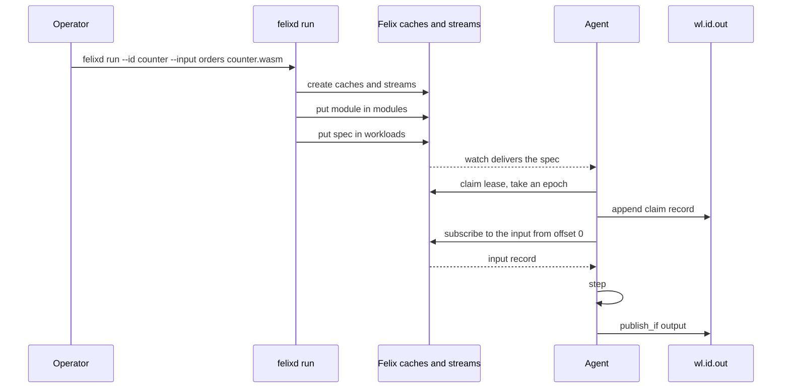

This page walks one workload from source code to output. It uses the `counter`
example from the felixd repository, which counts its input records.

## Submission goes through Felix

`felixd run` is a Felix client. It never contacts a felixd node. It connects to the
brokers and the control plane the same way `felixctl` does, from any machine that
has the addresses and credentials, and leaves the workload in Felix's caches and
streams. The agents on the cluster's nodes are watching the `workloads` cache and
pick the spec up from there. Which nodes are running at the time does not matter,
and a workload submitted while no agent is up starts when one is.

To do that it needs a token for the brokers that can read and write the `workloads`
cache, write the `modules` cache, and read the input stream's and the workload's
streams' tails (see [what felixd needs from Felix](/built-on-felix/felixd/running/#what-felixd-needs-from-felix)).
It also needs a control plane token, because it creates the caches and the
workload's two streams. Without that token it cannot get as far as writing the spec.

There is no intake stream with an admission step yet. Nothing reviews a submission
before it takes effect: the spec in the `workloads` cache is the workload, and the
cache holds only its latest value, not a history of specs. Keeping specs as records
on a log is part of [#72](https://github.com/GetFelix/felixd/issues/72).

## What a unit of work is

A workload is a WebAssembly component plus a spec. The component is the code. The
spec says which component to run, what it reads, where its output goes and under
which limits. The spec is JSON in the `workloads` cache, keyed by the workload id.
This is what `felixd run --id counter --input orders --replication-factor 1` writes
for the defaults:

```json
{
  "module": "<sha256 of the component, in hex>",
  "input": "orders",
  "output": "wl.counter.out",
  "snapshot_every": 1000,
  "state": "running",
  "limits": {
    "fuel_per_call": 50000000,
    "max_memory_bytes": 67108864,
    "snapshot_fuel": 500000000
  }
}
```

| Field | Meaning |
|---|---|
| `module` | The key of the component in the `modules` cache, its sha256 in hex |
| `input` | The stream the workload reads. One stream per workload |
| `output` | `wl.<id>.out`, derived from the id |
| `snapshot_every` | A snapshot after this many inputs. At least 1 |
| `snapshot_every_ms` | Also a snapshot at the first input of each interval this long. Left out unless set |
| `state` | `running`, `stopped` or `failed` |
| `limits` | Fuel per call, the most memory in bytes and the fuel for a whole snapshot or restore |
| `failure` | Why the workload failed. Present only when `state` is `failed` |

The id is the cache key, not a field. It is 1 to 64 characters of `a-z`, `0-9` and
`-`, and names the streams `wl.<id>.out` and `wl.<id>.snap`. The replication factor
is not in the spec either: it only sets the replicas of the caches and streams that
`felixd run` creates. The limits are in the spec so that every node runs the
workload under the same ones. [How it works](/built-on-felix/felixd/how-it-works/#the-spec)
explains each field.

## Writing a workload

A workload implements the `workload` world of
[contract 0.2](/built-on-felix/felixd/contract/): a `step` function that takes one
input record and returns outputs, and a set of `state` functions that save, restore
and describe its state. It imports nothing, so it has no clock, files or network.

This is `workloads/counter/src/lib.rs`, trimmed to the step. The full file also
implements the `state` interface (`snapshot`, `snapshot_chunk`, `restore`,
`restore_chunk` and `inspect`), which a workload must export too.

```rust
wit_bindgen::generate!({
    path: "../../wit",
    world: "workload",
});

use exports::felixd::workload::step::{self, Addressed, Input, Output, StepError};

thread_local! {
    static COUNT: Cell<u64> = const { Cell::new(0) };
}

struct Counter;

impl step::Guest for Counter {
    fn step(_input: Input) -> Result<Vec<Output>, StepError> {
        let total = COUNT.get().wrapping_add(1);
        COUNT.set(total);
        Ok(vec![Output::Record(Addressed {
            name: "out".to_string(),
            key: None,
            payload: total.to_be_bytes().to_vec(),
        })])
    }
}

export!(Counter);
```

The crate is a `cdylib` with `wit-bindgen` as its dependency. The examples live in
their own cargo workspace in `workloads/`, because they build for
`wasm32-unknown-unknown`. Build one to a core module, then wrap it as a component:

```bash
(cd workloads && cargo build --release --target wasm32-unknown-unknown -p counter)
wasm-tools component new \
  workloads/target/wasm32-unknown-unknown/release/counter.wasm -o counter.wasm
```

`felixd run` refuses a file that is not a component of contract 0.2.

## Submitting it

Set the connection once, as in the [quickstart](/built-on-felix/felixd/running/#quickstart),
then run:

```bash
felixd run --id counter --input orders --replication-factor 1 counter.wasm
```

The input stream `orders` must already exist and be durable. felixd reads it and
never creates it. `--replication-factor 1` is for a single development broker. The
default is 3, which needs three brokers.

In order, `felixd run`:

1. Checks the id, compiles the component with the same runtime the agents use, and
   checks `--snapshot-every` and `--snapshot-every-ms` are at least 1. A bad
   argument or module stops it before it writes anything.
2. Creates the caches `workloads`, `modules`, `leases`, `epochs` and `nodes`, and
   the streams `wl.<id>.out` and `wl.<id>.snap`, through the control plane. Ones
   that already exist are left as they are.
3. Writes the module bytes to the `modules` cache under its sha256.
4. If the workload already has a spec, checks the change against it (see
   [Changing a workload](#changing-stopping-and-removing)).
5. Writes the spec to the `workloads` cache, last.

The spec goes last because an agent starts a workload the moment it sees the spec.
Written in this order, an agent that finds the spec also finds the module and the
streams it needs.

On success it prints one line and exits 0:

```text
workload counter running module 3f1c...e9
```

The hash is the module's sha256, the same one that is in the spec.

### Without the CLI

The agents only watch the caches, so any Felix client that can write them can
submit: put the module's bytes in `modules` under the hex sha256 of those bytes,
create the two streams, then put the spec JSON in `workloads` last. This works, but
the CLI is the supported way. A hand-written submission skips the module check, the
creation of the caches and streams, and the refusal described below. A module under
the wrong hash fails the workload when an agent loads it, and a spec written before
its streams exist fails the first claim.

## What happens next



Every agent watches `workloads`. Each one that sees a running spec with no lease
waits a random time of up to one second (`--claim-delay-ms`), so the first node to
see it does not take everything, and then tries to claim the lease. The one that
wins takes a new [epoch](/built-on-felix/felixd/terminology/#epoch), appends a claim
record to `wl.<id>.out`, finds nothing to restore for a new workload and starts at
input 0. It logs `claimed` at that point. From there it produces one output record
per input as inputs arrive, and the others keep watching in case it stops renewing.
A node is limited by `--max-workloads`, so with every node full the workload stays
unclaimed until one has room.

## Feeding it input

The input is an ordinary durable Felix stream, so publish to it with any client:
[Rust](/clients/rust/), [Python](/clients/python/), [TypeScript](/clients/typescript/),
[C#](/clients/csharp/), [C](/clients/c/) or [`felixctl`](/getting-started/felixctl/).
With the CLI:

```bash
felixctl pub orders 'first'
felixctl pub orders 'second'
felixctl pub orders 'third'
```

The workload reads the stream from offset 0, so records published before it was
submitted are processed too. The body of each record is the `payload` the `step`
function receives. The `counter` workload ignores its content.
A workload can also read another workload's `wl.<id>.out` stream, in which case it
sees the outputs addressed to the name `out`.

## Reading its output

The workload's outputs are the records of `wl.<id>.out`, which any client can
subscribe to. They are binary, in the [output stream format](/built-on-felix/felixd/records/#output-stream-version-4),
and the stream holds more than outputs. The second byte of each record says what it is:

| Kind byte | Record | Means |
|---|---|---|
| 0 | output | One output of one step, with its input offset, index, name, optional key and payload |
| 1 | claim | A node took over the workload. One per owner |
| 2 | failure | The workload failed, with the reason |
| 3 | rejection | A step rejected an input and the workload carried on |

An output's payload comes after its header, and its name is the name the workload
gave it, so a workload with several kinds of output writes them all to this one
stream and the name tells them apart. `counter` writes the total as eight
big-endian bytes under `out`. felixd has no command that prints a stream's records
in decoded form. `felixctl sub wl.counter.out` shows the raw bytes.

Two commands read a workload without a decoder of your own:

```bash
felixd replay --id counter --to 2     # {"count":3}
felixd check --complete               # wl.counter.out: 4 records, ok
```

`replay` prints what the workload's `inspect` returns after input 2. `check` replays
each workload over its input and compares the result with the output stream. The
4 records here are one claim and three outputs. `--complete` also reports outputs
missing from the end, which is right once the workload has caught up. It exits 1 if
it finds anything.

## Changing, stopping and removing

**Changing.** Run `felixd run` again with the same id. It writes a new spec and the
agent restarts the workload under it, resuming from its latest snapshot. Limits,
snapshot settings and the replication factor of new resources can change freely.
The module and the input cannot change once `wl.<id>.out` or `wl.<id>.snap` holds a
record: `felixd run` refuses with a message to submit the change under a new id,
because the new code would not reproduce what is already written. A new module
needs a new id until [#64](https://github.com/GetFelix/felixd/issues/64) and
[#72](https://github.com/GetFelix/felixd/issues/72) land. Running it again also
puts a `failed` workload back to `running`.

**Stopping and removing.** There is no `felixd stop` or `felixd rm`. The agents act
on the cache, so the cache is the control. A spec whose `state` is `stopped`, or no
spec at all, makes the holder stop the workload and release its lease. With
`felixctl`:

```bash
felixctl cache get workloads counter          # copy the JSON
felixctl cache put workloads counter '<that JSON with "state":"stopped">'
felixctl cache del workloads counter          # remove it
```

Both leave the module and the streams in place, and nothing deletes them. Running
`felixd run` for the same id starts the workload again from its snapshot. After a
`del`, the check that refuses a new module no longer has a spec to compare with, so
do not reuse a deleted id for different code. `felixd drain` and `felixd ps` are not
built ([#17](https://github.com/GetFelix/felixd/issues/17)).

## When it goes wrong

| What happened | What you see | What to do |
|---|---|---|
| The step returns `reject` for an input | A rejection record on `wl.<id>.out` for that input. The workload keeps running | Look at the record's error code and detail. The input is skipped and nothing else is needed |
| The step returns `poison`, traps, runs out of fuel or breaks the contract | A failure record on the output stream, then `state` `failed` and a `failure` reason in the spec | Fix the module and submit it under a new id. There is no recorded way past a poison input ([#98](https://github.com/GetFelix/felixd/issues/98)) |
| Fuel or memory is too low, but the code is right | The same failure | Raise `--fuel` or `--max-memory` and run `felixd run` again for the same id |
| The module is built for contract 0.1, or a restore runs out of `snapshot_fuel` | [Needs operator](/built-on-felix/felixd/terminology/#needs-operator). The agent logs `the workload needs an operator, not running it` and releases the lease. Nothing is marked failed | Rebuild against 0.2, or raise `--snapshot-fuel` and run `felixd run` again for the same id. The agent starts the workload when the spec changes |

Needs-operator is only a log line on the agent that tried. It is not a recorded
state ([#73](https://github.com/GetFelix/felixd/issues/73)), so `felixd check` does
not show it. A workload that never starts producing, with no failure record, is
worth looking for in the agents' logs.
