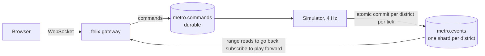

[felix-metro](https://github.com/GetFelix/felix-metro) is a city simulator that
runs in the browser in 3D. Residents commute, shop and go home over a day that
takes 24 minutes. Everything that happens is written to Felix, so you can drag
the timeline back to any moment the log still holds, see the city exactly as it
was, and let it play forward until it catches up with live.

It is in design. The [style frame](https://github.com/GetFelix/felix-metro/blob/main/prototype/style-frame.html)
fixes the look, and nothing is simulated yet. The sections below describe the
design.

| Day | Night |
|---|---|
|  |  |

## How it uses Felix

A city is a grid of districts. Its resources are created once, when the city is:

| Resource | Kind | What it holds |
|---|---|---|
| `metro.events.<city>` | Durable stream, one shard per district | One record per district per simulation tick, with that tick's events |
| `keyframe` | Stream state key on each district's shard | The offset of the district's latest keyframe |
| `metro.commands.<city>` | Durable stream with the gateway's sender stamp | Builders' commands: place a road, zone a lot, demolish |

One simulator per city is the authority. It steps every district together, four
ticks a second at normal speed, each tick 15 seconds of city time. Each tick it
writes one record per district as an [atomic commit](/features/atomic-commits/),
routed by the district so each district's history stays in order on its own
shard. It waits for every answer before the next tick, and it commits at an
[expected offset](/features/atomic-commits/#a-commit-at-an-expected-offset), so
a stale simulator that comes back after a replacement is refused by the broker
instead of writing a second history.

The log holds decisions, not positions. A tick record says that a resident left
home on a route at some speed, arrived somewhere, or that a building went up.
The browser moves each car along its route itself. That keeps a city of 20,000
residents at about 10 KB/s of log, so a week of history fits on one broker.

Every city hour each district also commits a keyframe, its whole state, and the
same commit writes the `keyframe` state key, so the pointer and the keyframe can
never disagree. Every tick record carries the offset of its district's latest
keyframe.

Going back to a moment is, for each district:

1. Find the tick record for that moment. There is one record per tick, so the client estimates the offset and corrects it with one read.
2. Read the keyframe that record points to.
3. [Read the range](/features/pubsub/#reading-a-range-without-subscribing) from the keyframe to the moment and apply the events.

Playing forward is a subscription from the next offset. Felix joins stored
history to live delivery with no gap, so the city catches up with live without
the client doing anything special.

Browsers reach Felix through [felix-gateway](/clients/browsers/), which already
offers `read` and `state_get`. Seeking by time would be one lookup per district
if the gateway exposed `offset_for_time`; that is on the project's list for
felix-gateway.

## What it demonstrates

- **History as the product.** The timeline is a range read and a subscription, not a second datastore of snapshots.
- **Seeking that stays fast.** A keyframe every city hour bounds a seek to one keyframe and an hour of events per district.
- **Rewind, then follow live with no gap**, across many shards at once.
- **One writer per city**, fenced at the broker by expected-offset commits.
- **Forks from the past.** A branch timeline starts from a keyframe of the parent and owes it nothing after that.

## More

- [README](https://github.com/GetFelix/felix-metro#readme)
- [Design](https://github.com/GetFelix/felix-metro/blob/main/docs/design.md): the data model, seeking, branching and the build order
- [Art direction](https://github.com/GetFelix/felix-metro/blob/main/docs/art.md): the asset packs and the style frame
