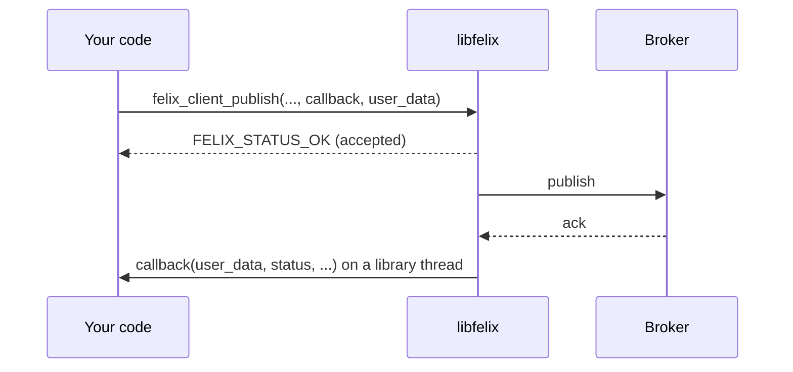

`libfelix` is a C ABI over the Rust client, built from `crates/sdk/felix-capi`.
It ships as a shared library (`.so`, `.dylib`, `.dll`), a static one (`.a`) and
a header, `felix.h`. Like the Python and TypeScript bindings it wraps
`felix-client`, so reconnection, redirect-following and error classes are the
Rust client's. See [Choosing a Client](/clients/overview/) for why bindings wrap
one client instead of reimplementing it.

It is a base for bindings: any language with a C FFI can bind to it, C# included. You can also call it from C directly.

## Building and linking

```bash
cargo build --release -p felix-capi
cc app.c -I crates/sdk/felix-capi/include target/release/libfelix.a <native libs>
```

A static link needs the system libraries the Rust code depends on. This prints
the list for your platform:

```bash
cargo rustc -p felix-capi --crate-type staticlib -- --print native-static-libs
```

The header is generated by cbindgen and checked in at
`crates/sdk/felix-capi/include/felix.h`. Each client owns a small Tokio runtime,
so your program needs no async runtime of its own.

## How calls work

Every call that talks to the broker is asynchronous. It returns at once and
reports its result to a callback. Each takes a callback, a `void *user_data`
that is passed back untouched, and an optional `FelixCancelToken` (pass `NULL`
for none).

```c
static void on_published(void *user_data, FelixStatus status, const char *message,
                         bool has_offset, uint64_t offset) {
    /* runs on a library thread */
}

felix_client_publish(client, "t1", "default", "events",
                     (const uint8_t *)"hello", 5, NULL, 0,
                     FELIX_ACK_PER_MESSAGE, FELIX_DELIVERY_AT_MOST_ONCE,
                     NULL, on_published, my_state);
```



### Two statuses

A call returns a `FelixStatus` for the call itself. `FELIX_STATUS_OK` means it
was accepted and its callback will run exactly once. Anything else means it was
refused before it started (a null pointer, bad UTF-8, a value out of range). The
callback will not run, and `felix_last_error_message()` says why. That message is
per thread and valid until the next Felix call on that thread; copy it to keep
it. It is null after a call that returned `FELIX_STATUS_OK`.

The callback gets the result's own status. For a failure (10 and above) it also
gets a message, valid only while the callback runs. On success it may own a new
handle, such as the client, a subscription or an event.

### Threads and order

Callbacks run on one of the client's two library threads, and may run before the
call that started them returns. Keep them short, because a callback that blocks
stalls the client. A callback may call any Felix function, including freeing the
handle it was called for. It must not unwind or throw back into the library.

Calls in flight together run concurrently and may reach the broker in any order,
as concurrent futures do in the Rust client. To keep records in order, start each
publish from the previous one's callback.

If you want a blocking call, wait on a mutex and condition variable signalled
from the callback. `crates/sdk/felix-capi/tests/c/pubsub.c` does this and is the
best set of worked examples. There are no blocking variants, so every operation
stays one function.

### Cancelling

Cancelling a token, or freeing the handle a call was made on, completes the call
with `FELIX_STATUS_CANCELLED`, unless it already finished. Each handle cancels
only its own calls: freeing the client does not end a subscription, watch,
producer or group made from it, which keep working until they are freed. One
token may be passed to any number of calls, and a token that is already
cancelled cancels a call at once. A cancelled connect or subscribe never hands
out a handle. A write cancelled after
it may have been sent completes with `FELIX_STATUS_OUTCOME_UNKNOWN` instead,
because it may have landed. Reads report `FELIX_STATUS_CANCELLED`. A token can be
freed while calls still hold it.

### Freeing handles

Handles (`FelixClient`, `FelixSubscription`, `FelixShardedSubscription`,
`FelixShardedGroup`, `FelixCacheWatch`, `FelixProducer`, `FelixEvent`,
`FelixCancelToken`) are opaque.
Everything the library hands out has a `*_free` function, which accepts null. A
handle may be used from several threads, but never freed while another thread is
using it, a callback included.

A subscription, sharded group, watch, producer or event keeps the client's runtime alive, so
the runtime stops when the last of them is freed, not when the client is.
Callbacks for calls cancelled by a free may run after the free returns, so
`user_data` must stay valid until they do. Freeing the last handle on a client's
runtime waits up to a few seconds for them. From inside a callback, or from
another async runtime, it returns at once and a library thread finishes the
teardown, so do not unload the library before those callbacks arrive. A process
that exits with handles still live gets no callbacks for its pending calls.

A panic inside the library becomes `FELIX_STATUS_PANIC`, from the call or
through the callback.

## Getting and refreshing a token

A token lasts 15 minutes by default, and the broker checks it each time a stream
authenticates, including the streams a reconnect opens. [Getting a
token](/clients/overview/#getting-a-token) covers where one comes from. A
process that outlives one gives `FelixConnectOptions` a fetch function, and the
library asks it for a token when it needs one. The Rust client's
`RefreshingToken` does the timing: it asks once two thirds of the held token's
life has passed, or when the broker refused it. If a fetch fails while the held
token is still valid, the client keeps using that one and asks again a few
seconds later. If the broker refuses a token and the fetch returns a different
one, the client retries once with it.

The fetch function has the shape `void fetch(void *user_data, FelixTokenReply
*reply)`. Set it as `token_fetch`, with `token_user_data` and an optional
`token_release`, and pass `NULL` as the `token` argument to
`felix_client_connect_with` to have the first connect call it, or pass a token
you already hold to use that first. An empty string counts as no token.

**When it is called.** On a library thread, when a stream is about to
authenticate and the library holds no token, the held one is due for
replacement, or the broker just refused it. An idle client makes no calls. The
library never runs two fetches at once: streams that open together wait on one
and share its token. That is also what makes it safe to rotate a refresh token
inside the function.

**Threading.** Do not block in the function; start the work and return. The
reply may be completed from any thread, now or later, with
`felix_token_reply_ok(reply, token)` (the string is copied) or
`felix_token_reply_err(reply, message)`. C has no async variant of the fetch,
so the reply is how a slow answer is returned.

**Failure.** The `message` you give reaches the call that needed the token
unchanged, once no valid token is held to fall back on. A fetch not answered
within 30 seconds counts as failed; an answer that arrives later returns
`FELIX_STATUS_OK` and the token is discarded. The library holds every unanswered
reply until the client is freed, when it counts as a failure, so answer each
one, even late. A null, empty or non-UTF-8 `token` returns
`FELIX_STATUS_INVALID_ARGUMENT` and leaves the reply open to be answered.

**Lifetime.** The first `felix_token_reply_ok` or `felix_token_reply_err` call
that is not refused for a bad argument consumes the reply, and the library
frees it once the fetch is over. Using it again is undefined behaviour, as for
any freed handle. A reply never answered stays until it is, or until
`token_release` runs. `token_release` is how you free what `token_user_data`
points to:

- If `felix_client_connect_with` returns anything but `FELIX_STATUS_OK`, the
  fetch is never used, `token_release` never runs, and the data is still yours.
- If it returns `FELIX_STATUS_OK`, `token_release` runs exactly once later,
  after the client is freed and no fetch can be running, including when the
  connect then reports failure through `on_connect`.

The example below does the control plane call with libcurl and keeps the
rotating refresh token. The refresh token works once: every refresh returns a
replacement, so the fetch function stores it before it answers. A `403` means
the refresh token expired or was revoked and the exchange has to be run again;
the fetch fails with that message, and the client keeps the last token until it
expires. Run a new login, then connect a new client.

```c
#include <curl/curl.h>
#include <pthread.h>
#include <stdlib.h>
#include <string.h>
#include "felix.h"

struct session {
  pthread_mutex_t mu;
  char refresh_token[256]; /* the newest one; guarded by mu */
};

struct body {
  char data[4096];
  size_t len;
};

static size_t collect(char *chunk, size_t size, size_t n, void *out) {
  struct body *body = out;
  size_t bytes = size * n;
  if (body->len + bytes >= sizeof body->data) return 0; /* curl fails the call */
  memcpy(body->data + body->len, chunk, bytes);
  body->len += bytes;
  body->data[body->len] = '\0';
  return bytes;
}

/* Copies a string value out of a flat JSON object. Use a JSON parser in real code. */
static bool json_string(const char *json, const char *key, char *out, size_t cap) {
  char needle[64];
  snprintf(needle, sizeof needle, "\"%s\":\"", key);
  const char *start = strstr(json, needle);
  if (!start) return false;
  start += strlen(needle);
  const char *end = strchr(start, '"');
  if (!end || (size_t)(end - start) >= cap) return false;
  memcpy(out, start, (size_t)(end - start));
  out[end - start] = '\0';
  return true;
}

/* Spends the refresh token for a new access token and stores the
   replacement, because every refresh token works once. */
static bool refresh(struct session *s, char *token, size_t cap, char *error,
                    size_t error_cap) {
  char request[400];
  pthread_mutex_lock(&s->mu);
  snprintf(request, sizeof request, "{\"refresh_token\":\"%s\"}", s->refresh_token);
  pthread_mutex_unlock(&s->mu);

  struct body body = {.len = 0};
  CURL *curl = curl_easy_init();
  if (!curl) {
    snprintf(error, error_cap, "could not start curl");
    return false;
  }
  struct curl_slist *headers = curl_slist_append(NULL, "Content-Type: application/json");
  curl_easy_setopt(curl, CURLOPT_URL, "https://controlplane:8443/v1/tenants/t1/token/refresh");
  curl_easy_setopt(curl, CURLOPT_HTTPHEADER, headers);
  curl_easy_setopt(curl, CURLOPT_POSTFIELDS, request);
  curl_easy_setopt(curl, CURLOPT_WRITEFUNCTION, collect);
  curl_easy_setopt(curl, CURLOPT_WRITEDATA, &body);
  curl_easy_setopt(curl, CURLOPT_TIMEOUT, 20L); /* the library gives up at 30 s */
  CURLcode rc = curl_easy_perform(curl);
  long status = 0;
  curl_easy_getinfo(curl, CURLINFO_RESPONSE_CODE, &status);
  curl_slist_free_all(headers);
  curl_easy_cleanup(curl);

  if (rc != CURLE_OK) {
    snprintf(error, error_cap, "control plane unreachable: %s", curl_easy_strerror(rc));
    return false;
  }
  if (status != 200) {
    snprintf(error, error_cap, "token refresh answered %ld", status); /* 403: sign in again */
    return false;
  }
  char next[sizeof s->refresh_token];
  if (!json_string(body.data, "felix_token", token, cap) ||
      !json_string(body.data, "refresh_token", next, sizeof next)) {
    snprintf(error, error_cap, "token refresh answered something unexpected");
    return false;
  }
  pthread_mutex_lock(&s->mu);
  memcpy(s->refresh_token, next, sizeof next);
  pthread_mutex_unlock(&s->mu);
  return true;
}

struct fetch_job {
  struct session *session;
  FelixTokenReply *reply;
};

static void *answer(void *arg) {
  struct fetch_job *job = arg;
  char token[2048], error[160];
  if (refresh(job->session, token, sizeof token, error, sizeof error)) {
    felix_token_reply_ok(job->reply, token); /* the string is copied */
  } else {
    felix_token_reply_err(job->reply, error); /* reaches your caller unchanged */
  }
  free(job); /* the reply is consumed: do not touch it again */
  return NULL;
}

/* Called on a library thread: start the work and return. */
static void fetch_token(void *user_data, FelixTokenReply *reply) {
  struct fetch_job *job = malloc(sizeof *job);
  pthread_t thread;
  if (!job) {
    felix_token_reply_err(reply, "out of memory");
    return;
  }
  job->session = user_data;
  job->reply = reply;
  if (pthread_create(&thread, NULL, answer, job) != 0) {
    free(job);
    felix_token_reply_err(reply, "could not start a thread");
    return;
  }
  pthread_detach(thread);
}

static void release_session(void *user_data) {
  struct session *s = user_data;
  pthread_mutex_destroy(&s->mu);
  free(s);
}

/* Connects with no token in hand: the first connect calls fetch_token. */
static FelixStatus connect_with_refresh(const char *addrs, const char *ca_file,
                                        const char *refresh_token,
                                        FelixConnectCallback on_connect,
                                        void *connect_data) {
  struct session *s = calloc(1, sizeof *s);
  if (!s) return FELIX_STATUS_INVALID_ARGUMENT;
  pthread_mutex_init(&s->mu, NULL);
  snprintf(s->refresh_token, sizeof s->refresh_token, "%s", refresh_token);

  FelixConnectOptions options = {.size = sizeof options,
                                 .token_fetch = fetch_token,
                                 .token_user_data = s,
                                 .token_release = release_session};
  FelixStatus status = felix_client_connect_with(
      addrs, "t1", NULL /* first fetch gets it */, NULL, ca_file, &options,
      NULL, on_connect, connect_data);
  if (status != FELIX_STATUS_OK) release_session(s); /* refused: still ours */
  return status;
}
```

## A minimal example

The token argument is a Felix token; [Getting and refreshing a
token](#getting-and-refreshing-a-token) covers where it comes from and how a
client that outlives it gets the next one. This example passes one and no fetch
function, so the client holds it until it expires: streams opened after expiry,
including the ones a reconnect opens, are refused with `FELIX_STATUS_AUTH`.

Connect, publish one record, subscribe to shard 0 and read one event. A small
`waiter` turns each async call into a blocking one.

```c
#include <pthread.h>
#include <stdio.h>
#include <string.h>
#include "felix.h"

struct waiter {
    pthread_mutex_t mu;
    pthread_cond_t cv;
    int done;
    FelixStatus status;
    void *handle; /* the new client, subscription or event */
};

static void finish(struct waiter *w, FelixStatus status, void *handle) {
    pthread_mutex_lock(&w->mu);
    w->done = 1;
    w->status = status;
    w->handle = handle;
    pthread_cond_signal(&w->cv);
    pthread_mutex_unlock(&w->mu);
}

static FelixStatus wait_for(struct waiter *w) {
    pthread_mutex_lock(&w->mu);
    while (!w->done) pthread_cond_wait(&w->cv, &w->mu);
    pthread_mutex_unlock(&w->mu);
    return w->status;
}

static void on_connect(void *ud, FelixStatus s, const char *msg, FelixClient *c) {
    finish(ud, s, c);
}
static void on_publish(void *ud, FelixStatus s, const char *msg, bool has, uint64_t off) {
    finish(ud, s, NULL);
}
static void on_subscribe(void *ud, FelixStatus s, const char *msg, FelixSubscription *sub) {
    finish(ud, s, sub);
}
static void on_event(void *ud, FelixStatus s, const char *msg, FelixEvent *e) {
    finish(ud, s, e);
}

static void waiter_reset(struct waiter *w) {
    w->done = 0;
    w->handle = NULL;
}

int main(void) {
    struct waiter w;
    pthread_mutex_init(&w.mu, NULL);
    pthread_cond_init(&w.cv, NULL);
    waiter_reset(&w);
    if (felix_client_connect("127.0.0.1:5000", "t1", "my-token", "localhost",
                             NULL, NULL, on_connect, &w) != FELIX_STATUS_OK ||
        wait_for(&w) != FELIX_STATUS_OK) {
        fprintf(stderr, "connect failed: %s\n", felix_last_error_message());
        return 1;
    }
    FelixClient *client = w.handle;

    /* Subscribe first, so the publish below is not missed. */
    waiter_reset(&w);
    felix_client_subscribe(client, "t1", "default", "events", 0,
                           FELIX_START_LATEST, 0, NULL, on_subscribe, &w);
    if (wait_for(&w) != FELIX_STATUS_OK) return 1;
    FelixSubscription *sub = w.handle;

    waiter_reset(&w);
    felix_client_publish(client, "t1", "default", "events",
                         (const uint8_t *)"hello", 5, NULL, 0,
                         FELIX_ACK_PER_MESSAGE, FELIX_DELIVERY_AT_MOST_ONCE,
                         NULL, on_publish, &w);
    if (wait_for(&w) != FELIX_STATUS_OK) return 1;

    waiter_reset(&w);
    felix_subscription_next(sub, 5000 /* ms */, NULL, on_event, &w);
    if (wait_for(&w) == FELIX_STATUS_OK) {
        FelixEvent *event = w.handle;
        const uint8_t *data;
        size_t len;
        felix_event_payload(event, &data, &len);
        printf("%.*s\n", (int)len, (const char *)data);
        felix_event_free(event);
    }

    felix_subscription_free(sub);
    felix_client_free(client);
    return 0;
}
```

The example skips the call status of the subscribe, publish and read; a real
caller checks it, because a refused call never runs its callback and the wait
would not end. TLS is always on. `server_name` is the name the broker's
certificate carries (`"localhost"` when null), and `ca_file` is a PEM file of CAs
to trust, or null for the system store. `addrs` is a `host:port` string.

## Publishing

`felix_client_publish` sends one record. A non-null `key` routes it, so records
sharing a key share a shard and stay in order; a null key sends it to shard 0.
`FELIX_DELIVERY_AT_MOST_ONCE` reports a lost connection instead of risking a
second write (a record the broker refused without applying is still sent once
more, to the shard's current owner). `FELIX_DELIVERY_AT_LEAST_ONCE` reconnects and sends it again, so
the record is certain to land and may land twice. The ack mode is
`FELIX_ACK_NONE` (complete once the record is sent), `FELIX_ACK_PER_MESSAGE` or
`FELIX_ACK_PER_BATCH`. The callback's `has_offset` is false with
`FELIX_ACK_NONE`, on a stream without a log, or when the broker acknowledged
before writing. A non-null `key` with a zero length is the empty key, which is a
key like any other.

The batch calls take the payloads end to end in one buffer, with an array of
lengths:

```c
const uint8_t data[] = "onetwothree";
const size_t lens[] = {3, 3, 5};
felix_client_publish_batch(client, "t1", "default", "events", data, lens, 3,
                           NULL, 0, FELIX_ACK_PER_BATCH, NULL, on_batch, my_state);
```

`felix_client_publish_batch` sends the batch to one shard, by key or to shard 0.
`felix_client_publish_on_shard` sends it to a shard you name. Either is one frame
that the broker appends contiguously and accepts or refuses whole.
`felix_client_publish_records` takes a key per record, splits the records by
shard and sends each share to its owner, so some shards can succeed while others
fail. Only it can resend, with `FELIX_DELIVERY_AT_LEAST_ONCE`, and a resent batch
lands after records sent later; the two single-shard batch calls never resend a
batch that may have been written. `felix_client_publish_on_shard` fails without
sending against a broker too old to take a shard number, since it would
otherwise write to shard 0.

A batch callback gets a `FelixRecordResult` per record, in the order passed: its
status, its log offset when the broker reported one, and the failure's message.
The callback's own status is `FELIX_STATUS_OK` only when every record was
accepted; otherwise it is the status, and message, of the first record that
failed. The results are null when no record has an outcome of its own: the
batch was empty, or the call was cancelled or panicked.

## Subscribing

`felix_client_subscribe` reads one shard. It follows the shard to its owner when
a rebalance moves it, and when it falls behind it resubscribes after the last
event, so no lag item reaches C. A shard past the stream's width is refused by
the broker.

Start with `FELIX_START_LATEST`, `FELIX_START_EARLIEST` or `FELIX_START_OFFSET`
plus an offset. As elsewhere, an offset start is the first record you have not
seen. Each read is `felix_subscription_next`, with a timeout in milliseconds (a
negative value waits indefinitely). It completes with an event, with
`FELIX_STATUS_TIMEOUT`, or with `FELIX_STATUS_CLOSED` once the broker ends the
stream. One read may be pending at a time and a second is refused. A timed-out or
cancelled read loses no event, and re-arming the next read from the previous
callback is the expected pattern. A subscription is pulled, not pushed, so the
broker-side queue and its overflow policy are the only buffer.

An event is read with `felix_event_payload`, `felix_event_offset` and
`felix_event_skipped_before`, and freed with `felix_event_free`. On a durable
stream a jump in offsets is a drop. `felix_subscription_start_offset` returns
where the subscription began (its `out_has` is false on a stream without a log
or from a broker that did not negotiate offsets), so a drop before the first
event counts as `offset - start_offset - skipped_before`. The start can be 0.

After a read reports `FELIX_STATUS_CLOSED`, `felix_subscription_close_reason`
says whether the broker ended the stream (`FELIX_CLOSE_ENDED`) or it was deleted
(`FELIX_CLOSE_STREAM_DELETED`). A live subscription reports `FELIX_CLOSE_OPEN`.

`felix_client_offset_for_time` finds the first offset on a shard at or after a
time in microseconds, to subscribe from with `FELIX_START_OFFSET`. The callback's
`has_offset` is false when no record is that recent yet; subscribe with
`FELIX_START_LATEST` to wait for one. A time older than every record answers
with the oldest. It only reads, so a cancel is `FELIX_STATUS_CANCELLED`.

### All shards

`felix_client_subscribe_sharded` opens every shard and merges them, failing if
any cannot be opened. `felix_sharded_next` completes with an item: a record
(`FELIX_SHARD_RECORD`, with an event to free) or a notice about one shard:
`FELIX_SHARD_LOST` with the error text, `FELIX_SHARD_RECOVERED`,
`FELIX_SHARD_MOVED` or `FELIX_SHARD_STREAM_DELETED`. A lost-shard notice is
still `FELIX_STATUS_OK`, with the error text as the message. With any other
status the kind is `FELIX_SHARD_NONE`. The read completes with
`FELIX_STATUS_CLOSED` once every shard's feed has ended. Order holds within a
shard only. `felix_sharded_shards` gives the shard count. A caller that ignores `FELIX_SHARD_LOST` reads an incomplete stream without
knowing it.

Resuming takes a map of offsets, because offsets are per shard.
`felix_sharded_positions` writes the last offset handed out per shard, never
ahead of what the caller has been given, and may be called while a read is
pending. Only shards that have delivered a record appear. It writes at most
`cap` entries, in ascending shard order, and sets `*out_count` to the total, so
call again with larger buffers if that exceeds `cap`. Pass the result to
`felix_client_resubscribe_sharded`: listed shards continue after their offset,
the rest start at `start` (a shard listed twice is
`FELIX_STATUS_INVALID_ARGUMENT`).

## Consumer groups

Every group call names one shard and goes to the broker that leads it, following
a move. `felix_client_stream_shards` gives the shard count, so a caller can run one
group per shard, or open a sharded group over all of them (below).

```c
felix_client_group_poll(client, "t1", "default", "orders", shard, "billing",
                        32 /* max_records */, 5000 /* wait_ms */,
                        0 /* visibility_ms: broker default */,
                        "worker-1", false /* reclaim */, NULL, on_poll, state);
```

- `felix_client_group_create` and `felix_client_group_seek` take a
  `FELIX_START_*` position and report where the group resumes. Create leaves an
  existing group alone.
- `felix_client_group_poll` returns up to `max_records` as `FelixGroupRecord`
  values (offset, attempts, skipped-before, payload), valid only during the
  callback. An empty poll is `FELIX_STATUS_OK` with a count of zero. `consumer`
  names the member, `reclaim` takes back what that member held before a restart,
  and a `visibility_ms` of zero uses the broker's timeout. A poll cancelled while
  it waits completes with `FELIX_STATUS_CANCELLED`, and records it claimed come
  back after the visibility timeout. A `max_records` of zero, and `reclaim`
  without a `consumer` (1 to 128 bytes), are `FELIX_STATUS_INVALID_ARGUMENT` at
  the call.
- Records are not handles. `felix_client_group_ack`, `_nack`, `_extend`,
  `_dead_letter`, `_discard` and `_redrive` take the offset. Nack and extend also
  take the `attempts` the poll reported, which the broker checks, so a claim that
  has lapsed or moved on is refused. A `stale_claim` refusal is
  `FELIX_STATUS_ERROR` with the reason in the message.
- `felix_client_group_extend` takes an `extend_ms` of at least one and reports
  how long the claim now stands (`visible_ms`). `felix_client_group_nack` takes a
  `delay_ms`, where zero is at once. Settles are writes: cancelled after they may
  have been sent they complete with `FELIX_STATUS_OUTCOME_UNKNOWN`, and settling
  again is refused or harmless.
- `felix_client_group_dead_letters` lists a shard's dead-letter offsets, and
  `felix_client_group_describe` fills a `FelixGroupInfo` (`has_committed`,
  `committed`, `tail`, `in_flight`, `owed`, `dead_letters`; `in_flight` and
  `owed` are leader memory and restart from zero when the leader changes).
  `felix_client_group_delete` says whether the group existed. Describe and
  listing are reads, so a cancel is `FELIX_STATUS_CANCELLED`.
- `felix_client_stream_shards` reports zero for a stream the broker does not
  know, not one.

Creating, seeking and deleting a group, and discarding or redriving a dead
letter, need the `group.manage` permission. Polling, settling, extending, listing
dead letters and describing need only consumer access. A broker without claim
control refuses a delayed nack, an extend and a visibility override with the
same error the Rust client raises.

### All shards

`felix_client_group_sharded` opens a `FelixShardedGroup` over every shard of a
stream; it creates nothing, so create the group first. `felix_sharded_group_shards`
gives the count and `felix_sharded_group_free` frees it. `felix_sharded_group_poll`
takes up to `max_records` (at least one), visiting the shards in turn from where
the last poll left off and returning the first non-empty batch as
`FelixShardedGroupRecord` values: a `shard` and a borrowed `FelixGroupRecord`,
valid only during the callback. Order holds within a shard only, and a shard that
cannot be polled fails the whole poll. Settle a record with the per-shard calls
(`felix_client_group_ack`, `_nack`, `_extend`, `_dead_letter`), passing its
`shard`: an offset means nothing without it. The poll is a read, so a cancel, or
freeing the group, completes it with `FELIX_STATUS_CANCELLED`, and what it
claimed comes back after the visibility timeout.

`felix_client_group_create_stream`, `_seek_stream`, `_describe_stream` and
`_delete_stream` run the admin call on every shard in shard order. Create and
seek report a `FelixGroupPosition` (`offset`, `moved`) per shard and describe a
`FelixGroupInfo` per shard, both indexed by shard and valid during the callback;
delete says whether any shard had the group. It is one request per shard, so a
failure partway leaves the earlier shards changed; every call is safe to repeat.
An offset start is refused for a stream with more than one shard, since an offset
means something different on each; use `FELIX_START_EARLIEST` or
`FELIX_START_LATEST`. Create, seek and delete are writes
(`FELIX_STATUS_OUTCOME_UNKNOWN` on a late cancel); describe is a read.

## Publisher and timestamp

`felix_client_connect_with` takes a `FelixConnectOptions`. Set `size` to
`sizeof(FelixConnectOptions)`; a field is read only when `size` covers it, so a
caller built against an older header keeps working and a field it does not know
is off. A null `options` is the defaults, which is what `felix_client_connect`
uses.

```c
FelixConnectOptions options = {
    .size = sizeof options, .publishers = true, .timestamps = true};
felix_client_connect_with("127.0.0.1:5000", "t1", "my-token", "localhost", NULL,
                          &options, NULL, on_connect, state);
```

`publishers` asks brokers to say who published each event, which adds the
principal to every event batch; `timestamps` asks for each record's append time,
which adds eight bytes per event. With them set, `felix_event_publisher` writes a
pointer and length (UTF-8, not NUL-terminated, valid until the event is freed)
and `felix_event_timestamp` writes microseconds since the Unix epoch by the clock
of the broker that led the shard. A `FelixGroupRecord` carries `publisher` and
`publisher_len` (borrowed, null when absent) and `has_timestamp` with
`timestamp_micros`. A broker that does not negotiate them, or an in-memory stream
that stores no time, leaves them absent; that is never an error.

## Caches, counters and watches

Keys and filters are UTF-8 C strings. Values are a pointer and a length, copied
before the call returns (null with length zero is the empty value). Values handed
to a callback are valid only while it runs. Any broker serves a cache request by
forwarding it to the key's owner, so there is no shard to name.

- `felix_client_cache_put` takes a `ttl_ms`, where zero is no expiry.
  A put is safe to repeat. `felix_client_cache_get` and `_delete` report `found`
  and the value (for a delete, the one removed). `felix_client_cache_get_versioned` adds the entry's
  version.
- `felix_client_cache_put_if` takes `FELIX_IF_ABSENT`, or `FELIX_IF_VERSION` with
  a version from a versioned get. `felix_client_cache_delete_if` takes a version.
  A condition that does not hold is `FELIX_STATUS_OK` with `applied` false, not
  an error.
- `felix_client_counter_add` returns the new value. `felix_client_counter_get`
  reports `has_value` false for a counter that does not exist. An add cancelled
  after it may have been sent is `FELIX_STATUS_OUTCOME_UNKNOWN`: read the counter
  before repeating it.

A watch is one handle, `FelixCacheWatch`, read with `felix_cache_watch_next` like
a subscription: one read pending at a time, a timeout that leaves it usable, and
a cancelled read that loses nothing. `felix_client_watch_cache` watches a key or
a prefix on one shard (a key is routed to its own shard, and a prefix reads one,
so use it on a single-shard cache). `felix_client_watch_cache_sharded` watches a
prefix on every shard, and fails rather than cover fewer shards than the cache
has. Both take `retained` to deliver the stored entries first; it cannot be
combined with an offset to resume from.

`felix_client_watch_cache` takes a filter kind, `FELIX_WATCH_KEY` or
`FELIX_WATCH_PREFIX` (anything else is `FELIX_STATUS_INVALID_ARGUMENT`), and
`has_from_offset` with `from_offset`, the first offset not yet seen (a handled
change's offset plus one, or a `FELIX_WATCH_LAGGED` item's `resume_from`). A watch
is read until it reports `FELIX_STATUS_CLOSED`. A single watch's offsets are
sparse, because other keys' changes consume them, so a gap is not a drop;
`FELIX_WATCH_LAGGED` is.

A `FelixWatchItem` is borrowed for the callback, and its `kind` says what it is:

| Kind | Meaning |
| --- | --- |
| `FELIX_WATCH_CHANGE` | a put or delete; a deleted key has `has_value` false, and `expires_at_millis` is zero for never |
| `FELIX_WATCH_LAGGED` | the broker ended the watch; `resume_from` is where a new one continues |
| `FELIX_WATCH_SHARD_MOVED` | the shard moved; followed automatically |
| `FELIX_WATCH_STATE_COMPLETE` | every shard's stored state is delivered (sharded retained watch only) |
| `FELIX_WATCH_SHARD_CLOSED` | one shard of a sharded watch ended |

Keys are not NUL-terminated, so use `key_len`. After `FELIX_WATCH_LAGGED` a single
watch's next read is `FELIX_STATUS_CLOSED`, while a sharded watch loses only that
shard. `felix_cache_watch_resume_offsets` writes each shard's offset for a
sharded watch (a single watch is `FELIX_STATUS_INVALID_ARGUMENT`), never ahead
of what reads have handed out, in ascending shard order with `cap` and
`*out_count` as for `felix_sharded_positions`. `has_shard` says whether an
item's `shard` is meaningful, and
`felix_cache_watch_retained_count` reports how many entries a retained watch
started from.

## Atomic commits and conditional writes

A commit is an array of `FelixCommitOp` (`FELIX_COMMIT_PUBLISH`,
`FELIX_COMMIT_ENQUEUE`, `FELIX_COMMIT_PUT`, `FELIX_COMMIT_DELETE`) written as one
record on the shard that owns an entity. Every reader sees the event at the
commit's offset and the state it wrote at the same version. It must hold exactly
one event, and every operation must name that event's stream. Anything else is
`FELIX_STATUS_INVALID_ARGUMENT` at the call, and the callback never runs. A
broker that does not serve commits completes the call with
`FELIX_STATUS_UNSUPPORTED`.

```c
FelixCommitOp ops[] = {
    { FELIX_COMMIT_ENQUEUE, "order-events", NULL, (const uint8_t *)"placed", 6 },
    { FELIX_COMMIT_PUT, "order-events", "order-42", (const uint8_t *)"{...}", 5 },
    { FELIX_COMMIT_DELETE, "order-events", "cart-42", NULL, 0 },
};
felix_client_commit(client, "acme", "orders", (const uint8_t *)"order-42", 8,
                    ops, 3, NULL, on_commit, state);
```

An operation's `key` is read only for a put or delete, and its `data` only for a
publish, enqueue or put. Everything is copied before the call returns.

- `felix_client_commit` routes by `entity_key`; `felix_client_commit_on_shard`
  names the shard. The callback gets the commit's `offset`.
- `felix_client_commit_if`, `_commit_if_on_shard`, `felix_client_publish_if` and
  `_publish_if_on_shard` write only if the shard's next offset is
  `expected_offset`. A refusal is an answer: `FELIX_STATUS_OK`, `written` false,
  and the shard's tail in `offset`. A conditional publish takes the payload arrays
  of `felix_client_publish_batch` and at least one record.
- `felix_client_state_get` and `_state_get_on_shard` fill a borrowed
  `FelixStateValue`. `has_value` is false for a key never written or deleted,
  `version` is the offset of the commit that wrote it, and `as_of` is the last
  commit the answer reflects. `felix_client_state_get` takes the `entity_key` the
  commits were routed by.

Commits are writes, so a late cancel is `FELIX_STATUS_OUTCOME_UNKNOWN` and the
commit is not sent again. `FELIX_STATUS_UNSUPPORTED` means the broker does not
advertise commits and nothing was sent. The semantics are in
[Atomic Commits](/features/atomic-commits/).

## Idempotent producers

`felix_client_idempotent_producer` asks the broker for a producer id and hands
back a `FelixProducer`. Its batches are numbered per shard, and the shard's
leader answers a number it already holds without appending again. A batch that
got no answer can be sent again and cannot land twice, across a reconnection or
a leader change. Calls on one producer take sequences in the order the C calls
returned, and they do not wait for each other's answers.

- `felix_producer_publish` sends a batch of one or more records as one sequence,
  to shard 0 or, with a `key`, to the key's shard. It reports the batch's first
  offset. `felix_producer_publish_batches` takes several batches in one call,
  split by `batch_sizes`, and reports only success. It has no key: all its
  batches go to shard 0. After a failure, call again with the same batches and
  only the unacknowledged ones are sent.
- A failure other than a broker refusal leaves the batch in doubt: the sequence
  has not advanced and the batch may have landed. Call again with the same
  payloads and key to settle it. A different batch is refused without being sent
  until then. A cancel after the batch was handed over reports
  `FELIX_STATUS_OUTCOME_UNKNOWN` and the batch is still sent, so settle it the
  same way.
- A refusal (for example, the shard forgot the producer) ends the producer on
  that stream, and its message says why. `felix_producer_abandon_in_doubt`
  numbers the stream afresh under a new id; a batch given up that way may land
  twice.
- `felix_producer_id` and `felix_producer_id_for` read the id a producer, or one
  stream of it, sends under.
- `felix_producer_close` waits for what was handed over, then stops the producer;
  a non-negative `timeout_ms` bounds the wait, and a negative one waits as long
  as it takes. After a successful close, calls on the handle complete with or
  return `FELIX_STATUS_CLOSED`. A close that runs out of time reports
  `FELIX_STATUS_TIMEOUT` and the handle stays closed; batches already handed
  over may still be sent. A cancelled close is `FELIX_STATUS_CANCELLED`, and the
  producer is closed all the same. `felix_producer_free` does not wait: pending
  calls complete with `FELIX_STATUS_CANCELLED` (or `FELIX_STATUS_OUTCOME_UNKNOWN`
  for a send that may be out), and batches already handed over may still be
  sent.

## Brokers the client knows

`felix_client_endpoints` reports the `host:port` of every broker the client
would try, including the ones it discovered from its seeds. The strings are
valid while the callback runs.

## Status codes

| Code | Value | Meaning | Retry? |
| --- | --- | --- | --- |
| `FELIX_STATUS_OK` | 0 | the call did what it was asked | |
| `FELIX_STATUS_TIMEOUT` | 1 | a bounded wait ended with nothing; the handle is still usable | |
| `FELIX_STATUS_CLOSED` | 2 | the broker ended the subscription, or the producer is closed | |
| `FELIX_STATUS_CANCELLED` | 3 | cancelled through its token or by freeing its handle; nothing left behind | |
| `FELIX_STATUS_INVALID_ARGUMENT` | 10 | a null pointer, non-UTF-8 string or out-of-range value; nothing was sent | no |
| `FELIX_STATUS_PANIC` | 11 | the library panicked; a bug worth reporting | |
| `FELIX_STATUS_ERROR` | 20 | a failure with no more specific class | see message |
| `FELIX_STATUS_CONNECTION` | 21 | broker unreachable, connection lost mid-call, or broker shutting down | yes |
| `FELIX_STATUS_AUTH` | 22 | token rejected or missing the permission | no |
| `FELIX_STATUS_NOT_FOUND` | 23 | no such tenant, namespace, stream or cache | see message |
| `FELIX_STATUS_CURSOR` | 24 | the start offset is no longer retained | no; restart earlier |
| `FELIX_STATUS_SHARD_UNAVAILABLE` | 25 | no broker can serve the shard, usually while it moves; nothing applied | yes |
| `FELIX_STATUS_OVERLOADED` | 26 | the broker is shedding load; nothing applied | yes, after a pause |
| `FELIX_STATUS_OUTCOME_UNKNOWN` | 27 | the write may or may not have been applied | only if idempotent |
| `FELIX_STATUS_UNSUPPORTED` | 28 | the broker does not advertise atomic commits; nothing sent | no |

These are the same classes as the
[other clients' errors](/clients/python/#errors-you-can-act-on).

## Binding from another language

These rules hold for any managed binding, C# included.

- Copy borrowed data inside the callback. Payloads, keys, values, messages,
  group records and watch items are valid only while the callback runs. Keep
  `(offset, attempts)` from a poll as a plain struct to settle with.
- Never let an exception escape a callback. One that unwinds into the library
  ends the process.
- Keep `user_data` alive until the callback runs, including for calls cancelled
  by a free. Pin or allocate it so it does not move.
- Every `bool` that crosses the ABI is one byte (`byte` in an
  `[UnmanagedCallersOnly]` signature or a sequential struct in C#), and `size_t`
  is `nuint`. That covers callback parameters (`found`, `applied`, `has_offset`,
  `existed`, `written`, `moved`), out-pointers (`out_has`, `out_has_offset`),
  call arguments (`reclaim`, `retained`, `has_from_offset`), and struct fields:
  `FelixRecordResult`, `FelixConnectOptions.publishers` and `.timestamps`,
  `FelixGroupPosition.moved`, `FelixGroupRecord.has_timestamp`,
  `FelixGroupInfo.has_committed`, `FelixWatchItem` (`has_shard`, `has_value`,
  `has_resume_from`) and `FelixStateValue`.
- An empty `fixed` array is a null pointer, which `felix_client_publish` reads as
  no key, so pass an empty key from a non-empty buffer.
- Build a `FelixCommitOp` array in pinned memory for the call only, since the
  library copies it.
- In a sharded-subscription item callback the `FelixEvent *` is null unless the
  kind is `FELIX_SHARD_RECORD`. Treat an unknown watch `kind` as skip and read
  again, so a newer library does not break an older binding.
- Keep one idempotent producer per logical writer, and start its calls from one
  thread or under a lock. The order is the order the C calls return, so calls
  racing across threads have no order of their own. Retry a failed publish with
  the same buffers.

## Conformance

The C test, `crates/sdk/felix-capi/tests/c/pubsub.c`, is a claimed run of the
[conformance suite](/clients/overview/#the-conformance-suite), like Python's and
TypeScript's. It tags the scenarios it exercises and runs them in both the shared
and the static build against the fixture, fault injection and broker loss
included. CI fails unless every required scenario passes in both. Optional
scenarios it does not exercise are reported as not claimed, not as passes.
