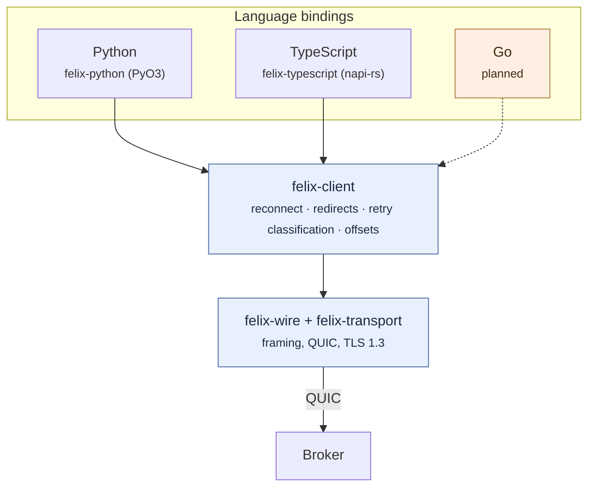
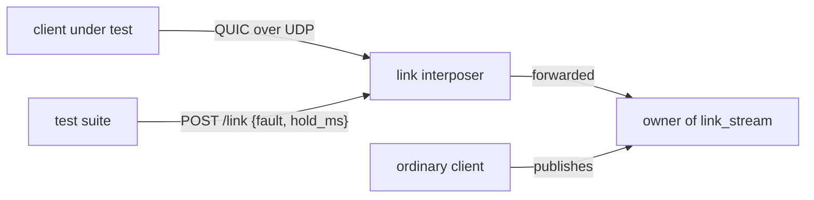

Felix has Rust, Python and TypeScript clients, a C ABI over the Rust client that other language SDKs bind to, and a C# SDK on that ABI that is still gaining coverage. Every one of them is a cluster client. This page covers
how they relate to each other, which is worth understanding before you depend
on one. Each client's own page covers using it.

Browsers cannot speak QUIC, so they go through
[felix-gateway](/clients/browsers/), a WebSocket relay built on the Rust
client.

## One implementation, several bindings

A Felix client does more than encode frames. It reconnects when the broker it
was using disappears, follows redirects to whichever broker owns the shard it
wants, follows a subscription's shard when a rebalance moves it, decides which failures are worth retrying and which are not, and keeps
track of offsets precisely enough that a resuming subscriber neither skips a
record nor sees one twice.

All of it is easy to get *nearly* right, so Felix writes it once. The Rust client (`felix-client`) holds the
behaviour; every other language binds to it through a thin wrapper:



Most systems write a native client per language, each speaking the wire
protocol directly, and end up with clients that behave subtly differently from
one another. The differences never show up
in a demo. They show up when a broker dies at an inconvenient moment and one
language's client loses records the other would have kept.

The cost is that a binding needs a Rust toolchain to build (though not to
*install*, since wheels and their equivalents ship compiled), and a language
with poor FFI support is harder to serve. In return, when reconnection is
improved every language gets the improvement, and no language can drift.

## Every client is a cluster client

The Rust `ClusterClient` is the client; each binding is built on it, and the C
ABI builds one in `felix_client_connect_with`, so C# gets the same. In every
language that means the client:

- takes several broker addresses (seeds), discovers the other brokers from
  them, and keeps the seeds it was given;
- sends each record straight to the broker that leads its shard;
- follows a shard that moves, for publishes and subscriptions alike;
- rebuilds its connection from the brokers that remain when one fails, and
  resolves names again when none of them answers;
- resumes a subscription on a durable stream from the offset after the last one
  it delivered, or reports the loss, and never ends it as though the stream had
  finished.

No binding exposes the reconnect backoff: each uses the Rust default. The
[Rust page](/clients/rust/#clusters) and
[Multi-node client](https://github.com/GetFelix/felix/blob/main/docs/multi-node-client.md)
cover the behaviour in full, and each client's page has a "Connecting to a
cluster" section with its connect call.

## The conformance suite

Sharing an implementation removes most divergence. It does not remove all of
it, because a binding still decides how to expose things: what an error looks
like, whether a timeout is an exception or a return value, whether closing
twice is safe.

So there is a catalogue of the semantics a client must implement, and a runner
that checks a client against it:

```bash
task conformance:scenarios     # what a client must implement, and why
task conformance:fixture       # a cluster to run a suite against
task conformance:verify -- results.json
```

The catalogue (`crates/testing/felix-conformance/scenarios.toml`) is deliberately
weighted toward the semantics a second client tends to approximate rather than
implement. Some examples:

| Scenario | What goes wrong without it |
|---|---|
| `redirect.carries_the_start_offset_through_every_hop` | A client that rebuilds the subscribe request when redirected drops the start offset and begins at the live tail. The call succeeds. Every record between the requested offset and now is simply absent, and nothing anywhere reports an error. |
| `reconnect.subscription_resumes_at_the_next_offset` | Off by one in one direction loses records silently; off by one in the other duplicates them. |
| `retry.ambiguous_outcomes_are_not_silently_retried` | Re-sending a publish that may already have been applied duplicates it, and nothing downstream can tell the copies apart, so the delivery guarantee changes without anyone choosing it. |
| `retry.idempotent_producers_re_send_ambiguous_outcomes` | With a producer id and a sequence the broker can tell the copies apart, so the producer must re-send under the same sequence. A client that advances the sequence on a failure, or re-sends after a refusal, turns the guarantee back into a guess. |
| `error.unauthorized_is_typed` | An application that cannot tell "not permitted" from "unreachable" retries the one that will never succeed. |
| `fault.subscription_through_a_dropped_link` | A subscription whose connection goes silent ends as though the stream had finished. The consumer loop exits cleanly, and the records published meanwhile are never read. |
| `error.quorum_timeout_is_outcome_unknown` | A write that may have survived, reported as a plain failure, gets resent and duplicated; reported as success, it may be lost. |

Each scenario has a stable id. A client's test suite tags its tests with those
ids, emits a results document, and `verify` reports any **required** scenario
without a passing result, by name. A skip does not satisfy a requirement, and
a result naming a scenario that does not exist is reported rather than ignored,
because a misspelled tag would otherwise look like coverage.

Optional scenarios may go unclaimed (a binding is allowed not to wrap a
surface yet), but may not *fail*. Claiming a semantic and getting it wrong is
worse than not claiming it.

### Connection faults

A handful of scenarios break the client's connection on purpose. Each carries a
`step` in the catalogue saying what to break, when, and for how long:

```toml
step = { during = "subscribe", fault = "drop", after_records = 3, records = 10, hold_ms = 8000 }
```

The fixture puts a UDP interposer in front of the broker that owns one
single-shard stream (`link_stream`) and serves it at `link_addr`. A suite
connects a client with `link_addr` as its only seed, handles `after_records`
records, and then asks the fixture's control endpoint to break the link:



| `fault` | What the interposer does | What the client sees |
|---|---|---|
| `drop` | discards every datagram, both ways, for `hold_ms` | silence, then its idle timeout (6 s by default); a new connection through the interposer fails until the hold ends |
| `reset` | kills every connection open through it, for good | the same idle timeout, but a reconnect gets through at once |
| `stall` | holds every datagram for `hold_ms`, then delivers them in order | a pause shorter than the idle timeout, and nothing lost |

QUIC encrypts everything a middlebox could forge, so there is no RST to inject:
a client learns of a drop or a reset from its own idle timeout, which is why the
drop holds past it.

What passes:

- **Mid-publish**, every publish returns, with an acknowledgement or an error,
  and none hangs. Once the fault is over the client publishes again, and every
  record it acknowledged is in the stream.
- **Mid-subscribe**, the subscription either resumes, delivering the rest at
  contiguous offsets with no gap and no duplicate, or raises. **Ending as though
  the broker had closed the stream fails**: that is a consumer loop exiting
  quietly on a dead connection with nothing to tell it records were missed.
- Through a **stall**, an error fails too. The connection never died.

The fixture JSON carries the steps under `faults`, so a suite in a language
without a TOML parser does not have to hard-code them. `cargo run -p
felix-conformance` runs the same steps with the Rust client, through
`ClusterClient` (which resumes) and through a plain `Client` (which reports the
loss), each on its own interposer in front of the in-process broker.

The suites poll a subscription with a short timeout, the way application code
does. That drops the read in flight every 250 ms, and it is what found a
`ClusterSubscription` that, cancelled while resubscribing, came back to its dead
subscription and reported the end of the stream, and, once that was fixed,
started a resubscribe that took longer than the timeout over on every call.

New languages are gated on this suite, not on review, because "looks correct"
is the standard that produces divergence.

### A broker without commits

Every real broker advertises `commit` and `state_get`, so the fixture also
runs a stand-in that answers `auth` and advertises no features, and writes its
address to `no_commit_addrs`. A client must refuse both requests against it
without sending anything: `commit.negotiated`. The count of requests it
received is at `GET <control_url>/no-commit/requests`. A fixture without the key
has no such broker, and a suite skips the scenario rather than claiming it.

### Licensing of the kit

The conformance kit is **AGPL-3.0**, like the broker it links to run its suite.
That does not reach your client: you run `felix-conformance verify` over a
results file your client produced, and nothing from the kit is linked into what
you ship. The specification itself is Apache-2.0: the wire protocol in
`felix-wire`, its byte-level test vectors, and `docs/protocol.md`.

## Getting a token

Every client connects with a tenant id and a Felix token. A Felix token is a
short-lived JWT the control plane mints for one tenant; the broker checks every
request against the permissions inside it. The client pages use a placeholder
for it. This is where it comes from.

In production, exchange a token from your identity provider at the control
plane:

```bash
curl -s -X POST "https://controlplane:8443/v1/tenants/t1/token/exchange" \
  -H "Authorization: Bearer $OIDC_TOKEN" \
  -H "Content-Type: application/json" \
  -d '{"requested": ["stream.publish", "stream.subscribe"], "resources": ["stream:t1/default/*"]}'
```

```json
{
  "felix_token": "<jwt>",
  "expires_in": 900,
  "token_type": "Bearer",
  "refresh_token": "<opaque>",
  "refresh_expires_in": 2592000
}
```

Pass `felix_token` to the client. The control plane works out what RBAC grants
your principal, and the body can only narrow that: `requested` keeps the listed
actions, `resources` keeps the listed objects, and the token gets every kept
action on every kept resource. Leave both out and it carries everything the
principal has, which a service that only publishes to one stream should not
hold. [Token Exchange](/features/security/#token-exchange-oidc--felix) covers
`permissions`, for different actions on different resources, and
[the API reference](/api/control-plane-api/) lists every field.

For a local stack or CI there is no identity provider to exchange with. Start
the control plane with `FELIX_BOOTSTRAP_DEV_TOKENS=true` and it mints a token
for any principal of an initialized tenant:

```bash
curl -sS -X POST http://127.0.0.1:9095/internal/bootstrap/tenants/t1/dev-token \
  -H 'X-Felix-Bootstrap-Token: change-me' \
  -H 'Content-Type: application/json' \
  -d '{ "principal": "p:dev" }'
```

The answer has the same shape as an exchange. It works only with bootstrap
enabled on a loopback address, and anyone holding the bootstrap token can act
as any principal, so never turn it on for a shared or production control plane.
See [Development tokens](/features/security/#development-tokens).

### Lifetime and refreshing

`felix_token` is the access token, and `expires_in` is its life in seconds: 900
unless the control plane sets `FELIX_EXCHANGE_TOKEN_TTL_SECONDS`. The
`refresh_token` lasts `refresh_expires_in` seconds, 30 days by default
(`FELIX_REFRESH_TOKEN_TTL_SECONDS`), and buys a new access token without going
back to the identity provider:

```bash
curl -s -X POST "https://controlplane:8443/v1/tenants/t1/token/refresh" \
  -H "Content-Type: application/json" \
  -d '{"refresh_token": "<opaque>"}'
```

```json
{
  "felix_token": "<jwt>",
  "expires_in": 900,
  "token_type": "Bearer",
  "refresh_token": "<the replacement>",
  "refresh_expires_in": 2592000
}
```

Refresh tokens rotate. Every refresh spends the token you sent and returns its
replacement, so store the new one each time and discard the old. The new access
token is minted from the principal's current grants, so an RBAC change takes
effect at the next refresh. Send `audience` only if you also sent it on the
exchange; a different one is a `400`.

Presenting a spent token again is treated as theft and ends the whole chain.
The exception is a short grace window (`FELIX_REFRESH_REUSE_GRACE_SECONDS`, 30
by default) that covers a retry after a lost answer and two refreshes racing
each other. So refresh from one place at a time.

An expired, revoked or unknown refresh token all get the same `403`, as does
a refresh for a principal whose RBAC grants have all been removed (that also
ends the chain). There is
nothing to repair: exchange a fresh identity-provider token again. An
administrator ends a principal's chains and broker tokens with
[`POST /v1/tenants/{tenant_id}/refresh-tokens/revoke`](/api/control-plane-api/#admin-api-refresh-token-revocation-and-signing-keys);
after that the app has to sign in again too.

A long-running app therefore refreshes before `expires_in` runs out, say after
two thirds of it, persists the replacement refresh token, and falls back to a
new exchange when a refresh answers `403`.

### When a token expires on an open connection

The broker checks a token when a stream authenticates, and not again while the
stream is open. A subscription or publish stream that is already running keeps
working after its token expires, with one exception: a publish forwarded
through a broker that does not own the shard is checked again by the owner,
which rejects it once the token has expired or been revoked. What fails is anything that authenticates
afterwards: a new subscription, a cache or group request, or the streams a
client reopens after losing its connection to a broker. A client that holds one
fixed token presents that same token every time, so once it has expired those
are refused. Revoking a principal is how you end streams that are already open.

The Rust client, the C ABI, the Python client and the TypeScript client can
replace the token while the client runs: the Rust client through a token
provider, C through the `token_fetch` callback, Python through `token_provider`,
TypeScript through a `tokenProvider` function. The other clients hold the token
they connected with, so build a new client with a fresh token before the old one
expires. Each client's page has an example.

## The clients

Each has its own page: what to install, the surface, and the failure modes
worth writing code for.

| | | |
| --- | --- | --- |
| **[Rust](/clients/rust/)** | `felix-client` on crates.io | The reference client, and the one the others are built from. Applications use `ClusterClient`; `connect_with_policy` tunes its reconnect backoff. |
| **[Python](/clients/python/)** | `felix-client` on PyPI | A PyO3 binding, with a synchronous and an asyncio surface over the same Rust client. `Client([...])` takes a list of seeds, and the cluster behaviour is the Rust client's. |
| **[TypeScript](/clients/typescript/)** | `felix-client` on npm | A napi-rs addon. One asynchronous surface, because blocking Node's event loop is not something a library may do. `Client.connect([...])` takes an array of seeds, with the Rust client's cluster behaviour. |
| **[C](/clients/c/)** | `libfelix` and `felix.h`, built from the repository | A C ABI over the Rust client, asynchronous through callbacks. `felix_client_connect_with` takes comma-separated seeds and builds a `ClusterClient`. The base for the C# SDK; not on a registry. |
| **[C#](/clients/csharp/)** | `Felix.Client`, built from `sdks/dotnet` | A P/Invoke binding over the C ABI, so `FelixClientOptions.Addrs` is a list of seeds for a `ClusterClient`. Connect, publish, subscribe to a shard, consumer groups, caches, counters and cache watches, atomic commits and conditional publishes, idempotent producers, and publisher and timestamp metadata so far. Not on NuGet yet. |

### Which client to use

In Rust, use `ClusterClient`, on one broker or many. It sends each record
straight to the broker that leads its shard and handles failover and
reconnects. `Client` is the single-connection building block underneath it,
for tools and special cases; in a cluster its publishes to shards the broker
does not lead are forwarded. In the v0.6.0 three-node, three-replica run that
hop cut in-memory throughput 2.4× (256 B records, batches of 64: 2,034 to 864
MB/s of payload, broker CPU up 34%) and durable quorum-acked throughput 4.4×
(475 to 107 MB/s of payload). See [v0.6.0 performance](/features/v060-performance/). The Python and
TypeScript clients, and the C ABI that C# binds, are built on `ClusterClient`
and have no other kind. See [Every client is a cluster client](#every-client-is-a-cluster-client).

Python and TypeScript both pass every required scenario in the catalogue, and
CI is gated on both. That includes the `commit.*` scenarios: all three clients
offer [atomic commits](/features/atomic-commits/) with the same typed
refusals. Each leaves a couple of optional scenarios unclaimed
rather than passing over them in silence; their pages say which.

## Other languages

No Go client exists. The C# SDK lives in this repository and, like Python and TypeScript, wraps
the Rust client rather than reimplementing it, binding through P/Invoke to
`crates/sdk/felix-capi`, the C ABI described on the [C page](/clients/c/). It covers connect,
publish, subscribe to a shard, consumer groups and publisher and timestamp metadata so far; the
[C# page](/clients/csharp/) says what is bound. The
ABI covers connect, publishes, subscriptions, consumer groups on a shard, caches,
counters and watches, atomic commits, conditional publishes and idempotent
producers, asynchronous through callbacks so a `Task` needs no waiting thread.
Groups also run across every shard of a stream, with stream-wide admin calls,
and connect options ask brokers for each record's publisher and append time.
Driven from C, it passes every required scenario of the conformance suite,
which gates it in CI as it does Python and TypeScript.

If you want to write one sooner, the things you need are all public: the
[wire protocol](/architecture/wire-protocol/) if you are implementing
natively, the conformance catalogue either way, and `crates/sdk/felix-python` or
`crates/sdk/felix-typescript` as worked examples of the binding approach: a few
hundred lines of Rust over a client that already works.
