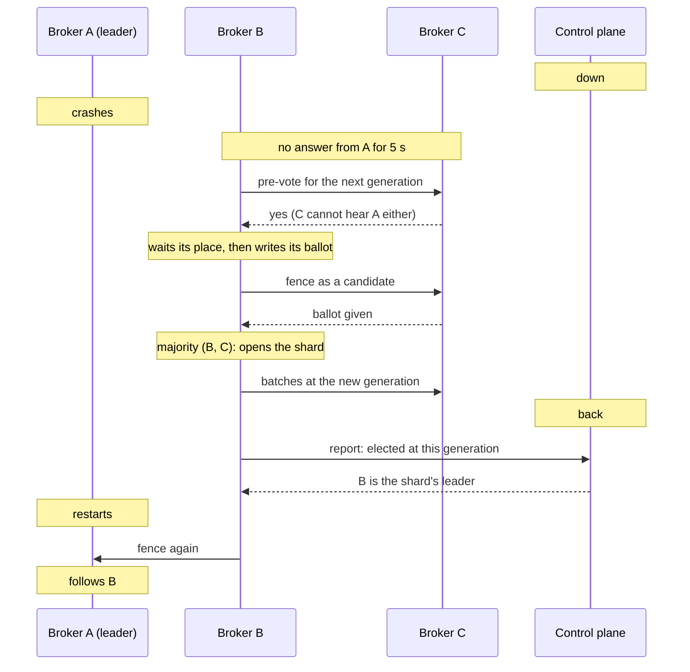

Normally the control plane decides every failover. When a shard's leader dies,
the control plane picks a follower and names it the new leader. If the control
plane is down at that moment, nobody can name one, and the shard stops taking
writes until the control plane is back.

With the `replica_election` fleet feature finalized, a shard's replicas elect a
new leader among themselves instead. The new leader serves writes while the
control plane is still down, and the control plane takes it as the shard's
leader when it returns. No acknowledged record is lost on the way.

This ships in 0.7.0. It is off until you turn it on: see
[Turning it on](#turning-it-on).

<!-- TODO(0.7.0 release day): decide whether elections are on by default for
new clusters. Today a broker offers them only with FELIX_INTERNAL_ELECTION=true
and an operator finalizes joint_fence, then replica_election. If the default
changes, update this page, the status row in
getting-started/what-felix-is-for.md and the 0.7 upgrade page together. -->

## Which shards it covers

Elections cover the shards whose control plane can already replace a leader
as soon as a majority of its followers report they cannot reach it, without
waiting for the leader's lease to run out:

- durable streams that acknowledge with `Quorum`, once `majority_ack` and
  `lease_free_reads` are finalized;
- `Quorum` caches, once `fenced_caches` is finalized as well.

`Leader` streams and in-memory streams still wait for the old leader's lease
to run out and the control plane to name a new one, as before. So do consumer
groups: a group on a shard with an elected leader waits until the
control plane is back (issue #1197).

A shard can elect only while a majority of its copies are running and have not
restarted since the control plane went down. See [Limits](#limits).

## What happens when a leader dies

A few terms first.

- The **replica set** is the list of brokers that hold a copy of the shard. Each
  copy keeps the set on disk.
- A **generation** numbers each leadership of a shard. Every new leader takes a
  higher one than the last.
- A **ballot** is a broker's promise, kept on disk, that it will follow only
  the leader of a given generation. A broker never promises one generation to
  two leaders.
- A **fence** is how a new leader takes over: it asks the replica set for their
  ballots at its generation, and it serves only once a majority has given one.
  A replica that answered stops taking writes from the old leader.

Say a shard has three copies on brokers A, B and C, with A leading, and the
control plane is down. A crashes.

1. **B and C notice.** Each follower pings its leader. A leader that has not
   answered for `FELIX_LEADER_SUSPECT_AFTER_MS` (5 s by default) is suspected.
2. **Pre-vote.** B asks the other members of its replica set whether they would
   back it. C says yes only if it cannot hear A either, it does not lead the
   shard itself, B's log is at least as far ahead as its own, and B's replica
   set is no older than the one C knows. A follower with a bad network link
   therefore cannot unseat a leader the others still hear. Nothing is written
   to disk for a pre-vote. B needs a majority, counting itself.
3. **Waiting its place.** The replicas are ordered by how far ahead their logs
   are. B waits 300 ms for each replica ahead of it, so the one with the most
   data usually stands alone. A replica that waited asks again and stops if a
   member that said yes now says no. One ahead of it that has already
   stood now says no, so the two do not stand against each other.
4. **Ballot.** B writes its ballot for the next generation to disk.
5. **Fence.** B fences the replica set as a candidate. C gives its ballot and
   records B as the new leader. With B and C, B has a majority of three. A gets
   the fence later, when it comes back.
6. **Serving.** B takes the most complete log among the answers, writes a
   start record for its generation, and opens the shard for writes. C now takes
   B's batches and sends clients that reach it to B.
7. **The control plane returns.** B's next report says it was elected. The
   control plane names B the leader at that generation, and from then on
   everything runs as before.



If two followers stand at once, the ballots decide: a replica gives its ballot
for a generation to one of them only, so at most one gets a majority. The other
backs off for 200 to 800 ms (doubling to at most 3 s) and tries again. A
standing that has not opened within 3 s, and has no fence or catch-up still
running, is withdrawn, and the next try is at a higher generation.

The time to a new leader is the suspicion window, plus one pre-vote round, plus
300 ms per replica ahead of the winner and a second pre-vote round if it waited,
plus one fence round.

### While the control plane is up

Replicas elect whether or not the control plane is reachable. So that the two
do not race, the control plane waits `FELIX_SHARD_ELECTION_HOLD_MS` (10 s) after
followers first suspect a leader before it promotes on their word. Promotion
after a dead leader's node expires is not held; with the default
`FELIX_NODE_EXPIRY_TIMEOUT_MS` that comes later than the hold anyway, so if you
lower it, keep it above the hold. If both end up
naming a leader at the same generation, ballots let only one of them open
there. If the elected one opened, the control plane moves the shard to it on
its next report.

Elections start only when followers cannot reach a leader's broker. A shard
can also get stuck on a broker that is up: a fence that never finishes, or a
copy that stopped accepting the leader. When the control plane sees no
progress from such a leader for `FELIX_SHARD_STUCK_LEADER_MS` (70 s), it
names the same leader again one generation up. The leader fences its
followers again before it serves, so no acknowledged write is lost. An idle
shard counts as progressing, a shard that never opened gets twice as long,
and each control-plane instance renames one shard at most four times an
hour. When many leaders look stuck at once the fault is not theirs, and none
is renamed.

## What you see

On the brokers, at `info`:

| Log message | Meaning |
|---|---|
| `standing for election: the leader is unreachable and a majority agreed` | This broker won its pre-vote and wrote its ballot. The line has `stream`, `shard`, `generation` and the old `leader`. |
| `a majority took the fence; opening the shard for writes` | The shard opened at `generation`. Same line as for any failover. |
| `the standing did not open in time; withdrawing it` | The shard had not opened 3 s after the ballot, and no fence or catch-up was still running. The broker tries again. |
| `not standing for election` | The broker suspects the leader but will not stand. `why` says which rule held it back, for example `the pre-vote found no majority` with the answers it got. Logged once per reason. |

On the control plane, `an elected leader reported; the control plane took its
generation`, with `adopted=true` when the elected broker became the shard's
leader.
A stuck leader named again logs a warning, `this shard's leader shows no
progress at its generation on a live broker; naming it again one generation
up`, with `reason` (`never_opened`, `stopped_reporting` or `not_committing`),
and counts in `felix_shard_move_steps_total{step="stuck"}`.

Metrics:

- `felix_broker_promotions_opened_total{path="fenced"}` goes up on the broker
  that won, as for any failover.
- `felix_broker_fleet_feature_enabled{feature="replica_election"}` is 1 on a
  broker that has the feature on. It stands for election only if
  `FELIX_LEADER_SUSPECT_AFTER_MS` is not `0` as well.

## Limits

**A broker that restarts while the control plane is down cannot vote.** It
waits for the control plane before it opens its data, so it neither votes nor
stands. A shard with three copies elects only while two of them have kept
running since the outage began. Letting a restarted broker rejoin is issue
#1196.

**16 generations per outage.** The control plane adopts an election only up to
16 generations past the last one it wrote for the shard. Each election uses a
generation, and so does each failed round after its ballot. A shard that
reaches the limit stops electing until the control plane is back.

**Brokers outside the replica set do not hear about it.** Only the shard's
replicas learn the new leader. Every other broker keeps the old route until the
control plane is back.

**Some shards wait for the control plane.** A replica does not stand while its
replica set has a change pending (most moves mid-way), or while the control
plane records a different set from the one the replica keeps. Neither is unsafe
to skip; the shard simply waits for the control plane as before.

**Mixed fleets do nothing.** Every serving broker must offer elections before
the control plane lets you finalize `joint_fence` or `replica_election`, and
until `replica_election` is finalized no broker stands, even one that offers
it.

## Turning it on

You need:

- every broker on 0.7.0 with `FELIX_INTERNAL_ELECTION=true`, restarted to
  pick it up. It works only with `FELIX_INTERNAL_FENCE` left on (the default),
  and with `FELIX_LEADER_SUSPECT_AFTER_MS` not `0`;
- every control-plane member on 0.7.0. Under Raft the control plane checks
  this: `joint_fence` needs metadata level 23 on every member, and
  `replica_election` level 26. Under Postgres it cannot see other instances'
  versions, so finish the control-plane upgrade before you start.

Then finalize these fleet features, in this order:

1. `generation_start`, then `majority_ack`, then `lease_free_reads` (and
   `fenced_caches` if you want caches elected).
2. `stream_incarnations` and `cache_incarnations`. `joint_fence` is refused
   until both are finalized.
3. `joint_fence`. From here on, a change to a replica set (a move, a
   replacement) needs a majority of both the old and the new set before the
   new leader serves.
4. `replica_election`. From here on, replicas elect.

A **new cluster** finalizes steps 1 and 2 by itself at its first broker
registration (see [A new cluster starts with them
finalized](/deployment/upgrades/#fleet-features-on-only-when-an-operator-finalizes-them)),
so you finalize only `joint_fence` and `replica_election`. An **upgraded
cluster** finalizes whichever of steps 1 and 2 it has not done yet, with the
cautions in [Upgrades and
compatibility](/deployment/upgrades/#runbook-rolling-out-a-fleet-feature).

For each feature, dry-run first:

```bash
felix-controlplane admin features finalize joint_fence --dry-run
felix-controlplane admin features finalize joint_fence
felix-controlplane admin features finalize replica_election --dry-run
felix-controlplane admin features finalize replica_election
```

The dry run says either that the feature can be finalized, or what stops it:
the features to finalize first, or the live or draining brokers that do not
support it. Under Raft the metadata level is checked only by the real
finalize, so it can still be refused after a clean dry run; the refusal says
what is missing.

Finalizing is one-way. Once `joint_fence` is finalized, a broker that registers
without it is refused and exits, and a broker reports `joint_fence` only with
`FELIX_INTERNAL_ELECTION=true`. Keep the setting on every broker from then on,
including any broker you add or replace later.

The defaults suit most clusters. `FELIX_LEADER_SUSPECT_AFTER_MS` sets how long
followers wait before they suspect a leader; a shorter window fails over faster
and replaces a slow leader more often. Keep `FELIX_SHARD_ELECTION_HOLD_MS` on
the control plane at twice that value. `FELIX_ELECTION_DEFER_FOR_MS` (60 s)
bounds how long a newly elected leader that never opens holds its followers
back before one of them may stand again.

## How it is checked

The election is modelled in TLA+ ([`docs/formal/`](https://github.com/GetFelix/felix/blob/main/docs/formal/README.md)), and each rule above has a
test. Some of them:

> `a_granted_pre_vote_puts_the_ballot_on_disk_then_records_the_standing`,
> `a_refused_pre_vote_writes_nothing`,
> `the_leader_refuses_a_pre_vote_against_itself`,
> `a_pending_set_change_is_not_stood_on`,
> `a_set_the_control_plane_does_not_record_is_not_stood_on`,
> `a_candidate_does_not_stand_past_the_adoption_window`,
> `a_cut_off_leader_takes_the_elected_leaders_fence`,
> `an_elected_leaders_report_is_adopted_once_replica_election_is_finalized`,
> `joint_fence_is_refused_while_a_serving_broker_lacks_election`,
> `replica_election_is_refused_until_joint_fence_and_the_rest_are_finalized`.

The full design, with every rule and its reason, is in [the replication
design notes](https://github.com/GetFelix/felix/blob/main/docs/replication-design.md#electing-without-the-control-plane).
