This guide follows a message through the code. It is for contributors who want
to know which task owns each piece of work, where data is queued, what is
copied, what is shared, and what happens under overload.

Code references use `path::symbol` rather than line numbers, because symbols
move less.

:::note[Scope]
Felix runs as a cluster: brokers own shards placed by the control plane, forward
what they do not own, replicate what they lead, fail over to a caught-up
replica, and move shards between brokers online. Durable storage, the
log-backed cache, and consumer groups are wired into the running broker.

The [status table](/getting-started/what-felix-is-for/) is the page to
trust per capability. Tiered storage and load-aware placement are among what is
not built.
:::
## 1. The shortest useful mental model

Felix is a brokered messaging and caching system:

- **Publishers** send byte payloads to named streams.
- **Subscribers** receive new payloads published to those streams.
- **Cache clients** store and retrieve values under scoped keys.
- A **broker** authenticates clients, validates resource scope, accepts traffic,
  and routes it through bounded queues.
- A **control plane** owns metadata and authorization state. Brokers periodically
  synchronize a local view of tenants, namespaces, streams, and caches.

The current pub/sub data path is:

```mermaid
flowchart LR
    subgraph pubproc["Publisher process"]
        direction TB
        APP1(["application"]) e1@--> PUB["felix-client<br/>Publisher"]
        PUB e2@--> CADM["publish admission<br/><small>+ worker queue</small>"]
    end

    subgraph broker["Broker"]
        direction TB
        DEC["frame decode<br/><small>+ authorization</small>"] e4@--> BADM["publish admission<br/><small>+ stream-sharded worker</small>"]
        BADM e5@--> ST[("felix-broker StreamState<br/><small>claim offsets, persist, append</small>")]
        ST e6@--> SQ["per-subscriber<br/>broker-core queue"]
        SQ e7@--> LANE["subscription lane<br/><small>encode once</small>"]
        LANE e8@--> CW["per-connection writer"]
    end

    subgraph subproc["Subscriber process"]
        direction TB
        ROUTER["event router<br/><small>+ subscription queue</small>"] e10@--> APP2(["application"])
    end

    CADM e3@-->|"QUIC bidirectional stream"| DEC
    CW e9@-->|"QUIC unidirectional event stream"| ROUTER

    e1@{ animate: true }
    e2@{ animate: true }
    e3@{ animate: true }
    e4@{ animate: true }
    e5@{ animate: true }
    e6@{ animate: true }
    e7@{ animate: true }
    e8@{ animate: true }
    e9@{ animate: true }
    e10@{ animate: true }

    classDef step fill:#e8f0fe,stroke:#4a6fa5,color:#1a2b40
    classDef store fill:#fdf0e3,stroke:#b07d3a,color:#3d2a12
    classDef endpoint fill:#e9f5ec,stroke:#4a8a5e,color:#16301f
    class PUB,CADM,DEC,BADM,LANE,CW,ROUTER step
    class ST,SQ store
    class APP1,APP2 endpoint
```



Every hop above is a named thing in the code. [Internals: Publish](/development/internals-publish/) and
[Internals: Subscribe](/development/internals-subscribe/) walk the publish and
subscribe halves in order.

The important architectural boundary is:

- `crates/server/felix-broker/src/` contains the transport-independent broker core.
- `services/felix-broker-service/src/` turns that core into a network service.
- `crates/sdk/felix-client/src/` implements the client-side connection pools and
  APIs.
- `crates/protocol/felix-wire/src/` defines what the two sides exchange.
- `crates/protocol/felix-transport/src/` wraps the QUIC implementation.

## 2. Repository map

| Area | Responsibility | Start reading |
|---|---|---|
| `crates/protocol/felix-wire` | Frame header, protocol messages, binary fast paths | `crates/protocol/felix-wire/src/lib.rs` |
| `crates/protocol/felix-transport` | QUIC endpoint, connection, stream, flow-control, and UDP configuration | `crates/protocol/felix-transport/src/lib.rs` |
| `crates/sdk/felix-client` | Publisher, subscription, and cache client APIs | `crates/sdk/felix-client/src/lib.rs` |
| `crates/server/felix-broker` | Stream registry, publish path (claim, persist, fan out), replay ring, subscriber registry, consumer groups | `crates/server/felix-broker/src/lib.rs` |
| `crates/server/felix-storage` | Segment log, commit sequencer, log-backed and in-memory caches, counters | `crates/server/felix-storage/src/lib.rs` |
| `crates/server/felix-replication` | Broker-to-broker transport and log replication | `crates/server/felix-replication/src/lib.rs` |
| `crates/server/felix-router` | Which node serves a shard, from the control plane's assignments | `crates/server/felix-router/src/lib.rs` |
| `crates/server/felix-kafka` | The read-only Kafka listener | `crates/server/felix-kafka/src/lib.rs` |
| `crates/server/felix-mqtt` | The MQTT listener and its mounts | `crates/server/felix-mqtt/src/lib.rs` |
| `crates/server/felix-common` | What broker and control plane must agree on: membership, clock, TLS, ids, the env registry | `crates/server/felix-common/src/lib.rs` |
| `crates/sdk/felix-capi` | C ABI over the Rust client, for the Go and C# SDKs | `crates/sdk/felix-capi/src/lib.rs` |
| `crates/server/felix-authz` | Token verification types and permission matching | `crates/server/felix-authz/src/lib.rs` |
| `services/felix-broker-service` | Runnable broker, network handlers, auth, metrics, control-plane sync | `services/felix-broker-service/src/main.rs` |
| `services/felix-controlplane-service` | Metadata APIs, placement, token exchange, JWKS, and RBAC | `services/felix-controlplane-service/src/lib.rs` |

## 3. QUIC transport

### 3.1 Why QUIC

QUIC runs over UDP and gives Felix TLS 1.3, reliable delivery, congestion and
flow control, and many independent ordered byte streams inside one connection.
A lost packet on one stream does not stall the others, so one connection can
carry several publish or cache workers.

Bytes within one stream are still ordered, and Felix gives each stream exactly
one writer task. The number of connections and streams is therefore what sets
real parallelism.

Felix uses the [`quinn`](https://github.com/quinn-rs/quinn) Rust implementation.
The wrapper types are:

- `crates/protocol/felix-transport/src/server.rs::QuicServer`
- `crates/protocol/felix-transport/src/client.rs::QuicClient`
- `crates/protocol/felix-transport/src/connection.rs::QuicConnection`

`QuicServer::bind` and `QuicClient::bind` create UDP sockets, install Quinn's
transport configuration, and create endpoints whose driver tasks run on a
dedicated I/O runtime when one is configured, or on the application's Tokio
runtime otherwise.

### 3.2 Connections and streams

A QUIC **connection** is the encrypted relationship between a client endpoint
and a server endpoint. A connection contains many streams:

- A **bidirectional stream** has one send direction and one receive direction.
  Either peer may send data on its half.
- A **unidirectional stream** carries bytes in one direction only.

Felix maps its operations onto these primitives:

| Operation | Stream type | Why |
|---|---|---|
| Authentication and acknowledged publish | Bidirectional | Client sends requests; broker sends responses |
| Subscribe setup | Bidirectional | Client sends `Subscribe`; broker returns `Subscribed` or `Error` |
| Event delivery | Broker-opened unidirectional | Events flow only from broker to subscriber |
| Cache put/get | Bidirectional | Each operation is a request/response exchange |
| Optional high-throughput publish ingress | Client-opened unidirectional | Fire-and-forget traffic does not need responses |

The current Rust client opens authenticated bidirectional workers for its normal
publish API. The broker also supports unidirectional publish ingress in
`services/felix-broker-service/src/serving/quic/streams/uni.rs::run_uni_loop`.
Fire-and-forget means that the broker does not return a publish response; it
does not mean that the stream is unauthenticated. A unidirectional publish
stream must begin with `Message::Auth` before it sends publish frames.

### 3.3 Transport tuning

`crates/protocol/felix-transport/src/config.rs::TransportConfig` controls:

- maximum concurrent streams;
- connection and per-stream flow-control windows;
- send window;
- initial MTU and path-MTU discovery;
- maximum accepted UDP payload;
- UDP socket send and receive buffers; and
- an optional initial congestion window.

`TransportConfig::quinn_transport_config` translates these settings into Quinn
configuration. `TransportConfig::bind_udp_socket` applies socket buffer sizes
best-effort, reducing the requested size until the host accepts it.

These settings matter because high-rate messaging can otherwise become limited
by tiny flow-control windows, excessive small datagrams, or kernel UDP drops.
They improve capacity; they do not change Felix's delivery semantics.

## 4. Felix's wire protocol

QUIC gives reliable byte streams but does not say where one Felix message ends.
Felix adds a 12-byte frame header (magic, version, flags, payload length) in
`crates/protocol/felix-wire/src/client/`. Control messages (`Auth`,
`Subscribe`, acknowledged publishes, cache requests, errors) are JSON. The hot
paths use binary frames, selected by flag bits in the header, and the shared
event encoder writes each payload once for every subscriber. A flag bit
the receiver does not know is rejected, because it would change the layout of
the body.

[Wire Protocol](/architecture/wire-protocol/) owns the frame layout, the message
catalogue and capability negotiation.

## 5. Felix's resource model

Pub/sub resources are scoped as:

```text
tenant -> namespace -> stream
```

Cache resources are scoped as:

```text
tenant -> namespace -> cache -> key
```

The broker keeps local registries for these objects in
`crates/server/felix-broker/src/broker/registry.rs`. A stream does not become valid merely
because a client names it; it must exist in the broker's synchronized metadata.

The running service obtains metadata from the control plane through
`services/felix-broker-service/src/cluster/catalog_sync.rs::start_sync`. On cold start,
`sync_once` fetches full snapshots in dependency order:

1. tenants;
2. namespaces;
3. caches;
4. streams.

Later iterations consume incremental change feeds. Each resource type has its
own sequence cursor. A failed fetch is retried without advancing that cursor,
so synchronization is eventually consistent rather than transactional across
all resource types.

## 6. Broker startup and process lifecycle

The executable starts at `services/felix-broker-service/src/main.rs::main`, which calls
`node::run_with_shutdown` (`services/felix-broker-service/src/node.rs`).

Startup proceeds in this order:

1. `observability::init_observability` installs tracing and the Prometheus
   recorder.
2. `BrokerConfig::from_env_or_yaml` resolves configuration.
3. `node::storage::open` opens durable storage when it is configured, the
   cache, consumer groups and counters, and builds the `Broker` over them.
4. `BrokerAuth::new` creates the broker's control-plane-backed authenticator.
5. `observability::serve_metrics` starts the health and metrics HTTP server.
6. `node::listeners::bind` creates the QUIC TLS configuration
   (`build_server_config`) and binds one `QuicServer` per configured listener.
7. `node::listeners::spawn_accept_loops` starts an accept loop per listener
   (`quic::serve_with_shutdown`).
8. `node::sync::spawn_catalog_sync` starts metadata synchronization
   (`catalog_sync::start_sync_with_signal`).
9. On a cluster member, `node::membership::spawn` registers the node, and
   `node::cluster` binds the peer listener and starts the shard and
   replication tasks.

:::caution[TLS certificate behavior]
`services/felix-broker-service/src/serving/tls.rs` serves the certificate in
`FELIX_TLS_CERT` / `FELIX_TLS_KEY`, re-read on rotation. Without them it
generates a fresh self-signed certificate for `localhost` at every start and
warns; that is development behavior, and `FELIX_TLS_REQUIRE_CERT=true` refuses
it.
:::
### 6.1 Graceful shutdown

Shutdown is an ordered drain, not a task abort. The broker marks itself
draining so load balancers stop routing to it, hands its shards to other
brokers, stops accepting connections, gives in-flight streams a bounded grace
period, then stops control-plane sync and the metrics server last. One
`felix_common::lifecycle::DrainBudget` bounds the whole sequence. The code is
`run_with_shutdown`. [Graceful shutdown](/deployment/graceful-shutdown/) has the
order, the deadlines and the Kubernetes settings.

## 7. Client connection architecture

`crates/sdk/felix-client/src/client/connect.rs::Connection::connect_with_transport`
constructs three separate pools.

### 7.1 Publish pool

For each configured publish connection, the client opens several
bidirectional streams. Each stream:

1. is authenticated by `authenticate_stream`;
2. receives a bounded `mpsc` queue; and
3. gets one `run_publisher_writer_with_limit` task that exclusively owns its Quinn
   `SendStream` and `RecvStream`.

The single-writer ownership is intentional. It avoids interleaved writes and
preserves the enqueue order of requests assigned to that worker.

### 7.2 Cache pool

The cache pool also uses multiple connections and multiple bidirectional
streams per connection. Every stream has a `run_cache_worker_with_limit` task. Each worker
performs sequential request/response exchanges, while separate workers allow
independent cache operations to progress concurrently.

### 7.3 Event pool

Event connections are reserved for subscriptions. Each event connection gets
one `event_router::run_event_router` task that accepts broker-opened
unidirectional streams and associates them with subscription IDs.

Separate pools allow publish, cache, and event-delivery flow control to be
tuned independently and keep one traffic class from consuming all streams in
another.

## 8. Authentication and authorization

Every client-created control stream begins with authentication. The broker's
read loop is `services/felix-broker-service/src/serving/quic/streams/control.rs::run_control_loop`.

Before authentication:

- JSON traffic must be `Message::Auth`.
- Binary publish frames are rejected with `auth required`.

`services/felix-broker-service/src/serving/auth.rs::BrokerAuth::authenticate`:

1. ensures the tenant's JWKS is cached, fetching it only for a tenant it holds
   no usable keys for (a background task renews the cached ones);
2. verifies the token signature and critical claims, fetching the JWKS once
   more when the token names a `kid` the cached set lacks;
3. verifies tenant scope;
4. compiles token permissions into a `PermissionMatcher`; and
5. returns an `AuthContext`.

After authentication, the control loop authorizes each operation against its
scoped resource: `StreamPublish`, `StreamSubscribe`, `CacheRead` (get, watch,
counter reads), `CacheWrite` (put, delete, counter adds), and `GroupConsume` /
`GroupManage` for consumer groups (`felix_authz::Action`).

The control plane is the authority for token exchange, public verification
keys, and RBAC policy. The broker caches enough state to verify and authorize
the data path locally instead of calling the control plane for every message.

## 9. The complete publish path

A publish crosses the client (`Publisher`, worker selection, byte admission, the
stream writer), the broker's QUIC handler (decode, authorize, route), byte and
item admission, the per-shard publish scheduler, and then the broker core, which
claims offsets, persists and fans out. Each stage and the types it passes are
walked in order in [Internals: Publish](/development/internals-publish/). The
fanout copies nothing: one `DeliveryEnvelope` is shared by every subscriber.

## 10. Acknowledgement semantics

`felix_wire::AckMode` has `None`, `PerMessage`, and `PerBatch`.

The important distinction is broker configuration:

- Unset, a durable stream acknowledges after commit and an in-memory stream on
  enqueue. `PublishContext::ack_durable_on_commit` carries the durable half,
  and the handler adds it to `commit_ack` when the resolved target is durable.
- With `ack_on_commit = false` (`FELIX_ACK_ON_COMMIT=0`), an acknowledgement means the broker accepted
  the job into its ingress queue. It is sent before the write, so the record is
  lost if the broker crashes first, or if its lease lapses while the job is
  queued: the claim refuses a write once the lease is gone. A publish admitted
  with little lease left (less than the queue wait plus the ack wait, capped at
  half the lease) waits for its write instead. A job that was acknowledged and
  then not written is counted in `felix_broker_acked_publishes_dropped_total`.
- With `ack_on_commit = true`, every stream waits until the publish has been
  written and fanned out.

What "commit" means depends on how the stream was registered. For an ephemeral
stream it is the in-memory append and fanout, and nothing more. For a durable
stream it is a write that has reached disk under the stream's fsync policy; for
one declared `Quorum` it is a write a majority of the shard's replicas hold.

Commit acknowledgements are sent by whoever settles the publish: the executor
for an in-memory write, the commit task for a durable one. Nothing waits in
between. They use:

- `handlers/publish/commit_ack.rs::CommitAcks`, one per control stream, which
  makes a `CommitReply` that travels with the job and answers the client;
- a bounded semaphore of answers owed; and
- `CommitAcks::run_deadlines`, one deadline sweep per stream in place of a
  timer per publish.

The writer takes every answer already queued and sends them in one write. It
never waits for more.

Acknowledgements carry request IDs and may be emitted out of order, allowing
independent completed jobs to respond without waiting for an earlier slow job.
A client that negotiated `FEATURE_PUBLISH_PIPELINE` is the exception: the
control loop registers each of its acked publishes as it reads it
(`handlers/publish/order.rs::AckOrder`), taking a slot in the stream's
publish window, and the stream's writer holds an answer back until everything
read before it has been answered. The slot is freed when the answer is
written, and while none is free the control loop stops reading, so the window
bounds a stream's unanswered publishes and pushes back through QUIC flow
control. Each stream has its own window so that one stuck behind a stalled
shard cannot take the slots its connection's other streams need. The Rust
`Client` puts each shard on a stream of its own, so for it the window
and the request order are in effect per shard.

Commit acknowledgement is not an exactly-once outcome protocol. The publish job
is enqueued before the broker reserves and submits all acknowledgement-waiter
state. If that later step is overloaded, or if `ack_wait_timeout` expires, the
client can receive an overload or commit-timeout error even though the publish
was already enqueued and may have completed. A client must not interpret every
acknowledgement error as proof that the event was not published.

## 11. The complete subscription and fanout path

A subscription is registered with the broker core, assigned to a lane, fed by a
per-lane feeder that encodes each batch once, written by a connection writer to
one QUIC stream, and decoded by the client's event router and subscription
pipeline. A subscriber that names a start offset gets history first, then the
live stream, with nothing lost between them. The steps are in
[Internals: Subscribe](/development/internals-subscribe/), and resuming is in
[Resuming from an offset](/development/internals-subscribe/#resuming-from-an-offset).

## 12. Ordering guarantees

Ordering must be described at a specific boundary:

- One client publish worker writes requests in queue order.
- `HashStream` keeps one logical stream on one client worker.
- The broker maps one `StreamHandle` to one publish lane, which claims
  offsets one publish at a time in arrival order.
- `Broker::claim_publish` takes offsets in lane order, and the
  `CommitSequencer` makes batches reach the ring and subscribers in offset
  order.
- Each subscriber receives envelopes through one ordered broker-core channel.
- Lane and connection writers preserve ordering for each subscriber.
- QUIC preserves byte order within the subscriber's event stream.

There is no universal order across different streams.

When several independent publishers publish concurrently to the same stream,
the resulting order is the order in which their jobs reach the stream's
publish lane. Felix cannot infer a stronger application-level
causal order between independent producers.

## 13. Backpressure and overload

Felix bounds every queue instead of letting memory grow. There are six
checkpoints between publisher and subscriber, then QUIC flow control beneath
them. Subscriber queues drop by default so a slow consumer costs only itself;
benchmark profiles switch to blocking so pressure reaches the publishers.
[Internals: Backpressure](/development/internals-concurrency/#the-full-backpressure-chain)
lists the checkpoints and their defaults, and explains why bytes and items are
both bounded.

## 14. Cache request path

The client methods in `crates/sdk/felix-client/src/client/cache.rs` are
`cache_put`, `cache_get`, `cache_delete`, `counter_add` and `counter_get`. Each
call:

1. allocates a request ID;
2. selects a cache worker round-robin;
3. enqueues a `CacheRequest`; and
4. waits on a one-shot response channel.

`crates/sdk/felix-client/src/cache/worker.rs::run_cache_worker_with_limit` owns one
bidirectional QUIC stream and performs sequential round trips:

```text
encode -> write -> read -> decode -> validate request ID
```

Different cache workers run concurrently. One worker stays sequential so
response matching is simple and the stream has one writer.

Watches are separate: `watch_cache` and `watch_cache_retained`
(`client/cache_watch.rs`) open a subscription-like event stream bound by
`EventStreamHello`, and each change arrives with its cache-log offset.

On the broker, the control loop authorizes the operation, routes the key to
its shard's owner (forwarding when that is another broker), and calls the
broker's `felix_storage::StorageApi` (`crates/server/felix-storage/src/cache.rs`).
Counters go to a separate `CounterStore`.

### 14.1 Which cache the broker runs

`node/storage.rs::open` picks the implementation:

- With `FELIX_DURABLE_STORAGE_DIR` set, the cache is a `LogCache` under
  `caches/`: writes append records to a segment log, reads go through a
  key-to-offset index rebuilt from the log at startup, and compaction reclaims
  superseded and expired records in the background. Counters get their own
  `CounterStore` under `counters/`. Watches, resume by offset and replication
  need this log.
- Without it, the cache is an `EphemeralCache` in memory, and counters are not
  offered. TTL is checked lazily on read, and the broker builds it with no
  entry limit.

## 15. Core sharding and CPU ownership

With `core_shards` on, a stream handle picks one dedicated single-threaded
runtime (`handle_id % shard_count`), optionally pinned to a CPU, so append,
fanout enqueue and feeder dequeue for a stream run on one core. It scales
across streams, not within one. QUIC I/O stays on the main runtime. See
[Internals: Core sharding](/development/internals-concurrency/#core-sharding).

## 16. Observability

`init_observability` installs tracing, OpenTelemetry propagation and a
Prometheus recorder. [Observability](/features/observability/) lists the
metrics, probes and tracing. When messages seem to be missing, check the drop
counters first (`felix_subscribe_dropped_total`, `felix_sub_queue_dropped_total`,
the broker's ingress drop counters): a nonzero count is an overload policy
doing its job before it is a routing bug.

### 16.1 The soak harness

`services/felix-broker-service/src/bin/soak/` is the resource-leak and lifecycle harness. Run
it with:

```bash
cargo run --release -p felix-broker-service --bin soak -- --duration-secs 60
```

It stands up a real broker with real QUIC connections and the real auth path,
then drives five phases: sustained load, connection churn, slow subscribers
saturating their queues, repeated identical load cycles, and repeated
`SIGTERM` restarts of a genuine child process. It samples RSS and open file
descriptors throughout, scrapes the broker's own gauges after quiescence, and
exits non-zero on a finding.

Memory is judged across repeated identical cycles, not against a pre-load
baseline, because allocators keep freed pages and that comparison would flag
every healthy run. A leak shows as peak RSS still climbing on the last cycle.
File descriptors are checked exactly, since nothing caches them.

After every client has disconnected, `felix_sub_active_connections`,
`felix_sub_connection_subscribers`, `felix_broker_ingress_queue_depth` and
`felix_broker_out_ack_depth` must be back at zero. Anything left there is an
entry that will never be reclaimed.

Findings and the current steady-state envelope are recorded in
`docs/security/soak-report.md`, alongside the panic audit in
`docs/security/panic-audit.md`. Both are repository-local audit records rather
than published pages.

## 17. What this guide leaves out

This guide follows one broker's data path. Replication (`felix-replication`),
failover, shard moves, consumer groups and the control plane's placement are
all in the running system and have their own pages under
[Architecture](/architecture/system-design/). The
[status table](/getting-started/what-felix-is-for/) says what is complete
and what is partial.

Two local gaps are worth knowing while reading the code:

- `sub_stream_mode = hashed_pool` is accepted in configuration, but
  `handle_subscribe_message` records a fallback
  (`broker_sub_stream_mode_fallback_total`) and uses one unidirectional stream
  per subscriber.
- `SubQueuePolicy::DropOld` behaves as `DropNew`; see
  [Internals: Publish](/development/internals-publish/#fanout-and-the-subscriber-queue-policy).

## 18. A worked example

Assume one application publishes a binary batch of 64 payloads to
`tenant-a/orders/updates`, with ten subscribers.

1. `Publisher::publish_batch` sees `AckMode::None` and selects the binary path.
2. `Publisher::select_worker` hashes the stream to one client publish worker.
3. The batch is encoded once into a binary Felix frame.
4. Client `PublishAdmission` reserves the encoded byte count.
5. The request enters that worker's bounded channel.
6. `run_publisher_writer_with_limit` writes the bytes to its authenticated QUIC stream.
7. The broker control loop recognizes `FLAG_BINARY_PUBLISH_BATCH`.
8. The broker verifies the authenticated tenant and publish permission.
9. `resolve_route` confirms this broker owns the shard and returns its `StreamHandle`.
10. Broker per-connection and global byte admission reserve the payload bytes.
11. `enqueue_publish` queues the job on the stream's lane, charged to `tenant-a`.
12. An executor takes it on `tenant-a`'s turn and calls `Broker::claim_publish`,
    which takes 64 offsets from the log and a commit turn, then releases the lane.
13. `Broker::complete_publish`, on its own task, waits for the flush and the turn,
    then appends the batch to the replay ring.
14. The broker loads the lock-free subscriber snapshot containing ten senders.
15. One `DeliveryEnvelope` is created and cloned into ten subscriber queues.
16. The first awakened feeder encodes one shared event frame; the other nine
    clone the cached `Bytes`.
17. Feeders enqueue deliveries through their selected writer lanes.
18. Lane tasks forward them to the relevant connection writers.
19. Each connection writer pipelines writes across subscribers while preserving
    per-subscriber order.
20. Each client event router has already associated the event stream with its
    subscription ID.
21. Subscription I/O tasks read the shared binary event frame.
22. Dispatch tasks decode the 64 payloads and enqueue them for application
    consumption.
23. `Subscription::next_event` returns them one at a time.

The batch was encoded once on publish ingress and once for event fanout, not
once per subscriber.

## 19. How to study the code

Read in this order and follow each symbol with editor "go to definition":

1. `crates/protocol/felix-wire/src/client/`
   - `FrameHeader`
   - `Frame`
   - `Message`
   - binary publish/event encoders
2. `crates/protocol/felix-transport/src/`
   - `TransportConfig`
   - `QuicServer`
   - `QuicClient`
   - `QuicConnection`
3. `crates/sdk/felix-client/src/client/`
   - `Connection::connect_with_transport` (`connect.rs`)
   - `Connection::subscribe` (`subscribe.rs`)
4. `crates/sdk/felix-client/src/publish/`
   - `Publisher::select_worker` (`routing.rs`)
   - `Publisher::publish_batch_binary` (`publish.rs`)
   - `run_publisher_writer_with_limit` (`writer.rs`)
5. `services/felix-broker-service/src/serving/quic/conn.rs`
   - `serve_with_shutdown`
   - `handle_connection_with_shutdown`
6. `services/felix-broker-service/src/serving/quic/streams.rs`
   - `handle_stream`
7. `services/felix-broker-service/src/serving/quic/streams/control.rs`
   - `run_control_loop`
8. `services/felix-broker-service/src/serving/quic/handlers/publish/`
   - `build_publish_context` (`worker.rs`)
   - `resolve_route` (`route.rs`)
   - `enqueue_publish` (`ingress.rs`)
9. `crates/server/felix-broker/src/`
   - `StreamState` (`stream/state.rs`)
   - `DeliveryEnvelope` (`stream/delivery.rs`)
   - `Broker::claim_publish` and `Broker::complete_publish` (`broker/publish.rs`)
   - `Broker::subscribe` and `Broker::subscribe_from` (`broker/subscribe.rs`)
10. `services/felix-broker-service/src/serving/quic/handlers/subscribe/`
    - `handle_subscribe_message` (`subscribe.rs`)
    - `run_lane_feeder` (`feeder.rs`)
    - `run_writer_lane` (`writer.rs`)
    - `run_connection_writer` (`writer.rs`)
11. `crates/sdk/felix-client/src/connection/event_router.rs`
    - `run_event_router`
12. `crates/sdk/felix-client/src/subscribe/pipeline.rs`
    - `Subscription::spawn_pipeline`
    - `run_subscription_io_task`
    - `run_subscription_dispatch_task`

## Related guides

- [System Design](/architecture/system-design/)
- [Component Architecture](/architecture/components/)
- [Wire Protocol](/architecture/wire-protocol/)
- [Internals: The Publish Path](/development/internals-publish/)
- [Internals: Subscribe & Fanout](/development/internals-subscribe/)
- [Internals: Backpressure & Core Sharding](/development/internals-concurrency/)
- [Graceful Shutdown](/deployment/graceful-shutdown/)
- [Performance Tuning](/features/performance/)
