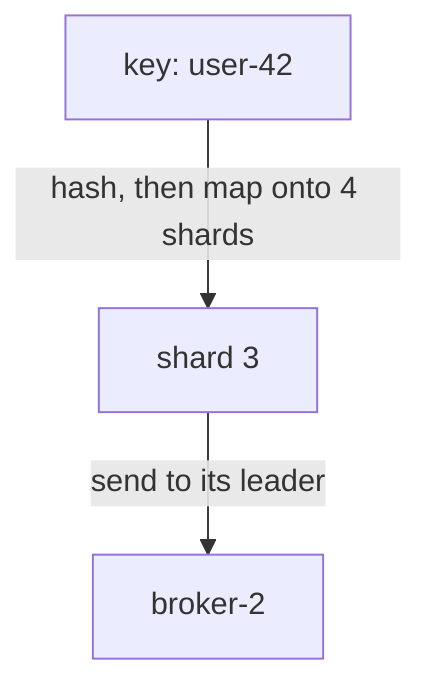
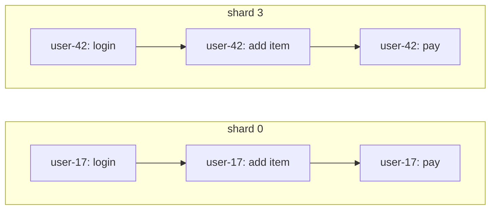
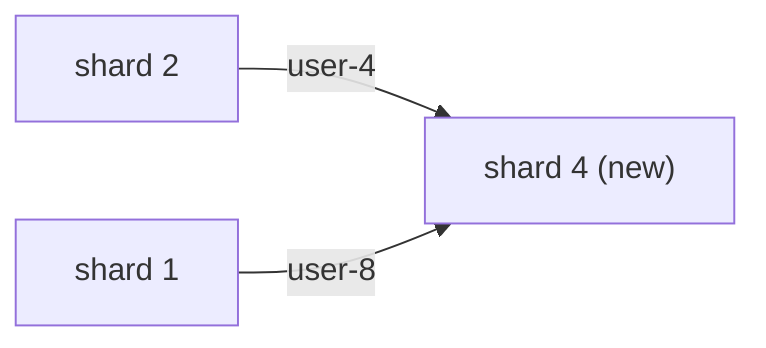
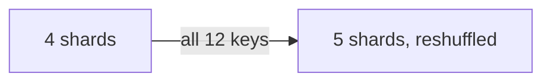
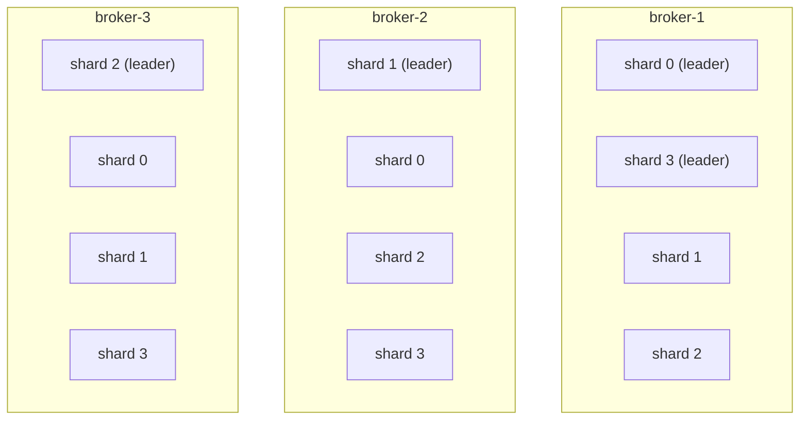
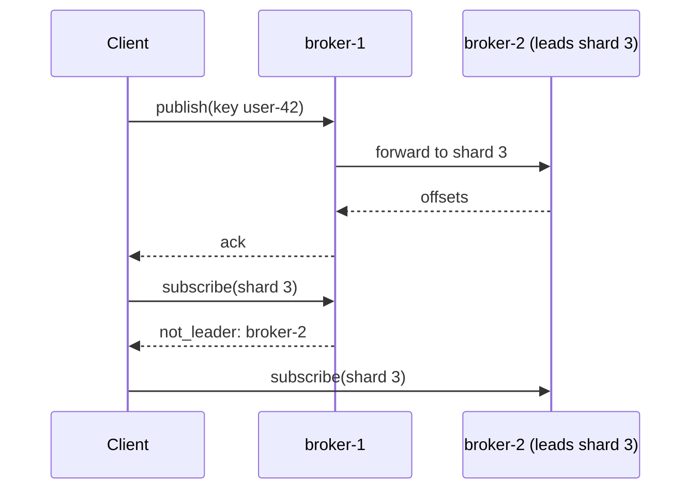

A stream can be split into **shards**. Each shard is its own ordered log with
its own leader broker and its own replicas. This page explains how records are
spread over shards, what order you can rely on, and how to choose a key and a
shard count.

## What a shard is

A stream with one shard is a single log. Every record goes to the same place,
one broker leads it, and every reader sees one order.

A stream with four shards is four logs that share a name. Each shard has:

- its own offsets, starting at 0,
- its own leader, the broker that accepts its writes,
- its own replicas, other brokers that keep a copy of it,
- its own generation, a counter that goes up each time its leader changes, so
  brokers and clients can tell an old leader from the current one.

Shards exist for two reasons. They spread load, because four shards can be led
by four different brokers, so one busy stream is not limited to one machine.
And they keep order where it matters: records that share a key always land on
the same shard, so they stay in order relative to each other.

## How a record finds its shard

A publish can carry a **routing key**, a short byte string such as a user id or
an order id. Felix turns the key into a shard number in three steps:

1. Hash the key to a 64-bit number (FNV-1a followed by a mixing step).
2. Map that number onto the stream's shard count, using the stream's mapping:
   jump hash or modulo (see [below](#modulo-and-jump-hash)).
3. Send the record to the broker that leads that shard.



The function is fixed and shared. It lives in one place in the wire protocol
crate (`felix_wire::routing`), and both the brokers and the clients use it. The
same key gives the same shard on every broker, in every client, and across
restarts.

### A worked example

Take a stream with 4 shards. These are the real answers for a few keys:

| Key | Jump hash, 4 shards | Modulo, 4 shards |
| --- | --- | --- |
| `user-17` | 0 | 3 |
| `user-42` | 3 | 3 |
| `order-9001` | 1 | 3 |
| `user-7` | 3 | 2 |
| `user-8` | 1 | 0 |

A test checks every number in this table, and in the growth example below,
against Felix's routing function.

The two mappings give different answers for the same key, which is why a
stream's mapping is fixed when the stream is created. Also, a handful of keys
can cluster: under modulo, three of these five keys land on
shard 3. Spread evens out over many keys, not over five.

### Publishing with a key

In Rust, the cluster `Client` takes the key as a `Bytes` argument. Here
`client` is a connected `Client` and `payload` is a `Vec<u8>`; see
[Clusters](/clients/rust/operations/#clusters) for setting one up.

```rust
use bytes::Bytes;
use felix_client::AckMode;

client
    .publish_keyed(
        "acme",
        "prod",
        "orders",
        payload,
        Bytes::from("user-42"),
        AckMode::PerMessage,
    )
    .await?;
```

In Python it is a keyword argument:

```python
client.publish("acme", "prod", "orders", payload, key=b"user-42")
```

The client works out the shard itself. It asks a broker once per stream for the
shard count and mapping, so it reaches the same answer the broker does, and
sends the record straight to that shard's leader. See
[Publishing in Rust](/clients/rust/publishing/#the-routing-key-decides-the-shard).

## Publishing without a key

**A publish without a key always goes to shard 0.** There is nothing to hash,
so there is nothing to spread. This is by design.

That is fine when the stream has one shard, or when you want a single total
order for the whole stream and the load fits on one broker.

It is not fine when you created several shards to get more throughput. If
you never pass a key, shards 1, 2 and 3 stay empty and shard 0's leader does
all the work. Pass a key whenever a stream has more than one shard.

## Ordering

Order holds **within a shard**. Since a key always maps to the same shard,
order holds **per key**. There is no order across shards.

Suppose `user-17` and `user-42` each do three things, on a stream with jump
hash routing and 4 shards. `user-17` lands on shard 0 and `user-42` on shard 3.



Every reader sees `user-17`'s three events in that order, and `user-42`'s three
in that order. A reader of both shards may see `user-42: pay` before
`user-17: login`, even if `user-17` logged in first. If you need one order over
everything, use a single-shard stream.

## Choosing a key and a shard count

A good key has two properties. It **spreads**: there are many distinct values,
and no single value carries a large share of the traffic. User ids, order ids
and device ids usually do. And it is **stable**: the same entity always uses the
same key, so its records stay together and in order.

Watch for hot keys. If one tenant or one device produces half of all records,
its shard does half the work no matter how many shards there are. A key only
spreads load as well as its busiest value allows.

Choose the key by what must stay in order. If an order's events must be
processed in sequence, key by order id. If a user's events must be, key by user
id.

The shard count is set when the stream is created. Felix cannot reshard a
live stream today, so pick the count with that in mind:

- One shard if you need total order or the stream is small.
- Otherwise, at least as many shards as brokers you expect to lead the stream,
  so each broker can lead some. A few times that leaves room for more brokers
  later, since a shard is the unit that moves.
- Far more shards than brokers you will ever run mostly adds bookkeeping.
  Each shard has its own leader, replicas and log.

```bash
felixctl stream create orders --shards 8 --replication 3
```

## Modulo and jump hash

Both mappings start from the same 64-bit hash.

- **Modulo** takes `hash % shards`. It is the original mapping.
- **Jump hash** is jump consistent hashing (Lamping and Veach). It gives an even
  spread like modulo, and it has one extra property.

The difference shows when the shard count grows from `n - 1` to `n`. Under jump
hash, only about `1/n` of the keys get a new shard, and every key that moves
goes to the new shard. Under modulo, nearly every key gets a new shard.

Here are twelve keys, `user-0` to `user-11`, going from 4 to 5 shards:

| Key | Jump hash 4 → 5 | Modulo 4 → 5 |
| --- | --- | --- |
| `user-0` | 0 → 0 | 0 → **4** |
| `user-1` | 1 → 1 | 0 → **4** |
| `user-2` | 3 → 3 | 3 → **0** |
| `user-3` | 1 → 1 | 2 → **4** |
| `user-4` | 2 → **4** | 3 → **4** |
| `user-5` | 0 → 0 | 1 → **2** |
| `user-6` | 1 → 1 | 3 → **1** |
| `user-7` | 3 → 3 | 2 → **4** |
| `user-8` | 1 → **4** | 0 → **4** |
| `user-9` | 1 → 1 | 2 → **4** |
| `user-10` | 1 → 1 | 2 → **1** |
| `user-11` | 0 → 0 | 3 → **1** |

Under jump hash, 2 of the 12 keys move, and both go to the new shard:



Under modulo, all 12 keys move, and five of them move between old shards:



Over 10,000 keys the same growth moves 1,941 keys under jump hash (about one in
five) and 7,993 under modulo (about four in five).

Streams created once the cluster has finalized the `jump_hash_routing` fleet
feature (an upgrade step an operator takes once every broker runs a version
that knows it) get jump hash unless they ask for modulo. Streams created before keep
modulo, and nothing about them moves. See
[Upgrades](/deployment/upgrades/). A stream's mapping is recorded with it and
never changes.

Since shard counts are fixed today, no stream moves keys yet. Jump hash keeps
most keys in place should a stream's shard count ever grow. Caches always
use modulo.

## Where shards live

The control plane decides **placement**: which brokers hold each shard and
which of them leads it. It scores every broker against each shard and spreads
leaders evenly, so a stream's shards end up led by different brokers. With
`--replication 3`, each shard has three copies, the leader included, and the
copies are spread across zones when brokers report them.

Here is one possible placement of a 4-shard stream with 3 copies per shard on 3
brokers. Each broker leads some shards and follows others.



Each shard replicates on its own. Its leader sends records to that shard's
followers. A stream created with `--consistency quorum` acknowledges a publish once a majority of that
shard's copies hold it. When a leader fails, only that shard's leadership
changes, and its generation goes up. The other shards carry on. (The default,
`leader`, acknowledges once the leader alone has the record.) See
[System design](/architecture/system-design/#clustered) and
[Failover without the control plane](/deployment/failover-without-control-plane/).

Shards also move. Placement moves them off a draining broker and from a broker
leading more than its share to one leading less. A move stages the new broker
as a replica, catches it up, and only then hands over leadership. See
[Adding and removing brokers](/deployment/scaling/) and
[Moving shards by hand](/deployment/moving-shards/).

### A request sent to the wrong broker

Clients do not need to know where every shard lives. Every broker keeps a
local copy of which broker leads each shard, refreshed in the background, so
any broker can answer for any shard.

A **publish** sent to a broker that does not lead the shard is forwarded. That
broker hashes the key, finds the leader, and passes the publish on. The client
gets its acknowledgement as usual. A conditional publish (`publish_if`) is never
forwarded.

A **subscribe** (and a consumer-group or cache-watch request) sent to the wrong
broker is answered with `not_leader`, naming the broker that leads the shard,
and the client reconnects there. A client too old to understand `not_leader`
gets an ordinary error instead. The Rust cluster `Client` does this for you, and
follows a shard again when it moves; see
[Building resilient clients](/clients/resilient-clients/) for the other
languages.



To see where a stream's shards live and which broker leads each, run
`felixctl topology` (see [felixctl commands](/reference/felixctl/#felixctl-topology)).
See also [Cross-broker routing](/architecture/system-design/#cross-broker-routing)
and [Redirects](/api/broker-api/#redirects).

## How readers see shards

**A subscription reads one shard.** A plain `subscribe` reads shard 0.
`subscribe_shard` reads one shard you name. `subscribe_sharded` opens one
subscription per shard and merges them into one stream of events, so you can
read the whole stream from one place. As above, `client` is the cluster
`Client` (held in an `Arc`), and `handle` is your own function:

```rust
use felix_client::{ShardEvent, StartPosition};

let mut stream = client
    .subscribe_sharded("acme", "prod", "orders", Some(StartPosition::Earliest))
    .await?;

while let Some(item) = stream.next().await {
    match item {
        ShardEvent::Record { shard, event } => handle(shard, &event).await?,
        ShardEvent::ShardLost { shard, error } => tracing::error!(shard, %error, "shard lost"),
        _ => {} // moves, recoveries and deletes; `ShardEvent` is non-exhaustive
    }
}
```

The merged stream keeps each shard's order and promises nothing across shards.
If one shard cannot be opened, `subscribe_sharded` fails rather than quietly
reading part of the stream.

**Offsets are per shard.** Offset 10 on shard 0 and offset 10 on shard 3 are
different records. To resume a sharded subscription, save a map from shard to
last offset (`positions()`) and pass it to `resubscribe_sharded`. See
[Resume a sharded stream](/clients/resilient-clients/#resume-a-sharded-stream).

**A consumer group is bound to one shard.** Acks, redelivery and the group's
position belong to that shard and replicate with it. To work a multi-shard queue,
`group_sharded` polls every shard in turn and sends each ack to the shard its
record came from. See [Work queues](/use-cases/work-queues/) and
[Queues](/features/queues/).

**Caches are sharded too.** A cache key picks a cache shard the same way a
routing key picks a stream shard, always with modulo, and each cache shard has
one leader. See [Distributed cache](/features/cache/).
