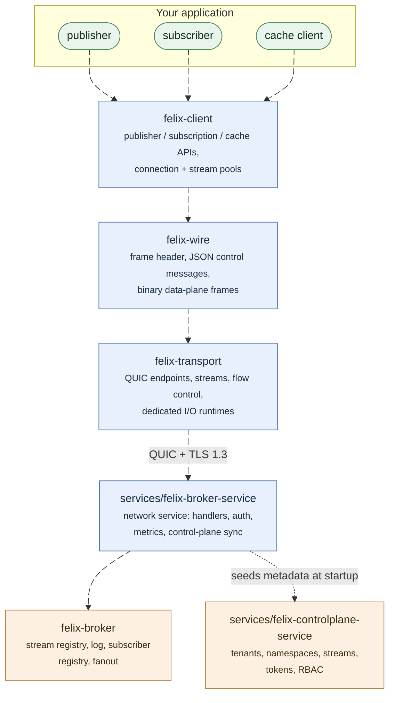

Felix is a distributed data backend that serves three things most systems run
three products for: event streams, work queues, and a key-value cache. All
three are readings of the same replicated, append-only log, reached over one
QUIC connection.

This page is the short version of how it fits together. The
[status table](/getting-started/what-felix-is-for/) is the page to trust
for what is and is not built.

:::note[Words you will see]
- **Shard**: one slice of a stream or cache, with its own log and its own leader.
- **Lease**: the time-limited right to act as a shard's leader.
- **Fence**: a step that makes an old leader stop accepting writes before a new one starts.
- **Fleet feature**: a cross-broker capability that turns on only once every broker supports it.
- **Quorum**: a majority of a shard's replicas; a `Quorum` publish waits for it.

More in [Terminology](/reference/terminology/).
:::

## The core idea

Internally there is one primitive, an append-only log per shard, and streams,
queues and the cache are three ways of reading it. [Why Felix?](/getting-started/why-felix/)
explains the idea in plain terms; this page covers the parts.

## What Felix optimizes for

Felix puts predictable latency under load ahead of peak batch throughput.
Several choices follow from that.

Felix clients use QUIC, so streams multiplex over one connection without
head-of-line blocking, and every connection is TLS 1.3. Queues are bounded and
their overflow policy is explicit, so one slow path degrades locally instead of
cascading. A stalled subscriber loses *its own* events (under the default
`drop_new` policy) rather than stalling the publisher or other subscribers; the
[slow-consumer demo](/demos/slow-consumer-isolation/) runs both policies
side by side. Batching bounds, flow-control windows, pool sizes and fsync policy
are all ordinary configuration.

Measured numbers are kept on the [Benchmarks](/features/benchmarks/) page
so they only need updating in one place.

## The pieces

These are the main pieces. Everything below the dotted line is transport-independent: the broker core has no idea QUIC
exists, which is what makes it testable in-process.

- **`felix-wire`** is the protocol: a fixed frame header, JSON control
  messages, binary frames on the data plane, and capability negotiation so
  old and new peers interoperate. Full details in
  [Wire Protocol](/architecture/wire-protocol/).
- **`felix-transport`** wraps QUIC: endpoints, streams, flow-control windows,
  and dedicated I/O runtimes so the transport driver is never starved by
  application tasks.
- **`felix-broker`** is the data plane with no networking in it: the log,
  subscriber registry, fanout, cache index, consumer groups.
- **`felix-storage`** writes the durable log to disk as append-only segments.
  See [Durable Storage](/architecture/durable-storage/).
- **`felix-replication`** ships each shard's log from its leader to its
  followers and counts the majority a `Quorum` write waits for.
- **`felix-client`** is the Rust SDK: publisher, subscription, and cache APIs
  over pooled connections, with reconnection and redirect-following in the
  cluster client. Python (`crates/sdk/felix-python`) and TypeScript
  (`crates/sdk/felix-typescript`) ship too, both as bindings over this client
  rather than reimplementations. A C# SDK (`sdks/dotnet`, `Felix.Client` on NuGet) binds the C ABI over the same client; Go is not started.
- **The control plane** (`services/felix-controlplane-service`) holds metadata (tenants,
  namespaces, streams, caches, nodes) behind a REST API, and assigns every
  shard to a broker. Brokers watch its assignment feed. It is not on the data
  path: a publish never waits on it.

## Delivery guarantees, plainly

Configured per stream:

- **Ephemeral streams** are at-most-once. The broker acknowledges receipt,
  fans out from memory, and a subscriber that falls behind misses records.
  This is the low-latency mode, and the right one when stale data is worthless
  anyway.
- **Durable streams** persist every record and replay from any retained
  offset. By default a publish is acknowledged after the write, under the
  fsync policy. `FELIX_ACK_ON_COMMIT=0` acknowledges when it is queued
  instead, which is faster but can lose an acknowledged record in a crash. With
  `consistency: quorum`, the acknowledgement additionally waits until a
  majority of the replica set holds the record, so a failover cannot lose an
  acknowledged write.
- **Consumer groups** redeliver anything unacknowledged, count attempts, and
  park repeat failures as dead letters you can list, discard, or redrive.
- **Idempotent producers** make a re-sent publish land once, but delivery is
  not exactly-once: a consumer can still see a record twice on redelivery, so
  deduplicate there if duplicates matter.

A lost leader is replaced by a replica that provably holds the log. That takes about a
second on a local three-node cluster. This is tested against process kill,
graceful stop, a leader frozen past its lease, and a partitioned broker that
keeps heartbeating.

## Security

Today: TLS 1.3 on every connection, OIDC token exchange at the control plane,
tenant-scoped tokens, RBAC enforced at the broker, and mutually authenticated
broker-to-broker QUIC once `FELIX_INTERNAL_TLS_CERT`, `_KEY` and `_CA` are set.
Not yet: end-to-end payload encryption, encryption at rest, audit logging.
Details in [Security](/features/security/).

## Running it

A single broker is fine for development and for workloads that fit on one
machine. Durable storage and the cache both work on one broker; replication
needs a second one to replicate to.

A cluster is brokers plus a control plane:

The control plane keeps its metadata in one of two backends:

| Backend | What holds the metadata | When to pick it |
| --- | --- | --- |
| `memory` | This process, nothing else. The default when no Raft variables are set. | Development, and the harness |
| `raft` | The control-plane instances themselves, replicated between them | Everything that must survive a restart: there is no external database to run |

Raft is the production backend: the instances form a quorum and survive losing
one without losing an acknowledged write. See
[Metadata Raft](/architecture/metadata-raft/) and
[Control-plane HA](/deployment/control-plane-ha/).

Felix runs anywhere a process runs. For orchestrators it ships the pieces
they expect: readiness and liveness endpoints that answer different questions,
and a bounded graceful drain on SIGTERM. See
[Graceful shutdown](/deployment/graceful-shutdown/).

## Is Felix right for your workload?

[Why Felix?](/getting-started/why-felix/#when-not-to-use-felix) says when not to use it, and
[What Felix Is For](/getting-started/what-felix-is-for/) is the status table, kept current per capability.

## Where next

- [Quickstart](/getting-started/quickstart/): run a broker and the demos
- [Tutorials](/tutorials/overview/): build a small app step by step
- [Installation](/getting-started/installation/): build from source
- [Pub/Sub Streaming](/features/pubsub/): the feature most readers want first
- [System design](/architecture/system-design/): the architecture in depth
