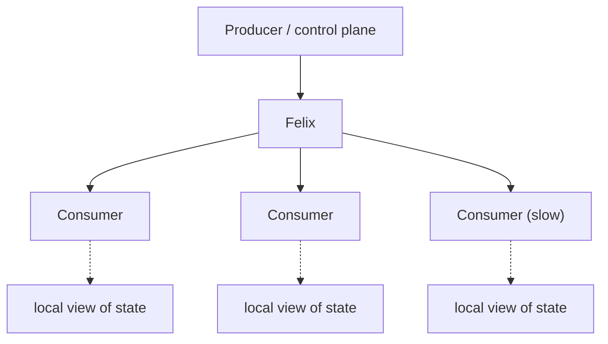

:::caution[Read this as two documents]
Felix is pre-1.0. This page separates **what Felix does
today** from **what Felix is being built to become**. Every capability below
carries a status marker. Nothing marked *Target* should be relied on, planned
around as if it exists, or claimed externally.

- ✅ **Today**: implemented, tested, and measurable in the current build.
- 🚧 **Partial**: a real implementation exists but is incomplete or not wired end to end.
- 🎯 **Target**: intended design. Not implemented. May change.
:::
:::note[Maintenance]
Verified against `main` for 0.7. A stale status marker is worse than none, so a change that ships or
removes a capability updates its row in the same pull request. To re-verify a row:

- Read the code the row names and the feature page it links to.
- Run the test named on the feature page; a row marked ✅ has one.
- Run `task docs:evidence`, which checks the cited paths and environment variable names.

A ✅ or 🚧 row was confirmed by reading the implementation. "Not started" on a 🎯 row means no
implementation was found, which is a weaker check.
:::
## The one-sentence answer

**Today:** Felix is a QUIC-based replicated log that serves stream, cache, and
queue semantics from one storage engine, optimized for high-fanout delivery with
predictable tail latency and strict slow-consumer isolation.

Shards of a stream or cache are placed across brokers, replicated by leader
leases and log shipping, and survive the loss of a leader; a publish can be made
to wait for a quorum of the replica set before it is acknowledged. What is not
yet true of a cluster is spelled out row by row in
[section 2](#2-what-felix-does-today). Most of the multi-node rows are ✅;
the ones still 🚧 each say what is missing.

The slow-consumer isolation half of that sentence is runnable:
[`task demo:slow-consumer`](/demos/slow-consumer-isolation/) stalls one
consumer and measures what happens to the others, under both queue policies.

**Target:** Felix is a distributed data plane offering coordination-store watch
semantics (read the current value, then receive every subsequent change with no
gap) at messaging-system fanout and throughput. The point of that combination is
keeping large populations of services, agents, and edge nodes synchronized with
rapidly changing state.

The gap between those two sentences is the roadmap. The rest of this page makes
that gap explicit.

---

## 1. The problem Felix is aimed at

Many distributed systems need a large number of independent processes to agree on
the same continuously changing state: configuration, policy, routing tables,
task assignments, cluster membership, device state.

The common implementation stitches together several systems: a database for the
authoritative value, Redis for fast reads, Kafka or RabbitMQ for change events,
WebSockets or polling to reach the consumers. Each one solves part of the problem
with different semantics, different failure modes, and no shared consistency
story between them.

Felix's thesis is that this class of workload deserves a single coherent
abstraction: **current state, the stream of changes to it, and the transport that
distributes both.**

Concretely, the traffic looks like a namespace of small, frequently-changing
values with a change feed beside each one:

```text
config/current              # the authoritative value
config/changes              # the deltas since
routing/table
policy/authz
cluster/membership
device/{id}/state
agent/{id}/tasks
agent/{id}/events
```

carrying events like `certificate rotated`, `node joined`, `route changed`,
`policy updated`, `feature enabled`, `task assigned`, `run cancelled`. The
defining property is that each consumer needs to end up holding an accurate local
copy. Seeing that something happened is not enough.



That is the target. What exists today is the transport and fanout layer
underneath it, plus the first watch primitives on top: a keyed cache watch
(subscribe to one key or prefix, resume by offset, loud loss) and retained
delivery on it, which is exactly the "current value plus every subsequent
change, gap-free" contract this section describes, for cache keys (see the
table below for exactly how far it goes).

### Why not etcd, Consul, or ZooKeeper?

This is the first question the thesis has to survive, because "current value plus
every subsequent change, gap-free" is not a new idea. etcd's watch does exactly
this (read at a revision, watch from that revision), and Kubernetes is built on
it. Consul and ZooKeeper have watches. NATS JetStream's KV store has watch.
Kafka's stream-table duality is the same concept applied to a log. Anyone
evaluating Felix will reach for one of these first, and for many workloads they
should.

The gap Felix is aimed at is the scale at which those semantics are available. Coordination stores are consistency-first: they run a
consensus quorum over a comparatively small dataset, and they trade write
throughput and watch fanout to get correctness. etcd is a well-known example:
the Kubernetes apiserver maintains its own watch cache in front of etcd in large
part because etcd cannot serve that many watchers directly. When people need
watch semantics at high fanout, they build a fanout tier in front of the
coordination store.

Felix's bet is that this tier should be a system rather than a bespoke component
rebuilt per deployment: **watch semantics as a first-class primitive on
infrastructure designed for fanout and throughput from the start, rather than
bolted in front of a quorum store.**

That bet is unproven, and it is the load-bearing claim of this entire document.
It fails if coordination stores turn out to be fast enough for most real
workloads, or if the consistency Felix gives up to get fanout turns out to be the
part that mattered. Both are live possibilities.

---

## 2. What Felix does today

At a glance:

| Area | Status | In one line |
|---|---|---|
| Streams | ✅ Today | Ephemeral and durable streams, replicated, with quorum acknowledgement and failover |
| Cache | ✅ Today | Key/value with TTL, compare-and-set, counters and keyed watches; the key index is held in memory |
| Queues | 🚧 Partial | Consumer groups with acks, redelivery and dead letters, one shard per group |
| Clustering | 🚧 Partial | Placement, replication, failover and online rebalancing work; fault coverage is single-machine |
| Clients | 🚧 Partial | Rust, Python, TypeScript, C and C# ship; the non-Rust ones do not cover every surface |
| Kafka and MQTT | ✅ Kafka / 🚧 MQTT | Kafka producers and partition-assigning consumers work, not groups or transactions; the MQTT listener takes QoS 0 and 1 publishes, not subscribes |

The full list, row by row:

Rows marked ✅ are shipped and measured; 🚧 rows are partial, and the Notes column says what is missing.

| Capability | Status | Notes |
|---|---|---|
| QUIC transport, TLS 1.3 always on | ✅ Today | Multiplexed streams with no head-of-line blocking. The broker serves your certificate, or a self-signed development one with a warning. Details: [QUIC transport](/features/quic-transport/) and [Security](/features/security/) |
| Publish / subscribe with high fanout | ✅ Today | Shared-frame fanout encodes a publish batch once regardless of subscriber count |
| Batched publish and batched delivery | ✅ Today | Count- and time-bounded, JSON or binary framing |
| Gap-free "current state + subsequent changes" subscribe | ✅ Today | A subscribe from a start position reports where history ends and live delivery begins (`start_offset`, `live_offset`), with nothing skipped between them. A stream has no per-key current value, so "current state" here is a position, not a snapshot. Details: [Pub/Sub](/features/pubsub/) |
| Idempotent producers | ✅ Today | A producer takes an id from the broker and numbers its batches per shard, so a re-sent batch lands once, including across a failover or restart on a durable stream. Kafka idempotent producers get the same checks. An in-memory stream loses its sequences with its leader. Details: [Idempotent producers](/clients/rust/publishing/#idempotent-producers) |
| Conditional publish and commit (single-writer fence) | ✅ Today | `publish_if` and `commit` write only if the shard's next offset is the one the writer expects, so of two writers at one offset exactly one wins. Served by the shard's leader, and on a `Leader` stream only as strong as the lease; sent by the Rust, Python, TypeScript, C and C# clients, with no per-key version precondition yet ([#1051](https://github.com/GetFelix/felix/issues/1051)). Details: [Conditional publishes](/features/pubsub/#conditional-publishes) |
| Conditional head trim | ✅ Today | `trim_before` hides a durable shard's history below an offset, only if the shard's next offset is the one the caller expects, and the trim replicates so it survives failover. A cluster trims only once it finalizes `head_trim`; the Rust, Python, TypeScript, C and C# clients and `felixctl stream trim` send it. Details: [Conditional head trim](https://github.com/GetFelix/felix/blob/main/docs/durable-storage.md#conditional-head-trim) |
| Bounded per-subscriber queues | ✅ Today | Every stage has an explicit depth or byte limit, and a subscriber can ask for its own queue capacity, which the broker clamps. The overflow policy stays the stream's. Details: [Choosing a queue size](/features/pubsub/#choosing-a-queue-size) and [Configuration](/reference/configuration/) |
| Slow-consumer isolation | ✅ Today | `DropNew` (default) or `Block`, set by the operator; see [`SubQueuePolicy`](/reference/configuration/). `DropOld` is accepted but behaves as `DropNew`: the arriving record is dropped, not the oldest |
| Key/value cache with TTL | ✅ Today | Scoped `(tenant, namespace, cache, key)`, expiry against an absolute expiry time that survives a restart; on a log-backed cache the leader writes a delete when an entry lapses, so watches see it go |
| Conditional cache writes (compare-and-set) | ✅ Today | `cache_put_if` writes only if the key is absent or at the version the caller read, and `cache_delete_if` removes it only at that version, atomically per key, for leases, idempotency keys and read-modify-write edits. Available in the Rust, Python, TypeScript, C and C# clients. Details: [Conditional writes](/features/cache/#9-conditional-writes) |
| Keyed cache watch | ✅ Today | `cache_watch` delivers every applied write to one key or key prefix, deletes included, in the shard's write order, and resumes by offset with no gap; retained delivery starts from each key's current value. A watch that falls behind is ended with the offset to re-watch from, so a drop is never silent. Log-backed caches only; `Client::watch_cache_sharded` watches a prefix across every shard, in the Rust client only. Details: [Keyed watch](/features/cache/#7-keyed-watch) |
| Counters (deltas folded into a durable sum) | ✅ Today | `counter_add` applies a signed delta and answers with the new sum, routed like a cache key; the sum survives restart, compaction and failover. At-least-once: a retried add after a lost acknowledgement double-counts. Details: [Projections](https://github.com/GetFelix/felix/blob/main/docs/projections.md) |
| Multi-tenant scoping | ✅ Today | Tenant and namespace required on all data-plane operations |
| Per-tenant quotas and connection limits | 🚧 Partial | A tenant's publish rate is capped per broker across QUIC and Kafka, a source address holds a bounded number of connections, and a per-tenant fair queue keeps one flooding tenant from shutting out the others. Not built: quotas on subscriptions, cache or storage, and quotas stored in the control plane. Details: [Configuration](/reference/configuration/) |
| Token-based authorization | ✅ Today | OIDC token exchange, tenant-scoped JWTs, and broker-side permission checks on publish, subscribe and cache, down to one key or key prefix. Revoking a principal ends its open streams within about one control-plane sync interval. Brokers authenticate each other with mutual TLS, required for a cluster member unless explicitly waived. Details: [Security](/features/security/) |
| Lease tokens | ✅ Today | A broker mints a short-lived token for whoever wins a conditional write to a lease cache key, so a stale node cannot write a workload's output without holding its lease. It does not stop a node that can write the lease cache from taking a live lease. Rust client only so far. Details: [Lease tokens](/features/security/#lease-tokens) |
| Publisher identity on delivered events | ✅ Today | A subscriber that asks is told which principal each write was accepted from, and a durable stream stores it so replay and failover report the same value. It vouches for who wrote, not for the payload. Not exposed by the Python and TypeScript bindings yet. Details: [Security](/features/security/) |
| Record headers | 🚧 Partial | A client that offers `EXT_RECORD_HEADERS` can publish a key and named byte headers with each record and read them back on delivery, replay and after a restart. A single broker serves it, and a cluster does once its fleet finalizes `record_headers`: replicas and forwards carry the headers, so a promoted replica delivers the same ones. The Kafka listener stores Kafka keys and headers in them when `FELIX_KAFKA_RECORD_HEADERS=true`. Consumer groups do not deliver them yet. Details: [Keys and headers](/clients/rust/publishing/#keys-and-headers) |
| Record times and replay from a time | ✅ Today | A subscriber that asks gets each durable record's append time, and `offset_for_time` finds the first offset at or after a time so a client can replay from there. Times are the leader's clock and survive failover; in-memory streams have none. Details: [Pub/Sub](/features/pubsub/) |
| Control plane metadata service | ✅ Today | A REST and OpenAPI service for tenants, namespaces, streams and caches, every call behind a Felix token, backed by memory or Postgres. Until `stream_incarnations` or `cache_incarnations` is finalized, creating a name that was deleted is refused with 409 ([#1447](https://github.com/GetFelix/felix/issues/1447)). Any number of identical instances run over one HA Postgres. Details: [Control-plane HA](/deployment/control-plane-ha/) |
| Prometheus metrics, health endpoints | ✅ Today | Plus opt-in `telemetry` feature for per-stage timings |
| Kubernetes packaging | ✅ Today | A Helm chart at `deploy/helm/felix` runs the control plane and the brokers with probes, drain grace periods, disruption budgets and optional peer mTLS, and refuses value combinations that would deploy something broken. Details: [Kubernetes](/deployment/kubernetes/) |
| Durable streams | ✅ Today | Opt-in per stream with `durable: true` when the broker has `FELIX_DURABLE_STORAGE_DIR`: a crash-safe segmented log that is replicated to followers and survives losing its leader. Retention is off by default, so a log grows without bound until you set it. Under the default `periodic` fsync a machine crash can lose the last 250 ms ([#1421](https://github.com/GetFelix/felix/issues/1421)). Details: [Durable storage](/architecture/durable-storage/) |
| Tiered storage | 🚧 Partial | Offload only. With `FELIX_DURABLE_OFFLOAD_DIR` set, sealed segments are copied to a local directory and verified before retention may delete them. Nothing reads the copies back yet (a read below the local head still gets `CursorTooOld`), and there is no cloud backend. Details: [Durable storage](/architecture/durable-storage/) |
| Resumable subscriptions | ✅ Today | `Subscribe` takes `latest` / `earliest` / an offset; every delivered event carries its offset (`Event.offset`) so an application can checkpoint and resume at `offset + 1`. Stored history joins live delivery with no gap, backfilling from disk if the live queue overflowed. Durable streams only; bounded by retention when it is configured, unbounded otherwise |
| Bounded range reads | ✅ Today | `stream_read` returns one page of a durable shard's committed records from a start offset, without registering a subscriber. A subscription is still the faster way to export a large range. The Python and TypeScript bindings do not expose it yet. Details: [Rust client](/clients/rust/) |
| Queue semantics (consumer groups, acks, redelivery) | 🚧 Partial | A client polls a group, acknowledges a record or hands it back; an unanswered record is redelivered and dead-lettered after `max_attempts`, and cursors replicate with the shard. Partial because a group is bound to one shard, and the visibility timeout and attempt bound are broker settings. Details: [Queues](/features/queues/) |
| Graceful shutdown | 🚧 Partial | Readiness flips before the listener closes, and a bounded drain runs against one shared deadline. Partial because, inside a connection, acknowledgement waiters and subscription writers are not told to wind down early. Details: [Graceful shutdown](/deployment/graceful-shutdown/) |
| Sharding | ✅ Today | A stream has a shard count and the control plane assigns each shard an owner; a routing key picks the shard, and a request sent to the wrong broker is forwarded. Ordering is per shard. A live stream's shard count cannot be changed yet. Details: [Pub/Sub](/features/pubsub/) |
| Multi-node clustering and replication | 🚧 Partial | Brokers register, shard leaders replicate to followers, and a publish or subscribe that reaches the wrong broker is forwarded or redirected. Partial because fault coverage is single-machine. A dead leader is replaced while the control plane is down only once `replica_election` is finalized (row below). Details: [System design](/architecture/system-design/) and [Diagnosing](/deployment/diagnosing/) |
| Fleet-wide feature gate | ✅ Today | Brokers report the cross-broker features they implement, and a feature turns on only once every serving broker supports it. A new cluster finalizes at its first registration; an upgraded one waits for the operator, so a rolling upgrade can be rolled back until then. Finalizing is one-way. Details: [Upgrades and compatibility](/deployment/upgrades/) |
| Leader failover | ✅ Today | A lost leader is replaced by a replica that held the log when it last reported. If no safe majority remains the shard waits for an operator instead of opening on a short copy; `felixctl placement abandon` unblocks it. Details: [Durable storage](/architecture/durable-storage/) and [Diagnosing](/deployment/diagnosing/) |
| Failover without the control plane | 🚧 Partial | Ships in 0.7.0 and is finalizable, off until an operator turns it on: with `replica_election` finalized, a shard's replicas elect a new leader when the old one dies while the control plane is down, and the control plane adopts it when it returns. Durable `Quorum` streams and `Quorum` caches only. Partial because a broker restarted during the outage cannot vote (#1196) and consumer groups still wait for the control plane (#1197). Details: [Failover without the control plane](/deployment/failover-without-control-plane/) <!-- TODO(0.7.0 release day): decide opt-in vs default for replica election and update this row to match. --> |
| Pipelined publishes | ✅ Today | A client that offers `FEATURE_PUBLISH_PIPELINE` gets a per-stream window (`FELIX_BROKER_PUBLISH_WINDOW`, 256 by default) and is slowed by flow control instead of filling its tenant's share of the publish queue. Old clients get the frames they always got. Details: [Pub/Sub](/features/pubsub/) |
| Online rebalancing | ✅ Today | A shard with a live leader is moved, not reassigned: the destination copies the log, the leader is fenced once it has nearly caught up, and publishes during the move are held and forwarded, never refused. A draining broker hands off all its shards and a joining one takes its share. Placement balances shard counts, not load. Details: [Moving shards by hand](/deployment/moving-shards/) |
| Replication factor restore | ✅ Today | A shard returns to its replication factor without an operator: a follower whose broker has been gone for `FELIX_SHARD_RESTORE_AFTER_MS` (five minutes by default) is replaced by a copy on a live broker. Details: [Moving shards](/deployment/moving-shards/#restoring-the-replication-factor) |
| Consistent backup point | 🚧 Partial | `felix-controlplane admin backup-point` records each shard leader's committed offset after one barrier instant, and `felix-broker restore-point` cuts a copied directory back to it. Partial because offsets are read one broker at a time with no write pause, so a point can be inconsistent across shards, and control-plane metadata is backed up separately. Details: [Backup and restore](/deployment/backup-and-restore/) |
| Zone-aware placement | ✅ Today | A broker registers its failure domain with `FELIX_NODE_ZONE`, and placement puts each shard's followers in zones the shard has no copy in yet; a shard that cannot be spread is placed anyway with a warning. A broker without a zone is treated as alone in its own. Details: [Moving shards](/deployment/moving-shards/) |
| Quorum acknowledgement | ✅ Today | A `Quorum` publish is acknowledged once a majority of the replica set, counting the leader, holds it durably, and one unreachable replica does not stall it. With no reachable majority it fails with `quorum_timeout`, and the outcome is unknown. Replicated `Quorum` caches acknowledge the same way once `fenced_caches` is finalized. Details: [Semantics](/architecture/semantics/) |
| Linearizable `Quorum` reads | ✅ Today | Once `lease_free_reads` is finalized, a get on a replicated `Quorum` cache is confirmed by a majority with no clock, so a leader cut off from its replicas cannot serve a stale read. Subscriptions, replay and group operations on `Quorum` shards follow the same rule. Until finalized, and on `Leader` streams, reads follow the lease. Details: [Semantics](/architecture/semantics/) |
| Client surviving a broker failure | ✅ Today | `Client` takes several broker addresses, holds one QUIC connection per broker, and rebuilds its connection from the rest when one fails, so an application outlives the broker it connected to. Subscriptions resume with no gap or report the loss, and Python, TypeScript and C# get the same behaviour. `publish` reports a failure; `publish_at_least_once` also resends and can duplicate. Details: [Rust client](/clients/rust/) |
| Kafka wire compatibility: consumers | ✅ Today | With `FELIX_KAFKA_LISTEN` set, every broker serves Kafka consumers that assign their own partitions: durable streams are `<namespace>.<stream>` topics and partitions are shards. Consumer groups are refused with an error that says why, so Connect, Streams and ksqlDB do not work. Details: [Kafka compatibility](/features/kafka/) |
| Kafka Produce | ✅ Today | Kafka producers write to durable streams through the shard leader, with compression, `acks` 0, 1 and all, and idempotent producers. Keys and headers are stored with the record when `FELIX_KAFKA_RECORD_HEADERS=true` and the broker accepts record headers, and dropped otherwise; producer timestamps are dropped, and transactions are refused. Details: [Kafka compatibility](/features/kafka/) |
| MQTT listener | 🚧 Partial | With `FELIX_MQTT_LISTEN` set, a broker accepts MQTT 3.1.1 and 5.0 connections and authenticates devices with a Felix token. A device can publish at QoS 0 and 1 to a mounted stream through any broker, which forwards to the shard's owner, and a `PUBACK` means the message is in the stream. Partial because `SUBSCRIBE` is still refused, and QoS 2, retained messages, sessions and wills are not built. Details: [MQTT](/features/mqtt/) |
| Log-backed cache (one core log, many semantics) | 🚧 Partial | A cache is a log: writes append records and reads go through a key-to-offset index rebuilt at startup, so entries survive a restart when the broker has `FELIX_DURABLE_STORAGE_DIR`. Shards are routed, replicated and survive the loss of their leader, and a cache declares `Leader` or `Quorum` like a stream. Partial because each shard keeps its whole key index in memory: memory grows with the key count and nothing caps or reports it ([#1073](https://github.com/GetFelix/felix/issues/1073)). Details: [Cache](/features/cache/) |
| Atomic event + state commits (one shard) | 🚧 Partial | `commit` writes an event and keyed state updates as one record on one shard, and no reader sees part of a commit. Partial because a commit is not idempotent, state is rebuilt from the retained log with no snapshot, and there is no read at an older version. Atomicity across logs is a non-goal. Details: [Atomic commits](/features/atomic-commits/) |
| Raft consensus for cluster metadata | 🚧 Partial | Set `FELIX_RAFT_NODE_ID`, `_DATA_DIR` and `_PEERS` for a Raft-replicated metadata store with no external database. Partial because only the faults a single machine can produce have been injected. A leader restart pauses writes for one election. Details: [Metadata Raft](/architecture/metadata-raft/) |
| Cross-region routing and data sovereignty enforcement | 🚧 Partial | A stream created with a `region` keeps its leader and replicas in that region, or in one the `FELIX_REGION_BRIDGES` allowlist bridges it to. Set the same `FELIX_REGION_BRIDGES` on the control plane and every broker. Partial because caches and region-less streams are placed anywhere, and there is no bridge agent, per-region encryption or audit log. Details: [Data residency](/use-cases/data-residency/) |
| Non-Rust client SDKs | 🚧 Partial | Python and TypeScript ship as bindings over the Rust client, and C and C# bind the same client through a C ABI. Python and TypeScript pass every required scenario of the conformance catalogue bar one optional scenario each, and the C ABI passes them driven from C. Each client page lists what is not wrapped yet. No Go client exists. Details: [Clients in other languages](/clients/overview/) |
| Command-line tool | 🚧 Partial | [`felixctl`](/getting-started/felixctl/) publishes, subscribes, works the cache and consumer groups, administers the control plane, moves shards and drains brokers, with `--json` throughout. State reads are not built yet ([#1005](https://github.com/GetFelix/felix/issues/1005)). Details: [felixctl reference](/reference/felixctl/) |
| Operator inspection | 🚧 Partial | `felixctl inspect shard` and `felixctl inspect subs` show a shard's live state from its leader and every replica, and each broker's subscriptions; `felix-broker inspect segments` and `inspect records` read a data directory offline and read-only. Partial because a connection listing, the control plane's decision log and locating one record on each replica are not built yet ([#1077](https://github.com/GetFelix/felix/issues/1077)). Details: [Diagnosing a cluster](/deployment/diagnosing/) |

### Measured performance

The current numbers are on [v0.6.0 Performance](/features/v060-performance/),
measured on Azure over a real network with TLS, with every condition stated.
In short, on one 8 vCPU broker with local NVMe:

- 3.6 GB/s of in-memory 4 KiB messages fire-and-forget without losing any, and
  4.4 GB/s acked.
- 1.40 to 1.48 GB/s durable with an fsync before every ack, which is the
  disk's own rate.
- About 0.3 ms for one fsynced durable publish when nothing else is running,
  and 160 to 180 µs in memory.

The same page covers a three-broker cluster with three copies of every durable
record, and a comparison with NATS JetStream on the same machines. The
loopback harness and its methodology are under
[Benchmarks](/features/benchmarks/); its numbers catch regressions in Felix's
own code and are not a measure of a deployment.

### Delivery semantics today

- **At-most-once for a plain subscription.** A subscriber is delivered to
  best-effort: no redelivery, and no publisher-visible confirmation that anyone
  received anything. This is the right default for the fanout workloads Felix is
  aimed at, where the next update supersedes the one that was dropped.
- **At-least-once through a consumer group.** Polling a group is the other
  shape: a record is claimed rather than pushed, redelivered if it is not
  answered for within the visibility timeout, and dead-lettered once it has
  been attempted too many times. A consumer must expect the same record twice,
  because a crash after handling and before acknowledging is indistinguishable from a
  crash before handling. See [Queues](/features/queues/).
- **Idempotent producers, not exactly-once delivery.** A producer that takes
  an id from the broker and numbers its batches can re-send a publish whose
  acknowledgement never arrived and have it land once. The shard's leader
  answers a sequence it already holds without appending it, and on a durable
  stream that holds across a failover or a move too. Delivery stays one
  of the two shapes above: a consumer can still see a record twice on
  redelivery. Deduplicate there, keyed on something in the record.
- **Per-shard ordering** preserved for a given subscriber on a durable
  stream, which means per key on a multi-shard stream and total order on a
  single-shard one. No ordering across streams. An in-memory stream's fanout is not
  ordered against concurrent publishes, so different subscribers of the same
  in-memory stream can see a racing pair in different orders.
- **Resumable subscriptions over the wire, for durable streams.** `Subscribe`
  carries an optional `start` (`latest`, the default and what every older
  client sends; `earliest`; or an exact offset), and every delivered event
  carries its offset, so an application checkpoints what it handled and resumes
  at the next one. History read from disk joins live delivery with no gap and no
  duplicate. Asking for an offset retention has discarded is a typed error, not
  a silent restart at the tail. A non-durable stream stays tail-only beyond its
  bounded replay ring, because there is nothing older to read.
- **Slow subscribers drop** under the default policy. On a durable stream the
  subscription ends at the first drop with the offset to resume from, and the
  cluster client resumes there from the log; on an in-memory stream the
  subscriber is not told. Publishers never block on subscriber speed.
- **Publishes can be shed under overload.** With the defaults, when the
  broker's publish queue or byte budget is full, a fire-and-forget publish is
  dropped (at most once) and an acknowledged one is refused with a retryable
  `overloaded` that the application must handle; on a durable stream it waits
  up to `publish_queue_wait_timeout_ms` (2 s) first. With `pub_ingress_wait`,
  fire-and-forget publishers wait for room instead. A waiting publish is parked
  off its connection's read loop, so publishes behind it to other shards go on
  ([#1416](https://github.com/GetFelix/felix/issues/1416)).
- **Ephemeral by default.** Nothing survives a broker restart unless the stream
  was registered with `durable: true`, which writes each record to its log
  before acknowledging it (unless the broker runs with
  `FELIX_ACK_ON_COMMIT=0`) and replays it afterwards. Durable storage is opt-in per
  stream and off unless the broker is started with `FELIX_DURABLE_STORAGE_DIR`.
  Retention is available but off by default: a stream's own `retention`, or
  the broker's `FELIX_DURABLE_RETENTION_BYTES` / `FELIX_DURABLE_RETENTION_SECONDS`
  for a bound it leaves unset. With none, a durable stream grows without
  bound; set, the oldest records are discarded and a resume below them fails
  with a typed error naming the oldest retained offset. Tiered storage stops
  at offload: sealed segments can be copied to a directory before retention
  deletes them, but nothing reads the copies back
  ([#172](https://github.com/GetFelix/felix/issues/172)).

---

## 3. What Felix is being built to become

None of the following exists today. It is listed so the intent is legible, not so
it can be planned around. Capabilities move up into the table above when they
ship rather than being marked off here.

| Capability | Status | Current state of the code |
|---|---|---|
| Load-aware placement | 🎯 Target | Not implemented. Placement spreads each stream's leaders evenly across brokers, then the cluster's, and moves a shard off a broker only when that broker leads more than its share of a stream's shards or of all shards, counted, or is draining. It reads no traffic, disk or CPU figures, so a broker leading its share of hot shards is left as it is. An operator can move a hot shard by hand (`felix-controlplane admin move`) |
| Node pools (workload isolation) | 🎯 Target | Not implemented. One control plane places every stream and cache shard on any of its brokers, so caches, streams and queues (which live on their stream's shards) cannot be kept on separate brokers under one control plane. A stream's `region` pins its copies, but caches have no region and a broker has only one. Today, isolating them means separate deployments, each with its own control plane ([#1678](https://github.com/GetFelix/felix/issues/1678)) |

**Target scale**, stated as ambition and nothing more: a single update fanning out
to tens of thousands of subscribers across a multi-node cluster. Measured fanout
today is 10, on loopback, single-node. There is no benchmark, model, or
napkin-math projection behind the target figure yet. Treat the gap between 10
and "tens of thousands" as unexplored engineering. Nobody has validated a scaling
curve for it.

The target architecture is described in full in
[Design](https://github.com/GetFelix/felix/blob/main/docs/design.md) and
[System Design](/architecture/system-design/).

---

## 4. Workload fit

Two separate questions, deliberately kept apart. "Fits the architecture" is about
whether the workload matches where Felix is going. "Usable today" is about
whether you could build it on the current release.

| Workload | Fits the architecture | Usable today | Why |
|---|---|---|---|
| High-fanout real-time event distribution | Strong | **Yes** | Fanout, isolation, and tail latency are the shipped strengths |
| Live operational dashboards, telemetry feeds | Strong | **Yes** | Tolerant of at-most-once and of loss under lag |
| Ephemeral coordination between services | Strong | **Yes** | Low-latency, no durability needed |
| Internal service event bus | Moderate | Mostly | Works, but NATS and RabbitMQ serve this well already; weak differentiation |
| Distributed live-state synchronization | Strong | Partly | On log-backed caches the primitive exists: a retained `cache_watch` starts from current values, resumes by offset with no gap, and a watch that falls behind is ended with the offset to re-watch from rather than dropping silently. In-memory caches and non-durable streams still drop under lag with no way to resynchronize (a durable stream's subscription is ended with the offset to resume from), and only the Rust client watches a prefix across shards |
| Infrastructure / control-plane state distribution | Strong | Partly | The same primitive, on a multi-node story that is still 🚧 (see section 2) |
| AI-agent coordination and shared state | Strong | Partly | Ephemeral coordination works. Durable task state replicates to followers, and a lost leader fails over to one that holds the log |
| Edge and disconnected operation | Strong | **No** | Durability, resumable subscriptions, and replication exist; retention is available but bounded by one machine's disk, and there is no store-and-forward between sites |
| Durable event log, replay, event sourcing | Weak | Partly | A durable log with offset replay exists, records replicate to followers, and retention can bound growth. Sealed segments can be copied to a directory before retention deletes them, but nothing reads the copies back yet; use Kafka for anything that needs readable history to outlive one machine today |
| Primary datastore | Weak | No | Use a database |
| General-purpose key-value store | Weak | No | Use Redis or Valkey |
| Complex broker routing, workflow messaging | Weak | No | Use RabbitMQ |
| Strongly-consistent coordination, leader election, locks | Weak | No | Use etcd, Consul, or ZooKeeper |

Read the two columns together and the current position is uncomfortable but
worth stating plainly: **the workloads Felix is differentiated for are the ones
it cannot serve yet, and the workloads it serves today are ones several mature
systems already serve well.** That is a normal place for an early project to be.
It is not a place to make strong adoption claims from.

### What the target workloads actually carry

The Strong-fit rows that are not fully usable yet are the ones the architecture
is aimed at. What each moves:

- **Infrastructure and control planes:** distributed configuration, feature
  flags, service discovery, routing tables, authorization policy, deployment
  state, cluster membership, certificate rotation. Kubernetes control planes,
  service meshes, fleet management, private and hybrid cloud. The traffic is
  live infrastructure state rather than durable business events.
- **Agent fleets:** task assignments and status, tool results, model
  configuration, resource availability, cancellation signals, intermediate
  results, shared scratch state. Attractive because agent systems naturally
  produce many concurrent producers and consumers, high event rates, fanout,
  ephemeral data, and wildly heterogeneous consumer speeds, which is close to Felix's
  intended operating point.
- **Edge and device fleets:** site- and device-level state pushed outward
  rather than polled inward, under intermittent connectivity, constrained
  bandwidth, and high latency. The model is that the edge holds a local copy and
  reconciles when a link returns. This is the furthest from what exists today.
- **High-fanout real-time data:** dashboards, telemetry, IoT, multiplayer and
  collaborative applications, live-event and market-data-style feeds. This one
  is largely usable now, because it tolerates loss.

### The open design question

The state-synchronization thesis and the current delivery semantics are in real
tension, and it has not been resolved.

For an event feed, a dropped message means a consumer missed one update. For a
consumer maintaining a local copy of state, a dropped message means its local
copy is **permanently wrong** with no signal that would let it recover on its
own. At-most-once delivery plus `DropNew` is a correct design for the first case
and an incorrect one for the second.

Closing this requires at least one of: gap-free snapshot-plus-stream subscribe,
resumable subscriptions with a durable log behind them, or an explicit
resynchronization protocol triggered by the lag signal subscribers already
receive.

The second of those exists for durable streams: a subscriber that records
the offsets it handles can resume from them. Because offsets are
contiguous apart from the generation starts the broker reports, it can also *detect* a
drop rather than diverging silently. That narrows
the case rather than closing it. It does not help a non-durable stream, it
requires the application to checkpoint, and a resume reaches only as far back
as retention keeps: unbounded when retention is unset, and no further than
the configured bound when it is.

For keyed state the first and third exist too, on log-backed caches: a
retained cache watch delivers current values and then changes with no gap, and a
watch that falls behind is ended with the offset to re-watch from, which is the
resynchronization signal. What is left is everything that is not a log-backed
cache: an in-memory cache or stream still drops under lag with nothing to
resynchronize from. A durable stream's subscription now gets the same signal a
cache watch does: it is ended at its first drop with the offset to resume from.

---

## 5. What Felix is deliberately not

Felix should not be positioned against any of these, now or later.

- **Not a Kafka replacement.** Kafka is excellent at durable event history,
  long-term retention, replay, and data integration. Felix's durability is meant
  to serve live distribution rather than long retention. Sealed segments can
  be copied to a directory before retention deletes them, but nothing reads
  them back yet, and retention is off unless it is configured. Speaking part
  of Kafka's protocol does not change that: it lets Kafka producers and
  partition-assigning consumers reach Felix streams, not run Kafka's ecosystem.
- **Not a Redis replacement.** Cache semantics in Felix exist as part of a
  state-distribution model, not as a general-purpose data-structure server.
- **Not a RabbitMQ replacement.** Elaborate routing topologies and traditional
  enterprise queueing are not the differentiator.
- **Not a database.** Felix is not the system of record.
- **Not a NATS competitor on general-purpose messaging.** NATS is fast, mature,
  broadly deployed, and already covers general high-performance pub/sub, with
  JetStream and its KV store overlapping parts of Felix's target surface. This
  is the closest neighbor, and "we are like NATS but faster" is not a position.
- **Not "a faster message broker."** That is a crowded category and the claim
  would rest on single-node loopback numbers.

Likewise, "Rust" and "QUIC" are implementation choices rather than the value
proposition, though QUIC is load-bearing for the eventual edge story
(connection migration, 0-RTT resumption, no head-of-line blocking).

### Where that leaves Felix

What each system is best at:

| System | Owns |
|---|---|
| Databases | Storing authoritative state |
| Kafka | Durable event history and replay |
| Redis / Valkey | Fast data structures and caching |
| RabbitMQ | Traditional broker routing and workflow queueing |
| NATS | General-purpose high-performance messaging |
| etcd / Consul / ZooKeeper | Strongly-consistent coordination and watch, at modest scale |
| **Felix (target)** | **Watch semantics at fanout and throughput coordination stores don't reach** |

The nearest neighbour is the coordination-store row rather than the messaging
rows. See [Why not etcd, Consul, or ZooKeeper?](#why-not-etcd-consul-or-zookeeper) for
the argument and its failure modes. The snapshot-plus-stream primitive exists
for log-backed caches; Felix becomes credible against that row only once the
multi-node story is real and fanout has been measured somewhere well past 10.

---

## 6. How to decide whether Felix fits you

[Why Felix?](/getting-started/why-felix/#when-not-to-use-felix) lists when not to use it. Two
things the status table does not say.

Felix is **usable but early** if you need multi-node operation. Placement,
replication, quorum acknowledgement, leader failover and client redirection are
all implemented and tested. Faults are injected into the process, the network
(including one-way and delayed links), the clock, the control plane and the
disk, and the nightly [history campaign](/architecture/testing/) draws
from all of them, on both the lease and the lease-free acknowledgement path.
All of it runs on one machine. There is
no cluster-scale latency budget
([#136](https://github.com/GetFelix/felix/issues/136)). Run it where you can
tolerate finding the next bug.

On a stream or an in-memory cache, Felix cannot yet rebuild keyed state after a
disconnect in one call. Asking a durable stream for *changes since
an offset* is gap-free, but a stream has no per-key current value, and
stitching one together yourself races. A retained watch on a log-backed cache
does give current state and every change after it.

Felix does not encrypt payloads end to end: TLS protects each hop, but a broker
reads payloads in the clear, so a client that must hide them from brokers
encrypts them itself. Felix also makes no compliance claim.

---

## 7. Why this framing, and not a broader one

One reason to organize the project around this specific question (*how do you
keep a large distributed population synchronized with rapidly changing state?*)
is that the requirements it generates are the ones Felix has been building
anyway, on both sides of the today/target line:

- shipped because the thesis demands them: high-performance transport, persistent
  connections, efficient serialization, encode-once fanout, bounded subscriber
  queues, slow-consumer isolation, snapshot-plus-change subscriptions,
  durability, replication, resumable subscriptions;
- targeted because the thesis demands it: edge operation.

A generic message broker would not obviously need that set, or build it in
that order. The framing is useful because it explains and
constrains the roadmap.

---

## See also

- [Overview](/getting-started/overview/): component-level tour
- [Semantics](/architecture/semantics/): the precise behavioral contract
- [Benchmarks](/features/benchmarks/): methodology and current numbers
- [Design](https://github.com/GetFelix/felix/blob/main/docs/design.md): full target architecture

## Where next

- [Overview](/getting-started/overview/): the components and how a message moves through them
- [Quickstart](/getting-started/quickstart/): run a broker and publish something
- [Use Cases](/use-cases/overview/): the scenarios Felix is built for
