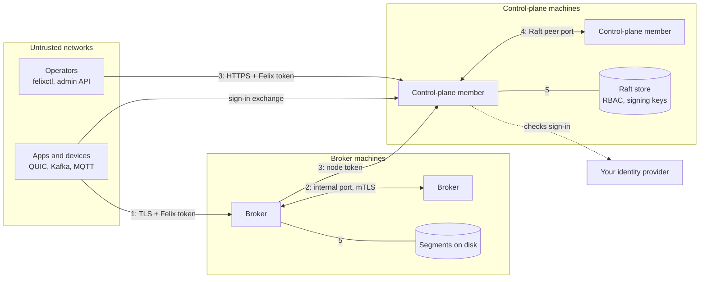

This page is the map: what an attacker would want from a Felix cluster, who
that attacker might be, where they would cross into it, and what stands in
the way at each crossing. Every control named here exists on `main`. Every gap
links the GitHub issue that tracks it.

Felix is pre-1.0 and has not had an external security review. Read this page
as the project's own account, not an audit.

## What is worth protecting

| Asset | Why it matters |
| --- | --- |
| Acknowledged data | A publish that was acknowledged must not be lost, rewritten or forged. Payloads may be confidential. |
| Tenant isolation | A credential for one tenant must never read, write or observe another tenant's streams, caches, groups or metadata. |
| Metadata | The control plane's store holds every tenant's RBAC policy, identity provider trust and signing keys. Whoever can change it decides who may do anything. |
| Credentials | Felix tokens and refresh tokens, tenant signing keys, the lease key, node tokens, the Raft peer token, the bootstrap token, and the private keys of every certificate. |

## Who might attack

| Actor | Starts with | Wants |
| --- | --- | --- |
| Anonymous network attacker | Can reach some port. No credential. | Any credential, any data, or to take a broker down. |
| A client of a tenant | A valid token for its own tenant, possibly with narrow grants. | More than its grants: other streams, admin actions, another tenant's data. |
| Another tenant | A valid token for a different tenant. | To read or disturb your tenant. |
| A compromised broker or storage machine | Everything on that machine: its node token, internal-port certificate, lease key file, segments on disk, and the tokens of clients connected to it. | To forge records, act as other brokers, or widen its reach to tenants or shards it does not serve. |
| A compromised control-plane member | Its Raft store (signing keys, RBAC), its member certificate, and the Raft peer token if one is set. | To mint tokens, rewrite metadata, or take over the group. |
| An operator | Bootstrap and Raft peer tokens, cluster-scope grants, shell access. | Mistakes are the usual risk. A malicious operator is out of scope: Felix has no audit log yet ([#2806](https://github.com/GetFelix/felix/issues/2806)). |

## Trust boundaries

1. **Client to broker**, over QUIC, Kafka or MQTT.
2. **Broker to broker**, on the internal port: forwarded writes and replication.
3. **Broker and operator to the control plane**: the REST API, plus the
   bootstrap listener while it is on.
4. **Control-plane member to member**: the Raft peer port.
5. **Disks**: broker segments, and each control-plane member's Raft store.

Each section below lists the attacks at that boundary, the controls that
exist, and what is open.

## 1. Client to broker

Clients reach brokers over QUIC (always TLS 1.3), the Kafka listener and the
MQTT listener (TLS by default, 1.2 or 1.3). Every listener takes a Felix
token: on QUIC per stream in `Auth`, on Kafka as the SASL/PLAIN password, on
MQTT as the `CONNECT` password.

**Controls present**

- **Tokens are verified locally.** A Felix token is an Ed25519-signed JWT,
  checked against the tenant's published keys for signature, issuer, audience
  (`felix-broker`), expiry and tenant (`tid`). A valid signature for the wrong
  tenant fails. Every request is checked against the token's permissions.
  See [Authentication and RBAC](/security/authentication/).
- **Least privilege in the token.** Token exchange can only narrow what RBAC
  grants, down to one stream, cache key or key prefix, or consumer group.
- **Stolen tokens can be tied to a key.** With `FELIX_TLS_CLIENT_CA` and
  `FELIX_TLS_CLIENT_CERT_BIND_SUBJECT=true`, a token works only over a TLS
  connection whose client certificate was issued to the token's subject (or,
  for a delegated token, its actor). This applies on QUIC, Kafka over TLS,
  and MQTT over TLS.
- **Credentials end connections at expiry.** A stream ends when its token
  expires, and a connection closes at its client certificate's `notAfter`, on
  every listener.
- **Revocation.** Revoking a principal, or removing a rule that reached it,
  ends what its tokens opened on every broker within about one sync interval
  (`FELIX_CONTROLPLANE_SYNC_INTERVAL_MS`, 2 s by default).
- **Unauthenticated work is cheap and bounded.** Until a stream
  authenticates, QUIC frames are capped (`FELIX_PREAUTH_MAX_FRAME_BYTES`),
  only a few streams per connection are read
  (`FELIX_PREAUTH_MAX_STREAMS_PER_CONN`), and a connection that authenticates
  nothing in `FELIX_AUTH_TIMEOUT_MS` is closed. Kafka and MQTT have their own
  deadlines (`FELIX_KAFKA_AUTH_TIMEOUT_MS`, `FELIX_MQTT_AUTH_TIMEOUT_MS`) and a
  64 KiB cap before authentication. Connections are capped per source address
  (`FELIX_MAX_CONNECTIONS_PER_IP`).
- **One tenant cannot starve another.** Per-tenant publish rate limits,
  per-subscriber bounded queues (a slow reader never blocks a publisher), and,
  when one connection carries several users, a subscription cap and publish
  byte budget for each (`FELIX_MAX_SUBSCRIPTIONS_PER_CONN`,
  `FELIX_BROKER_PUBLISH_CONN_INFLIGHT_BYTES`).
- **Hostile frames.** Decoders bound every length before allocating, and the
  wire protocol is fuzzed. See the
  [panic audit](https://github.com/GetFelix/felix/blob/main/docs/security/panic-audit.md)
  and [Fuzzing](/development/fuzzing/).

**Open**

- The default broker certificate is self-signed and changes at every start.
  A client that trusts it cannot tell which broker it reached, and hands its
  token to whoever answered. Set `FELIX_TLS_CERT` and
  `FELIX_TLS_REQUIRE_CERT=true`.
- Without client certificate binding, a token is a bearer credential: anyone
  who copies it can use it until it expires (900 s by default). The Python,
  TypeScript, C and C# clients cannot present client certificates yet.
- The Kafka and MQTT anonymous-tenant switches (`FELIX_KAFKA_ANONYMOUS_TENANT`,
  `FELIX_MQTT_ANONYMOUS_TENANT`) give a whole tenant to anyone who reaches the
  port. They are for development, and a Kafka connection under that switch is
  not ended at credential expiry
  ([#2903](https://github.com/GetFelix/felix/issues/2903)).
- No storage quota per tenant: a tenant with publish rights can fill a
  broker's disk ([#2804](https://github.com/GetFelix/felix/issues/2804)).
- `stream.manage` is needed to create a stream and also allows deleting and
  trimming it. There is no create-only grant
  ([#2805](https://github.com/GetFelix/felix/issues/2805)).

## 2. Broker to broker

Brokers talk to each other on a separate internal port (`FELIX_INTERNAL_BIND`)
to forward client writes to a shard's owner and to replicate logs. The full
analysis, abuse case by abuse case, is in
[the internal threat model](https://github.com/GetFelix/felix/blob/main/docs/threat-model-internal.md).
The short version:

**Controls present**

- **mTLS, required by default.** With `FELIX_INTERNAL_TLS_CERT`, `_KEY` and
  `_CA`, every connection is mutually authenticated, and the certificate's DNS
  name is checked against the node id in both directions. A broker with a node
  id refuses to start without it unless
  `FELIX_INTERNAL_ALLOW_UNAUTHENTICATED=true`.
- **Nothing before an identity-checked `Hello`.** Every request on a
  connection before an accepted `Hello` is refused and the connection closed,
  so a peer cannot act under no name. The node id is bound once per
  connection, and a Raft message that names another broker as its sender is
  refused.
- **Raft messages only from members and placed brokers.** A shard's Raft
  member refuses a vote, append, snapshot or read index unless the sender is
  in that group's own membership. A copy with no membership yet, or one that
  missed a change, also takes messages from the brokers the control plane's
  placement or target names, as of a feed answer under a minute old. A broker
  outside a group cannot raise its term, take its vote or truncate its log
  ([#2909](https://github.com/GetFelix/felix/issues/2909)). On this port the
  sender is the broker named by the certificate's DNS name; the
  `felix:principal:raft-member:` URI SAN belongs to the control-plane Raft
  port below.
- **Forwarding is not authority.** A forwarded publish or cache write carries
  the client's own token, and the owner verifies it before writing. With
  subject binding on, the owner also verifies the client's certificate chain
  against its own CA. So a broker cannot write to a tenant on its own say-so.
- **Replication checks role, generation and content.** A broker that is not a
  replica of a shard is refused, an old generation is fenced, and a batch that
  differs from what a follower already holds is a conflict. A follower that
  holds records refuses to have its log replaced.
- **Bounded resources.** Frame and batch sizes are bounded before allocation,
  and inbound connections are capped in total and per source
  (`FELIX_INTERNAL_MAX_INBOUND_CONNECTIONS`,
  `FELIX_INTERNAL_MAX_INBOUND_PER_SOURCE`).
- **Credentials end connections at expiry.** Each side closes the link when
  the other's certificate passes `notAfter`.

**Open**

- **Hybrid replication does not check membership per request.** On the
  hybrid engine, a broker with a certificate from the internal CA can send
  fetch, replicate, fence and seal requests to a replica set it is not in;
  only the ballot and generation bound them
  ([#2920](https://github.com/GetFelix/felix/issues/2920)).
- **A compromised broker can replay what it was shown.** It can forward a
  client's token and certificate chain until either expires. Closing that
  needs proof that the client holds its key
  ([#2818](https://github.com/GetFelix/felix/issues/2818)).
- **Records are not signed.** A compromised broker can append records to
  shards it replicates, and readers cannot tell them from real ones
  ([#2803](https://github.com/GetFelix/felix/issues/2803)).
- **The lease key signs for every tenant.** Every broker holds
  `FELIX_LEASE_TOKEN_KEY_FILE` when lease tokens are on. A stolen key file can
  mint short-lived tokens for exact streams or cache keys of any tenant. See
  [Lease tokens](/security/authentication/#lease-tokens).
- A plain (non-idempotent) forwarded publish can be replayed and duplicated.
  Idempotent producers are deduplicated.
- **Two Raft groups for one shard.** This applies only with the opt-in
  per-shard Raft engine (`FELIX_SHARD_ENGINE=raft`). A broker with a stale
  placement feed could form a second group for a shard; the control plane now
  holds a shard's set until its first group forms
  ([#2794](https://github.com/GetFelix/felix/issues/2794), fixed). Re-placing
  a formed group onto brokers it never reached can still form a second one
  ([#2905](https://github.com/GetFelix/felix/issues/2905), fix in review).

## 3. Broker and operator to the control plane

Brokers call the control-plane API with a node token (`FELIX_NODE_TOKEN`) to
register, heartbeat, and read the catalog, tenant keys and revocations.
Clients exchange identity-provider tokens for Felix tokens there. Operators
administer tenants and RBAC through it. The bootstrap listener, when on, seeds
a new tenant before any admin token exists.

**Controls present**

- **API calls need a Felix token** with an audience of
  `felix-controlplane`, so a broker cannot replay a client's broker token
  against the API. The credential is checked before existence. The
  exceptions are the probes and `/v1/system/info`, token exchange and
  refresh (which carry their own credentials), and the tenant JWKS, which is
  public by design.
- **TLS and client certificates are available**: `FELIX_CONTROLPLANE_TLS_CERT`
  and `_KEY`, `FELIX_CONTROLPLANE_TLS_CLIENT_CA` to refuse callers without a
  certificate, and `FELIX_CONTROLPLANE_TLS_CLIENT_CERT_BIND_SUBJECT` to tie
  each token to it.
- **Identity providers are pinned per tenant**: issuer, audiences and
  allowed algorithms. Discovery and JWKS URLs must be HTTPS (except loopback),
  private and link-local addresses are refused, and redirects are never
  followed.
- **RBAC writes cannot escalate.** A policy or assignment broader than the
  writer's own scope is refused, `tenant:*` is refused, and no tenant scope
  contains `cluster:*`.
- **A broker can only speak for itself.** Membership writes need `node.manage`
  over that node.
- **Bootstrap is off by default** and, when on, binds to loopback by default,
  compares its token in constant time, can require mTLS, and initializes each
  tenant exactly once. See the
  [bootstrap threat model](https://github.com/GetFelix/felix/blob/main/docs/security/bootstrap.md).
- **Refresh tokens rotate**, and presenting a spent one outside the grace
  window is counted as a replay (`felix_refresh_token_replays_total`).

**Open**

- **Plain HTTP by default.** Without `FELIX_CONTROLPLANE_TLS_CERT`, node tokens,
  token exchanges and tenant keys cross the network in clear text. A network
  attacker who can modify the tenant JWKS a broker fetches can make it accept
  forged tokens.
- **Revocation fails open while a broker cannot reach the control plane.** A
  revoked token keeps working on that broker until it expires, and a retired
  signing key keeps verifying for up to 24 hours after the last successful
  fetch. Monitor `felix_revocation_feed_last_success_seconds` and
  `felix_jwks_oldest_age_seconds`.
- **An identity-provider token issued before a revocation still exchanges**
  after it, for its remaining lifetime
  ([#2839](https://github.com/GetFelix/felix/issues/2839)).
- **Single-use upstream tokens are single-use per control-plane member**, not
  across the group ([#2844](https://github.com/GetFelix/felix/issues/2844)).
- **The tenant JWKS route tells an anonymous caller whether a tenant exists**
  ([#2918](https://github.com/GetFelix/felix/issues/2918)).
- **An open connection outlives its client certificate.** The REST listener
  does not close a keep-alive connection at the certificate's `notAfter`
  ([#2899](https://github.com/GetFelix/felix/issues/2899)).
- **Certificate rotation needs restarts** for the broker's CA bundles
  ([#2816](https://github.com/GetFelix/felix/issues/2816)) and for the broker's
  control-plane client certificate
  ([#2837](https://github.com/GetFelix/felix/issues/2837)).

## 4. Control-plane member to member

With the Raft metadata backend, control-plane members replicate the store
over their own peer port (`FELIX_RAFT_BIND_ADDR`). A member that speaks for
the group can change any metadata, so this port carries cluster-admin power.
The whole-store import and the Raft floor waiver are not on it: they live on
the bootstrap listener, behind a separate operator token.

**Controls present**

- **A separate listener**, never the API port.
- **Every request carries the cluster id**, and a member answers only
  requests addressed to itself.
- **Member certificates.** With `FELIX_RAFT_TLS_CERT`, `_KEY` and `_CA`, a
  connection without a certificate from the cluster CA never reaches the
  router, and each certificate names one member
  (`felix:principal:raft-member:<cluster_id>:<member_id>`). A vote, append,
  snapshot or forming record that speaks for another member is refused, so a
  stolen member key speaks only as that member. A single certificate can be
  revoked with `FELIX_RAFT_TLS_REVOKED`. See
  [Raft member certificates](/security/hardening/#raft-member-certificates).
- **A peer token without TLS.** Without certificates, every request must carry
  `FELIX_RAFT_PEER_TOKEN`, and a member refuses to start with neither unless
  `FELIX_RAFT_INSECURE_PEERS=true`. The token rotates without an outage. See
  [Rotating the Raft peer token](/security/hardening/#rotating-the-raft-peer-token).
- **Empty members do not form a new group** unless told to with
  `FELIX_RAFT_INITIAL_CLUSTER_STATE=new`.

**Open**

- **Token-only groups have no per-member identity.** Without Raft mTLS, every
  member holds the same peer token, and any holder can speak as any member.
- **The dialling side does not check which member answered**, only that the
  certificate names a member of this cluster
  ([#2912](https://github.com/GetFelix/felix/issues/2912)).
- **No incarnation in the vote record.** A member wiped and rejoined under the
  same id is told apart from its old self only by issuing a new certificate
  and revoking the old one
  ([#2911](https://github.com/GetFelix/felix/issues/2911)).
- **The operator token is a bearer header.** The member it is sent to sees it
  and could replay it until its digest is removed
  ([#2914](https://github.com/GetFelix/felix/issues/2914)).
- **A node that runs a member can read every member's key** under the Helm
  chart, which projects all member Secrets into the init container.
- **Plain HTTP without `FELIX_RAFT_TLS_*`.** The peer token then crosses the
  network in clear text.
- **Open connections outlive certificates.** The Raft listener does not close
  a connection at the peer certificate's `notAfter`
  ([#2899](https://github.com/GetFelix/felix/issues/2899)).
- The Raft certificate is read only at startup
  ([#2815](https://github.com/GetFelix/felix/issues/2815)).

## 5. Disks

**Controls present**

- **Corruption is detected.** Every segment record carries a CRC-32. A torn
  tail is repaired at startup, and interior corruption stops the broker
  rather than silently dropping acknowledged records. See
  [Durable storage](/architecture/durable-storage/).
- **Indexes are rebuilt, not trusted.** A missing or stale index is derived
  again from its segment.

**Open**

- **No encryption at rest.** Segments and the Raft store are plaintext. Use
  filesystem or block encryption.
- **Checksums are not signatures.** Someone who can write a broker's disk can
  write records with valid checksums
  ([#2803](https://github.com/GetFelix/felix/issues/2803)).
- **Every control-plane member holds every tenant's signing keys** in its Raft
  store. Reading one member's store is enough to mint any token for any
  tenant, cluster scope included
  ([#2801](https://github.com/GetFelix/felix/issues/2801)).
- **Secrets in files.** The lease key, node tokens and refresh tokens, and
  private keys live in files you provide. Protect them like the signing keys.

## Supply chain

Release archives are built once in GitHub Actions. Nothing yet rebuilds them
to check the bytes match the source
([#2799](https://github.com/GetFelix/felix/issues/2799)). Known advisory
exceptions are recorded with reasons in
[`deny.toml`](https://github.com/GetFelix/felix/blob/main/deny.toml).

## Out of scope

- A malicious operator with cluster-scope grants or shell access to the
  machines.
- The demo crates, test fixtures, the cluster harness and the load generator.
- Denial of service by sheer volume from a network you let reach the brokers.
  Felix bounds per-connection and per-source cost; it is not a DDoS shield.
