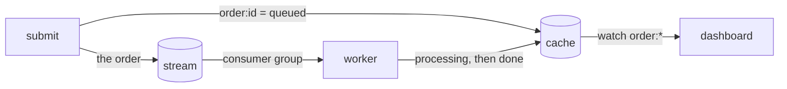

import { Tabs, TabItem } from '@astrojs/starlight/components';

You will build a small order pipeline from the three pieces the earlier
tutorials introduced. A submit command stands in for your API: it records an
order's status in a cache and publishes the order to a stream. Workers in a
consumer group take orders off the stream, fulfil them and write the result to
the cache. A dashboard watches the cache and prints every status change.



One program has three modes (`submit`, `work` and `dashboard`) so the whole
thing stays in one file. In a real system they would be separate services, and
submit would sit behind an HTTP handler.

## Prerequisites

A running broker and the environment variables from the
[tutorials overview](/tutorials/overview/#set-up-once), and the client for your
language. The earlier tutorials introduce each call used here, so
[Your first stream](/tutorials/first-stream/),
[A work queue](/tutorials/work-queue/) and
[Cache, leases and watches](/tutorials/cache-leases-watches/) are worth doing
first. This tutorial has Rust, Python, TypeScript and C# tabs. The C calls are
the same as in the earlier tutorials.

## 1. Create the stream and the cache

```bash
docker compose run --rm felixctl stream create tutorial-orders
docker compose run --rm felixctl cache create tutorial-cache
```

Use `felixctl` directly if you installed it. If you did the previous tutorial,
the cache exists and the command says so.

## 2. Connect and accept orders

An order is a small JSON document. Submitting one does two writes, and their
order matters. The status goes into the cache first and the order is published
second. Done the other way round, a quick worker could write `done` and then
have the API overwrite it with `queued`. Status keys expire after an hour so
the cache does not collect old orders.

<Tabs syncKey="lang">
<TabItem label="Rust">

```rust
use std::net::SocketAddr;
use std::sync::Arc;
use std::time::Duration;

use anyhow::{Context, Result};
use bytes::Bytes;
use felix_client::{AckMode, ClientConfig, ClusterClient, quic_client_config, root_store_from_pem_file};

// Must match FELIX_AUTH_TENANT.
const TENANT: &str = "dev";
const NAMESPACE: &str = "default";
const STREAM: &str = "tutorial-orders";
const GROUP: &str = "fulfilment";
const CACHE: &str = "tutorial-cache";
const STATUS_TTL_MS: u64 = 60 * 60 * 1000;

async fn connect() -> Result<Arc<ClusterClient>> {
    let ca_file = std::env::var("FELIX_CA_FILE").context("set FELIX_CA_FILE")?;
    let roots = Arc::new(root_store_from_pem_file(&ca_file)?);
    // Reads FELIX_AUTH_TENANT and FELIX_AUTH_TOKEN.
    let config = ClientConfig::from_env_or_yaml(quic_client_config(Some(roots), false)?, None)?;

    let broker = std::env::var("FELIX_BROKERS").unwrap_or_else(|_| "127.0.0.1:5000".into());
    let seeds: Vec<SocketAddr> = vec![broker.parse().context("FELIX_BROKERS must be ip:port")?];
    Ok(Arc::new(ClusterClient::connect(&seeds, "localhost", config).await?))
}

async fn set_status(client: &ClusterClient, id: &str, status: &str) -> Result<()> {
    let value = Bytes::copy_from_slice(status.as_bytes());
    client
        .cache_put(TENANT, NAMESPACE, CACHE, &format!("order:{id}"), value, Some(STATUS_TTL_MS))
        .await
}

async fn submit(client: &ClusterClient, count: u32) -> Result<()> {
    for n in 1..=count {
        let id = format!("o-{n}");
        let order = serde_json::to_vec(&serde_json::json!({ "id": id, "qty": n }))?;

        // The status goes first, so a fast worker's result is never overwritten.
        set_status(client, &id, "queued").await?;
        let publish = client.publish(TENANT, NAMESPACE, STREAM, order, AckMode::PerMessage);
        tokio::time::timeout(Duration::from_secs(10), publish)
            .await
            .context("the broker did not answer within 10 seconds")??;
        println!("accepted {id}");
    }
    Ok(())
}
```

</TabItem>
<TabItem label="Python">

```python
import json
import os
import sys
import time

import felix

# Must match FELIX_AUTH_TENANT.
TENANT = "dev"
NAMESPACE = "default"
STREAM = "tutorial-orders"
GROUP = "fulfilment"
CACHE = "tutorial-cache"
STATUS_TTL_SECONDS = 60 * 60


def connect() -> felix.Client:
    return felix.Client(
        os.environ.get("FELIX_BROKERS", "127.0.0.1:5000"),
        tenant_id=TENANT,
        token=os.environ["FELIX_AUTH_TOKEN"],
        ca_file=os.environ["FELIX_CA_FILE"],
        reconnect_deadline=10.0,
    )


def set_status(client: felix.Client, order_id: str, status: str) -> None:
    client.cache_put(
        TENANT, NAMESPACE, CACHE, f"order:{order_id}", status.encode(), ttl=STATUS_TTL_SECONDS
    )


def submit(client: felix.Client, count: int) -> None:
    for n in range(1, count + 1):
        order_id = f"o-{n}"
        order = json.dumps({"id": order_id, "qty": n}).encode()

        # The status goes first, so a fast worker's result is never overwritten.
        set_status(client, order_id, "queued")
        client.publish(TENANT, NAMESPACE, STREAM, order)
        print(f"accepted {order_id}")
```

</TabItem>
<TabItem label="TypeScript">

```ts
import { setTimeout as sleep } from "node:timers/promises";
import { Client } from "felix-client";

// Must match FELIX_AUTH_TENANT.
const TENANT = "dev";
const NAMESPACE = "default";
const STREAM = "tutorial-orders";
const GROUP = "fulfilment";
const CACHE = "tutorial-cache";
const STATUS_TTL_SECONDS = 60 * 60;

function required(name: string): string {
  const value = process.env[name];
  if (!value) throw new Error(`set ${name}`);
  return value;
}

function connect(): Promise<Client> {
  return Client.connect(process.env.FELIX_BROKERS ?? "127.0.0.1:5000", TENANT, {
    token: required("FELIX_AUTH_TOKEN"),
    caFile: required("FELIX_CA_FILE"),
    reconnectDeadline: 10_000, // milliseconds
  });
}

async function setStatus(client: Client, id: string, status: string): Promise<void> {
  await client.cachePut(
    TENANT, NAMESPACE, CACHE, `order:${id}`, Buffer.from(status), STATUS_TTL_SECONDS,
  );
}

async function submit(client: Client, count: number): Promise<void> {
  for (let n = 1; n <= count; n++) {
    const id = `o-${n}`;
    const order = Buffer.from(JSON.stringify({ id, qty: n }));

    // The status goes first, so a fast worker's result is never overwritten.
    await setStatus(client, id, "queued");
    await client.publish(TENANT, NAMESPACE, STREAM, order);
    console.log(`accepted ${id}`);
  }
}
```

</TabItem>
<TabItem label="C#">

```csharp
using System.Text;
using System.Text.Json;
using Felix;

// Must match FELIX_AUTH_TENANT.
const string Tenant = "dev";
const string Namespace = "default";
const string StreamName = "tutorial-orders";
const string Group = "fulfilment";
const string CacheName = "tutorial-cache";

static string Required(string name) =>
    Environment.GetEnvironmentVariable(name) is { Length: > 0 } value
        ? value
        : throw new InvalidOperationException($"set {name}");

static async Task<FelixClient> ConnectAsync(CancellationToken ct) =>
    await FelixClient.ConnectAsync(new FelixClientOptions
    {
        Addrs = [Environment.GetEnvironmentVariable("FELIX_BROKERS") ?? "127.0.0.1:5000"],
        TenantId = Tenant,
        Token = Required("FELIX_AUTH_TOKEN"),
        CaFile = Required("FELIX_CA_FILE"),
        ReconnectDeadline = TimeSpan.FromSeconds(10),
    }, ct);

static Task SetStatusAsync(FelixCache cache, string id, string status, CancellationToken ct) =>
    cache.PutAsync($"order:{id}", Encoding.UTF8.GetBytes(status), ttl: TimeSpan.FromHours(1), cancellationToken: ct);

static async Task SubmitAsync(FelixClient client, FelixCache cache, int count, CancellationToken ct)
{
    for (var n = 1; n <= count; n++)
    {
        var id = $"o-{n}";
        var order = JsonSerializer.SerializeToUtf8Bytes(new { id, qty = n });

        // The status goes first, so a fast worker's result is never overwritten.
        await SetStatusAsync(cache, id, "queued", ct);
        await client.PublishAsync(Tenant, Namespace, StreamName, order, cancellationToken: ct);
        Console.WriteLine($"accepted {id}");
    }
}
```

</TabItem>
</Tabs>

## 3. Fulfil orders

Workers poll the `fulfilment` group one order at a time. For each order the
worker reads the id and quantity, marks the order `processing`, does the work
(here a two second pause and a price of 5 per unit) and writes `done`. The
acknowledgement comes last, after the result is in the cache. If a worker dies
before acknowledging, the order comes back and the same result is written
again, which is why writing the result is safe to repeat.

The worker separates two kinds of failure. An order that does not parse will
never succeed, so retrying it only delays the orders behind it. The worker
acknowledges it and moves on. Anything else, such as a cache write that
failed, may work on the next attempt, so the worker nacks the record and the
broker hands it out again. A record that keeps failing ends up as a dead
letter, as in [A work queue](/tutorials/work-queue/#4-dead-letters-and-redrive).

<Tabs syncKey="lang">
<TabItem label="Rust">

```rust
use anyhow::bail;

async fn fulfil(client: &ClusterClient, id: &str, qty: u64) -> Result<()> {
    set_status(client, id, "processing").await?;
    tokio::time::sleep(Duration::from_secs(2)).await;
    set_status(client, id, &format!("done total={}", qty * 5)).await
}

fn parse_order(payload: &[u8]) -> Option<(String, u64)> {
    let order: serde_json::Value = serde_json::from_slice(payload).ok()?;
    Some((order.get("id")?.as_str()?.to_owned(), order.get("qty")?.as_u64()?))
}

async fn work(client: &ClusterClient) -> Result<()> {
    loop {
        let records = client
            .group_poll_wait(TENANT, NAMESPACE, STREAM, 0, GROUP, 1, Duration::from_secs(5))
            .await?;
        for record in records {
            let Some((id, qty)) = parse_order(&record.payload) else {
                // It will never parse, so settle it rather than retry it.
                println!("rejected a malformed order at offset {}", record.offset);
                client.group_ack(TENANT, NAMESPACE, STREAM, 0, GROUP, record.offset).await?;
                continue;
            };
            match fulfil(client, &id, qty).await {
                Ok(()) => {
                    client.group_ack(TENANT, NAMESPACE, STREAM, 0, GROUP, record.offset).await?;
                    println!("fulfilled {id} (attempt {})", record.attempts);
                }
                Err(err) => {
                    println!("{id} failed on attempt {}: {err:#}", record.attempts);
                    client.group_nack(TENANT, NAMESPACE, STREAM, 0, GROUP, &record).await?;
                }
            }
        }
    }
}
```

</TabItem>
<TabItem label="Python">

```python
def parse_order(payload: bytes) -> tuple[str, int] | None:
    try:
        order = json.loads(payload)
        return str(order["id"]), int(order["qty"])
    except (ValueError, KeyError, TypeError):
        return None


def fulfil(client: felix.Client, order_id: str, qty: int) -> None:
    set_status(client, order_id, "processing")
    time.sleep(2)
    set_status(client, order_id, f"done total={qty * 5}")


def work(client: felix.Client) -> None:
    while True:
        records = client.group_poll(
            TENANT, NAMESPACE, STREAM, 0, GROUP, max_records=1, wait=5.0
        )
        for record in records:
            order = parse_order(record.payload)
            if order is None:
                # It will never parse, so settle it rather than retry it.
                print(f"rejected a malformed order at offset {record.offset}")
                client.group_ack(TENANT, NAMESPACE, STREAM, 0, GROUP, record.offset)
                continue
            order_id, qty = order
            try:
                fulfil(client, order_id, qty)
            except felix.FelixError as err:
                print(f"{order_id} failed on attempt {record.attempts}: {err}")
                client.group_nack(TENANT, NAMESPACE, STREAM, 0, GROUP, record)
            else:
                client.group_ack(TENANT, NAMESPACE, STREAM, 0, GROUP, record.offset)
                print(f"fulfilled {order_id} (attempt {record.attempts})")
```

</TabItem>
<TabItem label="TypeScript">

```ts
import { FelixError } from "felix-client";

function parseOrder(payload: Buffer): { id: string; qty: number } | null {
  try {
    const order: unknown = JSON.parse(payload.toString());
    if (
      typeof order === "object" && order !== null &&
      "id" in order && typeof order.id === "string" &&
      "qty" in order && typeof order.qty === "number"
    ) {
      return { id: order.id, qty: order.qty };
    }
  } catch {
    // Not JSON.
  }
  return null;
}

async function fulfil(client: Client, id: string, qty: number): Promise<void> {
  await setStatus(client, id, "processing");
  await sleep(2000);
  await setStatus(client, id, `done total=${qty * 5}`);
}

async function work(client: Client): Promise<void> {
  for (;;) {
    const records = await client.groupPoll(TENANT, NAMESPACE, STREAM, 0, GROUP, 1, 5000);
    for (const record of records) {
      const order = parseOrder(record.payload);
      if (order === null) {
        // It will never parse, so settle it rather than retry it.
        console.log(`rejected a malformed order at offset ${record.offset}`);
        await client.groupAck(TENANT, NAMESPACE, STREAM, 0, GROUP, record.offset);
        continue;
      }
      try {
        await fulfil(client, order.id, order.qty);
      } catch (err) {
        if (!(err instanceof FelixError)) throw err;
        console.log(`${order.id} failed on attempt ${record.attempts}: ${err.message}`);
        await client.groupNack(TENANT, NAMESPACE, STREAM, 0, GROUP, record);
        continue;
      }
      await client.groupAck(TENANT, NAMESPACE, STREAM, 0, GROUP, record.offset);
      console.log(`fulfilled ${order.id} (attempt ${record.attempts})`);
    }
  }
}
```

</TabItem>
<TabItem label="C#">

```csharp
static (string Id, int Qty)? ParseOrder(ReadOnlyMemory<byte> payload)
{
    try
    {
        using var doc = JsonDocument.Parse(payload);
        var root = doc.RootElement;
        if (root.ValueKind == JsonValueKind.Object
            && root.TryGetProperty("id", out var id) && id.ValueKind == JsonValueKind.String
            && root.TryGetProperty("qty", out var qty) && qty.TryGetInt32(out var count))
        {
            return (id.GetString()!, count);
        }
    }
    catch (JsonException)
    {
        // Not JSON.
    }
    return null;
}

static async Task FulfilAsync(FelixCache cache, string id, int qty)
{
    await SetStatusAsync(cache, id, "processing", CancellationToken.None);
    await Task.Delay(TimeSpan.FromSeconds(2));
    await SetStatusAsync(cache, id, $"done total={qty * 5}", CancellationToken.None);
}

static async Task WorkAsync(FelixClient client, FelixCache cache)
{
    var group = client.JoinGroup(Tenant, Namespace, StreamName, shard: 0, Group);
    while (true)
    {
        var records = await group.PollAsync(maxRecords: 1, wait: TimeSpan.FromSeconds(5));
        foreach (var record in records)
        {
            if (ParseOrder(record.Payload) is not { } order)
            {
                // It will never parse, so settle it rather than retry it.
                Console.WriteLine($"rejected a malformed order at offset {record.Offset}");
                await group.AckAsync(record);
                continue;
            }
            try
            {
                await FulfilAsync(cache, order.Id, order.Qty);
            }
            catch (FelixException e)
            {
                Console.WriteLine($"{order.Id} failed on attempt {record.Attempts}: {e.Message}");
                await group.NackAsync(record);
                continue;
            }
            await group.AckAsync(record);
            Console.WriteLine($"fulfilled {order.Id} (attempt {record.Attempts})");
        }
    }
}
```

</TabItem>
</Tabs>

## 4. Watch the orders

The dashboard is a retained prefix watch on `order:`. A retained watch first
delivers the current value of every matching key and then the live changes, so
a dashboard started in the middle of the day shows the state of every order
that is still in the cache instead of only what changes afterwards. If the
watch falls behind, the broker ends it and says where to watch again from.

<Tabs syncKey="lang">
<TabItem label="Rust">

```rust
use felix_client::{CacheWatchFilter, CacheWatchItem};

async fn dashboard(client: &Arc<ClusterClient>) -> Result<()> {
    let mut watch = client
        .watch_cache_retained(TENANT, NAMESPACE, CACHE, CacheWatchFilter::Prefix("order:".into()))
        .await?;
    while let Some(item) = watch.recv().await {
        match item {
            CacheWatchItem::Change(change) => {
                let status = change.value.as_deref().map(String::from_utf8_lossy);
                println!("{} = {}", change.key, status.as_deref().unwrap_or("(expired)"));
            }
            CacheWatchItem::Lagged { resume_from } => {
                bail!("the dashboard fell behind; watch again from offset {resume_from}")
            }
            CacheWatchItem::ShardMoved(_) => println!("the shard moved; the watch follows it"),
        }
    }
    Ok(())
}
```

</TabItem>
<TabItem label="Python">

```python
def dashboard(client: felix.Client) -> None:
    prefix = felix.CacheWatchFilter.prefix("order:")
    with client.watch_cache(TENANT, NAMESPACE, CACHE, prefix, retained=True) as watch:
        for item in watch:
            if isinstance(item, felix.CacheChange):
                status = "(expired)" if item.value is None else item.value.decode(errors="replace")
                print(f"{item.key} = {status}")
            elif isinstance(item, felix.CacheWatchLagged):
                raise RuntimeError(f"the dashboard fell behind; watch again from offset {item.resume_from}")
            else:
                print("the shard moved; the watch follows it")
```

</TabItem>
<TabItem label="TypeScript">

```ts
async function dashboard(client: Client): Promise<void> {
  const changes = await client.watchCache(
    TENANT, NAMESPACE, CACHE,
    undefined, // key
    "order:",  // prefix
    undefined, // start offset
    true,      // retained: current values first
  );
  try {
    for (;;) {
      const item = await changes.recv();
      if (item === null) return;
      if (item.laggedResumeFrom !== null) {
        throw new Error(`the dashboard fell behind; watch again from offset ${item.laggedResumeFrom}`);
      }
      if (item.change === null) {
        console.log("the shard moved; the watch follows it");
      } else {
        const status = item.change.value === null ? "(expired)" : item.change.value.toString();
        console.log(`${item.change.key} = ${status}`);
      }
    }
  } finally {
    await changes.close();
  }
}
```

</TabItem>
<TabItem label="C#">

```csharp
static async Task DashboardAsync(FelixCache cache)
{
    await using var watch = await cache.WatchPrefixAsync("order:", retained: true);
    await foreach (var item in watch)
    {
        switch (item.Kind)
        {
            case WatchItemKind.Change:
                var status = item.IsDelete ? "(expired)" : Encoding.UTF8.GetString(item.Value!.Value.Span);
                Console.WriteLine($"{item.Key} = {status}");
                break;
            case WatchItemKind.Lagged:
                throw new InvalidOperationException(
                    $"the dashboard fell behind; watch again from offset {item.ResumeFrom}");
            case WatchItemKind.ShardMoved:
                Console.WriteLine("the shard moved; the watch follows it");
                break;
        }
    }
}
```

</TabItem>
</Tabs>

## 5. Pick the mode

<Tabs syncKey="lang">
<TabItem label="Rust">

```rust
#[tokio::main]
async fn main() -> Result<()> {
    let client = tokio::time::timeout(Duration::from_secs(10), connect())
        .await
        .context("connecting took longer than 10 seconds")??;
    let args: Vec<String> = std::env::args().skip(1).collect();
    match args.first().map(String::as_str) {
        Some("submit") => {
            let count = args.get(1).map_or(Ok(3), |n| n.parse()).context("count must be a number")?;
            submit(&client, count).await
        }
        Some("work") => work(&client).await,
        Some("dashboard") => dashboard(&client).await,
        _ => bail!("usage: orders submit [count] | work | dashboard"),
    }
}
```

</TabItem>
<TabItem label="Python">

```python
def main() -> None:
    args = sys.argv[1:]
    if not args or args[0] not in ("submit", "work", "dashboard"):
        sys.exit("usage: orders.py submit [count] | work | dashboard")
    with connect() as client:
        if args[0] == "submit":
            submit(client, int(args[1]) if len(args) > 1 else 3)
        elif args[0] == "work":
            work(client)
        else:
            dashboard(client)


main()
```

</TabItem>
<TabItem label="TypeScript">

```ts
async function main(): Promise<void> {
  const [mode, count = "3"] = process.argv.slice(2);
  if (mode !== "submit" && mode !== "work" && mode !== "dashboard") {
    throw new Error("usage: orders submit [count] | work | dashboard");
  }
  const client = await connect();
  try {
    if (mode === "submit") await submit(client, Number(count));
    else if (mode === "work") await work(client);
    else await dashboard(client);
  } finally {
    client.close();
  }
}

await main();
```

</TabItem>
<TabItem label="C#">

```csharp
var mode = args.Length > 0 ? args[0] : "";
if (mode is not ("submit" or "work" or "dashboard"))
{
    Console.Error.WriteLine("usage: orders submit [count] | work | dashboard");
    return 1;
}

using var connecting = new CancellationTokenSource(TimeSpan.FromSeconds(10));
await using var client = await ConnectAsync(connecting.Token);
var cache = client.Cache(Tenant, Namespace, CacheName);
switch (mode)
{
    case "submit":
        await SubmitAsync(client, cache, args.Length > 1 ? int.Parse(args[1]) : 3, CancellationToken.None);
        break;
    case "work":
        await WorkAsync(client, cache);
        break;
    default:
        await DashboardAsync(cache);
        break;
}
return 0;
```

</TabItem>
</Tabs>

## What you should see

Start `dashboard` in one terminal and two `work` processes in two others. In a
fourth, submit some orders:

```text
$ orders submit 4
accepted o-1
accepted o-2
accepted o-3
accepted o-4
```

The dashboard follows every order from queued to done, interleaved as the
workers get to them:

```text
order:o-1 = queued
order:o-2 = queued
order:o-3 = queued
order:o-4 = queued
order:o-1 = processing
order:o-2 = processing
order:o-1 = done total=5
order:o-3 = processing
order:o-2 = done total=10
order:o-4 = processing
order:o-3 = done total=15
order:o-4 = done total=20
```

The two workers split the orders between them, as in the work queue, so the
four orders take about four seconds instead of eight. Stop the dashboard and start
it again after a few seconds. It prints the current status of each order first,
then follows any new ones.

To see the failure paths, stop a worker with Ctrl-C while it is fulfilling an
order. The other worker finishes the order about 30 seconds later, on
`attempt 2`, and the dashboard shows it reach `done`.
To see the rejection path, publish text that is not an order with
`felixctl pub tutorial-orders 'not json'`. A worker prints
`rejected a malformed order` and carries on.

## Where next

Each piece here has more to it. [Queues and consumer groups](/features/queues/)
covers extending a claim for long jobs, delayed retries and dead letters, and
[Cache](/features/cache/) covers counters and conditional writes. To run several
workers that must not duplicate an effect, combine the work queue with the lease
from [Cache, leases and watches](/tutorials/cache-leases-watches/). The
[demos](/demos/overview/) run larger systems on Felix, and
[Choosing a client](/clients/overview/) compares the language bindings.
