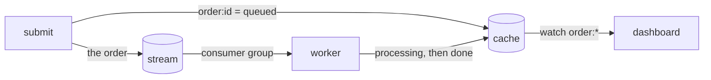

import { Tabs, TabItem } from '@astrojs/starlight/components';

You will build a small order pipeline from the three pieces the earlier
tutorials introduced. A submit command stands in for your API: it records an
order's status in a cache and publishes the order to a stream. Workers in a
consumer group take orders off the stream, fulfil them and write the result to
the cache. A dashboard watches the cache and prints every status change.



One program has three modes (`submit`, `work` and `dashboard`) so the whole
thing stays in one file. In a real system they would be separate services, and
submit would sit behind an HTTP handler.

## Prerequisites

A running broker, the env file and the client for your language, all set up as
the [tutorials overview](/tutorials/overview/#set-up-once) describes. The earlier tutorials introduce each call used here, so
[Your first stream](/tutorials/first-stream/),
[A work queue](/tutorials/work-queue/) and
[Cache, leases and watches](/tutorials/cache-leases-watches/) are worth doing
first. This tutorial has Rust, Python, TypeScript and C# tabs. The C calls are
the same as in the earlier tutorials.

## 1. Create the stream and the cache

<Tabs syncKey="engine">
<TabItem label="Docker">

```bash
docker compose run --rm felixctl stream create tutorial-orders
docker compose run --rm felixctl cache create tutorial-cache
```

</TabItem>
<TabItem label="Podman">

```bash
podman compose run --rm felixctl stream create tutorial-orders
podman compose run --rm felixctl cache create tutorial-cache
```

</TabItem>
</Tabs>

Use `felixctl` directly if you installed it. If you did the previous tutorial,
the cache exists and the command says so.

## 2. Connect and accept orders

An order is a small JSON document. Submitting one does two writes, and their
order matters. The status goes into the cache first and the order is published
second. Done the other way round, a quick worker could write `done` and then
have the API overwrite it with `queued`. Status keys expire after an hour so
the cache does not collect old orders.

<Tabs syncKey="lang">
<TabItem label="Rust">

```rust
use std::future::Future;
use std::net::SocketAddr;
use std::sync::Arc;
use std::time::Duration;

use anyhow::{Context, Result};
use bytes::Bytes;
use felix_client::{AckMode, ClientConfig, ClusterClient, ReconnectPolicy, quic_client_config, root_store_from_pem_file};

// Must match FELIX_AUTH_TENANT.
const TENANT: &str = "dev";
const NAMESPACE: &str = "default";
const STREAM: &str = "tutorial-orders";
const GROUP: &str = "fulfilment";
const CACHE: &str = "tutorial-cache";
const STATUS_TTL_MS: u64 = 60 * 60 * 1000;

// Every call to the broker gets this long. A poll waits on purpose, so it gets
// its wait on top.
const CALL_TIMEOUT: Duration = Duration::from_secs(10);
const POLL_WAIT: Duration = Duration::from_secs(5);

async fn bounded<T>(what: &str, limit: Duration, call: impl Future<Output = Result<T>>) -> Result<T> {
    tokio::time::timeout(limit, call)
        .await
        .with_context(|| format!("{what} did not finish within {limit:?}"))?
}

async fn connect() -> Result<Arc<ClusterClient>> {
    let ca_file = std::env::var("FELIX_CA_FILE").context("set FELIX_CA_FILE")?;
    let roots = Arc::new(root_store_from_pem_file(&ca_file)?);
    // Reads FELIX_AUTH_TENANT and FELIX_AUTH_TOKEN.
    let config = ClientConfig::from_env_or_yaml(quic_client_config(Some(roots), false)?, None)?;

    let broker = std::env::var("FELIX_BROKERS").unwrap_or_else(|_| "127.0.0.1:5000".into());
    let seeds: Vec<SocketAddr> = vec![broker.parse().context("FELIX_BROKERS must be ip:port")?];
    // Cap the time one call spends retrying.
    let policy = ReconnectPolicy { deadline: Some(CALL_TIMEOUT), ..ReconnectPolicy::default() };
    let connecting = ClusterClient::connect_with_policy(&seeds, "localhost", config, policy);
    let client = bounded("connecting", CALL_TIMEOUT, connecting).await?;
    Ok(Arc::new(client))
}

async fn set_status(client: &ClusterClient, id: &str, status: &str) -> Result<()> {
    let value = Bytes::copy_from_slice(status.as_bytes());
    let key = format!("order:{id}");
    let put = client.cache_put(TENANT, NAMESPACE, CACHE, &key, value, Some(STATUS_TTL_MS));
    bounded("writing the status", CALL_TIMEOUT, put).await
}

async fn submit(client: &ClusterClient, count: u32) -> Result<()> {
    for n in 1..=count {
        let id = format!("o-{n}");
        let order = serde_json::to_vec(&serde_json::json!({ "id": id, "qty": n }))?;

        // The status goes first, so a fast worker's result is never overwritten.
        set_status(client, &id, "queued").await?;
        let publish = client.publish(TENANT, NAMESPACE, STREAM, order, AckMode::PerMessage);
        bounded("publish", CALL_TIMEOUT, publish).await?;
        println!("accepted {id}");
    }
    Ok(())
}
```

</TabItem>
<TabItem label="Python">

```python
import asyncio
import json
import os
import sys

import felix

# Must match FELIX_AUTH_TENANT.
TENANT = "dev"
NAMESPACE = "default"
STREAM = "tutorial-orders"
GROUP = "fulfilment"
CACHE = "tutorial-cache"
STATUS_TTL_SECONDS = 60 * 60

# Every call to the broker gets this long. A poll waits on purpose, so it gets
# its wait on top.
CALL_TIMEOUT = 10.0
POLL_WAIT = 5.0


async def bounded(call, extra=0.0):
    return await asyncio.wait_for(call, CALL_TIMEOUT + extra)


async def connect() -> felix.AsyncClient:
    return await bounded(
        felix.AsyncClient.connect(
            os.environ.get("FELIX_BROKERS", "127.0.0.1:5000"),
            tenant_id=TENANT,
            token=os.environ["FELIX_AUTH_TOKEN"],
            ca_file=os.environ["FELIX_CA_FILE"],
            reconnect_deadline=CALL_TIMEOUT,
        )
    )


async def set_status(client: felix.AsyncClient, order_id: str, status: str) -> None:
    await bounded(
        client.cache_put(
            TENANT, NAMESPACE, CACHE, f"order:{order_id}", status.encode(), ttl=STATUS_TTL_SECONDS
        )
    )


async def submit(client: felix.AsyncClient, count: int) -> None:
    for n in range(1, count + 1):
        order_id = f"o-{n}"
        order = json.dumps({"id": order_id, "qty": n}).encode()

        # The status goes first, so a fast worker's result is never overwritten.
        await set_status(client, order_id, "queued")
        await bounded(client.publish(TENANT, NAMESPACE, STREAM, order))
        print(f"accepted {order_id}")
```

</TabItem>
<TabItem label="TypeScript">

```ts
import { setTimeout as sleep } from "node:timers/promises";
import { Client } from "felix-client";

// Must match FELIX_AUTH_TENANT.
const TENANT = "dev";
const NAMESPACE = "default";
const STREAM = "tutorial-orders";
const GROUP = "fulfilment";
const CACHE = "tutorial-cache";
const STATUS_TTL_SECONDS = 60 * 60;

// Every call to the broker gets this long, and a poll gets its wait on top. The
// client takes no timeout argument, so a timer is raced against the call.
const CALL_TIMEOUT_MS = 10_000;
const POLL_WAIT_MS = 5000;

async function bounded<T>(what: string, call: Promise<T>, ms = CALL_TIMEOUT_MS): Promise<T> {
  const timer = new AbortController();
  const expired = sleep(ms, undefined, { signal: timer.signal }).then(() => {
    throw new Error(`${what} did not finish within ${ms} ms`);
  });
  try {
    return await Promise.race([call, expired]);
  } finally {
    timer.abort();
  }
}

function required(name: string): string {
  const value = process.env[name];
  if (!value) throw new Error(`set ${name}`);
  return value;
}

function connect(): Promise<Client> {
  return bounded(
    "connecting",
    Client.connect(process.env.FELIX_BROKERS ?? "127.0.0.1:5000", TENANT, {
      token: required("FELIX_AUTH_TOKEN"),
      caFile: required("FELIX_CA_FILE"),
      reconnectDeadline: CALL_TIMEOUT_MS,
    }),
  );
}

async function setStatus(client: Client, id: string, status: string): Promise<void> {
  await bounded(
    "writing the status",
    client.cachePut(TENANT, NAMESPACE, CACHE, `order:${id}`, Buffer.from(status), STATUS_TTL_SECONDS),
  );
}

async function submit(client: Client, count: number): Promise<void> {
  for (let n = 1; n <= count; n++) {
    const id = `o-${n}`;
    const order = Buffer.from(JSON.stringify({ id, qty: n }));

    // The status goes first, so a fast worker's result is never overwritten.
    await setStatus(client, id, "queued");
    await bounded("publish", client.publish(TENANT, NAMESPACE, STREAM, order));
    console.log(`accepted ${id}`);
  }
}
```

</TabItem>
<TabItem label="C#">

```csharp
using System.Text;
using System.Text.Json;
using Felix;

// Must match FELIX_AUTH_TENANT.
const string Tenant = "dev";
const string Namespace = "default";
const string StreamName = "tutorial-orders";
const string Group = "fulfilment";
const string CacheName = "tutorial-cache";

// Every call to the broker gets this long. A poll waits on purpose, so it gets
// its wait on top.
const int CallSeconds = 10;
const int PollWaitSeconds = 5;

static async Task<T> Bounded<T>(Func<CancellationToken, Task<T>> call, int extraSeconds = 0)
{
    using var limit = new CancellationTokenSource(TimeSpan.FromSeconds(CallSeconds + extraSeconds));
    return await call(limit.Token);
}

static async Task BoundedTask(Func<CancellationToken, Task> call)
{
    using var limit = new CancellationTokenSource(TimeSpan.FromSeconds(CallSeconds));
    await call(limit.Token);
}

static string Required(string name) =>
    Environment.GetEnvironmentVariable(name) is { Length: > 0 } value
        ? value
        : throw new InvalidOperationException($"set {name}");

static Task<FelixClient> ConnectAsync() =>
    Bounded(ct => FelixClient.ConnectAsync(new FelixClientOptions
    {
        Addrs = [Environment.GetEnvironmentVariable("FELIX_BROKERS") ?? "127.0.0.1:5000"],
        TenantId = Tenant,
        Token = Required("FELIX_AUTH_TOKEN"),
        CaFile = Required("FELIX_CA_FILE"),
        ReconnectDeadline = TimeSpan.FromSeconds(CallSeconds),
    }, ct));

static Task SetStatusAsync(FelixCache cache, string id, string status) =>
    BoundedTask(ct => cache.PutAsync($"order:{id}", Encoding.UTF8.GetBytes(status), ttl: TimeSpan.FromHours(1), cancellationToken: ct));

static async Task SubmitAsync(FelixClient client, FelixCache cache, int count)
{
    for (var n = 1; n <= count; n++)
    {
        var id = $"o-{n}";
        var order = JsonSerializer.SerializeToUtf8Bytes(new { id, qty = n });

        // The status goes first, so a fast worker's result is never overwritten.
        await SetStatusAsync(cache, id, "queued");
        await Bounded(ct => client.PublishAsync(Tenant, Namespace, StreamName, order, cancellationToken: ct));
        Console.WriteLine($"accepted {id}");
    }
}
```

</TabItem>
</Tabs>

## 3. Fulfil orders

Workers poll the `fulfilment` group one order at a time. For each order the
worker reads the id and quantity, marks the order `processing`, does the work
(here a two second pause and a price of 5 per unit) and writes `done`. The
acknowledgement comes last, after the result is in the cache. If a worker dies
before acknowledging, the order comes back and the same result is written
again, which is why writing the result is safe to repeat.

The worker separates two kinds of failure. An order that does not parse, or
whose quantity is outside 1 to 1,000,000, will never succeed, so retrying it
only delays the orders behind it. The worker acknowledges it and moves on.
Anything else, such as a cache write that failed, may work on the next attempt,
so the worker nacks the record and the broker hands it out again. The Rust and
C# workers nack with a one second delay, so a failing order is not retried at
full speed; the Python and TypeScript bindings nack without one. A record that
keeps failing ends up as a dead letter, as in
[A work queue](/tutorials/work-queue/#4-dead-letters-and-redrive).

Every call to the broker has a time limit. See
[Time limits](/tutorials/overview/#time-limits).

<Tabs syncKey="lang">
<TabItem label="Rust">

```rust
use anyhow::bail;

const PRICE: u64 = 5;
const MAX_QTY: u64 = 1_000_000;

async fn fulfil(client: &ClusterClient, id: &str, total: u64) -> Result<()> {
    set_status(client, id, "processing").await?;
    tokio::time::sleep(Duration::from_secs(2)).await;
    set_status(client, id, &format!("done total={total}")).await
}

// The order's id and its total, or None for an order that can never be filled.
fn parse_order(payload: &[u8]) -> Option<(String, u64)> {
    let order: serde_json::Value = serde_json::from_slice(payload).ok()?;
    let qty = order.get("qty")?.as_u64()?;
    if qty == 0 || qty > MAX_QTY {
        return None;
    }
    Some((order.get("id")?.as_str()?.to_owned(), qty.checked_mul(PRICE)?))
}

async fn work(client: &ClusterClient) -> Result<()> {
    loop {
        let poll = client.group_poll_wait(TENANT, NAMESPACE, STREAM, 0, GROUP, 1, POLL_WAIT);
        let records = bounded("poll", CALL_TIMEOUT + POLL_WAIT, poll).await?;
        for record in records {
            let Some((id, total)) = parse_order(&record.payload) else {
                // It will never parse, so settle it rather than retry it.
                println!("rejected a malformed order at offset {}", record.offset);
                let ack = client.group_ack(TENANT, NAMESPACE, STREAM, 0, GROUP, record.offset);
                bounded("ack", CALL_TIMEOUT, ack).await?;
                continue;
            };
            match fulfil(client, &id, total).await {
                Ok(()) => {
                    let ack = client.group_ack(TENANT, NAMESPACE, STREAM, 0, GROUP, record.offset);
                    bounded("ack", CALL_TIMEOUT, ack).await?;
                    println!("fulfilled {id} (attempt {})", record.attempts);
                }
                Err(err) => {
                    println!("{id} failed on attempt {}: {err:#}", record.attempts);
                    let nack = client.group_nack_after(
                        TENANT, NAMESPACE, STREAM, 0, GROUP, &record, Duration::from_secs(1),
                    );
                    bounded("nack", CALL_TIMEOUT, nack).await?;
                }
            }
        }
    }
}
```

</TabItem>
<TabItem label="Python">

```python
PRICE = 5
MAX_QTY = 1_000_000


# The order's id and its total, or None for an order that can never be filled.
def parse_order(payload: bytes) -> tuple[str, int] | None:
    try:
        order = json.loads(payload)
        qty = int(order["qty"])
        if not 1 <= qty <= MAX_QTY:
            return None
        return str(order["id"]), qty * PRICE
    except (ValueError, KeyError, TypeError):
        return None


async def fulfil(client: felix.AsyncClient, order_id: str, total: int) -> None:
    await set_status(client, order_id, "processing")
    await asyncio.sleep(2)
    await set_status(client, order_id, f"done total={total}")


async def work(client: felix.AsyncClient) -> None:
    while True:
        records = await bounded(
            client.group_poll(
                TENANT, NAMESPACE, STREAM, 0, GROUP, max_records=1, wait=POLL_WAIT
            ),
            extra=POLL_WAIT,
        )
        for record in records:
            order = parse_order(record.payload)
            if order is None:
                # It will never parse, so settle it rather than retry it.
                print(f"rejected a malformed order at offset {record.offset}")
                await bounded(client.group_ack(TENANT, NAMESPACE, STREAM, 0, GROUP, record.offset))
                continue
            order_id, total = order
            try:
                await fulfil(client, order_id, total)
            except (felix.FelixError, asyncio.TimeoutError) as err:
                print(f"{order_id} failed on attempt {record.attempts}: {err!r}")
                await bounded(client.group_nack(TENANT, NAMESPACE, STREAM, 0, GROUP, record))
            else:
                await bounded(client.group_ack(TENANT, NAMESPACE, STREAM, 0, GROUP, record.offset))
                print(f"fulfilled {order_id} (attempt {record.attempts})")
```

</TabItem>
<TabItem label="TypeScript">

```ts
import { FelixError } from "felix-client";

const PRICE = 5;
const MAX_QTY = 1_000_000;

// The order's id and its total, or null for an order that can never be filled.
function parseOrder(payload: Buffer): { id: string; total: number } | null {
  try {
    const order: unknown = JSON.parse(payload.toString());
    if (
      typeof order === "object" && order !== null &&
      "id" in order && typeof order.id === "string" &&
      "qty" in order && typeof order.qty === "number" &&
      Number.isInteger(order.qty) && order.qty >= 1 && order.qty <= MAX_QTY
    ) {
      return { id: order.id, total: order.qty * PRICE };
    }
  } catch {
    // Not JSON.
  }
  return null;
}

async function fulfil(client: Client, id: string, total: number): Promise<void> {
  await setStatus(client, id, "processing");
  await sleep(2000);
  await setStatus(client, id, `done total=${total}`);
}

async function work(client: Client): Promise<void> {
  for (;;) {
    const records = await bounded(
      "poll",
      client.groupPoll(TENANT, NAMESPACE, STREAM, 0, GROUP, 1, POLL_WAIT_MS),
      CALL_TIMEOUT_MS + POLL_WAIT_MS,
    );
    for (const record of records) {
      const order = parseOrder(record.payload);
      if (order === null) {
        // It will never parse, so settle it rather than retry it.
        console.log(`rejected a malformed order at offset ${record.offset}`);
        await bounded("ack", client.groupAck(TENANT, NAMESPACE, STREAM, 0, GROUP, record.offset));
        continue;
      }
      try {
        await fulfil(client, order.id, order.total);
      } catch (err) {
        if (!(err instanceof FelixError)) throw err;
        console.log(`${order.id} failed on attempt ${record.attempts}: ${err.message}`);
        await bounded("nack", client.groupNack(TENANT, NAMESPACE, STREAM, 0, GROUP, record));
        continue;
      }
      await bounded("ack", client.groupAck(TENANT, NAMESPACE, STREAM, 0, GROUP, record.offset));
      console.log(`fulfilled ${order.id} (attempt ${record.attempts})`);
    }
  }
}
```

</TabItem>
<TabItem label="C#">

```csharp
const int Price = 5;
const int MaxQty = 1_000_000;

// The order's id and its total, or null for an order that can never be filled.
static (string Id, long Total)? ParseOrder(ReadOnlyMemory<byte> payload)
{
    try
    {
        using var doc = JsonDocument.Parse(payload);
        var root = doc.RootElement;
        if (root.ValueKind == JsonValueKind.Object
            && root.TryGetProperty("id", out var id) && id.ValueKind == JsonValueKind.String
            && root.TryGetProperty("qty", out var qty) && qty.TryGetInt32(out var count)
            && count is >= 1 and <= MaxQty)
        {
            return (id.GetString()!, checked((long)count * Price));
        }
    }
    catch (JsonException)
    {
        // Not JSON.
    }
    return null;
}

static async Task FulfilAsync(FelixCache cache, string id, long total)
{
    await SetStatusAsync(cache, id, "processing");
    await Task.Delay(TimeSpan.FromSeconds(2));
    await SetStatusAsync(cache, id, $"done total={total}");
}

static async Task WorkAsync(FelixClient client, FelixCache cache)
{
    var group = client.JoinGroup(Tenant, Namespace, StreamName, shard: 0, Group);
    while (true)
    {
        var records = await Bounded(
            ct => group.PollAsync(maxRecords: 1, wait: TimeSpan.FromSeconds(PollWaitSeconds), cancellationToken: ct),
            extraSeconds: PollWaitSeconds);
        foreach (var record in records)
        {
            if (ParseOrder(record.Payload) is not { } order)
            {
                // It will never parse, so settle it rather than retry it.
                Console.WriteLine($"rejected a malformed order at offset {record.Offset}");
                await BoundedTask(ct => group.AckAsync(record, ct));
                continue;
            }
            try
            {
                await FulfilAsync(cache, order.Id, order.Total);
            }
            catch (Exception e) when (e is FelixException or OperationCanceledException)
            {
                Console.WriteLine($"{order.Id} failed on attempt {record.Attempts}: {e.Message}");
                await BoundedTask(ct => group.NackAsync(record, delay: TimeSpan.FromSeconds(1), cancellationToken: ct));
                continue;
            }
            await BoundedTask(ct => group.AckAsync(record, ct));
            Console.WriteLine($"fulfilled {order.Id} (attempt {record.Attempts})");
        }
    }
}
```

</TabItem>
</Tabs>

## 4. Watch the orders

The dashboard is a retained prefix watch on `order:`. A retained watch first
delivers the current value of every matching key and then the live changes, so
a dashboard started in the middle of the day shows the state of every order
that is still in the cache instead of only what changes afterwards. If the
watch falls behind, the broker ends it and says where to watch again from.

<Tabs syncKey="lang">
<TabItem label="Rust">

```rust
use felix_client::{CacheWatchFilter, CacheWatchItem};

async fn dashboard(client: &Arc<ClusterClient>) -> Result<()> {
    let start = client.watch_cache_retained(TENANT, NAMESPACE, CACHE, CacheWatchFilter::Prefix("order:".into()));
    let mut watch = bounded("starting the watch", CALL_TIMEOUT, start).await?;
    while let Some(item) = watch.recv().await {
        match item {
            CacheWatchItem::Change(change) => {
                let status = change.value.as_deref().map(String::from_utf8_lossy);
                println!("{} = {}", change.key, status.as_deref().unwrap_or("(expired)"));
            }
            CacheWatchItem::Lagged { resume_from } => {
                bail!("the dashboard fell behind; watch again from offset {resume_from}")
            }
            CacheWatchItem::ShardMoved(_) => println!("the shard moved; the watch follows it"),
        }
    }
    Ok(())
}
```

</TabItem>
<TabItem label="Python">

```python
async def dashboard(client: felix.AsyncClient) -> None:
    prefix = felix.CacheWatchFilter.prefix("order:")
    start = client.watch_cache(TENANT, NAMESPACE, CACHE, prefix, retained=True)
    async with await bounded(start) as changes:
        async for item in changes:
            if isinstance(item, felix.CacheChange):
                status = "(expired)" if item.value is None else item.value.decode(errors="replace")
                print(f"{item.key} = {status}")
            elif isinstance(item, felix.CacheWatchLagged):
                raise RuntimeError(f"the dashboard fell behind; watch again from offset {item.resume_from}")
            else:
                print("the shard moved; the watch follows it")
```

</TabItem>
<TabItem label="TypeScript">

```ts
async function dashboard(client: Client): Promise<void> {
  const changes = await bounded(
    "starting the watch",
    client.watchCache(
      TENANT, NAMESPACE, CACHE,
      undefined, // key
      "order:",  // prefix
      undefined, // start offset
      true,      // retained: current values first
    ),
  );
  try {
    for (;;) {
      const item = await changes.recv();
      if (item === null) return;
      if (item.laggedResumeFrom !== null) {
        throw new Error(`the dashboard fell behind; watch again from offset ${item.laggedResumeFrom}`);
      }
      if (item.change === null) {
        console.log("the shard moved; the watch follows it");
      } else {
        const status = item.change.value === null ? "(expired)" : item.change.value.toString();
        console.log(`${item.change.key} = ${status}`);
      }
    }
  } finally {
    await changes.close();
  }
}
```

</TabItem>
<TabItem label="C#">

```csharp
static async Task DashboardAsync(FelixCache cache)
{
    await using var watch = await Bounded(ct => cache.WatchPrefixAsync("order:", retained: true, cancellationToken: ct));
    await foreach (var item in watch)
    {
        switch (item.Kind)
        {
            case WatchItemKind.Change:
                var status = item.IsDelete ? "(expired)" : Encoding.UTF8.GetString(item.Value!.Value.Span);
                Console.WriteLine($"{item.Key} = {status}");
                break;
            case WatchItemKind.Lagged:
                throw new InvalidOperationException(
                    $"the dashboard fell behind; watch again from offset {item.ResumeFrom}");
            case WatchItemKind.ShardMoved:
                Console.WriteLine("the shard moved; the watch follows it");
                break;
        }
    }
}
```

</TabItem>
</Tabs>

## 5. Pick the mode

<Tabs syncKey="lang">
<TabItem label="Rust">

```rust
#[tokio::main]
async fn main() -> Result<()> {
    let client = connect().await?;
    let args: Vec<String> = std::env::args().skip(1).collect();
    match args.first().map(String::as_str) {
        Some("submit") => {
            let count = args.get(1).map_or(Ok(3), |n| n.parse()).context("count must be a number")?;
            submit(&client, count).await
        }
        Some("work") => work(&client).await,
        Some("dashboard") => dashboard(&client).await,
        _ => bail!("usage: build_an_app submit [count] | work | dashboard"),
    }
}
```

</TabItem>
<TabItem label="Python">

```python
async def main() -> None:
    args = sys.argv[1:]
    if not args or args[0] not in ("submit", "work", "dashboard"):
        sys.exit("usage: build_an_app.py submit [count] | work | dashboard")
    async with await connect() as client:
        if args[0] == "submit":
            await submit(client, int(args[1]) if len(args) > 1 else 3)
        elif args[0] == "work":
            await work(client)
        else:
            await dashboard(client)


asyncio.run(main())
```

</TabItem>
<TabItem label="TypeScript">

```ts
async function main(): Promise<void> {
  const [mode, count = "3"] = process.argv.slice(2);
  if (mode !== "submit" && mode !== "work" && mode !== "dashboard") {
    throw new Error("usage: build-an-app submit [count] | work | dashboard");
  }
  const client = await connect();
  try {
    if (mode === "submit") await submit(client, Number(count));
    else if (mode === "work") await work(client);
    else await dashboard(client);
  } finally {
    client.close();
  }
}

await main();
```

</TabItem>
<TabItem label="C#">

```csharp
var mode = args.Length > 0 ? args[0] : "";
if (mode is not ("submit" or "work" or "dashboard"))
{
    Console.Error.WriteLine("usage: dotnet run -- submit [count] | work | dashboard");
    return 1;
}

await using var client = await ConnectAsync();
var cache = client.Cache(Tenant, Namespace, CacheName);
switch (mode)
{
    case "submit":
        await SubmitAsync(client, cache, args.Length > 1 ? int.Parse(args[1]) : 3);
        break;
    case "work":
        await WorkAsync(client, cache);
        break;
    default:
        await DashboardAsync(cache);
        break;
}
return 0;
```

</TabItem>
</Tabs>

## Run it

Use four terminals. Run `source /path/to/felix-tutorial.env` from the [overview](/tutorials/overview/#set-up-once) in each terminal first. `submit` takes an optional order count, 3 by default.

<Tabs syncKey="lang">
<TabItem label="Rust">

From the project directory:

```bash
# terminal 1: the dashboard
cargo run --bin build_an_app -- dashboard
# terminal 2: first worker
cargo run --bin build_an_app -- work
# terminal 3: second worker
cargo run --bin build_an_app -- work
# terminal 4: submit four orders
cargo run --bin build_an_app -- submit 4
```

</TabItem>
<TabItem label="Python">

With the virtual environment active:

```bash
# terminal 1: the dashboard
python3 build_an_app.py dashboard
# terminal 2: first worker
python3 build_an_app.py work
# terminal 3: second worker
python3 build_an_app.py work
# terminal 4: submit four orders
python3 build_an_app.py submit 4
```

</TabItem>
<TabItem label="TypeScript">

From the project directory:

```bash
# terminal 1: the dashboard
npx tsx build-an-app.mts dashboard
# terminal 2: first worker
npx tsx build-an-app.mts work
# terminal 3: second worker
npx tsx build-an-app.mts work
# terminal 4: submit four orders
npx tsx build-an-app.mts submit 4
```

</TabItem>
<TabItem label="C#">

From the `BuildAnApp` directory:

```bash
# terminal 1: the dashboard
dotnet run -- dashboard
# terminal 2: first worker
dotnet run -- work
# terminal 3: second worker
dotnet run -- work
# terminal 4: submit four orders
dotnet run -- submit 4
```

</TabItem>
</Tabs>

## What you should see

With `dashboard` running in one terminal and `work` in two others, `submit 4` in
a fourth prints:

```text
accepted o-1
accepted o-2
accepted o-3
accepted o-4
```

The dashboard follows every order from queued to done. The lines for
different orders interleave, and their order varies from run to run:

```text
order:o-1 = queued
order:o-2 = queued
order:o-3 = queued
order:o-4 = queued
order:o-1 = processing
order:o-2 = processing
order:o-1 = done total=5
order:o-3 = processing
order:o-2 = done total=10
order:o-4 = processing
order:o-3 = done total=15
order:o-4 = done total=20
```

The two workers split the orders between them, as in the work queue, so the
four orders take about four seconds instead of eight. Stop the dashboard and start
it again after a few seconds. It prints the current status of each order first,
then follows any new ones.

To see the failure paths, stop a worker with Ctrl-C while it is fulfilling an
order. The other worker finishes the order about 30 seconds later, on
`attempt 2`, and the dashboard shows it reach `done`.
To see the rejection path, publish text that is not an order:

<Tabs syncKey="engine">
<TabItem label="Docker">

```bash
docker compose run --rm felixctl pub tutorial-orders 'not json'
```

</TabItem>
<TabItem label="Podman">

```bash
podman compose run --rm felixctl pub tutorial-orders 'not json'
```

</TabItem>
</Tabs>

A worker prints `rejected a malformed order` and carries on.

An order that fails every attempt becomes a dead letter, and the worker never
writes its final status. Its key stays at `processing` until the one hour TTL
removes it. List the group's dead letters, as in
[A work queue](/tutorials/work-queue/#4-dead-letters-and-redrive), to find
orders stuck that way. Redriving one runs it again.

## Where next

Each piece here has more to it. [Queues and consumer groups](/features/queues/)
covers extending a claim for long jobs, delayed retries and dead letters, and
[Cache](/features/cache/) covers counters and conditional writes. To run several
workers that must not duplicate an effect, combine the work queue with the lease
from [Cache, leases and watches](/tutorials/cache-leases-watches/). The
[demos](/demos/overview/) run larger systems on Felix, and
[Choosing a client](/clients/overview/) compares the language bindings.
