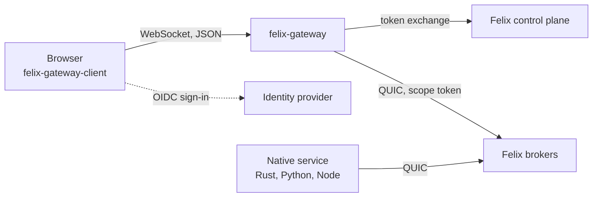

A multiplayer whiteboard has thousands of rooms, and a person in room `lobby`
must see that room's edits and nothing else. A live auction page needs bids as
they happen. A mobile app wants the same notification stream the web app gets.
The browser or phone is the least trusted part of the system, it cannot hold a
broker credential for the whole tenant, and it connects and disconnects all day.

## How this is usually built

The standard answer is a WebSocket tier. A fleet of Node, Go or Elixir servers
holds the browser connections, authenticates each one, and relays between the
sockets and a backend: Redis pub/sub, Kafka, NATS or a database change feed. The
tier needs sticky routing or a shared session store, a reconnect strategy that
tolerates a thundering herd after a deploy, per-connection backpressure so one
slow phone cannot grow a node's memory, and a way to resume after a drop. Authorization is the hard part: the application code decides on every
message which room a socket may touch, so a bug in that code is a data leak.

Hosted realtime services such as Pusher or Ably take that tier off your hands,
with channels, presence and history behind an SLA. If you want someone else to
run the edge, that is the sensible choice. NATS can also accept WebSocket
clients directly, with per-user permissions on subjects, which removes the tier
at the cost of running NATS at the edge of your network.

## Why Felix fits

Authorization is enforced by the brokers. The gateway exchanges the person's sign-in for a token narrowed to one scope, and the brokers check that token on every request. A token for room `lobby` cannot reach another room's streams, caches or counters, so a bug in the relay cannot leak across rooms. In a hand-built tier that check is application code on every message.

The relay holds no application state and never decodes a payload. The scope file maps aliases to resources, and the sign-in comes from your existing identity provider through token exchange, so there is no session store and no second permission system. Whether a person may open a scope is decided by Felix roles.

Resume is built in. On a durable stream every event carries its log offset, and a browser that was dropped subscribes again from the last offset it handled plus one. The gateway holds up to 1,024 events per connection and then stops reading, so a browser that stops reading is dropped by Felix's bounded queue and resumed from the log, receiving every record in order.

Narrowing reaches a single cache key or prefix, so a token can read `sessions/room1/*` and nothing else in that cache.

The same cluster serves the browser scope and your backend services' streams, caches and queues, so a native service can subscribe to the room's stream over QUIC without a second system between them.

## How it works on Felix

Browsers cannot speak QUIC, so
[felix-gateway](/clients/browsers/) sits between them and the brokers. A browser
opens a WebSocket, names one scope (a room, a board, a match) and signs in with
your identity provider. The gateway asks the Felix control plane for a token and
requests exactly the permissions that scope's resources need. The exchange only
narrows what RBAC already grants that person, so whether they may open the scope
is decided by Felix roles. The gateway then opens a QUIC connection to the brokers
with the narrowed token and relays JSON messages both ways, without decoding the
payloads.

The brokers enforce the narrowing, not the gateway. A token for room `lobby`
cannot reach another room's streams, caches or counters, even for someone who is
allowed in both, so a bug in the gateway cannot leak across scopes. Narrowing
goes down to a single cache key or key prefix as well: a token can carry
`cache.read` on `cache:acme/prod/sessions/room1/*` and nothing else in that cache.
The gateway today scopes by resource name, giving each scope its own streams and
caches.



Native services use the Felix clients directly over QUIC. QUIC multiplexes
independent streams over one connection without head-of-line blocking, and a
lost packet stalls only the stream that carried it. Each subscription gets its
own stream and flow-control window, TLS 1.3 is always on, and the Rust client can
act for many users over one connection (`Client::with_identity`), with each
user's token checked per request. Felix does not act on QUIC connection
migration or use 0-RTT today, so a client that changes networks reconnects.

A scope file tells the gateway which Felix resources a scope owns. The
`{scope}` placeholder is replaced by the value the browser sends in `join`:

```toml
[scope]
field = "room"

[[scope.streams]]
alias = "ops"
name = "app.ops.{scope}"
actions = ["publish", "subscribe"]

[[scope.caches]]
alias = "members"
name = "app.members.{scope}"
actions = ["read", "write", "watch"]
ttl_s = 30
```

Messages name resources by alias. On a durable stream every event the browser
receives carries its log offset, and a browser that was dropped subscribes again
from the last offset it handled plus one. The gateway holds up to 1,024 events
per connection and then stops reading the Felix subscription, so a browser that
stops reading is dropped by Felix's bounded queue and then resumed from the log.
It receives every record, late and in order. An in-memory stream has no log, so
dropped events there are gone.

## Example

The tenant, the identity provider's trust, the room's streams and caches and the
roles that let people open them exist before the gateway starts. Create a room's
resources and let a person into it with felixctl:

```bash
felixctl stream create app.ops.lobby
felixctl cache create app.members.lobby
felixctl rbac policy add role:lobby-members stream:acme/default/app.ops.lobby stream.publish
felixctl rbac policy add role:lobby-members stream:acme/default/app.ops.lobby stream.subscribe
felixctl rbac policy add role:lobby-members cache:acme/default/app.members.lobby cache.read
felixctl rbac policy add role:lobby-members cache:acme/default/app.members.lobby cache.write
```

Assigning a person to the `role:lobby-members` role is the other half; see
[Security](/features/security/#rbac-model-casbin) for assignments. Then run the
gateway next to the cluster:

```bash
docker run -p 8787:8787 \
  -e GATEWAY_TENANT=acme \
  -e GATEWAY_OIDC_CLIENT_ID=my-app \
  -e GATEWAY_OIDC_ISSUER=https://login.example.com \
  -e GATEWAY_FELIX_BROKERS=felix-broker:5000 \
  -e GATEWAY_FELIX_CONTROL_PLANE=https://felix-controlplane:8443 \
  -v "$PWD/scope.toml:/etc/felix-gateway/scope.toml:ro" \
  ghcr.io/getfelix/felix-gateway:0.2.0
```

`GATEWAY_NAMESPACE` defaults to `default`. In the browser:

```ts
import { GatewayClient } from "felix-gateway-client";

const client = await GatewayClient.connect("wss://example.com/ws", { room: "lobby", token });
client.onEvent = (event) => console.log(event.stream, event.offset, event.payload);
client.subscribe("ops", "live");
await client.publish("ops", new TextEncoder().encode("hello"));
```

Joining a room that mirrors state follows one rule: subscribe first, wait for
`subscribed`, then read the cache snapshot. Reading first loses whatever is
published in between. felix-canvas does this for its snapshot, and subscribes
again from the snapshot's offset plus one to fill the gap.

A native service skips the gateway. It subscribes with a Felix client and a
token narrowed to the scope it serves:

```rust
use felix_client::{Client, ClientConfig};

let quinn = quinn::ClientConfig::with_platform_verifier();
let client = Client::connect("127.0.0.1:5000".parse()?, "localhost",
    ClientConfig::optimized_defaults(quinn)).await?;
let mut subscription = client.subscribe("acme", "default", "app.ops.lobby").await?;
while let Some(event) = subscription.next_event().await? {
    handle(event.offset, &event.payload);
}
```

Two applications show the pattern end to end.
[felix-canvas](/built-on-felix/canvas/) is a multiplayer whiteboard in which each
room is a gateway scope, edits are a durable stream, cursors an in-memory stream
and the member list a cache watch with a 30 second TTL, all served by the stock
gateway image. [felix-arena](/built-on-felix/arena/) is a browser game whose
simulator publishes ticks to a durable stream that the gateway relays.

## Compared with a hand-built WebSocket tier, hosted services and NATS WebSocket

A hand-built tier gives you full control: any protocol, any auth model, any payload handling, and presence or rate limits in your own code. It also leaves you responsible for per-connection fanout memory, resume after reconnect and authorization on every message. The Felix gateway moves authorization into the brokers and resume into the log. The cost is that it cannot decode a payload, so anything that needs a payload-level decision, such as stamping a sender, is declared in the scope file (`stamp_sender`) or done by a service that subscribes as a normal client.

Hosted realtime services remove operations entirely and bring features Felix does not have, such as presence APIs, multi-region edge points of presence and mobile SDKs. If you want someone else to run the edge, pick one. Felix is self-hosted: you run brokers, a control plane with Postgres or its embedded Raft store, an identity provider and the gateway. In return, state lives in your cluster, resume uses offsets in your own log, and the same cluster serves your services' streams, caches and queues.

NATS WebSocket is the closest in shape: browsers connect to the server itself, and permissions are per user on subjects with wildcards, which is more flexible than a scope file. JetStream adds replay. The Felix gateway takes the sign-in from your identity provider through token exchange, narrows per scope, and relays resumable offsets and cache watches in its protocol. Pick NATS if wildcard subject permissions matter more to you than those.

## Try it

The one-command stack has no gateway, so a browser cannot connect to it. Run
the gateway command from the example above against a broker, or use the
Quickstart stack to see the stream a browser would be fed:
`docker compose run --rm felixctl sub orders` in one terminal and
`docker compose run --rm felixctl pub orders 'hello'` in another.

## Where it stops

Each browser session opens its own Felix client, and a broker accepts a bounded
number of connections, so one gateway does not serve very large audiences yet.
The gateway is pre-1.0, and its scope file format and library API may change
between minor versions. The browser protocol's version 1 is frozen.

A gateway runs one kind of scope. An app with rooms and also with user inboxes
runs two gateways. The gateway never retries a publish or a counter add, so a
counter add repeated by the browser after a lost answer is counted twice.

There is no Felix SDK for iOS or Android, Go is planned, and there are no C# clients.
A native mobile app today speaks the gateway's JSON-over-WebSocket protocol
([documented in the gateway repository](https://github.com/GetFelix/felix-gateway/blob/main/docs/protocol.md)),
because the `felix-gateway-client` package targets browsers. Felix clients exist for
Rust, Python and Node.

On a broker that binds tokens to client certificates, a gateway sharing its
connections would have to delegate each user's token, and the gateway does not do
that yet. Events carry no publisher, so sender identity needs `stamp_sender`.

## Related

- [Browsers (felix-gateway)](/clients/browsers/) for every setting and message
- [felix-canvas](/built-on-felix/canvas/) and [felix-arena](/built-on-felix/arena/)
- [Security](/features/security/) for token exchange and narrowing
- [QUIC transport](/features/quic-transport/)
- [Config and feature flags](/use-cases/config-and-feature-flags/) and [Live updates at high fanout](/use-cases/live-fanout/)
