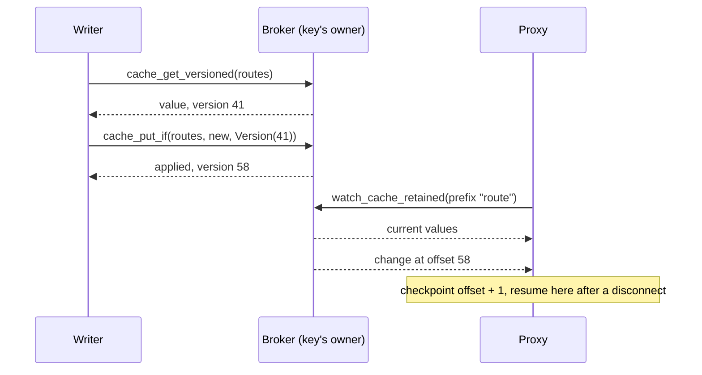

A fleet of 5,000 edge proxies has to apply a new routing table. A feature flag
flips for a tenant and every API instance should honor it within a second. A
policy document changes and no instance may keep enforcing the old one after it
reconnects from a network blip. The values are small and change a few times a
minute at most. What matters is that each consumer ends up holding the same
current value, never misses a change, and finds out when it could not keep up.

## How this is usually built

The authoritative value lives in a coordination store such as etcd or Consul, or
in a database. Consumers either poll it or watch it. A watch in etcd reads at a
revision and then streams every later change from that revision, which is the
right contract. The cost shows up at scale: etcd runs a consensus quorum over a
small dataset, and the Kubernetes apiserver keeps its own watch cache in front
of etcd so that thousands of watchers do not each hold a stream to it. Teams that
need the same shape for their own fleet end up writing that fanout tier
themselves.

The cheaper version is Redis. The control plane does `SET` and `PUBLISH`, and
every consumer subscribes and then runs `GET`. Redis pub/sub keeps no history,
so a consumer that was disconnected when the message went out never learns of
it. The usual repair is to `GET` again on every reconnect and to poll on a timer
as a backstop, which means the pub/sub channel is a hint and the poll is the
mechanism. Plain polling with an ETag is simpler still, and for a few hundred
consumers it is often the right answer. Its cost is a staleness bound equal to
the poll interval and a burst of requests whenever many consumers start at once.

## How it works on Felix

Configuration goes in a cache. A log-backed cache is a log: every write appends
a record with an offset, and a key's current value is an index over that log.
That one structure supplies the three things the stack above assembles from
parts: the current value of each key, a change feed that resumes at an offset,
and a notice when a consumer falls behind.

A consumer opens a retained watch on a key or a key prefix. The broker delivers
each matching key's current value, then every change after it. It registers the
watcher before it reads the tail, so a write that lands in between is neither
lost nor delivered twice. Every change carries its cache-log offset, so a
consumer that reconnects resumes at `offset + 1` and the broker replays exactly
what it missed. If the cache has compacted past that offset, the broker instead
sends each key's current value and says so (`resnapshot`), which is the contract
etcd gives for a compacted revision.

A watch cannot detect a drop by looking at offsets, because other keys' writes
make them sparse. So a watch that falls behind its bounded queue is ended with
`Lagged { resume_from }` instead of silently skipping changes. Re-watching from
that offset is gapless. A stale local copy is therefore something the API tells
you, not something you have to infer.

Writers that edit shared values use conditional writes. `cache_put_if` stores a
value only if the key is absent or still at the version you read, and the check
and the write are one step on the key's owner. Two operators editing the same
routing table cannot overwrite each other.

Declare the cache with `Quorum` consistency and a write is acknowledged once a
majority of the shard's replicas hold it, so a leader failover cannot take back
a value a writer was told was stored. Once `lease_free_reads` is finalized, a
watch on such a cache sees only committed changes.



## Example

The cache must be log-backed: the broker needs `FELIX_DURABLE_STORAGE_DIR`, since
an in-memory cache has no offsets to resume from and does not offer watches. Try
it against a local cluster (see [felixctl](/getting-started/felixctl/) for the
context setup):

```bash
felixctl cache create config --replication 3 --consistency quorum
felixctl cache put config flag/new-checkout on
felixctl cache watch config --prefix flag/ --retained
```

In a second terminal, change a flag and delete another. The watcher prints
`key<TAB>value` for each change and `(deleted)` for a delete:

```bash
felixctl cache put config flag/new-checkout off
felixctl cache del config flag/beta-search
```

A consumer in Rust holds the flags in memory and follows the watch. A lagged
watch is reopened from the offset it names:

```rust
use std::{collections::HashMap, sync::{Arc, RwLock}};
use bytes::Bytes;
use felix_client::{CacheWatchFilter, CacheWatchItem, ClusterClient};

async fn follow_flags(
    client: Arc<ClusterClient>,
    flags: Arc<RwLock<HashMap<String, Bytes>>>,
) -> anyhow::Result<()> {
    let filter = || CacheWatchFilter::Prefix("flag/".into());
    let mut watch = client
        .watch_cache_retained("acme", "prod", "config", filter())
        .await?;

    loop {
        match watch.recv().await {
            Some(CacheWatchItem::Change(change)) => {
                let mut flags = flags.write().unwrap();
                match change.value {
                    Some(value) => flags.insert(change.key, value),
                    None => flags.remove(&change.key),
                };
            }
            Some(CacheWatchItem::Lagged { resume_from }) => {
                watch = client
                    .watch_cache("acme", "prod", "config", filter(), Some(resume_from))
                    .await?;
            }
            // A ClusterClient watch follows the shard to its new owner itself.
            Some(CacheWatchItem::ShardMoved(_)) => {}
            None => anyhow::bail!("watch ended"),
        }
    }
}
```

`watch_cache_retained` also reports `retained_count()`, the exact number of
changes that make up the starting state. A consumer that must not serve traffic
until it holds a complete table waits for that many changes before it marks
itself ready. Zero is a definite answer: the prefix is empty.

A writer that edits a shared routing table reads the value with its version and
writes back only if the version still matches:

```rust
use felix_client::CacheCondition;

async fn edit_routes(
    client: &ClusterClient,
    edit: impl Fn(Option<&[u8]>) -> Bytes,
) -> anyhow::Result<()> {
    loop {
        let current = client
            .cache_get_versioned("acme", "prod", "config", "routes")
            .await?;
        let (next, condition) = match &current {
            Some(v) => (edit(Some(&v.value)), CacheCondition::Version(v.version)),
            None => (edit(None), CacheCondition::Absent),
        };
        let result = client
            .cache_put_if("acme", "prod", "config", "routes", next, None, condition)
            .await?;
        if result.applied {
            return Ok(());
        }
        // Refused: someone else wrote first. Read again and redo the edit.
    }
}
```

A refusal is an answer, not an error. The client never resends a conditional
write after a lost answer, because the retry would be refused by the version the
first one wrote. If a call fails with a transport error, read the key to find
out which happened before you edit again.

In Python the consumer side is the same shape. The binding has no conditional
write yet, so writers that need one use the Rust client:

```python
import felix

flags = {}
with felix.Client("127.0.0.1:5000", tenant_id="acme", token=tok) as client:
    resume_from = None
    while True:
        with client.watch_cache(
            "acme", "prod", "config",
            felix.CacheWatchFilter.prefix("flag/"),
            start=resume_from,
            retained=resume_from is None,
        ) as watch:
            resume_from = None
            for item in watch:
                if isinstance(item, felix.CacheWatchLagged):
                    resume_from = item.resume_from
                    break
                if isinstance(item, felix.CacheWatchShardMoved):
                    continue
                if item.value is None:
                    flags.pop(item.key, None)
                else:
                    flags[item.key] = item.value
        if resume_from is None:
            break
```

Full watch semantics are in [Cache](/features/cache/#7-keyed-watch), and the
[Python](/clients/python/#cache-watches) and [TypeScript](/clients/typescript/#cache-watches)
clients have their own watch examples.

## Compared with etcd, Consul, JetStream KV, Redis and polling

etcd gives you more consistency machinery than Felix does. It offers
multi-key transactions, linearizable reads by default, a global revision across
all keys and leases, and Kubernetes has years of production behind it. If your
config changes need to commit atomically across several keys, or you already run
etcd and a few hundred watchers, use it. Where Felix differs is the shape of the
watch tier. Watch delivery is built for fanout: each watcher has its own
bounded queue, and a slow watcher is ended with a resume offset instead of
holding up the writer. On a three-broker Azure cluster, a keyed watch
with 500 watchers on one key delivered every put to every watcher (1,100,000 of
1,100,000) at 4.6 ms p50, and a late joiner to a 10,000-key prefix held the
complete state in 38 ms ([measurements and conditions](/features/real-network-performance/#cache-counter-watch-and-queue)).
Counts above 500 watchers have not been measured.

Consul's watches are blocking queries: the client long-polls with the index it
last saw, and the agent returns when something newer exists. It works well
through the local agent and suits service discovery, but each change costs the
client a new request, and the semantics are an index comparison rather than a
resumable stream of changes.

NATS JetStream's key-value store is the closest relative. It is a stream under
the hood, a watch delivers the current values and then updates, an ordered
consumer resets itself after a gap, and a revision-based `Update` is a
compare-and-set. It also keeps per-key history. If you already run NATS, it is a
strong choice. Felix differs in that the lag signal is explicit and carries the
offset to resume from, `Quorum` caches have a documented acknowledgement and read
contract, and the same cluster also serves streams, counters and queues from one
log.

Redis with pub/sub plus `GET` is the fastest to stand up and the weakest on
delivery: the channel keeps nothing, so a consumer is only correct if it
re-reads after every reconnect and on a timer. Redis Streams do keep an offset
and fix that, at the price of a separate stream per feed and manual snapshotting
of current state. Redis can do compare-and-set with `WATCH`/`MULTI` or a Lua
script, and `SET NX PX` for leases.

Polling stays the right answer when the fleet is small, a staleness of tens of
seconds is fine, and you do not want a stateful connection per consumer.

## Where it stops

A log-backed cache holds its whole key index in memory, so memory grows with the
key count and nothing caps or reports it yet. This is why the log-backed cache is
marked 🚧 Partial in [What Felix Is For](/getting-started/what-felix-is-for/).
Config sets are small, which fits, but do not use it as a store of millions of
keys.

Conditional writes are per key. There is no transaction across keys, so a change
that must land atomically in several keys belongs in one value, or in a system
with transactions. They exist in the Rust client only so far.

A prefix watch across the shards of a multi-shard cache is a Rust call
(`ClusterClient::watch_cache_sharded`). In Python and TypeScript, and with
`ClusterClient::watch_cache`, it takes one watch per shard, and a prefix watch
that names no shard on a multi-shard cache is refused. A one-shard cache avoids
the question for config.

By default a `Quorum` read confirms leadership with the owner's lease, which
trusts clocks. After an operator finalizes the `lease_free_reads` fleet feature
it uses a round of confirmations from a majority instead. Multi-node clustering
is itself 🚧 Partial: the control plane still decides every failover, so with it
down a dead leader is not replaced.

An in-memory cache, which is what a broker without durable storage runs, has no
watch. A cache keeps the latest value per key and discards superseded ones when
it compacts, so it is not a history of every edit; use a durable stream for that.
A TTL expiry reaches watchers as a delete, written by a pass that runs once a
second and handles at most 1,024 deletes per shard.

## Related

- [Cache](/features/cache/) for conditional writes, counters and the watch contract
- [Delivery semantics](/architecture/semantics/#consistency-model) for `Leader` and `Quorum`
- [Demo: Local State Divergence](/demos/state-divergence/), which shows what an unwatched, droppable feed costs a consumer holding local state
- [What Felix Is For](/getting-started/what-felix-is-for/) for the status of every capability used here
- [Live updates at high fanout](/use-cases/live-fanout/) and [Browsers and mobile clients](/use-cases/browser-realtime/)
