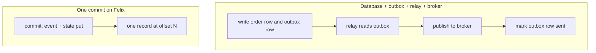

An order service accepts an order. It has to record the order's new status,
announce `OrderPlaced` to whoever cares, and hand the order to fulfilment. Those
are three effects, and a crash between any two of them leaves the system
disagreeing with itself: the status says placed and nobody was told, or
fulfilment started on an order whose status never changed. A Felix commit makes
them one write.

## How this is usually built

The state lives in a database and the events go to a broker, which means two
systems with no shared transaction. Writing to both from the request handler is
the dual-write problem. Whichever order you pick, a crash between the writes
loses one of them.

The common fix is the transactional outbox. The handler writes the order row
and an outbox row in one database transaction. A separate relay, often Debezium
reading the write-ahead log into Kafka, or a poller, moves outbox rows to the
broker. This is sound, and it is the right answer when the state has to live in
Postgres for queries and joins. The cost is the moving parts: the relay, its
lag, duplicates when it restarts (so every consumer has to deduplicate), and a
second pipeline to operate.

Kafka transactions solve a different half. A producer can write to several
partitions atomically, and a consume-transform-produce loop can commit its
consumer offsets in the same transaction, which gives exactly-once processing
between Kafka topics. That is real and well engineered. It does not cover the
service's own state, since the state is not in Kafka, and Kafka brokers offer no
keyed read of "what is order 42 right now" without building a table from the
topic yourself.

Event sourcing by hand puts the state in the log: append events, derive state by
folding them. The write is atomic because there is only one. The reads are the
problem. Every service builds and maintains its own projection, and a read of
current state waits on the projection catching up.

## Why Felix fits

Here the log is the place the state lives. A commit writes the event and the
`put` and `delete` operations as one record in one shard's log, so there is no
second system to fall out of step with. The dual-write crash window does not
exist, and neither does the outbox table, the relay, its lag, or the
deduplication every consumer needs when the relay restarts.

The state is readable by key. `state_get` returns the value and a `version`
equal to the offset of the commit that wrote it, so a reader can tell which
event a value belongs to. Event sourcing by hand leaves you to build and
maintain a projection, and a read of current state waits for it to catch up.

The event and the state change are held back together. On a `Quorum` stream both
wait for the committed mark, and the status table records failover and promotion
for commits as model-checked in TLA+ (`FelixAtomicCommit`) and checked under
faults. A subscriber, a consumer group and the Kafka listener all see the event
at the same offset the state carries.

`commit_if` lets a single writer refuse to overwrite a decision made since it
last looked, with no lock service and no separate version column.

## How it works on Felix

A commit puts the event and the state change in the same record. `commit` takes
an entity key and a list of operations: exactly one event, as `publish` for
subscribers or `enqueue` for consumer groups, plus any number of `put` and
`delete` operations on the keyed state of the same stream. The entity key routes
the commit to one shard of the stream, the same way a routing key routes a
publish, and the state for that entity lives on that shard.

Because the commit is one record in one shard's log, storage, replication, the
`Quorum` committed mark and failover all treat it as a unit. A subscriber sees
the event at offset N. A consumer group gets the event at N. `state_get` returns
the new value with `version` N. On a `Quorum` stream the event and the state
both wait for the committed mark together.



The usual setup has crash windows after the relay publishes and before it marks
the row sent (the event goes out twice) and while the relay is down (the event is
late). On Felix there is one write, so a crash leaves either all of it or none.

## Example

Create the stream the entity's events and state share, with replication so the
commit survives a broker loss:

```bash
felixctl stream create order-events --shards 4 --replication 3 --consistency quorum
```

Place an order, then read it back:

```rust
use felix_client::CommitOp;

let receipt = cluster
    .commit("acme", "orders", b"order-42", vec![
        CommitOp::enqueue("order-events", r#"{"type":"placed","id":42}"#),
        CommitOp::put("order-events", "order-42", r#"{"status":"placed"}"#),
        CommitOp::delete("order-events", "cart-42"),
    ])
    .await?;

let state = cluster
    .state_get("acme", "orders", "order-events", b"order-42", "order-42")
    .await?;
assert_eq!(state.version, Some(receipt.offset));
```

`enqueue` makes the event available to a consumer group such as `fulfilment`
(see [Queues](/features/queues/)); `publish` would deliver it to live
subscribers instead. They write the same record, so pick the one that says what
you mean. The same calls exist in Python:

```python
import felix

stream = "order-events"
receipt = client.commit("acme", "orders", b"order-42", [
    felix.CommitOp.enqueue(stream, b'{"type":"placed","id":42}'),
    felix.CommitOp.put(stream, "order-42", b'{"status":"placed"}'),
])
state = client.state_get("acme", "orders", stream, b"order-42", "order-42")
assert state.version == receipt.offset
```

A single writer that must not overwrite a newer decision uses `commit_if`, which
takes the offset the commit must land at, the shard's next. It is written only
if nothing was appended to the shard since the writer saw that offset.

```rust
use felix_client::{CommitOp, ConditionalWrite};

match cluster
    .commit_if("acme", "orders", b"order-42", vec![
        CommitOp::publish("order-events", r#"{"type":"shipped","id":42}"#),
        CommitOp::put("order-events", "order-42", r#"{"status":"shipped"}"#),
    ], next)
    .await?
{
    ConditionalWrite::Written { offset } => next = offset + 1,
    ConditionalWrite::Refused { tail } => {
        // Another write reached the shard first. Nothing was written.
        next = tail;
    }
}
```

felixctl does not read keyed state yet, so `state_get` is a client call today.

## Compared with an outbox, Kafka transactions and event sourcing

Against a Postgres outbox, Felix removes the relay, its lag and the duplicate
handling: one commit replaces the outbox row, the relay and the deduplication
when the state is a small record per entity that services read by key. Postgres
does more than that. State here is keyed values on a stream shard, not rows you
can join or filter, so pick the outbox when the order data needs ad-hoc queries.

Against Kafka transactions, Felix covers the part Kafka leaves out, the service's
own state: the value is available by key at the commit's offset, without a
consumer building a table. Kafka's transactions span partitions and topics and
make consume-and-produce exactly-once, and a Felix commit stays inside one shard
of one stream. Pick Kafka transactions for exactly-once between topics.

Against event sourcing by hand, a commit keeps the full event history in the log
and has the broker maintain the entity's current state in the same step as the
append, so no service builds a projection and no read waits on one. Pick the
hand-built version only when you need a read model that Felix's keyed state
cannot express.

## Try it

`felixctl` has no commit command, so the atomic write is shown by the Rust
snippet in the example above: the `cluster.commit` call that enqueues the event,
puts the state and deletes the cart as one record, and the `state_get` that reads
it back. Run it against the local cluster from the
[Quickstart](/getting-started/quickstart/#a-cluster-in-one-command), started with
`--nodes 3` for the replicated stream. To see the event half alone on the
one-command stack, run `docker compose run --rm felixctl sub orders` in one terminal and
`docker compose run --rm felixctl pub orders 'order placed'` in another.

## Where it stops

Atomic commits are marked partial. Atomicity holds within one stream shard
only. A commit naming a second stream is refused before anything is sent, with
`NotOnOwningShard`. State and events share one stream shard, so there is nothing
to split across shards or caches. Felix does not offer transactions across logs. An order that must update inventory in
another stream is two commits, and the application owns what happens between
them.

A commit is not idempotent: re-sending one whose answer was lost may write it
twice, so a handler that can retry needs its own check, for example a
`commit_if` at the expected offset. State is rebuilt from the retained log after
a restart or a failover, with no snapshot, so retention on an entity stream
must cover every live key. There is no read of state at an older version, and
a per-key version check is not built: `commit_if` compares against the whole
shard, so any write to the shard, including a plain publish, refuses it.
Ephemeral streams refuse commits, and in a cluster an operator must finalize the
`atomic_commit` fleet feature first.

## Related

- [Atomic commits](/features/atomic-commits/)
- [Queues](/features/queues/)
- [Publish/Subscribe](/features/pubsub/#conditional-publishes)
- [Rust client](/clients/rust/#atomic-commits) and [Python client](/clients/python/#atomic-commits)
