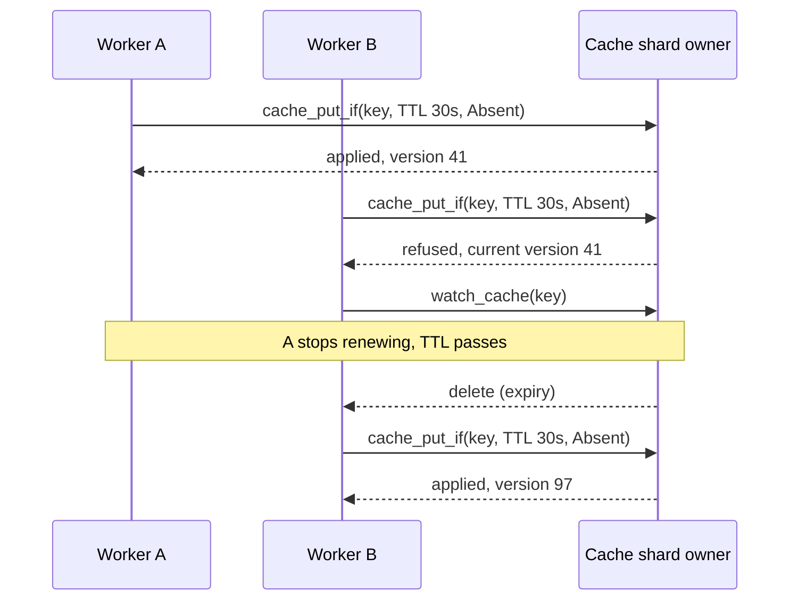

Forty workers run the same nightly reconciliation, and exactly one of them
should do each run. A payment API receives the same `POST /charges` twice
because a mobile client retried over a bad connection, and the card must be
charged once. A match server owns the state of one game and must stop writing
the moment a replacement takes over. All three are the same problem: several
processes race for a name, one wins, and the others need to find out
cheaply when the winner is gone.

Felix covers these with four primitives it already has for other reasons:
conditional cache writes with a TTL, a keyed watch on the cache, a
version on every cached value, and a conditional publish on a stream. This
page shows how they fit, and is plain about where a purpose-built
coordination store is the better choice.

## How this is usually built

The common answer is Redis. `SET lease:reconcile <worker-id> NX PX 30000`
claims a name for 30 seconds if nobody holds it, and the holder renews it
with a script that checks the value before extending. It is one round trip
and almost everyone already runs Redis. The weak points are known. With a
primary and an asynchronously replicated replica, a failover can promote a
replica that never saw the claim, and two clients then hold the same lock.
Redlock tries to fix that by claiming on a majority of independent
instances, but it still relies on clocks and offers no monotonic token, so a
holder that stalls past its expiry (a long GC pause, a stopped VM) can write
after its lease has passed to someone else. Martin Kleppmann's critique of it
is the standard reference.

When correctness matters, teams move to etcd, ZooKeeper or Consul. etcd
grants a lease with a TTL that the holder keeps alive, attaches keys to it,
and gives every write a cluster-wide revision that serves as a fencing
token. ZooKeeper uses ephemeral nodes tied to a client session and sequential
nodes for ordered waiting. Both are linearizable through a consensus
protocol, and both are built for exactly this. The cost is another cluster to
run, a client library with session semantics to get right, and a
write rate that is modest by design.

Idempotency keys are usually a database table with a unique constraint, or
Redis `SET NX` with a result stored beside the key.

## Why Felix fits

The claim returns its own fencing token. `cache_put_if` with `Absent` hands
back the version of the write. On a log-backed cache that is a log offset,
which only grows, across compaction and restart. A storage service that remembers
the highest version it has seen can refuse a stalled holder's late write. A
plain `SET NX` gives you the lock but no number to fence with.

On a `Quorum` cache the acknowledgement means a majority of the shard's
replicas hold the claim, so losing the owner does not hand the same lease to a
second worker. That closes the failover gap of an asynchronously replicated
Redis, without running a second consensus system next to your event stream.

Waiting workers do not poll. `watch_cache` on the lease key delivers the
expiry delete in order with its offset, and the worker then tries its own
`Absent` put. A renewal with `Version(v)` and a release with `cache_delete_if`
cannot act on a lease that has since moved to someone else.

A single writer of a stream needs no lease at all. `publish_if` carries the
offset the writer expects the batch to start at, the broker checks it where it
assigns offsets, and of two writers expecting the same offset exactly one is
written. The fence sits on the data, so a paused writer cannot append after a
replacement took over.

If you already run Felix for events and state, this replaces a separate Redis
or etcd used only for leases. The lease, the data it protects and the
permissions on both share one tenant scope, and the fencing token is an offset
that other parts of the system can already read.

## How it works on Felix

A cache key is the lease. `cache_put_if` with `CacheCondition::Absent` claims
it only if nobody holds it, with a TTL in milliseconds. The check and the
write are one atomic step on the key's owner, so two workers racing for the
same name cannot both win. An entry past its TTL counts as absent, so the
next `Absent` put wins as soon as the lease lapses.

Every value has a version, which is the log offset of the put that wrote it.
On a log-backed cache it only grows, including across compaction and restart.
An in-memory cache starts each run's versions from the clock, so fence only on
a log-backed cache. A holder renews with `CacheCondition::Version(v)` and releases with
`cache_delete_if`, so neither can act on a lease that has since passed to
someone else. The version is also a fencing token: a database or storage
service that remembers the highest version it has seen can refuse a write
that carries an older one, which is what stops a stalled holder from
corrupting state after it lost the lease.

Expiry is written down. Time is judged against an absolute expiry that
survives a restart, and on a log-backed cache the shard's leader writes a
delete when an entry lapses. A worker that wants to take over does not poll:
`watch_cache` on the key delivers that delete, in order and with its offset,
and the worker tries its `Absent` put. The expiry pass runs once a second, so
a watcher hears of a lapse up to about a second after the TTL, and under a
mass expiry the deletes can lag further. A direct `Absent` put does not
wait for the delete record.

For a single writer of a stream, `publish_if` and `commit_if` carry the
offset the writer expects the batch to start at. The broker checks it where
it assigns offsets, so of two writers expecting the same offset exactly one
is written, and the other is refused with the shard's tail and writes
nothing. That is a fence on the data itself and needs no separate lease.

### What consistency level gives what

A cache and a stream each declare `Leader` (the default) or `Quorum` when
they are created.

On `Leader`, the key's owner applies the write and answers, and replicas
catch up afterwards. The owner serves only while it holds its lease from the
control plane, so a partitioned owner stops serving, but an acknowledged
claim can be lost if the owner fails before a replica has it, and a second
worker can then take the same lease. On `Quorum`, a put, delete or counter
add is acknowledged once a majority of the shard's replicas hold it, so an
acknowledged claim survives losing the leader. A `Quorum` write that cannot
reach a majority fails with `quorum_timeout`, and one whose owner loses the
shard fails with `leadership_lost`. Both mean the outcome is unknown. Read
the key before deciding.

For leases, use a `Quorum` cache. Reads (`cache_get`, `cache_get_versioned`)
on a `Quorum` cache wait for a majority to hold everything the value reflects
and confirm the owner still leads. By default the confirmation is the owner's
lease, which is only as safe as the clocks of the brokers. Once an operator
finalizes the `lease_free_reads` fleet feature, together with `majority_ack`
and `generation_start`, the confirmation is a round of fences answered by a
majority and the read is linearizable without trusting clocks.
`FELIX_QUORUM_READS=lease` keeps a broker on the lease path. Writes use the
owner's lease in every mode.

The conditional publish has the same split. On a `Leader` stream the fence is
only as strong as the leader's lease. After a failover the expected offset is
stale even with no rival, because the new leader writes a generation-start
record, and the refusal says where the tail is.



## Example

Create a replicated `Quorum` cache and a durable stream once, then run the
code. `felixctl` is shown in [its guide](/getting-started/felixctl/), and
conditional writes are not exposed there or in the Python binding yet, so
this page's code is Rust.

```bash
felixctl cache create leases --shards 1 --replication 3 --consistency quorum
```

A worker that campaigns for a lease, renews it, and notices when it lapses:

```rust
use bytes::Bytes;
use felix_client::{CacheCondition, CacheWatchFilter, CacheWatchItem, ClusterClient};
use std::sync::Arc;
use std::time::Duration;

const TTL_MS: u64 = 30_000;

async fn campaign(client: &Arc<ClusterClient>, me: Bytes) -> anyhow::Result<()> {
    loop {
        let taken = client
            .cache_put_if("acme", "prod", "leases", "reconcile", me.clone(),
                Some(TTL_MS), CacheCondition::Absent)
            .await?;

        if let (true, Some(mut version)) = (taken.applied, taken.version) {
            // `version` is the fencing token for everything done as leader.
            while run_one_step(version).await.is_ok() {
                tokio::time::sleep(Duration::from_millis(TTL_MS / 3)).await;
                let renewed = client
                    .cache_put_if("acme", "prod", "leases", "reconcile", me.clone(),
                        Some(TTL_MS), CacheCondition::Version(version))
                    .await?;
                match renewed.version {
                    Some(v) if renewed.applied => version = v,
                    _ => break, // lost it; stop acting as leader
                }
            }
            continue;
        }

        // Not ours. Wait for the holder's lease to be deleted.
        let mut watch = client
            .watch_cache("acme", "prod", "leases",
                CacheWatchFilter::Key("reconcile".into()), None)
            .await?;
        // Time out so a lease that lapsed before the watch opened is retried.
        while let Ok(Some(item)) = tokio::time::timeout(Duration::from_millis(TTL_MS), watch.recv()).await {
            match item {
                CacheWatchItem::Change(c) if c.value.is_none() => break,
                CacheWatchItem::Change(_) => {}
                _ => break, // lagged or moved: go back to campaigning
            }
        }
    }
}
```

A step that releases at shutdown only if the lease is still the caller's:

```rust
client.cache_delete_if("acme", "prod", "leases", "reconcile", version).await?;
```

An idempotency key for a payment API. The first request claims the key with
a short in-progress marker, does the work, and replaces the marker with the
result for a day. A repeat finds one or the other.

```rust
use felix_client::CacheCondition;

let key = format!("charge:{idempotency_key}");
let claim = client
    .cache_put_if("acme", "prod", "idempotency", &key,
        Bytes::from_static(b"in-progress"), Some(60_000), CacheCondition::Absent)
    .await?;

if !claim.applied {
    // A repeat: return the stored result, or 409 while it is in progress.
    return match client.cache_get("acme", "prod", "idempotency", &key).await? {
        Some(v) if &v[..] != b"in-progress" => Ok(replay(v)),
        _ => Err(Conflict),
    };
}

let receipt = charge_card(&request, &idempotency_key).await?;
client
    .cache_put_if("acme", "prod", "idempotency", &key, receipt.encode(),
        Some(24 * 3600 * 1000), CacheCondition::Version(claim.version.unwrap()))
    .await?;
```

Pass the same idempotency key to the card processor. If the process dies
after charging and before storing the result, the marker lapses after 60
seconds and a retry runs the charge again, so the processor must be the one
that deduplicates. Felix makes the claim race-free. It cannot make an
external side effect happen once.

A single writer for a stream, fenced by offset:

```rust
use felix_client::ConditionalWrite;

match cluster
    .publish_if("acme", "games", "match-7", None, vec![b"tick 120".to_vec()], next)
    .await?
{
    ConditionalWrite::Written { offset } => next = offset + 1,
    ConditionalWrite::Refused { tail } => return Err(lost_the_stream(tail)),
}
```

A conditional write is never resent by the client after a lost answer,
because the retry would be refused by the write it is retrying. On an error,
read the key with `cache_get_versioned`, or the shard at the expected offset,
to see what happened.

## Compared with Redis, etcd and ZooKeeper

Against Redis `SET NX PX`, Felix returns a version that works as a fencing
token, offers a `Quorum` level whose acknowledgement survives losing the owner,
and tells waiters when a lease is deleted. Redis is quicker to adopt, has the
larger ecosystem of lock libraries, and a single instance is simpler to reason
about than a replicated cache. Pick Redis for a lock whose failure is merely
wasteful.

Against etcd, a Felix lease is one key with one TTL, renewed by writing it,
where an etcd lease can own many keys and expire them together. etcd also gives
a revision across the whole keyspace and multi-key transactions, and its
reads and writes are linearizable by design. In Felix, reads on a `Quorum`
cache are linearizable without clocks once `lease_free_reads` is finalized,
and writes still rely on the owner's lease. In return the lease sits next to
your streams and cache, and a conditional publish fences the data itself. Pick
etcd when you need multi-key transactions or one lease over many keys.

ZooKeeper ephemeral nodes disappear when a client's session ends, so a crashed
holder is noticed as soon as its heartbeats stop. Felix expires by TTL alone,
so choose a TTL that matches how long you can tolerate no leader. Expiry is
decided by the leader's clock, and a leader whose clock jumps forward expires
entries early. Felix needs no session library and no separate ensemble. Pick
ZooKeeper when you need ephemeral nodes tied to a connection.

## Try it

Start the stack from the
[Quickstart](/getting-started/quickstart/#try-it-in-one-command) (it covers Podman
too) and run these from the directory holding `compose.yaml`.

Conditional writes, which make the lease safe, are not in `felixctl`, so the
election code on this page is Rust. What `felixctl` shows is how a lapsing
lease reaches the workers waiting for it. In one terminal, watch the key:

```bash
docker compose run --rm felixctl cache watch config --key lease/job-1
```

In another, take a lease for ten seconds and read it:

```bash
docker compose run --rm felixctl cache put config lease/job-1 worker-a --ttl-ms 10000
docker compose run --rm felixctl cache get config lease/job-1
```

The watcher prints the put. The `get` prints `worker-a`. Ten seconds later the
watcher prints `lease/job-1<TAB>(deleted)` without anyone polling, and `get`
exits with status 5. To see the compare-and-set, run the Rust example above
against a cluster from the
[Quickstart](/getting-started/quickstart/#a-cluster-in-one-command).

## Where it stops

The [status page](/getting-started/what-felix-is-for/) lists strongly
consistent coordination, leader election and locks as a weak fit and points
at etcd, Consul or ZooKeeper, and that still stands. Conditional writes are
checks on one key and one shard. There are no multi-key transactions and no
lease that owns several keys. Detection of a dead holder is by TTL, with
expiry deletes written about once a second. The in-memory cache has no log, so
no watch, and its versions come from a clock-seeded counter. A watch needs a
log-backed cache, which means `FELIX_DURABLE_STORAGE_DIR`. `Leader` caches and
streams can lose an acknowledged claim on failover. The version fence only
helps if the protected resource checks it. The conditional calls are in the
Rust client only.

## Related

- [Cache features](/features/cache/#9-conditional-writes)
- [Keyed watch](/features/cache/#7-keyed-watch)
- [Conditional publishes](/features/pubsub/#conditional-publishes)
- [Atomic commits](/features/atomic-commits/#a-commit-at-an-expected-offset)
- [Delivery semantics and consistency](/architecture/semantics/)
- [Rust client](/clients/rust/#conditional-writes)
