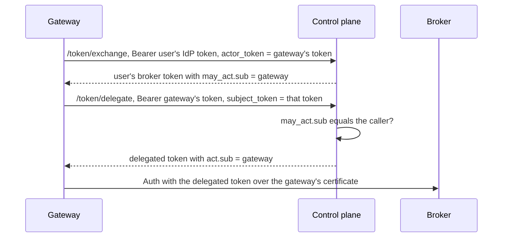
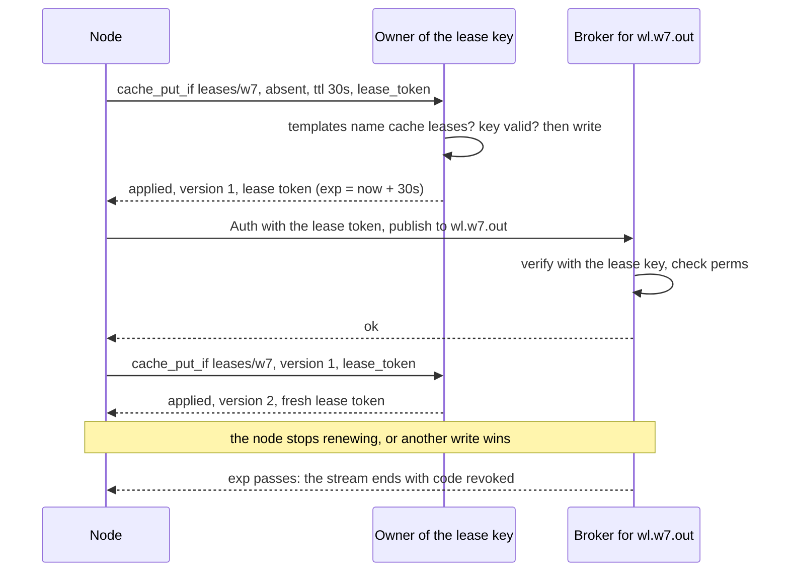
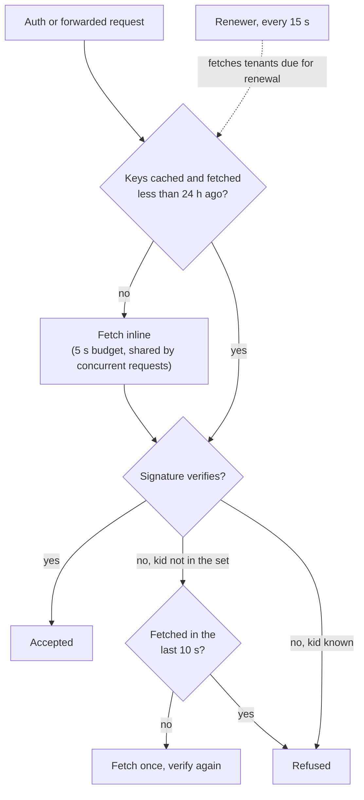

# Auth Design: OIDC Exchange + Felix Tokens

This document describes the current Felix authentication and authorization design as implemented in the control plane and the broker. It aligns with the `felix-authz` crate, Casbin RBAC model, and the token exchange flow in the control plane.

Detailed RBAC mutation/delegation rules and canonical grammar are documented in `docs/security/rbac.md`.

## Goals

- Multi-tenant authentication and authorization.
- Support multiple OIDC issuers per tenant.
- Brokers validate only Felix tokens (never upstream IdP tokens).
- Embed effective permissions in Felix tokens for fast broker-side enforcement.

## Components

- **Control plane**: Validates upstream OIDC tokens, evaluates RBAC policies, and mints Felix tokens.
- **felix-authz**: JWT mint/verify utilities and permission parsing/matching shared by control plane and broker.
- **Broker**: Verifies Felix token signature/claims and enforces permissions locally.

## Supported Identity Providers

Felix supports any OIDC-compliant IdP that exposes a JWKS endpoint (either via OIDC discovery or a direct `jwks_url`) and uses an allowed upstream OIDC signing algorithm.

Supported upstream OIDC JWT signing algorithms:
- `ES256` and `RS256` (the default)
- `RS384`, `RS512`
- `PS256`, `PS384`, `PS512`

Control plane configuration:
- YAML: `oidc_allowed_algorithms: ["ES256", "RS256"]`
- Env: `FELIX_CONTROLPLANE_OIDC_ALLOWED_ALGORITHMS=ES256,RS256,...`

This includes common providers like:

- Microsoft Entra ID
- Okta
- Auth0
- Google
- Apple

Other providers are supported as long as they provide standard OIDC discovery or a JWKS URL and the tokens include `iss`, `sub`, and `aud` claims.

## Token Types

### Upstream OIDC token

- Provided by an external IdP (Entra ID, Okta, Auth0, Google, Apple, etc.).
- Validated by the control plane using issuer discovery + JWKS.
- Claims used:
  - `iss` (issuer)
  - `sub` (subject)
  - optional groups/roles claim

### Felix token (JWT)

Minted by the control plane and verified by brokers.

Claims:
- `iss`: `felix-auth`
- `aud`: `felix-broker` or `felix-controlplane` (see [Audiences](#audiences))
- `sub`: `principal_id` (sha256 of `iss|sub`)
- `tid`: tenant id
- `exp`, `iat`
- `perms`: array of permission strings
- `act` (delegated tokens only): `{"sub": "<actor>"}`, the gateway that may
  present the token (see [Delegated tokens](#delegated-tokens))
- `may_act` (optional): `{"sub": "<actor>"}`, the one gateway that may have the
  token delegated to it

Algorithm:
- **EdDSA (Ed25519)** (tenant-specific signing key).
- Header includes `kid`.

### Audiences

A Felix token is for brokers or for the control plane's API, never both:

- `felix-broker` (the default) is what a client presents to a broker.
- `felix-controlplane` is what the API accepts: admin tooling, operators, and a
  broker's own node credential.

Brokers see every client token they are shown and keep it to forward publishes.
If the API accepted those tokens, a compromised broker could replay a tenant
admin's client token against the API. So the API refuses `felix-broker` tokens,
and a caller asks exchange or refresh for `"audience": "felix-controlplane"`
when it wants to call the API.

`FELIX_CONTROLPLANE_ACCEPT_BROKER_AUDIENCE=true` makes the API accept
broker-audience tokens as well, for the length of a migration (see
[Upgrading](#upgrading-to-scoped-groups-and-audiences)).

## Principal Normalization

- `principal_id = sha256(iss + "|" + sub)` (hex encoding).
- Groups/roles are extracted from a configured claim (optional).
- During token exchange, each extracted group is scoped by the token's issuer
  and added as a transient role link:
  - `g, <principal_id>, group:<issuer>#<group_name>, <tenant>`
  - This allows RBAC bindings like
    `g, group:https://login.example.com#g1, role:reader, <tenant>`.

## RBAC Model (Casbin)

Casbin is used with domains for tenant scoping.

- **Domain**: tenant id
- **Role link**: `g = user, role, domain`
- **Policy rule**: `p = role, domain, object, action`
- **Matcher**: `keyMatch2` for object pattern matching

Objects:
- Tenant: `tenant:{tenant_id}`
- Namespace: `namespace:{tenant_id}/{namespace}` or `namespace:{tenant_id}/*`
- Stream: `stream:{tenant_id}/{namespace}/{stream}`, `stream:{tenant_id}/{namespace}/*`, or `stream:{tenant_id}/*/*`
- Cache: `cache:{tenant_id}/{namespace}/{cache}`, `cache:{tenant_id}/{namespace}/*`, or `cache:{tenant_id}/*/*`
- Cache keys: `cache:{tenant_id}/{namespace}/{cache}/{key}` for one key, or
  `.../{prefix}*` for every key starting with `prefix` (a plain string prefix,
  so `user:1*` covers `user:10`). `cache.read` and `cache.write` only. See
  [Granting cache keys](security/rbac.md#granting-cache-keys).
- Cluster: `cluster:*` (see [Cluster scope](#cluster-scope))
- Node: `node:{node_id}`, one broker
- Lease templates: a stream or cache key object with one `{cache}` slot, such
  as `stream:{tenant_id}/{namespace}/wl.{leases}.out`. A template grants
  nothing directly. See [Lease tokens](#lease-tokens).

Actions:
- `rbac.view`, `rbac.policy.manage`, `rbac.assignment.manage`
- `tenant.manage`: over `tenant:{tenant_id}` for the tenant's own settings, or
  over `cluster:*` for the tenant catalog (create, list, delete)
- `ns.manage`, `stream.manage`, `cache.manage`: the control plane's resource
  API, over the namespace, stream or cache being changed
- `stream.publish`, `stream.subscribe`
- `stream.trim`: a conditional head trim (`trim_before`) over the stream.
  See [Head trims](#head-trims)
- `cache.read`, `cache.write`
- `group.consume`, `group.manage`: consumer groups, over the stream's object
  or one group's `group:{tenant_id}/{namespace}/{stream}/{group}`
- `node.view`: cluster-scoped only
- `node.manage`: over `node:{node_id}` or `cluster:*`
- `token.delegate`: over `tenant:{tenant_id}`, to exchange a user's broker
  token for one naming the caller as its actor (`/token/delegate`). Only the
  control plane checks it, it is never put in a broker token, and
  `tenant.manage` does not imply it.

Consumer-group operations are split in two, over the stream's object:

- **`group.consume`**: poll, acknowledge, hand back, and list dead letters.
  `stream.subscribe` also grants it, so a reader works a group without a new
  grant.
- **`group.manage`**: redrive or discard a dead letter. `stream.manage` also
  grants it; `stream.subscribe` does not. Both change what every consumer of the
  group sees, so a principal that may only read cannot do them.

A broker that predates these actions refuses a token carrying either one, so
upgrade brokers before writing policies that use them.

### Head trims

`stream.trim` lets a principal hide a durable stream's history below an
offset with `trim_before`. `stream.publish` does not grant it, since a trim
removes what every reader can see. `stream.manage` does, at the broker, so
`ns.manage` and `tenant.manage` reach it through the `stream.manage` they
expand to, and a viewer or a publish-only token is refused with `forbidden`.

A broker that predates the action refuses a whole token naming it. So the
control plane leaves `stream.trim` out of broker tokens until the fleet has
finalized `head_trim`, which needs every broker to support it. A policy can
grant it before then; it reaches tokens from the first exchange or refresh
after the finalize. A holder of `stream.manage` can trim either way.

Granting either action on a `group:` object scopes a principal to those groups:
its stream grants then stop covering the stream's other groups for that action.
The exact rule is in [security/rbac.md](security/rbac.md#granting-one-group).

### Cluster scope

One object sits outside the tenant hierarchy:

- Cluster: `cluster:*`, covering broker membership, liveness, and placement standing;
  the tenant catalog; and the metadata feeds brokers seed from.

It is an island in both directions, and that is the whole security property:

- **No tenant scope contains it.** A policy write is admitted only when its
  object is already inside the caller's scope, so a tenant admin cannot grant
  themselves `cluster:*`. Nothing in the bootstrap seed grants it either.
- **It contains no tenant object.** Cluster scope confers nothing inside a
  tenant, so it is not a backdoor into tenant data.

`node.view:cluster:*` is required by `GET /v1/nodes`, `GET /v1/nodes/{node_id}`,
and every `snapshot` and `changes` feed; `tenant.manage:cluster:*` by
`GET`/`POST /v1/tenants` and `DELETE /v1/tenants/{tenant_id}`. The tenant comes
from the token's own `tid` claim rather than a path segment, because the
cluster is not a tenant resource; that claim only selects which tenant's
signing keys to verify against, exactly as `kid` selects a key without
conferring one.

Cluster scope reaches a token only through bootstrap: initialize an operator
tenant with policies granting the cluster actions to a role, assign the
operator principal to it, and exchange. A tenant admin cannot write those rules
later, for the reason above. The full per-endpoint table is in
[control-plane.md](control-plane.md#metadata-api-authorization).

### RBAC Security Model

- RBAC mutation is **not** authorized by resource-management actions.
  - Example: `ns.manage` does not permit policy/grouping writes.
- RBAC APIs are split by intent:
  - list policies/groupings: `rbac.view`
  - mutate policy rules: `rbac.policy.manage`
  - mutate assignments/groupings: `rbac.assignment.manage`
- Delegation is scope-bound:
  - callers can only create/delete rules within their own object scope
  - callers cannot assign a role if any role policy exceeds caller scope
- Write-time validation rejects broad or malformed wildcards (for example `tenant:*`).

### Inheritance Expansion

When building effective permissions for a principal:
- `tenant.manage:tenant:{T}` implies tenant-scoped namespace/stream/cache manage + read/write actions.
- `ns.manage:namespace:{T}/{X}` implies stream/cache manage + read/write within namespace `{X}`.

### Group-Based Role Assignment (from IdP `groups_claim`)

You can assign roles to IdP groups without per-user RBAC bindings:

- Add RBAC grouping rules that bind `group:<name>` to a role.
- Configure `groups_claim` for the tenant IdP issuer.
- At token exchange time, Felix maps each incoming group value to
  `group:<issuer>#<name>`, where `<issuer>` is the validated token's `iss`
  exactly as configured, and evaluates RBAC through that link. The prefix is
  always added, so an IdP group literally named `group:ops` cannot stand in for
  a group named `ops`.

The issuer is part of the name because a tenant can trust several IdPs, and
adding one needs only `tenant.manage`. Without it, anyone who could register an
IdP could assert `groups: ["ops"]` and inherit every grant made to the
operators' `ops` group, cluster scope included. An issuer containing `#` is
refused, so the name splits unambiguously at the first `#`.

A refresh re-applies only groups whose issuer the tenant still trusts, so
removing an IdP removes its groups at the next refresh.

Example:
- `g, group:https://login.example.com#g1, role:reader, tenant-a`
- `p, role:reader, tenant-a, stream:tenant-a/payments/*, stream.subscribe`

## Control Plane Token Exchange Flow

1) Client obtains an upstream OIDC JWT from its IdP.
2) Client calls:
   - `POST /v1/tenants/{tenant_id}/token/exchange`
   - `Authorization: Bearer <oidc_jwt>`
3) Control plane validates:
   - `iss` matches a tenant-allowed issuer
   - signature using JWKS (cached with TTL; see below for unknown `kid`s)
   - `exp/nbf` with clock skew
   - `aud` matches configured audiences
4) Control plane derives `principal_id` and loads RBAC policies/groupings for the tenant.
5) Effective permissions are computed from Casbin and expanded for inheritance.
6) Optional request filters reduce the permission set. `requested` keeps only
   the listed actions. `resources` narrows each grant to the part a resource
   covers: asking for `stream:t1/payments/orders` out of a
   `stream:t1/payments/*` grant yields the one stream. A resource outside every
   grant, or one that is not an RBAC object, yields nothing; the filter never
   widens. The two filters combine as a cross product: every kept action on
   every kept resource. `permissions` names `action:object` pairs instead and
   narrows each one separately, so one token can subscribe to one stream and
   publish to another. See [Narrowing by pairs](#narrowing-by-pairs).
7) A Felix access token is minted for the requested `audience`, along with a
   refresh token, and both are returned.

If no permissions remain, the exchange returns `403`. The one exception is a
delegating gateway's connection-only token; see
[The gateway's own connections](#the-gateways-own-connections).

A token whose `kid` is not in the cached JWKS triggers a re-fetch, since that
usually means the IdP rotated keys. That lookup happens before the signature
is checked, so anyone who knows a tenant's issuer can reach it with a forged
token. Each JWKS URL is therefore re-fetched at most once every 30 seconds;
concurrent misses wait for the one fetch in progress, and a miss inside the
window is refused without contacting the IdP. A key the IdP rotates in is
accepted within 30 seconds of its first use. Fetches time out after 10 seconds.

### Narrowing by pairs

`permissions` is a list of `action:object` strings, in the grammar RBAC
policies use. For each pair, the control plane takes every granted permission
with exactly that action and narrows its object to what the pair names, by the
same rule `resources` uses. The token holds the union of the results.

```json
{
  "requested": [],
  "permissions": [
    "stream.subscribe:stream:t1/rooms/a",
    "stream.publish:stream:t1/rooms/b"
  ]
}
```

With `stream.subscribe` and `stream.publish` granted on `stream:t1/rooms/*`,
this token holds exactly the two pairs. A pair can never add to what RBAC
grants:

- An action the principal is not granted yields nothing. Matching is exact on
  the action string, so a `stream.manage` grant does not answer a
  `stream.publish` pair.
- A pair broader than the grant keeps the grant as it is. Asking for
  `stream.subscribe:namespace:t1/rooms` with only `stream:t1/rooms/a` granted
  yields `stream:t1/rooms/a`.
- Pairs do not borrow from each other. With subscribe granted on `a` and
  publish on `b`, asking for publish on `a` and subscribe on `b` yields nothing
  and the exchange answers `403`.

`permissions` must be sent with `"requested": []` and without a non-empty
`resources`; anything else is a `400`, as is a pair that does not parse or
names an unknown action. The empty `requested` is there for control planes
that predate `permissions`. Such an instance ignores the field it does not
know, and without `requested: []` it would mint the principal's full rights.
With it, it narrows to nothing and refuses with `403`. The refresh record
stores `requested: []` next to the pairs for the same reason, so an older
instance refreshing the chain refuses instead of widening it.

Under the Raft store the pairs are a metadata version 5 field. Until every
control-plane member reports that version, an exchange or dev token with
`permissions` is refused with `409` before anything is written; exchanges
without it are unaffected.

A pair's object can be anything an RBAC policy object can be, and it is
narrowed by the same containment rules the broker checks against.

## Staying authenticated: refresh

The access token is deliberately short-lived (900s), because a leaked bearer
token is only as dangerous as the time it stays valid. That is the right trade
for a caller that can re-exchange freely and the wrong one for anything
long-running. A broker holding a 900s node token drops out of the cluster in
fifteen minutes. Raising the TTL trades the problem for a longer-lived secret.

Refresh is the answer instead. Exchange hands back a refresh token; presenting
it to `POST /v1/tenants/{tenant_id}/token/refresh` mints a new access token
with no upstream IdP round trip.

Three properties make that safe:

- **The secret is never stored.** The control plane keeps a SHA-256 of it, so a
  database read yields nothing presentable.
- **Every refresh token is single-use.** Refreshing spends the one presented and
  hands back its replacement. A stolen copy is worth one use, not a month of
  them. Every check that can fail runs before the spend, and the spend and the
  replacement are one store write, so a refresh that fails with an error leaves
  the token presented unspent. (Under Raft, until every member is at metadata
  version 9 the spend and the replacement are two writes.) A refresh refused
  for lost permissions ends the chain instead, below.
- **A replay revokes the whole chain.** Nobody legitimately presents a spent
  token, so seeing one means two parties hold the chain. Both lose it, and the
  genuine holder re-exchanges. This is what makes single use *detect* theft
  rather than merely limit it.
- **Except a retry within the reuse grace window.** A refresh can commit and
  still lose its answer, as when a Raft write times out and commits later.
  The client's retry presents a spent token with the right secret. Within
  `FELIX_REFRESH_REUSE_GRACE_SECONDS` (30 by default) of that spend, and while
  the token that replaced it is still unused, the retry spends that
  replacement and gets a new one instead of ending the chain. Two concurrent
  refreshes of one token take the same path: both succeed, but each spends the
  other's result, so the older one is a replay once the window ends. Outside
  the window, or once the replacement was used, it is a replay. Below Raft
  metadata level 9 the window does nothing, because the fallback rotation
  records no successor, so a lost answer still ends the chain until every
  member is at level 9. The
  cost is that replay detection is blind for the window: a thief who presents
  a stolen token within it, before the genuine holder uses the replacement,
  gets a working chain, and the genuine holder's next refresh is the one
  treated as a replay. Set it to `0` to turn the window off.

Permissions are re-evaluated against current RBAC on every refresh, never
carried over from the previous token. A grant removed after a token was issued
stops working at the next refresh rather than whenever the caller happens to
re-exchange. A refresh that froze its grants would turn the short access TTL
into a long one for authorization purposes, which is most of what the short TTL
was for. If every grant is gone, the refresh is refused **and the chain ends**,
so a principal whose access was removed cannot keep rotating.

The group claims presented at exchange are recorded on the refresh token,
because group-derived grants cannot be recomputed without them. They are claims
to re-check, not permissions to reuse.

So is the exchange's narrowing: its `requested` actions, `resources` hints,
`permissions` pairs and `audience`. A refresh applies the same narrowing to current RBAC, so a narrowed
token's refresh token never yields more than the narrowed token did, and the
chain keeps its audience for life. Asking a refresh for a different audience is
a `400`; exchange again for the other one. A refresh token issued before the
narrowing was recorded refreshes to the principal's full RBAC rights, as it
always did.

`FELIX_REFRESH_TOKEN_TTL_SECONDS` (default 30 days) bounds a refresh token that
is stolen and *never used*; one that is used produces a replay, which ends the
chain immediately.

To cut off a principal without waiting out any token's expiry, revoke it.
Every refresh chain it holds ends at once, and so does every broker stream its
broker tokens opened (see [Revoking a principal](#revoking-a-principal)):

```
POST /v1/tenants/{tenant_id}/refresh-tokens/revoke
Authorization: Bearer <felix-controlplane token with tenant.manage:tenant:{tenant_id}>
Content-Type: application/json

{ "principal_id": "<the principal's sub>" }
```

The answer is `{"revoked": <n>}`, the number of live refresh tokens it ended.
Its broker tokens are refused from then on, and brokers end the streams they
opened within about one sync interval. Its `felix-controlplane` tokens stay
valid until they expire, which is what the short access TTL bounds. A `409`
means some control-plane member predates revocations: the refresh tokens are
revoked, the broker sessions are not, and the call is safe to repeat once the
upgrade finishes. Removing the principal's groupings stops the next refresh
too, and ends its chain. `"principal_id": "*"` revokes the broker tokens of
every principal of the tenant.

### Revoking a principal

A revocation is a cutoff time recorded for one principal of a tenant. Every
broker token of that principal issued at or before it is refused, and every
stream such a token opened is ended. A delegated token is also revoked when its
actor is. These record one:

- `POST /v1/tenants/{tenant_id}/refresh-tokens/revoke`, for the principal named.
- Removing a policy (`DELETE /v1/tenants/{t}/rbac/policies`), for the policy's
  subject and everyone who reaches it through role assignments.
- Removing a role assignment (`DELETE /v1/tenants/{t}/rbac/groupings`), for
  the assignment's user and everyone who reaches it.
- Deleting an IdP issuer, or narrowing or replacing what it trusts, for every
  principal of the tenant. Narrowing means dropping an audience or changing
  the subject or groups claim; replacing means changing `jwks_url` or
  `discovery_url`, since the old key source is no longer trusted. Adding an
  audience, or anything else that only widens, revokes nobody.

When the subjects a removal reaches include an IdP group (`group:...`), the
control plane cannot tell who its members are, so the revocation covers every
principal of the tenant (`principal_id` `*`). Every broker session in the
tenant then has to authenticate again. The change and its revocation are one
store write (one Raft entry), so either both happen
or neither does, and a failed request is safe to retry.

Under Raft, a group with a member below metadata version 9 makes them two
writes, as older builds did. If the second one fails, the change stands and the
sessions it reached keep their rights; below version 7 it is skipped with a
warning. To end them by hand, call `refresh-tokens/revoke` with the principals
the change reached, or with `"principal_id": "*"` for the whole tenant.

Brokers poll `GET /v1/principal-revocations/changes?since=<n>` on the catalog
sync interval (`FELIX_CONTROLPLANE_SYNC_INTERVAL_MS`), with the same
`node.view:cluster:*` credential. The feed holds each principal once, at its
latest revocation, so `since=0` is the whole set. When a broker learns of one:

- An `Auth` with a revoked token is refused with the `revoked` error code.
- An open control stream gets an `error` with `revoked` and is closed. A uni
  publish stream is closed.
- A subscription or cache watch gets an `error` with `revoked` as its last frame
  on its event stream. A client that did not offer error codes gets the same
  frame without the code. The Rust client yields it from `next_event` as a
  `BrokerError`, and from `CacheWatch::refusal` after the watch ends.
- A Kafka connection is closed at its next request, and a new SASL login with
  the token is refused.
- A forwarded publish or cache operation carrying the token is refused by the
  owner.

Revocation ends sessions; it does not narrow them. A client that still holds
some rights gets a token minted under the current rules from its next refresh
and opens its streams again with it. Token times are whole seconds, so the
control plane holds a mint that falls in the same second as a revocation of
its principal until that second has passed (at most two seconds, for clock
skew between members). `/token/delegate` refuses a subject token issued at or
before a revocation of its subject or of the caller, and a caller whose own
token was issued at or before a revocation of it. `actor_token` on
`/token/exchange` is checked the same way (see
[Delegated tokens](#delegated-tokens)). A revocation of a gateway does not end
the refresh chains of the users behind it, since RBAC edits that merely reach
the gateway, or the whole tenant, record one; the gateway needs a
`felix-controlplane` token minted after it to delegate again.

#### While a broker cannot reach the feed

Revocation fails open on a broker that cannot poll the feed. A revocation made
meanwhile is not enforced there until a poll succeeds again:

- A new `Auth` with a revoked token is accepted until the token expires. A
  revoked token was minted before the revocation and expires at most
  `FELIX_EXCHANGE_TOKEN_TTL_SECONDS` (900 s by default) after it was minted,
  so this lasts at most one access TTL past the revocation.
- A stream already open keeps running until the feed is back, however long
  that takes, because an open stream outlives its token's expiry. The first
  successful poll ends it.

The broker logs a warning when a poll fails, again every minute while polls
keep failing, and an info line when the feed is back.
`felix_revocation_feed_poll_errors_total` counts failed polls, and
`felix_revocation_feed_last_success_seconds` is the Unix time of the last good
one, or of when the broker started following the feed if no poll has
succeeded yet, so a feed that is down from the start still shows a growing
age. Alert on `time() - felix_revocation_feed_last_success_seconds` growing
past a few sync intervals.

A broker does not refuse new streams while the feed is down. It verifies
tokens with keys it already holds, so the data plane keeps working through a
control-plane outage. Refusing would turn every such outage into a data-plane
one to guard against a revocation that may not have happened, and it would not
end the open streams, which are the larger exposure.

#### Clocks

A cutoff and a token's `iat` are both wall-clock seconds, taken by whichever
control-plane member served the request: the cutoff by the member that took
the revoke call or the RBAC removal, `iat` by the member that minted the token.
Under the Raft store these can be different machines. `/token/exchange`, `/token/delegate` and `/token/refresh`
read cutoffs on the Raft leader after a read-index, so they see every
revocation already acknowledged, whatever the asking member has applied. A
read that fails fails the request, before a refresh token is spent. While the
leader predates that read, a member reads its own state, and its apply lag
adds to the window below.

That leaves clock skew. A token minted just before a revocation, on a member
whose clock runs `d` seconds ahead of the member that took the revocation, can
carry an `iat` up to `d` seconds after the cutoff and survive it. A member
whose clock is behind fails the other way: once the two-second mint wait runs
out, it mints tokens the cutoff refuses.

Keep the members' clocks synchronized; token expiry checks already rely on
that, with 5 s of leeway. A monotonic revocation number in place of a time
would remove the skew, but it needs a new claim that every broker checks, so
Felix does not do that.

A broker that cannot reach the control plane learns of revocations when it can
again. The feed is kept across a restore or a `migrate`, so a revoked token that
has not expired stays revoked. Revoking needs every Raft member at metadata
version 7.

### In the Rust client

Each client stream authenticates when it opens, and clients open streams long
after connecting: subscriptions, cache watches, group requests, and
`Client` reconnects. A fixed `ClientConfig::auth_token` stops working for
those once it expires, so long-running clients should set
`ClientConfig::token_provider` instead. The client asks it for a token every
time a stream authenticates.

`RefreshingToken` is a provider that takes a function to fetch a token
(normally the `/token/refresh` call above). It fetches a new one when two
thirds of the current token's lifetime has passed, based on `exp`. If a fetch
fails it keeps using the current token until that expires. If the broker
refuses a token, the client asks for a new one and retries once. A fetch that
fails with nothing valid held fails the operation with an `AuthError` carrying
the provider's message, and is not retried. Keep one
refresh in flight per chain, and keep the newest refresh token: two concurrent
refreshes both succeed within the reuse grace window, but each spends the
other's result, so the older one is a replay once the window ends.

```rust,ignore
config.token_provider = Some(Arc::new(RefreshingToken::with_initial(
    access_token,
    move || refresh_with_control_plane(http.clone(), refresh_chain.clone()),
)));
```

The broker checks the token when a stream opens, so a stream that is already
open keeps working after the token expires. A revocation does end it; see
[Revoking a principal](#revoking-a-principal). A lease token is the exception:
every stream it opened ends when it expires (see [Lease tokens](#lease-tokens)). Forwarded publishes are also
checked again. When a broker forwards a publish to the shard owner, the owner
checks the token the publish stream opened with and rejects it once it has
expired or been revoked.

### Many users over one client

A gateway that acts for many users, each with their own Felix token, does not
need a client per user. `Client::with_identity(tenant_id, token_provider)`
returns a client that shares the parent's connections and authenticates every
stream it opens with the user's token. `with_identity_token` takes a fixed
token instead. The single-connection `Connection` has the same two calls;
applications should use `Client`.

```rust,ignore
let gateway = Client::connect(&seeds, "broker", gateway_config).await?;
let alice = gateway.with_identity("t1", alice_tokens).await?;
// Checked against alice's grants, not the gateway's.
alice.cache_get("t1", "app", "sessions", "alice:profile").await?;
```

This works because the broker authenticates streams, not connections. Each
QUIC stream sends its own `Auth` and gets its own session, and every request on
it is checked against that session's token. Streams for different users can
share a connection without one user's grants covering another's request. No
wire change or feature bit is involved, so every broker version serves it.

How an identity behaves:

- It opens one publish stream and one cache stream before `with_identity`
  returns, so a refused token fails there. Subscriptions, cache watches and
  group requests open their own streams under the same token, as on any client.
- Its token provider is asked for a token on each stream open. One user's token
  expiring stops only that user's new streams, and revoking the user ends only
  that user's streams. A refused `Auth` closes one stream, never the connection.
- Dropping it closes its streams and leaves the connections to the gateway and
  the other users.
- A refused publish or cache request ends the stream it came on, on every
  client. With one stream of each, the identity can no longer publish or reach
  the cache after that, so a gateway that forwards requests a user may not make
  should build a new identity after a refusal.
- Each identity has its own limits on both sides. The client gives every
  identity its own `publish_inflight_bytes`. The broker keys its per-connection
  limits by tenant and token subject: each user on a connection gets
  `FELIX_BROKER_PUBLISH_CONN_INFLIGHT_BYTES` of unanswered publish bytes and
  `FELIX_MAX_SUBSCRIPTIONS_PER_CONN` subscriptions and cache watches, so one
  user at either limit is refused or slowed without taking the others' room.
  The connection as a whole is capped at
  `FELIX_BROKER_PUBLISH_CONN_TOTAL_INFLIGHT_BYTES` (four users' worth, at most
  `FELIX_BROKER_PUBLISH_INFLIGHT_BYTES`) and
  `FELIX_MAX_SUBSCRIPTIONS_PER_CONN_TOTAL` (four users' worth), and the users
  share that ceiling: four users at their limits use all of it, and a fifth is
  refused or slowed. A gateway that can have more users than that at full load
  should raise the ceilings or spread its users over more than one `Connection`.
  A user's share is dropped once they have no stream, subscription or publish
  in flight on the connection.
- The connections' QUIC flow-control windows are shared. A subscription the
  gateway does not read can slow delivery to the other users on that
  connection, so drain each one promptly or drop it.
- With `FELIX_TLS_CLIENT_CERT_BIND_SUBJECT=true`, the gateway's certificate is
  presented with every user's token, and a user's own token is refused there.
  The gateway exchanges each user's token for a delegated one first; see
  [Delegated tokens](#delegated-tokens).
- `Client::with_identity` and `with_identity_token` do the same across
  a cluster. The result is a `Client` with its own routing state that
  reaches each broker over the parent's connection to it, so it follows moved
  shards, redirects and failovers without a connection per user. When the
  parent's connection to a broker is rebuilt, the identity's streams there are
  reopened on the new one at its next request. The limits above apply on each
  broker. The Python and TypeScript clients expose it as `with_identity` and
  `withIdentity`, with a fixed token.

### Delegated tokens

A delegated token is a user's broker token reissued to name the gateway that
presents it: `sub` is still the user, and `act: {"sub": "<gateway principal>"}`
names the actor (RFC 8693). The broker authorizes it with the user's
permissions, as any token. Subject binding is the one place `act` matters: a
client certificate binds a token whose `sub` it was issued to, or whose
`act.sub` it was issued to, by the same `felix:principal:` URI or DNS/IP rules.
Without `act`, only `sub` binds, so a gateway's certificate carries a user's
token only after delegation. The claim is signed with the rest of the token,
so nobody but the control plane can add it.

A user's token can only be delegated to the gateway it was minted for. When
the gateway exchanges the user's IdP token at `/token/exchange`, it sends its
own `felix-controlplane` token as `actor_token`. The control plane checks that
the actor token is valid for the tenant and holds `token.delegate` on it, and
mints the user's broker token with `may_act: {"sub": "<gateway principal>"}`
(RFC 8693, section 4.4). An actor token that does not verify for the tenant
or lacks `token.delegate` is refused with `403` and code `actor_refused`. So
is one issued at or before a revocation of its principal, or whose principal
current RBAC no longer grants `token.delegate`: the token's claims alone are
not enough, since a gateway's `felix-controlplane` token stays valid for its
whole TTL after the gateway is revoked. The code is `actor_refused`,
never `forbidden`, so the gateway can tell a problem with its own credential
from a user without permissions. Every token refreshed from that exchange's refresh
token carries the same claim, and the refresh checks that current RBAC still
grants the gateway `token.delegate`. If it does not, the refresh is refused
with `403` and the chain ends; the user exchanges again through a gateway that
can still delegate. A revocation of the gateway alone does not end the chain:
`/token/delegate` checks it against the gateway's own token instead.
`/token/delegate` refuses a subject token whose
`may_act.sub` is not the caller, so a broker token taken from a browser, a log
or another gateway cannot be bound to a different gateway's certificate.



A subject token without `may_act` is refused too, unless the control plane
runs with `FELIX_CONTROLPLANE_DELEGATE_UNBOUND_TOKENS=true`. That switch lets
any holder of `token.delegate` delegate any `may_act`-less broker token of the
tenant it has, which is how delegation behaved before `may_act`; turn it on
only while gateways move to `actor_token`, and off again after. A token whose
`may_act` names another actor is refused either way.

Under the Raft store the actor is kept with the refresh token as a metadata
version 6 field. Until every control-plane member reports that version, an
exchange with `actor_token` is refused with `409` before anything is written.

```http
POST /v1/tenants/{tenant_id}/token/delegate
Authorization: Bearer <the gateway's felix-controlplane token>
Content-Type: application/json

{
  "grant_type": "urn:ietf:params:oauth:grant-type:token-exchange",
  "subject_token": "<the user's felix-broker token>",
  "subject_token_type": "urn:ietf:params:oauth:token-type:jwt",
  "permissions": ["stream.publish:stream:t1/app/alice-feed"]
}
```

```json
{
  "access_token": "<jwt>",
  "issued_token_type": "urn:ietf:params:oauth:token-type:jwt",
  "token_type": "Bearer",
  "expires_in": 900
}
```

- The caller is the actor. Its token must be a `felix-controlplane` token for
  the same tenant carrying `token.delegate:tenant:{tenant_id}`, issued after
  any revocation of the caller, and current RBAC must still grant the caller
  `token.delegate`. The caller's IdP groups are not known here, so a grant
  to an IdP group counts for a caller whose token carries the permission when
  the group's issuer is one the tenant trusts (a bare legacy group name only
  while `FELIX_CONTROLPLANE_LEGACY_UNSCOPED_GROUPS` is on). Removing such a
  grant, or the issuer, revokes the whole tenant, which the revocation check
  catches. A caller refused for either reason gets `403` with code
  `actor_refused`; mint a new `felix-controlplane` token and try again.
- `subject_token` must be a `felix-broker` token of that tenant that is not
  itself delegated (one hop only), and its `may_act` must name the caller.
- The result is never wider than the subject token: the same tenant and
  subject, its permissions or the subset `permissions` keeps (narrowed as on
  `/token/exchange`, never widened), and an expiry no later than the subject
  token's or `FELIX_EXCHANGE_TOKEN_TTL_SECONDS` from now, whichever is sooner.
- There is no refresh token. When the user's token is refreshed, delegate the
  new one.
- `400` for a wrong `grant_type` or `subject_token_type` or a malformed
  permission, `401` for a missing or invalid caller token, `403` for a caller
  without `token.delegate` (in its token or in current RBAC) or whose token
  predates a revocation of it, a subject token that does not verify, belongs to
  another tenant, is already delegated, or names another actor or none in
  `may_act`, or nothing left after narrowing.

### The gateway's own connections

The gateway's shared connections authenticate with a broker token of the
gateway's own principal before any user's delegated token rides on them. That
token is only there to open the connection: every request is checked against
the user's token on its stream. It should therefore carry no permissions.

A principal that holds `token.delegate:tenant:{tenant_id}` can exchange for a
connection-only broker token by asking for no permissions at all:

```json
{ "requested": [], "permissions": [] }
```

The token has the gateway's `sub` and an empty `perms`. The broker accepts it
on `Auth`, which is all the connection needs, and refuses every request made
with it. Under subject binding its `sub` matches the gateway's certificate.

- Only a `felix-broker` token, and only for a holder of `token.delegate` on the
  whole tenant. Anyone else asking for no permissions gets `403`
  `no permissions`, as before, so the refusal still catches a misconfigured
  grant.
- The gateway has to ask for it. An ordinary exchange by the same principal
  still refuses an empty result, since `token.delegate` never reaches a broker
  token.
- Refresh keeps it connection-only and checks `token.delegate` again. Once the
  grant is removed, the next refresh is refused and the refresh chain ends.
- The request is the pair narrowing with no pairs. A control plane that
  predates connection-only tokens narrows it to nothing and refuses it with
  `403`, never minting a wider token. Under the Raft store it needs the
  metadata version pair narrowing needs, and answers `409` until then.

A delegating gateway's principal therefore needs `token.delegate` and no
broker grant.

## Lease tokens

A *lease* is a cache key that one client holds at a time. The client takes it
with a conditional write (`cache_put_if` with `absent`), keeps it by
rewriting it at the version it holds before its TTL runs out, and loses it when
the entry expires or someone else's write wins. The client whose write made the
current version is the *holder*.

A *lease token* is a short-lived broker token that a broker mints for the
holder when its write wins. It grants only what the caller's lease templates
name for that key. A *lease template* is an RBAC object with one `{cache}`
slot, such as `stream:acme/prod/wl.{leases}.out`: for whoever holds key `w7`
of cache `acme/prod/leases`, it names `stream:acme/prod/wl.w7.out`.

This is for many nodes that share one identity. A node's own token holds the
lease cache and the templates, not the outputs. So a node cannot write a
workload's output without holding that workload's lease, and its token for the
output stops working soon after the lease is lost. That stops a stale or slow
node from writing after another node has taken over, and taking a lease is
visible to its holder, whose next renewal fails. It does not stop a
compromised node that can write the lease cache from taking a lease; it only
limits that node to writing for the leases it takes, where the holder can see
it. See [Known limit](#known-limit).

### Using lease tokens

1. Give every broker the same lease key file and restart them:

   ```sh
   # One base64 Ed25519 seed per line. The first signs, every line verifies.
   openssl rand -base64 32 > lease-keys
   export FELIX_LEASE_TOKEN_KEY_FILE=$PWD/lease-keys
   ```

2. Grant the nodes the lease cache and templates for the outputs. The
   templates are ordinary policy rules:

   ```sh
   felixctl rbac policy add role:node cache:acme/prod/leases cache.write
   felixctl rbac policy add role:node cache:acme/prod/leases cache.read
   felixctl rbac policy add role:node 'stream:acme/prod/wl.{leases}.out' stream.publish
   ```

3. Claim the lease with `cache_put_if_lease` (Rust client). If the write
   applies, the answer carries the token. Publish with it on its own handle
   (`with_identity_token`).

4. Renew with `cache_put_if_lease` at the version you hold, and switch to the
   fresh token it returns. A renewal that does not apply means the lease is
   gone: stop using the old token.

The [Rust client page](../docs-site/src/content/docs/clients/rust/cache.md#leases-and-lease-tokens)
has the code.



### How a mint works

The broker that owns the key's shard applies the write and mints the token. A
broker that does not own it forwards the write to the owner as its own peer
message kind, so an owner that predates lease tokens refuses it instead of
writing without minting. The owner, before writing anything, refuses the mint
when:

- the caller's token is itself a lease token, or a delegated token (one with
  `act`),
- the caller holds no template whose slot names this cache, or
- the key cannot be part of a name. The key must follow the name rules for
  streams and caches (letters, digits, `-`, `_` and `.`, starting with a letter
  or digit, at most 128 characters), and so must every name it expands to. A
  key with `*`, `/` or `:` would otherwise widen or reshape the grant.

A refused mint is an error and writes nothing. The write itself still needs
`cache.write` on the key, as any conditional put does.

Winning the write is the holder check. Only the write that made the newest
version gets a token, so a node whose lease was taken over fails its renewal
and gets nothing. The control plane is not on this path: claiming a lease
works while the control plane is down.

### The token

A lease token is a Felix token with a few differences:

- `iss` is `felix-lease`, and it is signed with the lease key, not a tenant
  key. Its header `kid` starts with `lease-`, which is how a broker routes it
  to the lease key. A broker without the key refuses lease tokens.
- `sub` is the caller's, so subject binding and the record of who published
  work as before.
- `perms` are the expanded templates. A lease claim
  (`"lease": {"cache": "prod/leases", "key": "w7", "version": 1}`) is added
  for logs and debugging. Brokers do not authorize with it.
- `iat` is the caller's token's `iat`, or the mint time if that is earlier.
  Revoking the caller's principal therefore revokes every lease token minted
  from its token.
- `exp` is the earliest of: when the written entry expires (rounded down to
  the second), the caller's token's `exp`, and the broker's maximum,
  `FELIX_LEASE_TOKEN_MAX_TTL_SECONDS` (300 by default). Every broker must use
  the same value, since the broker that verifies a token also refuses one that
  lives longer than its own maximum. While a change rolls out, lower it on
  every broker before the minting brokers start using it, or raise it on the
  verifying brokers first; otherwise a token minted under the larger value is
  refused by a broker still on the smaller one. A key written with no
  TTL still gets a short-lived token. If that time is already past, the write
  stays applied and the answer carries `lease_refused` instead of a token.
- The caller's token is the one its cache stream authenticated with, which on
  a long-lived connection may have expired. When this broker owns the key, the
  write applies and comes back with `lease_refused`. When it forwards the write,
  the owner checks the token again: within its 60 seconds of clock leeway the
  result is the same, and after that the owner refuses with `unauthorized`
  and writes nothing. Either way, a client that claims leases for a long time
  should claim over a stream opened with a fresh token.
- Verification allows 2 seconds of clock skew, not the 60 seconds allowed for
  control-plane tokens.

### Session end

Other tokens are checked when a stream opens, and an open stream outlives
the token. A lease token's streams do not: every stream it opened, on every
listener, ends 2 seconds after its `exp`, the same way a revocation ends it
(code `revoked`). Otherwise a node could keep writing over an open stream
long after it lost the lease. The Kafka listener checks the same end time at
each request and closes the connection after it.

### The lease key

`FELIX_LEASE_TOKEN_KEY_FILE` names a file with one base64 32-byte Ed25519
seed per line, in standard or URL-safe base64, with or without padding. Blank
lines and lines starting with `#` are ignored. Every broker needs the same
file, since any broker may own a lease key and any broker may serve the
output. The file is read once at startup, and a malformed file stops the
broker with an error that names the line but not its contents. Keep the file
secret: whoever has it can mint lease tokens.
Without the file, the broker does not advertise
`FEATURE_LEASE_TOKEN`, refuses to mint, and refuses lease tokens.

This changes what a broker host holds. Before lease tokens, brokers held only
public keys. With them, every broker host holds one signing key that works for
every tenant. A broker mints only what the caller's own token's templates
name, so grants still come from control-plane RBAC, but a stolen key file can
sign tokens directly. Verification limits what such a token can do. A broker
accepts a lease token only when it has a `lease` claim, an `iat` (the
caller's issue time, capped at the mint time) no later than now, a lifetime
no longer than its own `FELIX_LEASE_TOKEN_MAX_TTL_SECONDS`, and grants
nothing but publish or subscribe on exact streams, or read or write on exact
cache keys, in its own tenant: no `*`, no template, no management action.
With the key, an attacker can still write any stream or cache key of any
tenant for a few minutes at a time, so protect the file like a tenant
signing key and rotate it if it leaks.

To rotate the key without refusing any token:

1. Add the new seed as the last line (`openssl rand -base64 32 >> lease-keys`)
   on every broker and restart them. Every broker now verifies both.
2. Move the new seed to the first line on every broker and restart. Brokers
   now sign with it.
3. After the old key's tokens have expired (the maximum TTL), remove the old
   line and restart.

### Templates

A template's object is `stream:{tenant}/{namespace}/{prefix}{cache}{suffix}`
or `cache:{tenant}/{namespace}/{cache}/{prefix}{cache}{suffix}` with the slot
written as `{cache}`: exactly one slot, in the last segment, naming a cache in
the template's own tenant and namespace. The tenant, namespace and cache
around it are literal, and no part may hold `*`. A stream template takes
`stream.publish` or `stream.subscribe`; a cache key template takes
`cache.read` or `cache.write`. The control plane refuses any other template.

A template is never a grant. Names cannot contain `{` or `}`, so on a broker
that predates templates it matches nothing, and current brokers skip it. On
the control plane it never satisfies a check, token exchange may pass it
through but never makes one from a wider grant, and `/token/delegate` leaves
templates out of the delegated token.

### Audit

The owner logs one `lease token issued` line per mint at `info`, with the
tenant, subject, cache, key, version, `exp` and the granted permissions. The
token is never logged. `felix_lease_tokens_issued_total` counts mints, and
`felix_lease_token_refusals_total` counts refusals by `reason`
(`lease_token`, `delegated`, `no_template`, `invalid_key`, `expired`,
`signing`).

### Known limit

A principal that can write the lease cache (`cache.write` on it) can take a
live lease from its holder. It learns the key's version, from a refused
`cache_put_if` if it cannot read the cache, and writes at that version with
`cache_put_if_lease`, which applies and returns a token at once.
It can also delete the entry with `cache_delete_if` and claim the key fresh.
The holder sees either, because its next renewal fails, and its own token
still expires on time.

So lease tokens stop a node that is behind or stuck from writing after it lost
its lease, and they bound a compromised node to the leases it takes, which
their holders notice. They do not stop that node from taking a lease. Nodes
that share one identity look the same to the cache, so recording who wrote an
entry would not tell them apart either.

Only the Rust client asks for lease tokens so far. The Python, TypeScript and
C# clients will follow.

## Bootstrap Mode (Day-0)

Felix includes a **one-time operator bootstrap** flow to initialize tenant auth before any admin tokens exist.

Why it exists:
- Admin endpoints require a Felix token with explicit management permissions.
- But Felix tokens require IdP issuer configuration and signing keys.
- Bootstrap fills that gap once per tenant, then is disabled.

### How it works

1) Operator enables bootstrap on the control plane:
   - `FELIX_BOOTSTRAP_ENABLED=true`
   - `FELIX_BOOTSTRAP_BIND_ADDR=127.0.0.1:9095` (or cluster-internal address)
   - `FELIX_BOOTSTRAP_TOKEN=<random secret>`
   - optionally `FELIX_BOOTSTRAP_TOKEN_PREVIOUS=<the token being rotated out>`,
     accepted alongside the current one so a rotation is a rolling deploy
     rather than an outage
   - optionally `FELIX_BOOTSTRAP_TLS_CERT` / `FELIX_BOOTSTRAP_TLS_KEY` /
     `FELIX_BOOTSTRAP_TLS_CLIENT_CA` (all three), which makes the bootstrap
     listener terminate mTLS and refuse, at the handshake, any client without
     a certificate signed by that CA
2) Operator calls the internal endpoint:
   - `POST /internal/bootstrap/tenants/{tenant_id}/initialize`
   - header `X-Felix-Bootstrap-Token: <token>`
3) Control plane:
   - creates the tenant if missing
   - generates signing keys (EdDSA / Ed25519)
   - seeds IdP issuers
   - seeds RBAC policies + groupings
   - marks the tenant as bootstrapped
   All of it commits as one atomic store operation, exactly once per tenant:
   racing the call against itself, including through different control-plane
   instances behind one load balancer, produces one winner and `409` for
   everyone else, and a failure part-way leaves the tenant retryable rather
   than half-initialized.
4) Operator disables bootstrap after use.

The threat model, token lifetime and replay rules, the rotation procedure, and
recovery steps are in [security/bootstrap.md](security/bootstrap.md).

### Example

```
POST /internal/bootstrap/tenants/t1/initialize
X-Felix-Bootstrap-Token: <secret>
Content-Type: application/json

{
  "display_name": "Tenant One",
  "idp_issuers": [
    {
      "issuer": "https://login.microsoftonline.com/<tenant>/v2.0",
      "audiences": ["api://felix-controlplane"],
      "discovery_url": null,
      "jwks_url": null,
      "claim_mappings": {
        "subject_claim": "sub",
        "groups_claim": "groups"
      }
    }
  ],
  "initial_admin_principals": ["p:alice"]
}
```

### After bootstrap

Auth admin permissions:
- IdP issuer, signing-key and refresh-token revocation endpoints require
  `tenant.manage`.
- RBAC policy/grouping endpoints (add and remove) allow either:
  - `rbac.policy.manage` / `rbac.assignment.manage` at tenant scope (`tenant:{tenant_id}`), or
  - those same actions at narrower namespace/stream/cache scopes.
Bootstrap tokens **never** authorize normal admin endpoints.

## Broker Validation Flow

1) Client connects to a broker with `tenant_id` and a Felix token.
2) Broker verifies the token using tenant JWKS fetched from:
   - `GET /v1/tenants/{tenant_id}/.well-known/jwks.json`

   The tenant id comes from a client that has not authenticated yet, so the
   fetch is guarded. Once the broker's catalog sync has landed, a tenant it
   does not know is refused without a request. The id is percent-encoded as one
   path segment. Concurrent misses for one tenant share a single request, a
   failed fetch is remembered for 5 seconds, at most 8 fetches run at once, and
   each has a 5 second timeout, waiting for a free fetch slot included.

   The broker also fetches the JWKS of every tenant in its catalog once the
   first catalog sync lands, before it reports ready, spending at most 5
   seconds on it. A broker that restarts and then loses the control plane can
   still verify tokens of tenants it had not served yet, including the token a
   peer forwards with a client's write.

   After that, requests do not wait on the control plane. See
   [Keeping tenant keys current](#keeping-tenant-keys-current).

   A broker that started from its control-plane view while the control plane
   was down (`FELIX_START_WITHOUT_CONTROLPLANE`) checks no client token until
   it registers, because it serves no client until then: its listeners accept
   nothing, and a client request a peer forwards to it is refused as
   retryable. Nothing about auth is kept in the view. Its peers still reach
   it for replication and elections, and they authenticate by their mTLS
   certificates (`docs/internal-protocol.md`), not by tenant JWKS, so that
   needs nothing from the control plane.
3) Broker validates claims:
   - `iss = felix-auth`
   - `aud = felix-broker`
   - `exp/nbf`
   - `tid` matches connection tenant
4) Broker parses `perms` once at connect time and enforces per operation using keyMatch2.
   A cache request is also checked against its key, or a prefix watch against
   its prefix, so a key-scoped grant covers only the keys it names.

### Keeping tenant keys current

An `Auth` for a tenant whose keys the broker holds verifies against them
without asking the control plane. That covers every forwarded publish or cache
operation too, since the owner verifies the client's token again. A background
task keeps the keys current:

- **Renewal.** Each tenant's JWKS is fetched again 10 minutes after the last
  successful fetch. A request never waits for this: it keeps using the keys it
  has while the renewal runs.
- **Failed renewals.** If the control plane does not answer, the broker keeps
  verifying with the keys it has and retries after 15 seconds, doubling the
  wait up to 5 minutes. A control-plane outage does not refuse the `Auth`s or
  forwarded writes of tenants it already holds keys for.
- **Maximum staleness.** Keys not refreshed for 24 hours are no longer used.
  The tenant's tokens are then refused until the control plane answers again.
- **A new key.** A token whose `kid` is not in the cached set makes the broker
  fetch the set once, then verify again. Requests that arrive together share
  that fetch. A tenant is fetched this way at most once every 10 seconds, and
  all tenants together at most 5 at once and then one a second, so tokens with
  made-up `kid`s cannot make the broker flood the control plane. A failed fetch
  keeps the old keys, and a `kid` still missing afterwards is refused.
- **A removed tenant.** Once the catalog sync no longer lists a tenant, the
  renewer drops its keys within 15 seconds, and its tokens are refused.

A tenant the broker has never held keys for is the only case where a request
fetches inline, and then under the guards in step 2.



**What this costs in security.** A key the control plane retires keeps
verifying on a broker until that broker's next successful fetch. While the
control plane answers, that is within about 10 minutes. While a broker cannot
reach it, the retired key keeps verifying for as long as the outage lasts, up
to 24 hours after the broker's last successful fetch. Principal revocations
have the same shape: they also arrive from the control plane, and the broker
cannot learn of either while it is cut off (see
[While a broker cannot reach the feed](#while-a-broker-cannot-reach-the-feed)).

The broker logs a warning when renewals fail, again every minute while they
keep failing. `felix_jwks_renew_errors_total` counts failed renewals, and
`felix_jwks_oldest_age_seconds` is the age of the oldest key set the broker
holds. Alert on it growing well past 600 seconds: it is how long a retired key
could still be verifying, and at 86400 seconds that tenant's tokens start
being refused.

## Data Stored Per Tenant

In the control plane store (memory or Raft):
- Allowed OIDC issuers + audiences + claim mappings
- Casbin policies and groupings
- Tenant signing keys: a current key that signs, plus any keys that only
  verify, all published in the tenant JWKS and all tried on verification. See
  [Rotating signing keys](#rotating-signing-keys).

## Rotating signing keys

Every call requires a `felix-controlplane` token with `tenant.manage` over the
tenant. Responses name keys by `kid`; key material never leaves the store.

1. **Stage** a new key: `POST /v1/tenants/{tenant_id}/signing-keys`. The
   control plane generates it, publishes it in the JWKS and accepts tokens it
   signs, but keeps signing with the current key.
2. **Wait for brokers to learn it.** A broker renews a tenant's JWKS about
   every 10 minutes, and fetches it at once for a token whose `kid` it does not
   have, so a broker that can reach the control plane accepts the new key
   straight away. A broker that cannot reach it learns the key once it can
   again, through either path.
3. **Activate** it: `POST /v1/tenants/{tenant_id}/signing-keys/{kid}/activate`.
   It signs from now on; the key it replaced keeps verifying.
4. **Wait for the old key's tokens to expire**: the access-token TTL
   (`FELIX_EXCHANGE_TOKEN_TTL_SECONDS`, 900 s by default) plus a minute of
   clock skew.
5. **Retire** the old key: `DELETE /v1/tenants/{tenant_id}/signing-keys/{kid}`.
   It leaves the JWKS the control plane serves, and each broker drops it at
   its next renewal, within about 10 minutes. A broker that cannot reach the
   control plane keeps accepting tokens signed by it until it can, for at most
   24 hours (see [Keeping tenant keys current](#keeping-tenant-keys-current)).
   The current key cannot be retired (`409`).

`GET /v1/tenants/{tenant_id}/signing-keys` lists `current` and the keys that
only verify. Refresh tokens are not signed and are unaffected. To respond to a
leaked key, do the same with no waits: stage, activate and retire back to
back. New tokens stop being issued with the leaked key immediately, but
brokers that already cached its JWKS may still accept tokens it signed until
their next renewal, about 10 minutes. There is no way to force an early
refetch today, so budget those 10 minutes into how fast the response actually
cuts the key off, and check `felix_jwks_oldest_age_seconds` on every broker:
one that cannot reach the control plane keeps the leaked key until it can.

## Allowing Particular Upstream IdPs

IdP trust is **configured per tenant**. The control plane only accepts tokens from issuers listed for that tenant, and only for configured audiences.

### Admin API (preferred)

IdP issuer endpoints require a Felix token with `tenant.manage` for the tenant.
A tenant admin can register a new issuer that no other tenant trusts. Three
things additionally require `tenant.manage:cluster:*`:

- changing anything that decides which tokens an existing issuer accepts or
  who they identify: `jwks_url`, `discovery_url`, `audiences`,
  `claim_mappings.subject_claim` or `claim_mappings.groups_claim`. Re-posting
  the same settings needs nothing more;
- registering an issuer that another tenant already trusts, such as a shared
  corporate IdP;
- deleting an issuer, since deleting and re-creating it would get around the
  first rule.

Principal ids are `sha256(iss|sub)` and IdP groups become
`group:<iss>#<name>`, so whoever controls an issuer's keys, or picks which
claim is read as the subject or the groups, can pose as any of its subjects
or groups, including ones holding cluster grants.
RBAC endpoints require explicit RBAC actions (`rbac.view`, `rbac.policy.manage`, `rbac.assignment.manage`).

Use the control plane admin endpoints to manage IdP issuers per tenant:

```
POST /v1/tenants/{tenant_id}/idp-issuers
Content-Type: application/json

{
  "issuer": "https://login.microsoftonline.com/<tenant>/v2.0",
  "audiences": ["api://felix-controlplane"],
  "discovery_url": null,
  "jwks_url": null,
  "claim_mappings": {
    "subject_claim": "sub",
    "groups_claim": "groups"
  }
}
```

Delete an issuer:

```
DELETE /v1/tenants/{tenant_id}/idp-issuers/{issuer}
```

Notes:
- If `discovery_url` is `null`, the control plane uses `{iss}/.well-known/openid-configuration`.
- `jwks_url` can be set directly if your IdP doesn’t support discovery.
- `subject_claim` defaults to `sub`. `groups_claim` is optional.
- Discovery and JWKS URLs must be `https`. Plain `http` is accepted only for a
  loopback host (a local IdP in development), or anywhere when
  `FELIX_CONTROLPLANE_OIDC_ALLOW_INSECURE_HTTP=true`. URLs carrying
  credentials, and other schemes, are refused. A JWKS fetched over plain HTTP
  can be replaced in transit, and whoever replaces it can mint tokens for the
  tenant. The rule is checked when an issuer is added (`400`) and again before
  every fetch, including the `jwks_uri` a discovery document returns, so an
  issuer stored before the rule existed is held to it too.
- Discovery and JWKS URLs must not point at a private (RFC 1918), link-local
  (including `169.254.169.254`), unique-local (`fc00::/7`) or unspecified
  address, whether as a literal or through what the hostname resolves to at
  fetch time. Loopback stays allowed. `FELIX_CONTROLPLANE_OIDC_ALLOW_PRIVATE_IDP=true`
  (or `FELIX_CONTROLPLANE_OIDC_ALLOW_INSECURE_HTTP=true`) lifts this for an IdP
  on an internal network. The resolver check does not apply when fetches go
  through an HTTP proxy, which resolves the name itself.
- Redirects are not followed: a discovery or JWKS URL must answer directly.
- A discovery document's `issuer` must equal the configured issuer exactly
  (OIDC Discovery 1.0, section 4.3), or the exchange fails.
- The issuer must not contain `#`; see
  [Group-Based Role Assignment](#group-based-role-assignment-from-idp-groups_claim).

### In-Memory Store (dev/tests)

Use the store API to add issuers during initialization:

```rust
store
  .upsert_idp_issuer(\"t1\", IdpIssuerConfig {
      issuer: \"https://example-idp\".to_string(),
      audiences: vec![\"felix-controlplane\".to_string()],
      discovery_url: None,
      jwks_url: Some(\"https://example-idp/.well-known/jwks.json\".to_string()),
      claim_mappings: ClaimMappings {
          subject_claim: \"sub\".to_string(),
          groups_claim: Some(\"groups\".to_string()),
      },
  })
  .await?;
```

The token exchange endpoint will reject upstream tokens if:
- the issuer is not listed for the tenant
- the audience does not match
- the signature or standard claims are invalid

## HTTP Endpoints

### Token Exchange

```
POST /v1/tenants/{tenant_id}/token/exchange
Authorization: Bearer <oidc_jwt>
Content-Type: application/json

{
  "requested": ["stream.publish", "cache.read"],
  "resources": ["namespace:t1/payments", "stream:t1/payments/orders"],
  "audience": "felix-broker"
}
```

All three fields are optional. `audience` is `felix-broker` (the default) or
`felix-controlplane`; anything else is `400`. To name action and resource
pairs instead, send `"permissions": ["stream.subscribe:stream:t1/rooms/a", ...]`
with `"requested": []`, as described in
[Narrowing by pairs](#narrowing-by-pairs).

A gateway exchanging a user's sign-in for a token it will delegate also sends
`"actor_token": "<its own felix-controlplane token>"` (and optionally
`"actor_token_type": "urn:ietf:params:oauth:token-type:jwt"`). The broker token
then carries `may_act` naming the gateway; see
[Delegated tokens](#delegated-tokens). A delegating gateway asks for its own
connection-only broker token with `"requested": [], "permissions": []`; see
[The gateway's own connections](#the-gateways-own-connections).

Response:

```
{
  "felix_token": "<jwt>",
  "expires_in": 900,
  "token_type": "Bearer",
  "refresh_token": "<token_id>.<secret>",
  "refresh_expires_in": 2592000
}
```

### Token Refresh

```
POST /v1/tenants/{tenant_id}/token/refresh
Content-Type: application/json

{
  "refresh_token": "<token_id>.<secret>",
  "audience": "felix-controlplane"
}
```

No `Authorization` header: the refresh token *is* the credential. `audience`
is optional; the new token always has the audience the exchange chose, and
naming a different one is a `400`. A broker's credential refresh asks for
`felix-controlplane`, so its refresh token must come from an exchange that asked
for `felix-controlplane` too.

Response:

```
{
  "felix_token": "<jwt>",
  "expires_in": 900,
  "token_type": "Bearer",
  "refresh_token": "<new_token_id>.<new_secret>",
  "refresh_expires_in": 2592000
}
```

**Store the replacement before using the new access token.** The token you
presented is already spent; losing the replacement means re-exchanging.

Every failure answers `403` with the same message whether the token is unparseable, unknown,
expired, revoked or has the wrong secret. Distinguishing them would let a caller probe
which token ids exist.

A wrong secret against a real token id also spends the token. Someone holding
half a credential gets one guess, not unlimited ones.

### Tenant JWKS

```
GET /v1/tenants/{tenant_id}/.well-known/jwks.json
```

Response:

```
{
  "keys": [
    {
      "kty": "OKP",
      "kid": "k1",
      "alg": "EdDSA",
      "use": "sig",
      "crv": "Ed25519",
      "x": "..."
    }
  ]
}
```

### RBAC rule removal

```
DELETE /v1/tenants/{tenant_id}/rbac/policies
Content-Type: application/json

{ "subject": "role:reader", "object": "stream:t1/payments/*", "action": "stream.subscribe" }
```

```
DELETE /v1/tenants/{tenant_id}/rbac/groupings
Content-Type: application/json

{ "user": "p:bob", "role": "role:reader" }
```

Both answer `204`, or `404` when no such rule exists. Removal is held to the
same scope as adding: `rbac.policy.manage` over the rule's object for a policy,
and `rbac.assignment.manage` over every policy of the role for a grouping (a
role with no policies needs tenant scope). A removed grant stops working at
the holder's next refresh, since refresh re-evaluates RBAC.

## Upgrading to scoped groups and audiences

Two changes need operator action.

**Group names.** Groupings written against bare IdP group names
(`group:ops`) stop matching, because exchange now produces
`group:<issuer>#ops`. For each such grouping, add the scoped form for every
issuer that should carry the group, then remove the bare one:

```
POST   /v1/tenants/t1/rbac/groupings  {"user": "group:https://login.example.com#ops", "role": "role:operator"}
DELETE /v1/tenants/t1/rbac/groupings  {"user": "group:ops", "role": "role:operator"}
```

`FELIX_CONTROLPLANE_LEGACY_UNSCOPED_GROUPS=true` links the bare names as well
while this is under way. It keeps the hole scoping closes open, so turn it off
once the groupings are moved. Refresh tokens issued before the upgrade record
bare names and lose their group-derived grants at their next refresh unless the
switch is on; their holders re-exchange.

**Audiences.** Every caller of the API needs a `felix-controlplane` token:
exchange with `"audience": "felix-controlplane"`. That includes each broker's
node credential (`FELIX_NODE_TOKEN` / `FELIX_NODE_TOKEN_FILE`); an
upgraded broker's refresh loop asks for the right audience itself, but the
first token has to be minted with it. To upgrade without an outage, set
`FELIX_CONTROLPLANE_ACCEPT_BROKER_AUDIENCE=true` on the control plane, upgrade,
re-provision credentials, then remove it.

Rule removal and key rotation add Raft commands. On the Raft backend, those
routes answer 409 until every control-plane member runs a build that has
them; see [metadata-raft-design.md](metadata-raft-design.md#upgrading).

## Example Policies

```text
# policy rules (p)
# p, <role>, <tenant>, <object>, <action>
p, role:tenant-admin, tenant-a, tenant:tenant-a, tenant.manage
p, role:tenant-admin, tenant-a, tenant:tenant-a, rbac.policy.manage
p, role:payments-admin, tenant-a, namespace:tenant-a/payments, ns.manage
p, role:publisher, tenant-a, stream:tenant-a/payments/*, stream.publish
p, role:room1, tenant-a, cache:tenant-a/rooms/state/room1/*, cache.read
p, role:room1, tenant-a, cache:tenant-a/rooms/state/room1/*, cache.write

# groupings (g)
# g, <user>, <role>, <tenant>
g, p:alice, role:tenant-admin, tenant-a
g, p:bob, role:payments-admin, tenant-a
```

## Error Semantics

- `401 Unauthorized`: invalid or missing upstream token
- `403 Forbidden`: tenant not allowed, issuer not allowed, or no permissions
  (except a delegating gateway's connection-only token)
- `500 Internal Server Error`: unexpected backend failures

## Future Work

- Policy editor and audit logging for auth decisions.
- More efficient permission compression for large policy sets.
