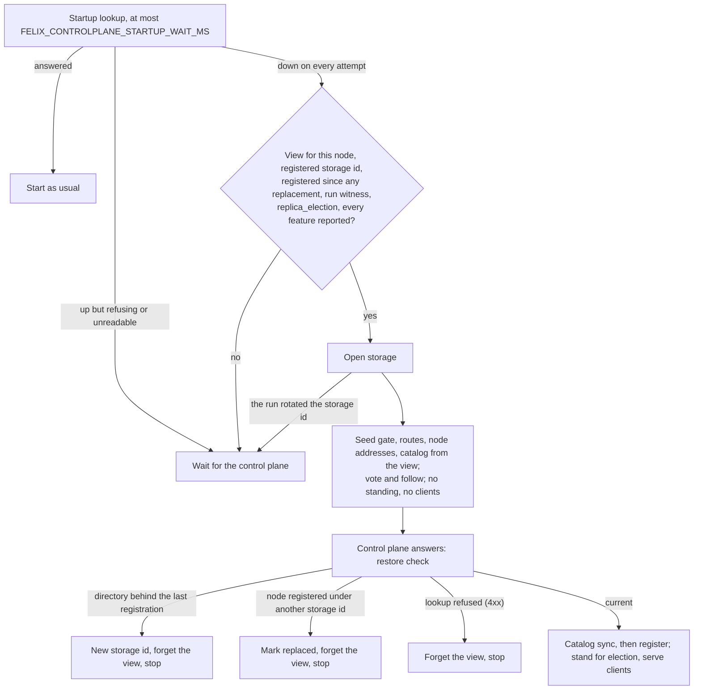

# Control Plane + RAFT Plan (Draft)

This document outlines how the Felix control plane will use RAFT to manage
cluster metadata and propagate configuration to dataplane brokers. It is not
the data plane and does not carry user payloads.

## Goals
- Consistent cluster metadata (membership, shard placement, config).
- Simple propagation to brokers with clear ownership and failover.
- Keep dataplane hot path free of RAFT overhead.

## Non-Goals
- Replicating stream payloads via RAFT.
- Strong consistency for data reads and writes (handled by dataplane + storage).

## RAFT Scope (Control Plane Only)

> **This section is the original sketch; the real thing now exists.** The
> control plane runs one of two production-shaped backends: a stateless REST
> service over a highly available Postgres (what that database must provide
> is [ha-postgres.md](ha-postgres.md)), or a Raft group embedded in the
> instances themselves, with no external database. The embedded Raft backend is complete, chaos
> pass included: three instances survive rolling restarts, a SIGKILLed
> leader, a frozen leader, and a wiped volume without losing an
> acknowledged write. The implemented design, which differs from the
> sketch below in the ways that mattered, is
> [metadata-raft-design.md](metadata-raft-design.md); operator-facing usage
> is on the docs-site Metadata Raft page. This sketch is kept only as the
> record of where the design started.

The RAFT log would store authoritative metadata:
- Node membership and health state (up/down, drains).
- Stream/shard placement and leadership.
- Cluster-wide config (retention, limits, feature flags).
- Versioned snapshots of metadata state.

All control plane nodes participate in the RAFT group. A single leader accepts
metadata writes and replicates them to followers.

## Propagation to Dataplane
Dataplane brokers do not run RAFT. They consume committed metadata through a
simple API:
- Watch or stream updates (long-poll / streaming RPC).
- Periodic snapshot fetch for resync.

On update:
- Brokers start/stop shard ownership.
- Routing tables update for publish/subscribe paths.
- Health/metrics reflect new assignments.

## Failure + Recovery
- If the control plane leader fails, a new leader is elected by RAFT.
- Brokers reconnect and resume watching from the latest committed version.
- Metadata snapshots allow new control plane nodes to catch up quickly.

## API Sketch (Control Plane)
- `GetSnapshot()` -> full metadata view + version.
- `WatchUpdates(from_version)` -> stream of incremental updates.
- `ReportHealth(node_id, status)` -> node liveness signals. **Implemented** as
  `POST /v1/nodes/{node_id}/heartbeat`; see [Broker liveness](#broker-liveness).

## Broker liveness

A broker registers on boot and then reports health on an interval. Nothing
reports that a broker has *stopped*, so silence is the only signal: a periodic
sweep marks a node `down` once its last heartbeat is older than the timeout.

The sweep holds off for one full timeout after the instance starts watching:
at startup, on becoming the Raft leader, and after it could not read its
store. Brokers cannot heartbeat to a control plane that is down, so right after
one comes back every heartbeat stamp is as old as the outage, and sweeping at
once would mark the whole fleet down. A broker that stays silent through the
grace window is expired as usual.

A control plane that was paused (a stopped process, a frozen VM) has the same
problem without restarting: the heartbeats sent during the pause are still
queued when it resumes, and the first sweep would run before it reads them. So
when the sweep finds more than two sweep intervals have passed since its last
tick, it does not count that gap as silence from any broker.

Expiry needs two clocks to agree. The last heartbeat stamp has to be older
than the timeout on the store's wall clock, and the instance running the sweep
has to have seen the stamp stay unchanged for as long on its own monotonic
clock. A wall-clock step forward cannot move the second, so it expires no
heartbeating broker. A step back leaves stamps in the future, since a heartbeat
never moves one backwards; the sweep pulls any stamp ahead of the store's
clock back to it (`clamp_future_heartbeats`) before judging, so a broker that
dies after the step still goes down one window after it went silent. Lowering
a stamp to now cannot expire anyone early: the broker was last heard no later
than now, and the monotonic window still has to pass. Under Raft the leader
judges every broker on its monotonic clock alone, so the log's stamp does not
enter into it: a broker it has heard this term by the age of that heartbeat,
any other from the moment it began leading (or from its registration, if that
came later). A broker a new leader never hears from therefore goes down one
window after the election, however far ahead of the new leader's clock its
stamp is, and never sooner, so a leadership change expires no live broker.
The leader lists a stamp ahead of its clock as now.

### `POST /v1/nodes/{node_id}/heartbeat`

Request carries the reporting process's own `incarnation`, from its last
registration. The response returns the node's lifecycle as the cluster sees it,
plus the cadence expected of it:

```json
{ "incarnation": 3 }
{ "node_id": "broker-1", "lifecycle": "live",
  "heartbeat_interval_ms": 5000, "expiry_timeout_ms": 15000,
  "fleet_features": [] }
```

`fleet_features` is the set of enabled features described in
[Fleet features](#fleet-features).

A broker that was marked down and registered again sends
`"want_assignment_seq": true` until its routes catch up. The answer then
carries `assignment_seq`, the shard-assignment feed's `next_seq` read after
the heartbeat was accepted (on the Raft leader, after confirming it still
leads). The broker serves again only on routes built from the feed at or past
it, so its renewal cannot bring back shards that moved while it was away. A
Raft leader that predates the field leaves it out.

A broker that cannot reach the leader of a shard it follows also sends
`"suspects": ["broker-2"]`, the leaders that have not answered its pings for
`FELIX_LEADER_SUSPECT_AFTER_MS`. The control plane keeps the list as soft
state for two heartbeat intervals and asks for a placement pass; a broker
suspecting nobody leaves the field out. Placement promotes on it only for a
durable `Quorum` stream once `generation_start`, `majority_ack` and
`lease_free_reads` are all finalized, and only against a leader whose own
latest report says `by_round` (`docs/replication-design.md`, "Failover on the
followers' word").
A record that cannot be stored is logged and does not fail the heartbeat.

Four rules, each of which exists for a reason:

- **The recorded time is the control plane's own clock.** A broker that could
  supply it could postpone its own expiry indefinitely.
- **An older `incarnation` is rejected with 409.** A heartbeat delayed past a
  restart belongs to a process the broker has already replaced; counting it
  would report a dead incarnation as live.
- **A heartbeat never revives a `down` node.** It proves a process is running,
  not that it still owns the identity. A broker that reads `"lifecycle": "down"`
  must register again before it is eligible for placement.
- **A heartbeat publishes no change.** Heartbeats arrive per node per interval;
  putting each in the changefeed would evict every real membership change from
  the retention window. Only the lifecycle move that expiry causes is published.

Requires `node.manage` over the node being reported; see
[Authorizing membership writes](#authorizing-membership-writes).

### Fleet features

Some changes alter what one broker expects of another: how a key maps to a
shard, what a peer checks before it accepts a write. Such a change cannot be
turned on while any serving broker predates it, and a rolling upgrade always
has a stretch where some do. So each one is a *fleet feature*
(`felix_common::fleet`). Brokers report which ones they support, and an
operator turns one on for the whole fleet by **finalizing** it once every
broker is upgraded, the way Kafka finalizes `metadata.version`.

**Reporting.** `POST /v1/nodes` carries `features`, the names this build
implements (`fleet::IMPLEMENTED`). The field is optional: a broker that
predates it sends none, and none is what it is recorded as. The set lives on
the node record (`status.features`) and is replaced at every registration,
since a new build means a new process and a new registration.

```json
{ "node_id": "broker-1", "advertise_addr": "10.0.0.4:5001", "region": "local",
  "features": ["jump_hash_routing"] }
```

**Supported.** The control plane intersects the `features` of every `live` or
`draining` node; a node that is `down` or has `left` leaves the calculation.
That is the *supported* set. It changes nothing on its own: a feature every
broker supports is still off.

**Enabled.** `POST /v1/fleet/features/{feature}/finalize` (`node.manage` on
`cluster:*`) enables a feature. It is refused with 409 unless at least one
broker is serving and every live or draining broker reported the feature;
the message names the ones that did not. `?dry_run=true` changes nothing and
answers whether a real finalize would be accepted:

```json
{ "feature": "jump_hash_routing", "dry_run": true, "enabled": false,
  "would_enable": false, "lacking": ["broker-3"], "requires": [],
  "serving_nodes": 3 }
```

Finalizing an enabled feature again is a no-op. Registration and every
heartbeat answer with the enabled set as `fleet_features`, and brokers act on
that alone. `GET /v1/fleet/features` (`node.view` on `cluster:*`) shows both:

```json
{ "supported": ["jump_hash_routing"], "enabled": [], "serving_nodes": 3 }
```

The names are opaque to the control plane, so it can gate a feature it has
never heard of. The exception is the order of the ones brokers use only
together: `majority_ack` is refused with 409 until `generation_start` is
enabled, and `lease_free_reads` and `fenced_caches` until both are. Placement
reads the enabled set, so a fleet with `lease_free_reads` but not
`generation_start` would fail over on suspicion while its brokers still serve
on the lease (`follower_features_are_finalized_after_generation_start`).
Placement also waits for the leader's own report to say `by_round`, since
brokers learn the enabled set on their next heartbeat. The
dry run lists what is still needed as `requires`. The check runs when the
operator asks rather than when a store applies the finalize: the enabled set
only grows, so a prerequisite once seen enabled stays enabled, and a Raft
member applying the command never decides differently from one on an older
release. An older control plane sends no `fleet_features`, which leaves every
broker with nothing enabled.

`joint_fence` and `replica_election` are declared the same way: the first
after `generation_start`, `stream_incarnations` and `cache_incarnations`, the
second after those, `majority_ack`, `lease_free_reads` and the first. A
replaced copy stops being a learner only once it holds its generation's start
record, which leaders write only under `generation_start`. Under joint fences
a broker opens a new stream's or cache's shard only once it knows the
assignment is the shard's first, and it can tell that only from an
incarnation above 0. Without the incarnations, no stream or quorum cache
created after the finalize would open
(`joint_fence_is_refused_until_incarnations_are_finalized`). A broker reports
both only with `FELIX_INTERNAL_ELECTION=true`, which is off by default, so a
fleet that has not turned it on everywhere has a finalize of either refused
(`the_election_features_cannot_be_finalized_yet`), and a new cluster does not
start with them. A broker that offers the `ELECTION`
peer capability reports it as `peer_election`, also only with that switch on.
Every broker from #1737 on also reports `start_holders`: its leaders name, in
each replica report, the followers holding the generation's start record
(`holds_start`). Current brokers report `non_voting` too:
under `joint_fence` it keeps a copy that lost its storage from voting, and its
leaders leave that copy's answers out of their marks. None of these names is
a feature an operator finalizes: the finalize endpoint, and its dry run,
refuse them by name. Finalizing `joint_fence` is refused while a serving
broker lacks `peer_election`, `start_holders` or `non_voting`, and until
every Raft member is at metadata level 25 (see "Turning on joint fences"
below). These are checked only when the operator finalizes; after that a
broker is admitted on the enabled features alone. That is enough because no
build reports `joint_fence` without the three markers; the one way around
it is a debug build told otherwise through `FELIX_TEST_FLEET_FEATURES`;
`replica_election` is also refused before `joint_fence` and its other
prerequisites, and until the control plane
has the metadata level for the pending replica set (see
[Moving a shard](#moving-a-shard)) and adoption (see [Adopting an elected
leader](#adopting-an-elected-leader)), 21 under Raft on every member. The
level is built, but the control plane still refuses the finalize: the election
driver turns it on once joint fences, two-majority acks and the wiped-voter
guard are in. Like the prerequisites, these are checked when the operator
asks.

**Finalizing is one-way.** From then on a broker that registers without the
feature is **refused with 409**, naming what it lacks; it logs the reason and
exits, as for any refused identity. That holds even with no broker serving:
the enabled set is stored, not derived. Withdrawing a feature instead would
switch routing back and forth whenever an old build reappeared, and letting
the broker in would leave it serving without behaviour its peers rely on. A
broker that is down when the feature is finalized is not counted, and is
refused if it comes back on an old build.

Before a finalize nothing is refused, so an old broker joins freely and a
single broker can be rolled back mid-upgrade. That is why enabling is an
explicit operator step rather than automatic once every broker reports the
feature: an automatic switch would make the last broker's upgrade the point
of no return, and a rollback after it would fail.

**A new cluster starts with its features finalized.** A cluster that never
ran an older release has nothing to roll back to, so at its first broker
registration it finalizes every feature its brokers report except
`publisher_principal` (`cluster::fleet::NEW_CLUSTER`). That puts a `Quorum`
write on `majority_ack` from the first stream: without it the leader waits
for a replica report to reach the control plane before it acknowledges.

The registration handler checks that the cluster is new: no stream or cache
was ever created (the change feeds and snapshots are empty) and every node
record is at node incarnation 0, which a broker leaves when it registers
again, as every broker of an upgraded cluster does. Under Raft it also waits
for every member to report this build's metadata level, since the upgrade
runbook finalizes `majority_ack` and the features after it only once every
control-plane member is upgraded. It then finalizes each feature in the
order above, prerequisites first, through the same store call as
`POST /v1/fleet/features/{feature}/finalize`, so the same checks hold: every
serving broker reported it, a Raft member below the level it needs refuses
it, and a broker without it is refused from then on. A refusal leaves the
feature, and any that need it, to the operator. The decision is the
proposer's, as for an operator's finalize, so every Raft member applies the
same commands.

When the member check or a store error holds the finalize back, the
instance that took the registration retries it in the background, from one
second apart up to thirty, until nothing that passes holds it
(`cluster::fleet::NewClusterFinalize`). The retry does not check again that
the cluster is new. Brokers re-registering or streams created meanwhile do
not make it one that could roll back to an older build, and an operator's
finalize at that point passes the same checks. Members starting together
with their brokers, as a Kubernetes rollout does, would otherwise leave
every registration held and the cluster unfinalized
(`a_held_new_cluster_finalize_is_retried_once_every_member_can`). It gives
up ten minutes after the first held attempt, with a warning naming the
manual finalize (`a_held_new_cluster_finalize_gives_up`): by then the cluster
may hold data, and its operator may want the rollback window an upgraded
cluster keeps. The retry lives in that instance's memory and stops with it:
if it shuts down first, the features are the operator's.

A broker configured out of a feature does not report it, so the feature
stays off: `FELIX_QUORUM_READS=lease` keeps `lease_free_reads` off, and
`FELIX_INTERNAL_FENCE=false` keeps `majority_ack`, `lease_free_reads` and
`fenced_caches` off. The first broker's configuration wins: a later broker
that lacks a feature it finalized is refused, and the refusal names the
setting to unset. `docs-site/src/content/docs/deployment/upgrades.md` has
what the operator sees and how to recover.

`publisher_principal` stays the operator's. It stores each record's
publisher, which grows every record by the principal id's length plus a
byte and keeps principal ids in the log, and a lone broker leaves it off too unless
`FELIX_RECORD_PUBLISHERS=true` asks for it.

The registration answers with the enabled set after the finalize, so the
broker uses it from its first stream
(`a_new_cluster_finalizes_every_feature_at_its_first_registration`,
`a_new_cluster_finalizes_only_what_its_brokers_report`,
`a_store_with_streams_is_not_finalized_on_registration`,
`a_store_whose_brokers_registered_before_is_not_finalized`,
`a_new_cluster_waits_for_every_member_to_finalize`). A cluster that creates
streams before any broker registers is not new by then, and is finalized by
the operator as an upgraded one is.

**Atomicity.** Registration is the only way a node starts serving, so a
finalize only has to be serialized with registrations. The memory store holds
its node lock across the check and the write, Postgres takes the same
advisory lock in both, and Raft applies both in the log (`finalize_fleet_feature`
and `register_node_in_fleet`, metadata version 2, or 3 to finalize
`jump_hash_routing`; see
`docs/metadata-raft-design.md`). On Postgres a test holds each one between its
check and its commit and fails without the lock
(`a_finalize_waits_for_a_registration_in_flight`,
`a_registration_waits_for_a_finalize_in_flight`). The enabled set is stored in
the `fleet_features` table on Postgres and in the snapshot on Raft.

**On the broker.** A `FleetGate` holds what this broker reported and which of
those are enabled, and `fleet.supports(FEATURE)` is one atomic load. It is
true only once the feature is finalized, and only for a feature this broker
reported. A heartbeat answer only ever adds to it, because a lower answer is a
stale one: a Raft follower answers from its own copy, which may lag. A
registration answer is exact, computed at the registration's own place in
the log, so the gate starts over from it when the broker registers again.
`felix_broker_fleet_feature_enabled` exports the gate per feature.

**Adding one.** Define it as a `FleetFeature` constant, add it to `IMPLEMENTED`
in the same change that makes the broker honour it, and have the code that
changes behaviour check `fleet.supports(...)`. Never reuse a name for a
different meaning: a broker that reported the old one would enable the new.

### Broker-side lifecycle

A broker joins a cluster only when `FELIX_NODE_ID` is set. Membership is opt-in
because a single-node broker has no cluster to join, and registering one would
put a node in the catalog that placement would then try to use.

| Env | Required | Meaning |
| --- | --- | --- |
| `FELIX_NODE_ID` | opt-in | Stable across restarts. This is the identity, not the process. |
| `FELIX_NODE_ADVERTISE_ADDR` | with `FELIX_NODE_ID` | `host:port` peers reach this broker's **internal** listener on. Not the bind address: a broker bound to `0.0.0.0` has to advertise something routable. |
| `FELIX_CONTROLPLANE_URL` | with `FELIX_NODE_ID` | Where to register. |
| `FELIX_REGION_ID` | no | Defaults to `local`. |
| `FELIX_NODE_ZONE` | no | The broker's failure domain within its region: an availability zone, a rack. Unset or blank registers none. See [Zones](#zones). |
| `FELIX_REGION_BRIDGES` | no | Directional `source>dest` pairs, comma-separated, of regions this broker may forward to besides its own. Unset is none. Give the control plane the same value; see [Regions](#regions). |
| `FELIX_INTERNAL_BIND` | no | Where the internal listener binds. Defaults to `0.0.0.0:5001`. Must not share a port with `FELIX_QUIC_BIND`. |
| `FELIX_INTERNAL_TLS_CERT`, `FELIX_INTERNAL_TLS_KEY`, `FELIX_INTERNAL_TLS_CA` | yes, or the opt-out below | Peer mTLS: this broker's certificate (its DNS name must be `FELIX_NODE_ID`), its key, and the CA every peer must chain to. All three or none. See `docs/internal-protocol.md`. |
| `FELIX_INTERNAL_ALLOW_UNAUTHENTICATED` | no | `true` lets the broker join without peer mTLS: the peer link is then encrypted but unauthenticated. Without either, startup refuses. |

The advertised address is the internal listener's, not the client-facing one:
peers are the only thing that reads it. A broker that advertises a port it does
not bind logs a warning at startup rather than refusing, because a deployment
may legitimately map ports.

A broker also polls `/v1/nodes` on the same interval to build its address book,
and reads it again whenever an assignment change wakes it. Shard assignments
name an owner by node id, and only the catalog turns that into an address to
forward to. Without it a broker knows a shard is owned elsewhere and cannot
reach it. The read on a wake is for a broker that restarted: it re-registers
under the same id on new ports, and nothing in the assignments says so. A refresh that fails keeps the previous catalog rather than
emptying it, because a control-plane blip must not turn a healthy cluster into
one that refuses every remote publish. `felix_broker_node_catalog_nodes` reading
zero while assignments are known is exactly that failure.

A three-node cluster can be run locally with
[the cluster harness](cluster-harness.md).

**Ownership is eventually consistent at the broker.** A shard that moves is not
known to its old owner until that broker's next sync, and until then it serves
publishes for the shard locally. Those records land in its log and no
subscriber on the new owner sees them. There is no fencing today, and the
generation check in the forwarding protocol does not cover this: a stale ex-owner
never forwards, so nothing compares generations. A publish acknowledged in that
window is durably written to a broker nobody reads it from, so this is write loss
rather than a delay. It is tracked in
[#239](https://github.com/GetFelix/felix/issues/239), and closed by the leases in
[the replication design](replication-design.md): a broker without a valid lease
refuses, rather than racing its watch. What holds today is convergence within the
sync interval. See
[the stale-ownership window](cluster-harness.md#the-stale-ownership-window-and-what-closes-it).

The internal transport is described in
[the broker-internal forwarding protocol](internal-protocol.md); its remaining
settings (`FELIX_INTERNAL_CONNS_PER_PEER`, `FELIX_INTERNAL_STREAMS_PER_CONN`,
`FELIX_INTERNAL_MAX_INFLIGHT`, `FELIX_INTERNAL_MAX_SERVED_FORWARDS`,
`FELIX_INTERNAL_REQUEST_TIMEOUT_MS`,
`FELIX_INTERNAL_IDLE_TIMEOUT_MS`, `FELIX_INTERNAL_RECONNECT_BASE_MS`,
`FELIX_INTERNAL_RECONNECT_MAX_MS`, `FELIX_INTERNAL_HANDSHAKE_TIMEOUT_MS`) all
have working defaults.

Startup fails, rather than defaulting, when `FELIX_NODE_ID` is set without an
advertised address or a control-plane URL, or when the address does not parse.
A broker that guessed its own address would register something unreachable, and
the failure would surface later as peers unable to connect to a node the catalog
says is live.

The sequence:

1. **Register after the broker can serve.** Advertising a node placement may
   route to before it can answer is worse than advertising it a moment late, so
   registration waits for the initial catalog sync when readiness is gated on it.
2. **Heartbeat** on the interval the control plane returns, with exponential
   backoff and jitter on failure. A failure is visible
   (`felix_broker_heartbeat_failures_total`) but never fatal: a control plane
   that is briefly unreachable must not take down a broker that is serving fine.
   Retries are capped at a fifth of the lease (about 2.25s with the default
   15s expiry) and each attempt is abandoned after a quarter of it, so a broker
   gets a heartbeat in within a few seconds of the control plane answering
   again. Every other control-plane call has a 2s connect and 5s request
   deadline, so a control plane that accepts connections and then stalls
   cannot hang the broker.
   If the answer is `down`, the broker registers again, takes a new
   incarnation, and carries on heartbeating under it. `left` is not undone:
   that is a deregistration someone asked for.
   Registration and heartbeats run on a thread of their own, with their own
   runtime and HTTP client. A slow disk can block every worker of the broker's
   main runtime at once (a filesystem journal stall under a burst of fsyncs,
   for example), and the heartbeat is what renews the lease, so it must not
   wait behind them. It still checks that the main runtime is running tasks: one
   that has run nothing for 10 s is hung, not stalled, and the broker stops
   renewing so its shards fail over to a live copy.
3. **Drain, then deregister** on SIGTERM, before connections are drained, so
   nothing new is placed here while in-flight work finishes.

A registration refused with a 4xx (a duplicate advertised address, say) stops
the broker with a clear error instead of retrying. A wrong identity stays wrong,
and retrying only hides the misconfiguration. An unreachable control plane is
retried, because it may simply be starting.

This is what separates a graceful shutdown from a crash: a broker that
deregisters is `left`, and one that simply stops is found `down` by expiry. Both
remove it from placement, but only the first is intentional.

Deregistering does not hand a node's shards on at once. It stops the lease
from being renewed (a heartbeat from a `left` node is answered `left`, which
renews nothing and moves no stamp), but the broker may still serve on the lease
it already holds, and nothing tells the control plane when it stopped. So
placement treats a `left` node as `draining` until the same window a silent
node gets has passed since its last heartbeat: the expiry timeout plus the
regrant margin, on the store's clock. Until then nothing it leads is promoted
away, abandoned, or re-placed; a move it takes part in can still hand a shard
over. Placement never names it leader again at a new generation, even
when a move off it gives up after the fence or it refuses a generation: the
shard waits for another caught-up copy or for the lease to run out. No new
move starts off it and no staged move is fenced, because a fence is such a
generation. While a follower is being seated, only the lease running out
ends the wait. It is
never promoted itself, as a draining follower can be. Only an operator's cancel
hands it back. A node already silent for that long, such as one `down` before
it was deregistered, is failed over straight away. An operator deregistering a
live broker should expect its shards to move about 19 s later with the default
settings. In-memory streams are the exception, as for a drain: they have no log
to move and are re-placed at once.

Under Raft the stamp placement waits from is the leader's: a new leader counts
a departed node as heard from when it began judging, as expiry does, because
the log's copy of a heartbeat can trail one the previous leader answered.

#### Starting while the control plane is down

By default a cluster member with durable storage asks the control plane for
its node's last registration before it opens any data, and waits until it
answers (see "Storage identity" in `docs/durable-storage.md`). A broker that
restarts during a control-plane outage therefore takes no part in its shards'
elections until the control plane is back.

Set `FELIX_START_WITHOUT_CONTROLPLANE=true` to let it rejoin them instead:

| Env | Default | Meaning |
| --- | --- | --- |
| `FELIX_START_WITHOUT_CONTROLPLANE` | `false` | Start from the control-plane view in the data directory when the control plane is down at startup. |
| `FELIX_CONTROLPLANE_STARTUP_WAIT_MS` | `10000` | How long the startup lookup asks the control plane before a broker with the switch on starts from its view. Each attempt gets at least one second. |

With the switch on, the broker asks for at most the wait. If the control plane
answers, startup is as without the switch. If every attempt found it down (no
answer, a timeout or a 5xx), the broker starts from its view when all of these
hold:

1. The data directory has a view (`controlplane.view`, see
   `docs/durable-storage.md`) for this node. A new or wiped directory has
   none. A broker removes its view before it deregisters itself, and puts
   it back if the deregistration never reached the control plane, including
   a view an earlier start wrote. It also removes it when it stops because
   the control plane refused it or found its directory replaced. A node an operator deregistered, or one expired while it was
   down, keeps its view: elections stay safe on any past view, because
   every decision is checked against the ballots and sets a majority holds
   (`docs/replication-design.md`, "Rejoining without the control plane").
2. The storage id on disk is the one the view was registered under. A new or
   rotated id has never been registered, and must register before it acts.
3. The view was registered after any `replaced-storage` marker on the
   directory. The marker says the control plane once registered the node
   under another storage id, and only a registration under the current id
   says which copies here the node still holds. Writing the marker removes
   the view, so only a view from a later registration of the current id
   qualifies. The marker also names that id and the incarnation the control
   plane held when the broker found the replacement, and the view must match
   both. A marker written by an older release names
   neither, and refuses every view.
4. The run witness names the directory: a file in `/dev/shm` that every start
   rewrites, naming the token the start wrote to `<root>/run-token` and the
   machine's boot. A restore brings back an older token, and a reboot clears
   `/dev/shm`, so only a restart on the same machine, in the same boot, with
   the directory as its last start left it qualifies. Nothing in the
   directory itself can rule out a restore. See `docs/durable-storage.md`,
   "The run witness".
5. The view's fleet had finalized `replica_election`.
6. This build reports every feature the view's fleet finalized. That is the
   check the control plane makes when a broker registers: a build rolled back,
   or started with `FELIX_INTERNAL_ELECTION` off, would be refused.

Otherwise it waits for the control plane, as without the switch. A 401,
another 4xx, or an answer that does not decode is a control plane that is
up, so it never counts as down.

Peers learn a broker's address only from the control plane, so a broker
started this way votes only if it comes back at its registered address.



**What it does before it registers.** It opens its storage, takes the view's
fleet features as enabled but not yet answered by a registration, and seeds
its routes, the node addresses those routes name and the streams and caches
its shards open at. It then votes in its shards' elections and takes records
from their leaders as a follower. It does not stand for election or restore a
standing from before the restart until it has registered: until then it does
not answer pings, so its peers would suspect it and take a shard it won
straight back, burning a generation. A shard the view names it leader of is
the exception: it may reopen that shard at the view's generation, as a broker
that stayed up would, and its followers refuse it if they have since elected
another leader. It serves no client: the QUIC, Kafka and MQTT listeners accept
nothing, `/ready` reports not ready, and a client request another broker
forwards to it is refused as `Unavailable`, which the forwarder retries. It
holds no lease, so nothing that rests on one runs.

**When the control plane answers.** The check a start without the switch makes
before it opens anything runs first: if the control plane registered the node
at an incarnation the directory never recorded, the directory is a restored
snapshot or a copy. The broker records `replaced-storage`, gives the
directory a new storage id, logs an error, counts
`felix_restored_directory_total` and exits non-zero without registering.
Its supervisor restarts it under the new id, and its copies are rebuilt by
their leaders. If the control plane last registered the node under another
storage id, the broker records `replaced-storage` and exits non-zero; the
next start registers as a replaced directory. If the control plane refuses
the lookup with a 4xx, the broker exits non-zero, as a start without the
switch fails on a refusal. On each of these exits it first removes its view
durably, so a restart during a later outage waits for the control plane
rather than voting from it. Until the check passes the broker also sends no
replica report, since a report announces this directory's storage id and
offsets as current. Only after the check passes does the catalog sync start and
the broker register. The routes and catalog snapshots then replace what the
view seeded. A stream or cache from the view that the catalog snapshot does
not list is unregistered and its logs closed, but its data is kept: a control
plane restored from an older backup lacks streams created after the backup,
and brokers that stayed up still hold them. Data is deleted only by a delete
in the change feed or a tombstone. Client listeners and readiness open once
the broker has registered.

**The trade-off.** The run witness lives in memory, so a broker that restarts
after a reboot, or on a new machine or pod, waits for the control plane even
with the switch on. That is the price of never voting from a restored copy
(#2071). A copy taken during the broker's last run and put back before its
next start is the one restore neither the witness nor the control plane can
see. A restore must delete `storage-id` or use `felix-broker restore-point`
either way; see "Restoring to a backup point" in `docs/durable-storage.md`.

### Operator endpoints

`GET /v1/nodes` and `GET /v1/nodes/{node_id}` list registered brokers and
explain each one's placement standing:

```json
{ "node": { "node_id": "broker-1", "spec": { ... }, "status": { ... } },
  "placement": { "eligible": false, "routable": false, "heartbeat_age_ms": 41200,
                 "reasons": ["last heartbeat was 41200ms ago, past the 15000ms timeout; expiry has not run yet"] } }
```

`placement.reasons` exists because "this broker is registered but shards are not
landing on it" is otherwise answered by reading a lifecycle string and doing
heartbeat arithmetic by hand. It reports a stale heartbeat separately from the
lifecycle, so the window between a heartbeat lapsing and the sweep noticing,
where a node still reads `live`, is visible rather than inferred.

`placement.routable` is what brokers read to decide whether they may forward
to a node: true while it is live or draining and its heartbeat is inside the
window. A draining broker is not eligible for new placement but still serves
the shards it has not handed off yet, and writes for them are forwarded to it
until each one moves.

Filters intersect, and an absent filter matches everything:

```
GET /v1/nodes?lifecycle=live&region=us-west-2&label=rack%3Da1&label=tier%3Dhot
```

Repeating `label` requires all of them. The listing is paged like the others;
see [Listing and pagination](#listing-and-pagination).

#### Authorization

Both read endpoints require `node.view:cluster:*` in a Felix bearer token. The
tenant comes from the token's own `tid` claim rather than a path segment,
because the cluster is not a tenant resource; that claim only selects which
tenant's signing keys to verify against, exactly as `kid` selects a key without
conferring one.

`cluster:*` sits outside the tenant hierarchy on purpose. No tenant scope
contains it, and `validate_new_rule_allowed` admits a policy only when its
object is already inside the caller's scope, so a tenant admin cannot grant
themselves cluster access, and nothing in the bootstrap seed grants it either.
The converse also holds: cluster scope confers nothing inside a tenant, so it is
not a backdoor into tenant data.

#### Authorizing membership writes

Registration, heartbeat, drain, deregistration and `PATCH /v1/nodes/{id}` all
require `node.manage` over the node being changed (`DELETE /v1/nodes/{id}`
requires it on `cluster:*`, so a broker cannot remove its own record):

| Object | Who holds it | Can change |
| --- | --- | --- |
| `node:{node_id}` | a broker, for its own identity | that node only |
| `cluster:*` | an operator managing the fleet | every node |

**A node is an RBAC object, not a field the caller asserts.** A broker
presenting `node.manage:node:broker-a` for `broker-b` is refused, so one broker
cannot register, drain, deregister, or report health for another. Registration
authorises the identity in the *request body*, so a broker cannot claim a name
its credential does not cover.

`node:*` is deliberately rejected: it would be `cluster:*` under a second name,
and two spellings for one scope is how a policy review misses one.

A node scope is an island in the same way `cluster:*` is. No tenant scope
contains it, so a tenant admin cannot grant themselves one; and it confers
nothing inside a tenant. `node.view` does not imply `node.manage`: reading the
fleet is not permission to change it.

##### Giving a broker its credential

A broker with `FELIX_NODE_ID` set **must** have a credential, or it refuses to
start. Starting one that will fail every control-plane call on a loop is worse
than refusing.

| Env | Meaning |
| --- | --- |
| `FELIX_NODE_TOKEN` | the token itself |
| `FELIX_NODE_TOKEN_FILE` | a path to read it from, for a mounted secret |

The file form exists so a credential need not sit in an environment variable
visible in a process listing. Whitespace is trimmed, and a blank value is
treated as no credential rather than as an empty one.

The same credential authenticates the shard-assignment watch and the metadata
feeds the broker seeds from (tenants, namespaces, streams and caches), which
are cluster metadata by the same argument. That makes it a broker's credential
rather than a *member's*: a standalone broker with `FELIX_CONTROLPLANE_URL` and
no `FELIX_NODE_ID` still presents it, and without one its sync is refused on
every poll. It is told so once, at startup, and still starts, because the JWKS
fetch that verifies client tokens is unauthenticated and keeps working.

### Metadata API authorization

Every endpoint that reads or changes the catalog takes a Felix bearer token
with audience `felix-controlplane`; a broker-audience token, the kind clients
hand to brokers, is refused (see [auth.md](auth.md#audiences)).
The check runs before the existence check, so a caller without a credential
learns nothing from a 404: a tenant that does not exist has no signing keys,
and a request against it answers `401` whatever the token says.

| Endpoint | Requires | Minted from |
| --- | --- | --- |
| `GET/POST /v1/tenants`, `DELETE /v1/tenants/{id}` | `tenant.manage:cluster:*` | any tenant; the `tid` only picks the keys |
| `/v1/tenants/{t}/namespaces[/{ns}]` | `ns.manage` over `namespace:{t}/{ns}` | tenant `t` |
| `/v1/tenants/{t}/namespaces/{ns}/streams[/{s}]` | `stream.manage` over `stream:{t}/{ns}/{s}` | tenant `t` |
| `/v1/tenants/{t}/namespaces/{ns}/caches[/{c}]` | `cache.manage` over `cache:{t}/{ns}/{c}` | tenant `t` |
| `POST /v1/tenants/{t}/namespaces/{ns}/resources` | both of the above, over every item in the batch | tenant `t` |
| `/v1/{tenants,namespaces,streams,caches}/{snapshot,changes}`, `GET /v1/principal-revocations/changes` | `node.view:cluster:*` | any tenant |
| `/v1/tenants/{t}/idp-issuers[/{issuer}]`, `/v1/tenants/{t}/signing-keys[/...]`, `POST /v1/tenants/{t}/refresh-tokens/revoke` | `tenant.manage` over `tenant:{t}` | tenant `t` |
| `GET /v1/tenants/{t}/rbac/{policies,groupings}` | `rbac.view` | tenant `t` |
| `POST`/`DELETE /v1/tenants/{t}/rbac/policies` | `rbac.policy.manage` over the rule's object | tenant `t` |
| `POST`/`DELETE /v1/tenants/{t}/rbac/groupings` | `rbac.assignment.manage` over every policy of the role | tenant `t` |

Tenant, namespace, stream and cache names are checked when created: 1 to 128
ASCII letters, digits, `-`, `_` or `.`, starting with a letter or digit.
Anything else would change meaning inside an RBAC object (`*`, `/`, `:`), a URL
or a storage path, and is refused with `400`. Names that already exist are
left alone.

A listing returns only what the caller could manage, so a namespace admin sees
their namespace and not the tenant's layout. A tenant admin's token carries the
manage actions already: token exchange expands `tenant.manage:tenant:{t}` to
`ns.manage:namespace:{t}/*`, `stream.manage:stream:{t}/*/*` and
`cache.manage:cache:{t}/*/*`.

**The catalog is the operator's.** Which tenants exist is cluster metadata, not
something any one tenant owns, so creating, listing and deleting tenants sits
in cluster scope alongside membership, and deleting is operator-only even for
the tenant's own admin, since it takes the signing keys with it. Cluster scope
still confers nothing *inside* a tenant: an operator who can create `t1` cannot
read its streams without a `t1` token.

**Day 0** is the bootstrap listener, which is the only thing that works before
any Felix token exists. An operator credential comes out of it the same way a
broker's does: bootstrap an operator tenant with a policy granting
`tenant.manage`, `node.view` and `node.manage` over `cluster:*` to a role,
assign the operator principal to it, and exchange an IdP token. No tenant admin
can write those rules afterwards, because no tenant scope contains `cluster:*`.

### Creating streams and caches together

`POST /v1/tenants/{t}/namespaces/{ns}/resources` creates a namespace's streams
and caches in one request, all of them or none:

```http
POST /v1/tenants/t1/namespaces/room-42/resources

{ "streams": [ { "stream": "chat", "kind": "Stream", "shards": 1, ... } ],
  "caches":  [ { "cache": "cursors", "display_name": "Cursors" },
               { "cache": "board", "display_name": "Board" } ] }
```

Each item has the body its single create endpoint takes. The checks run in
this order, and any failure creates nothing:

1. The batch holds 1 to 256 items, or `400`.
2. The token carries `stream.manage` or `cache.manage` over every item, or
   `403`. This runs before anything is read, so a refusal says nothing about
   what exists.
3. Every item is valid and no name appears twice, or `400`.
4. The namespace exists, or `404`.
5. Each item either does not exist yet or exists with the same configuration.
   Otherwise `409` naming the items that differ.

The answer lists every item in request order with `"status": "created"` or
`"unchanged"`. It is `201` when anything was created and `200` when everything
already existed as asked, so a caller that died part-way, or never saw the
answer, sends the same batch again.

"The same configuration" compares what the request would store, after its
defaults: a cache's `shards: 0` and an omitted `shards` both mean one. A
stream's `routing` counts only when the request names it, because when left
to the server it depends on whether the fleet has finalized
`jump_hash_routing`, and a retry across a finalize would otherwise conflict
with the stream its first attempt made. A stream's `incarnation` never counts:
a retry proposes another one, and the stream it would create is the existing
one. The single create endpoints use the
same comparison, so creating a stream or cache that already exists as asked
answers `200` with it, and `409` only when it differs.

The new items are written by one store operation. Under Postgres that is one
transaction, so a unique-key violation on any row, including one a concurrent
create committed first, rolls the whole batch back. Under Raft it is one log
entry (`create_resources`), applied whole or refused whole on every member.
When a concurrent create of the same name wins the race, the batch looks
again, up to three times: a winner with the same configuration becomes
`unchanged`, and one with a different configuration is a `409`.

Brokers read the catalog through the stream and cache feeds, which are
separate. Each item gets its own `Created` change, so a broker can see a
batch's streams one poll before its caches, but it never sees an item from a
batch that failed.

Under Raft the batch needs metadata level 5 on every member. Until the whole
group runs a release that has it, the endpoint answers `503` with code
`upgrade_in_progress`, and the single create endpoints keep working.

### Mounting a stream at an MQTT topic prefix

An MQTT device publishes to topics nobody created, such as `plant/7/line/3/temp`.
A stream's `mount` is how Felix ties those topics to a stream: a `PUBLISH` to
any topic that starts with the mount lands in that stream. The mount is a field
on the stream, set when it is created or later with `PATCH`. `docs/mqtt-design.md`
("Topic model") has the reasoning, and `docs/mqtt-compatibility.md` what the
MQTT listener does with it today.

```bash
CP=http://localhost:8443          # the control plane
TOKEN=...                         # a Felix token with stream.manage on the stream
STREAMS=$CP/v1/tenants/acme/namespaces/plant/streams

# Create a durable stream already mounted at plant/
curl -sS -X POST "$STREAMS" -H "Authorization: Bearer $TOKEN" \
  -H 'Content-Type: application/json' -d '{
    "stream": "telemetry", "kind": "Stream", "shards": 4, "durable": true,
    "retention": { "max_age_seconds": null, "max_size_bytes": null },
    "consistency": "Leader", "delivery": "AtLeastOnce", "mount": "plant/" }'

# Move the mount, then clear it
curl -sS -X PATCH "$STREAMS/telemetry" -H "Authorization: Bearer $TOKEN" \
  -H 'Content-Type: application/json' -d '{ "mount": "factory/" }'
curl -sS -X PATCH "$STREAMS/telemetry" -H "Authorization: Bearer $TOKEN" \
  -H 'Content-Type: application/json' -d '{ "mount": null }'
```

In a `PATCH`, an absent `mount` leaves it alone, a string sets it and `null`
clears it. Changing or clearing a mount touches no records: it only changes
which topics reach the stream from then on. A stream with no mount is
serialized without the field, so requests and answers for it are byte for byte
what they were.

The prefix is a plain byte prefix. `plant/` catches `plant/7/temp` and not
`plant` or `plants/7`; `plant` catches `plants/7` too. It does not have to end
in `/`, though it usually should. It is refused with `400` when it:

- is empty or longer than 1024 bytes (the listener's own topic limits, 1024
  bytes and 16 levels by default, also apply to the topics under the mount, so a
  very long or deep prefix leaves little room or none),
- contains `+`, `#` or a control character (NUL included), which no topic name
  can hold,
- starts with `$`, which MQTT reserves for the broker's own topics, or
- is set on a stream that is not `durable`, when the stream is created. A
  `PATCH` that mounts a non-durable stream is `409`. Only durable streams can
  be mounted, because MQTT clients rely on the acknowledgement meaning the message
  is stored.

A tenant's mounts may not overlap, whichever namespaces the streams are in: no
mount may be, or begin with, another's. A mount that does is refused with `409`
and a message naming the other stream, so a topic always has at most one stream
to go to. A `PATCH` that makes a mounted stream non-durable is also `409`; clear
the mount first. Creating a stream that exists with the same mount answers `200`
as for any retried create. Deleting a stream frees its mount, and so does
deleting its namespace or tenant.

The overlap check is part of the write in every store, so two requests racing
for overlapping prefixes cannot both succeed:

- **Memory and Raft** check inside the apply, under the store's lock, so every
  member refuses the same entry.
- **Postgres** checks in the same transaction as the write, under the streams
  feed lock every stream write takes. Migration `0041_stream_mount.sql` adds the
  nullable `streams.mount` column, and a unique index on `(tenant_id, mount)`
  backs the check up for two streams with the same prefix.
- **Batches** (`POST .../resources`) check every mount against the stored ones
  and against each other first, and a refusal creates nothing.

Brokers read `mount` in the stream snapshot and change feed with the rest of the
stream, and keep a per-tenant table of mounts for the listener to resolve topics
with. An older control plane sends none, and a stream without one is not
reachable from MQTT.

Under Raft a mount needs metadata level 24 on every member. Below it, a request
that sets or clears a mount is refused with `409` before it reaches the log, so
no member stores a mounted stream as unmounted, and nothing is written. Streams
without a mount are written as before at any level.

### Listing and pagination

These listings are paged:

| Endpoint | Order | No `limit`/`cursor` |
| --- | --- | --- |
| `GET /v1/tenants` | `tenant_id` | first 1000 |
| `GET /v1/tenants/{t}/namespaces` | namespace | first 1000 |
| `GET /v1/tenants/{t}/namespaces/{ns}/streams` | stream | first 1000 |
| `GET /v1/tenants/{t}/namespaces/{ns}/caches` | cache | first 1000 |
| `GET /v1/nodes` | `node_id` | first 1000 |
| `GET /v1/shard-assignments` | tenant, namespace, kind, name, shard | first 1000 |
| `GET /v1/tenants/{t}/rbac/policies` | subject, object, action | every rule, as a bare array |
| `GET /v1/tenants/{t}/rbac/groupings` | user, role | every assignment, as a bare array |

`limit` is 1 to 10000 and defaults to 1000. A response with more to come
carries `next_cursor`; pass it back as `cursor` with the same filters to get
the next page, and stop when it is absent. Anything else in either parameter
is a `400`.

```
GET /v1/tenants/t1/namespaces/payments/streams?limit=2
{ "items": [ ... two streams ... ], "next_cursor": "InMyIg" }
GET /v1/tenants/t1/namespaces/payments/streams?limit=2&cursor=InMyIg
{ "items": [ ... the last one ... ] }
```

**Compatibility.** The object-shaped listings keep their shape: `next_cursor`
is a new optional field, absent on the last page, so a response that fits on
one page has exactly the fields it had. A caller that ignores `next_cursor` sees
only the first 1000 entries of a longer listing; every in-repo caller (the
broker's node catalog, the `felix-cluster` harness) follows it. The two RBAC
listings answered with a bare JSON array, which has nowhere to put a cursor,
so they still answer that way, in full, when neither parameter is given, and
with `{ "items": [...], "next_cursor": ... }` when either is.

**The cursor** is the key of the last entry returned, base64-encoded; treat it
as opaque. Paging is keyset rather than offset, so an entry created or deleted
behind the cursor does not make a later page repeat or skip one that was there
all along; one created ahead of it appears on a later page. There is no
snapshot across pages: a listing read over several requests is not a
point-in-time view. The snapshot and changes feeds are for that.

**Filtering**, by the caller's rights and by `/v1/nodes`' filters and
`?leader=`, fills the page from further on rather than returning it short, so
every page but the last holds exactly `limit` entries, and a cursor never names
an entry the caller was not shown. The last page can be empty when everything
after the previous one was filtered out. A caller who can see little of a large
listing therefore costs a longer read per page, never more than the unpaged
listing did.

Not paged, because each is bounded by something other than growth:
`/v1/regions` (derived from the nodes), `/v1/shard-moves` (the moves in
progress, which the move limits cap), and a tenant's `idp-issuers` and
`signing-keys`.

The store implements pages natively on every backend: Postgres as an index
range scan (`WHERE key > $cursor ORDER BY key LIMIT n + 1`), memory and Raft
by sorting what is past the cursor. Postgres orders names by the database's
collation, so the order of names differing only in punctuation can differ
between backends; within one backend it is stable, which is all a cursor
needs.

### Snapshot and change feeds

The control plane serves a snapshot and a change feed for each of tenants,
namespaces, streams, caches, nodes and shard assignments. The snapshot
returns every current item plus a `next_seq`; `changes?since=N` returns the
changes with `seq >= N`, oldest first, and the `next_seq` to ask from next. A
consumer that applies the snapshot and then follows the feed from its
`next_seq` sees every committed change exactly once.

Four properties make that hold on every backend:

1. The snapshot's items and its `next_seq` are read at one point: one
   `REPEATABLE READ` transaction on Postgres, and the resource's lock held
   across both reads in memory and on Raft. Read separately, a delete landing
   between them leaves the item in the snapshot while `next_seq` is already
   past the delete.
2. A `seq` is handed out in commit order. On Postgres each change table's
   writers take that feed's advisory lock before anything else and hold it
   until they commit, so a writer cannot take seq 11 and commit while seq 10
   is still in flight. Without that, a reader could pass 10 and never see it.
   Nodes and shard assignments get the same property from a locked counter
   row. Writers in one instance queue in memory before they take a pooled
   connection, so a long cascade does not starve reads of connections, and a
   writer that waits more than 5 s for its feed gives up with a 503
   `busy` that is safe to retry: nothing was written.
3. A page holds at most `FELIX_CONTROLPLANE_CHANGES_LIMIT` changes (1000 by
   default). A full page's `next_seq` is the seq after its last change, and a
   shorter page's is the feed's tail. A consumer further behind than one page
   asks again from `next_seq` until a page comes back empty; the broker
   follows up to 64 pages per feed in each sync pass.
4. A consumer's cursor never moves backwards. On Raft each member answers
   from its own applied state, so a broker that reaches a lagging member can
   get a `next_seq` below its cursor, or a snapshot older than what it has
   applied. The broker ignores such an answer and asks again. A feed that
   answers only from behind for 60 s is taken as reset, and the broker takes
   a new snapshot of it: the changes before the new `next_seq` are a history
   it has never seen. A snapshot only adds and updates, so a tenant,
   namespace, stream or cache deleted across the reset stays registered on
   the broker. A broker registers only what the catalog holds when it starts,
   so restarting it drops them. Its data stays on disk either way, as a
   deleted stream's always does.

The tenant, namespace, stream and cache feeds keep only their most recent
`FELIX_CONTROLPLANE_CHANGE_RETENTION_MAX_ROWS` changes, so a consumer that
falls further behind than that has to take a new snapshot.

### Shard ownership

`GET /v1/shard-assignments` lists which broker leads each shard, and
`?leader=<node_id>` narrows it to one broker. Requires the same
`node.view:cluster:*` as the node listing, because ownership and membership are
the same view of the cluster.

There is **at most one assignment per (stream, shard)**. That is the primary
key, and it is the invariant placement depends on.

`generation` increments on every write and is owned by the store, never the
caller. A broker reports status against the generation it read, so a broker that
was slow, partitioned, or restarted cannot resurrect an ownership decision that
placement has already replaced.

An assignment that promotes a follower on failover also carries
`fence_storage_ids`: the storage id the replica report it was decided on named
for each replica, by node id. The promoted leader's fence counts a replica only
from that copy (`docs/replication-design.md`, "Fencing a promotion"). Every
other write leaves it out. Postgres keeps it only for the generation that wrote
it, and the Raft store writes it only at metadata level 16.

Every placement write, including creation, moves and operator steps, also
carries `member_storage_ids`: the storage id each member of the set has
registered, by node id. A member that registered none is left out. A broker
uses it to tell that it lost its storage: if the set names a different id
for it, it stops voting until it has caught up (`docs/replication-design.md`,
"A copy that lost its storage does not vote"). The promotion fence never
reads it, because a registered id is not the id a report vouched for.
Postgres keeps it only for the generation that wrote it (migration 0039), and
the Raft store writes it only at metadata level 22.

Under `joint_fence` an assignment also carries `learners`: the members the
control plane holds as learners because their storage was replaced. Empty
otherwise, so a write is what it was before. Postgres keeps it only for the
generation that wrote it (migration 0040), and the Raft store writes it only
at metadata level 23, which also carries a report's `holds_start`.

A placement write that lands more than one generation up, which only a rename
past a refusal's ballot does, also carries `previous_generation`: the
generation of the assignment it replaced. Nothing was recorded in between, so a
broker that watched that assignment takes its set as the one the new
generation leaves (`docs/replication-design.md`, "Planned handoff"). The store
sets it; a caller's value is ignored. Postgres keeps it only
for the generation that wrote it (migration 0045), and the Raft store writes it
only at metadata level 29.

A snapshot item also carries `previous`, the set of the assignment the change
log holds right before it (the generation below, or the one
`previous_generation` names). A broker that reseeds from the snapshot takes it
as the set its fence leaves. It is read from the retained change log, so an
item whose earlier change has been evicted carries none.

##### Re-admitting a replaced copy

A broker whose disk was wiped registers again under a new storage id. The
assignment still names the old one, so the copy is a *learner* (see
`docs/replication-design.md`, "A copy that lost its storage does not vote"),
and placement treats it as one. With `joint_fence` finalized:

1. **Placement keeps it out.** A member is a learner of a shard when the
   assignment names it under one storage id and it is registered under
   another, or when it is in the assignment's `learners` and the leader's
   report at the assignment's generation does not list it in `holds_start`
   under the id it is registered with. A learner is never chosen as a
   failover leader and never counts in a majority, such as the rest of a
   set that a trim or a seat judges level with the leader. A move's staged
   destination is not a learner unless one of those holds.
2. **The write names the new id.** When the shard has a live leader, a live
   majority of its set without the replaced member, no move, drain or
   pending set in progress, and the leader's report at the
   assignment's generation shows the replaced member caught up under its
   new id, placement writes the same leader and replicas at the next
   generation (the `readmit` step, at most one member per shard per pass).
   Each is a new fenced term on the leader, so a pass re-admits into at most
   16 shards, and none while placement is paused. The write names the new id and puts the member in `learners`.
3. **The report lets it count.** The leader's report at that generation
   lists the member in `holds_start` once the member holds the generation's
   start record. For a cache shard its counter log must hold the counter
   log's start record too. From then on placement counts the member again.
   The next placement write drops it from `learners`.
4. **The report is recorded as evidence.** When the leader's report at that
   generation shows the learner caught up under the id the assignment names
   it by, at the incarnation it is registered at, the control plane adds a
   `readmitted` entry to the assignment: `{node, storage_id, generation,
   offset}`, where `offset` is where the report put the copy. The set naming
   the new id was written after the id registered, so it was introduced after
   the copy was lost, and its leader holds every record the old copy helped
   acknowledge. A fence can later trust an answer from that same copy that
   shows a last generation of at least `generation` and a log end of at least
   `offset`, even after a restart that lost the broker's own record of it.
   A report from the earlier generation, whose set still named the lost copy,
   records nothing.

The store owns `readmitted`. It keeps the first entry per member (a later
report claims no less), carries entries to every later write while the
member stays in the set under that id, and drops one once the set names the
member by another id or leaves it out. Recording an entry does not change
the generation and writes no change: brokers see it in the next assignment
write or a snapshot. Postgres stores it from migration `0046`; under Raft it
is recorded only once every member is at metadata level 30, and below that
nothing is written. A report from a leader that elected itself records
nothing: it may have opened before the copy was replaced, at a generation
adopted later for a set naming the new id. The copy itself reads the
entries when it answers a fence, and only while the fleet has not
finalized `replica_election`: see `docs/replication-design.md`, "One fence rule for
every change of leader" and "Readmission and elections".

Every placement write works out `learners` from the assignment it replaces:
a member that assignment named under another id than the one registered now,
and a member it held that no report has admitted. The leader is never a
learner here; a leader that came back on a replaced disk is failed over
(`leader_replaced`). An operator's write has no report to read, so it keeps
the learners it finds; if it cannot read the assignment it replaces, it fails
rather than write none. Without `joint_fence` the field is always empty and
nothing in this section happens.

##### Turning on joint fences

The control plane finalizes `joint_fence` only when all of these hold. It
checks the first four itself.

1. Every serving broker reports `start_holders` and `non_voting`. A broker
   without `non_voting` would let a wiped copy vote and count its answers,
   so the check, not the order brokers and control planes are upgraded in,
   keeps a mixed fleet safe.
2. Every serving broker reports `joint_fence` and `peer_election`. A broker
   reports them only with `FELIX_INTERNAL_ELECTION=true`, off by default.
3. `generation_start`, `stream_incarnations` and `cache_incarnations` are
   finalized. A cluster created on 0.7 has all three; an upgraded one
   finalizes the incarnations first, or no stream or quorum cache created
   after the finalize could open its first shard. A stream or cache created
   before the incarnations were finalized carries incarnation 0, so place
   all of its shards before finalizing `joint_fence`.
4. Under Raft, every member is at metadata level 25: 23 for learners and
   start holders, 25 for the refusal report that renames a shard whose fence
   cannot learn the set it leaves.
5. On Postgres, every control-plane instance runs a release with learners
   (migration 0040) and refusal reports (migration 0042) before the
   finalize. Without 0042 an instance drops the refusal a restarted leader
   sends, and that shard waits. Nothing checks this: an older
   instance that writes an assignment leaves its learners unmarked for that
   generation, and they read as none, so placement could count a learner.
   The same holds after the finalize: no control-plane instance may be rolled
   back to, or started on, a release without learners, since nothing on
   Postgres stops it and it drops learners the same way.
6. The model's re-admission configurations pass with `PlacementKnowsLearners`
   (`docs/formal/README.md`).

The cluster test `failures/learners.rs` runs the whole sequence with joint
fences on (`ClusterConfig::joint_fence`): a follower is wiped, the leader
fails over to the follower that kept its data, and with the old leader down
the new one cannot serve, since the learner does not vote. Once the old
leader is back the wiped copy catches up, the leader's report shows it
holding the start, and from then on it counts: with the old leader down
again, the leader and the re-admitted copy acknowledge writes. The failover
already names the copy under its new storage id, so this test does not take
the path that writes the same set again at the next generation; unit tests
cover that one.

States are `assigning` (placement decided, the leader has not confirmed),
`active` (the leader is serving), and `draining` (the leader has been told to
stop serving at this generation so the shard can move). A drained shard leaves
only through a fresh `assigning` at a new generation, never back to `active`
where it stands. `successor` names the node a shard is moving to while a move
is in progress; it is always one of `replicas`, and absent otherwise. See
[Moving a shard](#moving-a-shard).

#### Replica reports

`POST /v1/nodes/{node_id}/replica-status` is how a shard's leader tells the
control plane which replicas hold its log and how far each has got. Promotion
is gated on it: a lost leader is replaced only by a replica reported caught up,
and among those by the one reported furthest ahead. A replica on a draining
broker is picked only when no live one is caught up; the drain then moves the
shard off it as usual. A broker that has deregistered is never picked, even
while placement still counts it as draining: it has stopped. A report may also
carry `drained: true`, the leader's word that it has stopped serving the shard at
that generation and its log will not grow: the fence of a planned move. For a
cache, `replica_counter_offsets` says how far each replica has got with the
counter log, which placement counts as a restore's progress; brokers that
predate it leave it out. Requires `node.manage` over
the reporting node, and the node must lead the shard it reports on; a report
naming a generation ahead of the assignment is refused, since one claiming
`u64::MAX` would otherwise block every real report after it.
`stream_incarnation` names the stream incarnation whose log the report
measured, and is left out at 0 (a cache, a stream from before incarnations,
and brokers that predate it). A report naming another incarnation than the
assignment's is refused as `stale`: after a control-plane restore a recreated
stream can be at the deleted one's generation, and a broker that has not yet
seen the recreate would otherwise report the old log, whose longer tail
would then refuse every real report.
`by_round: true` says the leader acknowledges the shard by its followers and
confirms its reads by a round, so nothing it serves rests on its lease. It is
kept only when the request's `incarnation` is the node's current one, and is
recorded with it as `leader_incarnation`; placement ignores it once the node
has registered again, since a restarted leader serves on its lease until its
first pass.
Placement replaces a leader on its followers' word only when its report at the
current generation says so ([Failover on the followers'
word](replication-design.md#failover-on-the-followers-word)). It is left out
when false and by brokers that predate it, which placement reads as a leader on
its lease. Under Raft it is recorded only once every member is at metadata
level 11.
`holds_start` lists the followers the leader saw holding the start record of
its own generation (for a cache, its counter log's too), by node id, and only
those that gave a storage id. Placement re-admits a replaced copy on it
([Re-admitting a replaced copy](#re-admitting-a-replaced-copy)). It is left
out when empty and by brokers that predate it. Postgres keeps it only for the
report that wrote it (migration 0040), and under Raft it is recorded only once
every member is at metadata level 23.

The answer is per shard, in request order: each entry names the shard and
generation and says `accepted`, `stale`, `not_leader`, `unassigned` or
`future_generation`. The status is 200 when every shard was accepted and 409
when any was not. The leader moves a shard's quorum mark only on `accepted`,
because a `Quorum` acknowledgement must rest on a report failover will read.
Control planes before this answered 204 whatever they did with each shard.

**Reports live in the store**, keyed like the assignment they describe and
cascading from it, not in the memory of the instance that received them. With
several instances over one Postgres, the instance a report reaches and the
instance that runs placement need not be the same process, and a report only
one of them had seen was a position no promoter could use: a `Quorum`
acknowledgement released on it could not be made good at failover. Under Raft
the report is a log command, restamped with the leader's clock as a heartbeat
is. Reports only move forward: one replaces the held report at a later
generation, or at the same generation with a leader tail at least as far
along, so a slow request cannot put back an older view of who is caught up.
One from an older generation than the assignment's is refused as stale,
because leadership moved on and it describes a replica set that may no longer
exist.

**The leadership check is repeated at the write.** The handler judges a report
against the assignment it read, and a promotion can land between that read and
the write. So every backend stores a report only if the reporting node still
leads the shard at the report's generation, checked in the same step as the
write: under the store lock in memory, against the assignment row held
`FOR SHARE` in the same Postgres transaction, and in the Raft state machine as
the command applies, against the replicated assignment rather than the
proposing instance's copy. A report refused there answers `not_leader` (another
node leads) or `stale` (another generation), so a deposed leader never sees
`accepted` and does not move its quorum mark. Report commands from members
that predate the check carry no reporting node and apply unchecked, as they
did; a member still on that build ignores the node and applies every report,
so finish the roll before relying on the check.

**One clock on both sides.** A report is stamped with the store's clock and its
freshness is judged, by whichever instance plans, against the store's clock
(`clock_timestamp()` under Postgres, the leader's process clock under Raft). A
report is believed for twice the expiry timeout plus one heartbeat interval:
long enough to outlive the detection of the leader that made it, since a
report that expired sooner would leave a shard unpromotable forever, and no
longer, since a stale one is how a failover loses the records written after
it. Nothing about a report survives the assignment it describes: deleting the
assignment deletes the report, so a shard removed and recreated does not
inherit the old one's promotability.

**A follower counts only under its own storage identity.** A broker registers
with the identity of its data directory (`storage_id`, 32 lowercase hex
digits; any other spelling is refused with 400), and a registration without
one clears the stored one. The leader's report names the identity it saw for
each follower (`follower_storage`). Placement counts a follower from a report
only while the two match, never once they differ, and by the report's age
alone when either is missing. The API also stamps each report with the node
that made it (`leader`) and the incarnation every node it names is registered
at (`node_incarnations`), read before the write. A `Leader` shard is promoted
only on its current leader's report, and a follower without an identity counts
only from a report taken at its current incarnation. While the report's leader, at the
same incarnation, is still the assignment's leader and is `down` or `left`, a
matching follower's report is aged to the leader's last heartbeat instead of
now, through any move steps since, so a dead leader's last report does not
expire while placement is slow (#1250). All of these are plain data written as
received. Under Postgres each has a marker: the node's
`storage_id_incarnation` and the report's `follower_storage_at` (migration
0030), and the report's `stamped_at` (0031). A member that predates the
columns writes the row without them, and what it leaves behind reads as
missing while the marker no longer matches the row's `incarnation` or
`reported_at_millis`. Under Raft they need metadata levels 12 and 13 and are
dropped by the proposer below them. See
[replication-design.md](replication-design.md#who-may-be-promoted).

A leader also reports, for each follower it has not reached yet at its
generation, the identity it inherited for it: the one the failover that
promoted it named, or after a set change that kept it as leader, the one it
named the follower by at its previous generation
(`inherited_storage_ids`, stored as `inherited_storage`; a malformed one is
dropped). A leader that stood for election inherits none, so for a member
the report names no identity for and inherits none for, the control plane
stores the one the shard's previous report named it by. The next failover names such a follower by it in the assignment's
`fence_storage_ids` instead of by an empty identity, so its fence answer can
count (#1574, #1922). It never makes a follower caught up. Under Postgres its marker
is `inherited_storage_at` (migration 0037); under Raft it needs metadata
level 20 and is dropped below it, which names the follower by none, as
before. See
[replication-design.md](replication-design.md#fencing-a-promotion).

#### How shards get placed

Rendezvous hashing: every eligible node is scored against the shard, and the
highest wins. Chosen over a consistent-hash ring because it needs no ring state
and no virtual-node tuning, distributes better at the handful-of-brokers scale a
cluster starts at, and because removing a node moves only the shards that node
held.

The highest-scoring node is passed over when it already carries its share,
which keeps a small cluster even where plain rendezvous would not. Roles
(leaders and followers) are capped at `ceil(roles / live nodes)`, and
leaders twice: per stream or cache first, then across the cluster. A new
shard goes to the best-scoring node still under its stream's floor
(`floor(shards / nodes)`), then under its stream's ceiling. Within each of
those it prefers a node under the cluster-wide floor (`floor(all shards / nodes)`),
then one under the cluster-wide ceiling (`ceil(all shards / nodes)`).
A 12-shard stream on three brokers is placed 4/4/4 whatever the other streams
already lead, and the cluster-wide count is evened out afterwards by moving
other streams' shards (see [Moving a shard](#moving-a-shard)).

The cluster-wide floor matters when many shards arrive at once, for example
from an application that creates a stream per job. With only the ceiling as
the bound, the best-scoring brokers could fill to it before the last one
reached the floor, which left the totals two apart. The balancer then moved an
existing leader to even them out. It takes the first shard in key order, so it
moved the same few shards over and over, often an application's own caches,
and each move holds that shard's writes while it is fenced. Filling every
broker to the floor first keeps a batch of single-shard streams within one of
even, so creating them moves nothing that already exists. A stream's own
spread still comes first, so a multi-shard stream can still leave the totals
for the balancer to even out.

The placement *plan* is deterministic: the same rows give the same decision,
whatever order streams, nodes, or existing assignments arrive in. Its input is
not one consistent snapshot, though. A pass reads the catalog, nodes,
assignments, replica reports and pause switch separately
(`PlacementRead::load`), and two instances may read different states. What keeps
that safe is **conditional writes**: every assignment write names the generation
it was planned from and the placement token read at the start of the pass, and
is refused if either moved, so a plan built on stale input is dropped and
replanned. The token advances on placement's own writes and on a change to a
stream's consistency or durability, which decide how its shards fail over
(below). Node lifecycle and other stream changes do not move it, so a pass can
still act on a node or stream that changed in those ways after it was read;
the next pass corrects it.

The hash is written out rather than taken from `DefaultHasher`, whose seeding is
not part of its contract. A placement decision that changed with the Rust
version, or differed between two instances, would be silently catastrophic. The
shard key and the node id are hashed independently and then mixed, because a
single pass over the concatenation is badly behaved at the size a cluster
actually is: over 300 shards on four nodes it put 43 on one node and 94 on
another, against a spread within 8% of even for the split form.

Two deliberate omissions:

- **`NodeCapacity::weight` is ignored.** Weighted rendezvous needs a logarithm,
  and floating point that must agree bit-for-bit across every instance is a bad
  foundation for a decision that has to be identical everywhere. `max_shards` is
  honoured, as a hard cap.
- **No label affinity.** Region is the only hard placement constraint, and
  zone the only preference; see below.

#### Regions

A stream created with a `region` is placed only where its data may be: on a
broker whose `FELIX_REGION_ID` is that region, or a region the control plane's
`FELIX_REGION_BRIDGES` bridges it to. Bridges are directional `source>dest`
pairs, so `eu>us` lets an `eu` stream have copies in `us` and not the reverse.
The region is fixed when the stream is created. A stream without one is placed
anywhere, exactly as before regions existed.

The constraint applies to every copy and every way a copy is chosen: the first
placement, rebalancing and drain moves, follower replacement, and failover,
which promotes only a caught-up replica in an allowed region and otherwise
leaves the shard unavailable rather than serving it elsewhere. A broker outside
the allowed regions is, for that stream's shards, a draining broker: it is given
none of them, and whatever it already holds (because its region changed or a
bridge was removed) is moved into the allowed regions by the ordinary move
steps. When no live broker is in an allowed region the shard is reported
`NoNodeInRegion` instead of placed. An operator move to such a broker is refused
with `region_not_allowed`.

Brokers apply the same allowlist to forwarding. A broker forwards a request to a
shard's leader only in its own region or one its `FELIX_REGION_BRIDGES` reaches,
and refuses the rest with `shard_unavailable` and reason `region_not_routable`.
A client that connects to the leader directly is not refused; the check is on
broker-to-broker traffic.

What is not enforced: caches have no region, the allowlist is configured per
process (give every control-plane instance and broker the same value), brokers
ship to the replica set placement assigned without checking its regions
themselves, and a follower already outside the region stays until a broker
inside it can take its place, since dropping it would cost a copy.

#### Zones

A broker may register a zone (`FELIX_NODE_ZONE`): the failure domain it shares
with other brokers inside its region, such as an availability zone or a rack.
Placement spreads each shard's copies across zones, so losing one zone costs a
shard at most the copies that zone held.

- **First placement and failover.** The leader is chosen as before. Each
  follower then goes to the best-scoring broker in a zone the shard has no copy
  in yet; only when no broker with room is in such a zone does it go to the
  best-scoring broker regardless. A copy that shares a zone still survives a
  single broker failure, so the fallback places rather than leaving the shard
  short.
- **Moves.** A drain goes to the destination that leaves the shard spanning the
  most zones, and only then prefers balance and score. A rebalance, which is
  optional, goes only where the shard loses no zone. At the cut-over the copies
  kept are the ones in zones the shard would otherwise lose, so dropping the
  surplus copy never narrows the spread.
- **Followers.** A follower on a draining broker is replaced in a zone the
  shard would otherwise lose. With nothing draining, a follower sharing a zone
  with another copy is replaced, the same way, by one in a zone the shard
  lacks, once a broker there has room: copies placed before a zone had brokers
  (or before brokers reported zones) are spread as the cluster allows. Each
  replacement takes a move slot, so it is paced like any other copy.

A broker without a zone is its own failure domain, shared with nobody. A
cluster in which no broker reports one is therefore placed exactly as it was
before zones existed, and a broker or stored record that predates the field
reads as having none. Zones mix with zoneless brokers: two brokers in `a` and
two with no zone give a replication-factor-three shard one copy in `a` and one
on each zoneless broker.

When a shard's copies share a zone although the brokers it may use span more
zones, placement still places it, logs a warning on the write, and counts it in
`felix_shards_zone_unspread`. That happens when every broker in a missing zone
is at `max_shards`, or while the move that would spread the shard waits for a
slot.

Zones sit inside regions: a stream with a home region is spread across the
zones of the brokers it may use there.

An operator's move (`POST /v1/shard-moves`) is never refused on zone grounds:
an operator may have a reason to put a shard somewhere placement would not,
and refusing would leave no way to do it. When any broker the shard may use
reports a zone, the response carries `zones_before` (the zones its live copies
span now) and `zones_after` (the zones placement expects once the move cuts
over), and `"dry_run": true` in the request answers the same without starting
the move. A move with `zones_after` below `zones_before` is logged as a
warning, and once cut over the shard counts in `felix_shards_zone_unspread`
until placement replaces a follower to spread it again. In practice a move
rarely narrows anything, because the cut-over keeps the copies in zones the
shard would otherwise lose; it can when the shard holds more copies than its
replication factor, which is the case after the factor is lowered.

A broker's zone is read once, when it registers, like its region and
addresses; heartbeats do not carry it and `PATCH /v1/nodes/{id}` cannot change
it, since the broker's next registration would overwrite the patch. Changing
a broker's zone is a restart with a new `FELIX_NODE_ZONE`. A zone describes
where the broker runs, which does not change under a running process, so
nothing is lost by not reading it more often.

Reconciliation is idempotent: a pass over a settled cluster writes nothing, so
running it on a timer does not churn rows or flood the changefeed.

**One instance runs the timed passes: the holder of the placement lease.**
The lease is one record in the store naming a holder and an expiry. Every
instance tries to take it on each tick, and the holder renews it every pass;
it lasts three reconcile intervals (15 s by default), judged by the store's
clock (Postgres's `clock_timestamp()`), so instances never compare their own.
An instance that stops gives it up on the way out and another takes it on its
next tick. One that dies holds it until it expires, and meanwhile no timed
pass runs: moves already started carry on, since brokers act on assignments,
but nothing new is started, stepped on the timer or failed over until the
lease moves. Under Raft the lease is leadership: only the confirmed leader
places, and it takes the lease the moment it is confirmed rather than
waiting for the old leader's to expire. The in-memory store is one instance
and trivially holds it.

A pass also runs wherever it is woken: a replica report a move waits on, or
an operator's request, runs one on the instance that received it, so a
switch-over does not wait for the holder's tick. And a deposed Raft leader,
or an instance that paused past its lease, can still be mid-pass. So the
lease decides who plans on the timer; it is not what keeps writes safe. Two
checks do that, both compared under the same lock or log entry as the write:

- **Every placement write is conditional on the generation it planned
  from** (`put_shard_assignment_if`; no assignment at all for a shard being
  placed for the first time). Without it, a fence planned before another
  instance's cut-over could land after it and hand the shard back to the old
  leader, whose log is missing whatever the new one acknowledged, and two
  instances could promote different followers after one failure. A write
  that finds a newer generation writes nothing, is counted in
  `felix_shard_assignment_write_conflicts_total`, and the next pass re-plans
  from a fresh read.
- **Every placement write is fenced by the placement token.** The token is a
  counter beside the lease. A pass reads it before anything else, and each of
  its writes lands only if the token is still where the pass left it; landing
  advances it by one, and so does a change of lease holder or of a stream's
  consistency or durability. The generation
  guards one shard, but the move limits are about all of them: two passes,
  or a pass and an operator's request, that each read one free slot would
  otherwise start moves on two different shards. A fenced write writes
  nothing and ends its pass, which is counted in
  `felix_placement_writes_fenced_total`; the next pass re-plans. An
  instance that paused past its lease finds its next write fenced by the
  takeover, before it has written anything. A pass that read a stream as
  `Quorum` and finds it changed to `Leader` is fenced the same way, so it
  cannot replace a leader on its followers' word once that leader may be
  serving on its lease (#1253). On Postgres a trigger (migration 0036)
  advances it, so an instance from before it is held to this too; under Raft
  the patch entry does, once every member is at metadata level 19.

An occasional conflict or fenced pass is expected with several instances; a
steady rate means instances keep planning from reads that are already old. A shard with
no eligible leader is left unplaced and logged with the reason. An empty
cluster and a full one are reported differently, because they need different
fixes.

**A pass also runs as soon as a move can advance**, not only on the timer. When
an instance records a replica report that is exactly what a move is waiting
for (a leader reporting `drained` at a fenced generation, or a report putting
the staged successor, or a follower being copied in, within the fence's lag
bound), it wakes its own reconciler. Wakes
coalesce: however many arrive while a pass is pending or running, one more
pass follows, and only one pass is ever in flight. The wake changes when a pass
runs, never what it decides; the pass reads the store and judges the report
itself like any other. It is local: a report that reaches an instance which
does not run placement (a Raft follower) waits for the leader's next tick.

| Setting | Env | Default |
| --- | --- | --- |
| `node_liveness.shard_reconcile_interval_ms` | `FELIX_SHARD_RECONCILE_INTERVAL_MS` | 5000 |
| `max_concurrent_shard_moves` | `FELIX_SHARD_MOVES_MAX_CONCURRENT` | 1 |
| `max_shard_moves_per_node` | `FELIX_SHARD_MOVES_MAX_PER_NODE` | unset (no per-node limit) |
| `shard_move_fence_max_lag_records` | `FELIX_SHARD_MOVE_FENCE_MAX_LAG_RECORDS` | 1000 |
| `shard_move_timeout_ms` | `FELIX_SHARD_MOVE_TIMEOUT_MS` | 1800000 (30 min); `0` never gives up |
| `shard_fence_timeout_ms` | `FELIX_SHARD_FENCE_TIMEOUT_MS` | 120000 (2 min); `0` waits for a fenced leader forever |
| `shard_pending_set_timeout_ms` | `FELIX_SHARD_PENDING_SET_TIMEOUT_MS` | 600000 (10 min); `0` waits for a pending replica set forever |
| `shard_election_hold_ms` | `FELIX_SHARD_ELECTION_HOLD_MS` | 10000 (10 s); `0` promotes on the followers' word without waiting under `replica_election` |
| `shard_restore_after_ms` | `FELIX_SHARD_RESTORE_AFTER_MS` | 300000 (5 min); `0` never replaces a lost follower |
| `shard_restore_stall_ms` | `FELIX_SHARD_RESTORE_STALL_MS` | 120000 (2 min); `0` waits for the move timeout |
| `shard_stuck_leader_ms` | `FELIX_SHARD_STUCK_LEADER_MS` | 70000 (70 s), never under two report TTLs; `0` never renames a stuck leader |
| `placement_settle_ms` | `FELIX_PLACEMENT_SETTLE_MS` | 10000 (10 s); `0` places new shards on whatever is live |

#### Moving a shard

A shard whose leader is alive is never reassigned outright: a node that has
not seen the log would serve it empty. It is **moved**, in three assignment
writes, each at a new generation and each resumable from the store by
whichever instance runs the next pass:

1. **Stage.** The destination joins `replicas` and is recorded as
   `successor`, with the store's clock as `move_started_at_millis`. The
   leader ships it the log like any other follower.
2. **Fence.** Once the leader's replica report puts the successor within
   `shard_move_fence_max_lag_records` of the leader's tail, the assignment
   goes `draining`. Exactly level is not required: a busy shard's
   destination is almost never level at the instant a report is made, and a
   move that waited for it could wait forever. The report carries the
   leader's tail (`leader_offset`) for this; from a broker that does not send
   it, only exactly level fences. A follower the leader cannot reach is left
   out of the report's offsets, so an unreachable destination is never
   fenced on a stale position. The leader closes the shard's write
   fence, so a write that has not yet claimed its place in the log is
   refused, lets the writes already inside land, keeps shipping, and reports
   `drained: true` once the fence is empty and the successor holds everything
   up to that final tail. The lag bound therefore limits how long the
   switch-over waits on the copy, not what can be lost.
3. **Cut over.** On a drained report at the fenced generation, the successor
   is named leader in a fresh `assigning` assignment. The old leader keeps a
   follower's seat if it is staying and the replication factor wants one;
   a draining node is dropped from the set.

**A cut-over that changes the set, under `replica_election`.** Once
`replica_election` is finalized, a shard whose replicas elect (a durable
`Quorum` stream, or a `Quorum` cache with `fenced_caches`) does not take a
changed set at the cut-over. The cut-over names the new leader at the next
generation, keeps the old set as the control plane's own (`replicas` holds
the old set less the new leader, the old leader included), and records the
new set's followers and that generation as `pending_set`. While it is
pending, placement changes nothing else about the shard: no move, follower
replacement, top-up or trim starts, and an operator's move or cancel is
refused (409 `set_change_pending`); an operator's cancel ends it. The change
ends in one of these ways. The leader reports, at the assignment's generation, `joint_start_acked` naming
the pending set's generation, which says its generation-start record is on a
majority of the old set and of the new (for a cache, its counter log's start
record too); placement then writes the pending
set as `replicas` and clears it (`take_pending_set`), conditional on the
generation it read. Or the leader is lost and a failover places the shard
from the old set, which abandons the change. Or the change is dropped, with
the old set written back and the pending set cleared at a new generation:
the instance running placement has watched it pending for
`shard_pending_set_timeout_ms` without the report (`pending_set_timed_out`,
counted in `felix_shard_moves_timed_out_total`; both new members dying, or the
leader never reporting, would otherwise hold the shard's set for good), the
shard no longer elects, as when its consistency changes to `Leader`
(`pending_set_dropped`), an operator cancels it (`pending_set_cancelled`), or
the leader reports a member of the set back on new storage and caught up
(`pending_set_member_replaced`).

That last ending exists because of brokers that restart after an unclean
stop. Such a broker comes back on new storage, and its copy counts toward
neither set until it is re-admitted. No re-admission is written while a change
is pending. After a move the new set is the old one less a copy, so a majority
of the old set needs every member of the new one. Take a move from a to b
whose old set is {a, b, c, d}: the cut-over drops d, so the new set is
{b, a, c}. The old set needs 3 of 4, and the leader b ships only to the new
set. If c comes back on new storage, only b and
a count, and the shard takes no acknowledged writes until the timeout. The
drop's write names c by its new storage and holds it as a learner, as a
re-admission does ([Re-admitting a replaced copy](#re-admitting-a-replaced-copy)),
so it counts against the same per-pass limit and waits while placement is paused.

The pending-set timeout clock is the instance's own and starts again when the lease
changes hands. Follower replacement, top-up and trim wait only until then.
A cut-over that keeps the set,
and every cut-over without `replica_election`, writes what it always has,
with no `pending_set`. Why the control plane waits:
[replication-design.md](replication-design.md#electing-without-the-control-plane),
rule 8 and decision 7.

Under Raft the pending set and the joint start need metadata level 21. Below
it a write carrying a pending set is refused with 409 before it reaches the
log, rather than written as a cut-over that takes the new set at once, and a
report's joint start is dropped, which keeps a change pending; finalizing
`replica_election` itself needs level 26. Under Postgres both come with
migration 0038 (`pending_set`, `joint_start_acked`), each with a marker
(`pending_set_generation`, `joint_start_acked_at`): what a member that
predates the columns leaves behind reads as none.

#### Adopting an elected leader

Under `replica_election` a shard's replicas elect a leader themselves when
theirs is lost, and the control plane adopts the result
([replication-design.md](replication-design.md#electing-without-the-control-plane),
rule 10). The elected broker reports at the generation it opened at, with
`elected` in its shard entry: `leader` (itself), `generation`, `replicas`
(the followers of the set it fenced) and `set_generation`. A report without
it is unchanged; only a broker leading by election sends it.

When the report's generation is above the assignment's, the report handler
adopts before it judges the report, once `replica_election` is finalized.
The write is conditional on the generation the handler read and lands at the
elected generation itself, not the next one:

- **The set is the control plane's** (while a change is pending, the pending
  set at its `set_generation`, with the leader also in the old set): the
  broker becomes `leader`, the rest of the old set stays in `replicas`, and a
  pending set stays pending under the new leader. A move in progress ends;
  a follower replacement goes on. The report is then that leader's and is
  judged as usual.
- **Any other set**: taking only the generation would leave the elected set
  unrecorded, and a later failover could promote from the control plane's
  set alone while a majority of the elected set holds records no majority of
  it does. So, with no change pending and no copy joining:
  - an elected leader in the control plane's set leads at the generation
    after the elected one, as a reissue names it (below);
  - one outside it leads at the elected generation on the elected set, and
    placement moves that set as it moves any other.

  This holds when the elected broker is already the control plane's leader
  too. A leader can open on a set the control plane has since changed, for
  example on a stale route after refusing the assignment that changed it.
  Keeping it as leader at the elected generation would leave the record on
  the wrong set, so it is reissued like any other leader in the set.

  Otherwise only the generation is taken and the report is refused as
  `not_leader`: a leader elected on the old set while a change is pending is
  deposed by the new set's leader. The exception is the control plane's own
  leader elected on the control plane's set while a change from it is
  pending: it opened past the change without taking it, and only it could
  take it, so the change is dropped as on its timeout. An elected set naming
  a node the catalog no longer holds also has only its generation taken,
  since no write can name that node. Under Raft, members below metadata
  level 26 apply the older form, which takes only the generation of any
  other set. A group finalizes `replica_election` only with every member at
  26. The older form stays so a member that has not yet rolled to 26
  applies the same entries the same way. Members below level 27 likewise
  take only the generation when the elected leader is the control plane's
  own, elected on another set; the report handler then moves past it as
  below.

  When only the generation was taken, the control plane's leader is now
  named at the generation the elected leader opened at, which ballots never
  let it open. The same report then moves the shard past that collision at
  once, as described under "A generation claimed twice" below, rather than
  waiting for the next report while a failover could be planned from the
  control plane's set.

An election more than 16 generations past the assignment's, or past
`i64::MAX`, is refused and the report is judged as before: elections run a
few generations at most between two reports, and a far generation would push
every later write toward the top of the range. The window is measured on
the elected generation, so a leader in the control plane's set elected on
another set 16 generations past is still named, in one write, at the
generation after. A store whose generation is
the last it can issue refuses further writes instead of repeating one.

Either way every later write, whoever makes it, is above the elected
generation, because the store gives each write the one after the stored
generation. A store error during adoption is logged and the report is judged
against the assignment as it was, like a lost write.

**A generation claimed twice.** The control plane can name a leader at the
generation an election took, for example by promoting a follower when it
returns before the elected leader's first report lands. Ballots let only one
of the two open there. If the elected leader opened, it keeps leading and
reporting, and the other never opens. A report at the assignment's own
generation from a leader the control plane did not name, or named on another
set than the one it was elected on, then moves the shard
to the next generation under that elected leader, with the same conditional,
placement-fenced write placement uses. Only the elected leader is named: its
log holds everything acknowledged up to the collision, on whichever set. The
shard is left alone while a set change is pending, while a copy is joining,
or when the elected leader is not in the control plane's set. The named
leader follows the new one, or stops when its route moves on if it is no
longer in the set.

The write depends on the set the leader was elected on:

- **The control plane's set.** The new generation names that set.
- **Another set.** The control plane changed the set at the claimed
  generation, and a majority of the elected set may hold records that no
  majority of the control plane's set does. The new generation records the
  elected set as the control plane's and its own set as a pending change
  from it, as a cut-over does. The leader's fence needs a majority of both,
  it counts an acknowledgement only once both hold it, and no follower
  stands for election while the change is pending. A failover meanwhile
  promotes from the elected set. The control plane takes its set back on
  the leader's report that its generation's start record is on a majority
  of both, or drops the change on the pending timeout and keeps the elected
  set. The leader ships only to the pending set, so this needs the pending
  set, the leader included, to hold a majority of the elected set. When it
  does not, the change could never complete, and the new generation names
  the elected set alone.
- **Another set naming a node the catalog no longer holds.** No write can
  name that node, so the new generation names the control plane's set, as
  adoption takes only the generation in that case.

A report older than the elected leader's deposition can still move the shard
to it, but the broker does not open a generation it promised to another
candidate or one older than its ballot. That write costs the shard a
promotion, or, when it carries a pending change, the pending timeout. If the elected leader did not open, its candidate withdraws the
standing within 3 s and the named leader opens as usual.

An elected leader that restarts before its first report reaches the
control plane rebuilds its standing from its own log: its ballot names it at
the elected generation, and its log records that it opened there. It
fences at that generation again and reports as before, so a collision is
resolved as above. If a replica of its set has promised a newer generation
meanwhile, the fence is refused and the standing is withdrawn within 3 s (rule 11 of
"Electing without the control plane" in `docs/replication-design.md`).

A joining follower (a replacement in progress) elected leader is recorded
only: the copy it replaces is not named in the assignment, so naming the
joining copy leader could not drop that copy from the set. The replacement
goes on under the old leader. An adoption that loses to another write is not retried; the
elected leader's next report tries again. The confirmed read
(`GET /v1/shard-assignments/confirmed`, under [How brokers follow
ownership](#how-brokers-follow-ownership)) returns the adopted leader and
generation like any other.

Placement's promotion on the followers' word stays as the fallback. Under
`replica_election`, on a shard whose replicas elect, a follower's suspicion
counts only once the instance running placement has seen it held for
`shard_election_hold_ms` (2×S at the brokers' default S of 5 s), so it does
not race an election. Keep it at twice `FELIX_LEADER_SUSPECT_AFTER_MS` if
that is changed. The clock is the instance's own and starts again when the
lease changes hands. Promotion on a lapsed lease is unchanged.

Under Raft adoption needs metadata level 21, like the pending set. Below it
the write is refused before it reaches the log, so every member keeps the
assignment it had and the report is judged as before. Postgres needs no
migration for it.

**When the election is recorded and not adopted**, the assignment still names
the old leader, now at the elected generation. That leader cannot serve there,
in one of three ways:

- It promised the generation to the elected broker before it heard of the
  assignment, so its open fails.
- It started to open first, persisting its own promise, but a majority of
  the set promised the generation to the elected broker, so its fence can
  never reach a majority.
- A replica promised the generation to another broker and every other
  replica that did not take the fence was unreachable or timed out. A retry
  at this generation would wait on those for as long as they stay down, so
  this counts as a refusal too. It does not when a replica answered from a
  copy the failover's report did not name, or under a joint fence: the fence
  keeps waiting then, since a rename would reset the copies it checks.

In each case it says so in its report, with `refused` set to the `generation`
it refused and the node it `promised_to`, and repeats it each tick. The
follower suspicion above cannot help, since the followers follow the elected
leader.

When the assignment's leader reports a refusal of exactly the assignment's
generation, placement names it again (`election_refused`): the same leader,
the same set, any pending change kept, at the next generation. That is above
the one the leader promised away, so it opens and fences, and the followers,
which take the higher generation, depose the elected leader.

Placement acts only on that report, and does not check that it recorded an
election: a refusal at the assignment's generation is enough. That also
covers an election it never heard of, for example one that took a majority
while placement was failing the shard over. Naming the same leader one
generation up is a new fenced term either way. Placement ignores a refusal of
an older generation and one that is no longer fresh. It skips the step while
the move's leader is draining, since that fence ends through its own steps.
A move still copying to its destination is dropped instead: the leader that
refused cannot ship to it, so the move would only wait for its timeout. The
next generation drops a destination that was staged on top of the set, as an
abandoned move does, and a later pass can start the move again. A leader that
has deregistered is not named again: placement waits for its lease to run
out, and the same holds for a staged move that times out or loses its
destination under it. A follower replacement does not stop
the step: the new generation keeps the joining copy, and the replacement goes
on under the same leader.

**When a newer ballot holds the generation**, the leader reports the same
refusal with an empty `promised_to`. An election that persists its ballot
and never opens leaves the candidate, and the replicas that answered it, at
a generation no assignment names. A leader placement names below that ballot
cannot open: its own open is refused if its own ballot is newer, and otherwise
the replicas holding the ballot refuse its fence. Placement never heard of the
ballot, so without the report it would keep naming a generation that can
never serve. The broker reports it on that evidence alone: its own ballot
newer than the open, or a replica answering its fence with a newer ballot. Placement names the leader one
generation up each time (`set_unknown`), so it climbs past the ballot within
a few reports; candidates never stand more than
`ELECTION_GENERATION_WINDOW` (16) past the control plane, so this is
bounded. A ballot the control plane did issue was for a newer assignment,
and placement ignores a refusal of an older generation.

**When the leader cannot learn the set it leaves**, it may report the same
refusal with an empty `promised_to`. Under `joint_fence` every open is fenced,
and the fence needs the set at the generation before. A leader restarted at
a generation it opened before `joint_fence` was finalized keeps that
generation's set and its own ballot in its log, but not the set before, and
its watch, started from a snapshot, did not see the step. That earlier open
already fenced the set before. A leader whose log keeps a set older than the
one before reports the empty refusal too, once its own ballot and start record
at the generation show it opened there, nothing is pending on the route, and
its kept set names exactly the route's set on the same copies. That is a
leader elected at a generation placement then adopted, restarted: it keeps
the set it stood on, which is the set before.

Placement answers the empty refusal the same way (`set_unknown`): the same
leader and set at the next generation. The set that generation leaves is the one the broker kept and is
named on now, so its fence can open there. Nothing in the control plane's
state is new for this: the empty name is stored like any other.

A broker reports it only from that evidence: this generation's set and a
ballot naming itself, a ballot naming itself and a start record at this
generation, or generation 0, where a log never keeps a set and
nothing comes before it. A set kept from another node's fence or election
request proves nothing was fenced from here, so that fence waits. So does
one whose log keeps no set for the shard above generation 0. It may be a
failover's new leader whose watch started from a snapshot, and the old
leader, cut off but still running, may still be acknowledging on a majority
of the old set. A
rename would fence the new set alone and lose those records. The one such
case that is safe is a shard's first assignment. The watch sees it as an
`assigned` change, and the snapshot marks it (`first_assignment`, see "How
brokers follow ownership"), so a new shard whose leader learns it from a
snapshot opens at its first generation.

So a rolling restart after finalizing `joint_fence` is safe: a leader that
comes back at a generation it opened before the finalize is named again one
generation up. `failures/joint_fence.rs` checks that, and a shard whose
leader learns it only from a snapshot.

Without a refusal report for a promise, the shard waits for the pending-set
timeout or a lease lapse, as before. Without one for an unknown set, it waits
until something else writes the assignment. Under Raft the field is stored
from metadata level 25 and dropped below it; under Postgres it is migration
0042 (`refused_generation`, `refused_to`), with `refused_at` as the marker
that keeps what a member that predates the columns leaves behind from
reading as a refusal.

A refusal can carry the ballot the leader's own copy holds for another node
above its generation. Placement then names the leader one past that ballot
instead of one up, as long as the ballot is at most 16 generations (the
election window) above the shard's. Under Raft the ballot needs metadata level 28 and is dropped
below it, so the leader is named one up on every member. Under Postgres it
is migration 0043 (`refused_ballot`), with `refused_ballot_at` as its
marker.

**Postgres: finish the control-plane upgrade before finalizing
`replica_election`.** The finalize check runs on the instance that receives
it, and the store records no version for the other instances (only who holds
the placement lease), so nothing can refuse it while an older instance runs.
That instance does not read `pending_set`, and a write it makes drops the
pending set, so a change reads as abandoned there while the leader goes on as
if it were not. It is an operator precondition: every instance must run this
release first.

Two things start a move. A **draining node** (`POST /v1/nodes/{id}/drain`)
gives up everything it leads, one shard per free move slot, preferring a
caught-up live replica under its share as the destination; a follower it
holds for some other shard is replaced by one on a node that is staying. The
replacement is copied in beside it, named in the assignment as `joining`
(`reseat`), and the departing follower leaves only once the replacement is
within the lag bound (`seat`), so the shard never has fewer copies than it
asked for while the new one fills. The live
node leading the most of a stream's shards, when that is **two or more more
than another node** leads, gives one to the node leading fewest of that
stream. Once no stream wants a move, the node leading the most shards
cluster-wide, when that is two or more more than another node, gives one to
the node leading fewest, choosing a shard of a stream the destination leads
fewer of, so evening the totals never unevens a stream. It prefers a
stream shard: caches are planned after the streams, so a cache moves only
when no stream shard ahead of it can. Moving a cache fences it, and every
client of the cache waits on that. The totals wait for the streams because a
shard moved for the totals first can land where a stream's move then takes
it away again. Balancing only the totals let one stream land 1/1/10 on three
brokers while the cluster read 21/21/19, and that stream then ran on one
broker. Moves in flight are counted as complete for both counts, so a node
never stages more moves than it needs. Every move lowers each stream's
spread, or keeps it and lowers the cluster's, so the process converges
without trading shards back and forth. A follower that is merely
down is left where it is: a rolling restart would otherwise copy every shard
once per node.

A move stops safely at every step. A destination that stops being live is
dropped from the move (`abandon`). After the fence, the old leader takes the
shard back at once at a new generation, unless it has already reported
drained; then the cut-over goes to another caught-up replica or the old
leader itself. A leader that has deregistered does not take the shard back
unless an operator cancels the move: it is stopping, and a new generation
would land on a broker about to stop serving it. The shard stays fenced until another caught-up replica can take
it or the leader's lease runs out and it fails over (`placement plan` says the
leader has deregistered). While a follower is being seated, only the lease ends
the wait. A leader that dies mid-move is a failover, where
the successor is a candidate like any other replica, except on a durable
`Quorum` stream: there a broker from before every change of leader was
fenced would open the shard as a cut-over, without the fence, so failover
passes it over. An ephemeral stream has
no log to hand off and is reassigned as it always was.

A fenced leader that is live but never reports drained would hold its shard
without writes forever, so the move has a second timeout. Once the instance
running placement has watched the shard fenced at one generation for
`shard_fence_timeout_ms`, it gives the move up (`fence_timed_out`): the same
write as an operator's cancel after the fence, so the leader serves again at a
new generation and holds every write it accepted, since nobody else has led
since the fence. The write is conditional on the fenced generation, so a
cut-over decided from a drained report and the give-up cannot both land. The
clock is the instance's own and starts again when the lease changes hands,
which delays the give-up but never hastens it. The shard keeps its move's
start time, so it waits behind other shards for its next move, and
`felix_shard_moves_timed_out_total` counts it.

A fenced leader that came back from an unclean crash and reported that it gave
its copy up at the fence's generation will never report drained either. The
move does not wait out the timeout for it: placement takes the same write at
once (`leader_gave_up`), except that the destination stays in the set as a
follower: it may be the only copy holding what the leader lost. The broker
leads its copy again only if its probe of
the followers found none ahead of it. Otherwise it gives the new generation up
as well, and the shard fails over to a follower that holds the log, the move's
destination included. That step is not counted as a fence give-up, so the
shard's next move does not back off for it.

Each give-up costs the shard its writes for the whole timeout and drops the
destination's copy, so the next move of that shard waits: the fence timeout
after one give-up, twice that after two in a row, and so on up to an hour.
The count starts again once the shard has another leader. A draining leader
whose shards cannot drain would otherwise fence and give up every few
minutes; with the wait it does so ever more rarely. `placement plan` shows a move
held by the wait and when it ends, and from the second give-up in a row
the control plane logs a warning naming the shard and its leader. The
count is kept by the instance running placement, like the fence clock.

Between the fence and the new owner opening, nobody serves the shard. A
publish, cache write or counter add that arrives then is held by the broker
it reached and forwarded once its routes show the new owner, so the client
sees a slower answer, not an error; a consumer-group operation is held the
same way and then redirected to the new owner. The
broker long-polls the assignment feed, so the window is tens of milliseconds
locally rather than a sync interval. Subscriptions on the old leader end with
`shard_moved` and follow the shard (see
[replication-design.md](replication-design.md#planned-handoff) and
`docs/protocol.md`, "Shard moves").

#### Pacing moves

Every copy holds a **move slot** from when it starts until it is finished:
a move from its stage to its cut-over, a follower replacement until it is
seated. `max_concurrent_shard_moves` bounds them across the cluster, one by
default, because each is a full copy of a shard's log. `0` starts nothing: a
drain waits and an imbalance stays, both visibly. `max_shard_moves_per_node`
bounds the copies going into or out of any one broker, counting the leader
that ships and the node that receives; unset, only the cluster-wide limit
applies. Slots go to drains before rebalancing, since a draining broker is
waiting to leave while an imbalance only costs evenness, and within a drain
to the broker's leaderships before its follower copies: clients feel a
leader, and a broker stopping for a restart waits only until it leads
nothing.

**Balancing waits while the cluster recovers.** While any broker is down
or has left, and was last heard from within `shard_restore_after_ms` (five
minutes when that is `0`), or any restore is copying a shard back, placement
starts no move for balance: not for a stream's spread, not for the cluster's
totals, and not to spread a zone. A balance move already staged is dropped
(`abandon`) before it fences, which also frees its move slot for a drain or a
restore. A zone reseat already staged and caught up on a stream that
fences its seats waits too, instead of fencing a leader that is busy; it
stays a follower meanwhile. `placement plan` lists the held shards as waiting
for the recovery. Failover is not held: a dead
broker's shards get new leaders in the same pass as always. Drains,
restores and an operator's moves go on too. The reason is what a fence costs
during a failover. The brokers left are opening the dead broker's shards,
and a leader fenced then can take minutes to report drained, refusing the
shard's writes the whole time. Caches and the system streams are the worst
case, since every client waits on them. The restore window bounds the hold,
so a broker that never comes back stops balancing for at most that long. A
broker scaled in gracefully counts too: a broker added within five minutes of
another leaving gets its shards once that window has passed.

The limits hold across instances. A move is started from a read that saw a
free slot, and the write lands only if no other placement write landed
since that read (the placement token above), so of two instances that each
saw the last slot free, one starts a move and the other re-plans. An
operator's start goes through the same check.

A move or replacement that has not reached its fence within
`shard_move_timeout_ms` of starting is **abandoned** (`timed_out`): the
destination is dropped from the replica set, unless the stream already had it
as a follower, and the slot goes to the next move. The start time stays on
the assignment, which puts that shard behind every other waiting for a slot,
so one copy that keeps failing cannot hold up the rest of a drain. Set the
timeout well above the time the largest shard takes to copy at the
bandwidth limit below.

A destination that goes down or halts before the fence ends the move at once
(`abandon` or `halted`) with the same write. The set goes back to what it was
before the move: a destination the move added is dropped, and one that was
already a follower stays, since its copy may be the only full one.

A set of three keeps the destination. That is the set a stream with two
replicas has while a move stages one, and the rule holds for every way a move
ends without cutting over: `abandon`, `halted`, `timed_out`, the fence
timeout, and a cancel before or after the fence. A leader with no earlier
pass to compare against, one that just restarted for example, counts the
destination toward the quorum. A record can then be acknowledged on the
leader and the destination alone. Dropping the destination would leave it on
the leader only, and a leader that then crashes uncleanly is named again
without it. The set stays one copy above its factor until a trim fence drops
a copy the others can do without, so it ends at two again. A failover from a
dead leader keeps the destination in a set of three too: without it, the
promoted follower's fence needs the dead leader's copy, and a copy that gave
itself up in a crash answers none, so the shard would stall.

A move that has been fenced is not timed out. The leader has stopped
serving; going back means a new generation and every client following the
shard twice, while going on waits for at most the lag bound's worth of copy.
An operator can still take one back (see [Operator controls](#operator-controls)).

A destination that stops being live after the fence (marked down, or
draining) would hold the drained report forever, since the leader waits for it
to be level. The next pass
gives the move up (`abandon`) with the same write as an operator's cancel:
the leader serves again at a new generation and the destination's staged
copy is dropped. Nobody has led since the fence, so the leader still holds
every write it accepted, and the write is conditional on the fenced
generation, so a cut-over cannot also land. The shard is not held to the
give-up backoff above, because the move failed through no fault of its own.
So a dead destination keeps the shard fenced only until the broker is marked
down (about 19 s after its last heartbeat, by default; see
[Broker liveness](#broker-liveness)) plus one pass, rather than for
`shard_fence_timeout_ms`. A halted destination is different: its leader is
reporting, so it is dropped at a new, still fenced generation, the leader
reports drained against the followers it has, and the cut-over picks one of
them or hands the shard back to the leader.

#### Restoring the replication factor

Placement brings a shard back to its replication factor without an operator.
A follower whose broker has been down or gone for `shard_restore_after_ms` is
replaced. A replica set that a failover left smaller than the factor, because
too few brokers were live to fill it, is topped up once a live broker is free.
The new copy goes on a live broker outside the set, in a zone the shard lacks
if there is one. It joins as a follower replacement does, with the move reason
`restore`, and is seated once it has caught up. On a durable `Quorum` stream
it must also hold what a majority of the old set holds. The seat removes the
lost follower, if there was one.

The delay exists because a broker that restarts is not lost. Set it above the
longest restart you expect, or a rolling restart copies every shard once per
broker. With `0`, lost followers are never replaced and only short sets are
topped up.

Everything a restore needs is in the assignment, so it survives a
control-plane restart or a change of placement lease holder. If the broker
being copied to goes down, the copy is dropped (`abandon`) and the next pass
picks another. If the lost broker comes back before the copy is seated, the
copy is dropped as well. A copy that does not catch up within
`shard_move_timeout_ms` is `timed_out` like any move. A copy whose reported
position, in the shard's log or a cache's counter log, has not moved for
`shard_restore_stall_ms` is dropped sooner
(`stalled`), so one restore that cannot finish does not hold the slot every
other short shard is waiting for. The shard then waits behind those that have
not had a slot. Restores take move
slots after drains and before rebalancing, and pausing placement stops new
ones. The details, and why a restore never happens inside a promotion, are in
[replication-design.md](replication-design.md#who-may-be-promoted) under
"Restoring the replication factor".

The copy's bandwidth is limited on the broker that ships it: see
`FELIX_SHARD_MOVE_BYTES_PER_SEC` in the broker configuration. It applies
only to a destination the quorum does not need, so a `Quorum` publish never
waits on it, and not to the remainder
after the fence.

| Metric | Meaning |
| --- | --- |
| `felix_shard_move_steps_total{step}` | move steps written: `stage`, `fence`, `cut_over`, `abandon`, `halted` (the destination halted), `timed_out`, `stalled` (a restore's copy stopped moving), `reseat`, `restore`, `seat`, `take_pending_set` (a pending replica set taken on the leader's report), `pending_set_timed_out`, `pending_set_dropped`, `pending_set_cancelled`, `pending_set_member_replaced` (one dropped), `readmit` (a replaced copy named by its new storage id and held as a learner), `election_refused` (a leader named again above a generation promised to an elected broker), `set_unknown` (a leader named again above a generation whose set before it could not learn, or that a newer ballot holds), and an operator's `cancel`, `retake` and `discard` |
| `felix_shards_under_replicated` | shards with fewer copies on serving brokers than their replication factor; non-zero for longer than the restore delay plus a copy means no broker can take the copy, or placement is paused |
| `felix_shard_replicas_missing` | the copies those shards are missing between them |
| `felix_shard_replicas_halted` | copies whose leader reports it has stopped shipping to them; counted as missing, kept out of placement, and replaced after the restore delay |
| `felix_shard_moves_timed_out_total` | moves and follower replacements abandoned at the move timeout, and restores dropped as `stalled`; a steady count means a copy that cannot finish |
| `felix_shard_moves_waiting` | moves that could not advance in the last pass: a destination not catching up, a leader not reporting drained, a move limit holding a drain back, or a move for balance held while the cluster recovers |
| `felix_shard_assignment_write_conflicts_total` | placements and move steps not written because another instance changed the shard after this pass read it; the next pass re-plans |
| `felix_placement_writes_fenced_total` | passes and operator requests that stopped because another placement write landed after they read the store; the pass re-plans, the request is decided again |
| `felix_placement_lease_held` | 1 on the instance holding the placement lease; summed across instances it is 1, or 0 while a lease that was not released runs out |
| `felix_placement_lease_takeovers_total` | times this instance took the placement lease |
| `felix_shard_move_duration_seconds` | histogram: from a move's first step (the stage, or the fence when the destination was already caught up) to its cut-over |
| `felix_shard_move_fence_seconds` | histogram: from the fence to the cut-over, the window in which the shard is not served |

The two histograms are **per-instance observations**, timed from the steps
the instance itself wrote; the start an assignment carries is for the move
timeout, not for these. A move is observed
only by the instance that wrote both its fence and its cut-over, and its full
duration only if that instance staged it too. With one instance, or under
Raft, that is every move; with several instances over Postgres, most steps
are written by the lease holder, but a step written by a pass that a report
woke elsewhere, or across a change of holder, leaves that move missing from
some or all of them.

The destination broker times the same move from its side, and that is the
number to watch for client impact: `felix_broker_shard_switchover_seconds`
runs from the fence to the destination serving the shard, whereas
`felix_shard_move_fence_seconds` stops at the cut-over write, before any
broker has acted on it.

The fence and the broker's side of it are described in
[replication-design.md](replication-design.md#planned-handoff).

#### Operator controls

An operator can see the moves in flight, see what placement would do next,
start and cancel moves, and pause placement's own. Reads take
`node.view:cluster:*`, like the assignment listing; everything that changes
a move takes `node.manage:cluster:*`, the permission that drains a node.

| Endpoint | What it does |
| --- | --- |
| `GET /v1/shard-moves` | moves and follower replacements in progress, and whether placement is paused |
| `GET /v1/placement/plan` | what the next pass would write, shard by shard, without writing it |
| `GET /v1/placement/replication` | each shard's copies on serving brokers against its replication factor; `?under_replicated=true` lists only the shards that are short |
| `POST /v1/shard-moves` | start moving a shard's leadership to a node |
| `DELETE /v1/shard-moves/{tenant_id}/{namespace}/{name}/{shard}` | cancel a shard's move or replacement; `?kind=cache` for a cache shard |
| `POST /v1/placement/pause`, `POST /v1/placement/resume` | stop and restart placement's own moves |
| `POST /v1/placement/abandon/{tenant_id}/{namespace}/{name}/{shard}` | give up a stranded shard's log and place it afresh; `?kind=cache` for a cache shard. **Loses data** |

A listed move has a `step` (`staged`, `fenced`, `replacing` or `restoring`),
the `reason` it started (`drain`, `balance`, `operator`, `replace` or
`restore`, stored on the
assignment as `move_reason`), `started_at_millis`, and from the leader's
latest report at the assignment's generation `lag_records`, `caught_up` and,
for a fenced move, `drained`:

```json
{ "paused": false,
  "items": [ { "tenant_id": "t1", "namespace": "ns", "stream": "orders", "shard": 0, "kind": "stream",
               "leader": "broker-1", "destination": "broker-3", "step": "staged", "reason": "operator",
               "started_at_millis": 1790000000000, "generation": 12, "lag_records": 4210,
               "caught_up": false, "drained": false } ] }
```

The replication listing counts a copy once it is seated, so a copy being
added shows under `restoring` and not in `current_replicas`:

```json
{ "under_replicated": 1,
  "items": [ { "tenant_id": "t1", "namespace": "ns", "stream": "orders", "shard": 0, "kind": "stream",
               "leader": "broker-1", "desired_replicas": 3, "current_replicas": 2,
               "under_replicated": true, "unavailable": ["broker-2"], "restoring": "broker-4" } ] }
```

**Starting a move** takes the shard's key and a `destination`. It is refused
where placement would not make it: the destination not registered (404
`unknown_node`), not live (409 `destination_not_live`), already the leader
(`already_leader`) or at its `max_shards` cap (`at_capacity`); the shard
already moving (`already_moving`); its leader down (`leader_unavailable`,
failover places it); or a move limit reached (`move_limit`). It is held to
the move limits but not to a pause. From there it runs like any other move,
through the fence and the cut-over, and a timeout abandons it the same way.

**Cancelling** depends on how far the move has got:

- *Before the fence*, the destination is dropped, as a timeout would, unless
  the stream already had it as a follower or the set has three copies with it
  (see above). A replacement drops the follower
  it was copying in.
- *After the fence*, the leader that stopped serves again at a new
  generation (`retake`). Nobody else has led since the fence, so its log
  holds every write it accepted, and writes still inside its write fence
  land in that same log. Publishes held for the move go to it once its
  routes show it serving; subscribers it ended with `shard_moved` looked for
  the destination, were redirected, and resume on it at the offset they
  were given, with nothing skipped or repeated. Refused (409
  `leader_unavailable`) if the leader is down: failover finishes that one.
- *After the cut-over* there is nothing to cancel (409 `not_moving`). Move
  the shard back instead.

Every operator step is written only at the generation and placement token it
was decided from, on whichever instance the request reached, and decided
again from a fresh read if either moved first. So a start is held to the
same limits as placement's own moves across instances. A cancel
that races a cut-over therefore finds nothing to cancel, rather than handing
the shard back to a leader missing writes the new one acknowledged
(`FelixShardCancelStalePlanner.cfg` in `docs/formal/` is that race without
the check). Either way a cancelled move keeps its start time, so placement
puts the shard behind others for its next move.

**Abandoning a log** is for a durable shard that placement is holding unplaced
because every copy of its log is out of reach: its leader is not serving and
no replica holds everything it may have acknowledged. With
`replication_factor: 1` that is every shard of a broker that is down. The
plan lists such a shard as `unplaceable`, and it waits there for the broker to
come back. Abandoning writes a new assignment at a new generation (step
`discard`) on the node placement would choose for a new shard; that broker
starts from whatever it holds for the shard, usually nothing. Every record
only the old leader held is gone, acknowledged ones included, and it does not
come back if the old leader returns. Refused as 409 `not_stranded` while the
leader serves the shard or a replica can take over without loss, and as
`unplaceable` when no node can take it. It takes `node.manage:cluster:*`; a
broker's own `node.manage:node:{id}` does not reach it.

**Pausing** is stored (the `placement_settings` table, a Raft command, or in
memory), so every instance's placement sees it on its next pass. Paused,
placement starts no move or follower replacement of its own, drains
included; new shards are still placed and a failed leader is still
replaced, since those are not moves. Moves already in flight finish: a
fenced leader has stopped serving, and freezing it there would keep its
shard unavailable. Cancel one to stop it. While placement runs it keeps
leadership even, so it may move a shard an operator placed by hand; pause it
first to keep a layout that is not even.

The same controls from a shell, as a client of these endpoints:

```bash
felixctl shard moves
felixctl placement plan
felixctl placement replication
felixctl shard move orders 0 --to broker-3
felixctl shard move cancel orders 0        # --cache for a cache shard
felixctl placement abandon orders 0 --yes  # loses the shard's records
felixctl placement pause
felixctl placement resume
```

Fleet features have their own two commands (see [Fleet features](#fleet-features)):

```bash
felixctl features ls                                    # supported and enabled
felixctl features finalize jump_hash_routing --dry-run
felixctl features finalize jump_hash_routing --yes      # one-way
```

The connection comes from a felixctl context or `FELIX_CONTROLPLANE_URL` and
`FELIX_CONTROLPLANE_TOKEN`; shards are named in the context's tenant and
namespace. Output is a plain table; `--json` prints the API's response.

#### How brokers follow ownership

`GET /v1/shard-assignments/snapshot` returns every current assignment plus a
`next_seq`; `GET /v1/shard-assignments/changes?since=N` returns the changes from
there. A broker applies the snapshot and then polls, and the two together
describe every committed change exactly once: the snapshot is read at a
consistent point and `next_seq` is the log position at that same point.

An item carries `"first_assignment": true` when it is the shard's first
assignment, the one the control plane wrote when it had none for the shard.
It is the snapshot's counterpart of an `assigned` change: a broker that
learns a new shard from a snapshot knows nothing came before it, and its
joint fence fences the new set alone. The control plane finds it in its
shard change log. The in-memory and Raft stores keep the last
`FELIX_CONTROLPLANE_CHANGE_RETENTION_MAX_ROWS` changes, so there an item
whose `assigned` change has been trimmed is left unmarked; Postgres keeps
every shard change. Only a stream or cache with an incarnation is marked. Absent never means "not first", only "not known", and a
broker treats it as unknown. A control plane that predates the field sends
none.

**Confirmed reads.** The snapshot and the feed answer from the member's
applied state, which a lagging Raft member serves behind.
`GET /v1/shard-assignments/confirmed?tenant_id=&namespace=&stream=&shard=&kind=`
answers one shard's assignment (`{"assignment": ...}`, `null` when there is
none) read on the Raft leader after a read-index, so it is no older than any
write acknowledged before the request. 503 means no leader confirmed it in
time, 501 that the Raft leader predates it. A broker asks here only for a
copy with no election promise on disk, before it takes a leader
([#1332](https://github.com/GetFelix/felix/issues/1332)). It asks from a
background task, one read per shard at a time and at most 16 requests at
once, never while a peer request waits. Reads that wait for a request go
together: `POST /v1/shard-assignments/confirmed` with
`{"keys": [{"tenant_id", "namespace", "stream", "shard", "kind"}, ...]}`
answers `{"items": [{"assignment": ...}, ...]}` in the same order, read on
the Raft leader after one read-index, for up to 256 shards (a 400 past that).
Each answer is as fresh as a single read. A control plane without the form
answers 404 or 405, and the broker reads one shard per request, asking for
a batch again 10 s later. A Raft leader that predates the batch is asked
one shard at a time by the member that took the request. A new shard's copy asks nothing once its
routing view holds the creation set of the shard's incarnation naming it
(a shard with no incarnation still reads); a learner under
elections is refreshed about twice a second while it takes batches
([#1791](https://github.com/GetFelix/felix/issues/1791)). An adopted
leader is the assignment's leader at the elected generation, so this is
also the read that tells a broker whether the control plane has adopted an
election. It needs
`node.view:cluster:*`, like the feed.

**Long-poll.** `changes?since=N&wait_ms=M` waits, when there is nothing new,
for up to `M` ms (capped at 25 000, under the 30 s idle timeout common to
proxies and HTTP clients) and answers as soon as there is. "Nothing new" means
an empty page with `next_seq` equal to `since`; anything else (a change, or
any of the re-snapshot signals below) answers at once, and the page is read
exactly as it is without `wait_ms`, so retention, the page limit and the
snapshot fallback are unchanged. A wait that runs out answers the same empty
page an immediate request would have. Without `wait_ms` (or with `0`) the
request never waits.

Brokers ask to wait 20 s, so a fence or a cut-over reaches them as it is
written. A control plane that predates `wait_ms` ignores it and answers at
once; the broker then waits out `FELIX_CONTROLPLANE_SYNC_INTERVAL_MS` between
empty answers, as it did before.

A waiting request holds no store connection: it re-reads the store every 50 ms,
each read taking a connection only for itself, which is how it sees a write by
another instance. A write by the instance serving the request (its own
placement pass) wakes it at once rather than at the next re-check. Each
waiting request costs about 20 small reads a second while it waits. A waiting
request answers as soon as the instance begins to drain, so long-polls never
hold a shutdown open.

Three things can break that, and a broker has to notice each rather than carry
on from a checkpoint the control plane can no longer honour:

| Signal | Meaning | Response |
| --- | --- | --- |
| first returned `seq` > `since` | changes between were evicted from the window | re-snapshot |
| empty page but `next_seq` > `since` | the whole span was evicted, not empty | re-snapshot |
| `next_seq` < `since` | a Raft member behind the one asked before, or the sequence reset under us (a control plane restarted onto a store that does not persist it) | ignore it and ask again; re-snapshot once it has stayed behind for 60 s |

The second is the subtle one: an empty page is only safe when the log has not
moved. Treating it as "nothing new" whenever it is empty silently skips
everything that was evicted.

Changes are applied by generation, not arrival: a change carrying a generation
at or below the one already held is dropped. That is what makes duplicate
delivery harmless and stops a reordered or retried poll rolling ownership
backwards. Falling behind is not an error. A broker that was away long enough
resnapshots and carries on.

Both endpoints require `node.view:cluster:*`.

#### What a broker does about ownership

The watch says who *should* own each shard. What a broker has actually done
about it is a separate state, because becoming an owner is not instant: the
durable log has to be opened and recovered first, and a broker serving writes in
that window would acknowledge records it cannot yet persist.

So ownership is two-phase in both directions:

```
unassigned -> opening -> active -> draining -> closed
                  |
                  +-> failed
```

A shard serves **only** in `active`, and only at the generation the control
plane currently names. `opening` exists precisely so an assignment arriving is
not the same event as the shard becoming servable.

- **A new generation reopens.** The control plane moved the shard away and back;
  local state is re-established rather than assumed.
- **An older generation is ignored.** A duplicate delivery, a reordered poll, or
  a snapshot replay is not news, so repeated events cost nothing.
- **A newer stream incarnation wins at any generation.** Assignments are ordered
  by `(incarnation, generation)`, both in the broker's view of ownership and in
  the shard lifecycle. A recreated stream's shard is a new one, and after a
  control-plane restore rewinds the change seq its first generation can be below
  the deleted stream's. An assignment without an incarnation counts as 0, below
  every incarnated one.
- **A shard's first assignment replaces whatever the broker holds.** A control
  plane before the shard unassignments of #1435 deletes a stream's assignments
  without a change for each shard, so the broker still holds the deleted
  stream's when the recreated stream's first one (`op: assigned`) arrives.
  Without incarnations that one can be at generation 0, below a shard that was
  moved, so it is applied regardless, and the lifecycle reopens the shard as a
  new one if this broker leads it. A snapshot does not count: a lower
  generation there may be a restored or lagging control plane rather than a
  recreate.
- **An open that finishes after a reassignment does not activate.** The shard
  moved on while it was being recovered.
- **A failed open is not retried by the same assignment arriving again.** Every
  poll re-delivers it, and retrying each time buries the failure. A new
  generation is what retries.
- **A vanished assignment releases the shard**, exactly like one reassigned
  away. A snapshot replaces the whole picture, so only the full set can say what
  disappeared.
- **A failed flush still gives up the shard.** Ownership has moved regardless,
  and continuing to serve would be worse than an unflushed tail, but the error
  is logged loudly.

| Metric | Meaning |
| --- | --- |
| `felix_broker_shard_phase{phase}` | shards this broker holds, by phase |
| `felix_broker_shard_transitions_total{from,to}` | local ownership moves |
| `felix_broker_shard_stale_events_total` | events ignored for an old generation |
| `felix_broker_shard_open_failures_total` | non-zero means a shard the cluster believes is placed here is not being served |
| `felix_broker_shard_move_seconds` | histogram, on the destination: from first seeing itself named as a shard's `successor` to serving it: the whole move, copy included |
| `felix_broker_shard_switchover_seconds` | histogram, on the destination: from seeing the old leader fenced to serving the shard: the window in which nobody serves it, as clients see it |
| `felix_broker_shard_move_held_total` | publishes that reached this broker while their shard was moving and were held for the cut-over instead of refused |
| `felix_broker_shard_move_hold_seconds` | histogram: how long each held publish waited, however it ended |
| `felix_broker_shard_move_hold_refused_total{reason}` | publishes to a moving shard refused as `moving`: `timed_out` when the move did not cut over within `FELIX_SHARD_MOVE_HOLD_MS`, `full` when `FELIX_SHARD_MOVE_HOLD_MAX` were already waiting |

#### Resolving a shard to a node

`felix-router` answers *where* a shard lives; the region allowlist answers
*whether* this broker may forward to it (see [Regions](#regions)). Keeping
those separate matters: folding them together makes a placement decision look
like a policy decision, and they fail for different reasons and need different
fixes.

Routes are published as an immutable snapshot and swapped in whole. A lookup is
an atomic load against a table nobody can mutate underneath it, so the publish
path never takes a lock a writer can hold and never makes a control-plane call.
Updates replace the table entirely rather than patching shards, because a
partial update would let a reader see half a rebalance.

Every outcome is explicit. There is deliberately no "not sure, handle it
locally", because that is a broker writing a shard it does not own:

| Outcome | Meaning |
| --- | --- |
| `Local` | this node leads the shard; handle it here |
| `Remote` | another node leads it, with the address to reach it. A publish is forwarded there |
| `Stale` | the caller knows a newer generation than this router does. Wait for the watch, do not fail the stream |
| `Unavailable::NoAssignment` | placement has not assigned it |
| `Unavailable::LeaderUnknown` | the assignment names a node with no known address |
| `Unavailable::LeaderNotLive` | the leader is registered but not live |
| `Unavailable::RegionNotRoutable` | the leader is in a region this broker has no bridge to. Refused to the client as `region_not_routable` |

Two rules that look like edge cases and are not:

- **A shard led by this node resolves `Local` regardless of liveness or region
  policy.** A broker that stopped serving its own shards while waiting to see
  its own heartbeat land would remove itself from the cluster for no reason.
- **An unknown leader is reported differently from a dead one.** Both are
  unroutable, but one is a missing address and the other is a failover in
  progress, and they send an operator to different places.

#### The ingress gate

Every publish passes through `resolve_stream_cached`, which is why the ownership
check lives there: nothing reaches storage without it.

Ownership is checked **outside** the stream-handle cache. That cache exists to
avoid a registry lookup and holds for a TTL; ownership changes the instant the
control plane says so, and caching it would keep a broker serving a reassigned
shard for up to a TTL. The check is two atomic loads, so paying it per publish
costs less than reasoning about staleness.

Both reads are `ArcSwap` loads, so the resolver is synchronous and allocation
free: no lock a writer can hold, and no await added to the publish path. A
single-node broker short-circuits on a null check before either.

One task keeps the two views in step, in a fixed order: reconcile local shard
state, publish what is servable, then publish the routes. Publishing routes
first would advertise this node as the owner of a shard it has not opened.

**A shard this broker does not own is forwarded to the one that does**, and the
publish is acknowledged only once the owner has written it. The owner does not
take the forwarder's word for the caller's authority: it verifies the client's
own credential before writing, so an authenticated peer is *who is calling*, not
what may be written.

**Sharding is reachable from the wire.** A publish may carry a routing key, and
the key picks the shard through `shard_for`, so a stream placed across brokers
spreads across them. Ordering is per key once a stream has more than one shard;
a single-shard stream keeps total order. The key rides the binary frame under
`FLAG_BINARY_PUBLISH_KEYED`, so routing a publish no longer costs the binary fast
path; JSON remains the fallback for a broker that predates the bit.

**Stream routing.** A stream records how its keys map to shards, and the
choice is fixed when the stream is created (`streams.routing`, migration 0022).
`modulo` is `hash(key) % shards`, the mapping every stream had before there was
a choice. `jump_hash` is jump consistent hashing of the same key hash: growing
a stream from `n - 1` to `n` shards would move about `1/n` of its keys instead
of nearly all of them. A stream's shard count cannot change today, so this is
groundwork: the mapping has to be right from creation for growth to be cheap
later. Both live in `felix_wire::routing`, so a broker and a
client can never compute different shards for the same key and mapping.

A new stream gets `jump_hash` once the `jump_hash_routing` fleet feature is
finalized and `modulo` before. The create request may pin `"routing":
"modulo"`, and asking for `"jump_hash"` before the finalize is refused with
`409`. The fleet gate is read before the create rather than in its transaction:
a finalize landing in between only leaves the stream on modulo, which every
broker serves. Finalizing never changes an existing stream, so no key of a
live stream ever moves. A stream answer omits `routing` when it is `modulo`.

A new stream also gets an `incarnation` once the `stream_incarnations` fleet
feature is finalized. Brokers keep each incarnation's data in directories of
its own, so a stream deleted and created again starts empty (see
`docs/durable-storage.md`, "Deleting a stream"). Finalizing it needs every
Raft member at metadata level 10 (an upgraded member refuses it before then;
one below level 10 does not, see `docs/metadata-raft-design.md`) and every serving broker reporting it, and
like every finalize it is one-way. A stream created before is incarnation 0,
which every answer leaves out.

A name's incarnations only increase. The creating request proposes one, the
control plane's clock in microseconds (kept below 2^53), whenever the store can
carry one: always on memory and Postgres, and on Raft once every member is at
metadata level 10, whether or not the instance handling the request has seen
the finalize yet. The store decides inside the write that
creates the stream: the memory store under its locks, Raft in the applied
command, which carries the proposal so every member decides alike, and
Postgres in a trigger. Before the finalize the stream gets 0 whatever was
proposed. After it, the stream gets the proposal or one above the name's
tombstone, whichever is higher, and never 0, so a create that read the fleet
just before the finalize still gets an incarnation. The clock is what keeps a
create after a restore of the control plane to an earlier point, which rewinds
tombstones and change sequences, above every incarnation given before the
restore. A clock stepped back or skewed across a restore can only give a lower
incarnation than one a broker holds, which the broker refuses: the stream is
unavailable there until it is created again, and no data is reused or lost.
A request cannot set the incarnation.

Brokers compare an assignment's incarnation before its generation: a higher
one opens the shard anew whatever its generation, a lower one is stale. The
first generation of a shard is the change seq, which a restore can rewind
below the deleted stream's generations
(`a_new_incarnation_opens_at_a_lower_generation`). An unincarnated shard
starts there too (on Raft from metadata level 17), since its stream's logs
outlive a delete and a generation starting over at 0 would be below what
they accepted.

**Deleted names.** Every stream and cache delete before the matching
incarnations finalize, including the ones a namespace or tenant delete
cascades to, records the name; after it nothing is recorded, since nothing is
refused, and the set stops growing. Until
`stream_incarnations` is finalized, creating a stream under a recorded name
is refused with `409`, alone or in a batch, and the same for a cache until
`cache_incarnations` is:

```json
{ "code": "conflict", "message": "a stream named orders was deleted on this cluster; finalize stream_incarnations before reusing the name (POST /v1/fleet/features/stream_incarnations/finalize)" }
```

Without an incarnation the new stream would open the deleted one's logs on
every broker, where each replica holds whatever it had of them, and replicas
could diverge (#1447). After the finalize the name is created again at an
incarnation of its own. A new cluster finalizes both at its first broker
registration, so clusters upgraded from a release before incarnations see the
refusal, and so does a control plane that no broker registers with: a broker
without `FELIX_NODE_ID` serves its own shards and never registers, and a
finalize with no broker serving is refused, so on such a stack a deleted name
cannot be created again. Give the new stream another name. Names are kept for good and travel with the state
(`deleted_stream_names` and `deleted_cache_names` in the Raft snapshot and
`migrate export`). The store decides inside the write: the memory store under
its locks; Raft in the applied command, from the entry's `names` flag, which
the proposer sets only once every member is at metadata level 18 (an entry
without it records nothing and refuses nothing, as an older member applies
it, `deleted_names_wait_for_every_member`); and Postgres in triggers
(migration 0035), so an instance from before it records deletes too and is
held to the refusal. Migration 0035 also
backfills the names of `Deleted` changes still in the change tables whose
name does not exist now. The memory and Raft stores have no such history to
backfill from, so on them a name deleted before the store recorded names (on
Raft, before every member reached level 18) is not refused, nor is one whose
change Postgres had already trimmed. The contract is
`before_the_finalize_a_deleted_name_is_not_created_again` and
`after_the_finalize_a_deleted_name_is_created_again`, and the API answer
`a_deleted_stream_name_is_refused_before_the_finalize`.

**Tombstones.** After the finalize every stream delete records a tombstone,
including the deletes a namespace or tenant delete cascades to. There is one
per name, holding the highest incarnation deleted: every incarnation of the
name up to and including it is gone. That is sound because a name has at most
one live incarnation and its incarnations only increase. Tombstones are kept
for good. A broker that was down for any length of time must still learn of
the delete, and they are small, one per name ever deleted, overwritten by a
later delete of the same name; a later create of the name leaves it in place.
Nothing writes them before the finalize. They are part of the exported and
imported state (the Raft snapshot, `migrate export` and `import`), and
`GET /v1/streams/snapshot` serves them as `tombstones`, left out while empty;
a broker applies them before the snapshot's streams.

A stream's `Deleted` change carries `deleted_through`, the name's tombstone,
once the feature is finalized, and leaves it out before. Its `stream` payload
is as it was: a single delete carries the stream when its incarnation is not
0, and a cascade always carried it. A broker deletes data only on
`deleted_through` or a tombstone; a delete without either, from before the
finalize, keeps the data, as it always did.

Each shard assignment stores the incarnation of its stream, which the store
reads from the stream when the assignment is written whatever the writer
passed, so a change replayed after the stream was created anew still names
the stream it was written for. The first assignment of an incarnated stream's
shard takes the shard change's sequence number as its generation, so a
recreated stream never repeats a generation of the deleted one.

**On Postgres** migration 0028 adds `streams.incarnation`,
`shard_assignments.incarnation`, the `stream_tombstones` table and
`stream_changes.deleted_through`, and puts the rules in triggers, so they hold
for every instance writing the database, one from before the migration's
release included:

- a `BEFORE INSERT` trigger on `streams` decides the incarnation as above, and
  refuses a 0 after the finalize with `check_violation`, so an instance that
  predates incarnations, which inserts the column's default 0, cannot create
  streams after the finalize;
- an `AFTER DELETE` trigger on `streams` writes the tombstone, which covers
  cascades and older instances;
- a `BEFORE INSERT` trigger on `stream_changes` fills a `Deleted` change's
  `deleted_through` from the tombstone;
- a `BEFORE INSERT` trigger on `shard_assignments` gives a new stream shard's
  assignment written without an incarnation (by an older instance) its
  stream's incarnation and, as generation, the seq of the shard change the
  writer records next, and one on `shard_assignment_changes` copies both into
  that change's payload
  (`an_instance_before_incarnations_assigns_the_live_incarnation`);
- the triggers read whether the feature is finalized under a shared advisory
  lock that an `AFTER INSERT` trigger on `fleet_features` takes exclusively
  for `stream_incarnations`, so a create that read "not finalized" commits
  before the finalize does
  (`a_create_waits_for_a_finalize_in_flight`).

The migration runs once per database, when the first upgraded instance
starts, so it is in place for the finalize. Instances still on an older
release may keep running across it: their stream creates fail
(`an_instance_before_incarnations_cannot_create_at_0_after_the_finalize`),
their deletes still write tombstones, and their assignments get the
incarnation and generation from the triggers. Their catalog reads leave
incarnations out, though, and brokers refuse those records rather than misread
them, so a broker polling an older instance serves no incarnated stream until
it reaches an upgraded one. Finish upgrading every instance before the
finalize to avoid that. The rules are checked for every
store by one contract (`run_incarnation_contract` in
`store/contract/incarnations.rs`).

**Caches have incarnations too**, under their own fleet feature,
`cache_incarnations`, finalized separately because a broker that has
`stream_incarnations` but predates this one would open an incarnated cache in
the deleted cache's directories. An upgraded Raft member refuses to finalize
it until every member is at metadata level 14. A member on the older build
accepts the finalize, but entries carry no cache incarnation or tombstone
until every member is at level 14 (see `docs/metadata-raft-design.md`), so
the members stay identical. The rules are the stream rules above, applied to caches: a
create proposes the clock (`cache_to_create`; on Raft once every member is at
level 14 or the feature is finalized), the store decides inside the write, a
cache from before the finalize is incarnation 0 and every answer leaves it
out, and a retried create ignores the incarnation. After the finalize every
cache delete, cascades included, records a tombstone per name, kept for good,
exported and imported with the state, served by `GET /v1/caches/snapshot` as
`tombstones` (left out while empty) and carried on the `Deleted` change as
`deleted_through`. A single cache delete carries the cache as its payload only
when its incarnation is not 0, as for streams. A cache shard's assignment
stores the cache's incarnation, and an incarnated cache's first shard
generation is the change seq. `POST /v1/resources` answers with the caches as
stored, incarnations included. On Postgres, migration 0032 adds
`caches.incarnation`, `cache_tombstones` and `cache_changes.deleted_through`
with the same triggers as 0028, under an advisory lock of their own, so a
cache write never waits on a stream finalize. The rules are checked for every
store by `run_cache_incarnation_contract` in `store/contract/cache_incarnations.rs`.

Brokers learn the mapping from the shard assignments, not from the stream
catalog: the snapshot, changes and list responses stamp each stream shard's
assignment with its stream's `routing` (omitted for `modulo`, always omitted
for a cache), so a broker takes a stream's width and mapping from the same
records and can never pair one with the other's stale value. The broker's
routing table resolves every keyed publish with it, and `stream_shards_view`
passes it on to clients, which is how `Client` keys its owner cache.

#### Referential integrity

Two references, two different policies, chosen rather than inherited:

- **Stream**: a foreign key with `ON DELETE CASCADE`. Deleting a stream removes
  its assignments and their replica reports, because the shards no longer exist
  and keeping ownership records for them leaves placement chasing ghosts. Each
  assignment taken is recorded as `unassigned` on the shard change log, which is
  what tells a broker leading the shard to let it go (on Raft, from metadata
  level 17). The
  in-memory and Raft stores do the same, including when the stream or cache goes
  with its namespace or tenant. On Raft that needs every member at metadata
  level 10. Below it a stream or cache delete keeps the reports and a namespace
  or tenant delete keeps both, on every member alike (see
  [metadata-raft-design.md](metadata-raft-design.md#upgrading)).
- **Node**: deliberately **no** foreign key. Deleting a node that still leads or
  replicates a shard is **rejected**, not cascaded. A cascade would delete the
  only record of where that shard's data lives, turning an operator's tidy-up
  into silent data orphaning. Reassign the shard first. On Postgres the delete
  locks the node row `FOR UPDATE` and an assignment write locks each node it
  names `FOR SHARE`, so a delete racing a write cannot both pass their checks.

Shard numbers are validated against the stream's `shards` count on every write.
Streams cannot currently be resized (`StreamPatchRequest` has no `shards` field),
so no assignment can be orphaned by a shrink. When resize arrives, assignments
above the new bound have to be removed in the same transaction.

### Metrics

Every label below is bounded. Lifecycle has four values, region has as many as
an operator configures, and failure kinds have two. **No metric carries
`node_id`**. A fleet view is `felix_node_count`, and a broker's own view is its
own series.

Control plane:

| Metric | Meaning |
| --- | --- |
| `felix_node_count{lifecycle,region}` | the fleet census, refreshed from the same store read the node listing serves |
| `felix_node_transitions_total{from,to}` | lifecycle moves; `live -> down` is failure, `draining -> left` is a deploy |
| `felix_node_registrations_total{outcome}` | `new`, `restart`, or `rejected` |
| `felix_node_expiry_total` | nodes the sweep marked down |
| `felix_node_expiry_failures_total` | sweeps that failed; non-zero means liveness is stale |
| `felix_node_changes_total{op}` | membership changes published to the changefeed |
| `felix_shard_assignment_changes_total{op}` | shard ownership changes: `assigned`, `updated`, `unassigned` |
| `felix_shards_placed_total` | shards given a leader by reconciliation |
| `felix_shards_unplaceable` | shards with no eligible leader right now; non-zero needs attention |
| `felix_shards_zone_unspread` | shards whose copies share a zone although brokers in other zones could hold them; non-zero means a zone is out of room or a spreading move is waiting for a slot |
| `felix_shards_under_replicated` | shards with fewer copies on serving brokers than their replication factor |
| `felix_shard_replicas_missing` | the copies under-replicated shards are missing between them |
| `felix_shard_replicas_halted` | copies whose leader has stopped shipping to them |
| `felix_shard_move_steps_total{step}` | planned-move steps written |
| `felix_shard_moves_timed_out_total` | moves and follower replacements abandoned at the move timeout, and restores dropped as `stalled` |
| `felix_shard_moves_waiting` | moves that could not advance in the last pass |
| `felix_shard_assignment_write_conflicts_total` | placement writes skipped because the shard changed after the pass read it |
| `felix_placement_writes_fenced_total` | passes and operator requests stopped because another placement write landed after they read the store |
| `felix_placement_lease_held` | 1 while this instance holds the placement lease and runs the timed passes |
| `felix_placement_lease_takeovers_total` | times this instance took the placement lease |
| `felix_shard_move_duration_seconds` | histogram: stage (or fence) to cut-over, as this instance observed it |
| `felix_shard_move_fence_seconds` | histogram: fence to cut-over, as this instance observed it |
| `felix_shard_reconcile_failures_total` | passes that could not read the catalog at all |
| `felix_controlplane_auth_rejected_total{reason}` | credentials turned away by any authenticated endpoint, token exchange and token refresh included: `missing_token`, `malformed_token`, `invalid_token`, `tenant_mismatch`, `forbidden`, `actor_refused` for an exchange's `actor_token` that does not verify or lacks `token.delegate`, or a gateway (on the exchange or on `/token/delegate`) whose token predates a revocation of it or that current RBAC no longer grants `token.delegate`, and `refresh_refused` for a refresh token that is unknown, expired, revoked, spent or has the wrong secret (replays and wrong secrets are also counted on their own, below). Each is also an `info` log line with the reason and the message the caller saw, never the token. A rising `invalid_token` or `forbidden` is a broker with a stale credential, or something that is not a broker |
| `felix_refresh_token_grace_reuses_total` | spent refresh tokens presented again with the right secret within `FELIX_REFRESH_REUSE_GRACE_SECONDS`, answered with a working token instead of a revoked chain: retries of refreshes whose answer was lost, and concurrent refreshes. A steady rate is a client refreshing one chain from two places |
| `felix_refresh_token_replays_total` | spent refresh tokens presented again. Each one revoked its whole rotation chain. Nobody legitimately does this, so any increase is a stolen token or a client that retried a refresh it already completed; alert on it |
| `felix_refresh_token_bad_secret_total` | refresh tokens presented with a real token id and the wrong secret. The token is spent anyway, so guessing costs the guesser the token; any increase means someone holds half a credential |
| `felix_refresh_tokens_revoked_total` | refresh tokens revoked by a replay |
| `felix_principal_revocations_total` | principals revoked, by `refresh-tokens/revoke` or by removing an RBAC rule that reached them. A tenant-wide revocation counts once. See [auth.md](auth.md#revoking-a-principal) |
| `felix_refresh_tokens_issued_total{via}` | refresh tokens issued: `exchange` or `refresh` |
| `felix_delegated_tokens_issued_total` | tokens issued by `/token/delegate` |

Broker side:

| Metric | Meaning |
| --- | --- |
| `felix_broker_shard_watch_checkpoint` | log position the watch has reached; compare against the control plane to see lag |
| `felix_broker_shard_assignments` | assignments this broker currently believes in |
| `felix_broker_shard_changes_applied_total` | ownership changes applied |
| `felix_broker_shard_changes_stale_total` | changes dropped for a stale generation or incarnation; small numbers are routine, and are what makes duplicate delivery harmless |
| `felix_broker_shard_watch_resyncs_total{reason}` | forced resnapshots: `gap_in_history` or `sequence_reset` |
| `felix_broker_shard_watch_failures_total` | polls that failed outright |
| `felix_broker_shard_confirmed_reads_total{outcome}` | confirmed assignment reads for a copy with no promise: `assigned`, `unassigned`, `not_served` (the routing view decides alone) or `unavailable` |
| `felix_broker_shard_move_seconds` | histogram: a move toward this broker, from being named its destination to serving the shard |
| `felix_broker_shard_switchover_seconds` | histogram: a move toward this broker, from the fence to serving the shard |
| `felix_broker_shard_move_held_total` | publishes held for a move's cut-over instead of refused |
| `felix_broker_shard_move_hold_seconds` | histogram: how long each held publish waited |
| `felix_broker_shard_move_hold_refused_total{reason}` | publishes to a moving shard refused: `timed_out` or `full` |

Broker:

| Metric | Meaning |
| --- | --- |
| `felix_broker_heartbeat_age_seconds` | seconds since this broker's last accepted heartbeat |
| `felix_broker_heartbeats_total` | heartbeats the control plane accepted |
| `felix_broker_heartbeat_failures_total{kind}` | `rejected` or `unavailable` |
| `felix_broker_membership_live` | 1 while the cluster considers this broker placeable |
| `felix_broker_fleet_feature_enabled{feature}` | 1 once an operator has finalized the feature and this broker has enabled it; 0 for one it reported that is not finalized yet |
| `felix_broker_membership_registrations_total{outcome}` | `registered`, `rejected`, or `unavailable` |
| `felix_restored_directory_total` | data directories found older than the node's last registration after a start from the control-plane view; each one stopped the broker. Any increase is a restore that kept its `storage-id` |
| `felix_broker_principal_revocations_total` | revocations this broker learned that moved a principal's cutoff; each one ends the principal's open streams here |
| `felix_revocation_feed_last_success_seconds` | Unix time of this broker's last successful poll of the revocation feed, or of when it started following the feed until a poll succeeds. Alert on `time() - felix_revocation_feed_last_success_seconds`. While it is stale, revocations made meanwhile are not enforced here; see [auth.md](auth.md#while-a-broker-cannot-reach-the-feed) |
| `felix_revocation_feed_poll_errors_total` | failed polls of the revocation feed. A run of failures is also a `warn` log line, repeated every minute while it lasts |
| `felix_jwks_renew_errors_total` | failed background renewals of a tenant's JWKS. The broker keeps verifying with the keys it has; a run of failures is also a `warn` log line, repeated every minute while it lasts |
| `felix_jwks_oldest_age_seconds` | seconds since the oldest tenant JWKS this broker holds was fetched. Normally under about 615; keys past 86400 are not used. See [auth.md](auth.md#keeping-tenant-keys-current) |

The `rejected` / `unavailable` split is the one worth keeping. `rejected` means
the control plane answered and said no (a duplicate address, a superseded
incarnation), and retrying never fixes it. `unavailable` means nothing answered.
Collapsed into one counter, a misconfigured broker looks exactly like a flaky
network.

#### Suggested alerts

| Condition | Why |
| --- | --- |
| `felix_broker_heartbeat_age_seconds > expiry_timeout_ms / 1000` | the earliest point a broker knows it is about to be declared down, and it fires even when the control plane is what is unreachable |
| `increase(felix_node_transitions_total{to="down"}[5m]) > 0` | a broker failed; `to="left"` over the same window is a deploy and is not the same alert |
| `increase(felix_broker_membership_registrations_total{outcome="rejected"}[15m]) > 0` | a broker is misconfigured and will never join; retrying will not clear it |
| `increase(felix_restored_directory_total[1h]) > 0` | a data directory restored without deleting `storage-id` ran from its control-plane view during an outage; the broker stopped and comes back under a new id |
| `felix_node_expiry_failures_total` rising | liveness is not being evaluated, so the census is stale in a way the census cannot show |
| `sum(felix_node_count{lifecycle="live"}) < expected` | the fleet is smaller than intended, whatever the cause |

Alert on `felix_broker_membership_live == 0` only where a broker is expected to
be a member; it is legitimately 0 during a drain.

### Configuration

| Setting | Env | Default |
| --- | --- | --- |
| `node_liveness.heartbeat_interval_ms` | `FELIX_NODE_HEARTBEAT_INTERVAL_MS` | 5000 |
| `node_liveness.expiry_timeout_ms` | `FELIX_NODE_EXPIRY_TIMEOUT_MS` | 15000 |
| `node_liveness.regrant_margin_ms` | `FELIX_NODE_REGRANT_MARGIN_MS` | a quarter of `expiry_timeout_ms` |
| `node_liveness.sweep_interval_ms` | `FELIX_NODE_EXPIRY_SWEEP_INTERVAL_MS` | 2000 |

The timeout is three intervals: one lost heartbeat is a hiccup, three is a
pattern. Startup fails if `expiry_timeout_ms` is not greater than
`heartbeat_interval_ms`: a timeout at or below the interval expires brokers
that are heartbeating exactly as told to.

A node is marked down only after the timeout **plus the regrant margin**, and
only once the sweeping instance has itself watched the node's heartbeat stamp
stand still that long on its monotonic clock. Brokers stop serving a quarter of
the timeout before their own lease runs out; the margin is the control plane's
half of the safety interval, so a broker's shards are never handed on while it
may still believe it leads them. Checking the monotonic clock as well as the
store's is what keeps a wall-clock step, or an election onto a machine whose
clock runs ahead, from expiring a broker early. Startup fails if the margin is
set below a quarter of the timeout; see `docs/replication-design.md`,
"Failover".

A deregistered node's shards wait out the same timeout plus margin from its
last heartbeat (see "Broker-side lifecycle" above), but judged on the store's
clock only: placement has no watch of its own, so a forward wall-clock step
can still shorten that wait.

Running several control-plane instances is safe. Each node is claimed by exactly
one sweep and only that instance publishes the change, so duplicate sweeps cost
a query and produce no duplicate events.

### Why liveness stays centralized (SWIM, considered)

**Decision: Felix keeps hub-and-spoke liveness (brokers heartbeat the control
plane, a sweep evicts on silence) and does not adopt SWIM-style gossip
membership. Recorded here so the question is answered once, with the triggers
that would reopen it.**

SWIM decentralizes failure detection: every node probes a few random peers per
period, a suspect is probed indirectly through other peers before being
declared dead, and membership spreads by gossip. Its two wins are constant
per-node network load regardless of cluster size, and detection latency that
does not degrade as the cluster grows. Mature Rust implementations exist
(`memberlist`, `foca`), so the cost being weighed is architectural, not
implementation effort.

Four reasons it is the wrong trade for Felix today:

- **Detection is not the authority, and splitting them creates two clocks.**
  Eviction only matters when placement acts on it, and placement is
  centralized: rendezvous hashing over control-plane metadata, with shard
  ownership fenced by leases the control plane grants. More than that: **the
  heartbeat is also the lease renewal.** A leader's authority to serve and its
  liveness signal deliberately travel on one channel to one authority, which
  is what makes "the recorded time is the control plane's own clock" a safety
  property. Gossip membership would put a second, eventually-consistent view
  of "alive" next to the one that grants leases, and every disagreement
  window between them is a place to hide the split-brain that the lease
  arithmetic exists to close.
- **Safety already does not rest on detection speed.** Data-plane failover is
  lease-driven: the 15 s liveness timeout is the lease, so a crashed leader is
  replaced only after the timeout plus the regrant margin (18.75 s after its
  last heartbeat with the defaults) and the next placement pass. That wait is
  what keeps two brokers from leading at once. SWIM's sub-second detection
  would accelerate a decision Felix deliberately does not take quickly. Where
  the lease is not needed for safety, a lease-free `Quorum` stream already
  fails over on its followers' word in about 5 s
  (`FELIX_LEADER_SUSPECT_AFTER_MS`), with no gossip.
- **The scale that justifies SWIM is not this scale.** SWIM pays off in the
  hundreds-to-thousands of nodes, where heartbeat fan-in to a hub becomes the
  bottleneck. A Felix cluster is tens of brokers; the fan-in is one tiny
  request per broker per 5s. Under metadata Raft that traffic becomes log
  writes, and even at hundreds of brokers it is tens of kilobyte-scale
  commands per second.
- **False positives are already handled where it matters.** The timeout is
  three missed intervals, eviction is non-destructive (a broker re-registers
  and is placeable again), and a wrongly-expired *leader* cannot corrupt
  anything, because its lease, not its liveness row, is what lets it write.

What SWIM would genuinely add is evidence about **asymmetric reachability**: a
broker the control plane can see but its peers cannot reads `live` in the
catalog while every forward to it fails. Leases keep that safe, and
`felix_broker_shard_watch_failures_total` plus the forwarding metrics make it
visible, but placement today cannot act on it. The cheap version of SWIM's
insight (brokers reporting peer reachability to the control plane as an
advisory placement input, alongside the replica-status reports they already
send) covers that gap without a second membership protocol, and is the
first thing to build if it starts biting in practice.

Reopen this decision when any of these becomes true: broker counts reach the
hundreds and heartbeat fan-in (or its Raft log traffic) shows up in
measurements; a deployment shape appears with no control plane to heartbeat;
or placement starts needing peer-observed reachability at a fidelity the
advisory reports cannot deliver.

## Evolution Plan
1) Control plane RAFT for membership + placement only.
2) Add richer metadata (tenants, quotas, retention).
3) Introduce safety checks for rebalancing and drains.

## Kubernetes Deployment Model
### Pod Layout
- Control plane runs as a dedicated StatefulSet with stable identities.
- Dataplane brokers run as a separate StatefulSet (or Deployment for stateless
  dev mode).
- Object store access is configured per broker (later), not in the control plane.

### Storage
- Under the Postgres backend, control-plane pods are stateless: all metadata
  is in the database, and an instance holds nothing worth a volume.
- Under the raft backend, each pod carries a PVC for the Raft log and
  snapshots; that volume is what makes a pod restart a rejoin. The
  reference StatefulSet shape is on the docs-site Metadata Raft page.
- Dataplane brokers use PVCs for durable log segments (when enabled).

### Services
- Headless Service for control-plane peer discovery, required by the raft
  backend (stable per-pod names feed `FELIX_RAFT_PEERS`, on the separate,
  token-authenticated Raft peer port), unused by the Postgres backend, whose
  instances do not know about each other.
- ClusterIP Service for control plane client API (watch/snapshot/health).
- Separate Service for broker QUIC ingress.

### Scheduling + Ops
- Control plane replicas: two or more. An odd count matters only for the Raft
  end state; instances share nothing today, so any number works and two is
  enough to survive losing one. The database is the half that actually holds
  state; run it HA per [ha-postgres.md](ha-postgres.md).
- Use PodDisruptionBudgets so a rolling deploy cannot take every instance at
  once.
- Prefer anti-affinity for control plane pods to avoid single-node failure.
- Configure liveness and readiness probes as described under
  [Health probes](#health-probes).

## Health probes

Two endpoints, because they drive different actions.

| Path | Question | What fails it | Wire it to |
| --- | --- | --- | --- |
| `/v1/system/live` | Should this process be restarted? | Nothing outside the process. It touches no database and answers `200` whenever the runtime can answer at all. | liveness probe |
| `/v1/system/ready` | Should this instance get traffic? | The store not answering, answering an error, or being on an older schema than this build expects. `503` with a reason. | readiness probe |
| `/v1/system/health` | n/a | The same check as `/v1/system/ready`. Kept because deployments already point at it. | nothing new |

**Liveness must not check the database.** A liveness probe drives restarts, and
an external database outage that fails one restarts every instance, repeatedly,
for a fault none of them caused and no restart can fix. That is the single most
important line here.

Recommended settings, and why:

| Setting | Value | Reason |
| --- | --- | --- |
| readiness `periodSeconds` | `2`–`5` | The answer is cached for `FELIX_READINESS_CACHE_TTL_MS` (1s), so polling faster costs nothing extra but gains nothing either. |
| readiness `timeoutSeconds` | `3` | Above `FELIX_READINESS_TIMEOUT_MS` (2s), so the service answers before the prober gives up and the reason is reported rather than lost. |
| readiness `failureThreshold` | `2`–`3` | One slow answer during a Postgres failover should not pull an instance out. |
| liveness `periodSeconds` | `10` | It answers from memory; there is nothing to poll hard for. |
| liveness `failureThreshold` | `3` | A restart is the most expensive response available. |

The readiness check is bounded and cached, so its cost is one query per second
per instance no matter how many probers there are. A transient outage clears on
its own: readiness returns as soon as the store answers again, within the cache
window.

Every claim in this section is exercised against a real Postgres reached through
a proxy the test can cut, black-hole, and restore, in
`tests/pg_readiness.rs` (`cargo test -p felix-controlplane-service --features pg-tests --test
pg_readiness`):

| Claim | What the test does |
| --- | --- |
| An instance that cannot reach its database leaves rotation | Cuts connectivity; `/v1/system/ready` turns `503` |
| …and is *not* restarted for it | Asserts `/v1/system/live` stays `200` through the same outage |
| A transient outage recovers with no intervention | Restores connectivity; readiness returns on its own |
| A database older than this build does not get traffic | Hides the newest applied migration row; readiness turns `503`, and returns when it is put back |
| A probe answers rather than hangs | Black-holes the connection (established, then silent), and the probe still comes back inside its own bound |

The mechanism itself (cache window, timeout, draining short-circuit) is covered
separately in `src/api/readiness/tests.rs` against a probe that fails on command;
the tests above are what make those the *database's* behaviour rather than a
fake's.

### During a shutdown

On SIGTERM the instance **fails readiness first**, before it stops accepting
connections. A load balancer sees the change and steers traffic away while this
instance can still serve what it already has, which is what makes a rolling
restart survivable.

Failing readiness first only helps if something has time to notice. A load
balancer learns by polling, so the instance keeps serving for
`FELIX_SHUTDOWN_PREDRAIN_MS` (default `5000`) after the flip and before it stops
accepting; otherwise the listener closes in the same breath and requests already
in flight toward it are refused at the socket. Size it above the prober's
interval times its failure threshold. A second SIGTERM ends the wait, since an
operator restarting by hand is not waiting on a load balancer.

Draining is answered before the store is consulted and before the cache is read:

- **Before the store**, because nothing a database says changes whether this
  process is shutting down, and a struggling database must not delay an instance
  leaving rotation.
- **Before the cache**, because an instance that had just cached a healthy
  answer would otherwise keep taking traffic for a whole cache window after it
  began shutting down.

Both `/v1/system/ready` and the metrics endpoint's `/ready` read **one flag**, so
they cannot disagree about whether this instance is in rotation. The two
*listeners* are shut down separately and deliberately: the metrics endpoint
outlives the API drain, which is how an operator watches the drain happen.

After the hold-off, in-flight requests are given
`FELIX_SHUTDOWN_DRAIN_TIMEOUT_MS` to finish against one shared deadline covering
every subsystem. Anything still running when it expires is aborted, and that is
reported rather than logged as a clean drain.

No control-plane handler long-polls: the `changes` feeds return immediately
with whatever is committed past `since`, and waiting is the caller's loop. That
is a shutdown property as much as an API one: a drain only has to outlast
requests in service, never a watcher parked on a hanging poll.

What a drain looks like on the metrics endpoint, which outlives it:

| Metric | Meaning |
| --- | --- |
| `felix_ready_state` | 1 in rotation, 0 draining; the flag both `/ready` endpoints read |
| `felix_inflight_requests` | requests currently being served, so "waiting on what?" has an answer |
| `felix_drain_duration_ms` | how long the last drain took |
| `felix_drain_forced_total{subsystem}` | subsystems cut off by the deadline; non-zero means work was dropped, and it is the counter to alert on because the warning log dies with the pod |

The rolling-restart guarantee (two instances over one Postgres, every broker
heartbeat and watch served across a restart of each) is exercised end to end
by `tests/rolling_restart.rs` (`cargo test -p felix-controlplane-service --features pg-tests
--test rolling_restart`).

## Open Questions
- Snapshot cadence and maximum delta size.
- Placement heuristics and rebalancing triggers.
- Authentication/authorization for control plane APIs.
