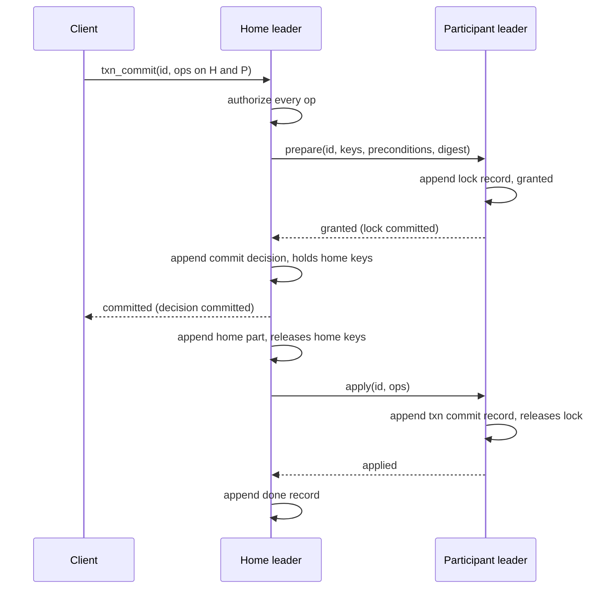
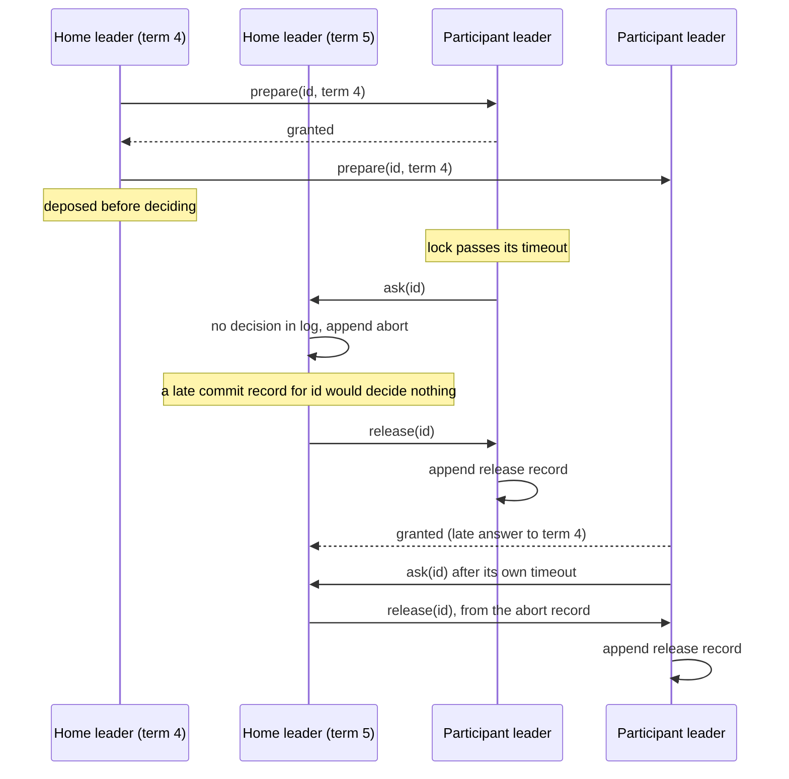

# Cross-shard atomic commits

This page is a design. None of it is built. Today an
[atomic commit](atomic-commit.md) writes one record on one shard, and a commit
that would touch a second shard is refused before anything is sent. This
design lets one commit write to several shards, of one stream or of several,
and still land whole or not at all.

The shape is two-phase commit in which the coordinator and every participant
are Raft groups. No new service is involved. The coordinator is the shard the
commit starts on, called the **home** shard. Every other shard the commit
writes is a **participant**. The commit is decided by one record in home's
log, and each participant's part is written later as an ordinary commit record
in its own log. Nothing uncommitted is ever written into a log that readers
read, so readers, fanout and the single-shard commit path do not change. Only
cross-shard commits pay for it.

It builds on two pieces of issue #2147 that come first: idempotent commits (a
commit id, deduplicated per shard) and the outbox (a leader that forwards a
record to another shard until that shard acknowledges it). This design adds
prepare, locks and abort on top.

## What it promises

- **All parts or none.** Every participant applies its part, or none does.
  No reader on any broker ever finds one part applied and another part
  refused.
- **Preconditions hold at the decision.** Each part may carry per-key version
  preconditions (issue #1051). If the commit is decided, every precondition
  held at that moment and still holds when the part applies. With the
  versions of everything a transaction read as its preconditions, that makes
  transactions serializable.
- **Exactly-once apply.** Each part is written once, however often home
  resends it, however often a leader changes, and however often a client
  retries with the same commit id inside the retry window.
- **Per-shard order at the apply offset.** A part takes its offset when it
  applies. Every reader of that shard sees it at that offset, ordered with
  everything else on the shard as any commit is.

## What it does not promise

- **Visibility at one instant across shards.** A part becomes visible when its
  shard applies it, so a reader of two shards can see the commit on one and
  not yet on the other, for up to one apply round. Once both apply, every
  reader sees both.
- **Snapshot reads across shards.** A read of two shards is two reads at two
  moments. Consistent cuts are issue #1388.
- **Read-your-writes right after the answer.** The client is answered at the
  decision, before any part applies, including home's own. A `state_get` on
  any participant may not reflect the commit yet. See the open questions.
- **Kafka transactions.** The Kafka listener still refuses transactional
  producers ([Transactions are refused](kafka-compatibility.md#transactions-are-refused)).
  Kafka's protocol puts uncommitted records in the log and asks readers to
  skip them, which is what this design avoids.
- **Progress while home is down.** A participant holding a lock waits for
  home's answer. If home's group has no leader, those keys stay locked until it
  has one. This is the blocking case every two-phase commit has. It is bounded
  by how long a Raft group can be without a leader, not by a broker's uptime.

## The steps

A commit names a commit id and a list of operations, each on some stream and
shard. The broker groups them by shard. The shard of the first operation is
home; the others are participants. A shard appears once however many
operations it has. Home's own operations form its part.

Each step below writes one record, in one log, through that shard's Raft
group. A step's answer is sent only once its record is committed in that
group, whatever consistency the stream asks for. A `Leader` stream acknowledges
plain publishes before the commit, but a lock or an apply that a failover
could take back would break the guarantees above.

| Step | Record | Written in | Which says |
| --- | --- | --- | --- |
| Prepare | lock | each participant | these keys are held for this commit, granted or refused |
| Decide | decision (commit or abort) | home | the outcome; on commit, every participant's operations, and a hold on home's own keys |
| Apply | txn commit, or release | each participant, and home | the part, written as a commit record, and the lock let go in the same record |
| Retire | done | home | every participant confirmed; the decision can be trimmed |

**Prepare.** Home's leader checks authorization for every operation (see
[Authorization](#authorization-and-trust-between-brokers)) and sends each
participant a prepare: the commit id, the keys its part writes or reads, the
preconditions on them, a digest of its operations, and the home term and
prepare sequence described under [Exactly-once apply](#exactly-once-apply).
The participant's leader appends a lock record. Whether the lock is granted is
decided at the record's place in the log: granted if no other commit holds a
conflicting lock on any of the keys and every precondition holds against the
state the log has at that point. Every member applies the same record and so
reaches the same answer. The participant answers granted or refused once the
record is committed.

**Decide.** When every participant has answered granted, home's leader appends
a commit decision. It carries every participant's operations, so the decision
survives a leader change with everything needed to apply it. It also checks
home's own preconditions at its place in the log and holds home's own keys,
so home needs no separate lock record. If home's preconditions fail there, or
a decision for this commit id is already in the log, the record decides
nothing (see [First record wins](#lock-timeout-and-first-record-wins)). Any
refused prepare, or a prepare round that does not finish within home's
deadline, makes home append an abort decision instead. The committed decision
record is the commit point and the client's answer.

**Apply.** Home's leader sends each participant its part, and keeps sending
until the participant confirms, the way the outbox forwards a record. A
participant that holds the commit's lock appends its part as one commit
record that also carries the commit id and releases the lock. Its readers
see an ordinary commit: an event at an offset, with its state updates. Home
applies its own part the same way, appended right behind the decision so the
two usually commit in one round. On an abort, home sends a release instead,
and the participant appends a release record. A part that only read keys
(preconditions and no writes) applies as a release.

**Retire.** When every participant has confirmed, home appends a done record.
After it, nothing more is sent for the commit and retention may trim its
records. Aborts need no done record; see [Retention](#retention-and-the-done-record).

## Locks on keyed state

A lock covers keys in one shard's [state view](atomic-commit.md#what-atomic-covers).
A key a part writes is held exclusively. A key a part only reads, through a
precondition, is held shared: other commits may read it too, and none may
write it. The lock table is derived from the log, like the state view, and is
rebuilt from the retained log after a restart, a promotion or a catch-up.

Nothing waits for a lock. A lock that cannot be granted is refused at once,
and the prepare answers refused, which makes home abort. A single-shard
`commit` or `commit_if` that writes a held key, or that has a precondition on
an exclusively held key, is refused with a retryable `key_locked` error, and
nothing is written. That check is made where conditional writes are decided
on the leader, before the commit takes an offset, so a refused commit costs
no offset and does not hold up later publishes behind it. Because nothing
ever waits on a lock, no cycle of waits can form and there is no deadlock to
detect. The cost is retries under contention, which the client backs off.

What a lock does not touch:

- **Plain publishes** to the stream never look at locks. The publish path is
  unchanged.
- **State reads** are not blocked. A `state_get` on a held key answers with the
  last applied value, which is the value before the commit.
- **A commit at an expected offset.** `commit_if`'s `expected_offset` is a
  condition on the whole shard. Holding it would mean blocking every append to
  the shard, so a cross-shard commit cannot carry one; it uses per-key
  preconditions.
- **Head trims** are already refused on a stream holding commits.

## Lock timeout and first record wins

A participant measures how long it has held each lock, on its own monotonic
clock, from when its leader applied the lock record. A new leader starts the
clock again when it opens, so a leader change only lengthens a lock. When a
lock passes its timeout, the participant asks home for the outcome, and keeps
asking with backoff until it gets one.

**A lock is never released on a timer.** Releasing on a timeout would let a
participant drop its part while home, which already had its grant, commits
and the other participants apply. A lock ends only with an apply or a release
that home sent for a decision in its log.

Home answers an ask from its log. With a decision, it sends the apply or the
release. With none, it appends an abort decision and then sends the release.

**First record wins.** The abort home appends for an ask can race a commit
decision that home's leader proposed a moment earlier and that has not
committed yet. Home's leader cannot settle that race by looking, since it
checks only committed records. So both decision records are conditional at
their place in the log: the first commit or abort record for a commit id is
the decision, and any later one decides nothing. Every member of home's group
applies the same rule and agrees. Home answers the client, sends applies and
answers asks from the winning record only, never from the record it proposed.

## Exactly-once apply

**The lock is the dedup entry.** A participant applies a part only while it
holds that commit's lock, and the apply record releases the lock in the same
record. A second apply finds no lock and writes nothing; the participant
answers applied. So resent applies, duplicated messages and applies from two
home leaders at once all write the part once.

**The dedup table must outlive every stray prepare.** A participant keeps
each finished commit id in its table, derived from the log, so it can answer a
repeated prepare with the original answer instead of granting a new lock. It
cannot keep them forever. Dropping one is dangerous: a prepare that a deposed
home leader sent long ago, delivered after the participant dropped the id,
would be granted as a new lock, and a delayed apply from the same leader would
then apply the part a second time. A precondition hides this for a
conditional write, because the version has moved. A blind put has no
precondition, and it would be written twice.

No timeout bounds how late a message arrives, so the table's lifetime cannot
be set against the lock timeout. Instead, every message home sends carries its
term and a prepare sequence home's leader numbers within that term, and a
participant refuses a prepare when:

- its home term is older than one the participant has already recorded from
  that home shard, or
- its sequence is at or below the low-water mark the participant recorded for
  that term. Home sends that mark with its messages: the highest sequence
  below which every commit of the term is decided and, for commits, done.

The participant writes the mark into its log as a fence record before it
drops any id the mark covers, so a new participant leader enforces it too.
Its table then holds only the ids above the mark, which home bounds by the
commits it has in flight. The TLA+ model's `NoStaleFence` twin drops ids with
no fence and finds the double apply.

**Retries at home.** Home keeps each decision in its own table until it is
done and the client retry window has passed, so a client that retries a commit
id inside the window gets the original answer, committed or aborted. This is
the same contract as idempotent single-shard commits (#2147). A retry after the
window is a new commit. An aborted commit id stays aborted: to try again, use
a new id.

## Failure cases

Each case says what happens and why it is safe. "Asks" means the lock-timeout
path above.

**Home leader changes before any prepare.** Nothing was written. The client
gets an unknown outcome and retries; the new leader starts the commit.

**Home leader changes after some prepares.** Participants hold locks that the
new leader knows nothing about, since home writes nothing before the decision.
If the client retries the same id, the new leader prepares again; a
participant that holds the lock answers with its original grant, and records
the newer term, which fences the old leader's late prepares. If nobody
retries, each lock passes its timeout and asks, and home appends an abort.
Either way exactly one decision is reached, by first record wins.

**Home leader changes with the decision proposed but not committed.** The
record either survives into the new leader's log and commits there, or it is
lost. The client gets an unknown outcome and retries with the same id. If the
decision survived, the retry returns it. If it was lost, the commit runs again
or the locks time out and abort. The old leader cannot commit anything once
deposed, since its writes go through Raft.

**Home leader changes after the decision.** A new home leader scans its log
for commit decisions with no done record and resumes sending their applies.
Participants that already applied answer applied; the rest apply. A deposed
leader that is still sending applies does no harm, because an apply writes
nothing without the lock.

**Home leader changes after every apply, before done.** The new leader resumes,
every participant answers applied, and it writes done.

**Participant leader changes.** A participant keeps nothing that matters in
memory: its lock table and dedup table come from its committed log, and it
answers only after its record commits. A change before the lock record commits
loses the answer, and home's resent prepare is answered by the new leader,
granting the lock or finding it in the log. The same holds for an apply. Lock
clocks restart.

**Lock timeout racing a decision.** Covered by
[first record wins](#lock-timeout-and-first-record-wins). Whichever of the
commit and the abort is first in home's log decides, and the participant acts
only on what home sends from that record. The lock timeout should be well
above a prepare round plus a decision commit, or slow commits abort for no
reason.

**Messages lost, duplicated or reordered.** Home resends prepares until it
decides, and applies until each is confirmed. Every receiver is idempotent:
a repeated prepare gets the original answer, a repeated apply writes nothing,
a repeated ask gets the decision. A stale prepare is fenced as above.

**Participant moved.** A planned move or a membership change keeps the group
and its log, so the lock table moves with it. Home addresses the shard, not a
broker, and follows `not_leader` redirects and the move hold as a forwarded
publish does. Messages name the shard's incarnation, so a participant refuses
any for an incarnation it is not.

**Participant or home re-formed.** A [re-form](per-shard-raft.md#re-forming-a-group)
is the operator command for a group that lost its majority, and it can lose
acknowledged records. If it loses a lock record, the keys are free while home
may still commit. If it loses an apply record, the part is gone after home
has written done. If home's group loses a commit decision, a participant that
asks gets an abort while others have applied. None of these can be made safe
inside the protocol, because the record that would make them safe is the one
that was lost. The design states this as a limit: atomicity across shards
holds as long as no group in the commit is re-formed with loss. `felixctl raft
reform plan` should list the cross-shard commits in doubt on every group it
would re-form, so the operator sees them. See the open questions.

**Participant stream deleted mid-commit.** Before the decision, the prepare
finds no shard, or its lock goes with the stream, and home aborts. After a
commit decision, the apply finds the incarnation gone, and home counts that as
applied. That is safe: a deleted stream has no readers and no records, so
"applied, then deleted" and "deleted" cannot be told apart. A reader that read
the stream before the deletion and missed the part saw it as lagging, which
the guarantees allow.

**Home stream deleted mid-commit.** This one is not safe as it stands. A
participant holding a lock asks a home that no longer exists, and if some
participants had applied a commit decision, releasing the others breaks
atomicity. The design needs deletion of a home stream to wait until its
undone decisions are done. See the open questions.

**Retention.** See the next section.

## Retention and the done record

Retention trims a log from its head. Three things pin the head while a
cross-shard commit is open:

- On home, a commit decision with no done record. Trimming it would turn a
  later ask into an abort after some participants applied. The TLA+ model's
  `TrimUndone` twin finds that.
- On a participant, a lock record whose lock is still held, since the lock
  table is rebuilt from the retained log.
- On a participant, the fence record and every finished id above it that the
  dedup table still needs.

An abort decision does not pin anything. If retention trims it and a
participant asks later, home finds no decision and appends a new abort, which
is the same answer. So aborts need no done record.

Because retention works from the head, one stuck commit stops retention on
every shard it holds, for as long as it is stuck. A commit is stuck only while
home has no leader or a participant cannot be reached, and the lock timeout
plus asks resolve every commit once both sides are up. The broker should
report the age of the oldest open decision and the oldest held lock per shard,
so an operator sees a pinned head before the disk fills.

State is still projected from the retained log, as for single-shard commits,
so the [retention advice](atomic-commit.md#what-atomic-does-not-cover) for
entity streams applies to every participant.

## Authorization and trust between brokers

**The client is checked at home, for every part.** Home's leader authorizes
each operation with the client's token before it sends any prepare, under the
same actions a single-shard commit uses: `stream.publish` on each stream the
commit writes. A precondition reveals whether a key is at a version, which is
a read, so a precondition on a stream also needs `stream.subscribe` there, the
action `state_get` checks. If any operation is refused, the whole commit is
refused and nothing is sent.

**A participant does not take home's word alone.** After #2819, a broker on the
internal port is bound to its node id by an identity-checked `Hello`, so a
participant knows which broker sent a message. That says who is asking, not
what the client may do. Felix already refuses to treat peer authentication as
authorization for a tenant write: a forwarded publish carries the client's
token and the owner checks it again
([internal threat model](threat-model-internal.md#abuse-cases), case 1). A
cross-shard commit keeps that rule:

- A prepare carries the client's token, the way a forward does, and the
  participant verifies it for its own part before appending the lock. The
  lock record stores the principal and the digest of the part's operations,
  not the token.
- An apply carries the operations, which must match the digest in the lock.
  An apply needs no token: it only completes a lock the participant itself
  authorized. A commit decided while the token was valid therefore applies
  even if the token expires or is revoked before the apply, which can be
  much later after a failover.
- Prepare, apply, release and the low-water mark are accepted only from a
  broker that the participant's routes name as a replica of the home shard,
  and an ask is answered only for a participant the decision names.

What a compromised broker that hosts the home shard can still do is limited
to commits a real client authorized: it can abort them, or delay their
applies. It cannot write a part no client authorized, and it cannot change a
part's operations. The security review this design needs is of exactly that
boundary.

## On the wire

**Clients.** A cross-shard commit is a new request, `txn_commit`, answered
with a new `txn_committed`, with `txn_aborted` (naming the participant and
reason, such as a refused precondition or a held key), or with `error`. It is
not an extension of `commit`, so a broker that predates it cannot read a
multi-shard request as a single-shard one. The broker advertises it with a new
feature bit in the extended word (`server_features_hi`), since the low word is
full, and a client that does not see the bit refuses the call before sending.
A client that does not use it sends and receives exactly the bytes it does
today. The single-shard `commit` gains the retryable `key_locked` error, which
it can only meet once the broker supports this feature.

**Between brokers.** Prepare, vote, ask, apply, release, applied and the
low-water mark are new messages on the internal port, sent only once the fleet
has finalized the feature below.

## Records and storage format

The new records, each one Raft entry with a new entry tag, as the commit
entry has tag 8:

| Record | Shard | Body | Readers |
| --- | --- | --- | --- |
| lock | participant | commit id, home shard and incarnation, home term and sequence, keys and mode, preconditions, digest, principal, granted or refused | skipped |
| release | participant | commit id | skipped |
| fence | participant | home shard, term, low-water mark | skipped |
| decision | home | commit id, commit or abort, every part's operations, home's preconditions and keys | skipped |
| done | home | commit id | skipped |
| txn commit | participant and home | an ordinary commit record plus the commit id | unwrapped as a commit |

A skipped record takes an offset that readers pass over, as a refused
`commit_if` does on a Raft shard.

The segment format has four record kind bits, and twelve of their sixteen
codes are taken, so four are left, too few for six new kinds.
The design spends one: a txn kind whose body starts with a one-byte subtag
for the six records above, the way a trim record carries its tag. It lives
only in a segment at the newest layout. A build that predates the kind
refuses it as an unknown kind rather than misreading it, and a member built
before the new entry tags refuses the append by its tag, so nothing writes
either until the fleet can read them.

**Fleet feature.** `cross_shard_commit`, which needs `raft_atomic_commit`.
Until the control plane finalizes it, a clustered broker refuses
`txn_commit` with an error that says so, and writes nothing. A lone broker
allows it at once, but every shard is then on one broker, which still runs
the full protocol between its own groups. A participant must be a Raft shard
of a durable stream: an ephemeral stream refuses any commit, as today.

## What it costs

A single-shard commit is one Raft commit on one shard, and that does not
change. A cross-shard commit is answered after:

1. the prepare to every participant, in parallel: one network round from home
   plus one Raft commit on each participant, so the slowest participant sets
   the time;
2. the decision: one Raft commit on home.

That is about two Raft commits and one round between brokers, against one Raft
commit for a single-shard commit. The applies and the done record come after
the answer, and set how long other shards' readers lag: one more round and one
Raft commit on each participant. Done records can be batched, since nothing
waits for them.

## Size limits

A decision record holds every part, so the whole commit must fit in one
record and one Raft entry, and the request in one client frame (4 MiB by
default). Proposed limits, enforced by the client before sending and by home
before preparing: at most 16 participants, the request within one frame, and
a bound on the keys one part may lock. A larger commit is refused, never
split.

## How it is checked

[`docs/formal/FelixCrossShardCommit.tla`](formal/FelixCrossShardCommit.tla) is
an outline of the model. It has home and participant leader changes, message
loss, duplication and reordering, lock timeouts, single-shard writers and
retention, and states `Atomicity`, `NoDoubleApply` and `PreconditionsHeld`,
with `EventuallyApplied` under fairness. It is not model-checked yet and no
configuration runs it. Each rule has a twin that drops it and should fail:

| Twin | Drops | Should violate |
| --- | --- | --- |
| `NoDedup` | apply only under the lock | `NoDoubleApply` |
| `NoFirstWins` | first record wins | `Atomicity` |
| `ReleaseOnTimeout` | a lock never ends on a timer | `Atomicity` |
| `NoStaleFence` | the term and low-water fence | `NoDoubleApply`, with a blind put |
| `TrimUndone` | retention keeps undone decisions | `Atomicity` |
| `WritesIgnoreLocks` | single-shard writes respect locks | `PreconditionsHeld` |

The implementation adds a simulator nemesis that kills and partitions home and
participant leaders at each step, and a history checker rule that every
committed cross-shard commit is eventually read on every participant and no
aborted one on any.

## Open questions for the maintainer

1. **Re-form with loss.** Atomicity cannot survive a re-form that loses a
   lock, apply or decision record. Recommendation: state it as a limit, make
   `felixctl raft reform plan` list in-doubt commits on every group it would
   re-form, and have `apply` refuse a group with in-doubt commits unless the
   operator names them.
2. **Deleting a home stream.** Recommendation: deletion waits, with a bound,
   until the stream's undone commit decisions are done, and is refused with an
   error naming them after the bound. A forced delete would release the
   participants and break atomicity, so it should not exist.
3. **Refuse or wait on a held key.** Recommendation: refuse, as above. A wait
   queue gives fairer progress under contention but brings deadlock detection
   and holds requests on the leader; it can be added later behind the same
   error.
4. **The participant re-checks the client's token.** The issue has all
   participants checked at home and trust from the peer credential.
   Recommendation: check at home and again at each participant's prepare, with
   the token in the prepare, because peer identity alone has never authorized
   a tenant write in Felix. The cost is one token check per participant.
5. **Read-your-writes on the answer.** The client is answered at the decision.
   Recommendation: keep that, and let the answer optionally wait for home's
   own part to apply, since it is appended right behind the decision and
   usually commits in the same round. Waiting for every participant should be
   a separate call.
6. **Parts with no event.** A single-shard commit has exactly one event. A part
   that only writes state, or only reads, would need an event today.
   Recommendation: let a part have zero events; its commit record is then
   skipped by stream readers like a blank, and still versions the state it
   writes.
7. **Limits and timeouts.** Recommendation: 16 participants, the request within
   one client frame, 1,024 keys per part, a lock timeout of 10 s, and a home
   retry window equal to the one idempotent commits choose. All but the
   participant count as broker settings.
8. **Kind bits.** Recommendation: the one txn kind with a subtag, keeping three
   codes free for later features.
