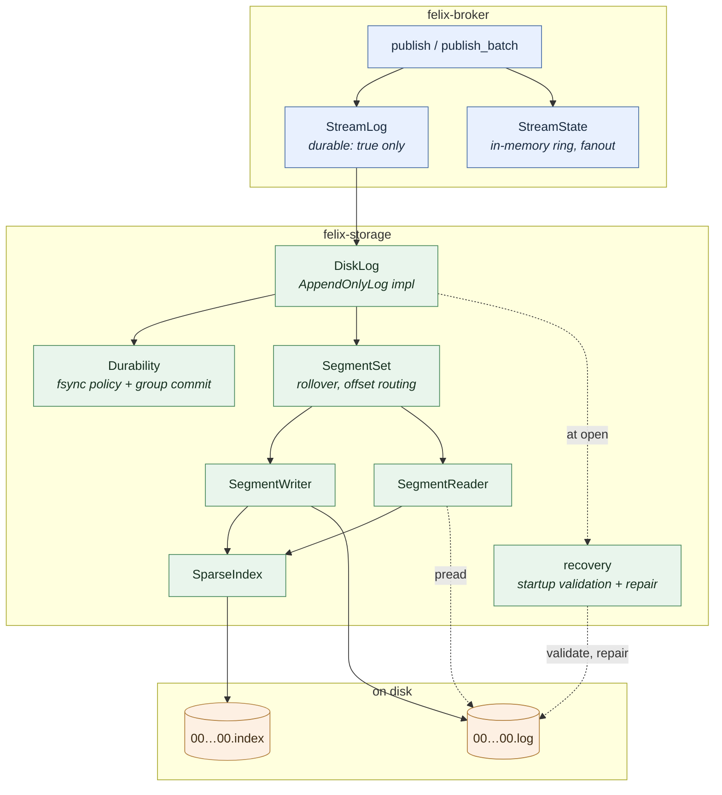
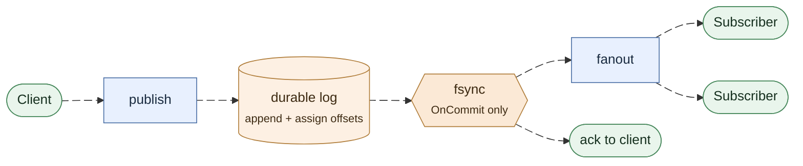
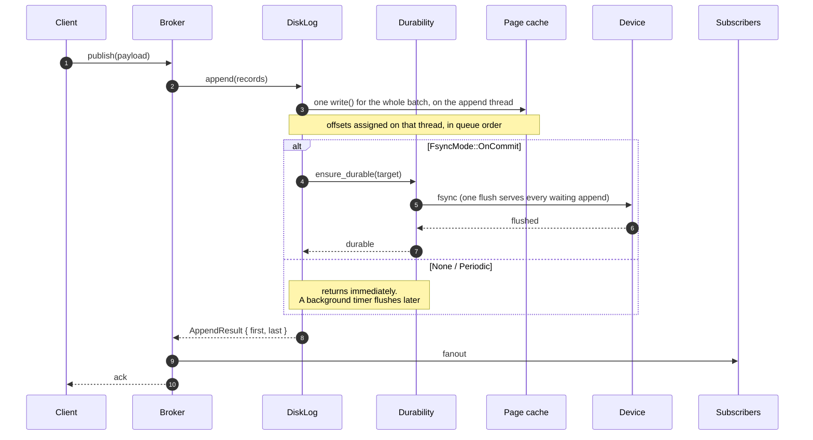
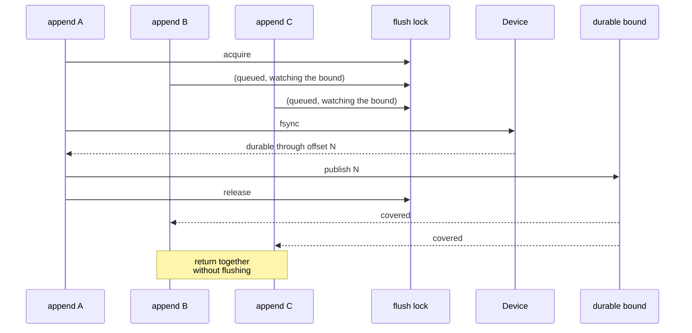
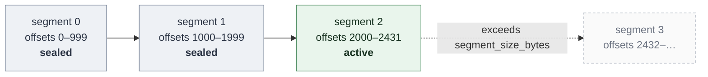
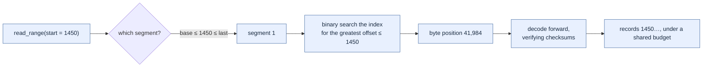
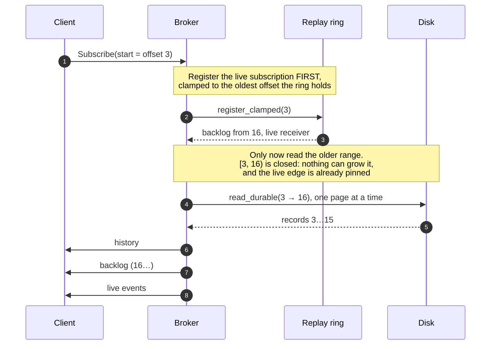
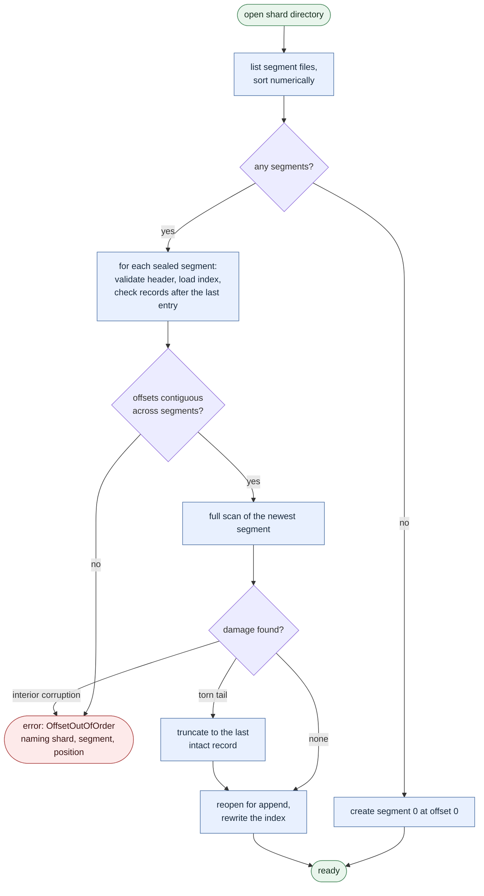

# Durable Storage

How a stream marked `durable: true` gets its records onto disk, keeps them there
across a crash, and reads them back.

Companion documents:

- [`storage-format.md`](storage-format.md): the byte layout, versioning rules,
  and exactly which corruption recovery may repair.
- [`storage-performance.md`](storage-performance.md): what durability costs,
  measured, and the regression budget.

## The guarantee

> A record that a durable publish acknowledged is readable after a restart,
> within the window the configured fsync policy allows.

Everything below exists to make that sentence true and to make its cost
explicit. The window is zero for `OnCommit`, one interval for `Periodic`, and
undefined for `None`.

The broker sends the acknowledgement after the commit by default, and the table
under "Durability policies" says what the commit waited for. The broker answers
on enqueue, before the append, only when started with `FELIX_ACK_ON_COMMIT=0`;
the guarantee above does not hold for such an ack. An in-memory stream has no
log and is answered on enqueue either way.

## Layers



Each module owns one decision:

| Module | Owns |
| --- | --- |
| `segment/format` | the byte layout and every corruption verdict |
| `io` | positioned reads, preallocation, device flush |
| `segment/index` | the sparse index and how a seek position is chosen |
| `segment/writer` | appending to one file; nothing about rollover |
| `segment/scan` | validating scans, and whether damage is a repairable tail |
| `segment/reader` | bounded range reads |
| `disk_log/append` | the append path, and when it rolls a segment |
| `disk_log/segments` | rollover, which segment holds an offset, truncation |
| `disk_log/recovery` | startup discovery, validation, torn-tail repair |
| `disk_log/sync` | when a flush happens and who waits for it |
| `disk_log/layout` | `ShardKey` and incarnation to a safe directory name |
| `broker/durable` | the ordering of append, fanout, and acknowledgement |

## The publish path



Nothing downstream of the log observes a record before it is durable: fanout
and the acknowledgement both hang off the flush, not off the append. Ordering
is the whole design, so the same path is worth spelling out step by step:



### One order, not three

Offsets are assigned on the log's append thread, one batch at a time, but the
fsync wait happens after the append returns, so two concurrent publishes can
resume from a shared group-commit flush in either order. Left alone, the log on disk could read `A, B` while a
cursor replay and a live subscriber both saw `B, A`.

A per-stream commit sequencer closes that gap. After its durable append, each
publisher waits until every lower offset has been applied, then appends to the
replay ring and fans out before releasing the next in line. Disk order is the
single source of truth for cursor order and delivery order alike.

This deliberately does not serialise the durable append: offsets are still
assigned concurrently and flushes are still shared, so group commit keeps its
fan-in. Only the cheap post-flush half is ordered.

Releasing a turn wakes exactly the publisher whose turn it now is, not every
publisher parked behind it. The distinction only shows up under concurrency, and
then it dominates: waking all of them makes the work per commit grow with the
number in flight, so throughput falls as load rises. Measured at
[storage-performance.md](storage-performance.md#8-releasing-a-commit-turn-wakes-one-publisher-not-all-of-them).

### A conditional append

`publish_if`, and a commit with an expected offset, append only if the batch
would start at exactly that offset. The log checks the tail on its append
thread, under the lock that assigns offsets, and claims the batch's range in
the commit sequencer in the same step (`DiskLog::append_claimed_at`). A batch
that fails the check is never staged: it writes nothing, consumes no offset,
and reserves no range, so nothing behind it waits on a turn that will not
come. The refusal reports the tail read under that lock. A follower storing a
leader's batch at the leader's offsets uses the same check without the claim
(`append_pending_at`).

The append happens **before** fanout and **before** the acknowledgement. The
alternative is unrecoverable: a record delivered to subscribers and acknowledged
to the publisher but lost in a crash is a silent hole in a log that consumers
believe they have read. Paying the append latency first turns a failed write into
a failed publish, which the publisher can retry.

A storage error therefore never produces a success acknowledgement, and it never
reaches a subscriber.

## Durability policies

| Mode | Flush trigger | Acknowledged when | Loss window |
| --- | --- | --- | --- |
| `None` | seal, shutdown | bytes reach the page cache | unbounded (whatever the OS decides) |
| `Periodic { interval }` | background timer | bytes reach the page cache | one interval |
| `OnCommit` | the append itself | bytes reach the device | none |

Every open log has its own `Periodic` timer, and a tick with nothing to flush
does not flush: no unsynced bytes, no retired segment awaiting its seal, and the
durable offset already at the tail. A broker with hundreds of idle shard logs
therefore issues no fsyncs, and `felix_storage_sync_total` tracks the logs being
written rather than the number open.

`None` is not "no durability": the data survives a *process* crash, because the
page cache belongs to the kernel. It does not survive a machine crash or power
loss. That distinction is the reason it is a useful setting at all.

### Group commit

`OnCommit` would be unaffordable without it. An `fsync` flushes the whole file,
not one caller's bytes, so when N appends are in flight one flush can satisfy all
N:


The lock protocol behind that picture (who flushes, and what the others find
when they wake):



A waiter queues for the lock and watches the durable bound at the same time,
and stops at whichever comes first. One flush therefore wakes every append it
covered together; waiting on the lock alone would hand it down the queue and
wake them one after another.

Measured on a Mac Studio (Apple M4 Max, APFS): 253 durable appends/second at
concurrency 1,
14,387 at concurrency 64, a 57× gain from the same code path. The fan-in
actually achieved is reported as `felix_storage_sync_batch_appends`, the number
of records each flush covered. Records rather than appends, because the broker
merges publishes that queue on a shard into one append, and those share the
flush too. A client batch of N records counts N, so read it under
single-record publishes, or divide by the batch size. A value near 1 under load
means appends are serialising on the device instead of sharing a flush.

This is the same mechanism behind PostgreSQL's `commit_delay` and the WAL
group-commit paths in MySQL and RocksDB.

### Where the flush runs

The winner does not run the `fsync` itself: it would block a reactor thread.
Each log has a flush thread of its own, started on its first flush and stopped
after 10 s without one, and the winner hands the sync to it over a channel and
awaits the answer. The thread only ever runs that log's flushes, so a flush
does not queue behind reads, rollovers or other shards the way it would on
Tokio's shared blocking pool. The job owns the file handles it syncs, so a
caller that gives up (a disconnected publisher) cannot close a file under a
sync in progress, and the sync still completes for whoever flushes next. If a
thread cannot be started, the flush falls back to the blocking pool.
[storage-performance.md](storage-performance.md#9-each-log-flushes-on-its-own-thread)
has the measurements.

### Where the append runs

A `write` into the page cache normally takes microseconds, but once a process
dirties pages faster than the device takes them, Linux throttles it inside
`write()` for up to hundreds of milliseconds. A reactor thread caught there
stalls every task scheduled on it. So each log also has an append thread, with
the same lifecycle as its flush thread, and every append runs there in
submission order, which is offset order. The publisher awaits the result.
The thread polls for its next append for 20 µs before it parks, and a caller
alone in the queue polls as long for its result, so back-to-back appends do
not pay a wake-up on either side. The caller hears its result before the
thread writes any index entries, and frees its batch itself.

The batch is encoded and given its place under the segment lock, written with
the lock released, and made visible under the lock again. A reader or a flush
needs that lock only for pointer work, so neither waits on the disk behind an
append. Appends to one log run one at a time, and anything else that changes
the active segment (a background roll's install, truncation, reset, restore,
seal, close) takes the same append lock, so nothing moves the segment under a
write in flight. An inline rollover runs on the append thread with the append.

A background roll's seal runs without the append lock and ends by setting the
retired file's length. So truncation, reset and restore wait for a seal in
flight and keep the next roll from starting until they finish. Otherwise the
seal would put back the length of a segment the cut reopened, or cut off
records appended to it since. A log that has failed refuses them outright: a
flush that cannot sync the retired segment marks the roll failed while its
seal may still be running, so there is nothing safe to wait for.

> `a_seal_in_flight_does_not_undo_a_truncation`,
> `a_seal_in_flight_does_not_cut_off_appends_after_a_truncation` and
> `a_truncation_is_refused_once_a_flush_failed_a_pending_seal` hold a seal
> while a truncation runs.

A flush takes its bound on the append thread too, behind the appends already
queued there, so one flush covers every append in flight. Taken on the caller,
it would miss the appends still queued, and each would wait for a flush of its
own. The cost is that a flush also waits for an append whose `write` the kernel
is holding.

An append whose caller gives up before the append thread starts on it is
skipped and spends no offsets. Once started, the batch is written and kept
whatever the caller does, as it was when the write ran in the caller's own
poll: cutting it back would free the blocks preallocated past it, and a flush
may already have covered it. A caller that orders batches by offset, such as
the broker's commit sequencer, passes its sequencer to
`DiskLog::append_claimed`, which claims the range on the append thread, so a
caller that gives up after its batch is kept still releases the range and the
writers behind it are not stranded.

A started batch can therefore land after its caller has gone, so a tail read
straight from the segments may sit below it. A subscribe cursor taken at the
tail (`Broker::cursor_tail`) reads it with `DiskLog::settled_tail_offset`
instead, on the append thread behind the batches already there. Otherwise a
cancelled publish could land above a cursor taken after it: absent from the
replay ring before a restart, replayed from disk after one.

A caller with work to do once its record is in the log runs the append and
that work to the end on a task of its own, so cancelling it only stops the
wait. A cache put or delete stages there (append, then the guard that applies
the write and tells the watchers), and a counter add appends and folds there.
The broker's publish executors are never cancelled mid-claim.

Such a write can still be applying after its caller has let go of any lock it
held. A read that feeds a write, like a consumer group's cursor commit or a
dead letter's state change, uses `LogCache::get_settled_checked`, which waits
for the writes already staged to that key to apply. A plain read could see the
old value, and the write that follows would land on top of the cancelled one.
An unconditional put or delete marks its key in flight before it spawns its
task, so a caller cancelled before that task first runs is waited for too. A
conditional one marks it once staged, since it waits out the key's other
writes itself.

## Segments and rollover

A shard's log is one *active* segment plus any number of sealed ones, and the
whole of its life (filling, sealing, rolling, and eventually being trimmed away
by retention) looks like this:

<p align="center">
  
</p>



Rules that recovery depends on:

- Offsets are contiguous **within** a segment and **across** the boundary. A gap
  is corruption, not a shrug.
- A batch is never split across segments. Rollover is decided before the write,
  from the projected size, so one append is always one `write` call.
- A record larger than `segment_size_bytes` gets a segment to itself rather than
  being split or rejected.
- Sealing syncs the data and index, then trims any preallocated tail so the file
  on disk is exactly its contents.
- The active segment reserves blocks ahead of its writes without moving the
  file size. It starts with 1 MiB and doubles the reservation, off the append
  path, each time the records pass half of it, up to the segment size. A
  failed extension never fails an append. See section 5 of
  [storage-performance.md](storage-performance.md).

## Reads

A read seeks through the sparse index rather than scanning from the head:

<p align="center">
  
</p>

The entry only says where to start. The forward scan over real records is what
answers, which is why a stale or missing index costs a rebuild rather than a
wrong answer.



Cost is `O(log n)` over index entries plus at most one `index_spacing_bytes`
interval of sequential decoding.

Bounds that hold regardless of log size:

- `max_bytes` caps the payload bytes returned, across every segment the read
  touches. It is one budget for the whole call, not one per file.
- `max_records_per_read` caps the record count, because payload bytes alone do
  not bound a response made of empty records.
- At least one record is always returned when the range has data, so a record
  larger than the caller's budget is still readable.
- Reading at or past the tail returns an empty vector. Reading *below* the base
  offset returns `StorageError::Trimmed { requested, oldest }`: those offsets
  existed and are gone, which is a different fact from "nothing here yet".

`read_range` returns every record, including a leader's generation-start
records (`docs/storage-format.md`). Only replication reads that way
(`StreamLog::read_log_from`), since it ships and compares the log exactly as
stored. Every other reader goes through `StreamLog::read_from`, which leaves
them out and reads on past them, so a page is empty only at the tail. Their
offsets stay taken: a reader sees the offset after one follow the offset before
it.

Clients reach this read directly through `stream_read`
([protocol](protocol.md#streamread)), which `Broker::read_range` serves with
one `read_from` per page and no subscriber. It reads no further than a
subscriber may: the committed mark on a `Quorum` shard, and under `OnCommit`
the durable offset, so a record whose sync has not finished is never returned.
The answer's `next_offset` steps over generation-start records, so a client
paging a range never has to guess where the next page starts.

## Resuming a subscription

Durability is only half of a resume: records surviving a restart is worthless if
a reconnecting client cannot say where it got to. A subscriber asks for a start
position (`latest`, `earliest`, or an exact offset), and delivered events carry
their offsets so the client has something to checkpoint. See
[the protocol](protocol.md#subscribe).

The hard part is not reading history. It is joining history to live delivery
without losing a record in between, and the ordering that achieves it is not the
obvious one.

<p align="center">
  
</p>



Registering first is what makes the disk range `[requested, backlog_start)`
**closed**: every record from `backlog_start` onward is already captured, either
in the returned backlog or on the subscription's receiver. Nothing can be
evicted out of the range while it is being read, and nothing published during
the read can fall between the two halves.

Reading history first and subscribing after is the version that looks natural
and loses records: a publish landing between the read and the registration
reaches neither.

Two consequences worth stating plainly:

- **History is paged, never collected.** The broker reads one bounded page at a
  time and writes it before reading the next, so a client resuming from the
  start of a large stream costs one page of memory rather than the whole
  history. A slow client turns into slower reading rather than unbounded
  buffering, because the client queues history with backpressure whatever its
  overflow policy: a record below `live_offset` waits for room, which stops it
  reading the stream, and QUIC flow control holds the broker's next write. Only
  live records past `live_offset` are subject to `drop_new`. A client that
  stops reading mid-replay therefore holds up to one stream receive window of
  its event connection until it resumes or closes the subscription.
- **A discarded offset is an error, not a silent skip.** Asking for an offset
  below what retention still holds returns `CursorTooOld` naming the oldest
  available offset. Quietly restarting at the tail, which is what a client got
  before resume existed, is the failure this exists to remove, so it is not the
  fallback.

## Recovery



Four properties:

1. **A provably incomplete tail is repaired.** A crash mid-append leaves a
   partial record at the end of the newest segment: one cut short by end of
   file, or claiming a length that could not fit. Nothing could have
   acknowledged a record that was never finished, so it is truncated away.

   A *complete* trailing record that fails its checksum is a different case and
   is **not** repaired by default. A torn write and bit rot on an already
   acknowledged record produce identical bytes, and under `OnCommit` that record
   may have been fsynced and acknowledged before rotting. Recovery refuses to
   guess: it fails to start, naming the segment and position.
   `repair_checksum_tail` opts in to truncating it, which is defensible under
   `FsyncMode::None` and is not under `OnCommit`.
   The exception is a **zero-filled tail**, which power loss leaves when the
   file size reached disk and the data blocks did not. If everything from the
   damaged record to end of file is zero (or the zeros start at a sector
   boundary inside it), no later record exists that an fsync could have
   acknowledged, so it is repaired by default. Zeros with anything after them
   are still interior corruption. Bytes past the durable mark, an unfinished
   background roll, and an empty segment a lost roll race left mid-chain are
   repaired too, never below what the mark says was synced. So is a log whose
   only segment is its first and is blank (no longer than a header, no header,
   and no durable mark past the header): its creation failed, usually on a full
   disk, before it could hold a record, and the log starts again empty (or at
   its placed base). A zeroed header on a longer first segment stays fatal,
   even if the bytes after it are zeros too. See
   `docs/storage-format.md`, "What recovery may repair".
   A **failed fsync poisons the log**, whichever path issued it (the group
   commit flush, the io_uring flusher, a seal, a truncation): the durable bound
   never moves again, and every later append, commit, flush and shutdown on that
   log returns the error until the process restarts and recovery re-reads what
   actually reached the disk. Linux may drop the dirty pages a failed writeback
   could not write, so the *next* fsync returns success having flushed nothing
   ("fsyncgate"). Believing it would acknowledge records that are gone, which is
   the same silent loss the checksum rule above refuses to risk.
   Readers stop at the durable bound once the log is poisoned. The batch whose
   flush failed is still written past it, and its publish was refused, so a
   resumed subscription, a Kafka Fetch (and its high watermark) and a group
   poll all end at the last durable offset rather than at the tail. A `Quorum`
   stream's readers already stop at the quorum mark, which only counts
   records a majority holds.

   A **failed write does not poison the log.** A batch is one `write` into
   the page cache, and `ENOSPC` or `EIO` there can still leave a prefix of
   the batch in the file. The writer truncates the segment back to its last
   good byte and returns the error without consuming any offsets, so the
   publish is refused, nothing of it survives, and the next append lands
   where it would have. Nothing already written is in doubt, so the log
   carries on as soon as the disk does. If the truncation itself fails, the
   writer no longer knows the file's length and refuses every later append
   and flush until a restart, when recovery repairs the tail as a torn one.

2. **Committed data is never silently discarded.** Corruption anywhere else is a
   startup error naming the shard, segment and byte position. Refusing to start
   is better than losing acknowledged records quietly.
3. **Recovery is idempotent.** Reopening an already recovered log changes
   nothing, so a crash *during* recovery is safe.
4. **Indexes are derived, never trusted.** A missing, short, or mismatched index
   is rebuilt from its segment, and a rebuilt index is byte-identical to one
   written during append.

**Cutting a log back is crash-safe too.** Replication's truncation and
`reset_to` delete whole segments newest first, and sync the directory after
each unlink. A power loss partway through leaves a longer log that ends at a
segment boundary. The records past the cut are the ones the truncation was
discarding, and replication cuts them again, as it would after a crash before
the truncation began. It never leaves a gap. A reset deletes every
old segment before it creates the new one, so after a crash the directory
holds either a prefix of the old log or the new empty one. Retention and
compaction delete from the head, so they go oldest first under the same
rule.

> `a_power_loss_during_truncation_leaves_no_gap` and
> `a_power_loss_during_a_reset_leaves_old_or_new` stop the pass after each
> unlink and open crash images of every stop (Linux only).

**New directories are flushed into their parent.** A new directory entry is
only durable once its parent directory is synced. The store roots (streams,
`groups/`, `dead-letters/`, `caches/`, `counters/`) and each shard directory are
created with every new path component synced into its parent. Without that, a
power loss on a fresh node could drop a whole root, and the acknowledged records
in it, before anything else happened to sync the storage directory. Opening an
existing root syncs its parent again, so a root that an earlier run created but
never synced becomes durable then.

> `a_fresh_root_keeps_its_acknowledged_record_through_a_power_loss`,
> `a_created_directory_survives_a_power_loss` and
> `an_unflushed_directory_is_made_durable_when_opened` (Linux only).

**The power-loss suite checks all of this against simulated reboots.** A
workload runs against a real log while a test layer records what each flush made
durable, then builds the directory a reboot could find (unsynced pages dropped,
torn or zeroed, unsynced directory changes undone) and opens a log on it. Every
record acknowledged as durable must come back, and what recovery keeps must be a
gap-free prefix. The workload races a background roll against appends, so one
seed does not replay one interleaving, and a missing sync can hide behind a
handful of lucky seeds. Every pull request runs eight workload seeds per
scenario, from `0x5eed0001`, plus pinned seeds that caught a bug the range
missed: `0x5eed0009` is the first to fail with the directory sync after writing
`durable.mark` removed. The nightly `power-loss-nightly.yml` workflow runs 110
seeds per scenario from a random base, printed in the job summary; replay one
with `FELIX_POWER_LOSS_SEED=<seed> FELIX_POWER_LOSS_SEEDS=1`.

> `on_commit_survives_any_writeback`,
> `periodic_with_background_roll_survives_any_writeback` and
> `no_fsync_keeps_what_explicit_syncs_covered` in
> `crates/server/felix-storage/src/disk_log/tests/power_loss.rs` (Linux only).

Idempotent producers' state is derived the same way, before the log takes its
first append: each producer's place comes from the marks its records carry,
replayed from the `producers` snapshot saved at the last rollover. The marks
after the snapshot are in the active segment, which the full scan above has
already read, so a current snapshot adds nothing to startup. A missing or
stale one is replaced by reading the sealed segments' marks, which
`felix_storage_producer_state_rebuilt_total` counts. See
the producer snapshot section of `docs/storage-format.md`.

### What is validated at startup

Fully checksumming every segment is `O(bytes on disk)`: minutes for a large
shard, which is the difference between a rolling restart and an outage. By
default:

- The **active** segment is always scanned in full. It is the only one that can
  have a torn tail, and it is bounded by `segment_size_bytes`.
- **Sealed** segments get their header validated, their index loaded, and the
  records after the last index entry checked, which is bounded by one index interval.
  Everything else is verified lazily, because every read verifies the checksum of
  every record it returns.

Set `verify_all_on_open` to trade startup time for eager detection of bit rot in
cold data.

### Plan, then apply

Recovery decides everything before it writes anything. `plan_recovery` in
`disk_log/recovery/plan.rs` reads the directory and returns the writes it
needs (segments to remove, indexes to rebuild, a retired segment to cut) and
how the log ends up: fresh, resumed with the active segment's torn tail to cut,
or refused with the corruption and its place. Where a repair changes what a
later check reads, as when an unsealed retired segment is cut and the chain is
checked again, the plan reads the files as if the earlier writes were made.
Startup then makes the writes in order and opens the log. A refusal still
makes the writes planned before the damage was found, as recovery always has.

`felix_storage::inspect` runs only the plan, which is what lets
`felix-broker inspect segments` report startup's verdict on a data directory
without changing it. The plan never writes, and the `segment_recovery` fuzz
target checks that the plan and the recovery that follows agree.

### A gap at the head left by an older build

Up to 0.6.0-preview, retention unlinked segments without syncing the
directory after each one. After a power loss, the device could keep a newer
unlink and lose an older one. The shard then fails to open with an error like
this:

```text
corruption detected: offset out of order (expected 6, found 12) (shard=t/ns/s/0, segment=4, position=0)
```

`segment=4` is the first segment after the gap, and `found` is its base
offset. Recovery does not repair this itself. A gap left by a deletion looks
the same on disk as a segment lost to damage, and dropping the segments below
the gap would silently discard acknowledged records if the cause was damage.

To repair a gap left by a deletion, by hand:

1. Check that this is a gap at the head. The shard's broker must have
   retention configured (`FELIX_DURABLE_RETENTION_BYTES` or
   `FELIX_DURABLE_RETENTION_SECONDS`). The segments below the gap must be the
   log's oldest, with no other gap among them. Anything else is damage: restore from
   a replica or a backup point instead.
2. Stop the broker and copy the shard directory somewhere safe.
3. Delete `<id>.log` and `<id>.index` for every segment id below the one named
   in the error. Names are zero-padded to 20 digits, for example
   `00000000000000000003.log`.
4. Start the broker. The log opens with its base at `found`, and a read below
   that offset returns `Trimmed`, just as if retention had finished.

The records you delete are ones the interrupted sweep was already removing.

A shard with offloaded segments does not need this. When the offload manifest
covers the gap and records a copy of every segment below it, recovery deletes
those segments itself and opens with its base at `found`. See
[Tiered storage: offload](#tiered-storage-offload).

## Configuration

Durability is opt-in. With `FELIX_DURABLE_STORAGE_DIR` unset the broker is
in-memory only, and a stream the control plane marks `durable: true` is **rejected
at registration** rather than silently downgraded to a guarantee the broker
cannot keep.

Durability is immutable while a stream is registered. Remove and recreate a
stream to change it between ephemeral and durable; this explicitly invalidates
old handles and prevents durable offsets from diverging from existing in-memory
cursors. Once the fleet has finalized `stream_incarnations` the recreated
stream starts empty; see [Deleting a stream](#deleting-a-stream).

| Variable | Default | Meaning |
| --- | --- | --- |
| `FELIX_DURABLE_STORAGE_DIR` | unset | Root directory; setting it enables durable streams |
| `FELIX_DURABLE_FSYNC_MODE` | `periodic` | `none` \| `periodic` \| `on_commit` |
| `FELIX_DURABLE_FSYNC_INTERVAL_MS` | `250` | Interval for `periodic` |
| `FELIX_DURABLE_SEGMENT_BYTES` | `268435456` | Rollover size |
| `FELIX_DURABLE_INDEX_SPACING_BYTES` | `4096` | Sparse index interval |
| `FELIX_DURABLE_MAX_RECORDS_PER_READ` | `10000` | Record cap on one range read |
| `FELIX_DURABLE_PREALLOCATE` | `true` | Reserve segment blocks ahead of the writes: 1 MiB at creation, doubling as the segment fills |
| `FELIX_DURABLE_VERIFY_ALL_ON_OPEN` | `false` | Checksum every segment at startup |
| `FELIX_DURABLE_REPAIR_CHECKSUM_TAIL` | `false` | Truncate a complete trailing record that fails its checksum (see below) |
| `FELIX_STORAGE_IO_URING` | `0` | Submit device flushes to `io_uring` instead of the log's flush thread (Linux only) |
| `FELIX_STORAGE_COMPACTION_BYTES_PER_SEC` | `67108864` | I/O budget for cache and counter compaction, per store; `0` is unlimited |
| `FELIX_DURABLE_OFFLOAD_DIR` | unset | Copy stream logs' sealed segments to this directory before retention deletes them; see [Tiered storage: offload](#tiered-storage-offload) |

Invalid combinations fail at startup, not at the first publish.

Sealed segments are opened lazily: an open reads only each sealed segment's
header and last index entry, and the first read that reaches a segment opens
its file and loads its sparse index into a cache shared per storage root,
bounded by `LogConfig::max_open_sealed_segments` (default 256, least recently
used evicted). Retention chooses segments and deletes their files outside the
segment lock; the lock is held only to drop them from the list.

### Opening and closing shards

The stream provider (`DiskLogProvider`), the cache (`LogCache`, which also
holds group cursors and dead letters) and the counters (`CounterStore`) each
keep one open log per shard. Two opens of the same shard coalesce into one,
because two writers over one directory would corrupt it. Opens of *different*
shards do not wait on each other: the store's map lock is held only to find a
shard's slot, and the open, including the scan of the active segment, runs
under that slot's own lock (`felix-storage/src/shard_slots.rs`).

A shard is closed when the assignment feed shows this broker has no role left
in it: not its leader, not one of its replicas, not the destination of a move
(`ShardLifecycle::relinquished`). The close runs after the shard's release in
the same pass, so its tail is already flushed and its readers ended. It closes
the stream log and the shard's group cursor and dead-letter logs, or a cache
shard's log and its counters, and drops the broker's in-memory `StreamState`.
`DiskLog::close` flushes, then fences the files:

- A handle given out earlier fails every read, append and flush with
  `StorageError::Closed`.
- An open of the shard while the close is running also fails with `Closed`
  rather than opening a second writer over files still being flushed. It is
  retryable: once the close finishes, the next open recovers the shard afresh
  from disk.
- A cache or counter operation that found the shard before the close and gets
  its lock after it is refused with `Closed`, and a compaction pass stops at
  its next step.
- A broker open racing the close either installs its state before the close
  clears it, or sees its log closed and fails instead of installing it.

The close runs on its own task, so a caller that stops waiting does not leave
the shard stuck half closed.

What this does not cover: a log opened while the broker has no role in the
shard stays open until the broker gains and then loses a role in it, or
restarts. Registration opens shard 0 of every stream, and replication working
from a route it read before a close can reopen the log just closed.

`FELIX_STORAGE_IO_URING=1` replaces the hand-off to the log's flush thread
with `IORING_OP_FSYNC` (with `DATASYNC`, like the thread's `fdatasync`) on one
process-wide ring. It is Linux-only and default off: a kernel too old for the
opcode, or a container that forbids the syscall, falls back to the flush thread
rather than failing, because durability must not depend on an optimisation
being available. If submitting to the ring fails (other than `EINTR`, `EAGAIN`
or `EBUSY`, which only delay it), every outstanding flush is failed with that
error, which poisons its log; the file stays open until the kernel reports the
operation done. The kernel runs the sync on a worker thread of its own, so a
single log's flush is not faster this way; see
[storage-performance.md](storage-performance.md#9-each-log-flushes-on-its-own-thread).

```sh
FELIX_DURABLE_STORAGE_DIR=/var/lib/felix/streams \
FELIX_DURABLE_FSYNC_MODE=on_commit \
  cargo run --release -p felix-broker-service --bin felix-broker
```

### Deleting a stream

Once the fleet has finalized `stream_incarnations`, a stream deleted and
created again under the same name is a new stream. It starts at offset 0 with
no records, no idempotent producer state, no consumer-group positions and no
dead letters, on every broker, including one that was down for the delete.

**Each creation has its own directories.** After the finalize the control
plane gives every stream it creates an incarnation, higher than any earlier
one of the same name (see `docs/control-plane.md`). The catalog carries it,
and each shard assignment stores the one of the stream it was written for.
The stream's shard directories, and its `groups/` and `dead-letters/`
directories, end in the incarnation (see `docs/storage-format.md`), and every
store caches open logs per shard and incarnation. A stream created before the
finalize is incarnation 0 and keeps the directory names it always had, so
upgrading moves nothing.

**A marker records what the broker holds.** A durable stream has a marker
under `.streams/` in the stream store's root naming the incarnation
registered here, whether a delete of it is unfinished, and, once the control
plane has said so, the incarnation through which the name is deleted. An
ephemeral stream gets one once it has an incarnation, since its group state is
on disk too. A marker is replaced whole through a flushed sibling and a rename,
so a crash leaves the old one or the new one. A marker that does not parse is
read as unknown, and nothing is deleted on its account.

**A name never moves back.** A name's incarnations only increase, so a
registration naming one below the incarnation held here (registered, or named
by the marker and not deleted), or one the catalog deleted, comes from a
catalog view older than one already applied: a Raft member behind the one read
before, since each member answers from its own applied state, or a restart
seeded from one. The broker refuses it and leaves the stream as it is, logs a
warning and counts `felix_broker_stream_incarnation_refused_total`. A record
without an incarnation for a name this broker has seen incarnated is refused
the same way, never mapped to the held incarnation. That covers a held
incarnation other than 0, and a missing or unreadable marker while an
incarnated stream of the name has directories here. A higher incarnation
replaces the held one: the old one stops serving and its logs close, and its
data stays until a delete covers it
(`an_older_catalog_never_replaces_the_live_incarnation`,
`a_new_incarnation_replaces_the_registered_one`).

**Data goes only on the control plane's word.** A broker deletes a stream's
data on a `Deleted` change carrying `deleted_through` (or, without it, a
payload naming a non-zero incarnation), a tombstone in the catalog snapshot,
or an operator's or tool's `Broker::remove_stream`. Each names an
incarnation, and every incarnation of the name up to it goes from every store:
records, group cursors and dead letters. When incarnation 0 is covered, the
dead letters the layout before 0.6 kept per group go too, found through the
cursors before those are deleted. If a later incarnation is registered by
then, incarnation 0's cursors are read through a second store, so the live
stream's stay open.

The order is fixed. The broker first writes the marker with `retiring 1` and
the deleted incarnation; that write is the commit point. If the registered
incarnation is covered it unregisters it and ends its subscriptions, then
closes its logs (a handle held elsewhere fails with `StorageError::Closed`).
Each covered directory is renamed into `.deleted/` under its store's root and
the rename flushed, on the blocking pool rather than an async worker, as are
the marker and floor reads and writes and every store's directory lookups. One background thread per root removes what
`.deleted/` holds, listing it again if more arrives while it works, so a
cascade over a namespace's streams costs one thread per store
(`retiring_many_directories_runs_one_purge_worker`). The next start removes
whatever a crash left there. Last, the marker is rewritten with `retiring 0`, keeping
the deleted incarnation as a floor. Every store is tried even when one fails.
A delete cut short by a crash or an I/O error is finished at start
(`Broker::finish_pending_deletes`), by the next delete, or by the next
registration of the name, before anything opens. Applying a tombstone already
applied costs one marker read. Registering and deleting one name must not
overlap, since each reads the marker and writes it back; the broker service
runs both from its single catalog-sync task.

`remove_stream` deletes the registered incarnation. For one other than 0 the
marker keeps it as deleted, as a tombstone would; for incarnation 0 the marker
is removed, so a broker that registers its own streams can create the name
again.

**A delete from before the finalize keeps the data.** A `Deleted` change with
neither `deleted_through` nor an incarnation in its payload is of a stream
created before incarnations and deleted before the finalize. The broker
unregisters it, ends its subscriptions and closes its logs, and keeps the
data, as brokers always have. If the name is created again at 0 it reopens the
old logs. That is deliberate: the new stream's shards start at the same
generations as the deleted one's, and brokers keep quorum marks and follower
positions per shard and generation, so a fresh empty log there could
acknowledge `Quorum` writes against the old stream's marks. The data goes only
when a tombstone covering incarnation 0 arrives, which can happen only after
the finalize, when nothing is created at 0 any more. A delete without
`deleted_through` delivered again therefore deletes nothing
(`a_delete_naming_no_incarnation_keeps_the_data_for_a_create_at_0`,
`a_tombstone_for_0_takes_kept_data_and_legacy_dead_letters`).

**A broker that was down still deletes.** The catalog snapshot carries the
tombstones, and the broker applies them before the snapshot's streams. One
that missed a delete and the create after it learns of the delete from the
tombstone and deletes the old incarnation's data
(`a_snapshot_tombstone_deletes_a_stream_missed_while_down`). A registration of
a higher incarnation alone never deletes the lower one's data. Most of a
snapshot's tombstones name streams the broker never held, as on a broker
joining the fleet. Those have nothing to delete, so only their floors are
recorded, all in `.streams/.floors`, replaced and flushed once for the
snapshot. A floor there refuses a registration as a marker's would, and
survives a marker lost to a crash
(`a_snapshots_tombstones_record_floors_and_delete_held_data`,
`a_tombstone_floor_outlives_its_markers`).

**Replication state does not carry over to a new incarnation.** The control
plane gives the first assignment of an incarnated stream's shard the sequence
number of the change that records it, which is usually above every generation
an earlier stream of that name reached. A control-plane restore rewinds that
sequence, so after one the new stream can start at the deleted one's
generation, and if the delete and the create arrive in one catalog poll, the
leader never sees the shard unled in between. So the leader keeps its follower
positions and quorum marks per shard, generation *and* incarnation. Follower
positions start over when the registered incarnation changes, a quorum wait
only counts a mark measured on the log of the incarnation registered now, and
a replication pass that began on the old log publishes neither its mark nor
its report (`a_recreate_at_the_same_generation_does_not_inherit_the_mark`).
A promotion fence taken on the old incarnation's logs does not open the new
one. A broker leading the shard also starts a new, fenced term whenever the
assignment names another incarnation, whatever the generations say.

Replica reports name the incarnation they measured (`stream_incarnation`),
and the control plane refuses one naming another than the assignment's. The
leader also drops a report from a pass that began on the old log, keeps the
tail it reports for a shard led alone per incarnation, and deleting a stream
deletes its shards' reports with their assignments in every store. A
follower's record of a leader that disagreed with a committed record, which
refuses that leader's rebuilds, is kept per incarnation too.

**A delete is applied once.** A delete names the incarnation through which the
name is gone, so a delete delivered again after the create that followed it
leaves the new stream alone. The catalog sync loop moves its cursor past each
change as it applies it and keeps that progress when a later change fails, so
one change that fails every time does not make it apply the ones before it
again.

**Nothing opens a stream at the wrong incarnation.** The first time a broker
sees a stream with an incarnation (registering one, a replication request
naming one, or a shard assignment naming one), it records that in
`.streams/.incarnations`, flushed, and from then on opens a stream's logs only
at the incarnation the catalog registered (`Broker::require_registered_streams`).
At start it reads that record, or any marker naming an incarnation, before a
shard task or peer can open anything
(`Broker::require_registration_if_in_play`), so a restart is covered before the
catalog seeds. It does not wait for the fleet's features, which arrive only
after the catalog seeds. A broker that has never seen an incarnation, which is
every broker before the fleet finalizes `stream_incarnations`, behaves as it
always did: a follower takes records for a stream its catalog has not
registered yet, and a shard opens as soon as it is assigned.

Once registration is required:

- A shard assigned before its stream is registered here, or while the catalog
  still has another incarnation than the assignment names, stays `Opening`
  and opens on the first assignment pass after the registration catches up.
  It holds up no other shard and is never marked failed for it.
- A leader names a non-zero incarnation on every replication request for a
  stream shard (the `Incarnated` frame, `docs/internal-protocol.md`); a stream
  has one only after the finalize, when every peer reads the frame. A follower
  that has not registered the stream, or holds another incarnation than the
  one named (none is 0), answers `StaleRoute` and the leader sends again
  later. Taking the records would put them in a log the follower never reads,
  or deletes once its catalog catches up, after the leader counted them toward
  a `Quorum` acknowledgement. The open itself takes only the named
  incarnation (`Broker::shard_log_for`) and refuses before creating anything,
  so a delete and create landing between the check and the open cannot hand
  the request the new stream's log, nor create it at the old stream's base.
- A broker acting for an incarnation opens its own logs at that one too: a
  shard opening for an assignment opens at the incarnation the assignment
  names, and a leader opens what it ships, fences or takes at the incarnation
  its requests name.
- Either wait asks the catalog sync to poll at once instead of at its next
  interval (`Broker::request_catalog_refresh`), so a lagging catalog costs one
  poll, not `FELIX_CONTROLPLANE_SYNC_INTERVAL_MS`. Asked-for polls start 100 ms
  apart and double, up to the interval, while they fail or bring nothing new,
  so a fleet waiting on a slow or absent control plane does not hammer it; one
  that brings something resets the gap.

**Restoring to a backup point.** `felix-broker restore-point` rewrites each
stream's marker to the incarnation the point names, with no deletion floor,
because the operator's restore is the evidence. The broker then takes the
point's incarnation even if it registered, or saw deleted, a later one after
the point. It deletes nothing: directories of incarnations created after the
point stay until a tombstone covers them
(`a_restore_to_a_backup_point_takes_the_points_incarnation`). A control plane restored to an
earlier point while its brokers keep running is another matter. A broker
holding a later incarnation than the restored catalog names refuses that
stream, since it never moves a name to a lower incarnation. Run
`restore-point` with the matching backup point, or delete the stream and
create it again; the new create gets a higher incarnation from the control
plane's clock.

What this does not cover:

- Data of a name deleted before the finalize and never deleted again after it
  stays on the broker, as it did before incarnations. Nothing opens it unless
  the name is created again at 0, which only happens before the finalize.
- Copies in the offload directory are not deleted.
- A stream created again at incarnation 0, before the finalize, continues the
  deleted stream's logs on each broker, including the generation each one
  accepted. Its shards start at the change seq, past every generation the
  deleted stream reached, as incarnated streams do, and the delete puts an
  unassignment for each shard on the shard change log
  ([#1435](https://github.com/GetFelix/felix/issues/1435)). Under Raft both
  need every member at metadata level 17; below it the shards start at
  generation 0 again, which a broker that took the deleted stream's leadership
  or fence at a later generation refuses.

### Deleting a cache

Once the fleet has finalized `cache_incarnations`, a cache deleted and created
again under the same name is a new cache: no entries, no counters, on every
broker, including one that was down for the delete. It is the stream design
above, applied to the cache store (`caches/`) and the counter store
(`counters/`):

- **Each creation has its own directories.** The control plane gives each
  cache it creates an incarnation, and each cache shard assignment carries it
  (see `docs/control-plane.md`). A cache shard's directory, and its counter
  shard's, end in the incarnation; a cache from before the finalize is
  incarnation 0 and keeps the directory names it always had, so upgrading
  moves nothing and an existing cache's entries and counters stay readable
  (`a_cache_from_before_incarnations_survives_the_upgrade_until_deleted`).
- **A marker records what the broker holds.** One per cache under `.streams/`
  in the cache store's root, in the stream marker's format, with the floors
  file and the in-play record beside it. None is written for a cache at
  incarnation 0 that has none yet, so nothing new lands on disk before the
  finalize.
- **A name never moves back.** A registration below the held incarnation, at
  or below a deleted one, or without an incarnation for a name seen
  incarnated is refused and counted in
  `felix_broker_cache_incarnation_refused_total`
  (`an_older_incarnation_is_refused`,
  `a_deleted_incarnation_is_not_registered_again`). A higher incarnation
  closes the held one's logs, ends its watches, and keeps its data until a
  delete covers it.
- **Data goes only on the control plane's word**: a `Deleted` change with
  `deleted_through` (or a payload naming a non-zero incarnation), a snapshot
  tombstone, applied before the snapshot's caches, or an operator's
  `Broker::remove_cache`. Every covered incarnation goes from both stores
  through a retiring marker and `.deleted/`, and a delete cut short is
  finished at the next start (`a_recreated_cache_starts_empty`,
  `a_tombstone_deletes_a_cache_deleted_while_the_broker_was_down`,
  `a_delete_cut_short_is_finished_at_start`). A delete from before the
  finalize names no incarnation and keeps the data, as before
  (`a_delete_naming_no_incarnation_keeps_the_data`).
- **Nothing opens a cache at the wrong incarnation.** Once a broker has seen a
  cache with an incarnation it records that on disk, and from then on opens a
  cache's and its counters' logs only at the registered incarnation
  (`logs_open_only_for_the_registered_incarnation`). Cache and counter
  replication requests name the incarnation, and a follower holding another
  one refuses them as a stale route, as for streams.
- **A cache store with no log** (a broker without durable storage) drops a
  deleted cache's entries when the delete finishes or a different incarnation
  registers.
- **Restoring to a backup point** rewrites each cache's marker to the
  incarnation the point names, as for streams.

Forwarded cache operations are still checked by generation only, as are
forwarded publishes (#1209).

## Observability

| Metric | Answers |
| --- | --- |
| `felix_storage_append_duration_seconds` | how long a durable publish takes end to end |
| `felix_storage_sync_duration_seconds` | how much of that is the device |
| `felix_storage_sync_batch_appends` | group-commit fan-in in records per flush; near 1 under single-record load means no batching |
| `felix_storage_unsynced_bytes` | data a crash would lose right now |
| `felix_storage_sync_failures_total` | non-zero means acknowledged durability is in doubt |
| `felix_storage_full_total` | writes and log creations refused because the disk or quota was full; none of them wrote anything |
| `felix_storage_segment_roll_total` | rollover rate |
| `felix_storage_recovery_duration_seconds` | startup cost |
| `felix_storage_recovery_truncated_bytes` | bytes discarded from a torn tail |
| `felix_storage_producer_state_rebuilt_total` | opens or truncations that read sealed segments to rebuild idempotent producers' state, because the snapshot was missing or out of date |
| `felix_storage_offload_segments_total`, `felix_storage_offload_bytes_total` | segments and bytes copied to the object store, verified and recorded |
| `felix_storage_offload_failures_total` | offload passes that failed, a missing or read-only directory included; while they keep failing, retention cannot delete a segment without a copy or any after it |
| `felix_storage_offload_failing_logs` | logs whose last offload pass failed; non-zero means local disk is growing past retention |
| `felix_storage_offload_held_bytes` | bytes retention would delete but keeps until offload copies them |

The first two together answer the question that actually comes up: *is durability
the bottleneck?* If sync dominates append, the fsync policy is the cost.

## Storage identity

A broker with durable storage keeps a random 16-byte id in `<root>/storage-id`
(format in `docs/storage-format.md`). It is read at startup, before any store
opens and before the broker registers, and sent with the registration as
`storage_id`, 32 lowercase hex digits. A broker without durable storage
makes up a new id each time it starts and never writes it down, since a
restart of such a broker has kept nothing.

The id names the data, not the node. A restart after a clean stop keeps it.
A wipe gives a new one: anything that removes the file, whether a deleted or reformatted data
directory, a replaced disk, or a fresh volume mounted at the same path, means
the next start finds no file and writes a new id. Deleting a shard's
directory and leaving the rest of the data directory in place keeps the id, so
that loss is not detected; to give a broker an empty shard, empty its whole
data directory. An upgrade from a build
without storage ids looks the same, so the first start on this release gives
every broker a new id even though its shards are intact. A file that does not
decode is replaced with a new id. `felix-broker restore-point` also writes a
new one, because restored logs are an older copy of what peers last saw here.

A machine crash under `Periodic` or `None` (a power loss, a kernel panic, a
reboot) keeps the directory but can lose the unsynced tail of a log, records
the broker may already have acknowledged to a client or a leader. So the
broker gives the directory a new id when it starts after one. A crash of the
broker's process alone (`SIGKILL`, an OOM kill, a panic) loses none of them:
every acknowledged record was handed to the kernel with `write` before it was
acknowledged, and the page cache that holds it outlives the process and is
still written back. So on Linux the id stays. `<root>/run-state` (format in
`docs/storage-format.md`) records which it was:

- **At startup**, before any store opens, the broker reads the id and the
  record. If the last run was under `Periodic` or `None` and did not record a
  clean stop, it writes a new id unless the record names the boot of the
  machine still running ([#1367](https://github.com/GetFelix/felix/issues/1367)).
  Keeping the id that way first calls `syncfs` once for each filesystem
  under the data directory (one per device among the root and every
  directory below it, so a shard on another mount is covered). What the
  crashed process left to the page cache is then on the device before the
  id is announced, and a later clean stop vouches only for what is there.
  Without it, a retired segment the crashed run never sealed would stay
  dirty, and a power loss after the next clean stop would lose it under the
  same id. The sync also reports a writeback error the crashed process never
  saw. If it fails, the id rotates. It has no timeout: a dead or very slow
  disk holds startup here, as recovery would anyway.
- **Linux only.** macOS's `sync` only queues the writes, so nothing there
  can say the page cache reached the device, and a relaxed crash on macOS,
  or any platform but Linux, rotates the id as it did before: a process
  crash under `periodic` or `none` still costs a re-copy there.
  Then it records that a run is under way, under which mode, and in which
  boot, and syncs that with the directory before any store opens. Recovery is
  this run's first write, and only the id this returns is sent to peers or the
  control plane.
- **On a stop**, after every store (streams, caches, groups, dead letters,
  counters) is flushed, the broker records a clean stop. Only if the flush
  succeeded, no drain step that can write ran past its deadline (one still
  running may write after the flush; deregistering and heartbeats do not
  count), and no log was poisoned during the run: a failed fsync may already
  have dropped pages that run acknowledged. A
  `felix-broker restore-point` that finishes records a clean stop under the
  id it wrote.
- **Anything else is a crash**: `SIGKILL`, an OOM kill, a power loss, a panic
  that ends the process, or a drain that ran out of time. A panic inside a
  task the runtime contains does not stop the process, and the stop that
  follows is judged like any other. So is a record that does not decode or
  names another id.
- **A failed fsync forgets the boot.** The kernel may drop the pages it could
  not write, so from then on the page cache no longer vouches for what the run
  acknowledged. The first failed sync of a segment, and the first log
  poisoned in the process, rewrite the record without its boot, and so does
  a stop whose flush failed. A crash after that
  rotates the id in any boot. That rewrite is not synced: only a process crash
  has to find it, and a machine crash rotates anyway.

The boot is the kernel's boot id, `/proc/sys/kernel/random/boot_id`, read
once at startup (macOS records `kern.bootsessionuuid`, but never keeps an id
on it). Every restart, kernel
panic and `kexec` gives a new one. A container sees its host's, which is the
right one, since the page cache is the host's too. A volume moved to another
machine meets a different boot id and rotates, as it should. Where there is
no boot id, on another platform or when it cannot be read, a crash rotates as
if the machine had gone down, and so does a record an older release wrote,
which names no boot. Silence never keeps the id.

One rollback the boot id cannot see: restoring a VM or container from a
memory snapshot, or a disk snapshot taken with the machine running, puts
the broker back in a boot whose id has not changed, with the page cache and
the disk both older than what peers last saw. A run that crashes after such
a restore keeps its id. Where snapshot restores are part of operations, run
`on_commit`, or delete `storage-id` from the restored data directory before
the broker starts, as for any restored copy (see "Restoring to a backup
point" and [#1334](https://github.com/GetFelix/felix/issues/1334)).

A crash under `OnCommit` keeps the id, since every record it acknowledged was
synced first. The record names the mode of the run that crashed, so changing
the mode across a restart does not hide one. A clean stop keeps the id under
every mode. The cost of a machine crash is one copy started over per shard
the broker follows: its leaders learn the new id and compare from the shard's
base.

Keeping the id after a process crash rests on one property of the write path:
nothing is acknowledged while it is still only in the process's memory.

- A batch is encoded into a staging buffer and handed to the kernel with one
  `write` on the log's append thread. The append is acknowledged only after
  that `write` returned, so a record a client or a leader heard about is in
  the page cache.
- No log uses `O_DIRECT`, `mmap` or a user-space write buffer for data. The
  optional `io_uring` path (`FELIX_STORAGE_IO_URING`) submits only `fsync` and
  polls, never a write, and under `OnCommit` the acknowledgement waits for its
  completion.
- What is written behind is derived: a segment's sparse index and a cache's
  key index (`keys.idx`), both rebuilt from the segment when short, and the
  `durable.mark`, which only bounds what recovery may call damage.
- The one exception is a replicated log's commit offset, which under a relaxed
  mode reaches disk at most once a second (`DiskLog::advance_commit_offset`).
  After a process crash it can read back behind, so a follower's refusal to
  truncate below it guards less until the leader's next batch carries it
  again. It is not a record and not what the id vouches for: a follower
  truncates only at the request of a leader at a generation it accepted, and
  such a leader holds every committed record.

The first start on a release with this record finds none. It rotates only if
the id was already there and startup would repair a shard: a torn tail, a
rollover left half done, or damage it refuses (it runs the recovery plan for
every shard to find out, which reads the active segments once more). An
orderly roll therefore keeps every id. A crash of the older release that left
no torn tail, which a power loss on page boundaries can, is not detected on
that one start. A downgrade after a clean stop keeps the id: a clean stop is
written in the layout older releases read. A relaxed run under way is written
in a newer layout that names the boot, which an older release does not
decode and so reads as a relaxed crash, as it would its own record of that
run: a downgrade after a crash rotates, as it did before. A record written by
the release before boot ids (#1284) names no boot, so the first crash after
moving up rotates. A crash under a release older than #1284, before moving up
again, is not detected.

**A directory older than the node's last registration also gets a new id**
([#1334](https://github.com/GetFelix/felix/issues/1334)). A data directory put
back from a volume snapshot or a copy keeps its id and can hold less than peers
counted, under any fsync mode, `OnCommit` included. Nothing in the directory
shows that, but the node's registrations can. `<root>/registration` (format in
`docs/storage-format.md`) holds the node incarnation the control plane gave at
the broker's last registration, rewritten at every registration, including a
second one in the same run. At startup a cluster member with durable storage
asks the control plane for its node's current incarnation (`GET
/v1/nodes/{node_id}`, which needs `node.view:cluster:*`, the permission its
catalog feeds already need) before any store opens. If the control plane is
ahead of the record, the node registered at least once that this directory
never saw, and the start writes a new id before the `running` record.

- **Unreachable control plane:** the broker opens nothing and announces no id
  until it answers, asking again with backoff up to 5 seconds. A stop while
  it waits leaves the directory as it was. A refusal fails the start; a 401 is
  waited out, since a refreshed credential may still arrive. The metrics
  listener is bound before the wait: `/live` answers `200` and `/ready`
  answers `503` with the reason, so a liveness probe does not restart a
  broker that is waiting. The full server takes over the same socket once
  the broker is built.
- **No evidence keeps the id:** no record (a new directory, or the first start
  on a release that writes one), a node the control plane has never
  registered, or a control plane behind the record, which was itself restored
  or forgot the node. A record that does not decode reads as older than any
  registration.
- **A crash between a registration and its record** makes the next start
  rotate. That costs a copy and loses nothing.

A rotation for this reason is treated like one after a crash: the broker
leads nothing from the copy it led before. It does not catch a snapshot
taken during the node's current registration. That snapshot recorded the
incarnation the control plane still holds, which is what the live directory
would show after an `OnCommit` crash, so the id is kept. Nor does it catch a
snapshot from before the node was deleted (`DELETE /v1/nodes/{node_id}`): the control
plane registers it again at incarnation 0, so the check stays quiet until the
control plane passes the old incarnation again. Restoring such a snapshot
still needs `storage-id` deleted by hand; see
`docs-site/src/content/docs/deployment/backup-and-restore.md`.

**A start that rotated the id leads nothing from a copy that may be short
of what it acknowledged** ([#1295](https://github.com/GetFelix/felix/issues/1295)):
the copy it led before the crash, and one it followed at an older generation
than it is named leader at, until a leader has shipped to it again. It gives
each such replicated shard up instead of reopening it with the shorter log:
the open is refused before it writes anything, and the shard's ballot is
rewritten to name no leader (`DiskLog::give_up_generation`), so no later start
leads that copy either until a newer leader has shipped to it. Nor does it
answer a successor's promotion fence from that copy meanwhile. It asks every
follower where its copy ends and reports that; placement promotes a follower
that holds at least as much as it kept, or, when every follower holds less,
names the same broker leader again at a new generation, and the broker then
leads its copy. A shard with no followers
is led as before, from its only copy. See `docs/replication-design.md`, "A
leader's own crash", for the whole of it and what it costs.

Rotating the id does not reset a broker's election promises: the accepted
generation and ballot are synced whatever the fsync mode, so a crash keeps
them. Giving a copy up only narrows them: the ballot it writes accepts no
leader at the generation it had already accepted.

Losing the directory does reset them. So a copy with no promise on disk, on
any broker, answers a fence only as its routing view backs it: with no route
for the shard it refuses, retryably, and at the view's generation it answers
only the leader the view names ([#1267](https://github.com/GetFelix/felix/issues/1267)).
See `docs/replication-design.md`, "A directory that lost its ballots".

Leaders learn each follower's id in the peer handshake and start its copy
over when it changes, and a follower counts toward the mark only once it has
answered that pass under the id its position was learned under. Placement
promotes a follower from a report only while the id the report names matches
the one the follower registered with (see `docs/replication-design.md`,
"Storage identities" and "Who may be promoted"). A follower that registers
without an id, an older build, is judged by the report's age alone. The
leader that promotion names counts a replica's fence answer only under the id
the same report named for it, so a follower back under a new id after a crash
or a wipe does not vote with the copy it has now (#1335; see
`docs/replication-design.md`, "Fencing a promotion").

## Restoring to a backup point

A backup point (see
`docs-site/src/content/docs/deployment/backup-and-restore.md`) records one
committed offset per shard log. The shard's directories are copied while its
broker keeps writing, so the copy usually holds more than the point, and
`felix-broker restore-point` cuts it back with `DiskLog::restore_to`.

Copying a live shard is safe because **records are never rewritten**. Once a
record below the point is in a segment, those bytes are final: later appends
only add bytes past them, rollover seals and starts a new file, and
preallocation reserves blocks without moving the file size. A copy taken after
the point therefore holds every byte below it, and whatever it caught past it,
a torn last record included, is either repaired by recovery on open or cut by
the restore. The small files are copied before the segments (`durable.mark`,
`replica`, `epochs`, `producers`), so none of them claims more than the
segments copied after them hold; each is also rewritten or rebuilt by the cut.

`restore_to(offset)` is truncation with one difference. Ordinary truncation
refuses to cut below the commit offset (`StorageError::BelowCommit`), because
those records were acknowledged on a majority and this copy may be the last
one. A restore goes back in time on purpose, so it first lowers the commit
offset to `offset` and writes the `replica` file, then drops the suffix
through the same path truncation takes, which also cuts `epochs`, rewinds
`durable.mark` and rebuilds `producers`. It refuses a copy that ends before
`offset` (incomplete) or begins after it (retention or compaction dropped what
the point still had) with `StorageError::OutsideLog`, rather than padding or
emptying it. Lowering first makes an interrupted restore safe to run again, and
running it again on a restored log changes nothing.

Before it cuts any log, the restore gives the data directory a new storage id
(see [Storage identity](#storage-identity)), so a restore that fails part way
does not leave older data under the id peers know. Removing a follower's copy
of a restored shard is safe only on a broker the restore also ran on, since
that is what gave it a new id; a missing shard directory alone keeps the old
one. A broker the restore skipped starts with an empty data directory.

## Tools

`felix-broker inspect segments <data-dir>` reports, read-only, without starting a broker, every shard's
segments, whether their records and indexes verify, and what startup would do
with each one. See "A broker will not start" in the docs site's
`deployment/diagnosing.md`.

```sh
# Write, then verify what survived.
felix-log-tool write  --dir /var/lib/felix/streams/shard --records 100000 --fsync on_commit
felix-log-tool verify --dir /var/lib/felix/streams/shard --payload-bytes 128

# Measure one policy.
felix-log-tool bench  --dir /tmp/bench --records 20000 --concurrency 8 --fsync on_commit
```

The end-to-end demo (publish, crash, restart, recover) is:

```sh
cargo run --release -p felix-broker-service --bin durable-restart-demo
```

It verifies its own claims rather than narrating them, so a regression makes it
fail rather than print the wrong numbers.

## Testing

| Suite | Covers |
| --- | --- |
| `felix-storage` unit tests | format round-trips, golden vectors, rollover, index equivalence, every recovery verdict |
| `tests/crash_recovery.rs` | a real process `SIGKILL`ed mid-append, per fsync mode, including repeated crash cycles |
| `tests/format_fuzz.rs` | seeded mutation fuzzing: no panics, no unbounded allocation, no silent loss |
| `fuzz/` | libFuzzer targets exploring the same properties much further, plus the cache and counter records and the per-shard state files; run nightly (see `docs-site/src/content/docs/development/fuzzing.md`) |
| `felix-broker/tests/durable_streams.rs` | ordering, restart, rejection without storage, durable vs non-durable isolation |
| `felix-cluster --test backup` | a backup point taken under load is committed and misses nothing acknowledged before it (`a_point_under_load_is_committed_and_misses_nothing_acknowledged_before_it`), and a live copy restored to it keeps every earlier acknowledgement and nothing past it (`a_live_copy_restored_to_the_point_keeps_every_ack_before_it_and_nothing_after`) |
| `felix-cluster --test failures writes::` | a real broker whose segment writes fail with `ENOSPC` or `EIO`, every time or once, injected the same way: a refused write is never acknowledged, on a `Leader` or `Quorum` leader, a follower that refuses one is not counted toward a `Quorum` majority, and once the disk takes writes again the log holds exactly what was acknowledged |
| `felix-cluster --test failures fsync::` | a real broker whose fsyncs are slow, fail with `EIO`, or fail once and then succeed, injected through `FELIX_STORAGE_FAULT_FILE`: a failed flush is never acknowledged, nor is anything after it on that log (see `docs/cluster-harness.md`) |

## Limits today

- **Retention is off unless configured.** `retention_bytes` and `retention_age`
  are both unset by default, so an existing deployment keeps growing without
  bound exactly as before. Setting either bounds the log: whole sealed segments
  are deleted from the head, `base_offset` rises, and offsets below it report
  `Trimmed` (storage) or `CursorTooOld` (broker) rather than a short read. See
  [Retention](#retention) below.
- **Offload, but no cold reads.** With `FELIX_DURABLE_OFFLOAD_DIR` set, sealed
  segments are copied to a directory through `object_store`'s local backend,
  and retention deletes only segments with a verified copy. Nothing reads the
  copies yet: below the local head a read still returns `Trimmed`. There is no
  cloud backend and no cold cache. See
  [Tiered storage: offload](#tiered-storage-offload) below.

## Retention

A durable log grows until something deletes from it. Two bounds, both optional
and both off by default:

| setting | meaning |
| --- | --- |
| `retention_bytes` | delete oldest sealed segments once the log exceeds this size |
| `retention_age` | delete sealed segments whose newest record is older than this |
| `retention_check_interval` | how often the bounds are evaluated (default 60s) |

These properties are worth knowing, because each rules out a class of surprise:

- **Whole segments, from the head only.** Records are never rewritten, which is
  what lets recovery keep trusting "valid bytes end at EOF". A partial segment is
  never trimmed.
- **The active segment is never deleted.** A log therefore retains at least the
  records written since its last roll, no matter how small the bound. Setting
  `retention_bytes` below `segment_size_bytes` does not empty the log; it just
  cannot be satisfied.
- **Age comes from the records, not the filesystem.** `timestamp_micros` on the
  newest record in a segment decides, so restoring or copying a directory does
  not reset the clock. The *newest* record is the one that counts, which is the
  conservative end: a segment survives until everything in it has expired.
- **It runs on its own timer, never on an append.** Retention is bulk file
  deletion; putting it on the publish path would trade a bounded disk for an
  unbounded p999.
- **A power loss mid-sweep leaves a longer log, never a gap.** Segments are
  unlinked oldest first, and the directory is synced after each unlink.
  Without the syncs the device could keep a newer unlink and lose an older one.
  The surviving segments would then have an offset gap, and recovery treats a
  gap as corruption.
- **On a `Quorum` shard it stops at the commit offset.** A segment holding any
  offset at or above the log's commit offset is kept, whatever the bounds say,
  and so is everything after it. Records up there may still be waiting for a
  majority; see "Retention and the quorum mark" in
  `docs/replication-design.md` for what deleting them would do. The same floor
  applies to compaction's head trims. Replication turns it on per log
  (`DiskLog::hold_retention_at_commit`), on the leader and on every follower;
  a log nobody advances the commit offset on, `Leader` streams and those
  without replication included, is not held. The hold is written to the
  shard's `replica` file and read back at open, before retention starts, so
  a sweep after a restart is held even on an idle shard or a follower cut
  off from its leader, which no pass or batch has reached yet. The broker
  also sets it when a stream or cache's consistency becomes `Quorum`, on the
  shards open and the ones opened later (`LogConfig::retention_hold`), so
  nothing is unheld between the change and the first pass. A leader lifts it
  once its shard has no followers left, and a broker with neither
  membership nor a peer transport lifts every saved hold at open, since
  nothing there will advance a commit offset.

What a reader sees after a trim is the point of the feature. `read_range` below
`base_offset` returns `StorageError::Trimmed { requested, oldest }`, which the
broker translates to `BrokerError::CursorTooOld`. That distinction between "those
records existed and are gone" and "nothing here yet" is what lets a
resuming subscriber tell a real gap from an empty tail. A trim landing
*mid-replay* surfaces the same way rather than silently ending the history
early. `earliest` means the oldest record still retained, so it keeps working on
a trimmed stream instead of becoming an error.

**Per stream.** A durable stream's `retention` in the control plane
(`max_size_bytes`, `max_age_seconds`) bounds that stream's shard logs. A bound
it leaves unset falls back, one at a time, to the broker's
`FELIX_DURABLE_RETENTION_BYTES` and `FELIX_DURABLE_RETENTION_SECONDS`. The
broker applies it when it registers the stream, before any shard opens, and
again on every update, which reaches logs already open: `DiskLog::set_retention`
swaps the bounds the next sweep uses and starts the timer if it was not
running. The control plane refuses a zero bound, which no log could meet.
Group cursor and dead-letter logs keep the broker's bounds.

> `a_streams_retention_bounds_its_log_and_updates_in_place`

> `retention_held_at_the_commit_offset_stops_below_it` and
> `a_head_trim_held_at_the_commit_offset_stops_below_it`

An operator can force a pass with `StreamLog::enforce_retention_now` instead of
waiting out the interval.

> `a_power_loss_after_retention_leaves_no_gap`: every crash image built after a
> sweep under `FsyncMode::None` recovers without a gap (Linux only).

## Cache and counter compaction

The cache (`LogCache`) and the counters (`CounterStore`) are projections of
their own logs, and those logs collect superseded records: an overwritten key,
a deleted one, a counter's folded deltas. Compaction reclaims them. It runs on a
background task, never on a write, and follows the same rules as everything
else here: records are never rewritten, and the index is derived.

A pass starts when a write leaves the log more than four times its live bytes
(and past a floor: 1 MiB for a cache, 64 KiB for counters). One pass runs per
shard at a time. It:

1. **Seals the active segment.** Its base becomes the *cut*: every record below
   it is now in a sealed segment. The roll is the background rollover, so its
   flushes are off the append path.
2. **Copies the live records below the cut to the tail**, in batches of 64. A
   cache copy is an ordinary put of the same value and expiry; a counter copy
   is a checkpoint of the current sum. Each batch is staged under the shard lock
   like a write (claim offsets, reserve a commit turn), committed outside it,
   and applied in commit order. The shard lock is held only for staging; the
   reads of the old values and the flush are outside it.
3. **Flushes the log**, whatever the fsync mode, so every copy is on the device.
4. **Deletes the sealed segments below the cut**, oldest first, syncing the
   directory after each unlink.
5. **Writes the key index** (caches only) to `keys.idx` in the shard
   directory, through a flushed temporary and a rename, so the next open
   replays only the records past it instead of the whole log. The file and the
   checks an open makes before trusting it are in
   [storage-format.md](storage-format.md#keysidx-a-caches-key-index).

Writers keep going throughout. A cache key with a write staged but not yet
applied is not copied: the copy would land after that write and bring the old
value back on replay, and the write itself lands above the cut anyway. A pass
that finds live records still below the cut after three rounds leaves the
segments alone and lets the next pass trim them.

**Crash safety.** A copy restates a value the log already holds, so a crash
after any number of copies replays to the same cache or sums. Nothing is
deleted until every live record has a copy above the cut and that copy has been
flushed. A crash partway through the deletes leaves a longer log, not a broken
one: the unlinks are synced one at a time, oldest first, so a power loss can
only bring back segments at the head of the chain, never leave a gap in it.
A crash before the key index is renamed leaves the previous one, which covers
less than the trimmed log begins at and is ignored, so the open replays the
whole log. Recovery needs nothing compaction-specific.

**Offsets never rewind.** Copies are appended at the tail, so an offset names
the same record for the life of the shard, and replication ships copies like
any other record. After a pass the log's base is the cut; a reader below it
gets `StorageError::Trimmed`, exactly as after retention.

**The I/O budget.** Each store's passes share one pacer:
`FELIX_STORAGE_COMPACTION_BYTES_PER_SEC` (default 64 MiB/s, `0` for unlimited).
A cache copy costs twice its record's payload, one read and one write. The
budget bounds how hard compaction can lean on the device; it does not delay a
write, because a write never waits for compaction.

**Shutdown.** `LogCache::shutdown` and `CounterStore::shutdown` stop every
pass at its next step, including one waiting on the budget, and wait for them
before flushing. A pass cut short leaves only redundant copies, which the next
pass after a restart reclaims. Closing a shard stops its pass the same way.

> `writes_do_not_wait_on_a_slow_compaction` and
> `adds_do_not_wait_on_a_slow_compaction`: a held pass delays no write.
> `a_crash_mid_compaction_replays_to_the_same_cache`,
> `a_crash_mid_compaction_keeps_every_sum` and
> `a_crash_mid_trim_leaves_a_longer_log`: a crash anywhere in a pass recovers.
> `a_power_loss_anywhere_in_a_pass_keeps_every_live_value`: the same under a
> simulated power loss, with `FsyncMode::None` (Linux only).
> `a_key_with_a_write_in_flight_is_not_copied`: a copy never undoes a write.
> `shutdown_abandons_a_held_compaction`: shutdown does not wait on the budget.
> `compaction_leaves_a_snapshot_a_restart_replays_past`: a restart starts from
> the key index and still sees the puts and deletes after it.
> `a_snapshot_written_but_not_renamed_is_not_used`,
> `a_snapshot_ahead_of_its_log_is_ignored`,
> `a_snapshot_behind_a_trimmed_log_is_ignored`, `a_corrupt_snapshot_is_ignored`
> and `a_snapshot_of_a_log_cut_and_rewritten_is_ignored`: a key index that does
> not match its log costs a full replay, never a wrong read.

**Upgrading from 0.6.0-preview or earlier.** Older builds compacted by
writing the live set into a sibling `<shard>.compacting` directory, renaming
the shard directory to `<shard>.retired`, renaming the compacted one into its
place, and deleting `<shard>.retired`. Each rename was followed by a sync of the
parent directory. A shard can therefore be found stopped anywhere in that
sequence. Opening a cache or counter shard settles it first, the same way the
old code did:

- If the shard directory is missing and `<shard>.retired` is present, the crash
  fell between the renames. `<shard>.retired` is the whole pre-compaction log,
  so it is renamed back. The compaction is lost and nothing else is.
- If the shard directory is present, any `<shard>.compacting` was never
  swapped in and any `<shard>.retired` was already replaced, so both are
  deleted.

Current builds never create either directory.

> `a_shard_left_mid_swap_by_an_older_build_opens_whole` and
> `a_shard_left_mid_swap_by_an_older_build_keeps_every_sum` run a port of the
> old swap, stop it after each step, and reopen.

## Tiered storage: offload

Offload is the first part of tiered storage
([#172](https://github.com/GetFelix/felix/issues/172)). It copies sealed
segments to an object store, and it makes retention wait for a copy before it
deletes a segment. It is off by default. `FELIX_DURABLE_OFFLOAD_DIR` turns it
on for stream logs (`LogConfig::offload` in the library). Cache, counter and
consumer group logs never offload. The only backend so far is a directory,
through the `object_store` crate's local filesystem backend.

A pass runs on the retention timer (`FELIX_DURABLE_RETENTION_INTERVAL_SECONDS`),
before retention, and the timer runs whenever offload is on, with or without a
retention bound. For each sealed segment that has no recorded copy, oldest
first, the pass:

1. uploads the segment's bytes to
   `<node id>/<shard directory name>/<base offset>-<segment id>.segment`
   under the offload directory, computing their CRC-32 as it reads them;
2. fsyncs the object and the directories above it, then reads it back and
   checks its size and CRC-32;
3. adds an entry to the shard's `offload.manifest` and fsyncs it (see
   `docs/storage-format.md`).

Retention then picks segments as it always has, and deletes only the leading
run of them that the manifest records. A segment with no copy stays, and so
does every segment after it. With no retention bound nothing is deleted and the
offload directory holds a second copy. Reads below the local head still return
`Trimmed`: nothing reads the copies yet.

**Key layout.** Keys start with the node id so that brokers can share one
offload directory. Replicas of a shard have the same shard directory name and
the same segment ids and offsets on every broker, so without it two replicas
would write to the same key and one could replace a copy the other had
recorded. The node id is `FELIX_NODE_ID` when it is set. A broker without one
generates an id the first time it offloads and keeps it in `node-id` under
`FELIX_DURABLE_STORAGE_DIR`, so it survives restarts. A node id must be
letters, digits, `-`, `_` and `.`, not starting with `.`; any other value fails
startup. The manifest records each copy's full key, so a node id that changes
(the file is lost, or `FELIX_NODE_ID` is set later) only puts later copies
under the new id. Copies made by 0.6.0-preview.3, which had no node id in the
key, stay where they are and their manifest entries still name them.

**Crash safety.** A segment's local file is unlinked only after its copy is
verified and the manifest entry recording it is on disk. A crash after the
upload and before the manifest leaves the local segment and an unrecorded
object, which the next pass replaces. A crash after the manifest and before the
unlink leaves both, and the next pass unlinks it. A crash after the unlink
leaves the recorded copy. So every record is in the local log or in a recorded,
verified copy, at every point. A recorded copy is never rewritten: only
segments without a recorded copy are uploaded.

**When the archive is down.** Opening a log does not touch the offload
directory; the first pass creates and opens it. So a missing mount, a
read-only one or a full one never stops a stream log from opening or taking
publishes. A pass that cannot open the directory or write a copy fails, adds
to `felix_storage_offload_failures_total` and is tried again on the next tick.
The broker logs `offload pass failed` at the first failure and then at most
every 30 seconds, backing off to every 15 minutes, with the shard, the
directory and the number of failed passes. When a pass succeeds again it logs
`offload is copying again`.

Retention does not give up on a copy. While passes keep failing, a segment
past the retention bound with no recorded copy stays on local disk, however
long that lasts, because deleting it would lose records nothing else holds. So
an archive outage turns into local disk growth at the publish rate.
`felix_storage_offload_held_bytes` says how much retention is keeping for that
reason, `felix_storage_offload_failing_logs` how many logs are failing, and
with each failure report the broker logs at error level `retention is keeping
segments past their bound until offload can copy them`. Fix the archive (mount
it, make it writable, free space on it) before the local disk fills; deletion
resumes on the first pass after it is back. If the disk fills first, writes to
it are refused as with any full disk (`felix_storage_full_total`); unsetting
`FELIX_DURABLE_OFFLOAD_DIR` and restarting lets retention delete without a
copy, which gives up the copies of those segments.

**Recovery.** The manifest is authoritative, like `replica`: a manifest that
does not decode fails the open. A gap in the local chain is still corruption,
with one exception. If the manifest covers the gap and records a copy of every
local segment below it, recovery deletes those segments and the log opens with
its base at the end of the gap. Every record below that base has a verified
copy.

**Truncation and reset.** A truncation drops the manifest entries holding
offsets at or after the cut, and a reset drops them all. The manifest is
written before the log is cut, so an entry never outlives the records it
describes. The objects stay in the store, unrecorded.

**Cost.** A pass reads each segment twice, once to upload it and once to verify
the copy, in 8 MiB chunks, so its memory does not grow with segment size. The
manifest is rewritten whole for every copy it records.

> `brokers_sharing_an_archive_do_not_overwrite_each_others_copies`: two
> replicas of one shard copy to one directory without touching each other's
> copies.
> `retention_with_offload_deletes_only_recorded_segments`,
> `a_copy_that_fails_verification_is_not_recorded_and_its_segment_stays`:
> retention waits for a verified copy.
> `a_crash_after_the_upload_and_before_the_manifest_keeps_the_segment`,
> `a_crash_after_the_manifest_and_before_the_unlink_keeps_both` and
> `a_crash_after_the_unlink_leaves_a_recorded_copy`: a crash at each step
> loses nothing, and a pass afterwards finishes the job.
> `a_power_loss_at_any_offload_step_loses_nothing`: the same under a simulated
> power loss (Linux only).
> `recovery_accepts_a_head_gap_the_manifest_covers` and
> `recovery_still_refuses_a_gap_the_manifest_does_not_cover`.
> `truncation_forgets_the_copies_it_cuts_into`.
> `an_unreachable_archive_does_not_fail_the_open_or_publishes`,
> `retention_keeps_and_reports_segments_while_the_archive_is_down_then_resumes`
> and `a_read_only_archive_does_not_fail_the_open_and_nothing_is_deleted`: an
> archive outage costs local disk and nothing else.

Still to come: a cold read path (ranged reads of a copy, using its index),
a bound on a local cold cache, cloud backends, and tail latency numbers for
cold reads. The manifest records each copy's oldest and newest record
timestamps, so a time lookup can narrow to one copy before it reads any.

The log was already shaped for this:

- **Sealed segments are immutable and self-describing.** Once sealed, a segment
  is fsynced, trimmed to exactly its contents, and never written again, so it is
  safe to copy while the log keeps running.
- **Reads already route per segment.** A read is planned as a list of spans,
  one per segment, under a single shared budget. A cold copy can be another
  kind of span; nothing above it needs to change: not `read_range`, the
  trimmed-offset error, or the byte and record bounds.
- **`StorageError::Trimmed` already distinguishes "gone" from "not yet".** A
  reader asking for an offset that has left local storage gets a distinct,
  actionable error rather than an empty range, which is the signal a cold
  read will hang off.
