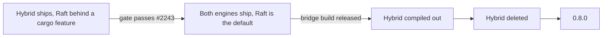

# Retiring the hybrid

This page is the design for track 6 of the one-engine plan (issue #2167):
delete the bespoke shard replication protocol, which the other pages call
"the hybrid", so that 0.8 has one engine (a Raft group per shard, through
openraft) and one model set (`FelixRaft`). Nothing here is built yet.

Read [`per-shard-raft.md`](per-shard-raft.md) first. It defines the Raft
engine, the switch of a shard from the hybrid to Raft, and the pull requests
of track 4 that this page orders itself against. The decisions both pages
rest on are in [`replication-engine.md`](replication-engine.md).

Line counts and paths are as of the commit that added this page.

## Summary

- The hybrid leaves in three steps: Raft becomes the default while the
  hybrid still ships, then the hybrid is compiled out, then it is deleted.
  No step ships a code path that CI no longer runs.
- 0.8.0 contains no hybrid code, so it cannot switch a hybrid shard. The
  last build that holds both engines is released as the **bridge build**. A
  0.7 cluster upgrades to the bridge build, switches every shard, and then
  upgrades to 0.8.0. This is the main open call (Questions, 1).
- A new fleet feature, `hybrid_retired`, is the latch. It takes effect only
  if no shard is on the hybrid at the log position where it is applied.
  0.8.0 refuses a cluster without it.
- Deleting is about 21,000 lines of non-test replication code, 2,000 lines
  of storage code, 8 TLA+ specs and 426 configs. What cannot simply be
  deleted is listed under "Gaps".

## What is deleted and what is kept

"Part" means the file holds both kinds of code and is cut down, not removed.
Track 4 is not built yet, so the split inside the Raft-facing files is
confirmed when stream shards on Raft (#2233) lands.

### Replication crate

`crates/server/felix-replication/src/`, 27,265 non-test lines today.

| Path | Lines | Fate | Why |
| --- | --- | --- | --- |
| `election.rs`, `election/candidate.rs`, `replica/election.rs` | 2,919 | Deleted | The election driver. Raft elects |
| `promotion.rs`, `promotion/joint.rs` | 2,980 | Deleted | The promote fence and the joint fence. A Raft leader opens when its blank entry commits |
| `suspicion.rs` | 304 | Deleted | Replaced by Raft. Its election timeout notices a dead leader, and the lease rests on openraft's `last_quorum_acked` plus the follower's refusal window |
| `unclean.rs`, `reclaim.rs` | 629 | Deleted | Doubted copies and tail reclaim. Replaced by copy ids and re-forming (#2250) |
| `confirmed.rs`, `leadership.rs` | 919 | Deleted | Assignment reads through the control plane and the fence read round. Replaced by a read-index round |
| `replica_set.rs` | 144 | Deleted | Kept sets on the wire and on disk. Membership is a log entry |
| `driver.rs`, `driver/`, `ship.rs`, `follower.rs` | 7,263 | Deleted | Leader-side shipping and cursors. openraft replicates |
| `replica.rs` | 3,216 | Deleted | Follower-side checks, promises and halting |
| `quorum.rs` | 1,999 | Deleted | Quorum marks and waits. The commit index replaces them |
| `reporter.rs` | 587 | Deleted | Replica reports to the control plane. Brokers report only who leads |
| `engine.rs`, `engine/` | 832 | Part | The `Hybrid` engine and `HybridHost` go. The trait shrinks to the shape in `per-shard-raft.md` |
| `controlplane_link.rs` | 340 | Part | Registration, heartbeats and the assignment watch stay. Reports, suspicions and confirmed reads go |
| `metrics.rs` | 239 | Part | See "Metrics" |
| `rebuild.rs`, `throttle.rs` | 371 | Kept | A snapshot install copies a record range the way a rebuild does, under the same bandwidth limit |
| `halted.rs`, `status.rs` | 406 | Kept | Operator listings. A stopped group is reported here |
| `shard.rs`, `incarnation.rs` | 178 | Kept | Shard identity and the incarnation a request names |
| `peer/` | 3,824 | Kept | The broker-to-broker transport |

### Broker service

`services/felix-broker-service/src/`.

| Path | Lines | Fate | Why |
| --- | --- | --- | --- |
| `shards/lifecycle/promotion.rs` | 157 | Deleted | Opens a shard after the promote fence |
| `shards/confirmed.rs` | 155 | Deleted | Serves confirmed assignment reads |
| `cluster/lease.rs` | 370 | Deleted | The control-plane lease. Its last user was the RF 1 shard, which becomes a single-voter group |
| `shards/lifecycle/fence.rs` | 663 | Part | The write fence stays as `opened`, `deposed` and `quiesced`. The withheld, probed, gave-up and lease callbacks go |
| `shards/lifecycle.rs` | 2,445 | Part | Ownership follows the engine's `opened` and `deposed`. The fencing states go |
| `shards/routing.rs` | 1,181 | Part | The router stays. `ShardServing` and the generation it serves at go; the leader is a hint from broker reports |
| `node/cluster.rs`, `node/startup.rs`, `node/peer_dispatch.rs` | | Part | Wire one engine. No `Hybrid::start`, no read-round binding, no election table |
| `node/handoff.rs` | 218 | Part | Shutdown handoff becomes a Raft leadership transfer |
| `shards/routing/hold.rs`, `shards/watch.rs` | | Kept | The move hold and the assignment watch |

### Storage

`crates/server/felix-storage/src/`.

| Path | Lines | Fate | Why |
| --- | --- | --- | --- |
| `disk_log/ballot.rs` (file `ballot`) | 488 | Deleted | Whom a replica answered at a generation. Raft's vote file replaces it |
| `disk_log/replica_state.rs` (file `replica`) | 141 | Deleted | The promised generation and commit offset |
| `disk_log/set.rs` (file `replica-set`) | 821 | Deleted | The kept set and the pending set |
| `run_state/copy_trust.rs` (file `copy-trust`) | 566 | Deleted | Vouching. A copy id per shard directory replaces it |
| `storage_identity.rs`, `run_state.rs`, `run_state/witness.rs`, `run_state/boot.rs` | | Kept | The storage id, the unclean-stop mark and the run witness feed the restore check in front of Raft |
| `disk_log/durable_mark.rs` | | Kept | Torn-tail repair after power loss |
| Segment format 9 and its `record-generations` file | | Kept | The generation field is the Raft term |

`felix-log-tool` stops printing the deleted files.

### Control plane

`services/felix-controlplane-service/src/`. Hybrid logic is spread through
shared modules here, so this is a refactor, not a file delete.

| Path | Lines | Fate |
| --- | --- | --- |
| `store/contract/adoption.rs` | 413 | Deleted. Adopting an elected leader |
| `store/contract/suspicions.rs` | 42 | Deleted |
| `store/contract/replica_reports.rs`, `api/nodes/reports.rs` | 1,433 | Part. Tails, ballots and refusals go. A report of who leads each shard stays |
| `cluster/placement/replica_positions.rs`, `caught_up.rs`, `progress.rs`, `restore.rs` | 1,985 | Part. Vouching and seat fences go. Catch-up is read from the leader's report |
| `model/shard.rs`, `store/contract/shards.rs`, `cluster/placement/moves.rs`, `plan.rs`, `decision.rs`, `reconciler.rs` | | Part. The assigned leader, the generation bump, `pending_set`, ballots and the promote step go. The replica set, its version and the move plan stay |
| `store/raft/command.rs`, `store/raft/soft_state.rs` | | Part. See "Control-plane log" under Upgrade |
| `cluster/placement/rendezvous.rs`, `zones.rs`, `leadership.rs`, `operator.rs`, `wakes.rs` | | Kept |

REST routes removed: `/v1/nodes/{node_id}/replica-status` and
`/v1/shard-assignments/confirmed`. Moves, placement, the assignment watch,
heartbeats and fleet features stay.

### Configuration

Removed from `crates/server/felix-common/src/env_registry.rs` and the
reference page:

| Variable | Read in |
| --- | --- |
| `FELIX_INTERNAL_ELECTION`, `FELIX_INTERNAL_FENCE` | `services/felix-broker-service/src/config/membership.rs`, `crates/server/felix-replication/src/peer/config.rs` |
| `FELIX_UNIFIED_FENCE` | `crates/server/felix-replication/src/peer/config.rs` |
| `FELIX_ELECTION_DEFER_FOR_MS`, `FELIX_LEADER_SUSPECT_AFTER_MS`, `FELIX_SHARD_SUSPECT_AFTER_MS` | `crates/server/felix-replication/src/suspicion.rs` |
| `FELIX_SHARD_FENCE_TIMEOUT_MS`, `FELIX_SHARD_PENDING_SET_TIMEOUT_MS`, `FELIX_SHARD_ELECTION_HOLD_MS`, `FELIX_SHARD_STUCK_LEADER_MS`, `FELIX_SHARD_MOVE_FENCE_MAX_LAG_RECORDS` | `services/felix-controlplane-service/src/config/env.rs` |

A removed variable that is still set is reported once at start as retired,
by name, and has no effect. It does not stop the broker.

`FELIX_PUBLISH_QUORUM_TIMEOUT_MS`, `FELIX_ACK_ON_COMMIT`,
`FELIX_ACK_WAIT_TIMEOUT_MS`, `FELIX_QUORUM_READS`, the rebuild limits and the
move limits stay. They describe what a client waits for, not how the engine
gets there.

### Fleet features

`crates/server/felix-common/src/fleet.rs`. These exist to roll the hybrid
forward one rule at a time. In 0.8.0 each is always on, cannot be turned
off, and its name is never used again:

`generation_start`, `majority_ack`, `lease_free_reads`, `fenced_caches`,
`joint_fence`, `replica_election`, the report markers `peer_election`,
`start_holders`, `fences_every_change` and `non_voting`, and the two that
exist only for the move to Raft, `shard_raft` and `hybrid_retired`.

A 0.8.0 broker still reports the names, so a bridge-build control plane
that checks them accepts it during the rolling upgrade. `record_generations`
stays a real feature of the format.

### Wire

**Client protocol.** Nothing is removed. No frame flag or negotiated bit
exists for the hybrid, and `ORIGINAL_V1_FLAGS` is not touched. The
`generation` field of redirects carries the Raft term. It keeps rising
across the switch because Raft elects above the sealed generation. The
error codes `NotLeader`, `QuorumTimeout` and `LeadershipLost` and the
`shard_unavailable` reason `fenced` keep their values and meanings.

**Internal protocol.** `crates/protocol/felix-wire/src/internal/`. Kinds are
numbered in `header.rs` and peer capability bits in `fence.rs`.

| What | Numbers | Fate |
| --- | --- | --- |
| Replication, fence and election kinds and their answers | 7 to 10, 14 to 21, 24 to 26, 29 to 33, 36, 37, 41 to 44, 47 to 50, 53 to 56 | Retired |
| Forwarding, hello, ping and incarnation kinds | 1 to 6, 11 to 13, 22, 23, 27, 28, 34, 35, 38 to 40, 51, 52 | Kept |
| `LeaseForwardCacheOp`, `LeaseForwardCacheOk` | 45, 46 | Decided with cache shards on Raft (#2238) |
| Capability bits `FENCE`, `TAIL_FETCH`, `GENERATION_LABELS`, `CACHE_FENCE`, `BALLOTS`, `GROUP_FENCE`, `ELECTION`, `LEARNER_ACKS`, `KEPT_SETS`, `KEPT_BALLOTS`, `UNIFIED_FENCE`, `WRITER_GENERATIONS` | bits 0, 1, 2, 4, 6, 8, 9, 15, 16, 20, 21, 22 | Retired |
| `RECORD_TIMES`, `HEAD_TRIM`, `RECORD_HEADERS` | bits 5, 14, 17 | Retired if the Raft messages carry these unconditionally, which they should |
| Transport bits | 3, 7, 10 to 13, 18, 19 | Kept |

The rule for a retired number is the client protocol's rule for a
negotiated bit: it is never used again. Today that rule is not written down
for internal kinds or capability bits, and deleting an enum variant makes
its number look free. So the retired numbers stay in the source as a
reserved list, with a test that no live kind or bit uses one. A 0.8.0
broker that receives a retired kind answers `UnsupportedKind`, as it does
for any kind it does not know. `INTERNAL_VERSION` does not change, because
no header or surviving body changes. `SetStamped` (42) is in the retired row
because it only wraps records kinds and is sent only to a peer that offered
`ELECTION`.

### Metrics

| Metric | Defined in | Fate |
| --- | --- | --- |
| `fence_set_unknown_total`, `promotion_truncated_total`, `promotions_opened_total`, `quorum_marks_withheld_total`, `replica_reports_per_request` | `crates/server/felix-replication/src/metrics.rs` | Removed |
| `fence_refused_ids_beyond_two_total` | `crates/server/felix-replication/src/peer/metrics.rs` | Removed |
| `shard_confirmed_reads_total` | `services/felix-broker-service/src/shards/watch/metrics.rs` | Removed |
| `felix_placement_writes_fenced_total`, `felix_shard_move_fence_seconds`, `felix_replica_status_rejected_total` | control plane, `cluster/placement/` and `api/nodes/reports.rs` | Removed |
| Replication lag, halted, rebuild, shipped and `publish_quorum_*` | `crates/server/felix-replication/src/metrics.rs` | Kept by name, fed by the Raft engine, so dashboards keep working |
| Peer transport, forwarding, move and watch metrics | | Kept |

The metrics reference and the dashboards under the observability assets
change in the same pull request as the metric.

### Docs

| Page | Fate |
| --- | --- |
| `docs/replication-design.md` (5,873 lines) | Replaced by a short page for the one engine. The history stays in git |
| `docs/internal-protocol.md` | Hybrid kinds move to a "Retired" table |
| `docs/formal/README.md` (2,251 lines) | Rewritten for the specs that remain |
| `docs/control-plane.md`, `docs/storage-format.md`, `docs/durable-storage.md`, `docs/semantics.md`, `docs/simulation.md`, `docs/history-checker.md`, `docs/cluster-harness.md`, `docs/rebalancing-plan.md` | Hybrid sections removed or restated |
| docs-site `deployment/failover-without-control-plane.md` | Removed. Failover never needs the control plane |
| docs-site `deployment/upgrades.md`, `deployment/choosing-a-configuration.md`, `deployment/scaling.md`, `deployment/diagnosing.md`, `reference/environment-variables.md`, `reference/terminology.md`, `architecture/semantics.md` | Updated. A new "Upgrading to 0.8" page carries the steps below |
| `docs/replication-engine.md`, `docs/per-shard-raft.md`, this page | Folded into the one-engine page by track 7 |

Each deleting pull request removes the claims it makes false. Track 7
writes the new pages.

### TLA+

`docs/formal/`, run by `scripts/check_tla.sh`.

| Spec | Lines | Configs | Fate |
| --- | --- | --- | --- |
| `FelixShard.tla` | 5,559 | 355 | Deleted |
| `FelixShardUnified.tla` | 575 | 40 | Deleted |
| `FelixShardMoveGiveUp.tla` | 445 | 13 | Deleted after its liveness check has a Raft twin (Gaps, 3) |
| `FelixShardFigure8.tla` | 145 | 8 | Deleted. `FelixRaft` has the current-term commit rule |
| `FelixShardWalkElectStaleSetReplay.tla`, `FelixShardWalkSparesSeatEarlyReplay.tla` | 966 | 2 | Deleted with `.github/workflows/tla-walk.yml` |
| `FelixShardReads.tla`, `FelixShardSessions.tla` | 304 | 8 | Re-based on `FelixRaft`, then the old files are deleted (Gaps, 1) |
| `FelixHeadTrim.tla`, `FelixPlacementPacing.tla` | 614 | 16 | Kept. Their fence and promotion steps are restated (Gaps, 3) |
| `FelixGroups.tla`, `FelixAtomicCommit.tla` | 450 | 10 | Kept unchanged |

Also changed: the `expectations` list in `scripts/check_tla.sh` (348
entries), the modelled paths in `scripts/check_spec_pairing.py`, the TLA
shards in `.github/workflows/ci.yml`, and the 36 Rust files that cite a
`FelixShard` action or invariant in a comment.

### Simulator and history checker

| What | Where | Fate |
| --- | --- | --- |
| Modes `off`, `clocks`, `placement`, `power-loss` | `crates/testing/felix-sim`, `.github/workflows/dst-nightly.yml` | Kept, on Raft clusters. `sleep` is added by #2239 |
| Checkers | `crates/testing/felix-sim/src/check.rs` and `check/` | See "Coverage hand-off" |
| Pinned seeds named after the driver, fences, promotion or seats | `crates/testing/felix-sim/tests/seeds.rs` | Replayed on Raft. A seed stays if it still runs a distinct schedule, renamed for what it checks |
| History modes `lease` and `lease-free` | `crates/testing/felix-cluster/src/history/campaign.rs`, `.github/workflows/history.yml` | Both removed. There is one mode |
| History nemesis `election` | `crates/testing/felix-cluster/src/history/nemesis.rs` | Kept as the control-plane-down nemesis. It no longer sets any flag or feature |
| Election and fence setup in the harness | `crates/testing/felix-cluster/src/node/spawn.rs`, `src/config.rs` | Removed |
| Hybrid cluster tests, 16 files, about 7,800 lines | `crates/testing/felix-cluster/tests/failures/`, `routing/generation_start.rs`, `scale/lease_starvation.rs`, `scale/failover_heal.rs` | Ported or retired per the hand-off table |

## Ordering

The rule: a code path is in a released artifact only while CI runs it.

| Phase | Starts when | What ships | What CI runs |
| --- | --- | --- | --- |
| 1. Hybrid ships | Today | The hybrid. Raft is behind a cargo feature no release enables (#2227 to #2250) | Everything on the hybrid. Raft jobs build with the feature |
| 2. Both ship | The gate (#2243) passes and PR 1 below merges | Both engines. A new cluster starts on Raft. An existing cluster stays on the hybrid until an operator finalizes `shard_raft` | Every simulator mode and history nemesis on both engines, and the switch under faults (#2242) |
| 3. Hybrid compiled out | The bridge build is released from phase 2 and PR 3 merges | Raft only | Raft only. Hybrid tests are behind the same feature as the code |
| 4. Hybrid deleted | PRs 4 to 9 | Raft only | Raft only |

The one-way points, in order:

1. **Per shard: the control plane's compare-and-swap in the switch**
   (`per-shard-raft.md`, "Moving a shard from the hybrid to Raft"). Before
   it the shard is a closed hybrid shard and can reopen. After it no broker
   runs the hybrid for that shard.
2. **Per cluster: finalizing `shard_raft`.** Shards start switching, and a
   build without the Raft engine can no longer join. From the log entry
   that enables it, every shard record is created on Raft ("Creating
   shards after `shard_raft`" below). So after this entry the number of
   hybrid shards only falls.
3. **Per cluster: finalizing `hybrid_retired`.** The condition "no shard is
   on the hybrid" is evaluated when the entry is applied, on every member,
   from the state at that log position. If a hybrid shard exists there the
   entry changes nothing and the operator is told which shards remain.
   Today's finalize checks run when the operator asks
   (`services/felix-controlplane-service/src/cluster/fleet.rs`,
   `check_prerequisites`). That is sound for conditions that only grow. It
   is not enough here: a shard create could commit between the check and
   the latch. After it the control plane refuses every hybrid write, nothing
   creates a hybrid shard, and a build without the hybrid can join.
4. **For the repository: PR 3.** Main can no longer run a hybrid shard. A
   fix to the switch after this goes to the bridge build's own branch.

### Creating shards after `shard_raft`

The rule is on the state machine, not on each caller. One function inserts
a shard record, and it reads the enabled set at the entry being applied:
with `shard_raft` enabled the record is created on Raft, whoever proposed
it and on whatever build. Every path that makes a shard record goes
through it:

- creating a stream,
- creating a cache,
- the group and dead-letter logs a stream gets,
- growing a stream's shard count,
- the fresh set that `placement abandon` writes.

A path that is found to insert a record any other way is a bug in the
bridge build. After the latch nothing creates a hybrid shard, and a command
that would write hybrid state applies as a no-op.

These are decisions made in apply, so every member must make them alike,
including two patch builds of the bridge. They are tied to a metadata
level, as the control plane does for every other change to what apply
does: `shard_raft` and `hybrid_retired` can be proposed only when every
member is at or above that level, and a member below it is held, not fed.
This is the concern the comment on `check_prerequisites` states: a member
applying a command must not decide differently from one on another build.

PR 3 merges only when all of these hold:

- The gate on the engine page has passed and its write-up is merged.
- The bridge build is released, from a commit where one 2000-seed sweep
  per mode passed on each engine and the switch sweep passed.
- The Raft models for reads, sessions and idempotent publish pass (Gaps, 1
  and 2). They are needed before the bridge build is released, because
  that is when Raft first ships.
- The upgrade test passes: a cluster started on the latest 0.7 release,
  with data, rolled to the bridge build, switched under faults, latched,
  then rolled to the candidate. It includes the two crash points under
  "What 0.8.0 finishes".
- The project's own long-running clusters have switched and latched on the
  bridge build.
- Every row of the hand-off table has its Raft check merged, or is marked
  retired.

The specs go last among the deletes. A model of code that is gone costs CI
time. Code without its model is the thing to avoid, and it cuts both ways:
a client property that is modelled only on `FelixShard` must be modelled
on `FelixRaft` before Raft ships, not when the old spec is deleted.

## Coverage hand-off

Every check that guards a hybrid property, and where it goes. "Retired"
means the mechanism it checks no longer exists, and says what stands where
it stood.

### Simulator checkers

| Checker today | Under Raft |
| --- | --- |
| `election-settles` | Kept. Every shard has a leader after the heal |
| `one-leader-per-generation` | One leader per term (`ElectionSafety`) |
| `acked-held-by-leader` | Kept (`LeaderCompleteness`) |
| `at-most-one-serving` | No two brokers pass the lease check for a shard at one time. It checks nothing until the leader lease (#2249) lands, because every `Leader` write waits for commit before then |
| `adopted-matches-opened` | Retired. Nothing is adopted. Its replacement checks that a broker opens a shard at a term only if Raft elected it at that term and its blank entry is committed (Gaps, 4) |
| `record-generations-agree` | Kept above the base: copies agree on the term of every entry. Below the base the generation is not compared, by design |
| `generation-burn` (warning) | Kept as a term-burn warning. It catches election storms, which sleep makes more likely |
| `torn-tail-repaired` | Unchanged |
| New with #2239 | `SleepersWake`, `AsleepIsLevel`, `IdleGroupsSleep` |

### History checker

| Check today | Under Raft |
| --- | --- |
| List-append, delivery, dependency-graph, register, cache linearizability, atomic commit, liveness | Unchanged. They judge what clients saw |
| Rule 21, one leader per generation (`history/leaders.rs`) | One leader per term |
| Modes `lease` and `lease-free` | Retired. They choose between two hybrid read and acknowledgement rules. Raft has one |
| Nemesis `election` | Kept, as control plane down. It is criterion 5 of the gate |
| Duplicate-offset nemesis | New with the gate (engine page) |

### Cluster tests

| Tests today | Under Raft |
| --- | --- |
| `failures/replica_election.rs`, `failures/replica_set.rs` | Retired. Elections are checked by the simulator and by the control-plane-down failover test of #2233 |
| `scale/failover_heal.rs` | Ported. No flag |
| `failures/majority_ack.rs`, `failures/failover.rs` | Ported: an acknowledged record survives its leader. The cases about reports and finalizing are retired |
| `failures/promotion_fence.rs`, `failures/joint_fence.rs`, `failures/fencing.rs`, `failures/fenced_caches.rs` | Retired as mechanism tests. One ported test each for streams and caches: a deposed leader acknowledges nothing |
| `failures/wiped.rs` | Ported: a wiped copy comes back as a learner and an acknowledged record survives (#2250) |
| `routing/generation_start.rs` | Ported: the blank entry of a term takes no offset a consumer sees |
| `failures/lease_free_reads.rs`, `failures/lease_free_sessions.rs` | Ported: a `Quorum` read or a group commit on a deposed leader is refused |
| `scale/lease_starvation.rs` | Retired. No lease is renewed through the control plane. Starved timers are covered by the groups-per-broker gate |
| `failures/followers_word.rs`, `failures/learners.rs` | Ported to learners and membership (#2235) |

### TLA+ invariants

| `FelixShard` family | `FelixRaft` |
| --- | --- |
| `OneLeaderPerGeneration` | `ElectionSafety` |
| `AckedHeldByLeader`, `AckedSurvive` | `LeaderCompleteness` |
| `AckedAgree`, `NoTruncationBelowHwm` | Log matching, and no committed entry is truncated |
| `AckedOnMajority`, `NoStaleCommit`, the Figure 8 configs | The current-term commit rule |
| `AtMostOneServing`, the lease and margin configs | The leader lease configs (#2244) |
| `SetChangesJoint`, `NoCutOverInPiece`, `StagedCopyNeverDelaysAck` | The joint consensus configs and the learner-counted twin (#2244) |
| Wipe, vouch, doubted, readmit and `FollowerTrusted` configs | The member identity twins (#2244) |
| Suspicion and pre-vote configs | The sleep liveness configs (#2244). openraft's pre-vote is not modelled by Felix |
| `EventuallyServes`, `ElectionSettles` | Election liveness |
| Ballot, kept-set, adoption, rename, reissue, report-order and control-plane-down configs (`AdoptedMatchesOpened`, `CpLeaderServes`, `OwnBallotCaughtUp`, `NeverRename*`, `CpDown*` and the rest) | Retired. Each guards a step between the control plane and a broker that no longer exists: the control plane does not name leaders |
| `Counters*` | Retired. A cache shard has one log and one commit index |
| `NoStaleRead`, `NoStaleGroupCommit`, `NoLostDelivery` | Gap 1 |
| `NoDuplicate` (idempotent failover and handoff) | Gap 2 |
| `EventuallyAtFactor`, the move give-up configs | Gap 3 |

### Gaps

Each has an issue and blocks what is named.

1. **Reads and sessions have no Raft model.** `FelixShardReads.tla` and
   `FelixShardSessions.tla` extend `FelixShard`. Their properties are about
   clients, not the hybrid, so they are re-based on `FelixRaft` with a
   read-index round, not retired. Blocks the bridge release, and so PR 3:
   from PR 3 Raft is the only engine and from PR 4 the code `FelixShard`
   models is gone, so nothing else would hold `NoStaleRead`,
   `NoStaleGroupCommit` or `NoLostDelivery`. Issue #2266.
2. **Idempotent publish across a leader change has no Raft config.** The
   hybrid proves `NoDuplicate` across failover and handoff. Under Raft the
   dedup state is rebuilt from the log by a new leader. Blocks the bridge
   release and PR 3, for the same reason. Issue #2267.
3. **Placement liveness under Raft membership is unmodelled**, and two
   specs that stay still speak of fences and promotions. `EventuallyAtFactor`
   and the move give-up configs need a twin over joint consensus.
   `FelixHeadTrim.tla` and `FelixPlacementPacing.tla` are restated. These
   are liveness checks, and membership safety is in the joint consensus
   configs (#2244). Blocks PR 8. Issue #2268.
4. **No check that the host opens only what Raft elected.** Replaces
   `adopted-matches-opened`. Part of PR 2.
5. **No test starts from a released version's data.** The upgrade test
   above does not exist. Part of PR 1.
6. **Retired internal numbers can be reused by accident.** Part of PR 7.
7. **The switch does not say that hybrid files are dead afterwards.** #2242
   must state that once a shard's member starts under Raft, nothing reads
   `replica`, `ballot`, `replica-set` or `copy-trust` for it. The rollback
   from 0.8.0 to the bridge build rests on that. Part of PR 1.
8. **No invariants page exists.** See "Complexity budget". Part of PR 9.

## Upgrade

### From 0.7

There is no upgrade from 0.7 data to 0.8. The control plane's metadata
does not carry over (no conversion from redb;
[#2234](https://github.com/GetFelix/felix/issues/2234) is not planned for
0.8), and a broker's 0.7 data would never be served or deleted under the new
group. Moving to 0.8 means stopping the cluster and starting every
control-plane member and every broker on an empty data directory (docs-site
upgrades page, "Control plane metadata in 0.8"). A 0.8 broker does not yet
refuse a 0.7 data directory
([#2438](https://github.com/GetFelix/felix/issues/2438)).

The rest of this section is the design for switching existing hybrid
shards in place through a bridge build. It does not apply to moving 0.7 data
to 0.8, which is not supported; it is kept for a later in-place switch. The
path it describes:

1. Roll the cluster to the bridge build.
2. Finalize `record_generations`, then `shard_raft`. Shards switch a few at
   a time. Each is closed for one hybrid promotion plus one Raft election.
3. When the fleet status shows no shard on the hybrid, finalize
   `hybrid_retired`. If a shard was created or is still hybrid at that
   point the finalize reports it and changes nothing. Try again later.
4. Wait until every control-plane member reports a snapshot at or past the
   latch entry and a log purged up to it.
5. Roll the cluster to 0.8.0.

A single broker follows the same steps. Its RF 1 shards switch with a set
of one.

**A shard that cannot switch.** The seal needs a majority of the shard's
hybrid set. An RF 1 shard whose broker is gone, or a shard that has lost
its majority, never seals, and the latch waits on it forever. The way out
is on the bridge build, while the hybrid is still there:

- `felixctl placement abandon <stream> <shard>` writes a fresh set on live
  brokers. It loses the records no live copy holds, as it does today. The
  shard then has a live majority and switches. It is only for a shard with
  no live majority: the leader proposes it only then, and apply accepts it
  only if the set version is the one the command saw and the shard is
  still on the hybrid. So it cannot race the switch. Before the
  compare-and-swap, an abandon raises the set version, the switch's write
  fails and the seal starts over on the new set. After it, apply sees the
  shard is on Raft and refuses, and the answer points to re-forming the
  group (#2250).
- Or delete the stream or cache.

The fleet status names each shard that has not switched and why. Abandon
must work for every such shard, so the abandon refusal in #2066 is fixed
on the bridge build, not left for re-forming under Raft.

Records written before generations were recorded keep generation 0 on
disk. They sit below every base and are never compared by term, so nothing
rewrites them.

### What 0.8.0 refuses

Every refusal happens at start, before anything is written, and names the
bridge build. So a mistaken start on 0.8.0 changes nothing and the old
build can be started again.

| Finds | Does |
| --- | --- |
| Control plane: a redb store | Refuses, as today, and says the group must start over |
| Control plane: a store whose snapshot is not at or past the latch entry | Refuses. This is also how it knows the cluster is latched |
| Broker: a control plane without `hybrid_retired` finalized | Does not register and exits |

A broker does not refuse over what a shard directory holds. Once the
cluster is latched every shard has a recorded base, and that record decides
what a directory is, as the next section says.

### What 0.8.0 finishes

The latch reads the control plane's record, and that record flips at the
compare-and-swap, before each copy has started its member (steps 3 and 4
of the switch). So a latched cluster can hold copies that never finished.
Example: C acknowledges the base, the write commits, C crashes before it
starts its member, the operator latches and rolls to 0.8.0. C's directory
has hybrid files and a copy id, because the copy id was minted before the
switch.

So 0.8.0 keeps the member start from a recorded base. It is Raft-side code
that re-forming a group also uses, and PRs 4 and 7 must not remove it:

- A member that has started leaves a **member mark** in its shard
  directory: the group epoch and the base it started from. The copy id is
  not that mark. The mark is written by a rename, and the file and its
  directory are fsynced, in every fsync mode, before the member answers
  any vote or append. Without that, a copy could rename the mark,
  acknowledge entries above the base, lose power, come back with no mark,
  and cut the entries it acknowledged.
- A directory without the mark is not a member yet. The broker reads the
  shard's current record from the control plane, not from a saved view:
  the group epoch, base and voters as they are now, which after a re-form
  are not the ones the switch wrote. If its copy id is a voter of the
  current epoch it cuts anything above that base and starts from it
  (step 3). Otherwise it starts empty as a learner (step 4). That covers a
  copy that failed the digest on the first seal and was still being
  rebuilt.
- If the broker cannot read the record, that member waits. It does not
  guess, and the broker's other shards are not held up.
- A directory for a shard the record does not place on this broker is a
  leftover and is not opened.

Only then are the dead files removed: `replica`, `ballot` and
`replica-set` from a directory that has the member mark, and `copy-trust`
from the data root. 0.8.0 never reads their contents.

The upgrade test crashes a voter between the compare-and-swap and its
member start, and leaves a learner from a failed first seal, then latches
and rolls to the candidate. Both must come up and no acknowledged record
may be lost.

### Control-plane log

The metadata log of an upgraded cluster holds hybrid commands (promotion,
adoption, replica reports, suspicions) and its snapshot holds hybrid fields.
Finalizing `hybrid_retired` is a log entry, the latch entry. Applying it
clears the hybrid fields. Each bridge member then takes a snapshot and
purges its log up to it, and redoes both at start if it crashed in
between. The rules, which hold on the bridge build and on 0.8.0 alike:

- **A hybrid command after the latch is a no-op.** A bridge leader can
  commit a hybrid command that was proposed before it applied the latch,
  at an index after the latch. Every member, on either build, applies it
  as a no-op, because its state is latched at that position. 0.8.0 keeps
  the reserved tags only to recognize them for this.
- **A hybrid command before the latch stops a 0.8.0 member.** If 0.8.0 is
  asked to apply a reserved tag while its state is not latched, it stops
  with a message that names the bridge build and applies nothing. It
  cannot skip it: before the latch hybrid commands also moved state that
  stays, such as the replica set and its version.
- **0.8.0 starts only from a snapshot at or past the latch entry**, and
  purges its log up to its snapshot before it serves. It refuses to
  install a snapshot from before the latch.
- **The window closes at the purge, not at the snapshot.** A bridge leader
  that has taken its latch snapshot and not yet purged can still send
  entries from before the latch to an empty member. So step 4 of the
  upgrade waits for every member to report its log purged up to the latch
  entry before any member is replaced.
- **Recovery is going back to the bridge build, never a wipe.** A stop
  writes nothing, so a stopped member starts again on the bridge build
  with its store as it was, finishes its snapshot and purge, and is then
  upgraded. That holds for one member or for a majority. Wiping stopped
  members is never the answer: wiping a majority loses the metadata.

The command tags stay reserved, like wire numbers.

### Rollback

| From | To | Possible |
| --- | --- | --- |
| Bridge build, nothing finalized | 0.7 | Yes for brokers, by the existing rules. A converted control-plane member uses the tool's `rollback`, only before it first starts on the new store |
| Bridge build, `record_generations` finalized | 0.7 | No. Storage format 9 does not roll back |
| A switched shard | The hybrid | No. Restore from a backup taken before `shard_raft` was finalized |
| 0.8.0 | Bridge build | Yes. The deleting pull requests change no storage, metadata or wire format, the member mark and the start from a base are the bridge build's own, and the bridge build runs a cluster that is all Raft |
| 0.8.0 | 0.7 | No |

Take a backup before finalizing `shard_raft`. It is the only way back.

## The bug map

Issues from the 0.8 re-triage that the hybrid's deletion does not close by
itself. "Resolves" means the pull request removes the cause or carries the
fix. "Re-tests" means it carries the test that decides whether the issue
is closed or kept.

### Still applies

| Issue | Where it is settled |
| --- | --- |
| #2218 segment read can skip to the next segment | Own storage fix, before #2233. Raft reads ranges through the same reader |
| #2182 replication tests do not compile in release mode | Own fix, before the gate runs (#2243), which build in release mode |
| #2162 subscribers registered past the quiesce cap | Engine independent. Re-tested by the soak run on Raft after #2233 |
| #2135 staged move sticks when the successor's storage id rotates | Resolved by #2235 and #2250: a rotated copy is a new member, swapped in by the membership loop |
| #2133 interim routing publish copies the map under the lifecycle lock | Resolved in PR 5, which rewrites how the lifecycle publishes routes |
| #2131 sim: assert a restarted broker reopens its torn segment | Added with the `power-loss` mode on Raft (#2250) |
| #2067 moves never complete under placement faults (seed 3) | Re-tested by #2235, `placement` mode |
| #2066 placement abandon refused on a held shard | Fixed on the hybrid in PR 1, because abandon is the way out for a shard that cannot switch. Under Raft, #2250 restates the rule against re-forming |
| #1998 fsync error must poison the log | Own storage fix, before #2233. A group stops on a storage error, so the error must be sticky |
| #1931 crash between purge and snapshot install | Track 2 (#2221, pull request #2255) |
| #1820 balancer moves caches back and forth | Placement. Re-tested after #2235, when leader balance is a transfer |
| #1774 creating streams before a broker registers skips the feature finalize | Resolved in PR 1. A new cluster must come up latched whatever the order |
| #1615 a counted copy dropped as staged | Resolved in PR 6. Staged and counted become learner and voter, read from the membership |
| #1006 lone unbatched publisher slower on a per-log thread | Measured by the single-node cell of #2243 |
| #2164 publishes time out forever after a whole-cluster wipe | Resolved by #2250: no voter is left, so the shard is re-formed or reported, not retried |
| #1889 a shard first seen in a snapshot waits for a rewrite | Track 3, the control plane on the segment store (`metadata-raft-design.md`) |
| #2206 a given-up leader leaves no promotable copy | Re-tested by #2235 and #2250, seed 3 |
| #2044 unclean kills leave shards unserved after the heal | Re-tested by #2250, `power-loss` mode, `election-settles` |
| #2028 a move leaves its leader fencing for good | Re-tested by #2235, seed 4. The fence around a membership step must reopen |
| #1999 seating a follower waits a full lease | Resolved by #2235. A learner catches up with the fence open and no lease is waited on |
| #1821 trim and restore seat fences fence leaders while a broker is down | Re-tested by #2235 with a member down during a membership step |

### Re-test

| Issue | Where it is settled |
| --- | --- |
| #2195 nightly seeds 649 and 1507 | Replayed at #2233 (`off`, `clocks`) |
| #2194 handoff that times out leaves a move in flight | #2235, leadership transfer |
| #2193 a leader keeps serving after a follower refused it | #2249. The lease check and its simulator checker |
| #2184 bounded-skew seed 3 leaves shards unserved | #2233, `clocks` mode |
| #2148 RF 3 64 KiB publish p99 | #2243, RF 3 steady cell |
| #2033 control plane and broker disagree on the leader | #2235. Routing takes the leader from broker reports |
| #1992 promotion-burst throughput | #2243, promotion burst cell |
| #1986 lifecycle stays locked after the heal | #2233, then PR 5 |
| #1805 failover at 1000 workloads | #2239 and the scale run of #2243 |
| #1622 a new stream is not served for a few seconds | #2233. A new group elects before it serves; #2243 measures it |
| #1196 brokers cannot rejoin while the control plane is down | #2250. A restarted broker passes the restore check by its run witness |
| #1009, #1197 failover and groups wait on the control-plane lease | Closed when the control-plane-down failover test of #2233 passes and the gate confirms it |

The ten issues the re-triage confirmed as retired (#2047, #2032, #1993,
#1990, #1988, #1966, #1914, #1890, #1792, #1331) are closed by the pull
request below that deletes the code they name. Four of them close only
with the acceptance case `per-shard-raft.md` carries over: #1331, #1914,
#1792 and #2032.

## Pull request split

Each is safe to merge alone. All are tracked under #2167.

| # | Pull request | Depends on | Why it is safe alone |
| --- | --- | --- | --- |
| 1 (#2257) | The latch and the default. `hybrid_retired` with its apply-time check, and shard creates that follow `shard_raft` in apply. The member mark. The Raft engine is compiled in. A new cluster starts on Raft. The upgrade test in Actions. The bridge build is released from here | The gate (#2243), Gaps 1 and 2 before the release | Additive. An existing cluster changes only when an operator finalizes a feature. Both engines stay under CI |
| 2 (#2258) | Coverage hand-off. The Raft checks in the tables above that track 4 did not already land, and the `opened` checker | 1 | Tests only |
| 3 (#2259) | One engine at run time. The refusals and the finishing rules under "Upgrade". The hybrid in `felix-replication` and the broker wiring moves behind a cargo feature no build enables, with its tests. Hybrid environment variables are retired. Hybrid CI jobs and history modes are dropped | 1, 2, the bridge release, Gaps 1 and 2 | The only behaviour change is refusing clusters that are not latched. No format changes |
| 4 (#2260) | Delete the hybrid in `felix-replication` and the broker service, with its metrics and tests. The member start from a recorded base stays | 3 | Deletes only code that is compiled out |
| 5 (#2261) | The engine trait, the write fence and the shard lifecycle in their final shape | 4 | A refactor with no behaviour change. Simulator seeds and the history run pass unchanged |
| 6 (#2262) | Control plane: no assigned leader, no generation bump, no reports, adoption, suspicion or seat fences. Routes removed. The snapshot rule | 3 | Removes code that is unreachable once latched, and 0.8.0 starts only latched |
| 7 (#2263) | Leftovers on the wire and on disk: retired kinds and capability bits with the reserved list and its test, the three replica files and `copy-trust`, their cleanup at open | 4, 6 | Nothing refers to them. Formats on the wire and on disk are unchanged for what remains |
| 8 (#2264) | Specs: delete the `FelixShard` family and its configs, re-point the spec pairing check, rewrite `docs/formal/README.md` | 4, 6, Gap 3 | Models only. Every invariant has a row in the hand-off table |
| 9 (#2265) | Tests and docs: hybrid cluster tests, seeds, harness setup, workflow inputs; hybrid pages removed; the invariants page; the size report | 4 to 8 | Tests and docs only |

## Complexity budget

Decision 6 of the engine page says size is reported and is not a pass
criterion. That stands for the gate. This section is what track 6 reports.

| Measure | Today | Removed by track 6 | Left for the Raft engine |
| --- | --- | --- | --- |
| `felix-replication/src`, non-test lines | 27,265 | about 21,000 in 19 files, plus the hybrid half of 3 more | Under 12,000 in the crate, transport included |
| `felix-replication/src`, test lines | 46,844 | most of it | Reported |
| `felix-storage` hybrid state | 2,016 in 4 files | all | 0 |
| Broker service: lease, confirmed reads, promotion gate | 682 in 3 files | all | 0 |
| Broker service: lifecycle and fence | 3,108 | reported | Under half |
| Shard protocol specs | 7,994 lines, 8 specs, 426 configs | all | `FelixRaft` and its configs, reported |
| Hybrid cluster tests | about 7,800 lines, 16 files | all, some ported | Reported |
| Environment variables | 11 hybrid | 11 | 0 |
| Fleet features an operator must finalize for replication | 6 | 6 | 0 after the latch |
| Internal message kinds | 56 | 34 | 20 to 22, plus Raft's own behind one capability |
| `docs/replication-design.md` | 5,873 lines | replaced | Under 1,000 |

The numbers after the last pull request go in the gate write-up and in the
release notes.

**The invariants page.** Felix has no single page that says what it
promises and what checks each promise. PR 9 adds `docs/invariants.md`: one
row per invariant, with the `FelixRaft` property, the simulator checker,
the history rule and the test that hold it. The hand-off tables above are
its first draft. An invariant with an empty cell is a gap and gets an
issue. The docs-site page `architecture/correctness-evidence.md` links to
it.

## Questions

Each has a recommendation.

1. **Does 0.8.0 carry the hybrid for upgrades, or is there a bridge
   build?** A live switch needs the hybrid's fence, catch-up and rebuild,
   which is most of the hybrid. So either 0.8.0 ships both engines and the
   delete moves to 0.9, or the last build with both is a required stop.
   Recommended: a bridge build, on two conditions. First, PR 3 waits until
   the project's own long-running clusters have switched and latched on
   it, so the switch has run on real data before main loses the hybrid.
   Second, the bridge build has its own branch, and that branch keeps the
   hybrid, switch and upgrade CI jobs for as long as the build is
   supported, so a fix to it is tested like any other. It is what track 3
   already does for redb: the new release refuses the old state and names
   what converts it. 0.8.0 then has one engine to test, model and document,
   which is the point of the release. The cost is a second hop for
   upgraders and a second branch to keep green.

2. **What is the bridge build called?** Two options. (a) A preview of the
   0.8 line, pinned by exact version on the "Upgrading to 0.8" page. It
   needs no new version scheme, but it makes a preview a required step,
   previews get no patches, and the site recommends stable releases only.
   (b) A named stable release with its own branch, versioned below 0.8.0,
   listed on the site as the step between 0.7 and 0.8 and patched while
   0.7 is supported. Recommended: (b). Every upgrade passes through this
   build with real data, so it should be held to the bar of a release:
   release checks, a changelog, patches from a branch whose CI still runs
   the hybrid. The exact version number needs a maintainer decision.

3. **Is `hybrid_retired` a feature an operator finalizes, or derived from
   "no shard is on the hybrid"?** Recommended: finalized by an operator,
   with the condition checked when the entry is applied, not when the
   operator asks. It follows the fleet feature runbook, gives 0.8.0 one
   fact to check at start, and gives the control plane a log entry to
   snapshot behind. Checking in apply is what makes it a latch: no create
   can slip in between the check and the entry.

4. **Does 0.8.0 convert an RF 1 shard in place, so a single broker can
   skip the bridge?** One copy has nobody to disagree with, so it is safe.
   Recommended: no. It would be a second conversion path with its own
   tests, for a hop that takes minutes on a single broker.

5. **Is the hybrid compiled out before it is deleted, or deleted in one
   pull request?** Recommended: compiled out first. PR 3 is then small and
   holds every behaviour change, and PR 4 is a delete a reviewer can check
   mechanically. The compiled-out code lives for days, not a release.

6. **Do `RECORD_TIMES`, `HEAD_TRIM` and `RECORD_HEADERS` stay as peer
   capabilities?** Recommended: no. Raft messages carry record times,
   trims and headers unconditionally, because every Raft peer is new
   enough. The three bits are retired with the rest.

7. **Is a removed environment variable an error?** Recommended: no. It is
   reported by name as retired and ignored. Refusing to start over
   `FELIX_INTERNAL_ELECTION=false` in an old manifest helps nobody. The
   retired names leave the registry one release later.

8. **Is the size budget enforced?** Recommended: reported, with one
   ratchet. A small check in `task docs:evidence` holds the non-test line
   count of `felix-replication/src` to the number recorded after PR 9 plus
   10%, and raising the number takes a line in the pull request that does
   it. It is cheap, and it makes growth a choice.

9. **Do the tracked hybrid stalls block the bridge build?** The seed batch
   is ignored today for known hybrid liveness stalls (#2024, #2032, #2033). Recommended: no. They are liveness stalls, not history
   violations, and 0.7 ships with them. The bridge build must have no stall
   the latest 0.7 release does not have, and none in the switch.

10. **When are the `FelixShard` specs deleted, and when must the Raft
    models exist?** Recommended: two rules. A client property modelled
    only on `FelixShard` (reads, sessions, idempotent publish: Gaps 1 and
    2) has its `FelixRaft` model passing before the bridge build is
    released, because Raft ships then. The `FelixShard` files are deleted
    after the code (PR 8 after PRs 4 and 6) and after Gap 3. On the bridge
    branch they stay and keep running.
