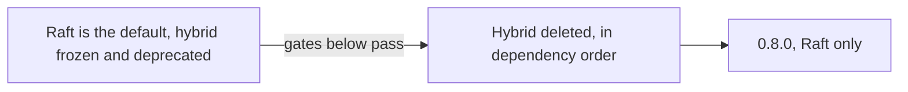

# Retiring the hybrid

This page is the design for track 6 of the one-engine plan (issue #2167):
delete the bespoke shard replication protocol, which the other pages call
"the hybrid", so that 0.8 has one engine (a Raft group per shard, through
openraft) and one model set (`FelixRaft`). Raft is already the default
engine on main; the deletion is not built yet.

Read [`per-shard-raft.md`](per-shard-raft.md) first. It defines the Raft
engine and the pull requests of track 4 that this page orders itself
against. The decisions both pages
rest on are in [`replication-engine.md`](replication-engine.md).

Line counts and paths are as of the commit that added this page.

## Summary

- There is no upgrade from 0.7 to 0.8. A 0.8 cluster starts fresh, so no
  build has to switch a running hybrid shard to Raft, and nothing has to
  ship both engines.
- Raft is the default shard engine on main. `FELIX_SHARD_ENGINE` unset
  means Raft. The hybrid is frozen: no fixes, no perf work. It stays
  selectable (`FELIX_SHARD_ENGINE=hybrid`, deprecated) only so its tests
  keep running until it is deleted.
- Then the hybrid is deleted, in the pull requests below, in dependency
  order. 0.8.0 contains no hybrid code.
- Deleting is about 21,000 lines of non-test replication code, 2,000 lines
  of storage code, 8 TLA+ specs and 426 configs. What cannot simply be
  deleted is listed under "Gaps".

## What is deleted and what is kept

"Part" means the file holds both kinds of code and is cut down, not removed.
Track 4 is not built yet, so the split inside the Raft-facing files is
confirmed when stream shards on Raft (#2233) lands.

### Replication crate

`crates/server/felix-replication/src/`, 27,265 non-test lines today.

| Path | Lines | Fate | Why |
| --- | --- | --- | --- |
| `election.rs`, `election/candidate.rs`, `replica/election.rs` | 2,919 | Deleted | The election driver. Raft elects |
| `promotion.rs`, `promotion/joint.rs` | 2,980 | Deleted | The promote fence and the joint fence. A Raft leader opens when its blank entry commits |
| `suspicion.rs` | 304 | Deleted | Replaced by Raft. Its election timeout notices a dead leader, and the lease rests on openraft's `last_quorum_acked` plus the follower's refusal window |
| `unclean.rs`, `reclaim.rs` | 629 | Deleted | Doubted copies and tail reclaim. Replaced by copy ids and re-forming (#2250) |
| `confirmed.rs`, `leadership.rs` | 919 | Deleted | Assignment reads through the control plane and the fence read round. Replaced by a read-index round |
| `replica_set.rs` | 144 | Deleted | Kept sets on the wire and on disk. Membership is a log entry |
| `driver.rs`, `driver/`, `ship.rs`, `follower.rs` | 7,263 | Deleted | Leader-side shipping and cursors. openraft replicates |
| `replica.rs` | 3,216 | Deleted | Follower-side checks, promises and halting |
| `quorum.rs` | 1,999 | Deleted | Quorum marks and waits. The commit index replaces them |
| `reporter.rs` | 587 | Deleted | Replica reports to the control plane. Brokers report only who leads |
| `engine.rs`, `engine/` | 832 | Part | The `Hybrid` engine and `HybridHost` go. The trait shrinks to the shape in `per-shard-raft.md` |
| `controlplane_link.rs` | 340 | Part | Registration, heartbeats and the assignment watch stay. Reports, suspicions and confirmed reads go |
| `metrics.rs` | 239 | Part | See "Metrics" |
| `rebuild.rs`, `throttle.rs` | 371 | Kept | A snapshot install copies a record range the way a rebuild does, under the same bandwidth limit |
| `halted.rs`, `status.rs` | 406 | Kept | Operator listings. A stopped group is reported here |
| `shard.rs`, `incarnation.rs` | 178 | Kept | Shard identity and the incarnation a request names |
| `peer/` | 3,824 | Kept | The broker-to-broker transport |

### Broker service

`services/felix-broker-service/src/`.

| Path | Lines | Fate | Why |
| --- | --- | --- | --- |
| `shards/lifecycle/promotion.rs` | 157 | Deleted | Opens a shard after the promote fence |
| `shards/confirmed.rs` | 155 | Deleted | Serves confirmed assignment reads |
| `cluster/lease.rs` | 470 | Kept | The control-plane lease. Durable shards stop using it, but an in-memory shard's owner still needs it to refuse once cut off. See "In-memory shards" |
| `shards/lifecycle/fence.rs` | 663 | Part | The write fence stays as `opened`, `deposed` and `quiesced`. The withheld, probed and gave-up callbacks go. The lease gate (`ShardFence::enter`, `check_lease`) stays for in-memory shards |
| `shards/lifecycle.rs` | 2,445 | Part | Ownership follows the engine's `opened` and `deposed`. The fencing states go. `ShardReaders::watch_leadership` and `close_stream_shard` stay for in-memory shards, with the watch no longer taking `QuorumMarks` and covering the shards `shards::memory` serves, not only `lifecycle.active()` (#3065) |
| `shards/routing.rs` | 1,181 | Part | The router stays. `ShardServing` and the generation it serves at go; the leader is a hint from broker reports |
| `node/cluster.rs`, `node/startup.rs`, `node/peer_dispatch.rs` | | Part | Wire one engine. No `Hybrid::start`, no read-round binding, no election table |
| `node/handoff.rs` | 218 | Part | Shutdown handoff becomes a Raft leadership transfer |
| `shards/routing/hold.rs`, `shards/watch.rs` | | Kept | The move hold and the assignment watch |

### Storage

`crates/server/felix-storage/src/`.

| Path | Lines | Fate | Why |
| --- | --- | --- | --- |
| `disk_log/ballot.rs` (file `ballot`) | 488 | Deleted | Whom a replica answered at a generation. Raft's vote file replaces it |
| `disk_log/replica_state.rs` (file `replica`) | 141 | Deleted | The promised generation and commit offset |
| `disk_log/set.rs` (file `replica-set`) | 821 | Deleted | The kept set and the pending set |
| `run_state/copy_trust.rs` (file `copy-trust`) | 566 | Deleted | Vouching. A copy id per shard directory replaces it |
| `storage_identity.rs`, `run_state.rs`, `run_state/witness.rs`, `run_state/boot.rs` | | Kept | The storage id, the unclean-stop mark and the run witness feed the restore check in front of Raft |
| `disk_log/durable_mark.rs` | | Kept | Torn-tail repair after power loss |
| Segment format 9 and its `record-generations` file | | Kept | The generation field is the Raft term |

`felix-log-tool` stops printing the deleted files.

### Control plane

`services/felix-controlplane-service/src/`. Hybrid logic is spread through
shared modules here, so this is a refactor, not a file delete.

| Path | Lines | Fate |
| --- | --- | --- |
| `store/contract/adoption.rs` | 413 | Deleted. Adopting an elected leader |
| `store/contract/suspicions.rs` | 42 | Deleted |
| `store/contract/replica_reports.rs`, `api/nodes/reports.rs` | 1,433 | Part. Tails, ballots and refusals go. A report of who leads each shard stays |
| `cluster/placement/replica_positions.rs`, `caught_up.rs`, `progress.rs`, `restore.rs` | 1,985 | Part. Vouching and seat fences go. Catch-up is read from the leader's report |
| `model/shard.rs`, `store/contract/shards.rs`, `cluster/placement/moves.rs`, `plan.rs`, `decision.rs`, `reconciler.rs` | | Part. The assigned leader, the generation bump, `pending_set`, ballots and the promote step go. The replica set, its version and the move plan stay |
| `store/raft/command.rs`, `store/raft/soft_state.rs` | | Part. See "Control-plane log" under Upgrade |
| `cluster/placement/rendezvous.rs`, `zones.rs`, `leadership.rs`, `operator.rs`, `wakes.rs` | | Kept |

REST routes removed: `/v1/nodes/{node_id}/replica-status` and
`/v1/shard-assignments/confirmed`. Moves, placement, the assignment watch,
heartbeats and fleet features stay.

### Configuration

Removed from `crates/server/felix-common/src/env_registry.rs` and the
reference page:

| Variable | Read in |
| --- | --- |
| `FELIX_INTERNAL_ELECTION`, `FELIX_INTERNAL_FENCE` | `services/felix-broker-service/src/config/membership.rs`, `crates/server/felix-replication/src/peer/config.rs` |
| `FELIX_UNIFIED_FENCE` | `crates/server/felix-replication/src/peer/config.rs` |
| `FELIX_ELECTION_DEFER_FOR_MS`, `FELIX_LEADER_SUSPECT_AFTER_MS`, `FELIX_SHARD_SUSPECT_AFTER_MS` | `crates/server/felix-replication/src/suspicion.rs` |
| `FELIX_SHARD_FENCE_TIMEOUT_MS`, `FELIX_SHARD_PENDING_SET_TIMEOUT_MS`, `FELIX_SHARD_ELECTION_HOLD_MS`, `FELIX_SHARD_STUCK_LEADER_MS`, `FELIX_SHARD_MOVE_FENCE_MAX_LAG_RECORDS` | `services/felix-controlplane-service/src/config/env.rs` |

A removed variable that is still set is reported once at start as retired,
by name, and has no effect. It does not stop the broker.

`FELIX_PUBLISH_QUORUM_TIMEOUT_MS`, `FELIX_ACK_ON_COMMIT`,
`FELIX_ACK_WAIT_TIMEOUT_MS`, `FELIX_QUORUM_READS`, the rebuild limits and the
move limits stay. They describe what a client waits for, not how the engine
gets there.

### Fleet features

`crates/server/felix-common/src/fleet.rs`. These exist to roll the hybrid
forward one rule at a time. In 0.8.0 each is always on, cannot be turned
off, and its name is never used again:

`generation_start`, `majority_ack`, `lease_free_reads`, `fenced_caches`,
`joint_fence`, `replica_election`, and the report markers `peer_election`,
`start_holders`, `fences_every_change` and `non_voting`.
`record_generations` stays a real feature of the format.

`FELIX_SHARD_ENGINE` goes too, with the cluster identity's
`shard_engine` field kept and always `raft`, so a control plane and a
broker still refuse each other if one predates the deletion.

### Wire

**Client protocol.** Nothing is removed. No frame flag or negotiated bit
exists for the hybrid, and `ORIGINAL_V1_FLAGS` is not touched. The
`generation` field of redirects carries the Raft term. The error codes `NotLeader`, `QuorumTimeout` and `LeadershipLost` and the
`shard_unavailable` reason `fenced` keep their values and meanings.

**Internal protocol.** `crates/protocol/felix-wire/src/internal/`. Kinds are
numbered in `header.rs` and peer capability bits in `fence.rs`.

| What | Numbers | Fate |
| --- | --- | --- |
| Replication, fence and election kinds and their answers | 7 to 10, 14 to 21, 24 to 26, 29 to 33, 36, 37, 41 to 44, 47 to 50, 53 to 56 | Retired |
| Forwarding, hello, ping and incarnation kinds | 1 to 6, 11 to 13, 22, 23, 27, 28, 34, 35, 38 to 40, 51, 52 | Kept |
| `LeaseForwardCacheOp`, `LeaseForwardCacheOk` | 45, 46 | Decided with cache shards on Raft (#2238) |
| Capability bits `FENCE`, `TAIL_FETCH`, `GENERATION_LABELS`, `CACHE_FENCE`, `BALLOTS`, `GROUP_FENCE`, `ELECTION`, `LEARNER_ACKS`, `KEPT_SETS`, `KEPT_BALLOTS`, `UNIFIED_FENCE`, `WRITER_GENERATIONS` | bits 0, 1, 2, 4, 6, 8, 9, 15, 16, 20, 21, 22 | Retired |
| `RECORD_TIMES`, `HEAD_TRIM`, `RECORD_HEADERS` | bits 5, 14, 17 | Retired if the Raft messages carry these unconditionally, which they should |
| Transport bits | 3, 7, 10 to 13, 18, 19 | Kept |

The rule for a retired number is the client protocol's rule for a
negotiated bit: it is never used again. Today that rule is not written down
for internal kinds or capability bits, and deleting an enum variant makes
its number look free. So the retired numbers stay in the source as a
reserved list, with a test that no live kind or bit uses one. A 0.8.0
broker that receives a retired kind answers `UnsupportedKind`, as it does
for any kind it does not know. `INTERNAL_VERSION` does not change, because
no header or surviving body changes. `SetStamped` (42) is in the retired row
because it only wraps records kinds and is sent only to a peer that offered
`ELECTION`.

### Metrics

| Metric | Defined in | Fate |
| --- | --- | --- |
| `fence_set_unknown_total`, `promotion_truncated_total`, `promotions_opened_total`, `quorum_marks_withheld_total`, `replica_reports_per_request` | `crates/server/felix-replication/src/metrics.rs` | Removed |
| `fence_refused_ids_beyond_two_total` | `crates/server/felix-replication/src/peer/metrics.rs` | Removed |
| `shard_confirmed_reads_total` | `services/felix-broker-service/src/shards/watch/metrics.rs` | Removed |
| `felix_placement_writes_fenced_total`, `felix_shard_move_fence_seconds`, `felix_replica_status_rejected_total` | control plane, `cluster/placement/` and `api/nodes/reports.rs` | Removed |
| Replication lag, halted, rebuild, shipped and `publish_quorum_*` | `crates/server/felix-replication/src/metrics.rs` | Kept by name, fed by the Raft engine, so dashboards keep working |
| Peer transport, forwarding, move and watch metrics | | Kept |

The metrics reference and the dashboards under the observability assets
change in the same pull request as the metric.

### Docs

| Page | Fate |
| --- | --- |
| `docs/replication-design.md` (5,873 lines) | Replaced by a short page for the one engine. The history stays in git |
| `docs/internal-protocol.md` | Hybrid kinds move to a "Retired" table |
| `docs/formal/README.md` (2,251 lines) | Rewritten for the specs that remain |
| `docs/control-plane.md`, `docs/storage-format.md`, `docs/durable-storage.md`, `docs/semantics.md`, `docs/simulation.md`, `docs/history-checker.md`, `docs/cluster-harness.md`, `docs/rebalancing-plan.md` | Hybrid sections removed or restated |
| docs-site `deployment/failover-without-control-plane.md` | Removed. Failover never needs the control plane |
| docs-site `deployment/upgrades.md`, `deployment/choosing-a-configuration.md`, `deployment/scaling.md`, `deployment/diagnosing.md`, `reference/environment-variables.md`, `reference/terminology.md`, `architecture/semantics.md` | Updated. A new "Upgrading to 0.8" page carries the steps below |
| `docs/replication-engine.md`, `docs/per-shard-raft.md`, this page | Folded into the one-engine page by track 7 |

Each deleting pull request removes the claims it makes false. Track 7
writes the new pages.

### TLA+

`docs/formal/`, run by `scripts/check_tla.sh`.

| Spec | Lines | Configs | Fate |
| --- | --- | --- | --- |
| `FelixShard.tla` | 5,559 | 355 | Configurations deleted. The module stays until `FelixShardReads` and `FelixShardSessions`, which extend it, are deleted |
| `FelixShardUnified.tla` | 575 | 40 | Deleted (done) |
| `FelixShardMoveGiveUp.tla` | 445 | 13 | Deleted after its liveness check has a Raft twin (Gaps, 3) |
| `FelixShardFigure8.tla` | 145 | 8 | Deleted (done). `FelixRaft` has the current-term commit rule |
| `FelixShardWalkElectStaleSetReplay.tla`, `FelixShardWalkSparesSeatEarlyReplay.tla` | 966 | 2 | Deleted (done). `.github/workflows/tla-walk.yml` stays for the Raft walks and nightly checks and lost its hybrid jobs |
| `FelixShardReads.tla`, `FelixShardSessions.tla` | 304 | 8 | Re-based on `FelixRaft` as `FelixRaftReads.tla` and `FelixRaftSessions.tla`; the old files are deleted (Gaps, 1) |
| `FelixHeadTrim.tla`, `FelixPlacementPacing.tla` | 614 | 16 | Kept. Their fence and promotion steps are restated (Gaps, 3) |
| `FelixGroups.tla`, `FelixAtomicCommit.tla` | 450 | 10 | Kept unchanged |

Also changed: the `expectations` list in `scripts/check_tla.sh` (348
entries), the modelled paths in `scripts/check_spec_pairing.py`, the TLA
shards in `.github/workflows/ci.yml`, and the 36 Rust files that cite a
`FelixShard` action or invariant in a comment.

### Simulator and history checker

| What | Where | Fate |
| --- | --- | --- |
| Modes `off`, `clocks`, `placement`, `power-loss` | `crates/testing/felix-sim`, `.github/workflows/dst-nightly.yml` | Kept, on Raft clusters. `sleep` is added by #2239 |
| Checkers | `crates/testing/felix-sim/src/check.rs` and `check/` | See "Coverage hand-off" |
| Pinned seeds named after the driver, fences, promotion or seats | `crates/testing/felix-sim/tests/seeds.rs` | Replayed on Raft. A seed stays if it still runs a distinct schedule, renamed for what it checks |
| History modes `lease` and `lease-free` | `crates/testing/felix-cluster/src/history/campaign.rs`, `.github/workflows/history.yml` | Both removed. There is one mode |
| History nemesis `election` | `crates/testing/felix-cluster/src/history/nemesis.rs` | Kept as the control-plane-down nemesis. It no longer sets any flag or feature |
| Election and fence setup in the harness | `crates/testing/felix-cluster/src/node/spawn.rs`, `src/config.rs` | Removed |
| Hybrid cluster tests, 16 files, about 7,800 lines | `crates/testing/felix-cluster/tests/failures/`, `routing/generation_start.rs`, `scale/lease_starvation.rs`, `scale/failover_heal.rs` | Ported or retired per the hand-off table |

## In-memory shards

An in-memory stream has no log, so it never becomes a Raft group
(`shards/raft.rs`, `Durable::No`). It has one owner placed by the control
plane, no offsets, an ack on enqueue and at-most-once delivery, and it is
placed again at once when its owner is lost. That stays in 0.8 (#3064).
Replicated in-memory streams are out of scope.

Today a Raft broker serves one on the hybrid path, end to end:

| Stage | Code it runs today | Hybrid only? |
| --- | --- | --- |
| Placement intake | `RaftShards::take` skips it. The hybrid lifecycle opens it through the promote fence (`lifecycle/promotion.rs`), Opening, Fencing, Active. `DurableShardStore` opens no log for a stream registered as in memory. `Hybrid::start`'s driver walks it like any led shard. The feed runs the confirmed-reads prefetch | Yes, all of it. Nothing here needs a fence round, a log or the driver |
| Owner lease | `cluster/lease.rs`, checked by the lease gate (`ShardFence::enter` and `check_lease`) at enqueue (`publish/worker.rs`). A lapse ends subscribers (`ShardReaders::watch_leadership`, spawned in `node/cluster.rs` with `QuorumMarks`) | No. It is the only thing that stops a cut-off owner. The watch's `QuorumMarks` argument is |
| Lease-free serving | The driver lets a `Quorum` shard serve past a lapse when its followers vouch (`driver/shard.rs`, `serve_without_lease`). `acknowledges_at_quorum` ignores durability, so an in-memory `Quorum` stream can be granted it | Yes, and wrong for a shard with no log: a lease-free grant must be limited to shards with one (#3069) |
| Ingress | `IngressRouter::dispatch_in`: local only when the servable generation is the route's, else forward | No. The move hold's `awaiting_promotion` and Fencing checks are |
| Generation | From the assignment. Owner change closes the shard (`close_stream_shard`), and subscribers end with the handoff or no-owner reason and the generation | No |
| Publish and fanout | `publish_in_memory` and the broker's fanout. A `Leader` stream is acknowledged on enqueue. A `Quorum` stream takes the other branch of `publish_in_memory`, whose ack passes `Hybrid::await_commit`, which returns at once with no offsets | Only the `Quorum` branch's `await_commit` call |
| Idempotent sequences | The stream's `ProducerTable`, in memory, empty on a new owner | No |
| Caches without logs | Not reachable on a Raft broker: durable storage always opens a `LogCache` | n/a |
| Control plane | Not `raft_step` (`on_raft` needs durable). `readmit` and `move_step` while the owner lives; `promote` on hybrid catch-up reports, or a fresh `choose`, when it is lost. Every write bumps the generation | `promote`, catch-up and reports are. The assigned leader and the bump are not |

The design, in three issues that block the deletion:

1. **Broker (#3065).** A `shards::memory` module takes every `Durable::No`
   shard from the routing feed. It opens at the assigned generation with no
   fence round, no disk log and no engine, serves only while the control-plane
   lease holds and the servable generation is the route's, and closes with
   `close_stream_shard`. The lease gate, `watch_leadership` and
   `close_stream_shard` stay; the watch drops `QuorumMarks` and ends the
   readers of these shards too. Blocks #2259 and #2260.
2. **Control plane (#3066).** In-memory shards get their own placement step:
   one owner from `choose`, placed again at once on loss or drain, a new
   generation on every owner change. They keep the assigned leader and the
   bump that #2262 removes for durable shards. Blocks #2262.
3. **Brokers without a disk (#3067).** A broker with a node id and no
   `FELIX_DURABLE_STORAGE_DIR` is refused at start today. It may start, run
   no Raft groups, say so when it registers, and the control plane places
   only in-memory streams and caches on it. That is where a log-less cache
   lives in a cluster.

The behaviour is pinned by `crates/testing/felix-cluster/tests/routing/in_memory.rs`:
served through any broker with no Raft group, owner loss gives a new
generation and an empty new owner, and a cut-off owner refuses after its
lease, which ends its readers with the reason.

## Ordering

The rule: a code path is in a released artifact only while CI runs it.

| Phase | What main has | What CI runs |
| --- | --- | --- |
| 1. Raft by default (now) | Both engines. A control plane with no `FELIX_SHARD_ENGINE` forms the cluster for Raft. A broker with no `FELIX_SHARD_ENGINE` and a node id (`FELIX_NODE_ID`) runs Raft, and refuses to start, naming what is missing, without the internal listener, durable storage or the `raft` build feature. A standalone broker, with no node id, runs each durable stream and cache shard as a Raft group of one, with no peer, internal listener or control-plane placement (decided in #2986); it refuses `FELIX_SHARD_ENGINE=raft` without durable storage, and without durable storage it runs in memory as before. Every registering broker is compared with the engine the control plane recorded. `FELIX_SHARD_ENGINE=hybrid` still works and logs a deprecation warning. `compose.yaml` runs its broker this way on images built from main, and `felix-cluster up` starts its brokers and control plane on Raft (#2985) | Raft cluster jobs gate. The hybrid cluster jobs run beside them and only report |
| 2. Hybrid deleted | Raft only, one pull request at a time (see "Pull request split"). A broker with a node id runs Raft as in phase 1. A standalone broker runs its durable shards as single-voter Raft groups, as in phase 1, so nothing about it changes when the hybrid goes | Raft only. Each pull request removes the hybrid tests for the code it removes |

The order, decided with Raft as the default:

- Raft is the default now, for clustered brokers and for the cluster test
  suites. The Raft cluster jobs gate a merge. The hybrid cluster jobs still
  run and only report, until the code they test is deleted.
- The hybrid TLA specs are deleted now, except the ones still waiting on a
  Raft twin. Those go with the pull request that adds the twin.
- The code deletion pull requests (#2259 to #2265) start when single-voter
  Raft (#3000) merges, because a standalone broker keeps its durable streams
  on the hybrid path until then.
- The skipped Raft gaps (#3030, #3032, #3001, #3005) are fixed along
  the way. A cluster test tracked by an issue skips on Raft and says so.
- Raft performance still has to match the v0.7.0 release binary on the
  gate's cells (#2646). The comparison is against v0.7.0, not against the
  hybrid on main, which is frozen.
- The long parity runs (#2243) and the bridge-build latch condition are
  dropped. There is no 0.7 to 0.8 upgrade, so no cluster ever runs both
  engines.
- The Raft models for reads, sessions and idempotent publish pass (Gaps, 1
  and 2), so no client property loses its model when `FelixShard` goes.
- Every row of the hand-off table has its Raft check merged, or is marked
  retired.

The specs go last among the deletes. A model of code that is gone costs CI
time. Code without its model is the thing to avoid, and it cuts both ways:
a client property that is modelled only on `FelixShard` must be modelled
on `FelixRaft` before the hybrid goes, not when the old spec is deleted.

## Coverage hand-off

Every check that guards a hybrid property, and where it goes. "Retired"
means the mechanism it checks no longer exists, and says what stands where
it stood. The status column says where the Raft check is: "Landed" names
it, "Missing" is still to be written before the hybrid goes (#2258), and
"Blocked" waits on the issue named.
Paths are under `crates/testing/` unless they start elsewhere.

### Simulator checkers

The hybrid checkers run on whole simulated clusters. On Raft the checks
live in the Raft groups simulation, `felix-sim/src/raft.rs`, run by
`felix-sim/tests/raft_seeds.rs`.

| Checker today | Under Raft | Status |
| --- | --- | --- |
| `election-settles` | Kept. Every shard has a leader after the heal | Landed: `Sim::recover`, each shard acknowledges a write within 30 s of the heal |
| `one-leader-per-generation` | One leader per term (`ElectionSafety`) | Landed: `Sim::watch`, "both led term" |
| `acked-held-by-leader` | Kept (`LeaderCompleteness`) | Landed: `Sim::acknowledged` and `Sim::watch` (an acknowledged or served offset is flushed on a majority), `Sim::final_reads` |
| `at-most-one-serving` | No two brokers pass the lease check for a shard at one time. The leader lease (#2249) has landed, so this now has something to check | Landed: `Sim::check_serving`, read in one step before every write and each second. A run whose skewed timers exceed what the lease is sized for is not judged |
| `adopted-matches-opened` | Retired. Nothing is adopted. Its replacement checks that a broker opens a shard at a term only if Raft elected it at that term and its blank entry is committed (Gaps, 4) | Landed: `felix-sim/src/raft/opens.rs`. Every open the engine reports is judged: a majority has flushed an entry of the term when it opens, one broker per term, the broker the watch saw lead that term, and an entry of that term in the final log |
| `record-generations-agree` | Kept above the base: copies agree on the term of every entry. Below the base the generation is not compared, by design | Landed: `Sim::check_terms_agree` after the final reads, below each member's read bound |
| `generation-burn` (warning) | Kept as a term-burn warning. It catches election storms, which sleep makes more likely | Landed: `RaftOutcome::warnings`, from the lowest and highest term the watch saw per shard |
| `torn-tail-repaired` | Unchanged | Landed: `Sim::check_power_cut` in the power modes (#2989). `raft_seed_1233_with_power_loss` tears and repairs tails |
| New with #2239 | `SleepersWake`, `AsleepIsLevel`, `IdleGroupsSleep` | Blocked on #2239, which adds sleep. `AsleepIsLevel` is modelled (`FelixRaftSleep.cfg`) |

### History checker

| Check today | Under Raft | Status |
| --- | --- | --- |
| List-append, delivery, dependency-graph, register, cache linearizability, atomic commit, liveness | Unchanged. They judge what clients saw | Landed: the harness runs Raft unless `FELIX_TEST_SHARD_ENGINE=hybrid` (`felix-cluster/src/config.rs`), so the `history` cluster suite in CI and `history.yml` run these on Raft. The Raft simulation also runs the list-append and delivery checks on every seed |
| Rule 21, one leader per generation (`history/leaders.rs`) | One leader per term | Landed: a Raft member logs its open with the term as the generation (`felix-replication/src/raft/lead.rs`), and `two_raft_members_logging_an_open_in_one_term_is_a_violation` checks the rule reads it |
| Modes `lease` and `lease-free` | Retired. They choose between two hybrid read and acknowledgement rules. Raft has one | Retired. Removed with the hybrid wiring (#2259) |
| Nemesis `election` | Kept, as control plane down. It is criterion 5 of the gate | Landed: `replicas_elect_a_leader_while_the_control_plane_is_down` waits on Raft for a new leader at a later term (`raft_await_election` in `history/liveness.rs`) and fails if rule 21 read no open |
| Duplicate-offset nemesis | New with the gate (engine page) | Missing on clusters: no nemesis partitions a `Leader` stream's leader while a QUIC subscriber, a Kafka consumer and a cache watcher record offsets. The simulator checks its QUIC subscriber half (`raft/deliveries.rs`) |

### Cluster tests

The Raft cluster tests are in `felix-cluster/tests/raft_shards.rs`.

| Tests today | Under Raft | Status |
| --- | --- | --- |
| `failures/replica_election.rs`, `failures/replica_set.rs` | Retired. Elections are checked by the simulator and by the control-plane-down failover test of #2233 | Retired. Landed in their place: `a_leader_lost_with_the_control_plane_down_loses_nothing_acknowledged` |
| `scale/failover_heal.rs` | Ported. No flag | Landed: `without_election_every_shard_of_a_killed_leader_serves_again` runs on Raft with no flag and kills the broker the groups elected. It is run by `scale-nightly.yml`'s `failover` variant |
| `failures/majority_ack.rs`, `failures/failover.rs` | Ported: an acknowledged record survives its leader. The cases about reports and finalizing are retired | Landed: `a_followers_subscriber_keeps_every_acknowledged_record_when_the_leader_dies`, `a_leader_stream_lost_with_its_leader_keeps_a_prefix_of_what_was_acknowledged`, `a_raft_cache_keeps_what_it_acknowledged_when_its_leader_dies` |
| `failures/promotion_fence.rs`, `failures/joint_fence.rs`, `failures/fencing.rs`, `failures/fenced_caches.rs` | Retired as mechanism tests. One ported test each for streams and caches: a deposed leader acknowledges nothing | Landed: `a_cut_off_leader_acknowledges_nothing_the_group_loses_after_its_lease` for streams, `a_cut_off_cache_leader_acknowledges_nothing_the_group_loses` for caches |
| `failures/wiped.rs` | Ported: a wiped copy comes back as a learner and an acknowledged record survives (#2250) | Landed: on Raft `a_wiped_follower_is_not_promoted` checks a wiped copy does not count and every record survives, and `learners.rs`'s `a_wiped_follower_counts_only_once_it_holds_the_start` that it counts once swapped in. The simulator wipes copies (`raft_seed_2_with_wipes`) |
| `routing/generation_start.rs` | Ported: the blank entry of a term takes no offset a consumer sees | Landed: the simulator's subscribers read from offset 0 through every term, and a delivery at a blank's offset is a finding (`raft/deliveries.rs`). In process, `a_term_blank_on_an_idle_shard_ends_no_records`. The file's own tests are about moves and skip on Raft until #2235 |
| `failures/lease_free_reads.rs`, `failures/lease_free_sessions.rs` | Ported: a `Quorum` read or a group commit on a deposed leader is refused | Landed: both files run on Raft. `a_cut_off_leader_cannot_serve_a_quorum_read_once_a_new_leader_took_writes` and `a_deposed_coordinator_refuses_a_group_ack` partition the old leader from its peers, not from the client, and assert the refusal |
| `scale/lease_starvation.rs` | Retired. No lease is renewed through the control plane. Starved timers are covered by the groups-per-broker gate | Retired |
| `failures/followers_word.rs`, `failures/learners.rs` | Ported to learners and membership (#2235) | Blocked on #2235. The wiped-copy case of `learners.rs` runs on Raft (above); `followers_word.rs` skips on Raft |

### TLA+ invariants

Each `FelixRaft` config is registered in `scripts/check_tla.sh`, with the
twin that must fail where there is one.

| `FelixShard` family | `FelixRaft` | Status |
| --- | --- | --- |
| `OneLeaderPerGeneration` | `ElectionSafety` | Landed: `OneLeaderPerTerm` in `FelixRaft.cfg` |
| `AckedHeldByLeader`, `AckedSurvive` | `LeaderCompleteness` | Landed: `LeaderCompleteness` and `AckedSurvive` in `FelixRaft.cfg` |
| `AckedAgree`, `NoTruncationBelowHwm` | Log matching, and no committed entry is truncated | Landed: `LogMatching` and `StateMachineSafety`; `FelixRaftTornTailKept` fails `LogMatching` |
| `AckedOnMajority`, `NoStaleCommit`, the Figure 8 configs | The current-term commit rule | Landed: `FelixRaftCommitPriorTerm` fails `LeaderCompleteness` |
| `AtMostOneServing`, the lease and margin configs | The leader lease configs (#2244) | Landed: `FelixRaftLease*.cfg` |
| `SetChangesJoint`, `NoCutOverInPiece`, `StagedCopyNeverDelaysAck` | The joint consensus configs and the learner-counted twin (#2244) | Landed: `FelixRaftMembership*.cfg`; `FelixRaftMembershipLearnerCounts` fails `AckedSurvive` |
| Wipe, vouch, doubted, readmit and `FollowerTrusted` configs | The member identity twins (#2244) | Landed: `FelixRaftIdentity*.cfg` |
| Suspicion and pre-vote configs | The sleep liveness configs (#2244). openraft's pre-vote is not modelled by Felix | Landed: `FelixRaftSleep*.cfg` |
| `EventuallyServes`, `ElectionSettles` | Election liveness | Missing. `FelixRaft` checks only that a quiet group is served (`QuiescentServed`), not that a leader is eventually elected |
| Ballot, kept-set, adoption, rename, reissue, report-order and control-plane-down configs (`AdoptedMatchesOpened`, `CpLeaderServes`, `OwnBallotCaughtUp`, `NeverRename*`, `CpDown*` and the rest) | Retired. Each guards a step between the control plane and a broker that no longer exists: the control plane does not name leaders | Retired |
| `Counters*` | Retired. A cache shard has one log and one commit index | Retired |
| `NoStaleRead`, `NoStaleGroupCommit`, `NoLostDelivery` | The same properties in `FelixRaftReads.cfg`, `FelixRaftReadsWritten.cfg`, `FelixRaftSessionsSubscriber.cfg` and `FelixRaftSessionsGroup.cfg`, each with a twin that drops the rule and fails (#2266) | Landed |
| `NoDuplicate` (idempotent failover and handoff) | `NoDuplicate` in `FelixRaftIdempotent.cfg`, with the in-memory twin `FelixRaftIdempotentMemory.cfg` (#2267). A handoff is a change of leader under Raft | Landed |
| `EventuallyAtFactor`, the move give-up configs | Gap 3 | Blocked on #2268 |

### Gaps

Each has an issue and blocks what is named.

1. **Reads and sessions on Raft.** Closed by `FelixRaftReads.tla` and
   `FelixRaftSessions.tla`, which extend `FelixRaft` with a read-index round
   and the blank-entry barrier in place of the fence round and the lease.
   `FelixShardReads.tla` and `FelixShardSessions.tla` extend `FelixShard`.
   Their properties are about clients, not the hybrid, so they are re-based
   on `FelixRaft`, not retired. Needed before PR 3: from PR 3 Raft is the
   only engine and from PR 4 the code `FelixShard` models is gone, so
   nothing else would hold `NoStaleRead`,
   `NoStaleGroupCommit` or `NoLostDelivery`. Issue #2266.
2. **Idempotent publish across a leader change.** Closed by
   `FelixRaftIdempotent.tla`: `NoDuplicate` holds across changes of Raft
   leader, with two batches in flight and for the re-send of a batch a
   change of leader cut short, with the table read from the leader's log.
   It models new two-record batches ahead of the engine, which refuses
   them until #2524. Its twin with the table in memory fails it. Issue #2267.
3. **Placement liveness under Raft membership is unmodelled**, and two
   specs that stay still speak of fences and promotions. `EventuallyAtFactor`
   and the move give-up configs need a twin over joint consensus.
   `FelixHeadTrim.tla` and `FelixPlacementPacing.tla` are restated. These
   are liveness checks, and membership safety is in the joint consensus
   configs (#2244). Blocks PR 8. Issue #2268.
4. **No check that the host opens only what Raft elected.** Closed by
   `felix-sim/src/raft/opens.rs`, which replaces `adopted-matches-opened`.
5. **No test starts from a released version's data.** Not needed: there is
   no upgrade from 0.7 ("Upgrade").
6. **Retired internal numbers can be reused by accident.** Part of PR 7.
7. **Hybrid files in a data directory.** A fresh 0.8 cluster never writes
   `replica`, `ballot`, `replica-set` or `copy-trust`, so 0.8.0 does not
   read or clean them. Part of PR 7.
8. **No invariants page exists.** See "Complexity budget". Part of PR 9.

## Upgrade

There is no upgrade from 0.7 to 0.8. The control plane's metadata does not
carry over (no conversion from redb;
[#2234](https://github.com/GetFelix/felix/issues/2234) is not planned for
0.8), and a broker's 0.7 data would never be served or deleted under the new
group. Moving to 0.8 means stopping the cluster and starting every
control-plane member and every broker on an empty data directory (docs-site
upgrades page, "Control plane metadata in 0.8"). A 0.8 broker does not yet
refuse a 0.7 data directory
([#2438](https://github.com/GetFelix/felix/issues/2438)).

Because every 0.8 cluster starts fresh, no build switches a running hybrid
shard to Raft. That drops the bridge build, the `shard_raft` and
`hybrid_retired` fleet features, the in-place switch (#2242), the member
mark and the control-plane log latch.

A cluster formed on main before the default flipped recorded `hybrid` as
its engine and keeps it: the control plane records the engine once, when
its metadata group forms. Its brokers refuse to start on Raft until they
are given `FELIX_SHARD_ENGINE=hybrid`. Such a cluster is a test cluster;
start it again on empty directories to move it to Raft.

## The bug map

Issues from the 0.8 re-triage that the hybrid's deletion does not close by
itself. "Resolves" means the pull request removes the cause or carries the
fix. "Re-tests" means it carries the test that decides whether the issue
is closed or kept.

### Still applies

| Issue | Where it is settled |
| --- | --- |
| #2218 segment read can skip to the next segment | Own storage fix, before #2233. Raft reads ranges through the same reader |
| #2182 replication tests do not compile in release mode | Own fix, before the gate runs (#2243), which build in release mode |
| #2162 subscribers registered past the quiesce cap | Engine independent. Re-tested by the soak run on Raft after #2233 |
| #2135 staged move sticks when the successor's storage id rotates | Resolved by #2235 and #2250: a rotated copy is a new member, swapped in by the membership loop |
| #2133 interim routing publish copies the map under the lifecycle lock | Resolved in PR 5, which rewrites how the lifecycle publishes routes |
| #2131 sim: assert a restarted broker reopens its torn segment | Added with the `power-loss` mode on Raft (#2250) |
| #2067 moves never complete under placement faults (seed 3) | Re-tested by #2235, `placement` mode |
| #2066 placement abandon refused on a held shard | Retires with the hybrid: no shard switches, so abandon is no longer the way out. Under Raft, #2250 restates the rule against re-forming |
| #1998 fsync error must poison the log | Own storage fix, before #2233. A group stops on a storage error, so the error must be sticky |
| #1931 crash between purge and snapshot install | Track 2 (#2221, pull request #2255) |
| #1820 balancer moves caches back and forth | Placement. Re-tested after #2235, when leader balance is a transfer |
| #1774 creating streams before a broker registers skips the feature finalize | Re-tested under Raft, which needs no replication feature finalized |
| #1615 a counted copy dropped as staged | Resolved in PR 6. Staged and counted become learner and voter, read from the membership |
| #1006 lone unbatched publisher slower on a per-log thread | Measured by the single-node cell of #2243 |
| #2164 publishes time out forever after a whole-cluster wipe | Resolved by #2250: no voter is left, so the shard is re-formed or reported, not retried |
| #1889 a shard first seen in a snapshot waits for a rewrite | Track 3, the control plane on the segment store (`metadata-raft-design.md`) |
| #2206 a given-up leader leaves no promotable copy | Re-tested by #2235 and #2250, seed 3 |
| #2044 unclean kills leave shards unserved after the heal | Re-tested by #2250, `power-loss` mode, `election-settles` |
| #2028 a move leaves its leader fencing for good | Re-tested by #2235, seed 4. The fence around a membership step must reopen |
| #1999 seating a follower waits a full lease | Resolved by #2235. A learner catches up with the fence open and no lease is waited on |
| #1821 trim and restore seat fences fence leaders while a broker is down | Re-tested by #2235 with a member down during a membership step |

### Re-test

| Issue | Where it is settled |
| --- | --- |
| #2195 nightly seeds 649 and 1507 | Replayed at #2233 (`off`, `clocks`) |
| #2194 handoff that times out leaves a move in flight | #2235, leadership transfer |
| #2193 a leader keeps serving after a follower refused it | #2249. The lease check and its simulator checker |
| #2184 bounded-skew seed 3 leaves shards unserved | #2233, `clocks` mode |
| #2148 RF 3 64 KiB publish p99 | #2243, RF 3 steady cell |
| #2033 control plane and broker disagree on the leader | #2235. Routing takes the leader from broker reports |
| #1992 promotion-burst throughput | #2243, promotion burst cell |
| #1986 lifecycle stays locked after the heal | #2233, then PR 5 |
| #1805 failover at 1000 workloads | #2239 and the scale run of #2243 |
| #1622 a new stream is not served for a few seconds | #2233. A new group elects before it serves; #2243 measures it |
| #1196 brokers cannot rejoin while the control plane is down | #2250. A restarted broker passes the restore check by its run witness |
| #1009, #1197 failover and groups wait on the control-plane lease | Closed when the control-plane-down failover test of #2233 passes and the gate confirms it |

The ten issues the re-triage confirmed as retired (#2047, #2032, #1993,
#1990, #1988, #1966, #1914, #1890, #1792, #1331) are closed by the pull
request below that deletes the code they name. Four of them close only
with the acceptance case `per-shard-raft.md` carries over: #1331, #1914,
#1792 and #2032.

## Pull request split

Each is safe to merge alone. All are tracked under #2167.

| # | Pull request | Depends on | Why it is safe alone |
| --- | --- | --- | --- |
| 1 (#2257) | The default. A new cluster starts on Raft, the release build includes the engine, `FELIX_SHARD_ENGINE=hybrid` is deprecated | None | Both engines stay under CI. The hybrid tests pin the hybrid |
| 2 (#2258) | Coverage hand-off. The Raft checks in the tables above that track 4 did not already land, and the `opened` checker | 1 | Tests only |
| 3 (#2259) | One engine at run time. `FELIX_SHARD_ENGINE` and the hybrid environment variables are retired, the hybrid wiring in the broker is cut, hybrid CI jobs and history modes are dropped | 1, 2, the gates under "Ordering", Gaps 1 and 2 | No format changes |
| 4 (#2260) | Delete the hybrid in `felix-replication` and the broker service, with its metrics and tests | 3 | Deletes only code nothing runs |
| 5 (#2261) | The engine trait, the write fence and the shard lifecycle in their final shape | 4 | A refactor with no behaviour change. Simulator seeds and the history run pass unchanged |
| 6 (#2262) | Control plane: no assigned leader, no generation bump, no reports, adoption, suspicion or seat fences, for durable shards. Routes removed | 3, #3066 | Removes code a Raft cluster never reaches once in-memory shards are placed on their own (#3066) |
| 7 (#2263) | Leftovers on the wire and on disk: retired kinds and capability bits with the reserved list and its test, the code that writes the three replica files and `copy-trust` | 4, 6 | Nothing refers to them. Formats on the wire and on disk are unchanged for what remains |
| 8 (#2264) | Specs: delete the `FelixShard` family and its configs, re-point the spec pairing check, rewrite `docs/formal/README.md` | 4, 6, Gap 3 | Models only. Every invariant has a row in the hand-off table |
| 9 (#2265) | Tests and docs: hybrid cluster tests, seeds, harness setup, workflow inputs; hybrid pages removed; the invariants page; the size report | 4 to 8 | Tests and docs only |

## Complexity budget

Decision 6 of the engine page says size is reported and is not a pass
criterion. That stands for the gate. This section is what track 6 reports.

| Measure | Today | Removed by track 6 | Left for the Raft engine |
| --- | --- | --- | --- |
| `felix-replication/src`, non-test lines | 27,265 | about 21,000 in 19 files, plus the hybrid half of 3 more | Under 12,000 in the crate, transport included |
| `felix-replication/src`, test lines | 46,844 | most of it | Reported |
| `felix-storage` hybrid state | 2,016 in 4 files | all | 0 |
| Broker service: confirmed reads, promotion gate | 312 in 2 files | all | 0 |
| Broker service: control-plane lease | 470 in 1 file | none | 470, for in-memory shards |
| Broker service: lifecycle and fence | 3,281 | reported | Under half, including the lease gate and reader watch in-memory shards keep |
| Shard protocol specs | 7,994 lines, 8 specs, 426 configs | all | `FelixRaft` and its configs, reported |
| Hybrid cluster tests | about 7,800 lines, 16 files | all, some ported | Reported |
| Environment variables | 11 hybrid | 11 | 0 |
| Fleet features an operator must finalize for replication | 6 | 6 | 0 |
| Internal message kinds | 56 | 34 | 20 to 22, plus Raft's own behind one capability |
| `docs/replication-design.md` | 5,873 lines | replaced | Under 1,000 |

The numbers after the last pull request go in the gate write-up and in the
release notes.

**The invariants page.** Felix has no single page that says what it
promises and what checks each promise. PR 9 adds `docs/invariants.md`: one
row per invariant, with the `FelixRaft` property, the simulator checker,
the history rule and the test that hold it. The hand-off tables above are
its first draft. An invariant with an empty cell is a gap and gets an
issue. The docs-site page `architecture/correctness-evidence.md` links to
it.

## Questions

Each has a recommendation.

1. **Is the hybrid compiled out before it is deleted, or deleted in one
   pull request?** Recommended: one engine at run time first (PR 3), then
   the delete. PR 3 is small and holds every behaviour change, and PR 4 is
   a delete a reviewer can check mechanically.

2. **Do `RECORD_TIMES`, `HEAD_TRIM` and `RECORD_HEADERS` stay as peer
   capabilities?** Recommended: no. Raft messages carry record times,
   trims and headers unconditionally, because every Raft peer is new
   enough. The three bits are retired with the rest.

3. **Is a removed environment variable an error?** Recommended: no. It is
   reported by name as retired and ignored. Refusing to start over
   `FELIX_INTERNAL_ELECTION=false` in an old manifest helps nobody. The
   retired names leave the registry one release later. The exception is
   `FELIX_SHARD_ENGINE=hybrid`: a broker asked for an engine it no longer
   has refuses to start, so nobody believes they run the hybrid.

4. **Is the size budget enforced?** Recommended: reported, with one
   ratchet. A small check in `task docs:evidence` holds the non-test line
   count of `felix-replication/src` to the number recorded after PR 9 plus
   10%, and raising the number takes a line in the pull request that does
   it. It is cheap, and it makes growth a choice.

5. **When are the `FelixShard` specs deleted?** After the code (PR 8 after
   PRs 4 and 6) and after Gap 3. The client properties modelled only on
   `FelixShard` (Gaps 1 and 2) have their `FelixRaft` models passing
   before PR 3.
