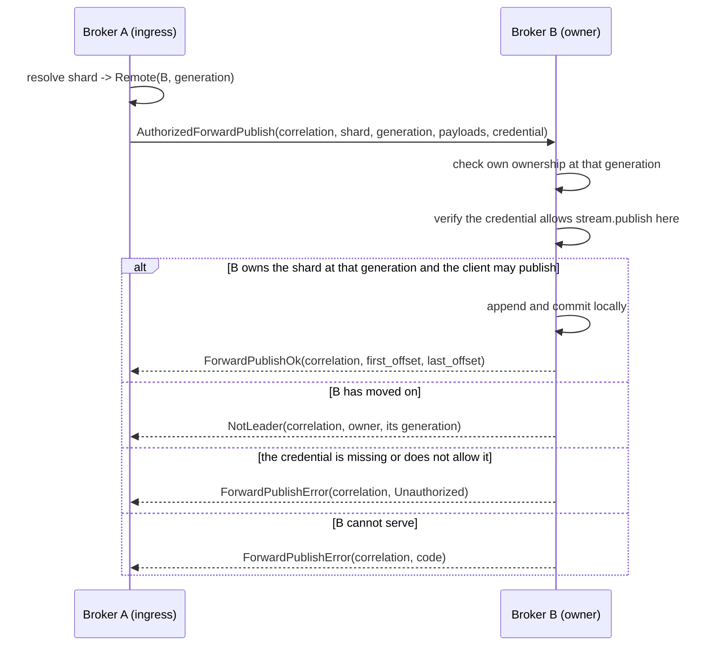
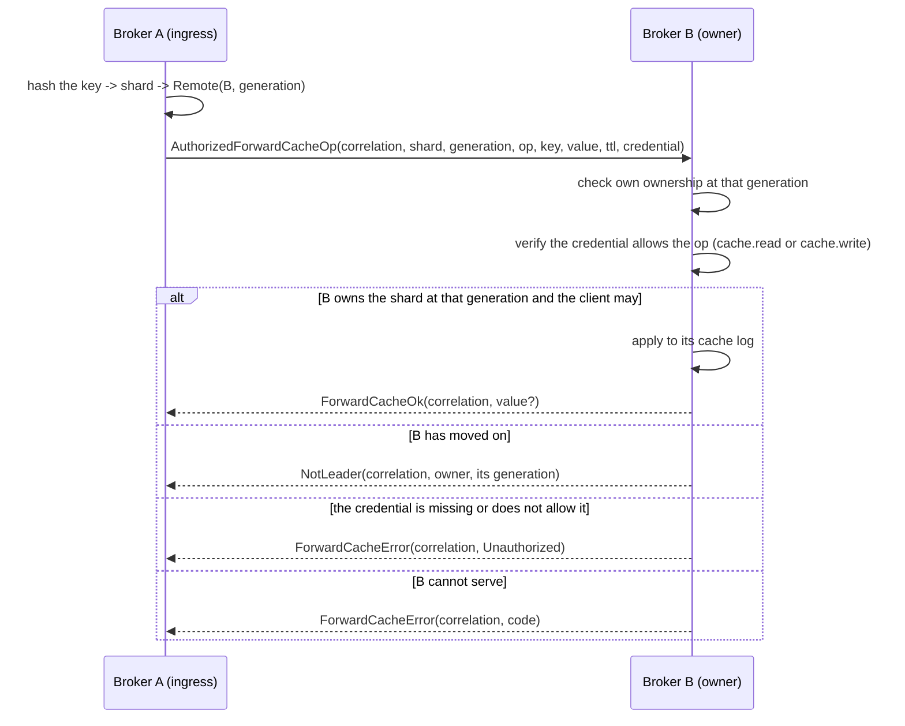
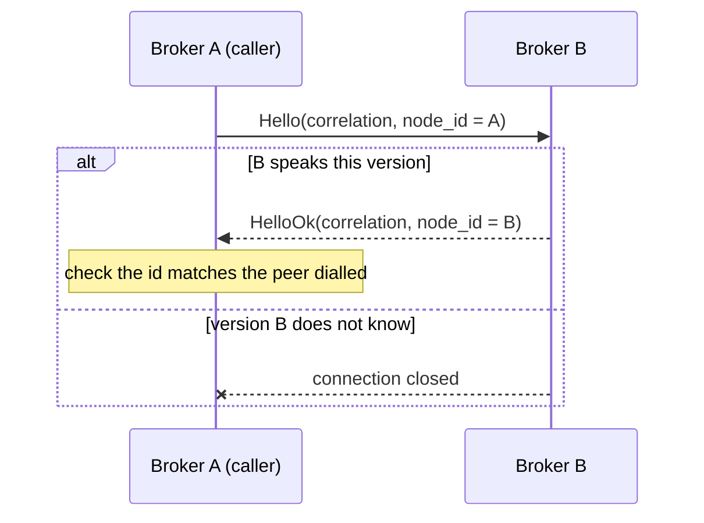
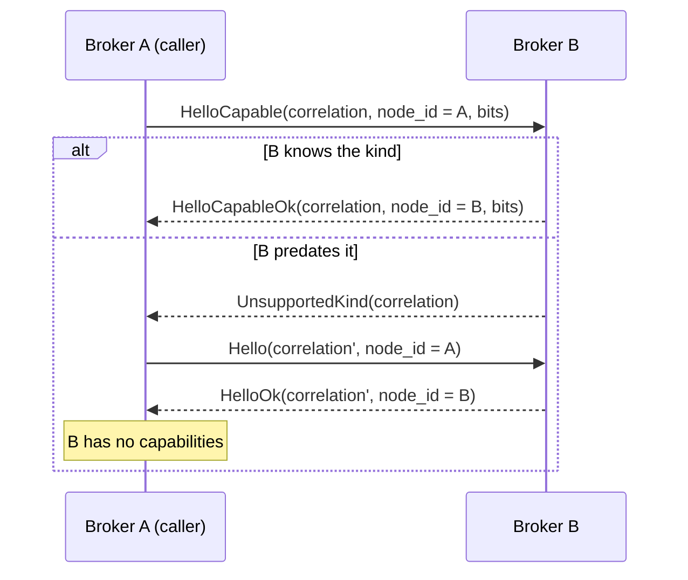
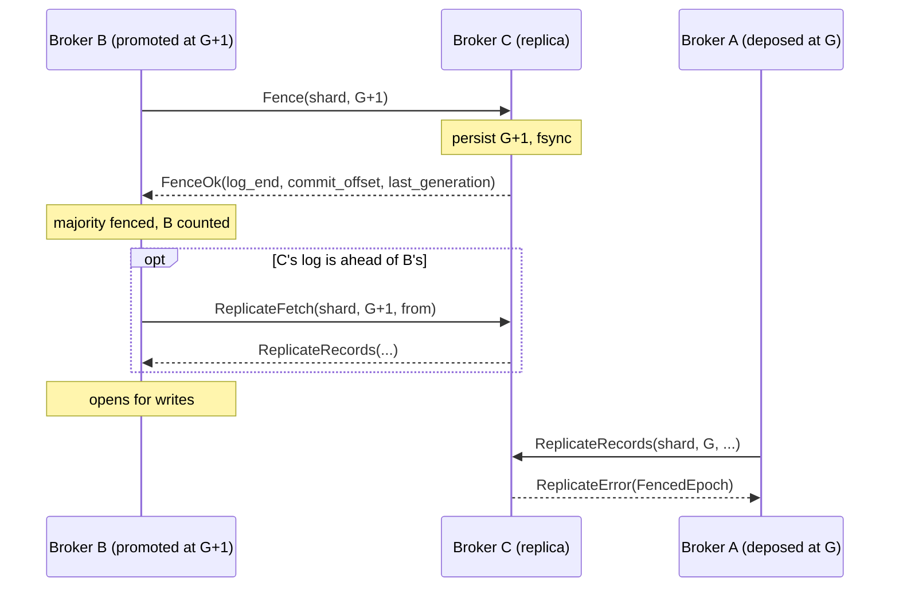

# Broker-internal forwarding protocol

The protocol brokers speak to each other. Separate from the client protocol in
`docs/protocol.md`, and deliberately not a superset of it.

## Why it is a separate protocol

A client frame and an internal frame must never be mistaken for one another. A
client that could send `ForwardPublish` could write to a shard on a broker that
never checked ownership; a broker that accepted client frames on its internal
listener would treat a peer as an authenticated publisher.

Three things keep them apart, and only the first is a wire concern:

1. **A distinct magic.** `FLXI` rather than `FLX1`, so a frame from one side
   fails to decode on the other rather than parsing into something plausible.
2. **A distinct listener.** Internal traffic arrives on the broker-internal QUIC
   role, never the client one. The two bind different ports, and startup refuses
   a configuration where they share one. Both internal endpoints negotiate the
   `felix-internal/1` ALPN and the client-facing role negotiates none, so a
   client pointed at the internal port has no protocol in common with it and TLS
   refuses the handshake before a frame is read, and before any broker state
   is touched.
3. **A distinct credential.** Peer authentication is mTLS between brokers, with
   the certificate's name checked against the node id in both directions, when
   `FELIX_INTERNAL_TLS_CERT`, `_KEY` and `_CA` are set.

The magic alone is not security. It is what makes a misdirected connection fail
loudly instead of quietly.

## Framing

```
+--------+---------+------+--------+---------+
| magic  | version | kind | length | body    |
| u32    | u16     | u16  | u32    | length  |
+--------+---------+------+--------+---------+
```

Big-endian throughout, matching the client protocol.

`kind` is a message discriminant, not a flag set. The client protocol uses flag
*bits* because they modify one payload layout; here each kind **is** a layout, and
an enum makes "unknown kind" a single unambiguous check.

**An unknown kind is refused, never interpreted.** Same reasoning as the client
protocol's unknown flag bits: the kind selects how to read the body, so ignoring
one means confidently misparsing it.

The refusal is not fatal. The receiver reads the body (the frozen header says
how long it is) and answers `UnsupportedKind` against the correlation id, then
carries on with the next frame. That distinction is what makes *adding a kind*
an additive change: these streams are long-lived and multiplex every in-flight
request to a peer, so dropping one on an unrecognised frame would turn "the peer
is newer than me" into "every request in flight to that peer failed", and make
every protocol addition a cutover.

It rests on one invariant: **every body begins with its correlation id, and
nothing may be added before it.** Without that the refusal could not be matched
to the request that caused it, and closing the connection would be the only
option left. `every_body_begins_with_its_correlation_id` holds every kind to it.

A frame that is not *ours* is still fatal: a wrong magic, or a version this
build does not speak. There is nothing to step over, because the bytes are not
laid out the way the reader assumes, so its length field means nothing.

### Handshake

The first message on a connection is `Hello`, answered by `HelloOk`. Both carry
a node id.

It exists for *when* a mismatch is found, not for what is found. Every frame
already carries the version, so a mismatched peer would be rejected on its first
request either way, but that request would be a real forwarded publish, which
then has to be failed and retried. Doing it at connect makes the connection
unusable before anything is riding on it.

The node ids make one further check possible: the caller compares `HelloOk`
against the node id it dialled. An address the catalog has since reassigned
answers with a different id, which is a connection to the wrong broker whether
or not it would have served the request.

### Capabilities

A build that has something to offer beyond the base protocol says so in the
handshake. The caller sends `HelloCapable` (kind 27), which is `Hello` followed
by a `u64` of capability bits, and a responder that knows the kind answers
`HelloCapableOk` (kind 28), `HelloOk` followed by its own bits. A responder that
predates them refuses kind 27 as `UnsupportedKind`, and the caller greets it
again with the plain `Hello`. A peer greeted either way with the plain kinds has
no capabilities, and the plain kinds stay byte for byte what they were.

Each bit says a peer answers some request. None changes how a body is read, so a
bit this build does not know is carried and never asked about, rather than
refused as an unknown client flag is. The pool refuses to send a request whose
bit the peer did not offer (`PeerError::Unsupported`), and nothing is written.
Both ends note what the other offered, the dialler from the answer and the
listener from the offer, because a leader deciding what its replicas can do may
never have dialled the one that shipped to it.

| Bit | Name | The peer |
| --- | --- | --- |
| `1 << 0` | `FENCE` | answers `Fence`, and refuses every older leader of the shard once it has |
| `1 << 1` | `TAIL_FETCH` | answers `ReplicateFetch` from the leader that fenced it |
| `1 << 2` | `GENERATION_LABELS` | reads `ReplicateLabelledRecords`, and answers `ReplicateLabelledFetch` |
| `1 << 3` | `FORWARD_OFFSETS` | answers `ForwardPublishOk` with the offsets the batch landed at, and with the empty range `1..=0` for a stream with no log |
| `1 << 4` | `CACHE_FENCE` | answers `Fence` and `ReplicateFetch` for a cache shard's counter log (`log` = `Counters`) as well as its cache log, refusing a counter fence older than the generation its cache log accepted, and reads cache and counter batches labelled with their generations |
| `1 << 5` | `RECORD_TIMES` | reads `ReplicateTimedRecords` and stores each record's time as sent, and answers `ReplicateTimedFetch` |
| `1 << 6` | `BALLOTS` | keeps a ballot with each accepted generation, naming the leader by the node id it gave in its `Hello`, and refuses `Fence`, replication and `ReplicateFetch` from any other node at that generation (`docs/replication-design.md`, "Ballots") |
| `1 << 7` | `PING` | answers `Ping` with `Pong` (see "Pinging a leader") |
| `1 << 8` | `GROUP_FENCE` | answers `Fence` and `ReplicateFetch` for a stream shard's dead-letter and group cursor logs (`log` = `GroupDeadLetters`, `GroupCursors`), refusing a fence older than the generation its stream log accepted and answering as an empty log when it keeps no consumer groups, and reads group batches labelled with their generations |
| `1 << 9` | `ELECTION` | takes part in electing a leader without the control plane: reads a `Fence` that names the replica set and says whether the sender is a candidate (`ElectionFence`), a batch stamped with the set's generation (`SetStamped`), and answers `PreVote` (see "Electing without the control plane") |
| `1 << 10` | `STORAGE_IDENTITY` | answers a `HelloCapable` that offers this bit with its storage identity (see "Storage identity" below) |
| `1 << 11` | `NODE_INCARNATION` | answers a `HelloCapable` that offers this bit with its node incarnation, and closes the connection once that changes (see "Node incarnation" below) |
| `1 << 12` | `LANE_RENEWAL` | offered by a caller: it replaces a request stream it gets no answer on, so the listener may drop a stream whose in-order handler overran (see "The transport") |
| `1 << 13` | `FORWARD_INCARNATION` | reads a forwarded publish or cache op inside an `Incarnated` frame, and refuses one whose incarnation is not the one its routes name (see "Naming the stream incarnation") |
| `1 << 14` | `HEAD_TRIM` | reads a head trim's mark (byte `5`) in a records batch and stores the trim record, applying its floor on a `Quorum` stream only once its commit offset passes the record. A batch holding a trim goes only to a peer that offered it |
| `1 << 15` | `LEARNER_ACKS` | offered by a caller: it reads `ReplicateLearnerOk`, so a follower whose copy is a learner answers it with that kind (see "A learner's answers" under "Replication") |
| `1 << 16` | `KEPT_SETS` | keeps every set an election fence names and every set its log kept from generations that never opened, and reads `ElectionKeptFence`. A joint fence counts only replicas that offer it (see "Electing without the control plane") |
| `1 << 17` | `RECORD_HEADERS` | reads `ReplicateHeaderedRecords` and stores each record's key-and-headers block with it, answers `ReplicateHeaderedFetch`, and reads `HeaderedForwardPublish`. A peer that offers it also offers `GENERATION_LABELS` and `RECORD_TIMES`. A batch or forward holding a block goes only to a peer that offered it |
| `1 << 18` | `SEQUENCED_FORWARDS` | reads `SequencedForwardPublish` and applies it as the named producer's idempotent batch, answering a batch its log already holds with that batch's offsets (see "A forward that names its producer"). It goes only to a peer that offered both this and `RECORD_HEADERS` |
| `1 << 19` | `REFUSAL_REASONS` | offered by a caller: it reads a `ReplicateError`'s reason fields, so a refusal to it carries them after the detail (see "Refusal reasons" under "Errors") |
| `1 << 20` | `KEPT_BALLOTS` | offered by a caller: it reads `FenceKeptOk`, so a replica whose fence answer attests a kept ballot answers it with that kind (see "Fencing a promotion") |
| `1 << 21` | `UNIFIED_FENCE` | offered by a caller: it reads `FenceAttestedOk`, so a replica whose fence answer carries an attestation of its copy answers it with that kind (see "Fencing a promotion"). Offered with `FENCE` unless `FELIX_UNIFIED_FENCE=0`, and never by a memory-only broker |
| `1 << 22` | `WRITER_GENERATIONS` | reads `ReplicateStampedRecords`, which names the generation that wrote each record, and stores those as the records' generations; answers `ReplicateStampedFetch`. A peer that offers it also offers `GENERATION_LABELS`, `RECORD_TIMES` and `RECORD_HEADERS`. A batch that names its writers goes only to a peer that offered it |
| `1 << 23` | `RAFT` | answers `Raft` for the per-shard Raft groups it holds (see "Raft messages"). Offered only by a listener that runs the group runtime, which no release does; a peer without it is never sent a Raft message |
| `1 << 24` | `SWITCH_SEAL` | takes part in the seal that moves a shard to Raft: answers `SealFence` and `SealAck`, and reads a request wrapped in `FromCopy` (see "Sealing a shard for the switch to Raft"). Offered with `FENCE` by a build with the Raft engine compiled in, which no release is; a peer without it is sent none of these |

#### Storage identity

Every broker has a storage identity: 16 random bytes in `<data dir>/storage-id`,
which a clean restart keeps and a wiped or replaced data directory changes, as
does a start after a crash under `Periodic` or `None` fsync. A leader uses it
to tell a follower that restarted from one that lost its disk or an unsynced
tail (see "Storage identities" in `docs/replication-design.md`).

It travels on `HelloCapableOk`, as 16 bytes after the capability bits, and only
when those bits include `STORAGE_IDENTITY`:

```text
u64 correlation_id | str node_id | u64 bits | [16 bytes identity, if bits has 1 << 10]
```

A responder sets the bit and appends the bytes only when the caller offered the
bit, so a caller that predates it gets the same bytes it always did. A decoder
reads the 16 bytes only when the bit is set, and refuses a body with the bit set
and the bytes missing, or with bytes and no bit. Every current broker offers the
bit when it dials; a peer that gives no identity is read as having none, and the
leader treats it as it did before identities existed.

#### Node incarnation

A broker's node incarnation is the number the control plane gives it at each
registration. Every restart registers again, so it names one process, where the
storage identity names one data directory. A leader holds a follower's
positions to both (see "Who may be promoted" in
`docs/replication-design.md`).

It travels on `HelloCapableOk` after the identity, and only when the bits
include `NODE_INCARNATION`: a byte, 1 followed by the incarnation, or 0 alone
for a broker that has not registered yet. Incarnation 0 is a node's first
registration, so the byte is what tells the two apart.

```text
u64 correlation_id | str node_id | u64 bits | [16 bytes identity, if bits has 1 << 10]
  | [u8 registered | u64 incarnation if registered = 1, if bits has 1 << 11]
```

As with the identity, a responder sets the bit only when the caller offered it,
so a caller that predates it reads the bytes it always did, and a decoder
refuses a body where the bit and the bytes disagree, or a first byte other than
0 or 1.

A caller learns the incarnation once, at the handshake. When the responder
registers again, as it does at startup and after the control plane marked it
down, it closes every connection it answered with another value (application
close code 4), and the caller learns the new one by dialling again. Every
current broker offers the bit when it dials.

`FELIX_INTERNAL_FENCE=false` turns `FENCE`, `TAIL_FETCH`, `CACHE_FENCE`,
`GROUP_FENCE` and `BALLOTS` off: the broker refuses `Fence` and `ReplicateFetch` as unknown kinds,
as an older build would, and checks only the generation of what it is sent. It
still offers `GENERATION_LABELS`, `FORWARD_OFFSETS`, `RECORD_TIMES`, `PING`,
`HEAD_TRIM`, `RECORD_HEADERS` and `SEQUENCED_FORWARDS`, which are not the
fence's.

A promoted cache shard is fenced only when every replica offered `FENCE`,
`TAIL_FETCH` and `CACHE_FENCE`; otherwise it opens on the lease, until the
fleet finalizes `fenced_caches` and it waits for a majority that answers
instead. A leader sends cache and counter batches with their generation labels
only to a follower that offered both `GENERATION_LABELS` and `CACHE_FENCE`.

A promoted stream shard fences both group logs on every replica in one round,
beside its records' fence. When a majority, itself included, took both, it
takes the dead-letter log of the replica whose pair is furthest ahead and
merges that replica's cursors into its own; otherwise it keeps its own.
A leader sends group batches with their generation labels only to a follower
that offered both `GENERATION_LABELS` and `GROUP_FENCE`.

### Versioning

`version` is this protocol's own, independent of the client protocol's. A peer
speaking a version this broker does not know gets `ProtocolVersion` and the
connection closes; there is no partial understanding.

Additive evolution happens by adding kinds, not by bumping the version. A new
kind on an old peer is an unknown kind, which is already a typed error rather
than a misparse. The version exists for the case additive change cannot cover:
a change to the header or to an existing body layout.

A third case is a change to what brokers *do* with frames they both
understand: a different key-to-shard mapping, a check a follower now makes
before accepting a replicated write. Neither a kind nor a version bump fits,
because both peers parse every frame and still disagree. Such a change is a
fleet feature: each broker reports the ones it implements when it registers
with the control plane, and turns one on only once an operator finalizes it,
which the control plane refuses until every serving broker has reported it. Nothing about it travels on this protocol; see
[Fleet features](control-plane.md#fleet-features).

## Correlation

Every request carries a `correlation_id`, unique per connection and chosen by the
requester. Every response echoes it.

**Every request has exactly one terminal response.** `ForwardPublish` is answered
by exactly one of `ForwardPublishOk`, `ForwardPublishError`, or `NotLeader`;
`ForwardCacheOp` by exactly one of `ForwardCacheOk`, `ForwardCacheError`, or
`NotLeader`; `ConditionalForwardCacheOp` the same way, with
`ConditionalForwardCacheOk` for its success, and `LeaseForwardCacheOp` with
`LeaseForwardCacheOk`. A requester that never receives one, because the connection
dropped, treats the request as failed, so nothing is silently abandoned as
pending.

The two paths share `NotLeader`, which carries a routing answer rather than an
error, and share nothing else. A refusal is answered in the shape of the request
that caused it: a requester matches on the message kind to decide what happened,
so a cache operation refused with a publish's error type would read as a
protocol violation rather than as a refusal.

Correlation ids are per connection, so two connections may reuse a value.
Responses are matched within the connection they arrive on and nowhere else.

Responses on one stream need not come back in request order. A broker answers
`ForwardPublish` and `ForwardCacheOp` as each finishes, up to 256 at once per
stream and `FELIX_INTERNAL_MAX_SERVED_FORWARDS` (4096) across the broker.
A forward past either limit is refused as `Overload` rather than queued, since
queueing would stall the stream. Record batches (`ReplicateRecords`,
`ReplicateMarkedRecords` and the records of the group, dead-letter, counter
and cache logs) are also stored side by side and answered as each finishes,
up to 16 at once per stream; past that the broker stops reading the stream
until one finishes. A batch is not refused like a forward, because the leader
would only send it again. So one stream holds at most 17 batches in memory: 16
being stored and one read. Across every connection a broker stores at most 256
batches at once, each about the leader's 1 MiB batch budget plus one record,
so a follower holds roughly 256 MiB of batches however many peers and streams
it serves. One peer node, on any of its connections, holds at most 64 of those
256, so a peer whose stores stall cannot starve the others. A stream that
finds either limit taken also stops reading. Raising `FELIX_INTERNAL_STREAMS_PER_CONN` or
`FELIX_INTERNAL_CONNS_PER_PEER` past 64 batches per peer meets the per-peer
limit. Before its `Hello` a connection has a limit of its own; peers are
trusted, and the pool always sends `Hello` first. A batch whose handler overruns this broker's peer
request timeout ends its stream, as an overrun request answered in turn does,
but only for a requester that offered stream renewal; an older requester's
stream waits for it. The overrun handler runs on and keeps its place in the
broker-wide limit until it finishes. Every other request on a stream,
bootstraps and rebuilds included, is answered in turn. Requesters have always matched by correlation
id alone, so this needs no capability bit.

Record batches are not answered in turn because a leader ships many shards at
once over a few streams. Stored one at a time, a batch waited behind every
batch ahead of it on its stream, so the leader's round trip grew with the
number of shards it was shipping while each store stayed fast
([#1968](https://github.com/GetFelix/felix/issues/1968)).

## Flows

### Forwarded publish



The `generation` field is what makes this safe. A forwarding broker names the
assignment generation it resolved against; the owner compares it with its own.

- **Equal**: both agree, and the publish proceeds.
- **Requester behind**: the shard moved. `NotLeader` carries the new owner, so
  the requester can retry against it rather than guess.
- **Requester ahead**: the *owner* is behind, and answers `StaleRoute`. It must
  not accept the write: it would be writing a shard it may no longer hold.

That asymmetry is the point. A generation mismatch in either direction is an
explicit typed answer, and **never a successful ownership claim**.

A forward can also name the incarnation of the stream its route was for. The
owner checks that first, because generations of two incarnations say nothing
about each other: a stream deleted and created again can start at the
generation the deleted one had, for example after a control-plane restore
rewinds the change sequence. Any other incarnation than the one the owner's
routes name is answered `StaleRoute`. See
[Naming the stream incarnation](#naming-the-stream-incarnation).

### Authorization across a forward

Ownership says the owner *may* write the shard. It says nothing about whether
the client behind the forward may, and the owner cannot tell an honest
forwarder from anything else that can reach its port. So a forward carries the
client's own bearer token, and the owner verifies it exactly as a direct
request is verified: against the tenant's keys, for `stream.publish` on that
stream (or `cache.read` / `cache.write` for a cache operation). A credential
that is missing, does not verify, or does not allow the action is refused
`Unauthorized` before anything is written. The owner's decision therefore
depends on the client's authority, not on the forwarder's honesty, which is
the property peer authentication alone cannot give.

The credential rides two kinds of its own, `AuthorizedForwardPublish` (22) and
`AuthorizedForwardCacheOp` (23): the legacy layouts are frozen, so the field is
appended on a new kind rather than added to the old one. A forwarder holding a
credential always sends the authorized kind (the credential decides the kind,
not a flag), and the legacy kinds, though still decodable, are refused by an
owner on this build for the same reason a missing credential is. An owner from
*before* these kinds answers them `UnsupportedKind`; the forwarder then sends
the legacy kind once, which is all that owner can read and which it checks no
differently, so a rolling upgrade keeps forwarding in that direction. See
[upgrades](../docs-site/src/content/docs/deployment/upgrades.md) for the
other direction.

A forward whose records carry key-and-headers blocks travels as
`HeaderedForwardPublish` (51): the authorized body, then the blocks as
described under "Replication" below. It goes only to an owner that offered
`RECORD_HEADERS`; the pool refuses to send it to any other, and the ingress
broker answers the client that headers cannot be forwarded to that owner. A
forward is never sent without blocks it was given, and the legacy fallback
above never applies to it.

### A forward that names its producer

`SequencedForwardPublish` (52) is `HeaderedForwardPublish` followed by two
`u64`s: a producer id and the batch's sequence for that producer on the shard.
The owner applies it the way it applies an idempotent Kafka batch: if its log
already holds that sequence for that producer, it writes nothing and answers
with the held batch's offsets, after the same quorum wait a new batch gets. A
held sequence with different payloads is refused `StorageFailed` and nothing is
written. The batch must carry at least one key-and-headers block; the MQTT
listener, its only sender, always does.

This is what lets the ingress broker send a batch again after its answer was
lost (see "Retrying a forwarded publish"). The sequences live in the log and
are replicated with it, so a promoted replica answers a re-send exactly as the
old leader would have. The frame goes only to an owner that offered
`SEQUENCED_FORWARDS` and `RECORD_HEADERS`. To any other the pool refuses to
send it, and the MQTT listener refuses the message as `not_owner`, which is
what it did before this kind existed.

An authorized frame relabelled as the legacy kind has trailing bytes and is
refused; a legacy frame relabelled as authorized has no credential to read and
is refused. A peer cannot pick the weaker check by rewriting the kind.

**The `shard` a forward names must be the shard the route was resolved for.**
The owner appends to the shard the message names, so the routing decision and
the batch have to agree: a record whose key resolved to shard 3, forwarded with
shard 0, is written to the wrong log. Nothing downstream detects it, because the owner
legitimately owns shard 0 and the write succeeds, so a whole multi-shard
stream's keys can silently collapse onto one shard while the router dispatched
them correctly all along.

### Replicating a cache

A cache shard is a log, so it is replicated by the same exchange as a stream's:
`ReplicateCacheRecords` carries the same body as `ReplicateRecords`, and the
follower runs the same tail, gap, and divergence checks against it.

**The kind is in the message kind, not in the shard reference.** A cache and a
stream may share a name, and a follower that guessed wrong would append one's
records into the other's log. A separate kind rather than a new field, because
this protocol evolves by adding kinds: widening `ShardRef` is a change to an
existing body layout, which needs a version bump, and a version bump means an
upgraded broker cannot talk to one that has not restarted yet.

An old peer answers an unknown kind with `Malformed`, which is not retryable, so
a leader shipping to a peer that predates this stops and says so rather than
silently writing a cache's records somewhere they do not belong.

One property the cache brings that a stream does not: **compaction must not
renumber the log.** Records are shipped at their offsets, so a leader that
restarted numbering on compaction would make its offset 0 a different record
from every follower's. Cache compaction appends the live set at the tail for
that reason.

### Replicating group state

A stream shard carries two more logs beside its records: the positions its
consumer groups have reached, and the offsets those groups gave up on. Each is
shipped by the same exchange with a kind of its own:
`ReplicateGroupRecords`/`ReplicateGroupBootstrap` (kinds 16 and 17) for the
cursors, `ReplicateDeadLetterRecords`/`ReplicateDeadLetterBootstrap` (kinds 18
and 19) for the dead letters. The bodies are the same, for the reason the cache pair
exists: the kind is the only thing stopping a follower from appending the
offsets a group abandoned into the cursor log that says where it resumes.

Both ride the shard's own replica set at the shard's generation, and neither
gates the records: no publish waits on group state, and group state lagging
never holds up the log it describes. What this buys is a promotion that keeps
the whole group, not half of it: the promoted leader resumes each group where
it had reached *and* can list and redrive what it had given up on.

A cache shard has the same shape of companion:
`ReplicateCounterRecords`/`ReplicateCounterBootstrap` (kinds 20 and 21) ship
its counter log on the cache's replica set, so a promoted replica folds the
true sum rather than restarting it. And the forwarded cache operation grew two
op kinds beside put/get/delete, `CounterAdd` (4) and `CounterGet` (5), with
the delta and the sum riding the envelope's existing value bytes as eight
big-endian bytes, so the body layout is untouched and an old peer refuses the
op rather than misparsing it.

### Forwarded cache operation

A cache key hashes to a shard, and that shard has one owner. A broker that
receives an operation for a key it does not own hands it over rather than
serving it, which is what stops two brokers holding different values for one
key.



The same generation rules as a forwarded publish, and the same reason: a
mismatch in either direction is a typed answer, never a successful ownership
claim. The same credential check applies too (`Get` and `CounterGet` need
`cache.read`, everything else `cache.write`), for the reason given under
[Authorization across a forward](#authorization-across-a-forward).

`ForwardCacheOk` carries the value a `Get` found or a `Delete` removed, and
nothing for a `Put`. The value is length-prefixed **behind a presence byte**, so
a stored empty value stays distinguishable from a miss. The two mean different
things, and one encoding for both would make a cached empty value read as
absent forever.

A `Get` and a `Delete` are safe to re-send after an indeterminate answer,
because both land on the same state twice. A `Put` is not: re-sending one with a
TTL restarts its clock. So a lost answer to a write is reported as
indeterminate rather than retried, and the caller decides.

A conditional put or delete, or a get that wants the value's version, travels
as `ConditionalForwardCacheOp` (34): the `AuthorizedForwardCacheOp` body with
a credential that may be empty (a zero length), then a condition byte:

```text
u8  condition   0 none (a versioned Get), 1 absent, 2 version
u64 version     only after a 2
```

The owner checks the condition and writes in one step, and answers with
`ConditionalForwardCacheOk` (35): the correlation id, a `u8` applied flag, a
`u8` presence byte and `u64` version, then the `ForwardCacheOk` value. A
separate kind, because an owner that predates it must refuse the request
rather than read it as an unconditional `Put`. On that `UnsupportedKind` the
forwarder refuses a conditional write, and sends a versioned `Get` again as a
plain one, which answers without a version. A conditional write is not
re-sent after an indeterminate answer either: one that applied would be
refused by the version it wrote.

A conditional put that asks the owner to mint a lease token travels as
`LeaseForwardCacheOp` (45), with exactly the `ConditionalForwardCacheOp` body;
the condition is always absent or a version. The owner verifies the credential
itself, checks that it may have a lease token for the key, and refuses with
`ForwardCacheError` before writing when it may not. It answers with
`LeaseForwardCacheOk` (46): the correlation id, a `u8` applied flag, a `u8`
presence byte and `u64` version, then a `u8` lease tag and what it carries:

```text
u8  lease       0 none (the write did not apply), 1 minted, 2 refused
u32+bytes token       only after a 1, bounded like a credential
u64 expires_at  only after a 1, seconds since the epoch
u32+bytes detail      only after a 2, why an applied write got no token
```

A separate kind, because an owner that predates lease tokens must refuse the
request rather than write without minting. On that `UnsupportedKind` the
forwarder refuses the write, and it treats a plain `ConditionalForwardCacheOk`
answer to this kind as a protocol error. See
[auth.md](auth.md#lease-tokens).

### Handshake



With capabilities, the same exchange opens with the kind that carries them:



### Subscribe

A subscription for a shard this broker does not own is **redirected**, not
proxied. See [subscribe routing](subscribe-routing.md) for the decision and the
measurements behind it.

The primitive is `NotLeader`, which carries the owning node's id, its advertised
address, and its generation. It is the answer to a misrouted subscribe, and it
is also what ends a live subscription whose shard has moved.

No relay kinds are defined, because nothing relays. Should proxying ever be
added they are additive: an unknown kind is already a typed error rather than a
misparse, so it needs no version bump.

### Replication

A shard leader ships records it has committed to the followers in the shard's
replica set. `ReplicateRecords` carries the leader's epoch, the offset its first
payload belongs at, a checksum over the batch, and the payloads.

The offsets are the **leader's**. A follower stores a record at the leader's
offset or not at all, which is what makes the two logs comparable by offset:
the acknowledged mark, the catch-up range, and the caught-up test that gates
promotion all rest on it.

The follower cannot tell its log where to put a record; the log appends at its
own tail. So position is *verified* rather than commanded: the batch must begin
exactly at the follower's tail.

| The batch | Answer | What the leader does |
| --- | --- | --- |
| begins at the tail | `ReplicateOk` | send the next batch from `durable_offset` |
| begins past the tail | `LogGap`, with `expected_offset` | resume from `expected_offset` |
| comes from a newer generation and begins past records the follower wrote under an older one, above the commit offset | `LogGap`, with the first such record | resume from `expected_offset`, so those records are compared |
| lies entirely below the tail | `ReplicateOk` | nothing; it was already stored |
| straddles the tail | `ReplicateOk` | nothing; the new suffix was stored |
| disagrees on stored bytes | `LogConflict` | **stop** |
| fails its checksum | `Malformed` | resend the same records |
| names an older epoch | `FencedEpoch` | stop; this broker is no longer the leader |
| names an epoch older than one this follower has accepted, even across a restart | `FencedEpoch` | stop |
| names a newer epoch than the follower knows | `StaleRoute` | retry shortly |

The middle two rows are what make a resend safe. Replication has to be able to
resend a batch whose acknowledgement was lost, and resending must not duplicate
a record: an overlap is resolved by position, and the overlapping bytes are
compared rather than assumed.

`ReplicateOk.durable_offset` is one past the last record the follower holds **on
disk**. It is both the acknowledgement and the offset to send next. It never
reports buffered data: a follower acknowledging before its own fsync would let
the leader believe a record had survived a failure it would not have survived,
and under `Quorum` that belief is the guarantee.

#### A learner's answers

A *learner* is a copy that lost its storage and is catching up before it may
vote again (see "A copy that lost its storage does not vote" in
`docs/replication-design.md`). It stores batches like any follower, but the
leader must not count its answers toward a majority. Before the wipe the copy
may have promised a candidate a newer generation, and the candidate may open
with that old answer. Counting the learner's new answer could then acknowledge
a record the candidate's log does not have.

The leader cannot see that the follower is a learner: the mark is in the
follower's own copy of the replica set. So the follower says so. It answers a
batch on any of the shard's logs (stream, cache, counters, group cursors, dead
letters) with `ReplicateLearnerOk` (kind 47) instead of `ReplicateOk` while
the shard's own log marks it a learner. The body is the same: the correlation
id and `durable_offset`.

The leader stores the batch as usual and moves the follower's position, but
leaves the follower out of the commit mark and the counter mark until an
answer on that log arrives as plain `ReplicateOk`. The learner still counts
in the set's size, so in a set of three the leader and the third copy make
the majority. A follower that cannot open the shard's own log answers as a
learner, since it cannot tell.

The leader tracks the flag per log. The batch that completes the catch-up
may be on any of the shard's logs, and only its answer is a voter's. The
other logs (records, counters, group cursors, dead letters) still hold their
last learner answer. So when a follower answers a batch as a voter, the
leader sends the last record again on each of its other logs that still say
learner, in the same exchange, to get a fresh answer. A pass that finds a
mark waiting on such a follower asks the same way. Only a voter's answer to
an actual batch triggers this, so a copy that is still catching up is not
asked again and again.

Only a caller that offered `LEARNER_ACKS` gets kind 47. To any other the
listener sends the answer as `ReplicateOk`, byte for byte what that caller
always read. Such a caller counts the learner, as it did before the kind
existed. That is safe without elections, where a learner takes batches only
from the leader the control plane confirms, and that leader fenced without
it. Every broker that can elect offers the bit.

The batch checksum covers each payload's length as well as its bytes. Without
the length, a batch resplit in transit hashes the same as the original, and a
resplit batch is a different set of records, which is exactly the divergence the
checksum is there to catch. `felix_wire::internal::batch_checksum` is the single
definition, so the two sides cannot compute it differently.

**Producer marks** ride with the records they belong to. A record an
idempotent producer wrote carries its producer, sequence and batch length (see
`docs/storage-format.md`, "Producer marks"), and a follower has to store them
exactly as the leader did: they are how a promoted replica, or a move's
destination, answers the producer's re-send. A batch with any marked record
travels as `ReplicateMarkedRecords` (kind 25): the `ReplicateRecords` body
followed by one mark per payload: a byte, `0` none, `1` opens a batch, `2`
continues one, the opening byte followed by `producer_id u64`, `sequence u64`
and `len u32`. The batch checksum covers the marks after the payloads, only
when there are any, so an unmarked batch is byte for byte what it always was.
A follower that predates the kind refuses it, and the leader stops shipping to
it and says so, rather than the follower storing records without their marks.
Two records with the same bytes and different marks are a `LogConflict`.

A leader's **generation-start record** travels the same way, with mark byte
`3` and no tag after it (`docs/replication-design.md`, "The generation-start
record"). It is not negotiated per peer: a leader writes one only once the
fleet has finalized `generation_start`, which the control plane allows only
when every serving broker supports it. A peer that predates the byte still
cannot decode the batch (`UnknownInternalProducerMark`) rather than storing
the record as a client's.

An **atomic commit record** travels the same way, with mark byte `4` and no
tag ([`atomic-commit.md`](atomic-commit.md)). It follows the same rule: a
leader accepts a commit only once the fleet has finalized `atomic_commit`, and
a peer that predates the byte refuses the batch rather than storing the
commit as an ordinary event.

A **head trim record** travels the same way, with mark byte `5` followed by
its floor as a `u64`; its payload is the trim's headers
([durable-storage.md](durable-storage.md#conditional-head-trim)). A leader
writes one only once the fleet has finalized `head_trim`, or on a broker
running alone. Unlike the bytes above it is also checked per peer: the pool
sends a batch holding a trim only to a peer that offered `HEAD_TRIM`, and
answers `PeerError::Unsupported` otherwise, so a follower that cannot read it
is held below the trim rather than refusing the batch. Shipping counts that as
the `trim_unsupported` outcome. A follower stores the record at the leader's
offset. On a `Quorum` stream it applies the floor only once the commit offset
the leader sends passes the record, since a later leader may still cut it; on
a `Leader` stream, once the record is durable.

A record's **publisher** travels in the marks section too. Bit `0x80` on a mark
byte says the record's publisher follows the rest of its mark, as a `u8`
length and that many bytes; the other bits are the mark as above. A batch with
any publisher has the section even when no record is otherwise marked, so a
plain batch carrying one goes as `ReplicateMarkedRecords`. The checksum covers
the publishers with the marks, and a follower stores them as shipped, so a
promoted replica reports what the leader did; a resend whose publisher differs
from the stored one is a `LogConflict`. A leader writes publishers only once
the fleet has finalized `publisher_principal`, and a peer that predates the
bit refuses the batch (`UnknownInternalProducerMark`) rather than storing the
records without them.

**The commit offset** rides with the records too. Under `Quorum` the leader
sends its quorum mark, one past the last record a majority holds and the
control plane has been told about, as `ReplicateRecords.commit_offset`. A batch
that carries one travels as `ReplicateCommittedRecords` (kind 26): the
`ReplicateRecords` body, one mark per payload as in kind 25, then the log it
belongs to (`ReplicaLog`, `u8`) and `commit_offset u64`. A batch without one
travels as its log's own kind, byte for byte as before. A follower that predates
kind 26 answers `UnsupportedKind`; the leader resends that batch without the
offset and ships that follower the old kinds from then on. The follower keeps
the lower of the offset and the end of what the batch left level with the
leader, and will not truncate or rebuild below it.

**The generations that wrote the records** ride with a stream log's records
to a follower that offered `GENERATION_LABELS`. Such a batch travels as
`ReplicateLabelledRecords` (kind 32): the `ReplicateRecords` body, one mark
per payload, the log (`u8`), then `has_commit u8` (`0` or `1`) and
`commit_offset u64` (zero without one, and a nonzero offset beside
`has_commit = 0` is refused), then `count u32` and that many
`generation u64, start_offset u64` pairs, oldest first: the generation the
first record belongs to and every later one starting by the batch's end. The
follower labels the records it appended with exactly those, rather than with
the sender's generation, which would make a record the sender inherited look
newer than it is. See `docs/replication-design.md`, "Each record keeps the
generation it was written at".

**Each record's append time** rides with a labelled batch to a follower that
offered `RECORD_TIMES`. Such a batch travels as `ReplicateTimedRecords` (kind
36): the kind 32 body, then one `u64` per payload, the record's time on the
leader in microseconds since the Unix epoch. The follower stores those times
instead of reading its own clock, so a replica promoted later reports the
times the leader's readers saw and `offset_for_time` answers the same. The
times are not covered by the batch checksum and are not compared on a resend:
a copy stored from a leader that sent none holds the follower's own times, and
that is not divergence. A batch without generations carries no times. A
follower that did not offer the capability is sent kind 32 and stamps the
records itself, and so does a newer follower receiving kind 32 from an older
leader.

**Each record's key and headers** ride with a timed batch to a follower that
offered `RECORD_HEADERS`. Such a batch travels as `ReplicateHeaderedRecords`
(kind 49): the kind 36 body, then `count u32` and, per payload, a presence
byte (`0` or `1`) and, when it is `1`, `len u32` and the block exactly as the
leader stored it. Storage does not look inside a block, and neither does
replication. A decoder refuses a `count` that differs from the number of
payloads, a section in which no record has a block (the encoder sends none
then), and any trailing byte. The batch checksum covers the blocks, after the
marks and tagged `H`, so a follower holding a record that differs from the
leader's only in its block answers `LogConflict` on a resend, and a block
altered in transit is refused as corrupt. A batch with no block anywhere
travels as before and checksums as before.

**The generation that wrote each record** rides with a batch to a follower
that offered `WRITER_GENERATIONS`, once the leader's log stamps records (it is
on storage format v9) or the fleet has finalized `record_generations`. Until
then the leader sends the kinds it always did, byte for byte, even to a
follower that offers the bit. Such a batch travels as
`ReplicateStampedRecords` (kind 55): the kind 49 body, then `count u32` and
`count` pairs of `generation u64` and `start_offset u64`. Each pair is a run:
it covers the records from its `start_offset` up to the next pair's, the last
to the end of the batch. A batch with no block anywhere sends the blocks
section as all absent, which a decoder accepts on this kind only and reads as
no headers. A decoder
refuses a `count` over 512 or over what the body could hold; on a batch with
records, a `count` of zero, a first `start_offset` other than `first_offset`,
offsets that do not strictly increase or reach past the last record, and
generations that do not strictly increase; and on an empty batch, any run. The
encoder refuses a shape the decoder would. The runs are not covered by the
checksum. A batch without them travels as before, byte for byte. A run at
generation 0 covers records whose writer the sender does not know (it holds
them in a segment older than v9); the follower stores them as such, and the
generation floor skips them.

A follower whose log stamps each record with its writer's generation never
stamps its own. It refuses a batch without runs with `UnsupportedKind`, storing
nothing. A leader that hears that refusal from a follower offering
`WRITER_GENERATIONS` sends it runs from then on, whether or not its own log
stamps records yet. It answers
`LogConflict` to a run below the generation of the record before it, storing
nothing and truncating nothing: the leader halts that follower as diverged, and
a rebuild is the way back.

A follower stores each block with its record, so its log reads back what the
leader's does. Only a stream's log carries blocks; a headered batch for any
other log is refused as `Malformed`. A leader whose follower did not offer
`RECORD_HEADERS` (an older build) ships what precedes a record with a block
and then holds there, counting `headers_unsupported`, rather than sending the
record bare: the follower would acknowledge a record unlike the leader's. It
catches up once it is upgraded.

`LogConflict` does not converge by *retrying*, because the same batch meets the same
bytes. It can be repaired, and the follower does it without an exchange: a
conflict from a **newer** generation than the one this follower last accepted,
at or after where that older generation began, is a suffix a dead leader left
behind and no majority adopted. The follower truncates it and replication
resumes, unless the cut would reach below its commit offset: then a majority
acknowledged part of the suffix, and the conflict stands.

Both conditions matter. A leader disagreeing with *itself* is an inconsistency
rather than a predecessor's leftovers, and a divergence reaching further back
than the older generation's start is not that generation's to discard. Anything
else halts, as before, and is surfaced. See `docs/replication-design.md`,
"Divergence and truncation"; the invariant the storage layer actually needs is
narrower than "never rewritten", and stated there.

### Bootstrapping a follower

A follower can be positioned below everything the leader still holds: a new
replica of a stream with retention, or one that fell far enough behind. Shipping
cannot bridge that: the records in between are gone from the leader too.

`ReplicateBootstrap` carries the offset of the oldest record the leader still
has. It is the one fact a follower cannot work out for itself, and the fact it
needs before it may place a log that begins anywhere other than zero.

| The follower | Answer |
| --- | --- |
| holds no log for the shard | places it at `base_offset`, `ReplicateOk` |
| already holds a log starting there | `ReplicateOk`; the offer is idempotent |
| holds records starting elsewhere | `LogConflict` |

The last row is the point. A log placed over existing records would have a hole
between what the follower held and what it was given, and a log with a hole is
one nothing downstream can detect. From the follower's own view its offsets are
still contiguous. Discarding those records is not something a bootstrap may do,
so the leader halts that follower instead, and rebuilds it under its policy.

### Rebuilding a follower

`ReplicateRebuild` (kind 24) is the one message that discards records. It names
the shard, which of the shard's logs (`ReplicaLog`: stream, cache, group
cursors, dead letters, or counters), and the leader's oldest surviving offset.
A follower of that shard at that generation discards its copy of that log,
generation history included, and answers `ReplicateOk` with the offset it was
given, where its new copy begins. Shipping then resumes from there as if the
follower had been bootstrapped. A follower never discards a record below its
commit offset: it keeps those, and the records shipped from `base_offset`
compare them with the leader's as they arrive.

| The follower | Answer |
| --- | --- |
| follows the shard at that generation | discards the log, `ReplicateOk` at `base_offset` |
| holds records below its commit offset at or above `base_offset` | keeps them, drops only what lies past the commit offset, `ReplicateOk` at `base_offset` |
| found a committed record that disagreed with this generation's leader | `LogConflict`; it stays halted |
| knows a newer generation | `FencedEpoch` |
| is outside the replica set | `Unauthorized` |
| predates the kind | `UnsupportedKind`; it stays halted |

The fence matters more here than anywhere: a superseded leader telling a
follower to discard its copy is the most damage a stale leader could do. The
leader sends it only for a halt discarding would resolve (`diverged`,
`needs_bootstrap`), never when it is itself fenced, and only within the policy
in `docs/replication-design.md`, "Rebuilding a halted follower".

The same fence applies as to storing records: a superseded leader cannot place a
log, and a broker outside the replica set cannot be given a shard. Placing a log
and filling it are the same authority question, and a fence applied to one and
not the other is a fence with a way round it.

### Fencing a promotion

`Fence` (kind 29) is sent by a newly promoted leader to a replica that offered
the `FENCE` capability, and never to one that did not. It names the shard, the
leader's generation, and the shard's own log (`ReplicaLog` stream or cache).
The replica persists the generation, fsynced, before it answers, and from then
on refuses any leader older than it: records, bootstraps, rebuilds, and a
batch that would otherwise have been told where to resume all get
`FencedEpoch`. The shard's cursor, dead-letter and counter logs check the
shard's own log as well as theirs, so the fence covers them without a request
each.

A promoted cache leader then sends `Fence` again with `log` = `Counters`, at
the same generation, to a replica that offered `CACHE_FENCE`, to learn where
that replica's counter log ends. The replica takes it at the generation its
cache log accepted or a newer one, and refuses an older one with `FencedEpoch`.
A promoted stream leader sends `Fence` with `log` = `GroupDeadLetters` and
with `log` = `GroupCursors` beside its stream fence, at the same generation, to
a replica that offered `GROUP_FENCE`. The replica checks them against the
generation its stream log accepted as well as their own, and answers a broker
with no consumer groups as an empty log (`log_end` 0, `last_generation` 0).

The answer, `FenceOk` (kind 30), says where the replica's copy stands: one past
its last record, its commit offset, and the generation its last record was
written at. See `docs/replication-design.md`, "Fencing a promotion", for what
the leader does with it.

`FenceKeptOk` (kind 53) is the same answer with the same body, plus an
attestation the kind carries: before this fence, the replica's ballot named
the sender at the generation right before the fence's, and its data directory
kept every ballot it took (an unclean crash of that directory, never a wipe or
a restore). A leader moving on to the next generation of a shard it serves
counts an answer from a copy it does not expect only with this attestation.
Only a caller that offered `KEPT_BALLOTS` gets kind 53. To any other the
replica sends `FenceOk`, byte for byte as before.

`FenceAttestedOk` (kind 54) is the `FenceOk` body followed by the replica's
attestation of its copy:

| Field | Type | Meaning |
| --- | --- | --- |
| `kept_from` | u64 | the set generation from which the copy's promises count: zero when its data directory never lost a ballot, otherwise the generation of the set that readmitted it |
| flags | u8 | bit 0 `trusted`: the copy holds every record its seat acknowledged (a clean start, or a batch since that left it level through the shipping leader's acknowledged mark). Bit 1: the kept ballot `FenceKeptOk` would carry. Bit 2: `trusted` rests only on the control plane's `readmitted` record, which a leader that does not count readmissions ignores. Any other bit is refused |

It is for a leader that counts a fence's promises and its coverage of
acknowledged records separately: promises from copies that kept their
ballots, coverage from trusted copies. Only a caller that offered
`UNIFIED_FENCE` gets kind 54. To any other the replica drops the attestation
and answers with `FenceKeptOk` or `FenceOk` as before. A replica attests on
every answer for a shard's own log (never a group or counter log). A broker
with `FELIX_UNIFIED_FENCE=0`, or a memory-only one, neither offers
`UNIFIED_FENCE` nor attests, and answers as before. `kept_from` is `u64::MAX`
(counts for no set) for a learner, a copy with an unkept ballot, and a copy
that lost its ballots and was not readmitted (`docs/replication-design.md`,
"Readmission and elections").

| The replica | Answer |
| --- | --- |
| has accepted this generation or an older one, and its routing view is not past it | persists it, `FenceOk` |
| is asked again at the generation it took | `FenceOk` again |
| has accepted a newer generation, or its routing view has one | `FencedEpoch` |
| is outside the replica set | `Unauthorized` |
| has no copy of the named log to keep the promise in | `Unauthorized` |
| led the shard before a crash that may have cost it acknowledged records, no newer leader has shipped to it since, and a set of two did not acknowledge what it may have lost: its last record is from an earlier generation than the one it accepted, or the route is not the failover straight after it with the same two members that failover's `fence_storage_ids` names, or the fence is not at the route's generation from the route's leader | `Unavailable`; retried, and the leader waits for a majority without it (`docs/replication-design.md`, "A leader's own crash") |
| predates the kind, or runs with `FELIX_INTERNAL_FENCE=false` | `UnsupportedKind`; the leader should never have sent it |

To a caller that offered `UNIFIED_FENCE`, the shard's own log answers
`FenceAttestedOk` where it would refuse a learner (`Unauthorized`), or the copy
it led before a crash (`Unavailable`, the set-of-two check included). The
attestation says what the answer counts for: a learner's `kept_from` is
`u64::MAX`, and a crashed leader's copy is not trusted. That includes a
learner whose ballot names the fencing leader at the generation before, which
an older caller counts: a unified fence gives a learner a ballot, so its
ballot may be one taken while its promises counted for nothing; the
replica records the copy as unkept before writing it, so an older caller
does not count it after a crash either. A crashed leader's copy is recorded
as doubted before its ballot, so it stays untrusted after a clean restart;
if that record cannot be written the fence is refused `StorageFailed`. A
learner's answer that counts for no set does not make this replica route the
shard to a candidate. Three cases still refuse:

- a copy given up on disk before a clean restart (`Unavailable`);
- a copy with evidence of a wipe while the `joint_fence` gate is unread
  (`Unavailable`, retried until the gate is read);
- every group or counter log.

The ballot and set refusals hold for every caller. No broker offers the bit
yet, so every fence on the wire is still answered as the table says.

The fence comes with a promotion, usually before the replica's routing view
has the new generation, so a replica that is behind takes it rather than
answering `StaleRoute`.

`ReplicateFetch` (kind 31) is how the leader takes a tail a fenced replica
holds past its own. It names the shard, its own log, an offset and a byte
budget, and is answered with the records as a leader ships them
(`ReplicateRecords`, or `ReplicateMarkedRecords` when any record carries a
producer mark), at most 4 MiB and none past the replica's end. Only a leader
at exactly the generation the replica last accepted is answered: an older one
gets `FencedEpoch`, and one that has not fenced it yet `StaleRoute`. A fetch
of a cursor log (`log` = `GroupCursors`) from below the log's first record is
answered from that record: a promoted leader reads the whole log to merge the
replica's groups into its own, and compaction may have trimmed its head.
`ReplicateLabelledFetch` (kind 33) is the same body, sent to a replica that
offered `GENERATION_LABELS` and answered with `ReplicateLabelledRecords`, so
the tail the leader takes keeps its generations. `ReplicateTimedFetch` (kind
37), the same body again, goes to a replica that also offered `RECORD_TIMES`
and is answered with `ReplicateTimedRecords`, so the tail keeps its times
too. `ReplicateHeaderedFetch` (kind 50) goes to a replica that also offered
`RECORD_HEADERS` and is answered with `ReplicateHeaderedRecords` when any
record in the page has a block, so the tail keeps its keys and headers. `ReplicateStampedFetch` (kind 56), the same body again, goes to a replica that
also offered `WRITER_GENERATIONS` and is answered with
`ReplicateStampedRecords`, so the tail keeps the generation that wrote each
record. A promoting leader asks for them only once its own log stamps records,
as above. The kind reads back as a headered fetch, so an encoder refuses a
fetch that asks for writers without asking for headers. A
replica refuses with `UnsupportedKind` a fetch that did not ask for blocks
when its page holds one: the leader would take those records bare.



### Electing without the control plane

Four kinds carry what an election needs. All of them go only to a peer that
offered `ELECTION`; the pool refuses to send one to a peer that did not
(`PeerError::Unsupported`), and a peer that predates them answers
`UnsupportedKind`. Without the capability every existing message is what it
was, byte for byte (`every_message_that_predates_election_encodes_as_it_did`).
No broker offers `ELECTION` unless it runs with the test switch
`FELIX_INTERNAL_ELECTION=true` (and the fence on). The semantics are in
`docs/replication-design.md`, "Electing without the control plane".

`ElectionFence` (kind 41) is `Fence` followed by the election fields: a
`candidate` byte (0 or 1) saying the sender is standing for election at
`shard.generation` and not leading a generation the control plane named, then
the replica set it counts, then a byte (0 or 1) and, when 1, the set it is
leaving. A set is its generation (`u64`), a member count (`u16`), and per
member the node id (`u16` length, bytes), a flags byte and, when bit 0 is
set, the 16-byte storage id. Bit 1 marks a learner, which is listed and not
counted. This is the layout of the replica-set file. A fence with none of it
is the original kind 29.

`ElectionKeptFence` (kind 48) is `ElectionFence` followed by the older sets
the fence also needs a majority of: a count (`u16`, 1 to 16) and the sets,
each older than the fence's set. A replica keeps them beside the set being
left. It goes only to a peer that offered `KEPT_SETS`; a fence with no older
set is kind 41, byte for byte as before.

`SetStamped` (kind 42) wraps a records batch of any log, the same way
`Incarnated` wraps a request: the correlation id, the generation of the set
the sender counts (`u64`), the inner kind and the inner body. It goes outside
an `Incarnated` envelope when a batch has both, never inside, and never around
anything but a records kind. A batch with no set generation is sent as it
always was.

Both envelopes together add 36 bytes, so the body inside them is limited to
`MAX_INNER_BODY_BYTES` (`MAX_BODY_BYTES` less 36): a batch built under its
budget never becomes `FrameTooLarge` once it is wrapped. Neither envelope
copies the body on encode or decode.

A replica answers an `ElectionFence` or a `SetStamped` batch whose set
generation is older than the one it keeps with `ReplicateError` code
`StaleSet` (12), with the newer generation in `expected_offset`. It refuses an
`ElectionFence` whose set does not list it as a voter with `Unauthorized`, and
a candidate's fence while it still hears its leader with `Unavailable`. It
writes the set to disk before it answers. A leader treats `StaleSet` as
`FencedEpoch`: it has been deposed.

A leader sends the set it is leaving only in a joint fence, once the fleet
has finalized `joint_fence` and its set changed: the fence then goes to every
member of both sets, and a voter of either set may answer it. A member listed
only in the set being left keeps both sets, as every member does.

`PreVote` (kind 43) asks a replica whether it would vote for the sender,
before the sender raises its generation. It carries the shard (with
`shard.generation` the generation the sender would stand at), the log, the
generation of the sender's last record, one past its last record, and the
generation of its set. Neither side persists anything for it. `PreVoteAnswer`
(kind 44) is a granted byte (0 or 1) and a reason byte, 0 for a grant and
otherwise one of: 1 the leader is still reachable (the replica heard it
within the stickiness window, or is that leader itself), 2 the replica's log is
ahead, 3 it has accepted that generation or a later one, 4 it counts a newer
set, 5 it does not vote, 6 it holds no copy of the shard.

A set holds at most 64 members, each node id at most 1024 bytes, with no node
or storage id listed twice, and a set being left is older than the one
replacing it. A body that breaks any of these, or has a byte that is not a
boolean where one is expected, is refused rather than read.

### Naming the stream incarnation

A leader names the stream incarnation its log belongs to, when it is not 0,
on every replication request for a stream shard: records of any log kind,
bootstrap, rebuild, `Fence`, `PreVote` and `ReplicateFetch`. The request travels inside
an `Incarnated` frame (kind 40):

| Field | Type |
| --- | --- |
| `correlation_id` | `u64`, the inner request's |
| `incarnation` | `u64` |
| `kind` | `u16`, the inner request's kind |
| body | the inner request's body, unchanged |

A frame without an incarnation is the inner kind byte for byte. One envelope
only, around a replication request whose correlation id matches; anything else
is malformed. No capability bit announces it: a stream has a non-zero
incarnation only once the fleet finalized `stream_incarnations`, which a
broker reports only if it reads the kind.

A follower that follows the control plane answers `StaleRoute`, and the leader
sends again later, when it has not registered the stream yet or holds another
incarnation than the one named (none is 0). Taking the records would put them
in a log it never reads, or in the deleted stream's logs, which it deletes
once its catalog catches up, after the leader counted them. See
`docs/durable-storage.md`, "Deleting a stream".

Cache shards work the same way once the fleet finalized `cache_incarnations`:
a request for a cache shard (cache records, counter records, their bootstraps,
`Fence` and `ReplicateFetch`) names the cache's incarnation when it is not 0,
and a follower that has not registered the cache or holds another incarnation
answers `StaleRoute`. See `docs/durable-storage.md`, "Deleting a cache".

A forwarded publish or cache op names the incarnation of the assignment the
ingress broker routed it by, in the same envelope, when it is not 0 and the
owner offered `FORWARD_INCARNATION`. Here a capability bit is needed: a broker
can report `stream_incarnations` and still predate the envelope around a
forward, which it refuses as malformed. To an owner without the bit, and for a
stream or cache from before incarnations, the forward is its own kind byte for
byte and is checked by generation alone.

If the ingress broker cannot learn what the owner reads, the attempt fails
before anything is sent and is retried. It is never sent without the
incarnation. If the owner restarts onto an older build between the handshake
and the send, its decoder rejects the envelope and its listener ends the request
stream. Every forward in flight on that stream is then reported indeterminate,
but none was applied.

The owner compares the named incarnation with the one its own routes give the
shard, before the generation. If its routes are behind, it waits for them as it
does for a newer generation. Any mismatch is answered `StaleRoute` and nothing
is written: the ingress broker's routes are for a stream that was deleted, or
the owner's are. A forward that names none is checked by generation alone,
which is what an ingress broker from before the check sends. Recreating a name
deleted before incarnations were finalized is refused by the control plane, so
an incarnation-0 route for a name that now has an incarnation does not arise.

### Pinging a leader

A follower asks each broker that leads a shard it follows whether it is there:
`Ping` (kind 38), answered with `Pong` (kind 39). Both bodies are the
correlation id alone. It goes on the connection's control lane, so it never
waits behind a forwarded publish. It is answered as soon as it arrives, so it
never waits behind a slow fence either (see "The transport"). The answer comes
from the broker's serving runtime rather than the transport task, so a broker
whose runtime is stuck reads as unreachable. Sent only to a peer that offered
`PING`; one that did not is not watched at all, so a rolling upgrade never
reads as a dead leader.

A leader that has not answered for `FELIX_LEADER_SUSPECT_AFTER_MS` is named
in the follower's heartbeat, and the control plane promotes once a majority of
the set names it. See `docs/replication-design.md`, "Failover on the
followers' word".

### Raft messages

A broker that runs per-shard Raft groups (`docs/per-shard-raft.md`) sends its
members' messages to the other members' brokers as `Raft` (kind 57), answered
with `RaftAnswer` (kind 58). Both go only between peers that offered `RAFT`.
A sender whose peer did not offer it sends nothing and tells Raft the member
was unreachable, so a rolling upgrade looks like a peer that is down, and
Raft tries again later.

Each body is the correlation id, then a Raft body laid out by the
replication crate (`crates/server/felix-replication/src/raft/wire.rs`). The
frame layer reads only the correlation id. The Raft body is Felix's own
layout, written field by field, not openraft's serde output, so upgrading
openraft cannot change the bytes. Integers are big-endian. A name is a `u16`
length and UTF-8 bytes, at most 512. An optional value is a `u8` (0 absent,
1 present) followed by the value.

| Field | Layout |
| --- | --- |
| layout | `u8`, 2 (layout 1 had no report byte). A reader refuses any other with an error that names the layout, so two builds on different layouts refuse each other's messages instead of misreading them |
| message | `u8`: 1 append with no entries (a heartbeat), 2 append with entries, 3 vote, 4 pre-vote, 5 snapshot, 6 leader transfer, 7 written position |
| deadline | `u32`: how long the sender waits for the answer, in milliseconds |
| group | tenant, namespace, stream (names), shard `u32`, kind `u8` (0 stream, 1 cache), epoch `u64` |
| member | broker (name), copy id `u64` |
| beat | `u64`: on a leader's append, how long it may now stay silent, in milliseconds; 0 otherwise |
| report | `u8`: 1 on a leader's append with entries when it wants the member's written position back (message 7); 0 otherwise. Any other value is refused |
| vote | term `u64`, the member voted for, committed `u8` |
| log id | term `u64`, index `u64` |

After the report byte comes the message:

- **Append**: the leader's vote, the previous log id (optional), the
  leader's commit (optional), and for message 2 a `u32` count and that many
  entries. An entry is its log id and a payload: `u8` 0 for a blank entry,
  1 for a record (append time `u64`, `u32` length, the bytes), 2 for a
  membership.
- **Vote and pre-vote**: the candidate's vote, its last log id (optional),
  and the vote of the leader that asked for the election (optional), which
  is present only when a leader hands over leadership.
- **Snapshot**: the leader's vote, the last log id the snapshot covers
  (optional), and its membership with that membership's log id (optional).
  It carries no data. A stream shard's state is its log, so no member takes
  a snapshot: each answers `NoSnapshots`, and a member that is behind is
  sent entries.
- **Leader transfer**: the leader's vote, the member to take over, and the
  leader's last log id (optional).
- **Written position**: the member that sends it, and the log id of the
  last entry it has written, fsynced or not. A follower sends it to the
  leader whose append asked for it (report 1), once that append's entries
  are written and before their fsync. It is addressed to the leader's
  member. The leader uses it only to acknowledge a `Quorum` write early on
  a stream that does not fsync on commit (`docs/per-shard-raft.md`,
  "Two signals from one append"). It never moves the commit index.

A membership is a `u8` count of voter sets (two during a joint change), each
a `u8` count and that many members, then the members that are not voters the
same way. At most 64 members in a set.

The answer has the same first byte, then:

| Message | Then |
| --- | --- |
| 1 appended | `u8` 0 and the last log id accepted (optional); 1 a conflict at a log id, then an optional hint (a `u32` count and that many log ids); 2 a higher vote |
| 2 voted | the voter's vote, granted `u8`, its last log id (optional) |
| 3 snapshot | the member's vote |
| 4 transferred | `u8` 0 accepted; 1 the vote changed (expected and actual votes); 2 the log is not flushed yet (expected and actual last log ids, optional) |
| 5 written position taken | nothing |
| 16 unreachable | a reason (name layout, up to 1,024 bytes) |
| 17 no such member | the group and member. The broker holds no member for that copy and epoch |
| 18 stopped | the group and member, and a reason |
| 19 no snapshots | the group and member |

A body that does not read is answered as unreachable. A count larger than the
bytes left can hold is refused before anything is sized from it, and so are
trailing bytes. Records in an append stay slices of the received frame. A
membership entry with no voters is refused.

An append carries what crosses a 1 Gbit/s link in a quarter of its deadline:
about 6 MB at the 200 ms heartbeat, never more than 32 MiB, and at least one
record whatever its size. The rest of the deadline is for the follower's
fsync and the answer. The sender cuts a longer append, and openraft takes the
answer as a partial acknowledgement and sends the rest next. An append that
could not arrive in time would be cut the same way on every retry, so a
follower far behind would never catch up.

Raft calls have in-flight budgets per peer of their own
(`FELIX_INTERNAL_MAX_INFLIGHT` each), so groups waiting on a slow peer cannot
take the permits its pings and fences need. Appends that carry entries have
one budget and every other Raft message another, so appends stalled on a slow
follower cannot shed other groups' heartbeats and votes.

An append with entries goes on the replication streams. Every other Raft
message goes on the control stream, so a heartbeat or a vote never waits
behind records. The pool picks the stream from the message byte. A listener
answers each `Raft` as it finishes, matched by correlation id, like the
control requests: an append waits for an fsync that a vote behind it should
not. At most 1,024 Raft messages run per stream; past that one is refused
with `ReplicateError` `Overload`, and the sender treats it as unreachable.
The listener reads the deadline from bytes 2 to 6 without decoding the rest,
and gives up on a message at that deadline, or at 10 s if it names longer,
answering `ReplicateError` `Unavailable`. The sender has given up by then, so a
member stuck on storage cannot hold the stream's permits.


### Sealing a shard for the switch to Raft

Moving a shard from the hybrid protocol to Raft starts with a seal: the
hybrid leader of a new generation `G` fences the shard, appends one last
record at offset `N`, the base, and counts the copies that hold it. The
steps and why they are safe are in `docs/per-shard-raft.md`, "Moving a shard
from the hybrid to Raft". Five kinds carry it, sent only to a peer that
offered `SWITCH_SEAL`. No existing body changes, so two brokers that never
seal exchange the same bytes as before.

- **`SealFence`** (kind 59) is `Fence` without election fields, on the
  shard's own log, followed by the seal leader's 16-byte storage identity,
  its copy id. The replica takes it as a fence and, in place of a plain
  ballot, promises the seal on disk: from then on it takes the shard's
  batches only from that copy, refuses rebuilds, bootstraps and election
  ballots from a candidate, and answers no pre-vote. A control-plane
  promotion, which names the set with no candidate, is still taken. The
  promise has no timeout. It ends only
  when the replica accepts a later generation.
- **`SealFenceOk`** (kind 60) is the `FenceOk` body (never an attestation),
  a `u8` that is 1 for a kept ballot and 0 otherwise (any other value is
  refused), then three `u64` starts: where the shard's log, its dead letters
  and its group cursors begin on this copy.
- **`SealAck`** (kind 61) is the correlation id, the shard (names, shard
  `u32`, generation `u64`), the sealing copy id, the record's offset and
  append time (`u64` each), then the record's payload to the end of the
  frame. The replica checks its copy against the payload's digests and
  appends the record at `N`.
- **`SealAckOk`** (kind 62) is the correlation id and the replica's own copy
  id, sent only once the record is on disk.

A `SealFence` or `SealAck` for an incarnated stream travels inside
`Incarnated`, like `Fence`. Both go on the control stream.

A replica refuses the seal's fence with `ReplicateError` when it keeps no
dead-letter and cursor logs for the shard or any of the three logs does not
fsync on commit, and refuses `SealAck` when its copy differs from the
digests. A build without the Raft engine answers both with `UnsupportedKind`.

While its own promise holds, the seal leader wraps each batch for the
shard's log to a peer that offered `SWITCH_SEAL` in **`FromCopy`** (kind 63): the correlation id, the 16-byte copy
id, the inner kind (`u16`), then the inner body as it would travel alone.
`FromCopy` is always outermost and never nested, and its correlation id must
equal the inner one. Its 26 bytes count toward `MAX_BODY_BYTES`: a batch that
would pass the limit once wrapped is `FrameTooLarge` on encode, and the
shipping budget leaves room for it. A request inside `FromCopy` still needs
every capability it needs alone, so a batch holding a trim goes only to a
peer that also offered `HEAD_TRIM`. A promised replica takes a batch only when the copy id
is the one its promise names, so the same broker back after a wipe, under a
new copy id, cannot write past what the seal covers. Once the leader has
appended the record at `N`, it ships nothing from `N` on: a follower gets
that record only through `SealAck`, which checks its copy first.

## Errors

Typed, because they need different responses:

| Code | Meaning | What the requester does |
| --- | --- | --- |
| `NotLeader` | the shard is owned elsewhere | retry against the named owner |
| version mismatch | the peer speaks a version this broker does not know | the connection closes; there is no frame to answer with, because a reply would carry the version the peer just rejected |
| `StaleRoute` | the *responder* is behind the requester's generation, or the two name different incarnations of the stream or cache | retry shortly; the owner, or the requester's routes, are catching up |
| `Unavailable` | the owner cannot serve right now, e.g. still opening | retry with backoff |
| `Unauthorized` | the peer is not permitted, or the credential a forward carries is missing or does not allow the write | do not retry |
| `Overload` | the owner is shedding load | retry with backoff |
| `ProtocolVersion` | version not understood | do not retry; close |
| `Malformed` | the body did not decode | do not retry; close |
| `StorageFailed` | the responder tried and its own disk failed | do not retry; nothing is wrong with the request |
| `LogGap` | a replication batch starts past the follower's tail, or past its uncompared older-generation records | resume from `expected_offset` |
| `LogConflict` | a replication batch disagrees with stored bytes | do not retry; the logs have diverged |
| `FencedEpoch` | the sender named an epoch older than the responder's | do not retry; it is no longer the leader |
| `UnsupportedKind` | the responder predates the kind that was sent | do not retry with that kind; a forwarder falls back to the legacy forward kind once |
| `StaleSet` | the responder counts a newer replica set than the sender's fence or batch named; its generation is in `expected_offset`. Sent only to a peer that offered `ELECTION` | do not retry; stop leading or standing at that set |
| `LeadershipLost` (13) | the owner wrote a `SequencedForwardPublish` and stopped leading the shard before a majority held it. Sent only in answer to that kind | the batch may be in the log: report it indeterminate; the MQTT listener sends it again under the same sequence to whoever leads now |

### Refusal reasons

A replica's `ReplicateError` names why it refused in `detail`, as text.
To a caller that offered `REFUSAL_REASONS` it also sends the reason as
fields after the detail, and the leader reads those instead of the text:

```text
u8 tag    1 PromisedTo: u64 generation, u32+bytes leader
          2 Accepted:   u64 accepted, u64 sender
          3 View:       u64 have, u64 sender
          4 Assigned:   u64 assigned, u64 sender
          5 NotAReplica
          6 NotVoter
```

`sender` is the generation the refused request named, so a reason is read
only for the request it answers. A tag the reader does not know fails the
decode rather than reading as no reason. Any other caller gets the original
body, byte for byte, and reads the detail as it always has; a leader falls
back to the detail whenever the fields are absent.

`ReplicateBootstrap` is kind 10, `ReplicateRebuild` kind 24,
`ReplicateMarkedRecords` kind 25, `ReplicateCommittedRecords` kind 26,
`HelloCapable` 27, `HelloCapableOk` 28, `Fence` 29, `FenceOk` 30,
`ReplicateFetch` 31, `ReplicateLabelledRecords` 32,
`ReplicateLabelledFetch` 33, `ReplicateTimedRecords` 36,
`ReplicateTimedFetch` 37, `Incarnated` 40, `ElectionFence` 41,
`SetStamped` 42, `PreVote` 43, `PreVoteAnswer` 44, `LeaseForwardCacheOp` 45,
`LeaseForwardCacheOk` 46, `ReplicateLearnerOk` 47,
`ElectionKeptFence` 48, `ReplicateHeaderedRecords` 49,
`ReplicateHeaderedFetch` 50, `HeaderedForwardPublish` 51,
`SequencedForwardPublish` 52, `FenceKeptOk` 53 and
`FenceAttestedOk` 54, `ReplicateStampedRecords` 55,
`ReplicateStampedFetch` 56, `Raft` 57, `RaftAnswer` 58, `SealFence` 59,
`SealFenceOk` 60, `SealAck` 61, `SealAckOk` 62 and `FromCopy` 63. A peer
that predates any of them rejects the
kind rather than misreading the body, which is why
each is a new kind rather than a field on `ReplicateRecords`: this protocol
freezes existing body layouts.

`NotLeader` is a distinct kind rather than an error code, because it carries a
routing answer rather than only a reason.

## Acknowledging a forwarded publish

**The ingress broker never acknowledges before the owner has.** A forwarded
publish is acknowledged from the owner's answer and from nothing else.

This overrides `ack_on_commit`, the broker setting that otherwise decides
whether a publish is acknowledged on enqueue or after commit. That setting is a
statement about a *local* write ("accepted into this broker's ingress queue is
good enough"), and for a forward the ingress broker has accepted nothing: the
data is not on its disk, and the owner may still refuse it. So a forward always
takes the commit-ack path, whatever the setting says.

The owner's write is durable-then-answer, so `ForwardPublishOk` means the batch
is as safe on the owner as a local publish would have been on the ingress
broker.

The ingress broker passes the owner's `first_offset` on to a client that asked
for ack offsets, but only from an owner that offered `FORWARD_OFFSETS`. An older
owner answers a stream with no log with `0..=0`, which cannot be told from a
batch written at offset 0, so its answer is relayed without an offset. The
message's layout is unchanged, and an older ingress broker ignores the offsets.

## Retrying a forwarded publish

One question decides it: *could the owner already have applied this batch?* If it
could, a retry is a duplicate rather than a repair, and the ingress broker has no
way to tell the two apart.

| Outcome | Applied? | Retried |
| --- | --- | --- |
| Shed, backoff, unreachable | No, nothing was sent | Yes |
| `NotLeader` | No, the refusal is the evidence | Yes, against the owner it names |
| `StaleRoute`, `Unavailable`, `Overload` | No, refused before writing | Yes |
| `Unauthorized`, `Malformed`, `StorageFailed` | Refused, or tried and failed | No |
| Connection dropped, request timed out | **Unknown** | **No** |

The last row is the important one. The batch may be on the owner's disk, and no
answer is coming. The publish is reported as *indeterminate* rather than failed,
because "failed" is a claim the ingress broker cannot make.

**This is stricter than `AtLeastOnce` allows**, deliberately. A duplicate
produced inside the broker is invisible to the client, which holds the
`request_id` and is the only layer that could deduplicate. A client that wants
the retry can reissue and know that it did.

The exception is a `SequencedForwardPublish`. Its owner recognises a batch it
already holds, so the MQTT listener sends it again after a lost answer, under
the same producer id and sequence, to whichever broker owns the shard by then,
this one included. It keeps trying within the forward budget
(`BrokerConfig::forward_budget`). Once an answer was lost, only a later success
settles the write. A refusal from a later send says nothing about the first, so
the device is told neither. An owner deposed while it waited for the majority answers
a sequenced forward `LeadershipLost`, which the listener treats like a lost
answer. A token the owner could not check, as opposed to one it refused, is
answered `Unavailable` rather than `Unauthorized` on this kind, so the device is
not told its token was rejected.

Retries are bounded by an attempt budget, so a shard being reassigned converges
or fails explicitly instead of chasing `NotLeader` around the cluster. A redirect
back to a `(broker, generation)` the batch has already been sent to is refused
rather than followed: that is a loop, and following it would bounce the batch
between two brokers that disagree.

A redirect to a broker *not* yet tried is followed even when the generation has
not advanced. On a freshly formed cluster every shard sits at its first
generation (0, or for a stream with an incarnation the sequence number of the
change that assigned it), so a requester whose routing snapshot has not
converged points at the wrong owner *there*, and the correct owner's redirect
is at that same generation. Refusing
every same-generation redirect made that transient misroute fatal instead of
self-correcting.

## Chains are refused, not relayed

A broker asked for a shard it does not own answers `NotLeader`. It never forwards
onward on the requester's behalf. One request crossing an unbounded chain of
brokers would have unbounded latency and a failure mode nobody can reason about;
the requester holds the decision instead. This applies to a forwarded cache
operation exactly as it does to a forwarded publish. Both go through the same
ownership check for that reason.

## The transport

Peers reach each other over a QUIC endpoint of their own. What it guarantees,
and what it refuses:

**Peers authenticate each other, when told how.** With `FELIX_INTERNAL_TLS_CERT`,
`FELIX_INTERNAL_TLS_KEY` and `FELIX_INTERNAL_TLS_CA` set (all three or none),
both ends of every peer connection present a certificate and verify the other's
chains to the CA. The certificate's DNS name is the broker's identity, and it
is checked in both directions: a dialler verifies the listener's certificate
against the node id it meant to reach, so a catalog entry pointing at the wrong
broker fails in the handshake; and the listener checks the node id a peer
claims in `Hello` against the certificate it presented, so a broker holding a
valid certificate for one name cannot speak as another. A peer without a
certificate, with one from another CA, with an expired one, or claiming a name
its certificate does not carry, is refused: the first three in the handshake,
the last with `Unauthorized` and a closed connection. It follows that a node id
has to be a valid DNS name, and startup refuses one that is not.

Rotation is a file swap: the certificate and key are re-read every thirty
seconds and installed for the *next* handshake, and connections already up keep
the identity they were made with, so a rolling renewal (cert-manager's, say)
never drops healthy traffic. The CA bundle is read once; changing trust roots
is a restart. Nothing about the key is ever logged; a load failure names the
variable and the path.

Without the three variables the transport runs **unauthenticated**: the link
is encrypted, brokers present self-signed certificates and accept any, and
anything that can reach the port is a peer. A broker with `FELIX_NODE_ID`
refuses to start in that mode unless `FELIX_INTERNAL_ALLOW_UNAUTHENTICATED=true`
says the operator has put the internal listener on a network only brokers can
reach.

**Connections are pooled and reused.** Repeated requests to one peer share a
connection; several multiplexed streams carry them, because a QUIC stream is
ordered and one large forwarded batch would otherwise hold up every smaller
request behind it. The streams come in three classes, and a request only ever
goes on its own class's streams:

| Class | Streams | Carries |
| --- | --- | --- |
| Control | 1 | `Hello`, `Fence`, `ReplicateFetch`, `PreVote`, `Ping`, and `Raft` that carries no entries |
| Forward | `FELIX_INTERNAL_STREAMS_PER_CONN` | `ForwardPublish`, `ForwardCacheOp` |
| Replication | `FELIX_INTERNAL_STREAMS_PER_CONN` | every other `Replicate*` request, for every log, and `Raft` appends with entries |

A forwarded `Quorum` publish is answered only after the owner's quorum wait,
and that wait ends when the owner's replication to the other replicas is
answered. When two brokers forward to each other, each one's replication is
the other's forward's quorum, so replication behind forwards on a stream that
is served one request at a time is a deadlock until every quorum times out
([#1458](https://github.com/GetFelix/felix/issues/1458)). Separate classes
keep it off forward streams on the sending side, and a broker answers forwards
out of order on the serving side, so a link is safe once either end has the
fix. A promoted leader serves nothing until its fence is answered, and a ping
stuck behind a forward would read as a dead leader, hence the control stream.

**The control stream is not served in order either.** A broker answers each
`Fence`, `ReplicateFetch`, `PreVote` and `Ping` as it finishes, matched by
correlation id, and reads the next request while earlier ones run. Without
this, one slow request held up everything behind it on the stream. During a
burst of shard creates, the promotion fences for the new shards would hold up
the fences a leader sends to confirm cache reads, and the pings followers use
to tell a leader is alive. A queue that lasted
`FELIX_LEADER_SUSPECT_AFTER_MS` read as a dead leader
([#1796](https://github.com/GetFelix/felix/issues/1796)). `Hello` is still
answered before the next request is read, because every later request on the
connection is checked against the identity it gives.

Promotion fences from one leader still take turns on each follower. Each one
can open a log and write a ballot to disk, and many of them at once slow
the writes the follower already serves. So the follower runs one leader's
promotion fences one at a time, and a fence waits at most 2 seconds for its
turn before it runs anyway. A read round's fence repeats the generation the
log already took and writes nothing, so it skips the queue. The follower
knows that from the fences it last answered, so right after a restart a log's
first read-round fence waits its turn once. The queue is per leader, across all
of that leader's shards. The 2 second wait sits under the default 5 second peer
request timeout (`FELIX_INTERNAL_REQUEST_TIMEOUT_MS`); a timeout set lower lets
a queued fence time out before it runs.

Nothing depends on the order of the control stream. A requester that needs
one request to happen before another waits for the first answer before it
sends the second:

- A promoted leader waits for a follower's `FenceOk` before it fetches that
  follower's tail, and before it ships a batch at the new generation. The
  batches go on replication streams anyway, which were never ordered with the
  control stream.
- Two fences for the same shard can still run at once. That was already true
  for fences from two brokers, or from one broker with more than one
  connection (`FELIX_INTERNAL_CONNS_PER_PEER`). Accepting a generation
  re-checks the ballot under the log's own lock, so the higher generation
  wins and a generation is promised to one leader whichever fence lands
  first.
- A ping touches no state.

Every requester build matches answers by correlation id, so the change needs
no capability bit: an older broker gets the same answers, sooner. A stream
holds at most 1024 fences, tail fetches and pre-votes at once, the requester's
default in-flight limit per peer (`FELIX_INTERNAL_MAX_INFLIGHT`), so a
requester at its defaults rarely reaches it: only when requests it gave up on
after its timeout are still running here, as in a long disk stall. Past that,
a request is answered `Overload` at once and nothing is applied, so the stream
never stops reading and a ping never waits behind a slow fence. Only 16 of the
fetches run at a time, because each answer can hold 4 MiB; the rest wait off
the stream. A ping needs no permit at all.

Round-robin within a class does not reorder replication: the driver keeps at
most one exchange outstanding per follower and log, and waits for its answer
before sending the next, so per-shard order never depended on a stream's
order. Forwards are likewise held per shard on the forwarding broker until
answered.

**No stream stays wedged.** A requester replaces a stream after two timeouts
in a row with no answer between them, or as soon as either half of it has
ended, and keeps the connection and every other request on it
(`felix_broker_peer_lanes_replaced_total`). It says so by offering
`LANE_RENEWAL`. To such a requester, a request answered in turn may hold its
stream for at most `FELIX_INTERNAL_REQUEST_TIMEOUT_MS`, the requester's own
timeout: past that nobody is waiting, so the broker drops the stream and lets
the handler finish on its own. A requester that did not offer the bit never
opens another stream, so a dropped one would be lost for the life of the
connection; its streams are kept, and a slow handler's late answer is still
sent. Closing the whole connection instead was rejected: it would fail every
forward in flight on it as indeterminate.

Forwards and the other two classes also have separate in-flight allowances of
`FELIX_INTERNAL_MAX_INFLIGHT` each, so forwards at their limit cannot shed the
replication that would let them finish. A forward's own timeout is
`FELIX_PUBLISH_QUORUM_TIMEOUT_MS` + 1 s (never less than
`FELIX_INTERNAL_REQUEST_TIMEOUT_MS`), so the owner's quorum wait ends first and
its answer arrives rather than an indeterminate timeout.

**Every request terminates.** A connection that drops fails every request
waiting on it at that moment, rather than leaving each to reach its own timeout.
This is what makes the correlation rule above true in practice: a forwarded
publish is never left pending.

**An unhealthy peer cannot consume this broker.** Three bounds, each failing
differently:

| Bound | What crossing it means |
| --- | --- |
| In-flight requests per peer | Requests are shed immediately, not queued. Nothing was sent, so the caller may retry elsewhere at once |
| Reconnect backoff | A peer that refuses connections is redialled on a jittered exponential schedule, and requests arriving inside the window fail without a dial. Jitter matters because every broker notices the same peer restart at the same moment |
| Request timeout | A peer that accepts a request and never answers still releases its waiter |

**A dropped connection and a timeout are not retryable.** The peer may have
applied the write before the answer was lost, so retrying is a duplicate rather
than a repair. Only a shed request, where nothing was sent, is safe to retry
as-is.

Idle connections are closed: rebalancing changes which peers a broker forwards
to, and a connection to one it no longer talks to is a file descriptor and a
keepalive with nothing to do.

## Limits and validation

Every peer-provided field is validated before it is used to allocate:

- Declared payload counts are bounded by what the remaining bytes could hold,
  before any allocation, exactly as the client binary path does.
- String fields are length-prefixed and bounded, and must be valid UTF-8.
- The total body is bounded by the frame length, which is itself bounded.

Peer-provided does not mean trusted. A broker is authenticated, not assumed
correct: a compromised or buggy peer must fail decoding rather than be able to
allocate on demand.
