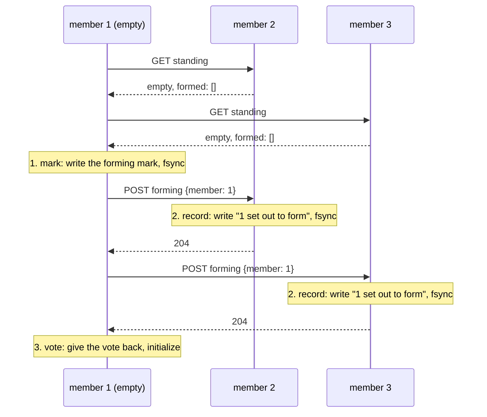

# Metadata Raft

**Decision: control-plane metadata becomes a Raft-replicated state machine
hosted inside the control-plane instances themselves, built on openraft,
served through the existing store traits as a backend alongside memory.
Brokers and clients cannot tell which backend answered. SWIM
for node liveness is rejected for now; that decision is recorded in
[control-plane.md](control-plane.md#why-liveness-stays-centralized-swim-considered),
because it stands on its own whether or not Raft ships.**

Recorded for [#333](https://github.com/GetFelix/felix/issues/333). The
alternatives and what would overturn each choice are below, in the same
spirit as [replication-design.md](replication-design.md), which decided the
*opposite* for stream payloads, and whose argument this document must not
quietly contradict.

## Why now

Felix should be deployable where no database platform exists. The control
plane had been made highly available as N stateless instances over an HA
Postgres, which was the right trade wherever a managed database was
available. Raft removes the last external dependency from a self-contained
cluster, and the Postgres backend has since been removed: Raft is the only
production backend.

## What has to be true

**The broker contract is frozen.** Brokers consume snapshots + change feeds,
send heartbeats, and receive leases. None of that may change shape: a broker
must not know or care which backend the control plane runs. The whole design
is behind `ControlPlaneStore`/`AuthStore`, exactly where the
backend split already lives.

**Acknowledged metadata writes survive losing a minority.** A rolled-back shard-assignment
`generation` can be reused for a different owner, and brokers de-duplicate
ownership changes by generation. Raft gives this by construction: an
acknowledged write is committed on a majority.

**Rolling restarts must stay invisible to brokers.** Rolling restart of every instance, and
a kill of any one of three, with zero failed broker watch or heartbeat calls.
The existing `rolling_restart.rs` test is the yardstick; it gets a Raft
variant.

**Writes are rare and small; reads are constant.** Tenants, streams,
assignments and membership are kilobytes that change on operator action, plus
heartbeats on a fixed cadence. The read side (broker watches, snapshots,
routing) dwarfs the write side. The design must put its cost on the path
that can afford it.

## The objection this design must answer first

[replication-design.md](replication-design.md) rejected per-shard Raft
partly because **Raft requires truncating a follower's divergent uncommitted
log suffix**, and the storage layer's load-bearing invariant is that records
are never rewritten. Does that argument not kill a metadata Raft log too?

No, and the distinction is worth stating precisely: that invariant belongs to
`felix-storage`'s segment log, and the metadata Raft log **never touches
`felix-storage`**. It is a separate, purpose-built, kilobyte-scale log whose
semantics are Raft's, suffix truncation included, owned by the control
plane, on the control plane's own volume. The "keep two logs" objection in
that document was about writing every *payload* record twice; here there is
no payload, and the second log holds only metadata commands. Reusing the
segment store for the Raft log was considered and rejected for exactly the
reason per-shard Raft was: it would need a truncate-uncommitted-suffix
operation the segment format deliberately does not have.

That was true when this was written. The segment store now cuts an
uncommitted suffix as a supported operation, and the plan is to move this
log onto it: see [Moving to the segment store](#moving-to-the-segment-store).

## The selected design

### Shape

Every control-plane instance embeds a Raft node. The group is the
control-plane replica set: three for production, one (single-node group)
for development. Each instance persists the Raft log and periodic snapshots
on its own volume; this is the PVC-per-pod StatefulSet shape
[control-plane.md](control-plane.md#kubernetes-deployment-model) has
sketched since the beginning.

```
            writes (forwarded to leader, proposed, committed on majority)
   brokers ──────────────────────────────────────────────┐
      │                                                   ▼
      │  reads (served locally)     ┌─────────┐    ┌───────────┐
      ├────────────────────────────▶│ follower│◀──▶│  leader   │
      │                             └─────────┘    └───────────┘
      └────────────────────────────▶┌─────────┐         ▲
                                    │ follower│◀────────┘
                                    └─────────┘   log + snapshots
                                                  on each node's own volume
```

### The state machine is the in-memory store

`InMemoryStore` already implements every store trait and holds the entire
metadata state. The Raft state machine is that store plus an `apply(command)`
entry point: commands mutate it, snapshots serialize it, and reads are served
from it directly on whichever instance received them. Reusing the store this way is the
design's main simplification. The state machine does
not need inventing; it needs a command log in front of something that
already exists and is already contract-tested.

**Commands are API-shaped, not statement-shaped.** One command per logical
mutation: `CreateStream`, `RegisterNode`, `Heartbeat`, `PlaceShard`,
`BootstrapTenantAuth`, and so on: roughly one per mutating store-trait
method, not one per row touched. Two things fall out:

- **Multi-step atomicity is free.** Tenant bootstrap must give N racing
  instances exactly one winner. Under Raft that is a single
  `BootstrapTenantAuth` command:
  the log totally orders the racers, the first applies, the rest observe
  `already initialized`. Every check-then-act race
  is closed by the log's ordering.
- **Apply must be deterministic.** Three instances apply the same commands
  and must reach identical state. So nothing inside `apply` may read a
  clock, generate randomness, or consult anything outside the command and
  the state. Every timestamp is stamped at *propose* time (the heartbeat
  rule "the recorded time is the control plane's own clock" becomes "the
  leader's clock, carried in the command", with the same authority and the same property:
  a broker still cannot postpone its own expiry). Every generated value
  (signing-key material, kids) is generated at the API layer and carried in
  the command. Signing keys therefore appear in log entries and
  snapshots, on the same class of volume as the store itself; this is stated
  here so nobody discovers it in a review.
- **A conditional write is decided at apply.** Placement's assignment writes
  are `PutShardAssignmentIf`, carrying the generation the planner read; the
  state machine compares it with the generation it holds as the entry applies,
  so every replica reaches the same answer and a stale write is answered with
  `StaleAssignment` rather than applied. It is a separate command, not an
  optional field on `PutShardAssignment`: a follower from before it existed
  must refuse the entry, as it refuses any unknown `op`, rather than ignore the
  field, apply the write unconditionally, and diverge from the replicas that
  skipped it. Entries already in the log are unaffected.

### Writes: forwarded, proposed, applied

Any instance accepts a mutating HTTP request; a follower forwards it to the
leader over the control plane's internal channel, the leader proposes,
commits on a majority, applies, and answers. Clients keep talking to one
load-balanced URL. Forwarding is invisible, exactly as it is for
broker-to-broker publishes on the data plane.

### Liveness is leader soft state

Heartbeats do not go through the log. Each one would be an fsync on a
majority for a fact that is stale seconds later. The leader keeps the last
heartbeat per node in memory, aged on its monotonic clock, and answers a
heartbeat only after a read-index round confirms it still leads, so a
partitioned ex-leader cannot extend a broker's lease. A follower forwards
heartbeats to the leader (`/internal/raft/v2/leader`). If the leader is an older
build without that route, the follower falls back to the old log command.
A member that has shut down stops counting itself as leader, even though
openraft still names it, and refuses leader-only requests at once, so the
caller tries another instance instead of reading the dead term's view.

The log carries only the consequences. `ExpireNodes` names the nodes the
leader judged stale, each at an incarnation. `CheckpointHeartbeats`, written
at most every 5 s for the whole fleet, keeps node listings on followers
roughly current. The leader judges every node by a monotonic age alone, never
by the log's stamp: that stamp is a checkpoint of an earlier moment and, after
a wall-clock step back or on a leader whose clock is behind the last one's, it
lies in the future. A node heard from this term is aged from that heartbeat. A
new leader starts knowing nothing and treats its own start as a heartbeat from
every node, and a registration during the term as a heartbeat from that node.
So it expires nobody until a full window has passed under it, and a broker it
never hears from goes down one window after the election, however far ahead
its stamp is. Its view resets on every term change. Listings served by the
leader show a stamp ahead of its clock as "now". The placement
lease works the same way: renewals are soft state, only a change of holder is
written, and a new leader counts the recorded holder as renewed when it took
over.

### Reads: local, because the contract already allows it

Broker snapshot/changes polling is *pull-based and eventually consistent by
contract*: a broker behind by one poll is the normal case the resnapshot
rules already handle. So follower-served reads change nothing for brokers,
and they are what keeps read load off the leader.

The change feeds keep their per-entity sequence numbers and eviction
windows, maintained by the state machine exactly as `InMemoryStore`
maintains them today, so all three resnapshot signals
(`first seq > since`, empty-but-advanced, `next_seq < since`) survive
unchanged. Sequence numbers are state-machine state, identical on every
instance at the same applied index, so a broker can fail over between
instances mid-poll and the numbers still mean the same thing, which is
better than today, where an in-memory control plane restarting resets them.

Admin reads that feed decisions (the sweep's view before claiming an expiry,
placement's reads) run on the leader, which serves them from applied
state: leader-local reads after `ReadIndex`-style confirmation where
staleness would change a decision. The expiry sweep and the placement
reconciler run **only on the leader**, which replaces M7's
"each node claimed by exactly one sweep" cross-instance coordination with
something strictly simpler: there is one sweep because there is one leader,
and its conclusions are commands like everything else.

### Leases come from the leader

[replication-design.md](replication-design.md) leases are granted by "the
control plane"; under Raft that means **the Raft leader**, and the
`t + L + margin` safety arithmetic gets one addition: a new Raft leader must
not grant generation `G+1` earlier than the old leader could have promised
`G` was still valid. Lease grants and their timestamps are in the log, so
the new leader knows every outstanding promise and simply waits out the
same margin. The fencing story does not change; it gains a second
well-defined epoch (Raft term) underneath the one it already has
(assignment generation).

Replica reports go through the log like everything else placement decides
on (`RecordReplicaReport`, restamped with the leader's clock on the way in,
exactly as a heartbeat is), so every member holds them and a new Raft leader
promotes from what the old one knew rather than waiting for leaders to report
to *it*. They are in snapshots too (`replica_reports`, left out while
empty, so an older snapshot without the field still loads). A live leader
would replace them within one reporting interval, but a dead one never
reports again, and its last report is exactly what failover needs to promote
a replica. Without it, a member restored from a snapshot taken after that
report could not replace the leader, and its state would differ from its
peers' in a way the byte-for-byte snapshot comparison could not see.

### Snapshots, compaction, recovery

State is small, so snapshots are cheap: serialize the whole store at a log
threshold, truncate the log behind it. An instance that lost its volume
rejoins empty and is caught up by snapshot install plus log replay, without
a vote until it has (see [Rejoining after a lost volume](#rejoining-after-a-lost-volume)).
For disaster recovery beyond quorum loss, the snapshot format is what
[Restoring beyond quorum loss](#restoring-beyond-quorum-loss) reads.

Each member keeps one snapshot on disk, and it only moves forward. Openraft
builds snapshots in a background task, so a member can capture its state for a
snapshot, receive a newer snapshot from the leader, and only then finish
writing the one it built. Writing that older snapshot would be unsafe: the log
has already been purged up to the newer one, so on restart the member would
need entries it no longer has, and it would refuse to start.

So a snapshot is written only if its last log index is past the stored one's.
The check and the write happen under one lock in the snapshot store, so
nothing can land in between. A snapshot's metadata and data are one file,
renamed into place, so a crash never leaves half of one. A
received snapshot also never moves the applied state backwards. If one ever
arrived behind what the member has applied, the member stops with an error
rather than apply the entries in between a second time.

One crash window remains. When a member receives a snapshot from the leader,
openraft purges the log behind it without waiting for the snapshot to be
written. A member that crashes between the two restarts with its older
snapshot and a log purged past it, and refuses to start. It does not diverge.
To recover, wipe its volume and let it rejoin as described in
[Rejoining after a lost volume](#rejoining-after-a-lost-volume).

### Group membership and bootstrap

Initial members come from configuration. For the StatefulSet shape, the
ordinal peers (`felix-controlplane-{0,1,2}`) via the headless service that
control-plane.md already reserves for exactly this. Growing the group is
learner-first: a new instance joins as a non-voting learner, catches up by
snapshot, and is promoted; shrinking is the reverse. A single-member group
serves development with no ceremony, replacing the in-memory backend's role
without its amnesia.

### Rejoining after a lost volume

Raft is only safe if a voter never forgets its vote or its log, and openraft
will grant a vote from an empty log. So a wiped member that simply came back
as a voter could lose acknowledged writes: with the leader wiped and the only
other holder of a write frozen, the member that missed the write wins on the
wiped member's vote, and truncates the write from the frozen member when it
returns. `tests/raft_chaos.rs` reproduces exactly that.

A member that starts with no Raft state therefore withholds its vote: it
refuses vote requests and does not stand for election. It asks its peers
(`GET /internal/raft/v2/standing`) which case it is in:

- **The group exists**: some peer's log is past the initial membership
  entry. The member follows the leader like a learner: it takes the log or a
  snapshot but has no vote. It asks the leader for its last log index
  (`GET /internal/raft/v2/catch-up-target`, answered only after a read-index
  round confirms the leadership) and votes again once it has applied that
  far. Readiness keeps it out of rotation until then.
- **First boot**: every configured member answers and is empty, *and* the
  operator set `FELIX_RAFT_INITIAL_CLUSTER_STATE=new`. Each such member
  initializes the configured group, which openraft allows, once every
  other member has recorded it ([below](#forming-the-group)). A
  single-member group decides this alone. With the default, `existing`, empty members wait
  and log why instead: a member cannot tell a first boot from a lost volume,
  and only the operator knows which it is.
- **Neither**: it waits and asks again, and logs which members it is waiting
  for and why.

A first boot acts on answers, never on silence:

- **Every member must answer.** A member that is down may be the one that
  holds the group's data. A majority of empty answers used to be enough, so
  two members that lost their volumes while the third was down formed a new
  group under `new`, and the third's acknowledged writes were gone when it
  came back. The cost is that a cluster's first start needs every member
  up, once.
- **Only a decoded, empty answer is empty.** A 403 (the member belongs to
  another cluster), any other refusal, a failed TLS handshake and a body
  that does not decode all block a first boot. None of them counts as "the
  group exists" either.
- **Each member has its own address.** `FELIX_RAFT_PEERS` is refused when
  two ids share one, since one machine would then answer for both.
- **The group exists when a log holds an entry at index 1 or above.** Every
  first-boot member writes the same membership at index 0 and may vote for
  itself before anyone leads, so neither says a group exists. An entry at
  index 1 takes a leader, and a leader takes a formed majority. Until then
  every member answers empty, so the members of a first boot never wait on
  each other.

The model checks the rule (`docs/formal/FelixRaftPlacementForm.cfg`,
`FelixRaftPlacementFormAfterWipes.cfg`), and shows the majority rule it
replaced losing an acknowledged write (`FelixRaftPlacementFormMajority.cfg`).

#### Forming the group

An empty log does not show that nobody has voted. Members vote before the
first leader writes its first entry, so in a cluster's first moments every
member answers empty while votes are already out. A member that lost its
volume in that window, with `new` still set, used to form again and vote a
second time in a term it had forgotten. Two members could then lead the same
group, and one acknowledged a write the other overwrote
([#2374](https://github.com/GetFelix/felix/issues/2374)).

So a member forms in three steps, and each is on disk before the next
starts:



1. **Mark.** Every member has answered empty and none names this member. It
   writes a *forming mark* to its own store.
2. **Record.** It sends `POST /internal/raft/v2/forming` with its id and the
   ids of the group to every member that answered. Each one writes the id to
   its own store and syncs it before it answers. A member records whatever
   its own state is: formed, empty or still withholding its vote. It refuses
   a group that is not the one in its own `FELIX_RAFT_PEERS` (409), since
   members initialized with different groups can split.
3. **Vote.** Once every one of them has answered, the member gives back its
   vote and initializes. Until then it votes for nobody and asks again.
   Between `initialize` and its first vote it writes a *reached* flag to
   its own store, beside the mark. A member that catches up writes it too,
   before it votes again, and so does any start that finds Raft state and
   a vote that is not withheld.

`standing` lists the ids a member has recorded, as `formed`. An empty member
reads the lists when it starts:

- **Named by a peer, and it holds no mark.** The volume that held the mark is
  gone, and that volume may have voted. The member never forms. It keeps its
  vote withheld and catches up with a confirmed leader, like any member that
  rejoins.
- **It holds the reached flag.** Its log is blank, so the log was lost after
  the member may have voted. On the segment store the log is a directory of
  its own (`store/log/`) and the mark and the flag are beside it, so an
  emptied log directory keeps both. The member never forms; it catches up
  like a member that lost its volume.
- **Named by a peer, and it holds its mark but not the flag.** It was
  stopped between the mark and its first vote. A crash before `initialize`
  leaves a blank log and no flag; one after `initialize` leaves a log, and
  the next start writes the flag. So the member has not voted. It asks for
  the records again and goes on.
- **Not named.** A first boot, as above. Members that have already formed do
  not stand in its way: only a record of *this* member counts, so a member
  that starts late forms with the same group, and the others can win its
  vote.

This closes the gap because every vote a member gives comes after a record
of that member on every other member that answered. The record is lost only
if all of those volumes are lost as well, and then nothing is left for a
second vote to contradict. Neither the mark nor the records are Raft state:
a member that holds only those still counts as empty, and `form-without`
still accepts it.

The model checks the three steps (`docs/formal/FelixRaftPlacementFormEarlyWipe.cfg`,
`FelixRaftPlacementFormEarlyWipeFirstBoot.cfg`), and shows a member voting
twice in a term without the record
(`FelixRaftPlacementFormEarlyWipeUnrecorded.cfg`). A wipe that takes only
the log is in `FelixRaftPlacementFormLogWipe.cfg` and
`FelixRaftPlacementFormLogWipeFirstBoot.cfg`; without the reached flag the
member forms again on its mark and votes twice
(`FelixRaftPlacementFormLogWipeUnreached.cfg`).

What it costs:

- **A first start needs every member on a build that has the route.** A
  member on an older build answers `standing` as empty and 404 to `forming`.
  That is no record, so the others wait and log which member it is. An
  existing group is not affected: its logs hold entries past index 1, so no
  member tries to form.
- **A majority of volumes lost in the first moments leaves nobody to lead.**
  With one volume lost, the other two elect a leader and the member catches
  up. With two lost before any leader wrote an entry, the wiped members wait
  for a leader that the third cannot become alone. If the cluster never held
  data, stop every member, empty every volume and start again; otherwise it
  is quorum loss and the [restore](#restoring-beyond-quorum-loss) applies.

Still remove `new` once the cluster has started. The record makes a stale
`new` safe in this window, and `existing` keeps it from mattering at all.

#### Forming without a lost machine

If a member's machine is gone for good before the group ever formed, the
others would wait for it forever. The operator can waive it. On each
surviving member, while it is stopped:

```bash
felix-controlplane raft form-without --data-dir /var/lib/felix/raft \
  --cluster-id prod-metadata --slot 3
```

`--slot` is the absent member's `FELIX_RAFT_NODE_ID` and may be repeated.
The command writes a `form-without` file into the data directory and prints
what it wrote. At its next start the member logs the waiver as a warning and
may form the group without an answer from that slot.

What the waiver does and does not do:

- **It excuses silence only.** If the waived slot answers, its answer counts
  like any other: a group that exists is caught up with, and a 403, a
  failed TLS handshake or an undecodable answer still blocks. Silence is a
  connection that fails or times out.
- **It names a minority.** The members that answer empty, this one included,
  must still be a majority of the configured group.
- **It covers the record too.** A waived slot that stays silent is not asked
  to record the forming member. One that answers is asked like any other.
- **It is used once.** The member removes the file before it initializes.
  It also removes it, with a warning, when it finds the group exists or
  that it holds Raft state. A crash between the removal and the
  initialization leaves an empty member with no waiver: run the command
  again.
- **It applies to a first start only.** The command refuses a member that
  holds Raft state (a vote, a log entry or a snapshot). A member that
  started, waited for the dead peer and was stopped holds none, so the
  command accepts it.
- **It does not shrink the group.** The absent slot stays a voter, so the
  group runs two of three with no slack until a machine with an empty volume
  starts at that slot's address.
- **It cannot see the absent machine's disk.** If that machine holds this
  cluster's data and returns, the group formed without it has replaced it.
  Use the waiver only under a cluster id that no volume has ever held.

**Known gap (#2365).** Only the vote is withheld. The member still answers
appends and heartbeats, and a leader counts them. It forgot the term it last
voted in, so a leader of an older term can commit with it after a newer
leader was elected on its vote, and that entry is then cut
(`docs/formal/FelixRaftPlacementSameIdCounted.cfg`). A rule that no leader
counts a member while its vote is withheld closes this for three members
(`FelixRaftPlacementSameId.cfg`). It does not for five: the member can vote
a second time in the term it forgot (`FelixRaftPlacementSameIdFive.cfg`).

The withheld vote is written to the member's store before any of this, so a
crash half-way through catching up restarts still withholding it, not as a
voter with half a log. Membership never changes: a demote-and-promote would
need every remaining voter for the joint configuration, so one other member
being down would stall writes until it came back.

Losing a majority's volumes at once is quorum loss, and the snapshot
restore path is the answer. What the member must not do is paper over it:
two empty members of three that can reach each other but not the third
used to form a new, empty group on their own, with new signing keys and
every generation back to zero. Now they form one only under `new`, which
belongs to a cluster's first start and nowhere else, and only once the
third has answered that it is empty too.

**Cluster id.** Every member is configured with `FELIX_RAFT_CLUSTER_ID`,
etcd's cluster token under another name. The first start records it in the
member's store, and a member refuses to start on a store recorded under
another id. Every peer request carries it and is refused (403) when it
names another cluster, so a member whose peers map points at some other
group's members never counts them as empty or as holding the group.

### Restoring beyond quorum loss

The state machine's snapshot format can be loaded into a group with the
`ImportState` command, which the peer listener's `propose` route accepts. The
group refuses it if it already holds state, unless `overwrite` is set, which
discards what the group holds, consumers' checkpoints included. No shipped
command or tool writes or proposes such a file, so a restore beyond quorum loss
has no operator path today; the tests use the command.

- **Restore under stopped brokers.** A restore rewinds node incarnations and
  replica reports together, so an old report can again name the incarnation a
  running broker's later process holds, and placement may replace that leader
  on its followers' word while it still serves on its lease. Stop every broker
  before the import.
- **A snapshot is a credential.** It holds every tenant's Ed25519 signing-key
  seeds, current and previous, as plaintext JSON: whoever reads it can mint a
  valid token for any tenant.

### Probes

- `/v1/system/live`: unchanged, process-local, never touches consensus.
  An instance that lost quorum must not be restarted into the same lost
  quorum.
- `/v1/system/ready`: ready when this instance knows a leader and its
  applied index is within a freshness bound of the leader's commit. A
  follower serving watches is ready; an instance partitioned from the group
  is not; during an election the group is briefly all-unready for writes,
  which is the truthful answer and lasts an election timeout, not a cache
  window. The M7 drain semantics (fail readiness first, predrain hold,
  bounded drain) apply as-is.

## Library

**openraft, pinned to one exact version** (0.10.0, the workspace pin; the
move from 0.9 is described in
[openraft 0.9 to 0.10](#openraft-09-to-010)), wrapped behind a small crate-local seam so
openraft types never appear in the store traits or handlers. This is the same
discipline as the storage layer's `AppendOnlyLog` seam, and the insurance
against openraft's documented pre-1.0 API instability.

- **openraft**: async, tokio-native, snapshot/learner/membership machinery
  included, proven as the metadata consensus of Databend among others.
- **raft-rs (TiKV)**: rejected, as a sync core that requires hand-building
  the tick loop, transport, storage, and snapshot orchestration openraft
  ships; that is most of the risk for none of the fit.
- **Hand-rolled**: rejected. Every line of consensus code Felix does not
  carry is one it cannot get wrong, which argues for a maintained
  implementation with an existing test corpus. Felix's effort here goes to
  the state machine, which nobody else can write.

### Transport and peer authentication

Raft RPCs are JSON over HTTP on a **peer listener of their own**
(`FELIX_RAFT_BIND_ADDR`), never the public API port. On the API port,
`propose` would be open to anyone who can reach the API, and one
`ImportState{overwrite}` replaces the whole store, signing keys included.

Every peer request must carry:

- `x-felix-raft-cluster-id` naming this group (403 otherwise), and
- `Authorization: Bearer <FELIX_RAFT_PEER_TOKEN>`, compared in constant
  time (401 otherwise).

The token is the cluster-admin credential. Members hold it, and so does the
operator holding it; brokers and API clients never see it.
`propose` needs nothing more because holding the token already is
cluster-admin. A member refuses to start in Raft mode without a token of at
least 32 characters unless `FELIX_RAFT_INSECURE_PEERS=true` says otherwise,
which is for throwaway local groups.

A member that refuses a connection, times out, or answers with any non-2xx
status is treated as unreachable: the leader backs off before retrying it,
starting at one heartbeat interval and doubling up to one second. The
leader's log names the status and the start of the reply body, for example
`peer answered 403 Forbidden: ...`. Elections and replication to healthy
members are not delayed by it.

With `FELIX_RAFT_TLS_CERT`, `FELIX_RAFT_TLS_KEY` and `FELIX_RAFT_TLS_CA`
set, the peer listener terminates mTLS and refuses the handshake to any
client without a certificate from that CA, and the member's own peer client
presents the same certificate, trusts only that CA, and checks the server
name against the address in `FELIX_RAFT_PEERS`. The token stays required
under mTLS. What mTLS does not do yet is bind a certificate to a member id:
any certificate from the cluster CA can speak for any member, so issue that
CA's certificates to control-plane members only.

The network layer resolves a member's address from `FELIX_RAFT_PEERS` by
id before falling back to the address recorded in the membership, so moving
the peer port is a config change, not a membership change.

### Upgrading

Two rules, both about mixed versions.

**Moving to the authenticated peer listener** is not a rolling change: an
old member sends unauthenticated RPCs to the API port, and a new one only
answers authenticated ones on the peer port. Upgrade every member at once
(scale the StatefulSet's pods down and up, or delete them together). Writes
pause for the restart; brokers keep serving on their catalogs and leases as
during any control-plane blip. The recorded membership still names the old
API addresses, which is fine: the configured peers map wins.

**Commands newer than some member are not proposed.** Every command
variant has a level (`MetaCommand::version`), and each build reports the
highest level it can apply (`METADATA_VERSION`) on the peer `standing`
route. A member proposes a command only when every member of the current
membership, learners included, reports at least that command's level, in
the manner of KRaft's `metadata.version`. A member that reports nothing
predates this and counts as level 0; one that cannot be reached counts at
what it last reported. One that has not answered since this process started
counts at the group's floor (below), the level the applied log already
depends on. A member below it could not apply what the log already holds,
so counting one at the floor lets through no level above what it was
already sent. Counted at 0, a
restart with one member down dropped every field the group had been storing,
such as a node's storage identity, until that member answered again. The member asking gives its
own level on that probe, so every member has heard the leader's: when the
leader dies, the member elected next still counts it at its level. Without
that, a dead leader was an unknown to its successor, and the new leader fell
back to heartbeats and expiry through the log for as long as it stayed down.
The group's level is
recomputed at most every two seconds, so it rises shortly after the last
member restarts on the new build. The rollout order therefore does not
matter: a StatefulSet can upgrade the leader first.

**A member below the group's floor is not added.** The floor is the
higher of two levels. One is the highest level a finalized fleet feature
needed (`stream_incarnations` needs 10, `jump_hash_routing` 3, any other 2),
since the entries after a finalize rely on it. The other is a mark the state
machine keeps: applying an entry whose variant or fields
(`store/raft/command/fields.txt`) need a level above 8, the last released
one, raises it to that level, whether or not the entry succeeds. Before any
finalize, a delete carrying `take_shards` raises it to 10. The mark comes
from the entries alone, so every member holds the same one, and it rides
the snapshot as `levels_used`, left out while it is 0. A
v0.6.0-preview.7 member, at level 8, refuses a snapshot with a non-empty
field it does not know; it never sees the mark, because the mark is only
set by entries it could not apply either. Once the floor is above 0, the
leader asks a new member its level on the `standing` route before adding it
as a learner, and refuses the join when it is below the floor, reports
none, or does not answer, naming both versions. At floor 0 any build may
join: the group's level drops to the newcomer's, as during a rolling
upgrade.

**A member below the floor is held, not fed.** A member already in the
membership is never asked to join again: one whose volume was wiped and
that restarts on an older build under its old id would otherwise be sent
the log and a snapshot it cannot apply. So the leader holds a member when
it has evidence the member is below the floor (`raft/hold.rs`): an append
carrying entries, or a snapshot, fails as unreachable and nothing is written
to it. A heartbeat still goes while openraft has nothing else queued for
the member (it is caught up and nothing new has been written), with the
commit index removed so the member applies
nothing, not even entries it was sent before the hold. A held member that is
behind gets nothing at all: openraft retries the held append or snapshot
with backoff, up to a second apart, and never sends a heartbeat in its place.
It may time out and call elections, which the others refuse while they hear
from the leader, and once it is released its first append can come back with
a higher vote and depose the leader. That is one extra election per long
hold. The check reads only
cached state, the floor from an atomic the state machine updates on apply
and restore and each member's last reported level; a send never waits on a
probe. The leader keeps those levels fresh in the background
(`watch_versions` in `raft/version.rs`): it asks every member on the
`standing` route when it takes the lead, every 10 seconds after that, and
every 500 ms while a member is held.

The evidence is one of two things. Either the member reported a level
below the floor (every released build that runs Raft answers `standing`
with its level, 8 for v0.6.0-preview.7), or it answered an append with a
conflict at or below an entry it had acknowledged to the same replication
client. A client lives at most one leader's term, during which the
leader's log only grows, so that conflict means the member lost its log,
possibly to a restart on another build. It alone is held, and asked at
once by a probe of it alone, until it reports a level at the floor; an answer to a probe sent
before the conflict does not count. A member whose level is unknown,
because it has not been asked yet or did not answer, is fed, and a failed
probe keeps the last level it reported. Holding on silence would hold
healthy voters after every leader change or slow probe and cost the group
its quorum. The conflicts a lagging member answers while the leader
searches for where their logs match are above what it acknowledged, so
they hold nothing.

A new client has nothing acknowledged to compare with. openraft builds one
for each follower when a leader takes over and again on every membership
change, and a member that lost its log would otherwise be fed on that
client's first conflict, with whatever level it reported before the wipe
still cached. So a conflict a client sees before any
acknowledgement holds that member until one probe sent after it settles:
a level at the floor or no answer releases it, a level below keeps it
held. The probe goes to that member alone, so it never waits on a pass over
the other members. It gives up after 200 ms and then asks once more for up
to a second, the bound the watch uses, so a member that is slow to answer is
not released by silence. Only the held member waits on that; the others are
fed as usual. One probe per member is in flight at a time. Each such
conflict asks again once the last probe settled, since
the member can be wiped between two of them. Up-to-date members answer the
first append with success and are never asked. A member that is behind pays,
for each conflict while the leader searches for where their logs match, a
probe round trip and openraft's retry delay of one heartbeat interval.

Marks and holds belong to the leader that made them. The watch drops a
member's state once it leaves the membership and clears all of it,
resetting the gauges, when this member stops leading.

The leader logs the hold once and sets
`felix_meta_raft_member_below_floor{member}` to 1 until it ends. To openraft
a held member is a follower that stopped taking entries, so commits still
need only a majority, but holding a voter takes one failure off what the
group can survive until that member is upgraded. Two cases are not caught: a member
restarted on an older build with its log intact, which is a rollback,
covered below; and a member wiped and restarted on an older build whose
probe fails even though it just answered an append, which is fed because
silence never holds. And while the leader's log is shorter than 16 entries
and has never been purged, openraft sends a new client's first append from
the start of the log, which an empty member accepts without a conflict; a
member wiped and restarted on an older build then is caught only by the
watch's next pass, up to 10 seconds later.

Level 1 is rule removal and signing-key rotation (`remove_rbac_policy`,
`remove_rbac_grouping`, `stage_signing_key`, `activate_signing_key`,
`retire_signing_key`) and leader soft-state liveness (`expire_nodes`,
`checkpoint_heartbeats`). Until every member is at level 1:

- the routes that remove RBAC rules or stage, activate or retire signing
  keys answer 409 saying the group is not yet at the version they need;
- the leader declines leader-only requests, so heartbeats, expiry and the
  placement lease go through the log (`record_node_heartbeat`,
  `expire_stale_nodes`, `take_placement_lease`) as on the older build.
  When the group reaches level 1 the leader starts a fresh soft-state
  window, so nothing is expired at the switch.

Level 2 is fleet features (see [Fleet features](control-plane.md#fleet-features)):
`register_node_in_fleet`, a registration that keeps the broker's features
and refuses one lacking an enabled feature, and `finalize_fleet_feature`,
which enables one if every serving broker supports it. An older member would
apply the first as a plain registration and accept a broker this build
refused, so until every member is at level 2 brokers register with
`register_node` and their features dropped, and a finalize is refused. A
broker reports its features again when it next registers. The enabled set is
part of the snapshot (`fleet_enabled`, omitted while empty).

Level 5 is `create_resources`, the batch create behind
`POST /v1/tenants/{t}/namespaces/{ns}/resources` (see
[Creating streams and caches together](control-plane.md#creating-streams-and-caches-together)).
It is one entry so the batch applies whole or not at all. Until every member is
at level 5 that endpoint answers `503`, and single creates go through
`create_stream` and `create_cache` as before.

Level 6 is a refresh record's `narrowing.may_act`, the gateway an exchange's
`actor_token` named (see [Delegated tokens](auth.md#delegated-tokens)). An
older member would drop it, and the chain's refreshed tokens could no longer be
delegated by that gateway, so until every member is at level 6 an exchange with
`actor_token` is refused with `409`.

Level 7 is `revoke_principals`, a principal revocation (see
[Revoking a principal](auth.md#revoking-a-principal)), and the snapshot's
`principal_revocations`, omitted while empty. Until every member is at level 7,
`POST /v1/tenants/{t}/refresh-tokens/revoke` revokes the refresh tokens and
answers `409`, and an RBAC removal succeeds without ending the sessions it
reached.

Level 8 is a replica report's `counter_offsets`, where each copy of a cache
shard has got with its counter log. Placement only reads it as progress for a
restore, so until every member is at level 8 reports are recorded without it,
and a restore copying only counters can be dropped by the stall window as
before.

Level 9 is two combined entries. `ChangeAuthAndRevoke` makes an auth change
(a rule removed, an issuer changed or deleted) together with the revocation it
calls for, and `RotateRefreshToken` spends a refresh token and stores its
replacement. Until every member is at level 9, the proposer writes each as the
two older entries it combines, so a failure between them can leave the first
without the second, as before.

Level 10 is stream incarnations (the rules are in
[control-plane.md](control-plane.md#broker-side-lifecycle)): a
stream's and a shard assignment's `incarnation`, a stream change's
`deleted_through`, and the snapshot's `stream_tombstones`. Finalizing
`stream_incarnations` needs every member at level 10. The create command
carries the proposed incarnation and the applying member decides the final one
against its tombstones, so every member decides alike.

Level 10 also decides what a delete takes of a stream's or cache's shard state.
`delete_stream` and `delete_cache` carry `take_reports`, and `delete_namespace`
and `delete_tenant` carry `take_shards`. With the flag, the delete takes the
shards' assignments and replica reports. Without
it, the delete applies as a member below level 10 applies it: a stream or cache
delete takes the assignments and keeps the reports, and a namespace or tenant
delete keeps both. The proposer sets the flag only once every member is at level
10, so a mixed group applies every delete alike. Until then a stream created
again under a deleted name can find what the delete kept, as before.

Level 11 is a replica report's `by_round`, the leader's word that it serves
the shard without its lease, and the `leader_incarnation` it was said from. Placement takes a follower's suspicion against a
leader only when its report says so, so until every member is at level 11
reports are recorded without it and leaders are failed over on the lease.
Dropping it is the safe side: a member that applied the field and one that
dropped it would otherwise disagree on whether a leader may be replaced.

Level 12 is storage identity: a node's `storage_id` and a replica report's
`follower_storage`. Both are plain command data, stored as proposed, so every
member applies them alike without reading a clock or its node table. Until
every member is at level 12 the proposer drops them, from the registration
and from the report, and keeps the rest of each. Placement then reads every
follower as unverified: counted while the report is fresh, and never from a
dead leader's report past its TTL (see
[replication-design.md](replication-design.md#who-may-be-promoted)).

Level 13 is a replica report's `report.leader`, the node that made it, and
its `node_incarnations`, the incarnation each node it names was registered at
when the API took it. The API fills both before proposing, so they are plain
data too. Below level 13 the proposer drops them, and placement reads the
report as it did at level 12: from any leader, and an unverified follower
however often it restarted.

Level 14 is cache incarnations, the same change as level 10 for caches: a
cache's `incarnation`, a cache change's `deleted_through`, the snapshot's
`cache_tombstones`, and a `create_resources` answer carrying the caches as
stored. It also adds `incarnations` to the create commands and to
`delete_cache`, `delete_namespace` and `delete_tenant`: the proposer sets it
only once every member is at level 14, and apply decides incarnations and
tombstones from the entry alone.

- A flagged create stores the incarnation it proposed, raised above the
  name's tombstone, once the feature is finalized, and 0 otherwise. A
  proposal of 0 stays 0.
- A flagged cache delete records the tombstone once `cache_incarnations` is
  finalized.
- An unflagged entry applies as level 13 applies it. A cache is created at 0,
  and a cache delete writes no tombstone. A stream entry keeps the meaning it
  had at levels 10 to 13, so entries already in a log replay as they did.

**What the finalize gate does and does not do.** An upgraded member refuses to
propose the finalize of `cache_incarnations` (409) until every member is at
level 14. A member still on the older build does not know the feature, reads
its finalize as level 2 and proposes it, so the finalize can commit in a mixed
group. What keeps the members identical is the rules above, not the gate.
Until every member is at level 14 no entry carries the flag, so caches are
created at 0 and no cache delete writes a tombstone, on every member. Through
an upgraded member a cache create is refused with 409 in that window, since
it would carry a cache incarnation. Brokers see caches at 0, as before the
finalize, and keep a deleted cache's data. Once every member is at level 14,
new entries carry the flag and caches get incarnations. The first flagged
create or delete raises the group's level floor to 14, finalized or not, so
from then on a member below level 14 is refused at join and held by the
leader.

Streams have the same gap at level 10: a `stream_incarnations` finalize can be
committed through a member below level 10, such as a `v0.6.0-preview.7`
member (level 8) during a roll to this release. Stream entries are decided
from the entry alone for that reason too:

- An unflagged stream create proposing 0 stores 0, and an unflagged delete of
  a stream at incarnation 0 writes no tombstone, so a level-8 member and an
  upgraded one store the same.
- An unflagged create proposing an incarnation still gets one, as at levels 10
  to 13. A proposer below level 10 never writes one.
- A level-14 proposer flags every create and delete once every member is at
  14, and fills in a proposal. It reads the group's level once per entry and
  decides the flag and the level gate from that one reading. An entry
  carrying a cache proposal is always flagged, so the gate refuses it below
  14. A stream create from it can still go unflagged while a member is below
  14, and then applies as the older levels do.

**The residual is for unreleased builds.** Levels 10 to 13 were never
released. Their builds gave an unflagged create proposing 0 after the finalize
the name's tombstone + 1, and tombstoned a deleted stream at incarnation 0.
That happened when the proposer had not yet applied the finalize, or counted a
silent peer as level 0. A cluster that ran such a build and logged one of
these entries now stores something different when it replays them: 0, and no
tombstone. A member that replays the log then disagrees with one restored from
a snapshot taken before the upgrade. Rebuild such members from a snapshot:
remove the member, wipe its Raft data and add it back. No migration step is
needed.

**Fields have levels too.** An older member decodes a newer entry with
serde, which drops any field it does not know, so a field is as much a
change to the command set as a variant. Every key path a command or the
snapshot can serialize is listed with the level that introduced it in
`store/raft/command/fields.txt`, and a command's level is the higher of its
variant's and that of the newest field it actually carries. Optional fields
are left out at their default, so a jump-hash stream needs level 3 and a
modulo stream needs nothing. Below a field's level the proposer either drops
the field itself, on every member alike, or refuses the command:

| Field | Level | Below it |
|---|---|---|
| refresh token `narrowing` | 1 | the refresh token is not stored and the exchange fails, since without it a refresh could widen the exchange's rights |
| replica report `leader` | 1 | the report is proposed without it and applies unchecked everywhere, as on the older build |
| snapshot `refresh_tokens` | 1 | snapshot only |
| node `zone` | 2 | the node registers without it, like its fleet features |
| node `features`, snapshot `fleet_enabled` | 2 | as above |
| stream `routing` | 3 | a jump-hash stream is refused with 409, and so is finalizing `jump_hash_routing` |
| snapshot `replica_reports` | 3 | snapshot only |
| stream and assignment `incarnation`, change `deleted_through`, snapshot `stream_tombstones` | 10 | an upgraded proposer refuses finalizing `stream_incarnations` with 409; one below level 10 does not, see the level-14 notes above |
| replica report `stream_incarnation` | 10 | the report is proposed without it, on every member alike |
| delete `take_shards` and `take_reports` | 10 | the delete is proposed without them and keeps what an older member keeps, on every member |
| replica report `by_round` and `leader_incarnation`, snapshot `replica_reports[].by_round` and `[].leader_incarnation` | 11 | the report is proposed without it, which placement reads as a leader on its lease |
| node `storage_id`, replica report `follower_storage`, and both in the snapshot | 12 | the registration and the report are proposed without them, which placement reads as unverified |
| replica report `report.leader` and `node_incarnations`, and both in the snapshot | 13 | the report is proposed without them, which placement reads as at level 12 |
| cache `incarnation`, cache change `deleted_through`, snapshot `cache_tombstones`, command `incarnations` | 14 | the entry carries no flag, so every member creates caches at 0 and writes no cache tombstone; an upgraded proposer refuses the finalize and, once finalized, cache creates with 409 |
| replica report `given_up`, and in the snapshot | 15 | the report is proposed without it, so placement replaces a leader that gave a shard up only on its storage identity and never names it again |
| delete `unassign`, shard put `seq_generation` | 17 | the delete records no unassignment for the shards it takes, and an unincarnated shard's first assignment starts at generation 0, on every member; a broker following the shard feed keeps the deleted stream's assignment until a newer one replaces it |
| create and delete `names`, snapshot `deleted_stream_names` and `deleted_cache_names` | 18 | deletes record no names and a deleted name is created again before the finalize, on every member, as before #1447 |
| stream patch `fence` | 19 | a change of consistency or durability does not advance the placement token, on every member, as before #1253 |
| replica report `inherited_storage`, and in the snapshot | 20 | the report is proposed without it, so a failover names a follower its leader had not reached by no identity, on every member, as before #1574 |
| assignment `pending_set`, replica report `joint_start_acked`, both in the snapshot, finalizing `replica_election`, `adopt_elected_leader` | 21 | a write carrying a pending set is refused with 409 before it reaches the log, never sent as a cut-over that takes the new set at once; the report is proposed without the joint start, which keeps a change pending on every member; an adoption is refused before it reaches the log, so every member keeps the generation and leader it had and the elected leader's report is judged as before; the finalize is refused |
| assignment `member_storage_ids`, and in the snapshot | 22 | the map is cleared before the write is proposed, so a broker reads a set that names no registered ids and a wiped copy is not told apart from one that kept its directory, on every member, as before #1009 S8 |
| assignment `learners`, replica report `holds_start`, both in the snapshot, finalizing `joint_fence` | 23 | the learners are cleared before the write is proposed and the report is proposed without its start holders, so placement reads the shard as it did before learners and a replaced copy is never re-admitted, on every member; the finalize is refused |
| stream `mount`, stream patch `mount`, and in the snapshot | 24 | a create or patch that sets or clears a mount is refused with 409 before it reaches the log, so no member stores a mounted stream as unmounted or lets two overlapping mounts through; streams without a mount are proposed as before |
| replica report `refused`, and in the snapshot | 25 | the report is proposed without it, so a leader that cannot serve a generation promised to an elected node is not named again above it and the shard waits as before #1730 |
| `adopt_elected_leader` `elected_set` | 26 | every member takes only the generation of a leader elected on a set other than the recorded one, and the report handler then moves the shard past it |
| `adopt_elected_leader` `own_leader_set` | 27 | every member takes only the generation when the shard's own leader was elected on another set, and the report handler then moves the shard past it (#1929) |
| replica report `refused.ballot`, and in the snapshot; shard put `at_least` | 28 | the report is proposed without the ballot and the write without the floor, so every member names the refusing leader one generation up, as before #1951 |

**A member refuses what it would drop.** From level 3 on, a member that
decodes an entry carrying a non-empty field it does not know answers
`Unsupported` and counts it, exactly as for an unknown variant, instead of
applying what is left. A snapshot carrying one stops the member at restore.
This is the rollback case: a member rolled back below a level already in
use would otherwise read the newer data and quietly lose the field, and for
`routing` that turns a jump-hash stream back into modulo and moves keys
between shards. Builds before level 3 do not have this check, so rolling
back past level 3 once a jump-hash stream exists silently loses its routing.
Do not roll a member back below the group's level; roll it forward.

A release that adds a variant or a field gives it the next level and raises
`METADATA_VERSION`. `store/raft/command/fields/tests.rs` builds every
replicated type from full struct literals and compares the paths they
serialize with `fields.txt`, so a new field does not compile until it has a
sample value, and the test fails until it has a level. If `felix_meta_raft_unsupported_commands_total` still
moves on a member (something proposed through the raw peer `propose`
route, or a member on an older build that joined before any finalize),
upgrade it, then wipe its volume and let it rejoin: it rebuilds from the
leader's snapshot as in
[rejoining after a lost volume](#rejoining-after-a-lost-volume).

## Failure modes

| Failure | Behaviour |
| --- | --- |
| One instance of three dies | Leader (if it was the leader) re-elected in one election timeout; writes pause for that long, reads keep serving; M7 signal holds |
| Instance loses its volume | Rejoins without a vote, catches up by log or snapshot, then votes again ([above](#rejoining-after-a-lost-volume)); no operator data surgery |
| A majority loses its volumes | The empty members wait rather than form a new, empty group. Under `FELIX_RAFT_INITIAL_CLUSTER_STATE=new` they still wait until every member answers and is empty, so a member that holds the log blocks them whether it is up or down; recovery is the snapshot restore |
| A member's volume is lost after the group formed and before its first leader wrote an entry | Its peers recorded it before it first voted, so it does not form again, even under `new`. It waits for the others to elect a leader, catches up and votes again ([above](#forming-the-group)). If a majority's volumes go in that window, nobody can lead: empty every volume and start again if the cluster held no data, or restore |
| A first start with a member on a build without the `forming` route | Nobody forms: that member cannot record the others. The log names it. Start every member on the same release |
| A member's machine is lost before the group first forms | The others wait for its answer. `felix-controlplane raft form-without` lets them form without it ([above](#forming-without-a-lost-machine)) |
| Something other than a member reaches the peer port | Refused before any route runs: wrong cluster id 403, missing or wrong peer token 401, and under peer mTLS no TLS handshake without a certificate from the cluster CA |
| Network partition, leader in minority | Old leader steps down (cannot commit), majority elects; minority instances fail readiness rather than serve writes that cannot commit |
| Quorum lost (2 of 3 down) | Writes and readiness fail on survivors; brokers keep serving on catalogs and leases as during any control-plane outage; recovery = restore instances (see [Restoring beyond quorum loss](#restoring-beyond-quorum-loss)) |
| Clock skew between instances | Irrelevant to Raft safety (term-based). Liveness expiry does not depend on it either: heartbeats are stamped and judged by one clock (the store's), so two instances comparing their own `SystemTime` is not a thing that can happen |
| Disk full on one instance | That instance fails writes → falls out of quorum participation → fails readiness; group continues on the majority |

## Testing

- **Determinism harness**: apply the same command sequence to two state
  machines, assert byte-identical snapshots. It is the cheap test that catches
  the expensive bug (a clock or a HashMap iteration order leaking into
  apply).
- **The contract suites run against the Raft backend** as they run against
  memory (`contract::nodes`, `contract::shards`,
  `contract::signing_keys`, `contract::placement` including the expiring
  lease, `contract::refresh_tokens`); that is what the trait seam is for.
  There are no contracts for tenants, streams, or RBAC on any backend yet.
- **`rolling_restart.rs`, Raft variant**: three instances,
  same zero-failed-calls assertion, plus a hard kill of the leader
  specifically.
- **Chaos via the cluster harness**: partition the leader from the group
  under broker traffic; assert no metadata write is lost and no shard gets
  two leaders across the transition (the lease safety interval test, now
  with a moving grantor).
- **Snapshot/restore**: wipe one instance's volume mid-traffic; assert it
  rejoins and converges.
- **First start** (`tests/raft_core.rs`): two empty members do not form
  while the third is down, answers 403 or answers something undecodable;
  two wiped members do not form over a down member that holds an
  acknowledged write; three empty members form one group; and the
  `form-without` waiver forms once, is removed, and never overrides a member
  that answers. For the forming record: a member wiped before the first
  entry does not form again and votes only after it has caught up with a
  leader; two wiped members do not form over a third whose log is empty; a
  late member forms against peers that have formed and have no leader; a
  member does not vote while one peer has not recorded it; on the segment
  store, a member whose log directory was emptied does not form again; and
  (`raft/join/tests.rs`) members stopped between the records and
  `initialize` form after a restart.

## What would overturn this

- **Heartbeat write volume dominating the log** at broker counts Felix
  actually reaches: the fix is decentralizing liveness (the SWIM decision
  gets reopened), not abandoning Raft for the metadata that is actually
  rare.
- **A multi-region metadata requirement.** One Raft group in one region is
  this design; metadata with region-local write latency everywhere is a
  different problem.
- **openraft 0.10 stabilizing with a materially better storage API**: the
  seam exists so that upgrade is a contained event, not a redesign. 0.10.0
  is out, and [openraft 0.9 to 0.10](#openraft-09-to-010) is that upgrade.

## Moving to the segment store

**Status: done for new clusters; no conversion.** The control plane runs
on `felix-storage`'s metadata store: the member file, the lock, the
snapshot file, the purge rule and `MetadataStore::open`, which checks the
start rules below, with the standard leader id and every peer route under
`/internal/raft/v2`. redb is gone from the service. The conversion tool
below was not built ([#2234](https://github.com/GetFelix/felix/issues/2234)
is open), so a member that finds a `raft.redb` refuses to start and an
existing group starts over
([replication-engine.md, decision 7](replication-engine.md#7-the-control-plane-starts-fresh-and-refuses-an-old-redb-directory)).
This section is the design, conversion included, for a Felix node with one
storage engine (issue [#2167](https://github.com/GetFelix/felix/issues/2167)).

The move was first built behind a compiler cfg, `--cfg felix_segment_store`,
that no release set, so CI could run both stores side by side. The reasons
for leaving redb, and the answer to "the segment store cannot truncate",
are in
[replication-engine.md](replication-engine.md#control-plane-storage-on-the-segment-log).

The log goes through the `raft_log` adapter in `felix-storage`, the same
adapter every shard group will use. What the adapter must guarantee is
written down as a TLA+ model, `FelixRaft.tla` (issue
[#2198](https://github.com/GetFelix/felix/issues/2198)). This section
covers what the control plane adds on top of it.

Four things must hold through the move:

1. No committed metadata is lost silently. With the conversion tool below,
   none is lost across the upgrade of an existing cluster. Without it, as
   shipped, a member refuses a redb directory and the operator starts the
   group over by hand.
2. Members never diverge. Where a rule cannot be kept, a member stops.
3. Brokers and clients see no change in a running group. Everything stays
   behind the store traits. (Starting a group over is a change they see.)
4. No benchmark cell gets worse than redb.

### What is stored, and where

One directory per member, under the Raft data directory:

| File | Holds | Written by |
| --- | --- | --- |
| `store/log/` | The Raft log: a `DiskLog` opened as a Raft log. Each entry is one record, the record's offset is the entry's index, and the term is in the record header. The vote and the committed index live in the log's ballot and replica-state files. | The `raft_log` adapter |
| `store/raft-snapshot` | The current snapshot: last log id, membership, the state machine's bytes, one checksum. | Rename into place |
| `store/member` | The cluster id, the vote-withheld flag, and two marks the upgrade uses: *converted* and *started*. | Rename into place |
| `store/lock` | Nothing. The open holds an exclusive `flock` on it, so a second process, a restore tool or a second open in the same process is refused while the store is in use. The log holds the lock too, so it lasts until the last clone of the log is dropped. `flock` on Linux NFS is emulated per process and does not keep two opens in one process apart, so the data directory belongs on a local disk. | Created at open |

`MetadataStore::open` in `felix-storage` is the one way to open these. It
decides the start before it writes, takes the lock, and checks the rules in
this section. The byte formats and the open's steps are in
[storage-format.md](storage-format.md#member-a-metadata-stores-member-file).

**A blank log.** A log with no vote, no entry and no purged id says nothing
about what the member did. A crash between the started mark and the first
vote leaves one, and so does a log directory that was emptied. With a
snapshot beside it the log was lost, so the open withholds the member's
vote. With no snapshot the open reports "no Raft state" and the service
treats the member as one with an empty store: it withholds its vote unless
it is forming a new cluster. The formation file tells the two cases apart:
a member that holds the reached flag has voted from this store, so its
blank log was emptied, and it catches up instead of forming
([Forming the group](#forming-the-group)).

Rules for the log:

- **It syncs on commit, always.** openraft is told an entry is flushed only
  after the fsync that covers it. The log has no other fsync mode and no
  setting for one.
- **It has no retention, no tiering and no compaction.** Only a Raft purge
  removes entries.
- **It is format version 9 from its first record.** Only control-plane
  members read it, so there is no fleet gate.
- **Log ids are a term and an index.** The type config uses openraft's
  standard leader id, which elects one leader per term. Today's group uses
  the default, which allows a second leader in the same term if its node id
  is higher. That difference matters for the upgrade, below.

Nothing here needs a transaction over several keys. Raft needs three atomic
writes: an append (a checksummed record, with a torn tail cut at open), the
vote (two renamed files, read as the higher of the two) and the snapshot
(one renamed file).

### The state machine and snapshots

The state machine does not change. It is the in-memory store, rebuilt at
start from the snapshot and the log. Only where the snapshot is kept
changes.

**One file, one rename.** The snapshot's id and its data are in the same
file, written to a temporary name, fsynced, renamed, and the directory
fsynced. A crash leaves the old snapshot or the new one. Two files would
allow new data under the old id, which the model rejects
(`SnapshotTwoRenames`).

**Never backward.** A snapshot is stored only if it is not behind the stored
one: its last index is at or past the stored one's. The check and the rename
happen under one lock in the store, which replaces redb's single writer.
This keeps the rule from
[Snapshots, compaction, recovery](#snapshots-compaction-recovery): a build
that finishes after a newer install is dropped.

**Purge follows the snapshot.** openraft 0.10 runs a purge only after the
snapshot it belongs to is stored (`PurgeLog` carries a snapshot condition in
`engine/command.rs`), which closes the crash window of issue
[#1931](https://github.com/GetFelix/felix/issues/1931). The store keeps the
rule itself, in three parts:

- A purge up to the stored snapshot removes entries from disk.
- A purge past the stored snapshot only hides entries. They stay on disk
  until a snapshot covers them, so a crash brings them back and a restart
  never finds a log that starts after its snapshot
  (`PurgedCoveredBySnapshot`).
- An append must continue the log that is on disk, or start right after the
  stored snapshot. Any other append fails with a storage error and the
  member stops. Without this, a purge past the end of the log, ahead of its
  snapshot, would let entries be acknowledged after a gap that a crash then
  exposes. 0.10's ordering means the state is not reached; the check is
  there for the day it is.

After an install the snapshot can be past the end of the log. The purge that
follows empties the log and sets its next index to the one after the
snapshot. If a crash comes between the two, the open does the same.

**Nothing uncommitted is applied at restart.** Issue #1931 objected that
keeping entries a purge wanted gone could let a restart apply entries that
were never committed. It cannot, for two reasons:

- Entries at or below the stored snapshot are never applied, whatever the
  log holds. The open drops them.
- Above the snapshot, a restart applies only up to the saved committed id.
  openraft saves that id on one path only, just before it applies log
  entries (`SaveCommittedAndApply`). A snapshot install never saves it. So
  when the id was saved, the log matched the leader's up to it, and every
  entry at or below it that is still on disk is committed. Entries above it
  are kept but not applied until a leader confirms or replaces them.

The open checks this instead of trusting it. If the saved id is past the
recovered log it is lowered to the log's end (issue
[#2221](https://github.com/GetFelix/felix/issues/2221), rule 1). If the log
holds an entry at that index with another term, the member refuses to
start.

**Build.** The store takes the state and the applied id under the apply
lock, as today, and writes the file outside it. The data is stored as raw
bytes. Today it is stored as a JSON array of numbers, several times larger.

**Transfer.** A snapshot is streamed to a follower in one request over the
authenticated peer listener, in the body form every group on the segment
store shares ([replication engine](replication-engine.md), "Sending a
snapshot"). The head is JSON: the sender's vote, the snapshot's last log id
and its membership. The follower answers a stale sender, refuses a length
over `FELIX_RAFT_SNAPSHOT_MAX_BYTES` (1 GiB by default) and refuses a second
transfer while one runs, all before reading any data. The data is written
to a file as it arrives, not buffered by the transfer. The install reads it
back whole once, because the state machine restores from one slice, so a
member holds one copy of the snapshot then, at most the cap. The transfer
fails only when no bytes move for 30 s.

**Start.** Open the log, read the snapshot, restore it, and let openraft
apply the log up to the committed index. The member stays out of rotation
until it has applied everything it had committed before it stopped, as
today.

### openraft 0.9 to 0.10

This step ran on redb and is history since the move: the redb store, the
0.9 forms, their fixtures and the chunked snapshots are gone, and a 0.8
member neither reads a 0.9 member's store nor talks to it. What follows is
how that step was made safe.

The workspace pins openraft 0.10 exactly, and the control plane runs that
pin: today one commit just past 0.10.0, and `=0.10.1` once that is released
([`replication-engine.md`](replication-engine.md), "openraft version"). It
moved first, still on redb and still with its leader id (a term and a node
id), so the library change and the store change are separate steps.

A group is upgraded one member at a time: stop a member, start it on the new
build, wait until it is ready, then do the next. A member can also go back
to the release that ran 0.9, on the same data directory. Both work because
nothing a 0.9 member reads has changed:

- **The peer format is Felix's, not the library's.** Each peer request and
  response is a Felix type (`raft/wire.rs`) with the JSON 0.9 wrote. The
  library's own types are not put on the wire or in the store. The bytes are
  pinned by fixtures in `raft/fixtures/openraft-0.9`, printed by openraft
  0.9.25 for the control plane's type configuration. They cover each request
  and response, and what is stored: the vote, log entries, the committed and
  purged positions, and the snapshot meta.
- **A peer's error is text.** The two library versions do not agree on the
  shape of an error. A member whose Raft node has stopped answers 503, which
  every version reads as an unreachable member and backs off from.
- **Snapshots still travel in chunks, with a snapshot id.** 0.10 sends a
  snapshot in one piece and has no snapshot id. The network layer cuts the
  piece into the 0.9 chunk requests on the way out and joins them on the
  way in (`raft/chunks.rs`, removed with redb in 0.8), and names the transfer by the snapshot's last
  log id. A 0.9 leader can then bring a lagging 0.10 member up to date, and
  the reverse. A transfer that fails part-way starts again from the first
  chunk.
- **The stored snapshot meta keeps its id field**, so a 0.9 binary started
  on a store a 0.10 binary wrote still parses it.

Chunks and the snapshot id go away with the new peer prefix, in the store
step, where no 0.9 member can be on the other end.

What changes in `src/raft/`:

| 0.9 | 0.10 |
| --- | --- |
| `truncate(id)` cuts from the id | `truncate_after(id)` keeps the id |
| `LogFlushed` | `IOFlushed`; storage errors are `io::Error` |
| `read_vote` on the log store | on the log reader |
| `apply` returns the responses | each entry carries a responder that must be called |
| Snapshot id in the snapshot meta | none; a snapshot is named by its last log id |
| `RaftNetwork`, snapshot in chunks | `RaftNetworkV2`, snapshot in one piece |
| `loosen-follower-log-revert` feature | `Config::allow_log_reversion` |

The table is the library's API. None of it reaches the wire or the redb
file in this step.

Behaviour that changed, and what pins each:

- **A leader past its lease refuses proposals.** The refusal names no
  leader, so the write path does not forward it. It retries on the same
  member inside the write deadline (`raft/handle/tests.rs`).
- **A restarted leader campaigns at once**, whatever the election switch
  says. A member whose vote is withheld must still never campaign, so it
  starts with `Config::enable_leader_restore` off. The test starts such a
  member with a stored vote that says it led, and counts the vote requests
  its peers receive (`raft/handle/tests.rs`).
- **A restarted follower refuses votes for one election timeout.** After a
  whole-group restart the first election can take that long. The failover
  cell of the perf gate measures it.
- **Retry backoff** starts at 200 ms and doubles to 1 s. The network layer
  keeps its own backoff, which starts at one heartbeat.
- **What a held member is sent** ([Upgrading](#upgrading)) depends on how
  openraft retries. The hold tests run on 0.10 unchanged.
- **A member that took only part of an append says how far.** 0.10 reports
  the last entry a follower accepted. The answer to a peer is 0.9's partial
  success when that is short of what was sent, so a leader on either version
  never counts the rest as stored.

The mixed-version test (`tests/raft_runtime.rs`) runs this build next to the
v0.7.1 binary in one group of three. A 0.9 leader sends a lagging 0.10
member a snapshot. The other two members are upgraded. The third is then
rolled back to v0.7.1 on a store the new build installed and built snapshots
in, and a 0.10 leader sends it a snapshot. CI downloads the released binary
for it (`scripts/fetch-released-controlplane.sh`).

Leadership transfer on drain comes after the store has switched. Pre-vote
(`Config::enable_pre_vote`, off unless set) stays off; see the open
questions.

### Upgrading an existing cluster

**Not built.** 0.8 ships without the conversion tool. A member that finds
`raft.redb` refuses to start and writes nothing, and the docs-site upgrades
page tells operators to start the group over. What follows is the design
for the tool, kept for
[#2234](https://github.com/GetFelix/felix/issues/2234). The service already
keeps its side of it: the start rule from names and the member file, the
converted and started marks, and the term display.

A member's redb store is converted by a tool, one member at a time, while
that member is stopped. The service itself never reads redb: a control
plane that finds a redb store in its data directory refuses to start,
before it writes anything, and names the tool.

**The conversion keeps each member's Raft state exactly.** Raft's safety
rests on what each member has on disk: its log, its vote and its snapshot.
The tool copies all three and drops nothing, so entries a member holds but
does not yet know are committed are kept as entries, and Raft settles them
after the restart as it would after any restart. No step needs the members
to agree first.

Two rules make the copy exact:

- **A log id's term becomes `term * 2^32 + node id`.** Today's log ids
  carry the leader's node id, because two leaders can share a term. The new
  log id has only a term. Dropping the node id would give two different
  entries the same id. The mapping keeps the order and keeps them apart.
- **The vote is raised to term 2^62, for the member itself, not
  committed.** That is what a member does when it times out and stands for
  election, so it is always allowed. Every mapped id is below 2^62 and every
  term used after the conversion is above it. So no term used after the
  conversion can equal one an unconverted member still holds.

A term that large does not fit the places a term is shown: the
`felix_meta_raft_term` gauge is a float, exact only below 2^53, and the
status route reports a signed 64-bit number. Both show a term of 2^62 or
more with 2^62 taken off. The term on the wire and on disk is unchanged.

The mapping needs every node id below 2^32 and every term below 2^30. The
tool refuses a store outside those bounds and changes nothing. A term that
high is not reachable. `FELIX_RAFT_NODE_ID` is any 64-bit number, so a node
id can be, and such a group has no upgrade path yet. Replacing the member
needs a membership change, and no operator command proposes one. Even with
one, a membership entry written by a large-id leader outlives snapshot and
purge, because the snapshot keeps the last membership with its log id. The
store is inside the bounds only after a small-id leader commits another
membership change and a snapshot passes it. Issue
[#2252](https://github.com/GetFelix/felix/issues/2252) tracks the path.

**Converted and unconverted members never talk.** Every route on the peer
listener moves to a new prefix, from `/internal/raft` to
`/internal/raft/v2`: append entries, vote, snapshot install, propose,
standing, the catch-up target and the leader route. A request
between the two kinds of member gets a 404. To Raft that is a partition. A
group that is upgraded one member at a time therefore stays safe: the old
members keep a majority until the member that tips it stops, and then the
converted members have one. Any entry the old majority committed is on at
least one converted member, and no member without it can win the election.

A converted member in the minority has no leader. Its local reads return
the state it had when it stopped, for as long as it stays in rotation.

The procedure the docs give is a whole-group stop. It has no such window,
and it leaves one clean point to go back to:

1. Upgrade to the last 0.7 release.
2. Stop every control-plane member. Brokers keep serving, as during any
   control-plane outage.
3. Run the tool on each member's data directory.
4. Start every member on the new build.

What the tool does to one directory:

1. Opens the redb file. redb takes an exclusive lock, so this fails while
   the member runs.
2. Reads everything and checks it: no hole in the log, ids in order and
   inside the bounds, the snapshot at or past the purge point.
3. Builds the new store in a temporary directory, with the *converted* mark
   set in its member file, and fsyncs it.
4. Verifies it. It reopens the new store with the code the service uses,
   compares every entry and id with redb, rebuilds the state machine from
   both stores up to the committed index, and compares the two snapshots
   byte for byte.
5. Hard-links `raft.redb` as `raft.redb.pre-segment`. Converting and
   rolling back never modify or delete the original.
6. Renames a stub over `raft.redb`. The stub is a redb file with an empty
   log and an empty cluster id. The name `raft.redb` exists at every
   moment, as the original or as the stub.
7. Renames the temporary directory to `store/`. This is the commit.

Each rename and link is followed by an fsync of the directory.

**What an older binary does with the stub.** It opens the file, commits an
empty transaction that creates tables the stub already has, reads the
cluster id and refuses to start, because its own configured id is never
empty (configuration rejects an empty `FELIX_RAFT_CLUSTER_ID`). The write
changes nothing the check reads. Without a stub the older binary would find
no store and come up as a new, empty member.

**What a redb build does with `store/`.** A directory the new store
created from scratch has `store/` and no `raft.redb`. A redb build that
does not check would create an empty `raft.redb` there and start as a new
member. Restart every member that way and the group forms again with no
metadata. So a redb build must refuse any `store/` before it writes: it
cannot read the member file, so it cannot tell a rolled-back store from a
live one. Released 0.7 builds do not check yet
([#2424](https://github.com/GetFelix/felix/issues/2424) backports the
check).

- A directory created by the new store has no way back to redb. Keep
  running it on 0.8, or wipe it and let the member rejoin.
- A converted directory goes back through `rollback` or `restore`, which
  move `store/` aside. A `restore` that stopped part way is finished by
  running it again.

**How the service decides, without reading redb.** It looks at names and at
its own member file only:

| `raft.redb` | `store/` | The service |
| --- | --- | --- |
| absent | absent | Starts as a new member. |
| absent | present | Starts. |
| present | present, with the converted mark | Starts. The mark is written before step 6 and `store/` appears after it, so the file is the stub. |
| present | absent, or without the mark | Refuses to start and names the tool. |

On its first start on a store, before it creates the Raft node, the
service sets the *started* mark in the member file: the file is fsynced,
renamed and its directory fsynced. A member campaigns on its own timer, so
the mark has to be on disk before the node exists, not only before the peer
listener opens. From then on this member may have voted or acknowledged in
the new group.

**What the tool finds on a second run:**

| Found | The tool |
| --- | --- |
| A real `raft.redb`, no `store/` | Starts again from step 1. A leftover link or temporary directory is removed. |
| The stub, a `raft.redb.pre-segment`, no `store/` | Converts from the linked file and finishes. |
| `store/` with the converted mark, not started | Reports that the directory is converted. |
| `store/` with the started mark | `convert` refuses. It never replaces a store. |
| A `raft.redb.pre-segment` that already names the new cluster id | `restore` finishes from the step it stopped at. |
| A real `raft.redb` that names the new cluster id, and a started `store/` without the converted mark | `restore` moves the store aside. A crash came between its last two steps. |

**Going back.** There are two commands, and the started mark picks which
one is allowed.

- **`rollback`, before the member has started on the new store.** It moves
  `store/` aside, then renames `raft.redb.pre-segment` over the stub.
  Nothing is lost. It refuses when the started mark is set.
- **`restore`, after.** A member that has started may hold a vote or an
  entry of the new group. Putting its old file back makes it forget them,
  and one member that forgets can vote twice in a term or help commit a
  second entry at an index the others already filled. So one member can
  never go back alone.

  `restore` takes a new cluster id and refuses one equal to the current
  id. Its steps, in order:

  1. Writes the new id into `raft.redb.pre-segment`.
  2. Clears the converted mark in `store/member`, so the service no longer
     starts on this store. The file and the `store/` directory are fsynced
     before the next step. The started mark stays set.
  3. Renames `raft.redb.pre-segment` over the stub.
  4. Moves `store/` aside.

  The new id is on disk before anything else moves. So a crash never leaves
  a redb file with the old id beside no store, which a second `convert`
  would take for a member that was never converted.

  Every member is restored with the same new id and
  `FELIX_RAFT_CLUSTER_ID` is changed to match. A member that was left out
  still names the old id, and the peer listener refuses it with a 403. A
  member given the new id in its configuration but not restored refuses to
  start, because its store names the old one. A left-out member that keeps
  running still answers local reads from the history the group abandoned.
  Stop it, then restore or wipe it.

  A restore returns the cluster to the conversion point and loses what was
  committed since. It follows the rules of
  [Restoring beyond quorum loss](#restoring-beyond-quorum-loss): brokers
  stopped, because a generation given out since can be given out again.

Putting `raft.redb.pre-segment` back by hand skips these checks. It is the
same as restoring one member from an old backup, which Raft does not
survive.

The old file holds every tenant's signing keys. Delete it once the upgrade
is settled.

The tool lives in its own crate, so the service does not link redb. It
ships in 0.8 and is removed in 0.9
([#2240](https://github.com/GetFelix/felix/issues/2240)); a cluster on 0.7
or earlier upgrades through 0.8.

### Keeping openraft out of the broker library

`felix-broker` is the library people embed. It must build without openraft.

- The adapter is the `raft_log` module of `felix-storage`, compiled only
  with the crate's `raft` feature. The feature is off by default and brings
  in openraft as an optional dependency.
- The control plane turns the feature on. `felix-broker` never does.
- openraft types stay inside `felix-storage::raft_log`, the per-shard
  runtime in `felix-replication`'s `src/raft/` (behind that crate's own
  `raft` feature) and the control plane's `src/raft/`. The store traits and
  handlers never see them.
- redb has left the workspace. A conversion tool would bring it back in
  its own crate only.

Cargo merges features across one build. The simulator and the cluster
harness depend on both the broker and the control plane, so a workspace
build compiles `felix-storage` with the feature on and proves nothing about
the broker alone. The check is therefore per package, as a lint step:

- `cargo tree -p felix-broker -e normal -i openraft` finds nothing, and
  `cargo check -p felix-broker` passes on its own.
- The same holds for the broker binary's package until per-shard Raft
  lands, which removes that line on purpose.
- A script fails the lint if `openraft::` appears outside the three modules
  above and their tests.

All three are `scripts/check-openraft-containment.sh`, a step of
`task lint`. The script also checks that it still finds openraft under the
control plane, so it cannot pass by finding nothing anywhere.

One cost: the control plane now links `felix-storage` and what it depends
on, including the object-store client it never uses.

### Crashes and recovery

A crash is a process kill or a power loss. Power loss drops anything not
fsynced, including a rename whose directory was not fsynced.

| Crash during | Found at the next start | Result |
| --- | --- | --- |
| An append, before the fsync | A torn or missing tail | The tail is cut. openraft was never told those entries were flushed, so nothing acknowledged is lost. |
| An append, after the fsync | The entries | Kept. A new leader keeps or truncates them, as Raft does. |
| A truncation | The cut is on disk before any later append is reported flushed | A cut tail never comes back under a committed id (`TruncateNotDurable`). |
| A vote save | The old vote or the new one | The higher of the two files is read, so the vote never goes down (`VoteNeverLowers`). |
| Saving the committed index | An index that may be past the recovered log | Lowered to the log's end at open. An entry at that index with another term stops the member (issue [#2221](https://github.com/GetFelix/felix/issues/2221)). |
| A snapshot build or install | The old snapshot or the new one; maybe a temporary file | The temporary file is deleted. The log still holds everything after the stored snapshot. |
| A purge | Entries removed up to some point at or before the stored snapshot. Entries a purge hid past the snapshot are back. | The log starts at or before the snapshot's next index and has no gap. Entries at or below the snapshot are not applied. |
| A write of the member file | The old file or the new one | The vote-withheld flag is durable before the member acts on it, as today. |

What a member does with damage:

| Found at start | Action |
| --- | --- |
| A torn tail | Repair, then start. |
| A damaged record inside the log, or a snapshot that fails its checksum | Refuse to start. Never guess, and never fall back to an older state. |
| A log that starts after the snapshot | Refuse to start. The purge rule makes this unreachable, so it means a bug or a damaged disk. |
| A `raft.redb` beside no store, or a store without the converted mark | Refuse to start, before writing. |
| A saved committed id whose entry has another term | Refuse to start. |
| An empty directory | Withhold the vote and rejoin ([Rejoining after a lost volume](#rejoining-after-a-lost-volume)). |
| A write or fsync error while running | Stop the member. openraft treats a failed flush as fatal, and a failed fsync is never retried. |

A member that refuses to start is recovered by wiping its directory and
letting it rejoin without a vote, which is the path that already exists.
Losing a majority is still quorum loss, and its answer is still the snapshot
restore.

### Test plan

The switch does not merge until all of these pass on the new store.

- **openraft's storage suite.** `Suite::test_all` against the new log and
  state machine store, in place of the redb run.
- **Crash points.** On the in-memory filesystem with the power-loss model:
  a crash at every step of an append, a truncation, a vote save, a
  committed-index save, a snapshot build, a snapshot install, a purge and a
  member-file write. After each, the store opens, the vote has not gone
  down, no flushed entry is missing, and the log has no gap and does not
  start after the snapshot. Two named cases: a purge past the end of the
  log with no snapshot stored, then an append, which must fail; and a
  follower with an unconfirmed tail that crashes during a snapshot install,
  which must not apply that tail at restart (the objection in #1931).
- **Mixed versions.** A group of 0.9 and 0.10 members on redb, with the
  last released binary: a 0.9 leader sends a snapshot to a lagging 0.10
  member, a 0.10 leader sends one to a lagging 0.9 member, and a member is
  downgraded to 0.9 on a store a 0.10 binary wrote a snapshot into.
- **A model-based test.** Random sequences of the same operations and
  crashes, checked against a small reference that follows `FelixRaft.tla`.
- **The chaos test.** `tests/raft_chaos.rs` unchanged, plus two cases: a
  kill during a snapshot install on a wiped member, which must restart; and
  repeated kills with a small snapshot threshold, to land in the build and
  purge steps.
- **The simulator.** A mode that runs a three-member metadata group on the
  in-memory filesystem with member crashes and power loss, under broker
  traffic, in the nightly sweep. Today the simulator's control plane is the
  in-memory store
  ([#2232](https://github.com/GetFelix/felix/issues/2232)).
- **History runs.** Today the history checker's control plane also runs on
  the in-memory store, so no history run covers the metadata group. A new
  mode runs three control-plane binaries and adds kill, pause, wipe and
  whole-group restart to the nemeses
  ([#2226](https://github.com/GetFelix/felix/issues/2226)). It runs on redb
  first, for a baseline, then on the new store.
- **The conversion.** Stores written by released binaries, converted and
  compared. Random stores that hold same-term entries from two leaders. A
  crash at every step of the tool, then a second run, with an older binary
  and the new service each tried on the directory between the two. A
  three-member group under traffic, converted whole and one member at a
  time, with every acknowledged write present on every member afterwards.
  `rollback` before a start; `rollback` and a second `convert` refused
  after one; `restore` of two members of three, where the third is refused
  by its peers. An older binary on a converted directory refuses to start
  and leaves the stub's cluster id empty. A store with a node id of 2^32 is
  refused untouched. A crash at every step of `restore`, then a second
  `convert`, which must refuse.
- **TLA+.** The `FelixRaft` configs for snapshots, purge and the committed
  index. A config for the conversion, with three twins that must fail:
  one drops the node id, one does not raise the vote, one rolls a single
  started member back.
- **What already exists and must keep passing.** The determinism harness,
  the contract suites, and the rolling-restart test.

### Perf gate

Metadata writes are rare, so the gate is "nothing gets worse", measured on
the same openraft version: the commit that moves to 0.10 on redb against
the commit that switches the store. Runs are in Actions on a runner with a
real disk. An A/A run of the baseline gives the noise band for each cell,
and a cell fails if the new store is worse by more than that band.

| Cell | Measures |
| --- | --- |
| Proposal latency and throughput | p50 and p99, one and three members, 1, 16 and 128 proposers, 256 B and 16 KiB commands |
| Replica-report stream | The steady write load the log really carries, at fleet rate |
| Failover | Leader kill to the next acknowledged write |
| Restart to ready | Behind a 1 MiB and a 32 MiB snapshot |
| Snapshot build | Time to build and store, and the longest apply stall, at both sizes |
| Snapshot install | An empty member to caught up |
| Disk cost | Fsyncs and bytes written per committed entry |
| Idle | CPU and resident memory of an idle member |

The benchmark and the redb baseline are in
[metadata-raft-benchmark.md](metadata-raft-benchmark.md)
([#2224](https://github.com/GetFelix/felix/issues/2224)). It runs from the
**Metadata Raft benchmark** workflow, which compares two commits over
repeated alternating runs and takes the noise band from the spread of the base.

### Order of work

Each step is safe to merge on its own.

| Step | Issue | Why it is safe alone |
| --- | --- | --- |
| 1. The benchmark and the redb baseline | [#2224](https://github.com/GetFelix/felix/issues/2224) | Test code only. |
| 2. openraft 0.10 on redb | [#2225](https://github.com/GetFelix/felix/issues/2225) | The peer format and the stored forms are pinned to 0.9's, snapshots included, so a group can roll and a member can go back. |
| 3. History mode with a real metadata group | [#2226](https://github.com/GetFelix/felix/issues/2226) | Test code only. Gives the redb baseline. |
| 4. The snapshot file and the member file | [#2228](https://github.com/GetFelix/felix/issues/2228) | New code with crash-point tests. Nothing calls it. |
| 5. The new store behind a build-time switch | [#2230](https://github.com/GetFelix/felix/issues/2230) | No shipped build turns the switch on. CI runs both sides. |
| 6. Simulator mode for the metadata group | [#2232](https://github.com/GetFelix/felix/issues/2232) | Test code only. |
| 7. The conversion tool | [#2234](https://github.com/GetFelix/felix/issues/2234) | A separate binary. Converting never modifies the redb file. |
| 8. Turn the switch on and delete the redb store | [#2236](https://github.com/GetFelix/felix/issues/2236) | Merges only with the test plan and the perf gate passed. Safe for an existing cluster only with the started mark, the whole-group restore and the stub as described above. |
| 9. Leadership transfer on drain, and pre-vote | [#2237](https://github.com/GetFelix/felix/issues/2237) | Each is one setting with its own chaos run. |

Step 5 needs the adapter's purge and snapshot part. Step 8 needs every
step before it.

### Open questions

Each has a recommendation, judged on safety and performance only.

1. **Convert an existing cluster, or start fresh?**
   [replication-engine.md](replication-engine.md#7-the-control-plane-starts-fresh-and-refuses-an-old-redb-directory)
   decided on a fresh start. A fresh start loses every tenant, stream,
   signing key and assignment generation, and brokers that outlive it meet
   generations that start again from zero. *Recommendation: convert, with
   the tool above. The service still refuses a redb directory, so that part
   of the decision stands.*
2. **Copy each member's state, or seal the old group first?** The other
   safe design commits a "seal" command in the old group, after which
   nothing more is acknowledged, and starts the new group from the sealed
   snapshot. Its argument is shorter, but it needs a 0.7 release that knows
   the command, and members that missed the seal rejoin by snapshot.
   *Recommendation: copy each member's state. It needs no agreement between
   members and no change to a released line, and it stays safe if an
   operator rolls members one at a time by mistake.*
3. **Whole-group stop, or one member at a time?** Going forward, both are
   safe with the copy. One at a time has a cost: a converted minority has
   no leader and serves stale local reads until the majority tips. Going
   back is different: once a member has started, only the whole group can
   go back, and the tool enforces it with the started mark and a new
   cluster id. *Recommendation: document the whole-group stop. Test both
   directions of travel, because a StatefulSet rolls by default.*
4. **What should an older binary find in a converted directory?** The old
   file left in place (it starts on stale state), nothing (it starts as an
   empty member, and forms an empty group if `new` was left in its
   configuration), or the stub. *Recommendation: the stub.*
5. **Move to 0.10 on redb first, or change both at once?** 0.10 first is
   only a safe step if a mixed group can pass a snapshot both ways and a
   member can be downgraded. That needs the 0.9 chunk requests and the
   snapshot id kept through the roll, as above. *Recommendation: 0.10
   first, on that condition. A failure in the chaos or history runs then
   points at one change, and the perf gate compares stores on the same
   library. If keeping the 0.9 forms proves fragile, change both at once
   behind the new prefix.*
6. **Should the store enforce the purge rule when openraft 0.10 already
   orders it?** Enforcing it means hiding instead of deleting, refusing an
   append that would leave a gap, and never applying past the saved
   committed id. *Recommendation: yes. The rule is then Felix's own and has
   crash-point tests, where today it is one line in a library.*
7. **Fsync on commit only, with no setting?** *Recommendation: yes. Any
   other mode acknowledges an entry before it is on disk, which the model
   rejects (`AckBeforeFlush`).*
8. **Are the simulator mode and the history mode part of the gate for the
   switch, or follow-ups?** *Recommendation: part of the gate. Without them
   the metadata group has no deterministic crash coverage under broker
   traffic and no history coverage at all.*
9. **Pre-vote: on, and when?** openraft 0.10 has it as
   `Config::enable_pre_vote`, off unless set, with its own peer request. A
   peer that does not implement the request counts as granting it. A member
   whose vote is withheld must answer a pre-vote with an explicit refusal
   and must never start one. Silence would count as a grant. *Recommendation: leave it off at the switch.
   Decide after
   [#2237](https://github.com/GetFelix/felix/issues/2237) has run the chaos
   suite with vote-withheld members.*

## Sequencing

Tracked as milestone M13; the issue breakdown mirrors this document's
sections: Raft core and storage, state machine and command set, the store
backend and forwarding, migration tooling, probes and packaging, and the
chaos/conformance pass. [#333](https://github.com/GetFelix/felix/issues/333)
is the umbrella.

### Implementation status

| Piece | Issue | State |
| --- | --- | --- |
| Raft core: seam, log/vote/snapshot store (redb until 0.8), HTTP transport, group lifecycle | [#337](https://github.com/GetFelix/felix/issues/337) | **Landed**: `services/felix-controlplane-service/src/raft/`. The store passes openraft's own storage conformance suite; group tests cover election, replication, restart-as-rejoin, wiped-volume rebuild by snapshot, and learner-first growth. Nothing serves metadata from it yet. |
| Metadata state machine | [#338](https://github.com/GetFelix/felix/issues/338) | **Landed**: `store/raft/command.rs` (the versioned, API-shaped command set) and `store/raft/state_machine.rs` (`MetadataStateMachine`, the in-memory store behind the seam). The determinism harness applies a full-coverage script to two machines and requires byte-identical snapshots; a real three-node group settles eight concurrent bootstraps by log order alone with byte-identical replicas. Landing it surfaced and fixed real iteration-order leaks: multi-node expiry and cascading deletes published change events in HashMap order. Nothing serves API traffic from it yet. |
| Store backend, forwarding, read semantics | [#339](https://github.com/GetFelix/felix/issues/339) | **Landed**: `store/raft.rs` (`RaftStore`), the third backend behind the store traits: reads from local applied state, writes proposed through the seam with follower→leader forwarding inside it, sweep and placement gated to the leader by a linearizable read-index check, and `StorageBackend::Raft` selectable via `FELIX_RAFT_NODE_ID` / `FELIX_RAFT_DATA_DIR` / `FELIX_RAFT_PEERS`. Passes the same node/shard contract suites as memory; a binary-level test serves the HTTP API with no database and keeps its metadata across a restart. Finding recorded below. Probes are minimal (leader-known) until #341. |
| Postgres migration | [#340](https://github.com/GetFelix/felix/issues/340) | **Removed**: the Postgres backend and its export are gone, and Raft is the only production backend. The `ImportState` command (used-store guard, `overwrite`) remains for the tests; no shipped tool proposes it. |
| Probes, packaging, configuration | [#341](https://github.com/GetFelix/felix/issues/341) | **Landed**: readiness answers from consensus state (leader known, apply-lag bounded, and a leader counts only while a quorum has acknowledged it within 5s; a quorumless leader leaves rotation, proven by test); liveness stays process-local. Timings are tunable (`FELIX_RAFT_HEARTBEAT_MS`, `FELIX_RAFT_ELECTION_TIMEOUT_MIN/MAX_MS`, snapshot/write knobs) with unworkable combinations refused at startup. Consensus position ships as `felix_meta_raft_*` gauges plus forwarded-proposal and write-timeout counters. Kubernetes shape documented on the docs-site page. Known fact below. |
| The segment store, then the only store | [#2230](https://github.com/GetFelix/felix/issues/2230), [#2236](https://github.com/GetFelix/felix/issues/2236) | **Landed in 0.8**: the group runs on `felix-storage`'s metadata store (`raft/store.rs`) with the standard leader id, snapshots streamed in one request to a file with a size cap and one install at a time ([#2364](https://github.com/GetFelix/felix/issues/2364)), and every peer route under `/internal/raft/v2`. It passes openraft's storage suite, the contract suites, `raft_core`, `raft_runtime` and `raft_chaos`. redb, its chunked snapshots and the 0.9 wire forms are gone; a `raft.redb` in the data directory is refused (`tests/raft_runtime.rs` starts this build on a directory v0.7.1 wrote). `scripts/check-openraft-containment.sh` keeps openraft out of `felix-broker`. No conversion tool ([#2234](https://github.com/GetFelix/felix/issues/2234)). |
| openraft 0.10 on redb | [#2225](https://github.com/GetFelix/felix/issues/2225) | **Landed, then superseded**: the move to 0.10 kept the peer and stored formats of 0.9 so a group could roll through it; the redb store and those forms left with the move to the segment store. The redb baseline for the perf gate is [#2224](https://github.com/GetFelix/felix/issues/2224). |
| Chaos and conformance | [#342](https://github.com/GetFelix/felix/issues/342) | **Landed** in `tests/raft_chaos.rs`: three real binaries, no database, broker-shaped traffic and metadata writes flowing while every member is SIGTERM-restarted, the leader is SIGKILLed, the leader is frozen (SIGSTOP) past several elections and thawed, and a follower's volume is wiped. Verdict per run: zero failed calls, election gaps bounded, and **every acknowledged write present on every member** once each has applied a later marker write. That was the completion signal, and it was met. It caught four real bugs before landing (below). A second test wipes the *leader* while the only other holder of a write is frozen, the case in which a wiped member voting from an empty log loses that write ([above](#rejoining-after-a-lost-volume)). |

One deliberate deviation from the sketch above, made while landing #337: the
Raft log lives in **redb** (an embedded, crash-safe, single-file ACID store)
rather than hand-rolled files. Consensus durability plumbing (votes and
entries that must never be acknowledged and then lost) is the last place
Felix should be inventive, and openraft's storage suite now enforces the
semantics against the real store on every test run.

That choice changed in 0.8:
[Moving to the segment store](#moving-to-the-segment-store) put this log on
`felix-storage`'s `DiskLog`, through one Raft log adapter shared with the
shard replication engine, and redb is gone.

No fsync of the store runs on an async worker: the log flushes on its own
thread, and the snapshot and member files are written on tokio's blocking
pool. Run inline, a slow disk held an async worker for the whole flush, and
other tasks queued on that worker waited with it: RPC handlers, timers, and
on a one-worker runtime everything else. Under disk load that cost an
election in a single-threaded test (#1705), and a control plane limited to
one CPU gets one worker too. Openraft awaits each log and vote write before
it issues the next, so their order and the rule that a vote or entry is
durable before it is acknowledged are unchanged.

Four findings from landing #342, each one a bug the chaos suite caught
that no earlier test could see:

- **Allowing a log to go backwards is not optional.** A member rejoining
  with a wiped volume reports a log that went backwards; without openraft's
  permission for that the *leader* trips a debug assertion in its
  replication-progress tracking when the member returns, and a release build
  would carry the inconsistent progress state silently. It is on
  (`Config::allow_log_reversion`), with the reasoning where the config is
  built in `raft/handle.rs`.
- **A restart is not done until the state machine is.** A restarted member
  learned the leader within a heartbeat and reported ready while its
  volatile state machine was still replaying the log, serving a world
  missing entries it had itself committed. Startup now blocks until the
  replay reaches the committed index persisted on its own disk.
- **A wiped member's apply-lag reads zero.** Lag is measured against the
  member's *own* log, which is exactly the blind spot for a member that has
  none of the group's state yet. Readiness now refuses a follower that
  knows a leader but holds an empty log: it has joined an established
  group and nothing has replicated into it yet. (A leader is exempt; a
  genuinely new cluster is leaderless, so formation is never blocked.)
- **One hung hop must not eat the whole write budget.** A leader that is
  frozen (not dead) accepts the forwarded connection and stalls, and a
  single forward could consume the entire proposal budget, leaving nothing
  for the retry after the group elected a successor. Every attempt is now
  individually capped well below the budget.

One known fact recorded while landing #341, inherent to **pre-0.10
openraft**: there is no leadership-transfer API, so a rolling deploy that
restarts the current *leader* pauses metadata writes for one election
timeout (~1.2s at defaults) while a successor elects itself. Reads keep
serving throughout, followers restart with no pause at all, and brokers are
unaffected by construction. openraft 0.10 adds `transfer_leader`; adopting
it is a contained change because the seam owns the shutdown path. Until
then this is a documented bound, not a bug.

One finding from landing #339: **openraft's write path waits indefinitely**:
a leader that has lost quorum queues proposals forever rather than
failing them. The seam now owns an overall write deadline (default 10s,
elections and forwarding included), so "no quorum" reaches callers as an
error rather than a hang; the quorum-loss test is what surfaced it. The API
answers that error `503 unavailable`, not `500`: the group is electing or has
lost quorum, which a retry can outlast. The outcome is unknown rather than
failed, since the entry may still commit, so a retried create can meet its
own earlier write as `409`.

Two findings from landing #338, recorded because they are the design's
predictions coming true:

- **The iteration-order leak was real.** Multi-node expiry and the
  tenant/namespace cascade deletes published their change events in HashMap
  iteration order, harmless on one instance, state-forking on replicas,
  because each event takes a sequence number as it publishes. They now
  publish in sorted order, and the determinism harness is what holds that
  door shut.
- **Key generation moved to propose time for every backend.**
  `TenantAuthSeed` now carries the candidate signing keys; the API layer
  generates them, and the state machine
  installs them only when the tenant has none. The store layer is now free of
  randomness end to end, not just under Raft.
