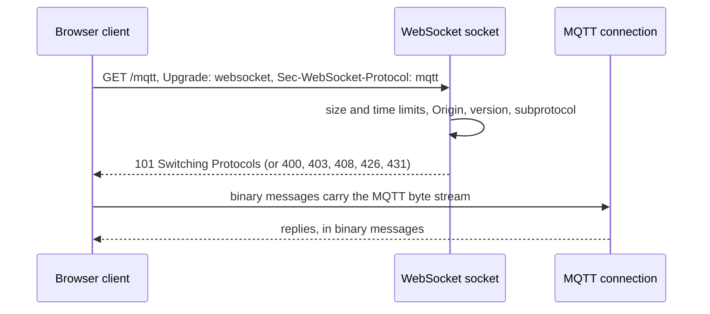
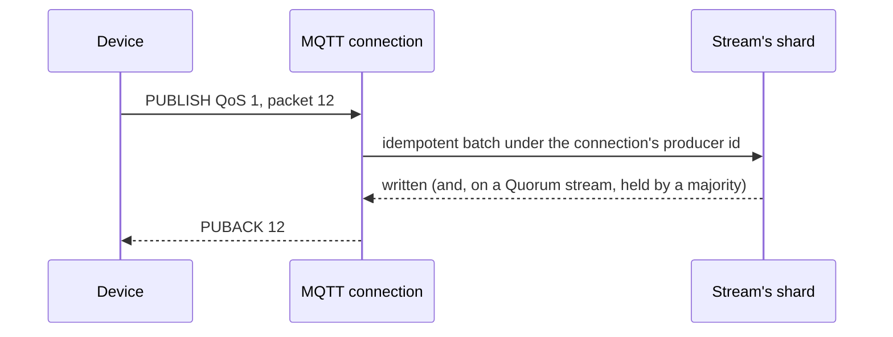

# MQTT compatibility

A Felix broker can accept MQTT connections from devices. With `FELIX_MQTT_LISTEN`
set, the broker opens a listener that speaks MQTT 3.1.1 and 5.0 over TCP, with
TLS by default, and over WebSockets for browsers when `FELIX_MQTT_WS_LISTEN` is
also set. The design for the whole feature is in
[mqtt-design.md](mqtt-design.md); this page says what works today.

**Today a device can connect with a Felix token and publish at QoS 0 and 1 to
a mounted stream.** Streams are mounted at topic prefixes (see
[Mounting streams](#mounting-streams)), and a `PUBACK` means the message is in
the stream with the durability the stream asks for. `SUBSCRIBE` is still
refused, because the subscribe path comes in a later change. With
`FELIX_MQTT_LISTEN` unset, the broker binds nothing, builds no runtime and runs exactly the code it
ran before.

The listener is in `crates/server/felix-mqtt`, the packet codec in
`crates/protocol/felix-mqtt-wire`, and the broker wires it up in
`services/felix-broker-service/src/serving/mqtt.rs`.

## Turning it on

```bash
FELIX_MQTT_LISTEN=0.0.0.0:8883 felix-broker
```

TLS is on by default and uses the broker's client certificate
(`FELIX_TLS_CERT`, `FELIX_TLS_KEY`). `FELIX_MQTT_TLS=false` serves plain TCP and
logs that tokens cross the network in clear text. With `FELIX_TLS_CLIENT_CA`
set, a client must also present a certificate, and with
`FELIX_TLS_CLIENT_CERT_BIND_SUBJECT=true` the token's subject must be the one
the certificate was issued to, as on the other listeners.

The settings are listed in the
[environment variable reference](https://docs.getfelix.dev/reference/environment-variables/).

## Connecting

Use the tenant id as the username and a Felix token as the password, the same
convention as the Kafka listener. For example, with the Mosquitto client:

```bash
mosquitto_sub -h broker.example.com -p 8883 --cafile ca.pem \
  -u my-tenant -P "$FELIX_TOKEN" -t 'sensors/#'
```

That connects and then fails to subscribe, as described above. Publishing
works today; see [Publishing](#publishing).

What `CONNECT` does:

| Case | Answer |
|---|---|
| Valid tenant and token | `CONNACK` success. The session is clean: `session present` is 0, and a 5.0 request for a session expiry is answered with an expiry of 0. A 5.0 client is also told `Receive Maximum` (`FELIX_MQTT_MAX_INFLIGHT`), `Maximum QoS` 1, `Retain Available` 0, and, by leaving the property out, `Topic Alias Maximum` 0. |
| Wrong token or tenant | `CONNACK` 0x86 (3.1.1: 4), then the connection closes. |
| No credentials | `CONNACK` 0x87 (3.1.1: 5), unless `FELIX_MQTT_ANONYMOUS_TENANT` is set. |
| Token cannot be checked (control plane unreachable) | `CONNACK` 0x88 (3.1.1: 3). The client may retry. |
| A will message | `CONNACK` 0x87 (3.1.1: 5). The listener does not send wills yet. |
| Empty client id, 3.1.1, `clean session` 0 | `CONNACK` 0x02. |
| Empty client id otherwise | Accepted; a 5.0 client is told its assigned id. |
| Protocol level other than 4 or 5 | `CONNACK` 0x01, then the connection closes. |
| No valid `CONNECT` within `FELIX_MQTT_AUTH_TIMEOUT_MS` | Closed. With TLS the clock starts after the handshake, which has its own 10 second limit. A check that outlasts it gets `CONNACK` 0x88 (3.1.1: 3). |
| A packet over 64 KiB before `CONNECT` | Closed. |

`FELIX_MQTT_ANONYMOUS_TENANT` is a development switch. A connection that sends
no credentials acts as that tenant and may publish to every stream mounted for
it, and the broker logs a warning at startup. A connection that sends a wrong
token is still refused.

A connection ends when its token expires or is revoked. A 5.0 client is sent a
`DISCONNECT` with reason 0x87 first. Re-authenticating with `AUTH` is not
supported yet.

## Over WebSockets

Browser apps connect with MQTT over WebSockets. Set `FELIX_MQTT_WS_LISTEN` to a
second address; it needs `FELIX_MQTT_LISTEN` as well, because the two sockets
share one runtime, one TLS setting (`wss` with TLS, `ws` without), and one set of
connection limits and connect rate. After the upgrade a connection is the same as
one on the TCP listener, and everything on this page applies to it.



| Case | Answer |
|---|---|
| Valid upgrade for the `mqtt` subprotocol, on any path | `101`, then MQTT as above. |
| Not a `GET`, not HTTP/1.1, no `Upgrade`, wrong version or key, no `mqtt` subprotocol | `400`, or `426` when it is not an upgrade or not version 13. |
| An `Origin` that `FELIX_MQTT_WS_ALLOWED_ORIGINS` does not allow | `403`. With the variable unset every request that has an `Origin` gets this; clients that send none connect (some libraries, such as Python `paho-mqtt`, do send one). |
| A request head over `FELIX_MQTT_WS_MAX_HEADER_BYTES`, or over 64 header lines | `431`, as soon as the limit is reached. |
| No complete request within `FELIX_MQTT_WS_UPGRADE_TIMEOUT_MS` | `408`. |
| Bytes that are not an HTTP `GET` (an MQTT client on the wrong port) | `400`, counted as `ws_not_http`. |
| The client closes the socket before finishing the request | Nothing is sent. Counted as `ws_closed_in_upgrade`. |
| A text message, an unmasked frame, a reserved bit, a bad control frame | The connection closes with a WebSocket close code (1003 for text, 1002 otherwise). |

MQTT packets may be split across WebSocket messages, or several may share one.
The broker joins the messages into one byte stream before decoding, so the packet
limits apply to it exactly as on TCP. Pings are answered (not while 64 KiB of replies are already waiting for a client
that has stopped reading), a close is echoed, and the broker does not negotiate
extensions, so there is no compression.

Upgrades that are refused are counted in `felix_mqtt_refused_total` with a
reason that starts with `ws_`.

## Mounting streams

MQTT topics are made up by devices as they publish; Felix streams are created
on purpose. A *mount* ties the two together: it sends every topic that starts
with a prefix to one durable stream. Mounting stream `telemetry` at `plant/`
means `plant/7/line/3/temp` belongs to `telemetry`. Mount a stream when you
create it or later, through the control plane:

```bash
curl -sS -X POST "$CP/v1/tenants/my-tenant/namespaces/plant/streams" \
  -H "Authorization: Bearer $TOKEN" -H 'Content-Type: application/json' -d '{
    "stream": "telemetry", "kind": "Stream", "shards": 4, "durable": true,
    "retention": { "max_age_seconds": null, "max_size_bytes": null },
    "consistency": "Leader", "delivery": "AtLeastOnce", "mount": "plant/" }'
```

`$CP` is the control plane's address (`http://localhost:8443` for a local one)
and `$TOKEN` a Felix token with `stream.manage` on the stream. To move a mount
later, `PATCH` the stream with `{"mount": "factory/"}`; `{"mount": null}`
clears it. Changing a mount moves no records.

- The prefix is a plain byte prefix, so `plant/` does not catch `plant` or
  `plants/7`. End it with `/` unless you mean otherwise.
- Only a durable stream can be mounted.
- A tenant's mounts cannot overlap, even across namespaces. A prefix that is, or
  begins with, another's is refused, so a topic never has two streams to go to.
- A prefix cannot be empty, hold `+`, `#` or a control character, run past 1024
  bytes, or start with `$` (MQTT keeps those topics for the broker).
- Deleting a stream frees its prefix.

The full rules, errors and Raft upgrade requirement are in the
[control plane documentation](control-plane.md#mounting-a-stream-at-an-mqtt-topic-prefix).
Each broker learns the mounts with the rest of the stream catalog, so a new
mount reaches the listener within one catalog sync interval. Each tenant sees
only its own mounts.

## Publishing

A device publishes with any MQTT client. With a stream mounted at `plant/` (see
[Mounting streams](#mounting-streams)) and the broker started as
`FELIX_MQTT_LISTEN=127.0.0.1:1883 FELIX_MQTT_TLS=false`:

```bash
mosquitto_pub -h 127.0.0.1 -p 1883 -u my-tenant -P "$FELIX_TOKEN" \
  -t plant/7/line/3/temp -q 1 -m 21.5
```

The message is a record in the mounted stream. `mosquitto_pub` exits once the
`PUBACK` arrives, so when it returns without an error the record is written.



**When the `PUBACK` is sent.** Only after the write has the acknowledgement the
stream's consistency level asks for, the same one a Kafka producer with
`acks=all` waits for. On a `Leader` stream that is the leader's write under the
fsync policy (or the enqueue, if the operator set `FELIX_ACK_ON_COMMIT=0`); on a
`Quorum` stream it is also a majority of the replicas. `PUBACK`s leave in the
order the `PUBLISH`es arrived. A refusal that needs no write waits its turn
behind earlier publishes.

**QoS 0** is written the same way, with nothing sent back and no wait for a
majority. **QoS 2** is not supported: the broker advertises `Maximum QoS` 1.

**Which shard.** The mount finds the stream, and the full topic name picks the
shard, so every message on one topic goes to one shard and keeps its order. A
publish goes to a shard this broker owns. If another broker owns it, the broker
does not forward the message yet (forwarding needs the producer sequence on the
internal protocol, which is a later change); see the table below.

**Batching.** A connection has one write at the broker at a time. Publishes that
arrive while it is out wait, and when it returns the leading run of them for one
shard goes out as one batch, with no timer. A device that pipelines publishes
gets group commit; a device that sends one at a time pays nothing extra. Each
connection publishes under its own producer id, and every batch carries the next
sequence for its shard.

**If the broker cannot tell.** If leadership moves, the lease lapses or a majority
does not answer in time after the batch was sent, the message may or may not be
in the stream. The broker then sends neither a `PUBACK` nor an error reason: a
5.0 error reason means "not delivered", which may be false. It closes the
connection. Sessions do not outlive the connection yet, and with a clean
session MQTT tells the client to forget unacknowledged messages, so most
clients will not resend it on their own. The application decides: publish it
again after reconnecting, and accept that the stream may then hold it twice.

### What is stored

The topic name is the record's key. The payload is stored as it came. The other
fields travel as record headers, so a Felix client reading the stream sees
exactly what the device sent in the payload, and the MQTT fields beside it.

| Header | Value | When |
|---|---|---|
| `felix.mqtt.qos` | `0` or `1`, as text | Always |
| `felix.mqtt.payload_format` | `0` (bytes) or `1` (UTF-8), as text | The 5.0 `Payload Format Indicator` was sent |
| `felix.mqtt.content_type` | UTF-8 text | The 5.0 `Content Type` was sent |
| `felix.mqtt.response_topic` | UTF-8 text | The 5.0 `Response Topic` was sent |
| `felix.mqtt.correlation_data` | The bytes sent | The 5.0 `Correlation Data` was sent |
| `felix.mqtt.expiry` | When the message expires, in milliseconds since the Unix epoch, as decimal text | The 5.0 `Message Expiry Interval` was sent; the broker adds it to its clock when the message arrives |
| any other name | The value, as UTF-8 | One per 5.0 user property, name for name and in order |

Names that start with `felix.` belong to the broker. A QUIC publisher cannot
write them, and a 5.0 user property that starts with `felix.` is refused: the
message is not written and the client gets `PUBACK` reason 0x83 with the reason
string `reserved_header` (QoS 0: a `DISCONNECT` with the same reason). The
retain flag is not stored yet, because retained messages are not supported.

Storing headers needs the broker to accept record headers. A broker with
`FELIX_RECORD_HEADERS=false`, or a cluster whose brokers have not all finalized
`record_headers`, refuses every MQTT publish (see the table below). The first
MQTT publish to a mounted stream is also what moves that stream's logs to
storage format v8; mounting the stream is the explicit step that opts in. See
[upgrades](https://docs.getfelix.dev/deployment/upgrades/).

### Answers

The topic name is checked first: it must not be empty, hold `+`, `#` or NUL, or
be over 65535 bytes (the listener's own limit, `FELIX_MQTT_MAX_TOPIC_BYTES`, is
lower and applies first). An invalid name is a protocol error: the connection
closes, and a 5.0 client gets `DISCONNECT` 0x90 first.

3.1.1 has no way to refuse one message, so wherever a 5.0 client is told per
message, a 3.1.1 connection closes, as the specification asks of a server that
cannot accept a `PUBLISH`. Nothing is written in any of these cases, and none is
dropped silently: each is counted in `felix_mqtt_refused_total{reason}`.

| Case | 5.0, QoS 1 | 5.0, QoS 0 | 3.1.1 |
|---|---|---|---|
| Written and acknowledged | `PUBACK`, reason 0 | Nothing | `PUBACK` (QoS 0: nothing) |
| Topic under no mount (`unmounted`) | `PUBACK` 0x90 (topic name invalid) | `DISCONNECT` 0x90 | Closes |
| Principal lacks `stream.publish` on the mounted stream (`not_authorized`) | `PUBACK` 0x87 | `DISCONNECT` 0x87 | Closes |
| This broker does not own the shard (`not_owner`) | `PUBACK` 0x83, reason string `not_owner` | Dropped, counted | Closes (QoS 0: dropped, counted) |
| Broker does not accept record headers (`record_headers_disabled`) | `PUBACK` 0x83, reason string `record_headers_disabled` | Dropped, counted | Closes (QoS 0: dropped, counted) |
| Mounted stream is gone or not durable (`stream_unavailable`) | `PUBACK` 0x80, reason string `stream_unavailable` | Dropped, counted | Closes (QoS 0: dropped, counted) |
| User property starting with `felix.` (`reserved_header`) | `PUBACK` 0x83 | `DISCONNECT` 0x83 | Not possible |
| QoS 2 (`qos2_unsupported`) | `DISCONNECT` 0x9B | the same | Closes |
| Retain flag set (`retain_unsupported`) | `DISCONNECT` 0x9A | the same | Closes |
| Topic alias sent (`topic_alias_invalid`) | `DISCONNECT` 0x94 | the same | Not possible |
| More unacknowledged QoS 1 publishes than `Receive Maximum` (`receive_maximum_exceeded`) | `DISCONNECT` 0x93 | Not applicable | See below |
| Outcome unknown (`leadership_lost`, `quorum_timeout`, `write_failed`) | Closes, no `PUBACK` | Closes | Closes, no `PUBACK` |

Reason strings are sent only to a 5.0 client that did not turn off `Request
Problem Information`.

- **Retained messages** are a later change, so the broker advertises `Retain
  Available` 0. A 3.1.1 client cannot be told that, so a publish with the retain
  flag closes its connection rather than be accepted and not retained.
- **Topic aliases** are not offered (`Topic Alias Maximum` is 0).
- **Receive Maximum.** A 3.1.1 client was never told the limit, so it is held to
  it by TCP: the broker stops reading the connection while that many publishes
  wait for the stream, and carries on when they are written.
- **Quotas.** A publish counts against the tenant's publish quota
  (`FELIX_TENANT_PUBLISH_*`), the same budget its QUIC and Kafka publishes use.
  MQTT has no throttle field, so over quota the broker stops reading that
  connection for the computed delay, at most five seconds, and TCP pushes back
  on the device.

## After connecting

| Packet | Answer |
|---|---|
| `PINGREQ` | `PINGRESP` |
| `DISCONNECT` | The connection closes. |
| `PUBLISH` | QoS 0 and 1 are written to the mounted stream; see [Publishing](#publishing). |
| `SUBSCRIBE` | `SUBACK` refusing every filter (5.0: 0x87, 3.1.1: 0x80). |
| `UNSUBSCRIBE` | `UNSUBACK`. Nothing was subscribed. |
| `CONNECT` again, `AUTH`, or a packet only a server sends | A protocol error: the connection closes. |

Every refusal is counted in `felix_mqtt_refused_total{reason}`.

**Keepalive.** The broker closes a client that sends nothing for one and a half
keepalive intervals. A client that asks for no keepalive, or for more than
`FELIX_MQTT_KEEPALIVE_MAX_SECS`, gets that maximum (600 seconds by default). A 5.0
client is told through `Server Keep Alive`. A 3.1.1 client cannot be told, so
it should send a `PINGREQ` at least that often.

## Limits

Every resource a device can hold is bounded, and the listener runs on a tokio
runtime of its own (`FELIX_MQTT_WORKER_THREADS`, 2 by default). A flood of
connections or TLS handshakes spends those threads, not the ones serving QUIC
clients.

| Limit | Setting | What happens past it |
|---|---|---|
| Connections on the broker | `FELIX_MQTT_MAX_CONNECTIONS` | The new connection is closed on arrival (`connection_limit`). |
| Connections per source address | `FELIX_MQTT_MAX_CONNECTIONS_PER_IP` | The new connection is closed on arrival (`per_ip_limit`). |
| New connections per second | `FELIX_MQTT_CONNECT_RATE` | They wait in the kernel's accept queue, not in the broker. |
| Packet size | `FELIX_MQTT_MAX_PACKET_BYTES` | The connection closes (5.0: reason 0x95). A 5.0 client is told the limit as `Maximum Packet Size`. |
| Unacknowledged QoS 1 publishes | `FELIX_MQTT_MAX_INFLIGHT` | 5.0: the connection closes with reason 0x93. 3.1.1: the broker stops reading until the stream has acknowledged them. Advertised as `Receive Maximum`. |
| Topic length and levels, filters per `SUBSCRIBE` | `FELIX_MQTT_MAX_TOPIC_BYTES`, `_MAX_TOPIC_LEVELS`, `_MAX_SUBSCRIPTIONS` | The connection closes. |

## Not built yet

Forwarding a publish to the broker that owns the shard, QoS 2, subscribing,
retained messages, persistent sessions, will messages, shared subscriptions and
topic-level grants. The order they land in is in
[mqtt-design.md](mqtt-design.md#implementation-slices).
