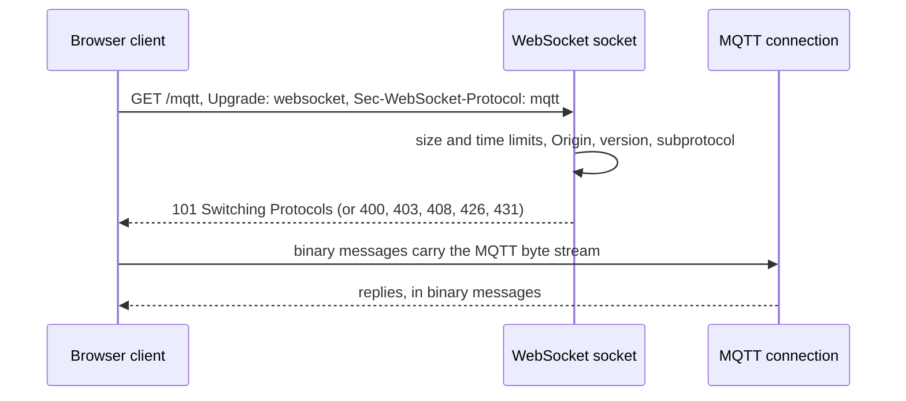

# MQTT compatibility

A Felix broker can accept MQTT connections from devices. With `FELIX_MQTT_LISTEN`
set, the broker opens a listener that speaks MQTT 3.1.1 and 5.0 over TCP, with
TLS by default, and over WebSockets for browsers when `FELIX_MQTT_WS_LISTEN` is
also set. The design for the whole feature is in
[mqtt-design.md](mqtt-design.md); this page says what works today.

**Today the listener authenticates connections and knows which stream a topic
belongs to.** A device can connect with a Felix token, keep the connection alive
and disconnect. Streams can be mounted at topic prefixes (see
[Mounting streams](#mounting-streams)), and a `PUBLISH` is checked against the
mounts, but every `PUBLISH` and `SUBSCRIBE` is still refused, because the
publish and subscribe paths come in later changes. With `FELIX_MQTT_LISTEN`
unset, the broker binds nothing, builds no runtime and runs exactly the code it
ran before.

The listener is in `crates/server/felix-mqtt`, the packet codec in
`crates/protocol/felix-mqtt-wire`, and the broker wires it up in
`services/felix-broker-service/src/serving/mqtt.rs`.

## Turning it on

```bash
FELIX_MQTT_LISTEN=0.0.0.0:8883 felix-broker
```

TLS is on by default and uses the broker's client certificate
(`FELIX_TLS_CERT`, `FELIX_TLS_KEY`). `FELIX_MQTT_TLS=false` serves plain TCP and
logs that tokens cross the network in clear text. With `FELIX_TLS_CLIENT_CA`
set, a client must also present a certificate, and with
`FELIX_TLS_CLIENT_CERT_BIND_SUBJECT=true` the token's subject must be the one
the certificate was issued to, as on the other listeners.

The settings are listed in the
[environment variable reference](https://docs.getfelix.dev/reference/environment-variables/).

## Connecting

Use the tenant id as the username and a Felix token as the password, the same
convention as the Kafka listener. For example, with the Mosquitto client:

```bash
mosquitto_sub -h broker.example.com -p 8883 --cafile ca.pem \
  -u my-tenant -P "$FELIX_TOKEN" -t 'sensors/#'
```

That connects and then fails to subscribe, as described above.

What `CONNECT` does:

| Case | Answer |
|---|---|
| Valid tenant and token | `CONNACK` success. The session is clean: `session present` is 0, and a 5.0 request for a session expiry is answered with an expiry of 0. |
| Wrong token or tenant | `CONNACK` 0x86 (3.1.1: 4), then the connection closes. |
| No credentials | `CONNACK` 0x87 (3.1.1: 5), unless `FELIX_MQTT_ANONYMOUS_TENANT` is set. |
| Token cannot be checked (control plane unreachable) | `CONNACK` 0x88 (3.1.1: 3). The client may retry. |
| A will message | `CONNACK` 0x87 (3.1.1: 5). A will is a publish, and publishing is not built yet. |
| Empty client id, 3.1.1, `clean session` 0 | `CONNACK` 0x02. |
| Empty client id otherwise | Accepted; a 5.0 client is told its assigned id. |
| Protocol level other than 4 or 5 | `CONNACK` 0x01, then the connection closes. |
| No valid `CONNECT` within `FELIX_MQTT_AUTH_TIMEOUT_MS` | Closed. With TLS the clock starts after the handshake, which has its own 10 second limit. A check that outlasts it gets `CONNACK` 0x88 (3.1.1: 3). |
| A packet over 64 KiB before `CONNECT` | Closed. |

`FELIX_MQTT_ANONYMOUS_TENANT` is a development switch. A connection that sends
no credentials acts as that tenant, and the broker logs a warning at startup. A
connection that sends a wrong token is still refused.

A connection ends when its token expires or is revoked. A 5.0 client is sent a
`DISCONNECT` with reason 0x87 first. Re-authenticating with `AUTH` is not
supported yet.

## Over WebSockets

Browser apps connect with MQTT over WebSockets. Set `FELIX_MQTT_WS_LISTEN` to a
second address; it needs `FELIX_MQTT_LISTEN` as well, because the two sockets
share one runtime, one TLS setting (`wss` with TLS, `ws` without), and one set of
connection limits and connect rate. After the upgrade a connection is the same as
one on the TCP listener, and everything on this page applies to it.



| Case | Answer |
|---|---|
| Valid upgrade for the `mqtt` subprotocol, on any path | `101`, then MQTT as above. |
| Not a `GET`, not HTTP/1.1, no `Upgrade`, wrong version or key, no `mqtt` subprotocol | `400`, or `426` when it is not an upgrade or not version 13. |
| An `Origin` that `FELIX_MQTT_WS_ALLOWED_ORIGINS` does not allow | `403`. With the variable unset every request that has an `Origin` gets this; clients that send none connect (some libraries, such as Python `paho-mqtt`, do send one). |
| A request head over `FELIX_MQTT_WS_MAX_HEADER_BYTES`, or over 64 header lines | `431`, as soon as the limit is reached. |
| No complete request within `FELIX_MQTT_WS_UPGRADE_TIMEOUT_MS` | `408`. |
| Bytes that are not an HTTP `GET` (an MQTT client on the wrong port) | `400`, counted as `ws_not_http`. |
| The client closes the socket before finishing the request | Nothing is sent. Counted as `ws_closed_in_upgrade`. |
| A text message, an unmasked frame, a reserved bit, a bad control frame | The connection closes with a WebSocket close code (1003 for text, 1002 otherwise). |

MQTT packets may be split across WebSocket messages, or several may share one.
The broker joins the messages into one byte stream before decoding, so the packet
limits apply to it exactly as on TCP. Pings are answered (not while 64 KiB of replies are already waiting for a client
that has stopped reading), a close is echoed, and the broker does not negotiate
extensions, so there is no compression.

Upgrades that are refused are counted in `felix_mqtt_refused_total` with a
reason that starts with `ws_`.

## Mounting streams

MQTT topics are made up by devices as they publish; Felix streams are created
on purpose. A *mount* ties the two together: it sends every topic that starts
with a prefix to one durable stream. Mounting stream `telemetry` at `plant/`
means `plant/7/line/3/temp` belongs to `telemetry`. Mount a stream when you
create it or later, through the control plane:

```bash
curl -sS -X POST "$CP/v1/tenants/my-tenant/namespaces/plant/streams" \
  -H "Authorization: Bearer $TOKEN" -H 'Content-Type: application/json' -d '{
    "stream": "telemetry", "kind": "Stream", "shards": 4, "durable": true,
    "retention": { "max_age_seconds": null, "max_size_bytes": null },
    "consistency": "Leader", "delivery": "AtLeastOnce", "mount": "plant/" }'
```

`$CP` is the control plane's address (`http://localhost:8443` for a local one)
and `$TOKEN` a Felix token with `stream.manage` on the stream. To move a mount
later, `PATCH` the stream with `{"mount": "factory/"}`; `{"mount": null}`
clears it. Changing a mount moves no records.

- The prefix is a plain byte prefix, so `plant/` does not catch `plant` or
  `plants/7`. End it with `/` unless you mean otherwise.
- Only a durable stream can be mounted.
- A tenant's mounts cannot overlap, even across namespaces. A prefix that is, or
  begins with, another's is refused, so a topic never has two streams to go to.
- A prefix cannot be empty, hold `+`, `#` or a control character, run past 1024
  bytes, or start with `$` (MQTT keeps those topics for the broker).
- Deleting a stream frees its prefix.

The full rules, errors and Raft upgrade requirement are in the
[control plane documentation](control-plane.md#mounting-a-stream-at-an-mqtt-topic-prefix).
Each broker learns the mounts with the rest of the stream catalog, so a new
mount reaches the listener within one catalog sync interval. Each tenant sees
only its own mounts.

## Publishing

A `PUBLISH` is resolved before anything else. The broker finds the mount that is
the longest prefix of the topic name and, from the full topic name, the shard of
the stream the message would go to. Every message on one topic goes to one shard,
so the topic keeps its order. The topic name is checked too: it must not be
empty, hold `+`, `#` or NUL, or be over 65535 bytes (the listener's own limit,
`FELIX_MQTT_MAX_TOPIC_BYTES`, is lower and applies first).

Writing the message to the stream is not built yet, so a `PUBLISH` to a mounted
topic is still refused. The answer depends on whether the topic is under a mount:

| Topic | 3.1.1 | 5.0, QoS 1 | 5.0, QoS 2 | 5.0, QoS 0 |
|---|---|---|---|---|
| Under no mount | The connection closes. | `PUBACK`, reason 0x90 (topic name invalid). The connection stays open. | `PUBREC`, reason 0x90. | `DISCONNECT`, reason 0x90, then the connection closes. |
| Under a mount (not built yet) | The connection closes. | `PUBACK`, reason 0x87 (not authorized). | `PUBREC`, reason 0x87. | `DISCONNECT`, reason 0x87, then the connection closes. |
| An invalid name | The connection closes. | `DISCONNECT`, reason 0x90, then the connection closes. | the same | the same |

3.1.1 has no way to refuse one message, so its connection closes, as the
specification asks of a server that cannot accept a `PUBLISH`. An unmounted
topic is never dropped silently: it is counted in
`felix_mqtt_refused_total{reason="unmounted"}`, an invalid name under
`invalid_topic_name`, and a publish to a mounted topic under
`publish_unsupported`.

## After connecting

| Packet | Answer |
|---|---|
| `PINGREQ` | `PINGRESP` |
| `DISCONNECT` | The connection closes. |
| `PUBLISH` | Checked against the tenant's mounts; see [Publishing](#publishing). Always refused for now. |
| `SUBSCRIBE` | `SUBACK` refusing every filter (5.0: 0x87, 3.1.1: 0x80). |
| `UNSUBSCRIBE` | `UNSUBACK`. Nothing was subscribed. |
| `CONNECT` again, `AUTH`, or a packet only a server sends | A protocol error: the connection closes. |

Every refusal is counted in `felix_mqtt_refused_total{reason}`.

**Keepalive.** The broker closes a client that sends nothing for one and a half
keepalive intervals. A client that asks for no keepalive, or for more than
`FELIX_MQTT_KEEPALIVE_MAX_SECS`, gets that maximum (600 seconds by default). A 5.0
client is told through `Server Keep Alive`. A 3.1.1 client cannot be told, so
it should send a `PINGREQ` at least that often.

## Limits

Every resource a device can hold is bounded, and the listener runs on a tokio
runtime of its own (`FELIX_MQTT_WORKER_THREADS`, 2 by default). A flood of
connections or TLS handshakes spends those threads, not the ones serving QUIC
clients.

| Limit | Setting | What happens past it |
|---|---|---|
| Connections on the broker | `FELIX_MQTT_MAX_CONNECTIONS` | The new connection is closed on arrival (`connection_limit`). |
| Connections per source address | `FELIX_MQTT_MAX_CONNECTIONS_PER_IP` | The new connection is closed on arrival (`per_ip_limit`). |
| New connections per second | `FELIX_MQTT_CONNECT_RATE` | They wait in the kernel's accept queue, not in the broker. |
| Packet size | `FELIX_MQTT_MAX_PACKET_BYTES` | The connection closes (5.0: reason 0x95). A 5.0 client is told the limit as `Maximum Packet Size`. |
| Topic length and levels, filters per `SUBSCRIBE` | `FELIX_MQTT_MAX_TOPIC_BYTES`, `_MAX_TOPIC_LEVELS`, `_MAX_SUBSCRIPTIONS` | The connection closes. |

## Not built yet

Writing published messages to the mounted stream (QoS 0, 1 and 2), subscribing,
retained messages, persistent sessions, will messages, shared subscriptions and
topic-level grants. The order they land in is in
[mqtt-design.md](mqtt-design.md#implementation-slices).
