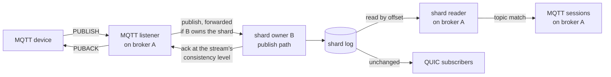
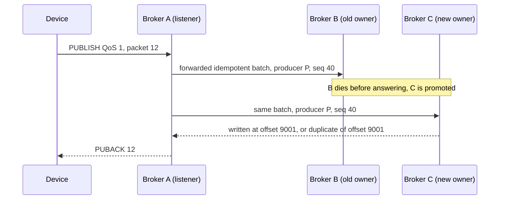
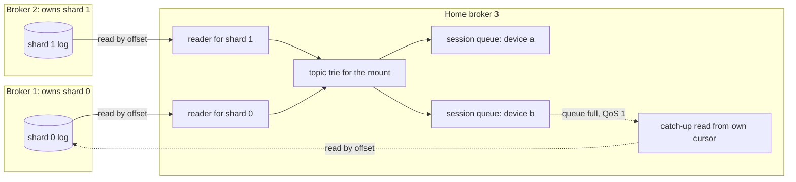

# MQTT ingress: design

Status: accepted in #1685 on 2026-10-31, with the decisions listed at the end.
Nothing here is built yet; the work is tracked as slices #1687 to #1698.

Devices speak MQTT, and a Felix broker cannot accept an MQTT connection today.
This page designs a native MQTT listener, built the way the Kafka listener is
(`crates/server/felix-kafka`, `docs/kafka-compatibility.md`), under one hard
requirement from the issue: it must not weaken Felix's performance or safety.
Concretely, that means four things.

1. With `FELIX_MQTT_LISTEN` unset, the broker runs exactly the code it runs
   today on the QUIC publish, subscribe, ship and ack paths. The
   `instructions_per_message` gate and the perf A/B are the proof.
2. An MQTT acknowledgement (`PUBACK`, `PUBREC`) is sent at the same point a
   Felix acknowledgement would be for that stream's consistency level, never
   earlier.
3. A slow or hostile MQTT client is bounded like any subscriber, and a device
   fleet cannot starve QUIC clients.
4. Auth is required unless an operator turns it off.

## The shape in one paragraph

The listener runs inside every broker, off by default. An operator *mounts* a
durable stream at an MQTT topic prefix; every MQTT topic under that prefix is a
record in that stream, hashed to a shard by its full topic name, with the topic
kept as the record's key and MQTT's message properties as record headers. A publish is written through the
broker's ordinary publish path, forwarded to the shard's owner when this broker
does not own it, and acknowledged when Felix would acknowledge it. A
subscription is served by the broker the device is connected to, which reads
the mounted stream's shards by offset and matches topics against its local
sessions' filters. Retained messages live in a cache beside the stream, and
persistent sessions are records in a session cache. QoS 2 uses the log's
producer sequences.

## Scope

Both MQTT 3.1.1 and 5.0 are in scope for the codec from the first slice, because
5.0 is where an honest error can be said: 3.1.1 has no negative `PUBACK`, so the
only refusal it can express for a publish is closing the connection. The first
usable slices speak both ([D1](#d1-protocol-versions)).

In:

- `CONNECT`, `CONNACK`, `PUBLISH`, `PUBACK`, `PUBREC`, `PUBREL`, `PUBCOMP`,
  `SUBSCRIBE`, `SUBACK`, `UNSUBSCRIBE`, `UNSUBACK`, `PINGREQ`, `PINGRESP`,
  `DISCONNECT`, and 5.0's `AUTH` for re-authentication only.
- QoS 0 and 1 publish and subscribe. QoS 2 publish once its slice lands
  ([D8](#d8-qos-2)).
- Single-level (`+`) and multi-level (`#`) wildcards inside one mount.
- Retained messages, including clearing one with an empty payload.
- Clean and persistent sessions, 5.0 session expiry, will messages and will
  delay, keepalive with a server maximum.
- 5.0 properties: reason codes and reason strings, `Receive Maximum`,
  `Maximum Packet Size`, `Topic Alias Maximum` (server side, bounded), `Message
  Expiry Interval`, `Payload Format Indicator`, `Content Type`, `Response
  Topic`, `Correlation Data`, `User Property`, `Server Keep Alive`, `Session
  Expiry Interval`, `Maximum QoS`, `Retain Available`, `Wildcard Subscription
  Available`, `Shared Subscription Available` (false), `Subscription
  Identifier`, `No Local`, `Retain As Published`, `Retain Handling`.
- TLS, token auth, and TLS client certificates bound to the token.

Out, each refused with a reason code (5.0) or a closed connection (3.1.1), and
listed in the compatibility page when it ships:

- MQTT 3.1 (protocol level 3) and MQTT-SN.
- MQTT over WebSockets. A gateway concern; it can come later behind its own
  setting.
- Shared subscriptions (`$share/...`). They map naturally onto Felix consumer
  groups, which is a later slice ([D16](#d16-shared-subscriptions)).
- `$SYS` topics. Felix's metrics are Prometheus.
- Topics outside any mount, and filters that span mounts
  ([D14](#d14-filters-that-span-mounts)).
- Bridging to other MQTT brokers.
- In-memory streams as mounts ([D7](#d7-durable-streams-only)).
- Enhanced authentication methods in `AUTH` beyond token refresh.

## Codec: build or reuse

The decoder faces untrusted devices, so it has to enforce limits while it
decodes: reject an oversized packet from its fixed header, cap property and
subscription counts before allocating for them, and never reserve memory from a
count the client sent. Felix already learned this once. It vendors
`kafka-protocol` 0.18 under `vendor/` because that crate reserved `Vec`
capacity from a client-supplied count.

What exists on crates.io, checked on 2026-10-31:

| Crate | Version | Licence | What it is | Fit |
|---|---|---|---|---|
| `rumqttc` | 0.25.1 | Apache-2.0 | Maintained client, about 2.4M recent downloads. Its `mqttbytes` module encodes and decodes every v4 and v5 packet. | The codec is good, but using it brings the whole client. |
| `rumqttd` | 0.20.0 | Apache-2.0 | A full broker with its own routing and storage. | Wrong shape to embed. |
| `ntex-mqtt` | 9.4.0 | MIT/Apache-2.0 | Server framework on the ntex runtime, MSRV 1.97, updated 2026-10-30. | Needs a second async runtime beside tokio. Rejected. |
| `rmqtt` | 0.24.0 | MIT/Apache-2.0 | A full plugin broker. | Wrong shape. |
| `mqttbytes` 0.6.0, `mqttrs` 0.4.1, `mqtt-protocol` 0.12.0 | | | Standalone codecs. | Unmaintained since 2021 to 2024. |

That left two real options: Felix owns a small codec, or it vendors `rumqttc`'s
`mqttbytes` and hardens it as it did `kafka-protocol`. Felix owns the codec
([D2](#d2-codec)). MQTT has about 15 packet types plus 5.0's properties, so it is
roughly 2,000 lines plus tests. The
codec decodes into `bytes::Bytes` without copying the payload, has a fuzz target
from its first commit, and is cross-checked against encodings produced by
`rumqttc` and the mosquitto clients, kept as golden vectors.

### Crate layout

The codec is split from the listener:

- `crates/protocol/felix-mqtt-wire` is the codec only: 3.1.1 and 5.0, limits
  enforced during decode, zero-copy into `bytes::Bytes`. It depends on `bytes`
  and `thiserror` and nothing else, no tokio and no `felix-*` crate. It is
  internal and stays off crates.io, like the other internal crates.
- `crates/server/felix-mqtt` is the listener on the broker: sessions, topic
  mapping, QoS and auth, as `felix-kafka` is for Kafka.

Keeping both in the Felix repository means the decode limits, which are broker
settings, change in the same PR as the code that reads them; the fuzz, coverage
and conformance tooling already in CI covers the codec without new setup; and
nothing makes a public semver promise before the API has met real devices.
Publishing the codec later as a standalone crate stays an option
([D5](#d5-a-standalone-codec-crate)); the split makes that a directory move.

## Topic model

MQTT topics are dynamic and hierarchical: a device publishes to
`plant/7/line/3/temp` without anyone creating it. Felix streams are explicit,
created through the control plane, and sharded. The model bridges the two with a
mount.

**A mount maps a topic prefix to one durable stream.** Mounting stream
`telemetry` in namespace `plant` at prefix `plant/` makes every topic starting
with `plant/` a record in that stream. The mount is explicit, as a stream is;
the topics under it are dynamic and need no creation. A publish to a topic under
no mount is refused. Streams are never created by an MQTT client, which matches
the Kafka listener and keeps stream creation an administrative act. A mount is a
field on the stream, set through the control plane
([D3](#d3-where-mounts-are-declared)), so device firmware keeps its own topic
scheme and there is no second object to keep in step with the stream.

Mount prefixes in one tenant may not overlap, so a topic resolves to at most one
stream with a longest-prefix lookup, done once per publish in the listener.

**The full topic is kept with the record, in record headers.** Felix records
today have a payload, an append time, and no key or headers (`StreamRecord`; the
Kafka listener drops keys and headers for that reason). An MQTT subscriber needs
the topic, and a 5.0 subscriber needs the message properties. Both travel in a
new optional part of the record ([D4](#d4-where-the-topic-lives-in-the-record)),
built in #1688 before any MQTT traffic flows:

- A record may carry a key and a list of headers (name and value pairs). They
  are stored in a new segment record version, shipped by replication with the
  record, and delivered to subscribers that negotiated a new wire flag. A record
  without them is written in the existing version, byte for byte, and an old
  peer exchanges byte-identical frames. A subscriber that did not negotiate the
  flag receives the payload alone.
- The Kafka listener maps a produced record's key and headers onto them and
  serves them back on fetch, which removes "keys and headers are dropped" from
  `docs/kafka-compatibility.md`.

The MQTT listener uses them this way:

| Record part | MQTT field |
|---|---|
| key | The full topic name, after topic-alias resolution. It is also the routing key. |
| headers under a prefix reserved for the listener | Original QoS, retain, payload format indicator, content type, response topic, correlation data, message expiry as an absolute time, and the QoS 2 packet id (see [QoS 2](#qos-2)) |
| ordinary headers | 5.0 user properties, name for name |
| payload | The application payload, untouched |

The exact header names, and how a non-MQTT publisher is kept from writing the
reserved ones, are settled in #1688 and specified in the compatibility page.

Because the payload is untouched, a QUIC or Kafka consumer reading a mounted
stream sees exactly what the device sent, and a Felix client that publishes with
a key under a mount is visible to MQTT subscribers on that topic without any
MQTT-specific encoding.

**The shard is chosen by the full topic.** The listener computes the routing key
as the topic bytes, so `shard_for` sends every message on one topic to one
shard. That is what keeps MQTT's ordering promise: messages one client publishes
to one topic at one QoS arrive in order, because one topic is one shard and one
shard is one ordered log. Messages on different topics may be reordered relative
to each other across shards, which MQTT allows.

**Wildcards cost only MQTT subscribers.** A filter is matched in the listener,
against records the listener reads, never in the broker's fanout. The QUIC
subscribe path does not learn that filters exist. What an MQTT subscription
costs:

- An exact-topic filter (`plant/7/line/3/temp`) reads one shard, the one its
  topic hashes to, and skips records for other topics on that shard.
- A wildcard filter inside a mount reads every shard of the mounted stream,
  because the matching topics are spread across them.
- Each broker holds one topic trie per mounted stream for all of its local
  sessions. A record read from a shard is matched once against the trie, at a
  cost proportional to its topic's levels, and the result is the set of local
  sessions that want it. The match is shared; it is not paid per session.
- A record no local filter matches is read and discarded. On a mount with many
  shards and few interested sessions, that is read bandwidth spent on nothing,
  and the compatibility page will say so plainly.

## Publishing

### QoS mapping

| MQTT | Felix write | Acknowledged |
|---|---|---|
| QoS 0 | A publish with no acknowledgement wait | Nothing is sent to the device |
| QoS 1 | An acknowledged idempotent publish | `PUBACK` when the Felix ack for that stream would be sent |
| QoS 2 | An acknowledged idempotent publish carrying the packet id | `PUBREC` when the Felix ack would be sent; `PUBCOMP` as in [QoS 2](#qos-2) |

"When the Felix ack would be sent" means exactly the rules in
`docs/semantics.md`. On a durable `Leader` stream that is after the leader's
write under the fsync policy, or on enqueue if the operator set
`FELIX_ACK_ON_COMMIT=0`. On a `Quorum` stream it is once a majority holds the
record. The listener waits on the same outcome the Kafka listener's `acks=all`
waits on, so there is no listener-specific rule to drift.

### Idempotence and outcome unknown

Each MQTT session gets a Felix producer id when it is created, kept in the
session record for persistent sessions. Every QoS 1 and QoS 2 write is an
idempotent producer batch under that id. The cost is one producer mark per
batch, and it buys the property that matters most here: when a write's outcome
is unknown, the listener can resolve it without the device.

A write is indeterminate when the shard's owner dies, its lease lapses, or the
shard starts moving after the write was sent and before the answer came back
(`RetryClass::OutcomeUnknown`, for example `leadership_lost`). The listener
re-sends the same batch with the same producer sequence to the shard's new
owner. The log answers a duplicate with the offset it was first written at and
writes nothing; a batch cut short by the failover is finished. Only then is the
`PUBACK` sent. This is the same mechanism the Kafka listener relies on, tested
across failover and a move in `kafka_produce.rs`.

If the outcome is still unknown when `FELIX_MQTT_PUBLISH_RESOLVE_TIMEOUT_MS`
runs out, the listener closes the connection without acknowledging. It must not
send a 5.0 error reason code: the device would treat that as "not delivered",
which may be false. A closed connection makes an MQTT client re-send the publish
with `DUP` set after it reconnects, and the producer sequence makes that re-send
land once if the session's producer state is still known (a persistent session,
or the same broker). For a clean session on a different broker, QoS 1 is
at-least-once, as MQTT says it is.

### Batching and ordering

A device's consecutive QoS 1 publishes to the same shard that the listener has
already read off the socket go out as one producer batch, with no timer, so a
pipelining device gets group commit for free and a one-at-a-time device pays no
added latency. Every `PUBACK` in the batch is sent when the batch is
acknowledged.

Publishes from one session to one shard stay in order through the forwarding
hop because each session keeps one ordered queue per shard it is writing to, and
the producer sequence turns any reordering into a refusal (`SequenceGap`)
rather than a silent swap. `Receive Maximum` (5.0) and the in-flight cap bound
how many acknowledgements one session can be owed.

### Cluster routing

The QUIC publish path already forwards a publish for a shard this broker does not
own to the shard's owner and acknowledges only once the owner answered
(`docs/semantics.md`, "Routing"). The listener uses the same forwarding. The
Kafka listener refuses instead, because a Kafka client reads Metadata and goes
to the leader itself; an MQTT client has no metadata and no redirect it
understands in 3.1.1, and 5.0's "use another server" is rarely implemented and
would mean one connection per shard owner. A forwarded publish passes the same
per-shard write fence on the owner as a direct one, so a deposed owner refuses
it with `shard_unavailable`, which is safe to retry.

The first publishing slice has to confirm that a forwarded publish carries its
producer sequence end to end. If the internal protocol does not carry it today,
adding it is a negotiated internal-protocol change on the forwarding path, which
does not touch the QUIC client publish path.

### Quotas

A publish counts against its tenant's publish quota (`FELIX_TENANT_PUBLISH_*`),
the same budget the tenant's QUIC and Kafka publishes draw on. MQTT has no
throttle field, so over quota the listener stops reading that connection's
socket for the computed hold, at most five seconds, and TCP pushes back on the
device. The Kafka listener does the same.

### Regions

A mounted stream with a `region` is placed in that region, as any stream is.
The listener forwards only where `RegionRouter` would forward a QUIC publish, so
a device connected in an unbridged region gets a refusal, never a write that
crossed a boundary the operator did not open. The session cache is in the
listener's own region.

## QoS 2

QoS 2 promises exactly once between the device and the broker. The device sends
`PUBLISH`, the broker answers `PUBREC`, the device sends `PUBREL`, the broker
answers `PUBCOMP`. Until `PUBCOMP`, the device may re-send `PUBLISH` (with
`DUP`) or `PUBREL` at any time, including after reconnecting to a different
broker, and the broker must recognise the re-send.

The issue requires this to come from idempotent producers, not a second dedup
store. Within one broker that is direct: the listener knows which packet ids it
has written and which producer sequence each got. The hard case is a re-send
after the broker holding the session crashed. The new broker must decide whether
packet id 7 was already written, and packet ids are 16 bits and reused, so "the
log has a record for packet 7 from producer P" could be an earlier, finished use
of 7.

The answer writes the packet id into a record header and makes `PUBREL` durable
before `PUBCOMP`:

1. On `PUBLISH` QoS 2, write the record as an idempotent batch for producer P
   with the packet id in its headers. Send `PUBREC` at the Felix ack.
2. On `PUBREL`, append a release mark for that packet id: a small record on the
   same shard, under the same producer, that subscribers never see (as a new
   leader's generation-start record already is). Send `PUBCOMP` only once the
   mark is acknowledged.
3. A new broker taking over the session reads producer P's recent batches on the
   shards the session wrote to. Those batches are already indexed by the log's
   producer window (the last 64 batches per producer and shard). A packet id
   whose newest record has no release mark after it is pending; one with a
   release mark is finished, and a `DUP` publish of it is a new message.

The device cannot reuse a packet id before `PUBCOMP`, and `PUBCOMP` waits for
the mark, so the newest record for an id is always the one the device means.
Capping the session's in-flight QoS 2 window well under the producer window
keeps every pending id inside it.

The cost is a second log write per QoS 2 message, which is what the protocol's
second round trip pays for in any broker that keeps the guarantee across a
crash. Until the QoS 2 slice lands, the listener advertises `Maximum QoS` 1
([D8](#d8-qos-2)). Outbound QoS 2 (the broker delivering at QoS 2) needs the same
care on the delivery side, and subscribers are granted at most QoS 1 until then.

A new protocol step that a crash can interrupt is what the TLA specs exist for.
The QoS 2 slice adds a small model of packet-id reuse,
release marks and takeover, checked for "a released id is never deduplicated
and a pending id is never written twice".

## Retained messages

Each mount names a durable cache for its retained messages, keyed by full topic.
The cache is the mechanism Felix already describes as MQTT's retained message:
`docs/cache-on-log.md` serves a key's current value first and live changes
after.

**Publishing with `RETAIN`.** The listener writes the record to the stream, as
for any publish, then writes the cache entry with a conditional put that only
replaces an entry holding an older stream offset. One topic is one shard, so
offsets for a topic are comparable, and two devices racing to retain on the same
topic converge on the stream's order rather than on whichever cache write landed
last. `PUBACK` waits for both. If the stream write is acknowledged and the cache
write's outcome is unknown, the connection is closed without `PUBACK`; the
device re-sends, the producer sequence deduplicates the stream write, and the
cache write is retried.

**Clearing.** A `RETAIN` publish with an empty payload deletes the cache entry
(conditionally, by offset) and is delivered to current subscribers as an
ordinary message, as the specification says.

**Message expiry.** A 5.0 `Message Expiry Interval` on a retained message becomes
the cache entry's TTL, so expiry is the cache's own delete and watchers see it.

**Subscribing.** A new subscription registers with the shard reader first, then
reads the retained set (register before read, the rule every Felix join
follows), so a retained publish landing during the join is delivered live rather
than lost. It may also arrive in the snapshot; MQTT allows the duplicate, and the
offset lets the listener drop it when the two copies meet in the same session.
The snapshot is a prefix read of the cache from the filter's longest literal
prefix, filtered by the trie, across every cache shard. 5.0's `Retain Handling`
options 0, 1 and 2 are supported.

Retained messages count against the cache's own bounds. A per-mount cap on
retained topics is in [Limits](#isolation-and-limits).

## Subscribing

### Who serves a subscription

An MQTT session lives on the broker the device connected to, its home broker.
Felix's native subscribe redirects to the shard owner instead of proxying
(`docs/subscribe-routing.md`), and that decision stands for QUIC. It cannot be
applied to MQTT: a wildcard subscription spans every shard of a stream, those
shards have different owners, and a device holds one connection. So the home
broker must read remote shards. `docs/subscribe-routing.md` rejected proxying
because a push-based proxy forces a choice between a shared upstream queue
(isolation lost) and one upstream per subscriber (fanout amortisation lost). A
pull-based reader avoids that choice on durable streams:

- **One reader per (home broker, shard) that any local session needs.** It reads
  the shard's log by offset, like a Kafka fetch or a follower catching up,
  bounded by the shard's committed mark (`docs/semantics.md`, "What a reader sees
  of a `Quorum` stream"). On the owner it is a local log read (`read_log_from`,
  woken by the shard's append notification, as the Kafka fetch is). On any other
  broker it is an offset-addressed read over the internal protocol. Cross-broker
  bandwidth is one copy per broker per shard, whatever the fanout.
- **The hop cannot lose a record.** The reader asks for offsets. If it falls
  behind, it is behind; nothing upstream is dropped.
- **A slow session leaves the shared reader instead of slowing it.** Each session
  has its own cursor per shard. While a session keeps up it is fed from the shared
  reader through its own bounded queue. When its queue fills, its QoS 1
  subscriptions detach and read the log from their own cursor at their own pace,
  the way a Felix subscriber's replay already reads history for that subscriber
  alone. Its QoS 0 subscriptions follow the subscriber overflow policy and drop,
  as a QUIC subscriber's would.

This is the arrangement chosen ([D6](#d6-cross-broker-delivery)), over 5.0
server redirects and constraining mounts to one shard.

### Delivery

The delivered QoS is the lower of the publish's QoS (from the record's headers) and the
subscription's granted QoS. A QoS 1 delivery advances the session's per-shard
cursor once the device's `PUBACK` covers a contiguous run, the same rule a
consumer group's cursor follows. At most `Receive Maximum` deliveries are
unacknowledged at once.

Per-topic order to a subscriber holds because a topic is one shard and each shard
is read in offset order. A session subscribed through several shards gets each
shard's messages in order and no order across shards, which MQTT permits.

The encoded `PUBLISH` differs per session only in the packet id and, for 5.0,
the subscription identifiers and topic alias. The listener encodes the topic,
properties and payload once per record and writes the per-session header in
front of the shared bytes with a vectored write, the same idea as
`DeliveryEnvelope`'s cached frame.

### Moves and failover

A shard reader is an ordinary reader. When its shard moves or fails over, it
reconnects to the new owner and resumes at its offset; the sessions it feeds see
a pause, not a gap. A record past the committed mark is never read, so a
failover cannot take back a message a device has been sent.

## Sessions

**A clean session** (3.1.1 `CleanSession=1`, or 5.0 `Clean Start` with session
expiry 0) lives in the home broker's memory and starts at the tail of each shard
it reads. It ends with the connection.

**A persistent session** is a record in the session cache, a durable cache named
by `FELIX_MQTT_SESSION_CACHE`, keyed by tenant and client id. It holds the
subscriptions, a cursor per shard read, the session's producer id, the will,
the expiry interval and the owning broker. Cursors live there rather than in a
consumer group per device ([D9](#d9-session-state)).

- **Offline queueing is a cursor, not a copy.** While a device is away, nothing
  is queued for it in memory; its messages are in the log, and on reconnect the
  session reads from its cursors. The bound on an offline backlog is the
  stream's retention. If retention removes records past a session's cursor, the
  session resumes at the oldest readable record, counts the gap in
  `felix_mqtt_session_gaps_total` and logs it. Neither MQTT version can tell the
  device.
- **Cursor checkpoints.** A connected session writes its cursors back at most
  every `FELIX_MQTT_SESSION_CHECKPOINT_MS` and at disconnect. After a home broker
  crash the session resumes from its last checkpoint and re-delivers what came
  after it with `DUP` set. That is QoS 1's at-least-once, not a new loss window.
- **Takeover.** MQTT says a second connection with the same client id takes the
  session over and the first is closed. The new home broker claims the session
  with a conditional write on the session's owner key. Each broker watches the
  owner keys of the sessions it holds (one prefix watch per session cache shard,
  filtered locally), and closes a connection whose session another broker has
  claimed. Two connections racing resolve on the conditional write; exactly one
  wins.
- **Expiry.** A disconnected session's record is written with a cache TTL equal
  to its expiry interval, so expiry is the cache's own delete. A connected
  session's record carries a TTL its owner refreshes, so a session whose broker
  died still expires. `FELIX_MQTT_SESSION_EXPIRY_MAX_SECS` caps the interval. 3.1.1
  persistent sessions never expire in the specification; here they are capped by
  the same setting, and the compatibility page will say so.
- **Wills.** The will is stored with the session and published by the home
  broker when the connection ends without `DISCONNECT`, or with 5.0's
  `DISCONNECT` reason 0x04, after `Will Delay Interval` unless the session
  resumes first. A pending will is lost if the home broker itself crashes, and
  the compatibility page says so ([D10](#d10-wills-when-a-broker-crashes)).
- **Keepalive.** A connection silent for 1.5 times its keepalive is closed. A
  keepalive above `FELIX_MQTT_KEEPALIVE_MAX_SECS`, or 0 (none), is replaced by
  the maximum, and 5.0 clients are told so with `Server Keep Alive`.

## Auth

Auth is required. `CONNECT` carries the tenant id as the username and a Felix
token as the password, the same convention as the Kafka listener's SASL/PLAIN,
checked by the same `BrokerAuth::authenticate_peer`. The token comes from the
control plane's token exchange like any client's. A connection that has not sent
a valid `CONNECT` within `FELIX_MQTT_AUTH_TIMEOUT_MS` is closed, and until it
has, a packet larger than 64 KiB closes it.

With TLS on (`FELIX_MQTT_TLS`, default true) the listener serves the broker's
client-facing certificate, and `FELIX_TLS_CLIENT_CA` requires a client
certificate here as on the QUIC and Kafka listeners. With
`FELIX_TLS_CLIENT_CERT_BIND_SUBJECT=true`, a token whose subject the certificate
was not issued to is refused. Today a certificate binds a token and is not an
identity on its own. Certificate-only device identity is later work
([D11](#d11-device-identity)).

**Grants.** Publishing to a topic needs `stream.publish` on the mounted stream;
subscribing needs `stream.subscribe`. Authorization is checked before existence,
as on the other listeners, so a principal cannot probe for mounts it may not
use. Stream-level grants cannot say "device 42 may publish only under
`plant/7/devices/42/`", which most fleets want, so grants on topic filters
land before the listener is called production-ready
([D12](#d12-topic-level-grants)).

A token is checked at `CONNECT` and its expiry is enforced on the connection:
the connection closes when the token expires, unless a 5.0 client refreshes it
with `AUTH`. Revocation reaches MQTT connections through the same revocation
feed the QUIC listeners follow.

`FELIX_MQTT_ANONYMOUS_TENANT` is the development switch, as on Kafka: an
unauthenticated connection gets every stream grant in that tenant, and the
broker logs a warning at startup. Unset by default.

## Isolation and limits

A device fleet is many small, long-lived, sometimes hostile connections. Every
resource one can hold is bounded by a setting, and the listener runs apart from
the QUIC listeners so that exhausting it does not reach them.

**A separate accept loop and runtime.** The Kafka listener has its own accept
loop on the broker's shared runtime. The MQTT listener has its own accept
loop on its own tokio runtime with `FELIX_MQTT_WORKER_THREADS` threads, so a
reconnect storm of a hundred thousand TLS handshakes spends those threads and not
the ones serving QUIC. Publishes and reads cross into the broker through the
same calls the Kafka listener makes ([D13](#d13-runtime)).

The settings, with proposed defaults:

| Variable | Default | Bounds |
|---|---|---|
| `FELIX_MQTT_LISTEN` | unset | `ip:port`. Unset turns the listener off. |
| `FELIX_MQTT_TLS` | `true` | `false` serves plain TCP and logs that tokens cross in clear text. |
| `FELIX_MQTT_ANONYMOUS_TENANT` | unset | Development only. |
| `FELIX_MQTT_WORKER_THREADS` | 2 | Threads in the listener's runtime. |
| `FELIX_MQTT_MAX_CONNECTIONS` | 100000 | Connections served at once; extra ones are closed on arrival. |
| `FELIX_MQTT_MAX_CONNECTIONS_PER_IP` | 1024 | Higher than Kafka's 128 because fleets sit behind carrier NAT. `0` is unlimited. |
| `FELIX_MQTT_CONNECT_RATE` | 2000 | New connections accepted per second, so a reconnect storm queues in the kernel rather than in memory. |
| `FELIX_MQTT_AUTH_TIMEOUT_MS` | 10000 | Time to a valid `CONNECT`. |
| `FELIX_MQTT_MAX_PACKET_BYTES` | 1 MiB | Larger packets close the connection (5.0: reason 0x95). Advertised as `Maximum Packet Size`. |
| `FELIX_MQTT_MAX_TOPIC_BYTES` | 1024 | Topic name or filter length. |
| `FELIX_MQTT_MAX_TOPIC_LEVELS` | 16 | Levels in a topic or filter. |
| `FELIX_MQTT_MAX_INFLIGHT` | 32 | Unacknowledged QoS 1 and 2 messages in each direction. Advertised as `Receive Maximum`. |
| `FELIX_MQTT_MAX_SUBSCRIPTIONS` | 64 | Filters per session. |
| `FELIX_MQTT_MAX_TOPIC_ALIASES` | 16 | Inbound topic aliases per connection (5.0). |
| `FELIX_MQTT_SESSION_QUEUE_MAX_BYTES` | 1 MiB | A session's delivery queue. QoS 1 detaches to a catch-up read past it; QoS 0 drops. |
| `FELIX_MQTT_QUEUE_MAX_BYTES_TOTAL` | 512 MiB | All session queues on the broker together. |
| `FELIX_MQTT_KEEPALIVE_MAX_SECS` | 600 | Longest keepalive honoured. |
| `FELIX_MQTT_SESSION_EXPIRY_MAX_SECS` | 604800 | Longest persistent session. |
| `FELIX_MQTT_SESSION_CACHE` | unset | `namespace/cache` holding persistent sessions. Unset refuses persistent sessions. |
| `FELIX_MQTT_SESSION_CHECKPOINT_MS` | 1000 | Longest gap between cursor checkpoints. |
| `FELIX_MQTT_MAX_RETAINED_PER_MOUNT` | 100000 | Retained topics in one mount; past it a new retained topic is refused. |
| `FELIX_MQTT_PUBLISH_RESOLVE_TIMEOUT_MS` | 10000 | How long the listener re-sends an indeterminate write before closing the connection. |

The per-subscriber settings that already bound QUIC subscribers
(`FELIX_SUB_QUEUE_POLICY`, `FELIX_SUB_QUEUE_MAX_BYTES`,
`FELIX_SUB_EGRESS_MAX_BYTES`) are not reused, because changing them for MQTT
would change them for QUIC. The MQTT settings above are separate and default
smaller, since a device session is cheaper and far more numerous.

Each limit refuses visibly: a 5.0 reason code where the protocol has one, a
closed connection where it does not, and a count in
`felix_mqtt_refused_total{reason}` either way.

## Performance plan

**Off means off.** The listener is a crate, `felix-mqtt` (with the codec in
`felix-mqtt-wire`), used by `felix-broker-service` the way `felix-kafka` is.
With `FELIX_MQTT_LISTEN` unset, nothing is bound, no runtime is built and no
reader exists. Topics, filters and sessions live in the listener, forwarding and
the internal read are on broker-to-broker paths, and mounts are control-plane
metadata.

Record headers (#1688) are the one change every record path sees, since the
storage format, replication and the event frame all learn an optional part.
Their bar is that a record without a key or headers costs what it costs today:
it is stored in the existing record version, byte for byte, proven by golden
vectors; a peer that did not negotiate the flag exchanges byte-identical frames;
and the append and read benchmarks and the IPM gate are unchanged with no
headers present.

The proof, in each slice that touches a broker crate:

- The `instructions_per_message` gate (`scripts/perf/ipm_gate.py`, in CI as
  `ipm-gate.yml`) stays within tolerance on every existing cell with the listener
  off. One new cell runs the same load with the listener on and idle, and must
  match the off cell, which shows that an idle listener costs the QUIC path
  nothing.
- The perf A/B against the last release tag, including the large-payload fanout
  cells, before any slice that touches the broker merges.
- The release binary's size before and after each slice, reported in the PR.
  There is no cargo feature ([D17](#d17-cargo-feature)).

**When on, what it costs others.** MQTT publishes are ordinary publishes and
draw on the tenant's publish quota. MQTT readers are additional log readers on
the shard owners, mostly served from the page cache, plus one internal read
stream per (home broker, shard). Those costs are measured, not assumed: a cell
runs QUIC load beside an MQTT fleet and reports the QUIC latency and throughput
against the same cell without the fleet.

**MQTT's own numbers.** Benchmarks use open-source load generators,
`emqtt-bench` (Apache-2.0) and `mqtt-benchmark` (MIT), against Felix, Mosquitto
(EPL-2.0), VerneMQ (Apache-2.0) and NanoMQ (MIT), each at its best documented
configuration on the same machines. The matrix covers publish throughput and
latency at QoS 0 and 1, fanout to many subscribers, a wildcard subscriber over a
sharded mount, a reconnect storm, and a persistent session draining an offline
backlog. Durability is matched and stated: Felix acknowledges after its fsync
policy, and the competitors' persistence settings are listed beside each result
so a page-cache acknowledgement is never compared with an fsynced one without
saying so. As with the existing benchmarks, `throughput` is what publishers sent
and `delivered_throughput` counts deliveries.

## Safety plan

- **Fuzzing from the first commit.** Targets for the packet decoder at both
  versions (any bytes, never a panic, allocation bounded by the limits), the
  record header encoding in storage and on the wire, topic and filter parsing, and the session record. A property
  test checks the trie's matches against a direct implementation of the
  specification's matching rules.
- **Conformance against open-source clients**, run in containers in CI as kcat is
  for Kafka: `mosquitto_pub` and `mosquitto_sub` (EPL-2.0), Eclipse Paho for
  Python (EPL-2.0), and `rumqttc` (Apache-2.0) as a Rust test client. Each slice
  adds the cases for what it ships, including the refusals. The Eclipse Paho
  interoperability test suite covers the specification's normative statements
  for the parts in scope.
- **History-checker cases** (`docs/history-checker.md`) for MQTT clients under
  the existing nemesis of kills, pauses, partitions and moves: every `PUBACK`ed
  QoS 1 message is readable once the cluster heals; no QoS 2 message whose
  `PUBREC` was sent appears twice in the log; a persistent QoS 1 subscriber
  across a home-broker kill receives every message at least once, in per-topic
  order.
- **Cluster tests** for a publish forwarded through a failover and a move, a
  wildcard subscriber across shards owned by three brokers, a session taken over
  across brokers, and a retained message racing a subscribe.
- **TLA.** Shard readers, forwarding and the session cache reuse steps the
  existing specs already cover. QoS 2 release marks are new and need a model, as
  described under [QoS 2](#qos-2), if D8 chooses them.

## Implementation slices

Each slice is one PR that merges safely on its own: with `FELIX_MQTT_LISTEN`
unset nothing changes, and with it set the listener offers only what has landed,
refusing the rest with a reason. Each ships its docs (`docs/mqtt-compatibility.md`,
the docs-site page, the env reference, the status row in What Felix Is For) and
its tests. Sizes are rough lines of Rust including tests.

1. [#1687](https://github.com/GetFelix/felix/issues/1687) **Codec.** `felix-mqtt-wire` with the 3.1.1 and 5.0
   packet codec, limits enforced during decode, golden vectors and fuzz targets.
   No broker wiring. About 2,500.
2. [#1688](https://github.com/GetFelix/felix/issues/1688) **Record headers.** Optional key and headers on Felix
   records: a new segment record version, a negotiated wire flag, replication,
   Kafka keys and headers mapped onto them, Rust client APIs. Records without
   them stay byte-identical. About 1,500 plus the format work.
3. [#1689](https://github.com/GetFelix/felix/issues/1689) **Listener skeleton.** `felix-mqtt` with settings, env
   registry, bind and spawn beside Kafka in `node/listeners.rs`, the separate
   runtime, connection caps and rate, TLS, `CONNECT` auth, keepalive,
   `PINGREQ`, `DISCONNECT`. Every `PUBLISH` and `SUBSCRIBE` is refused as not
   authorized. Adds the idle-listener IPM cell. About 1,500.
4. [#1690](https://github.com/GetFelix/felix/issues/1690) **Mounts and topic resolution.** The mount field on streams
   in the control plane, topic validation and longest-prefix resolution. About
   1,200.
5. [#1691](https://github.com/GetFelix/felix/issues/1691) **Publish at QoS 0 and 1.** Local and forwarded, idempotent
   batches, outcome resolution, quotas, conformance with `mosquitto_pub` and
   `rumqttc`, the history-checker publish case. About 1,800.
6. [#1692](https://github.com/GetFelix/felix/issues/1692) **Subscribe on one broker.** QoS 0 and 1, clean sessions,
   local shard readers, the trie, session queues and catch-up reads. About
   2,000.
7. [#1693](https://github.com/GetFelix/felix/issues/1693) **Cross-broker reads.** The internal offset read, readers on
   non-owners, moves and failover, three-broker cluster tests. About 2,000.
8. [#1694](https://github.com/GetFelix/felix/issues/1694) **Retained messages.** Mount caches, conditional put by
   offset, clearing, expiry, the subscribe join. About 1,200.
9. [#1695](https://github.com/GetFelix/felix/issues/1695) **Persistent sessions and wills.** Session cache, takeover,
   expiry, checkpoints, offline delivery, wills, the history-checker subscriber
   case. About 2,500.
10. [#1696](https://github.com/GetFelix/felix/issues/1696) **Grants on topic filters.** About 1,000.
11. [#1697](https://github.com/GetFelix/felix/issues/1697) **QoS 2.** Release marks and their TLA model. About 1,500.
12. [#1698](https://github.com/GetFelix/felix/issues/1698) **Benchmarks and docs as shipped.** The matrix above in
    `scripts/perf/`, the results page, and the compatibility page checked
    against what landed. About 800, mostly scripts.

Slices 1 and 2 are independent and come first, then 3 to 6, then 7 to 11, then
12. Slices 1 to 5 make Felix a working MQTT ingress for devices that only
publish, the commonest fleet shape. Shared subscriptions follow after the first
release as [#1699](https://github.com/GetFelix/felix/issues/1699).

## Decisions

Decided by Gabriel on 2026-10-31 in #1685. Each entry gives the outcome and the
options it was chosen over.

### D1. Protocol versions

MQTT 3.1.1 and 5.0 together from the first usable slice, over 3.1.1 first or 5.0
only. 3.1.1 is what deployed firmware speaks; 5.0's reason codes let the listener
refuse honestly.

### D2. Codec

Felix owns a small codec in `felix-mqtt-wire`, used with `rumqttc` and the
mosquitto clients only as test clients and golden-vector sources. Vendoring and
hardening `rumqttc`'s `mqttbytes` was the alternative; carrying a fork costs
more than owning MQTT's small framing.

### D3. Where mounts are declared

A mount field on the stream, set through the control plane. Rejected: a
Kafka-style naming convention, which would force Felix's hierarchy on firmware,
and a separate mount table.

### D4. Where the topic lives in the record

A key and headers on records (#1688): a new record version and a negotiated wire
flag, with Kafka keys and headers mapped onto them, so QUIC and Kafka consumers
see an untouched payload. Chosen over an envelope at the front of the payload,
which would have needed no format change but would have handed every non-MQTT
reader bytes it had to decode.

### D5. A standalone codec crate

`felix-mqtt-wire` stays internal to the Felix repository and off crates.io.
Extracting it as a published crate (for example `fxmqtt`) once its API has
settled stays an option.

### D6. Cross-broker delivery

The device's broker reads remote shards by offset, one reader per (broker,
shard). Rejected: 5.0 server redirects, unusable for wildcards and absent from
3.1.1, and single-shard mounts, which cap a mount at one broker.

### D7. Durable streams only

Only durable streams can be mounted. Offset readers, persistent sessions and
outcome resolution all depend on the log.

### D8. QoS 2

QoS 1 first, with `Maximum QoS` 1 advertised, then QoS 2 with release marks and a
TLA model. Rejected: exactly once only while a session stays on one broker,
which is a weaker promise under the stronger one's name.

### D9. Session state

Session state lives in a cache, over a consumer group per session per stream.

### D10. Wills when a broker crashes

A will is published by the broker holding the connection and is lost if that
broker crashes, which is documented. A sweeper that publishes a dead broker's
wills can follow if fleets need it.

### D11. Device identity

A token in the password, optionally bound to a client certificate.
Certificate-only identity needs a new control-plane path and is later work.

### D12. Topic-level grants

Stream-level grants first; grants on topic filters (#1696) before the listener
is called production-ready.

### D13. Runtime

A separate tokio runtime for the listener, over sharing the broker's runtime
with connection caps alone.

### D14. Filters that span mounts

Refused in the first release. Resolving them against every readable mount can be
revisited with measurements.

### D15. A 3.1.1 publish to an unmounted topic

The connection is closed and the refusal counted in
`felix_mqtt_refused_total`, never a silent drop.

### D16. Shared subscriptions

Out of the first release; mapped onto consumer groups afterwards (#1699).

### D17. Cargo feature

No cargo feature, as with Kafka. The binary size is reported per slice.
