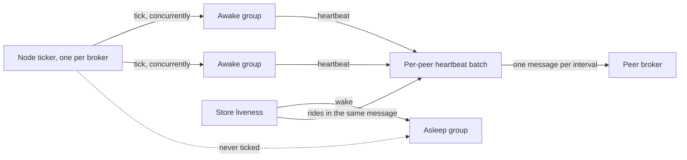
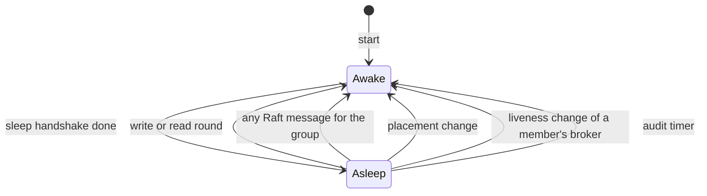
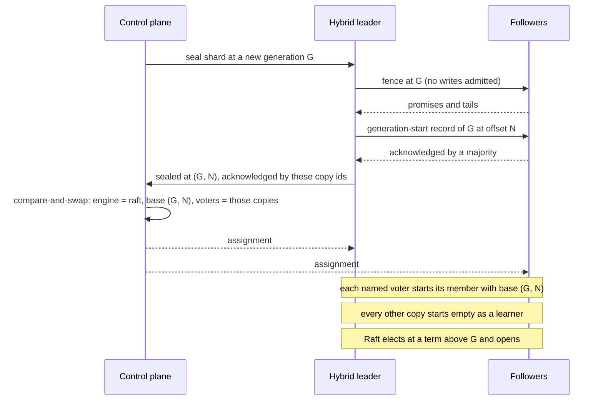

# Per-shard Raft

This page is the design for track 4 of the one-engine plan (issue #2167):
every shard runs one Raft group, through openraft, behind the engine
interface. Nothing here is built yet. The decisions it rests on are in
[`replication-engine.md`](replication-engine.md), which this page calls "the
engine page". Read its "Decisions" first. The protocol being replaced is in
[`replication-design.md`](replication-design.md) and is called "the hybrid"
here.

The page covers the engine interface as Raft needs it, how thousands of
groups share one timer and one heartbeat message per peer, how idle groups
sleep, how the write fence, leases and read bound map to Raft, how a shard
moves from the hybrid to Raft, and how all of it is tested and gated. It ends
with the pull request split and the questions that are still open.

## Summary

A broker holds one Raft member per shard copy. The design point is 2,000
members per broker and the gate is 5,000 (engine page, "How many groups a
broker carries"). Three things make that cheap:

1. One timer per broker ticks every awake group. Groups do not run their own
   timers.
2. An idle group sleeps. It is not ticked, sends no heartbeats and runs no
   election timer. It wakes on a write, on any Raft message, or when the
   brokers' own liveness exchange says a member's broker is gone or came
   back.
3. Heartbeats of awake groups travel as one message per peer broker.

Safety comes from Raft alone. Sleep, the shared timer, coalescing and the
liveness exchange only decide when a group does work. If any of them is
wrong, a group is slow to elect or elects when it did not need to. None of
them can make two leaders commit at one offset.

## What changes for the rest of the broker

| Today (hybrid) | Under per-shard Raft |
| --- | --- |
| The control plane assigns a leader and a generation | Raft elects the leader. The term is the generation. The control plane only places replica sets |
| A promoted leader runs a fence, then opens | A leader opens when the blank entry of its term commits |
| A `Leader` shard serves on the control-plane lease | A Raft leader lease, checked when a write is acknowledged |
| `Quorum` reads confirm by lease or read round | A read-index round |
| Cache shards have a cache log and a counter log | One log, one group |
| A wiped copy is vouched back in | A wiped copy has a new copy id, is a new member and joins as a learner. A group that lost its voters is re-formed |
| Suspicion is reported through the control plane | Brokers exchange liveness directly, tied to their disks |

## The engine interface

The trait in `crates/server/felix-replication/src/engine.rs` was shaped by
routing the hybrid's callers through it. Raft needs it smaller. The target:

```rust
/// Where a write landed: the offset one past its last record, and the
/// generation (Raft term) it was written at.
pub struct Written {
    pub end: u64,
    pub generation: u64,
}

pub trait Engine: Send + Sync {
    /// Records up to `written.end` are durable on this leader's log, in the
    /// broker's commit order. Raft adopts them as entries.
    fn appended(&self, shard: &ShardKey, written: Written);

    /// Wait until `written` is committed. An error means this broker cannot
    /// say so, not that the write is lost.
    fn await_commit(&self, shard: &ShardKey, written: Written, timeout: Duration)
        -> impl Future<Output = Result<(), CommitError>> + Send;

    /// May a write at `generation` be acknowledged on local durability
    /// alone? The leader lease check for `Leader` streams. On an error the
    /// caller waits on `await_commit`. A refusal never closes the shard.
    fn admit_local_ack(&self, shard: &ShardKey, generation: u64) -> Result<(), CommitError>;

    /// One past the highest committed offset, at every consistency level.
    fn read_bound(&self, shard: &ShardKey) -> Result<u64, Unreadable>;

    /// Confirm this broker still leads `shard`, for a read of state.
    fn confirm_read(&self, shard: &ShardKey)
        -> impl Future<Output = Result<(), CommitError>> + Send;

    /// The control plane placed `shard` on `set`.
    fn placement_changed(&self, shard: &ShardKey, set: &ReplicaSet);

    /// A peer's replication message.
    fn handle(&self, from: Option<&str>, caller: PeerCapabilities, request: InternalMessage)
        -> impl Future<Output = InternalMessage> + Send;
}

pub(crate) trait EngineHost: Send + Sync {
    /// This broker leads `shard` at `generation` and may take writes.
    fn opened(&self, shard: &ShardKey, generation: u64);
    /// This broker no longer leads `shard` at `generation`.
    fn deposed(&self, shard: &ShardKey, generation: u64);
    /// Whether `shard` is closed with no write still inside.
    fn quiesced(&self, shard: &ShardKey) -> bool;
}
```

The hybrid keeps implementing everything it has today until it is deleted.
The first pull request only adds to the trait. What goes away when the
hybrid is deleted, and why it is safe to drop then:

- `cache_write_at`, `await_cache_quorum` and `await_counter_quorum` become
  `await_commit`. A cache shard has one log and one commit index (see "Cache
  and counters").
- `committed_bound` merges into `read_bound`. Today it differs by a lease
  check. Under Raft a deposed leader's commit index is still a true lower
  bound on what is committed, so delivering up to it is always safe and needs
  no lease.
- `read_skips_lease` and `await_readable` go with the control-plane lease,
  which the shipping hybrid still serves on. Under Raft every read is bounded
  by `read_bound`.
- `EngineHost::generation` and `replicated` go. The engine tells the host the
  generation through `opened`, and every shard is a group.
- The `HybridHost` callbacks stay on the hybrid until it is deleted.

The interface does not assume one group per stream. A `ShardKey` maps to a
group through a registry inside the engine, so several small streams could
later share a group without changing a caller.

### Group and member identity

A group id is the `ShardKey` plus a group epoch, which starts at 0 and rises
only when the group is re-formed (below). A member id is the pair of broker
id and copy id.

The copy id is minted in the shard's own directory when the member is first
created there, and is fsynced with the directory. It is per shard on
purpose. The broker's storage id is one per data root and rotates only when
the broker notices a loss at start (`node/storage.rs`, `start_run`), so it
cannot tell a broker that lost one shard's directory from one that lost
nothing. An empty shard directory has no copy id, so the member made there
is new to Raft whatever the storage id says.

A member with a new id has never voted. It joins as a learner and the old
member is removed by a membership change. This is the rule issue #1331 asks
for, and it replaces vouching and copy trust. The copy ids of a shard
rotate, and the directory's log is kept as plain records, in each of these
cases:

- The shard directory is missing or empty.
- The storage id rotated: the data root was lost, or a run with relaxed
  fsync crashed and the machine restarted since
  (`felix-storage/src/run_state.rs`, `begin`), so writes that peers counted
  may be gone.
- The directory fails the restore check below.

**Votes are always fsynced.** The vote, the copy id and the membership are
synced in every fsync mode. Votes are rare, so this costs nothing on the
write path, and it means a relaxed-fsync crash can shorten a log but never
forget a vote.

**The restore check.** A directory restored from a backup or a VM rollback
keeps its copy id with an older log and an older vote. Raft cannot see
that: the copy would vote under an id that already promised more. Today the
control plane's incarnation check catches it (`restored` in `start_run`),
and the run witness catches it when the broker starts from its saved view.
Both stay, as a gate in front of Raft: a restarted broker starts no member
until its data root has passed one of them. A root that fails rotates every
copy id in it. A broker that can reach neither the control plane nor a
witness starts no member until it can. Brokers that stayed up are not
affected, so failover with the control plane down still works. What waits
is the restarted broker's own vote. The check is once per broker start, not
per shard.

**Per directory, not only per root.** The check above judges a data root,
and the copy id is per shard directory, so two more things are checked when
a member opens its directory:

- The directory records the storage id its copy id was minted under. If
  that is not the root's current storage id, the copy is rotated. This
  also makes rotation lazy: when the storage id rotates, one synced write
  at the root does it, and each shard directory is judged when it is
  opened. There is no pass over thousands of directories that a crash
  could leave half done. A new copy id and its storage id are written
  together by one rename.
- The root keeps a high-water mark for each shard: the vote and a last log
  id. If a directory's vote or last log id is below its mark, that one
  directory was restored or copied back, and its copy is rotated. The order
  is pinned: the vote mark is synced at the root before `save_vote`
  returns, and both the mark and the vote are durable before the vote is
  answered to anyone. The last log id is marked in batches, one synced
  write per root per mark interval, so it is a floor that trails the log by
  up to that interval.

**What this does not catch.** A single shard directory that goes back to a
state younger than one mark interval, with no vote saved since, passes
both checks. A steady leader's term does not change, so the copy's vote
equals its mark, and its log is above the trailing floor. Example: A and C
acknowledge R inside the last interval, C's shard directory goes back to
before R, A dies, and C votes for B, which lacks R. No leader is left to
notice. Whole-root restores are not affected: the incarnation check and
the run witness catch those whatever their age. Whether to accept this
residual or pay for an exact mark is Questions, 11.

`Config::allow_log_reversion` stays off for shard groups. It lets a voter
come back with a shorter log under the same id. Off, a leader that sees a
follower go backwards stops instead of carrying on. That protects a leader.
It does not stop the reverted copy from voting, which is why the rotation
rules and the restore check above carry the safety, and reversion-off is
the backstop. (The engine page says the adapter sets it for every group.
See Questions, 2.)

A new group is created from a first set that names copy ids. Each broker
the control plane places the shard on mints its copy id and reports it, and
the control plane then writes the first member set once. Every member in
that set calls `initialize` with it, which openraft allows. A member
initializes only when its own member id is in the set. A copy wiped after
that has a new id that the set does not name, so it can never initialize a
second time on an empty log.

### Re-forming a group

Rotating ids keeps one failure safe. It also means that several at once can
leave a group without a majority of voters: power-cycle two of three
brokers that run relaxed fsync, and every group they share has one voter
left. An RF 1 shard has that problem after any rotation. The hybrid
readmits such copies. Raft needs an explicit path, and it is the same
mechanism as the switch from the hybrid: a base recorded once in the
control plane.

1. A broker that holds a copy of a group that has had no leader for the
   re-form time tells the control plane so. This first report promises
   nothing and stops nothing. It names the old member id if the copy still
   has one, or says that it rotated, and the newest membership in the
   copy's log, committed or not.
2. The control plane asks the copies to retire only in one of two cases:
   every voter's broker is reachable and reports the group leaderless, or a
   majority of the voters has already rotated. In any other case it does
   nothing, and the group is left to elect. With A down and B and C merely
   slow to elect, A is unreachable and nobody has rotated, so nothing is
   retired and the stall heals by itself.
3. A broker that is asked retires the copy and then reports it. Retiring
   comes first: the broker stops its member of the current epoch and fsyncs
   a marker in the shard directory that says so. A retired member never
   votes, acknowledges or appends in that epoch again, also after a
   restart. This second report is therefore a promise, not a snapshot of a
   moment. It adds the last log id of the records on disk. A rotated copy
   still reports its records. They are evidence, not votes.
4. "Every voter" means the voters of every membership that any report
   names, both halves of a joint one. Its own record of the
   membership comes from broker reports and can be stale, so it is only one
   more input. A report that names a membership with further voters widens
   the set, and the control plane waits for those too. When every voter in
   the set has retired and reported, or is known to have rotated, it picks the report with the highest last log id
   and writes, by compare-and-swap on the group epoch: the next epoch, the
   base (that log id), and the voter set, which is exactly the copies whose
   reports hold the base. Everyone else is a learner.
5. Members start at the new epoch from the base, as in the switch. Messages
   carry the epoch, so the two never mix.

Why it is safe: the old epoch cannot commit anything more, because every
voter of it has either rotated or durably retired before the control plane
acts. It does not matter why the group was leaderless. Three intact copies
that were only partitioned from each other all retire before they report,
so when the partition heals none of them can commit in the old epoch. Every
record any reporting disk holds is at or below the chosen base or is cut as
uncommitted. What is lost is only a record that no surviving disk holds,
which is the loss relaxed fsync already documents for a majority losing
power. With fsync on commit a crash does not rotate ids, and a re-form then
loses nothing.

Step 4 closes the stale-membership case: the group went from {A, B, C} to
{A, B, D}, the control plane still has {A, B, C}, and A and B rotate with
short logs. A's or B's report names {A, B, D} if the change reached their
disk, and D is waited for. If the change reached neither, it was never
acknowledged by a majority that still holds it, which is the relaxed-fsync
loss again.

A retired copy whose group goes on without a re-form, because a voter that
was asked never retired and a leader was elected after all, cannot take its
promise back. It rotates its
copy id and rejoins as a learner.

If a voter's broker cannot be reached, the control plane waits. An operator
can force the re-form without it. The command names the missing copies and
says two things: records only they held are lost, and they made no promise,
so they must not come back under their old ids (the new epoch makes their
messages void, and they stop when they learn of it). An RF 1 shard whose
only copy is gone is re-formed empty the same way, by an operator, and the
new base is not below the highest offset the control plane has seen
reported for the shard, so offsets are not reused. See Questions, 10.

**After a re-form the group may have one voter.** If only one report holds
the base, that copy is the only voter and the rest are learners. The leader
promotes each learner by a membership change as soon as it has caught up.
Until the voters are again a majority of the placed set, the control plane
shows the shard as under-replicated and does not count it as RF 3, and a
`Quorum` acknowledgement rests on as many disks as there are voters, which
can be one. The same holds for a switch that started with two voters.

The control plane is on this path. It already is for placement, and a
group that needs re-forming is not serving.

### Adopting the leader's appends

The engine page decides that the broker keeps appending on the leader and
openraft adopts the records (Decisions, 2). In openraft terms: after the
broker's `commit`, `appended` hands openraft one entry per record through
`client_write_many`, in commit order. openraft assigns each the next index
and calls the adapter's `append`. The adapter finds the record already
durable at that index with that term and reports it flushed.

Two rules make this safe.

**The vote is the fence.** The adapter keeps a term gate under `DiskLog`'s
append lock. `save_vote` for a term above `T` closes the gate for `T` before
it returns. A broker append at generation `T` after that fails. So once
openraft has voted in a later term, no record of the old term can reach the
log, whatever the service's write fence believes at that moment. The
service-level fence (`ShardFence`) stays as the fast path and for routing. It
is not what safety rests on.

**No tail openraft has not seen.** When the gate closes, the adapter cuts any
records above the last index openraft accepted, before `save_vote` returns.
Those records were never committed. A `Leader` publisher may have been
acknowledged for them, which is inside the loss window `Leader` already
documents. After a crash the same tail is read back as uncommitted entries of
the old term, and the next leader keeps or cuts it, as the engine page says.

**Entries openraft writes itself.** A membership entry is created by
openraft, not by a publish. If a publish has claimed offset `X` in
`begin_append` and openraft gives `X` to a membership entry, the two
collide. So the engine never lets them race. Before it calls `add_learner`
or `change_membership`, the engine closes the write fence for the shard,
waits until the host reports `quiesced` (no claim outstanding) and every
`appended` has been handed to openraft, and only then makes the call.

The fence opens again, at the same term, only when every entry the call
proposed is known to be committed or known to be dead. Dead means openraft
refused the proposal before appending it, or this broker was deposed, in
which case the fence stays closed for that reason. A call that returned is
not enough, and neither is a timeout: an entry still queued inside openraft
would take the next index after the fence opened. So the engine runs the
call in a task it owns, never in a caller's future that can be dropped, and
on a timeout it keeps the fence closed and keeps waiting on the log.

`add_learner` is called without blocking on catch-up. It returns when the
learner's membership entry is committed, the fence opens, and the learner
catches up while writes flow. The engine watches replication progress and
starts the joint step when the learner is level.

The blank entry at the start of a term needs none of this, because the
fence is still closed then.

The cost is a write pause on that shard for each membership step: the drain
plus one commit round for a learner, and two rounds for a joint change. A
move is a learner step and a joint step. Publishers wait or retry as they
do during a promotion. The "move under load" cell prices it.

If openraft still assigns an index the record is not at, the group stops.
That means the commit order and openraft disagree, which is a bug.

The first implementation pull request proves adoption on the pinned openraft
with a test, before anything builds on it. If it cannot be made to hold, the
fallback is `client_write` with the adapter appending, and the gate's latency
cells price it.

## One timer for every group

Every group is built with `enable_tick: false`. Its internal ticker task
stays parked and costs no CPU (measured: idle CPU 0 at 5,000 groups, against
86% of a core per 1,000 members with the default tick). One task per broker,
the node ticker, calls `Raft::trigger().tick()` on every awake group each
interval. openraft 0.10.1 adds that call (openraft#2305). It runs the same
check the internal ticker runs: a follower past its election timeout starts
an election, a leader whose heartbeat is due sends one.



Rules for the ticker:

- **Tick concurrently.** `tick()` waits while a group's API channel is full,
  so a loop that awaits each group in turn lets one busy group delay the
  rest. The ticker polls all of an interval's ticks together in its own task.
  It spawns nothing per tick.
- **Drop, never queue.** A tick still waiting when the next interval starts
  is dropped. openraft reads the clock when it handles a tick, so a late tick
  sends one heartbeat and a dropped tick loses nothing. The ticker counts
  dropped ticks per group as a metric.
- **Only awake groups.** A sleeping group is not ticked at all. This is what
  makes idle CPU zero, since even a slow tick costs a wakeup per member.
- **The interval adds to timeouts.** A timeout is noticed at the next tick,
  so the tick interval is added to election and heartbeat latency. The lease
  margin (engine page, Decisions, 5) counts it.

Cost when every group is awake: a tick costs about 9 microseconds of CPU
(from the measurement above). 2,000 awake members at 20 ticks a second is
about a third of a core. With most groups asleep it is close to nothing.

Timer values are in Questions, 4. The hybrid suspects a leader after 5
seconds, so Raft does not need 50 ms heartbeats to match its failover time.

## Heartbeat coalescing

Without coalescing, each awake leader sends each follower one empty
AppendEntries per heartbeat interval. A broker with 2,000 awake members at RF
3 leads about 667 groups, so it sends about 1,300 heartbeats per interval and
answers about as many.

### The upstream shape

openraft sends a heartbeat through the group's network handle, and
`openraft-multi` routes it through `GroupRouter::append_entries(target,
group, request)` with no entries. The pull request Felix sends to
`openraft-multi` (openraft#2304, item 2) has three parts:

1. A wrapper router that implements `GroupRouter` over any other
   `GroupRouter`. An AppendEntries with no entries is parked in a buffer for
   its target. Anything else passes straight through.
2. A new `GroupRouter::heartbeats(target, batch)` method that carries many
   `(group, request)` pairs and returns one result per pair. Its default
   implementation calls `append_entries` for each, so existing routers keep
   working. A router that implements it sends one message.
3. A receive helper that hands each request in a batch to its group's
   `Raft::append_entries` concurrently and collects the answers.

The buffer flushes when the oldest heartbeat in it has waited a short window
(a few milliseconds), or when the batch reaches a size cap. Since the node
ticker ticks all groups together, their heartbeats arrive in the same
window, and one flush carries them all. One heartbeat is about 60 bytes
(vote, previous log id, commit index), so 2,000 fit in one message.

The delay is safe for leases. openraft takes the lease's start from when it
handed the heartbeat to the network, which is before the wait, and a follower
starts refusing votes when it receives it, which is after. Both err on the
safe side. The window is added to the margin like the tick interval.

### The interim

Felix does not coalesce privately (engine page, "Limits found in openraft are
fixed upstream", and #2215). Until the upstream change ships, sleep carries
the load: an idle group sends no heartbeats, and a busy group's appends
already serve as its heartbeats. What is left is groups that are awake and
lightly written, which heartbeat one by one over the shared peer connection.
The design-point run measures that traffic on real transport, and the
numbers go on openraft#2304. If it breaks a gate cell before the release, the
wrapper is carried in the tree as an exact copy of the upstream pull request
and deleted when the release that has it is pinned. See Questions, 3.

## Store liveness

Sleep needs a way to notice that a sleeping leader's broker is gone without
per-group heartbeats. That is store liveness: each pair of brokers that
share a group exchanges one small heartbeat per interval. It rides in the
same per-peer message as the group heartbeats. It follows the rules on the
engine page ("What other multi-Raft systems learned", 1):

- **Peer to peer.** Brokers exchange it directly. The control plane is not
  involved, so a control-plane outage does not stop failover.
- **Tied to the disk.** A broker writes and fsyncs a small probe file on each
  volume that holds shard logs, once per interval. It sends liveness
  heartbeats only while the last probe finished within the stall limit. A
  broker whose disk has stalled goes silent, even if its process and
  network are fine. The stall limit is several probe intervals and is
  separate from the time after which a peer withdraws support for silence:
  one slow fsync (`F_FULLFSYNC` can take over a second) must not silence a
  healthy broker.
- **Epochs.** Each broker has a store epoch that rises at every start. A peer
  that sees a new epoch knows the broker restarted.

A broker that has not heard a peer for the suspect time withdraws support
for it and tells the sleep logic, which wakes the groups it shares with that
peer.

In this design store liveness decides only when to wake. A wrong answer is
never unsafe: a false alarm wakes groups whose followers then ask the
leader before they campaign ("When a broker dies with sleeping leaders"),
and a missed failure is caught by the audit described below. Using it to keep leases alive while a group sleeps is a later step
with its own safety argument (see "Leases that survive sleep").

`suspicion.rs` is the hybrid's version of this signal. It pings peers but
reports through the control-plane heartbeat and writes nothing to disk. It
is deleted with the hybrid.

## Sleep and wake

A member is awake or asleep. The node ticker holds the state. openraft does
not know about it: an asleep member is simply one that gets no ticks.



### Going to sleep

The leader proposes sleep when all of these have held for the idle time:

- It is the leader and its blank entry is committed.
- Nothing has been proposed, and no read round is waiting.
- Every member matches the leader's last log id, and has acknowledged a
  heartbeat that carried the current commit index. A member whose broker
  store liveness says is down is left out, as long as a majority matches.
- Membership is committed and not joint. No snapshot is being sent and no
  leadership transfer is running.

It then sends each member a sleep request naming its vote, last log id and
commit index. A follower accepts only if its own vote, last log id and commit
index are the same. It then marks the group asleep and answers. The leader
sleeps only after every live member has answered. Followers sleep first and
the leader last, so a lost answer leaves the leader awake, and its next
heartbeat wakes the followers again.

A follower that is behind cannot be put to sleep, because the request names
the exact log position.

### Waking

Any of these wakes a member. Waking always happens before the event is
handed to openraft.

- **A write, or a read that needs a round, on the leader.** The leader wakes
  and replicates. The append wakes each follower when it arrives.
- **Any Raft message for the group.** AppendEntries, a vote or pre-vote, a
  snapshot, a transfer.
- **A placement change** for the shard.
- **Liveness.** When support for a broker is withdrawn, or its epoch
  changes, every group shared with it wakes. A leader woken this way sends a
  heartbeat at once. A follower woken this way does not campaign at once
  (see the next section).
- **The audit timer.** Each sleeping leader wakes on a long, jittered timer
  (about a minute), sends one heartbeat round and sleeps again through the
  handshake. A sleeping follower that has heard nothing for two audit periods
  wakes and ticks, so ordinary Raft election takes over. At 5,000 members
  this is about 80 wakeups a second per broker. The audit bounds how long a
  bug in sleep or in liveness can leave a group without a leader.

### When a broker dies with sleeping leaders

Every follower of every group it led wakes together. Pre-vote does not help
here. Pre-vote refuses a candidate only while the voter has heard from a
leader recently, and a sleeping follower has not heard from its leader for
up to an audit period. So a single false liveness alarm, followed by an
immediate campaign, would depose every sleeping leader on a healthy broker.
Three rules prevent that and keep a real failure from becoming a storm:

- **Ask before campaigning.** A follower woken by liveness sends a wake
  message for the group to the leader's broker. These travel in one message
  per peer. It is then given no ticks for one election timeout. A healthy
  leader wakes on the message and heartbeats, which resets the follower's
  election timer, and nothing changes. Only if nothing arrives do ticks
  start, and ordinary election follows. openraft measures its timeout from
  the last leader contact, so withholding ticks should be all this needs.
  The sleep pull request confirms that on the pinned version with a test.
- **Ranked starts.** When ticks do start, each follower's first tick is
  delayed by its rank among the group's live voters (a hash of the group id
  and member id), one election timeout per rank. The first usually wins
  before the second starts. This only shapes timing: if the ranks are
  wrong, the usual randomized timeouts decide.
- **A cap per tick.** The ticker starts at most a fixed number of elections
  per interval and queues the rest.

The cost is that a sleeping group fails over one election timeout later
than an awake one.

**Restarted members.** A member that starts after a broker restart is held
the same way: it gets no ticks until it hears from a leader, or until the
liveness suspect time plus one election timeout has passed since it
started. Without the hold it would campaign 1 to 2 seconds after start,
before the sleeping leaders on other brokers have noticed its new epoch and
sent a heartbeat.

### What sleep costs a write

A sleeping leader has not heard from a majority, so its lease has lapsed.
The first write after sleep is replicated and acknowledged by a majority
before a `Leader` publisher is acknowledged: one round trip, once. `Quorum`
writes wait for that round anyway.

### Leases that survive sleep

CockroachDB's leader leases keep a sleeping group's lease valid for as long
as a majority of the group's stores support the leader's store. The first
write after sleep then pays nothing, and a dead broker's groups elect
without a storm. Felix wants this, but it moves store liveness into the
safety argument: a follower's promise not to vote has to be tied to the
support it gave, and the support has to survive a restart. That needs a
change inside openraft's vote handling (openraft#1651) and a checked model.
It is not in the first version. See Questions, 5.

## Write fence, leases and read bound under Raft

### When a leader opens

The engine calls `EngineHost::opened(shard, term)` when the blank entry of
its term is committed. At that point the leader holds every committed
record, its commit index is current, and its lease clock has started. The
blank entry is the generation-start record and goes through the broker's
commit order like any other append. This costs one round at the start of a
term, as the hybrid's fence does today.

### When it closes

The engine calls `deposed` and the write fence closes on any of:

- openraft reports a vote for a higher term, or a role other than leader.
- A leadership transfer starts.
- The group stops on a storage error.

A failed lease check is not on this list. A leader whose lease has lapsed
is still the leader until Raft says otherwise, and a leader that has just
woken always has a lapsed lease. The fence also closes for a moment around a
membership step, without `deposed` ("Entries openraft writes itself").

openraft reports role changes through its metrics channel, which is
asynchronous. The term gate in the adapter covers the gap: after the vote
is saved, an append at the old term fails under the log's own lock.

### Acknowledging a write

A `Quorum` write is acknowledged when `await_commit` returns: the commit
index has passed it and the entry there has the term it was written at. If
the leader is deposed first, the waiter gets leadership lost and the client
gets an unknown outcome, as today. Nothing on this path asks the control
plane anything, which is the property issue #1792 asks for.

A `Leader` write is acknowledged on local durability if `admit_local_ack`
passes: `now < last_quorum_acked + lease`. openraft 0.10 publishes
`last_quorum_acked` as an instant; the older `millis_since_quorum_ack` is
deprecated. The value only moves forward, so a stale read errs toward
refusing. The lease must satisfy the inequality on the engine page
(Decisions, 5), with the tick interval and the heartbeat batch window added
to the left side.

If the check fails, the write waits on `await_commit` like a `Quorum`
write. Its commit renews the lease, and later writes are local again. The
shard stays open. The check is turned on by its own pull request, after the
model's lease configs pass. Until then it always refuses and every `Leader`
write waits for commit, which is safe and slower.

### Reads

`read_bound` is the commit index plus one, for every stream and every
consistency level. Subscriber fanout, cursor replay, Kafka fetch and cache
watch all take it. The engine publishes each commit index advance into the
table the commit hold already waits on.

`confirm_read` is a read-index round (`Raft::get_read_linearizer` with the
read-index policy). On a sleeping group it wakes the group for one round.
Raft lease reads (`get_local_read_linearizer`) would save that round. They
stay off until they are measured and the model covers the lease (engine
page, "openraft version").

A broker that restarts answers reads again once its member has caught up
and a leader is known. It needs the restore check once per start ("Group
and member identity"), and nothing per shard: no assignment has to be
confirmed, which is what kept shards unreadable in issue #1914.

### Membership

The control plane still chooses the replica set and paces moves. The group's
leader makes Raft's membership match it:

1. Add each new member as a learner. Catch-up happens with the fence open.
2. Call `change_membership` with the new set. openraft goes through joint
   consensus on its own and commits the membership as the typed record.
3. If the leader is not in the new set, transfer leadership first.

Only the leader acts, one change at a time, and the steps can be repeated
safely. Each step closes the write fence and drains first ("Entries openraft
writes itself"). A copy with a new copy id is handled by the same loop: the
set names the broker, the member id differs, so the old member is swapped
for a learner with the new id.

The control plane no longer assigns leaders. Brokers report who leads each
shard, and the routing table uses that as a hint. A broker that gets a write
for a shard it does not lead answers with the leader it knows. To balance
leaders the control plane asks the current leader for a transfer.

### Shards with one replica

An RF 1 shard runs a group with one voter. It elects itself, commits on its
own disk and sleeps like any other group, and moving it to another broker is
an ordinary membership change. This removes the last use of the
control-plane lease. If its one copy rotates its id, the group has no voter
and is re-formed ("Re-forming a group"). See Questions, 1.

## Cache and counters

A cache shard's group has one log holding puts, deletes, counter deltas and
counter checkpoints (engine page, Decisions, 4). For track 4 that means:

- **One wait.** A cache or counter write waits on `await_commit` at its
  position in the one log.
- **The state machine is the projection.** The cache index and the counter
  sums are rebuilt from a snapshot plus the log, as the cache index is
  today.
- **Compaction is proposed by the leader.** Copies of live records and the
  counter checkpoint are entries. Followers apply them and do not compact on
  their own. Dropping old segments is Raft's purge, done only behind a
  durable snapshot.
- **The snapshot** is the live cache records and one counter checkpoint, as
  of one log id.

## Moving a shard from the hybrid to Raft

The switch is per shard, one way, and looks to Raft like a snapshot install.
It needs the `record_generations` fleet feature finalized (records carry
their term) and a new fleet feature, `shard_raft`, that says every broker
can run the Raft engine.



1. **Seal.** The control plane promotes the shard to a new generation `G`
   with a seal flag. The hybrid leader runs its ordinary fence and catch-up
   and appends the generation-start record at offset `N`, but does not open
   for writes. For a cache shard it first appends one counter checkpoint
   holding the counter log's sums, so the cache log alone carries the state.
   The record at `N` names a start offset `S` and carries a digest of the
   records from `S` up to `N` (see "What a holder holds").
2. **Record the base.** A follower acknowledges the record at `N` with its
   copy id, and only if its own digest matches. When a majority of the
   hybrid's set has acknowledged, the leader reports `(G, N)` and the copy
   ids that acknowledged. The control plane commits, in one
   compare-and-swap on the shard's generation and replica set version, that
   the shard's engine is Raft, its base is `(G, N)`, and its voters are
   exactly the reported copy ids. Every other copy in the set is a learner.
   This write is the switch. Before it, the shard is a hybrid shard that
   happens to be closed, and can be opened again. After it, no broker runs
   the hybrid for this shard. If the generation or the set changed in
   between, the write fails and the seal starts over. If no majority
   acknowledges because followers fail the digest, the shard opens again as
   a hybrid shard, each mismatching copy is rebuilt from the leader by the
   hybrid's ordinary rebuild, and the seal is retried afterwards.
3. **Start the voters.** A copy whose copy id is in the recorded voter set
   cuts anything above `N` and starts its Raft member with the log purged
   up to `(G, N)`, the base as its snapshot id, and the recorded
   membership. Everything up to `N` stays on disk as readable records and
   is never compared by term, so records whose writer is unknown
   (generation 0) are never Raft entries.
4. **Start the rest as learners.** Every other copy starts empty as a
   learner: one that lagged, one that was halted, one whose digest
   differed, and one whose copy id changed after it acknowledged. It
   receives a snapshot install from the Raft leader, which is the record
   range below the base copied the way a rebuild copies it today. The
   leader promotes it by a membership change once it has caught up.
5. **Elect.** Voters campaign at a term above `G`. The winner commits its
   blank entry and opens.

Why it is safe: the hybrid's fence guarantees that every acknowledged record
is at or below `N` on the leader and that no lower generation can commit
again. Only copies that proved they hold everything up to `N` can vote, so
no set of voters can elect a leader that lacks an acknowledged record. The
base and the voters are recorded once, in the control plane's Raft, so no
two brokers can start from different bases.

The case this closes: A leads, A and C acknowledge `N`, B lags, and C is
wiped before the control plane's write. The record names A and C's old copy
id. B and the new C are learners with nothing to vote with. A alone cannot
elect, so the shard is unavailable, not wrong, and "Re-forming a group"
brings it back from A's log.

**What a holder holds.** Two copies that hold the same records below `N`
do not hold the same bytes. A record written before generations were
recorded has generation 0 in its header on one copy and may carry a real
generation on another. So the digest covers each record's offset, key,
payload and flags, and leaves the generation field out. A snapshot install
and any later comparison follow the same rule. The digest is also why the
switch does not rest on the hybrid's log matching for prefixes with
generation 0, which has not been verified: a copy that differs below `N`
fails its digest and is rebuilt as a learner. Computing it reads each
shard's log once on each copy, which is part of what paces the switch.

Hybrid copies do not share a log start. Retention is local, and a rebuilt
follower starts later than its leader (`replication-design.md`,
"Replication"). So the digest cannot start at each copy's own
first record. Followers send their log start with their fence promise, and
the seal names `S`, the highest start among the leader and the copies that
answered. Every one of them holds `S` up to `N`. A copy whose log starts
above `S` cannot acknowledge and becomes a learner. Records below `S` stay
readable on the copies that have them, as today, and the switch proves
nothing about them.

A cache shard has no range to digest, because each copy compacts its cache
log on its own and the copies hold different records for the same state.
For a cache shard the digest is over the live state at `N`: every live
key with its value, expiry and version, in key order, and the counter
checkpoint. Whether a key is live is judged from the log at `N`, by the
time the record at `N` carries, and never from a copy's own clock, so two
copies with skewed clocks compute the same digest. A voter's base snapshot is that state, and the log below `N` is
never compared.

The shard is closed from the seal until the Raft leader opens: one hybrid
promotion plus one Raft election. Shards switch a few at a time, paced like
moves. There is no switch back. See Questions, 6.

## Testing

### Simulator: Raft clusters

The simulator builds Raft-engine clusters through the same service code. All
four modes (`off`, `clocks`, `placement`, `power-loss`) run against them,
with the history checkers unchanged. They are turned on as the code they
need lands: `off` and `clocks` with stream shards, `placement` with
membership, `power-loss` with copy ids and re-forming. Each of these sweeps
passes with sleep off before sleep is turned on. Cluster checkers named after
`FelixShard.tla` invariants are replaced by the same checks named after
`FelixRaft.tla`: one leader per term, acknowledged records held by the
leader, election settles.

Acceptance cases carried over from open issues:

- **#1331.** A copy that was wiped has a new copy id and never votes under
  its old member id. It rejoins as a learner. A test wipes a voter that held an
  acknowledged record and checks the record survives every later election.
- **#1914.** After a killed broker returns, every shard is served and
  readable. No read is refused once the faults heal.
- **#1792.** With the control plane paused for the whole run, `Quorum`
  acknowledgements continue. The acknowledgement path makes no control-plane
  request.
- **#1009 and #1197.** With the control plane down, a leader crash fails
  over, writes continue and consumer groups keep working. Passing this in
  the Raft cluster closes both.
- **#2032.** Seed 4 is rerun under Raft.
- **Majority power loss.** Two of three brokers on relaxed fsync lose power
  together. Every shard is served again through a re-form, and the only
  records lost are ones no disk holds.
- **Restored directory.** A broker restarted on an older copy of its
  directory never votes under its old ids.
- **Membership under load.** A move while publishers write never stops a
  group on an index collision.

### Simulator: the sleep nemesis

A fifth mode, `sleep`. It sets the idle time to two seconds and the audit
period to twenty, and adds a schedule that stops client writes to a random
subset of shards long enough for them to sleep. Then it draws faults aimed
at sleeping groups:

| Fault | What it must not break |
| --- | --- |
| Crash, kill or power-cut the broker that leads the most sleeping groups | Every group elects; no storm stalls the run |
| Freeze a broker (process alive, silent) | Liveness withdraws support; groups move |
| Stall a broker's disk while its network works | The broker goes silent because its probe stalls; groups move |
| Drop or delay sleep requests and answers | A half-asleep group wakes fully or sleeps fully |
| Partition a sleeping leader, then write to it | The write is refused or times out; a new leader takes it |
| A write arriving during the handshake | It is committed; no member sleeps behind |
| Restart a sleeping follower | It hears the leader before it campaigns |
| A false liveness alarm for a healthy broker | No leader on it is deposed: followers ask first |
| A broker restart with sleeping leaders elsewhere | The restarted members hold until they hear a leader |
| The first `Leader` write after sleep | It is acknowledged after one round; the shard stays open |
| Liveness that misses a dead broker | The audit elects a leader within two periods |
| A placement change on a sleeping shard | The group wakes and applies it |
| Clock steps and skew (with `clocks`) | The lease margin holds |

New cluster checkers:

- `SleepersWake` (healed and end): every shard that slept is served, and a
  write to it is acknowledged within the settle time.
- `AsleepIsLevel` (every second): if every live member of a group is
  asleep, they have the same last log id and commit index.
- `IdleGroupsSleep` (end, a warning): in the quiet tail of a run, a group
  with no writes got no ticks. This catches a group that fails to sleep,
  which is a cost bug and not a safety bug.

The history checkers stay the judge of safety.

### History checker and scale

Every nemesis in `history.yml` runs against a Raft cluster, including the
duplicate-offset nemesis of the engine page. `scale-nightly.yml` adds a run
that kills a broker leading sleeping groups at the design point and reports
the time until every shard is served.

## The TLA+ model

`FelixRaft.tla` (pull request #2220) models one group with a fixed voter
set and no leases. Track 4 needs these added before its pull requests that
touch them are labelled reviewed.

**Joint consensus.** Membership is carried by the membership entry. A member
uses the latest membership in its log, committed or not. Add learners, a
joint configuration that needs a majority of both the old and the new set
for election and commit, and the rule that a new change starts only after
the previous one is committed. Add a removed leader stepping down. Checks:
the existing ones across a change, plus no two leaders in one term under any
pair of overlapping configurations. Twin configs that must fail: a change
that skips the joint step with two members changed, a second change before
the first commits, and a learner counted toward a quorum.

**Member identity.** A wipe gives a copy a new member id. A twin where a
wiped copy keeps its id and votes must violate `LeaderCompleteness`. A
second twin restores a copy to an older log and vote under its old id and
lets it vote, and must fail the same way. A third restores one shard
directory to a state younger than the log mark with no vote since, which
shows the residual of Questions, 11 and is pinned as an expected violation
if that residual is accepted. This is the model's side of #1331.

**Re-forming.** Add the group epoch and the re-form step: a new base and
voter set chosen from reports of every old voter. Check that a record held
by any reporting copy and committed in the old epoch is in the base. Twins
that must fail: re-forming before every old voter has reported; old and new
epochs exchanging messages; a report that is not a promise (three intact,
partitioned voters report, the partition heals, and the old epoch commits a
record before it learns of the new one); and waiting only for the control
plane's own, stale membership while a newer voter holds the records.

**Membership and adoption.** A twin where a publish claims an offset while
a membership entry is proposed must reach the stop.

**Leader leases.** Add a clock per broker with bounded drift, the leader's
lease from the send time of its last majority-acknowledged message, and the
follower's vote refusal from its receive time. Add `Leader`
acknowledgements on local durability under the lease. Check that no two
brokers pass the lease check for one shard at the same real time, and that a
`Leader` record delivered to a subscriber is never replaced. Twins that must
fail: a lease longer than the margin allows, a lease measured from the
acknowledgement instead of the send, and a follower that votes inside its
refusal window.

**Sleep.** Add asleep members that take no timeout steps, the handshake, and
the wake rules. Sleep changes only liveness, so the check is a liveness one:
with a leader's broker gone and a majority alive, a leader is eventually
elected, through liveness or through the audit. A twin with neither wake
path must fail it. Safety checks must pass with members sleeping in any
state, including behind, to show safety does not rest on the handshake.

**The switch.** Start a group from a base `(G, N)` with records below it
that differ in term between members (the generation 0 case). The twin that
compares terms below the base must fail, as the engine page already asks.
Voters are the copies that acknowledged `N`. A twin that makes the whole
set voters, with one member lagging and one wiped, must lose an
acknowledged record.

**Later, with store-liveness leases:** support with epochs and expiry, a
lease that holds while a majority supports the leader's store, and a vote
refused while support stands. Not needed for the first version.

The hybrid's `FelixShard*` specs stay until the gate passes. How they and the
rest of the hybrid are removed is in
[`hybrid-retirement.md`](hybrid-retirement.md).

## Performance plan

Two comparisons, both needed.

**Against the hybrid, same commit.** While both engines are in the tree, the
build that has the Raft engine picks one at start. `perf-env-ab.yml` runs
both sides on one runner, interleaved, six rounds. This is the gate on the
engine page: throughput within 10% and p99 within 20% in every cell,
failover no worse.

**Against the latest v0.7 release.** The release A/B builds the v0.7 tag and
the candidate and runs them on the same runners. Steady and single-node
cells must match the release. This catches a regression that both engines
share.

Cells, each at 1 KiB and 64 KiB where payload size applies:

| Cell | What it prices |
| --- | --- |
| Single node, RF 1 | Adoption and the single-voter group on the hot path |
| RF 3 steady, `Quorum` | The Raft core's cost per record, pipelined appends |
| RF 3 steady, `Leader` | The lease check; delivered latency (commit before delivery) |
| RF 3 promotion burst | Election plus blank entry against fence plus generation-start |
| Cache, mixed puts and counter adds | One log: fsyncs per write |
| `Quorum` read p99 | Read-index rounds |
| Failover time, control plane up and down | Timer values and ranked starts |
| First write after sleep | The one extra round, p50 and p99 |
| Move under load | The write pause around each membership step |
| Store liveness on, on the hybrid | The disk probe's fsync per second per volume |
| Broker loss with sleeping leaders, design point | Time until every shard is served |

Rules for the runs: a clean machine and clean artifacts, nothing compiled
during a run, throughput and delivered throughput reported separately, and
batched cells read as throughput only. Functional runs are in Actions. The
real-network cells run on cloud VMs with separate disks per broker.

A miss is fixed in the engine or upstream. It is not written up as a limit.

## The groups-per-broker gate

Criterion 6 of the gate, made concrete. Three real brokers on real
transport, RF 3, so each broker holds every shard: 5,000 shards is 5,000
members per broker, about a third of them leaders.

| Measure | At 2,000 members (design point) | At 5,000 members (gate) |
| --- | --- | --- |
| Idle CPU per broker, 60 s after settling | under 2% of one core | under 5% of one core |
| Resident memory added by Raft, against the hybrid on the same shards, idle | reported | reported |
| The same, one broker killed, under load | reported | under 1 GB |
| Groups asleep after the idle time | all | all |
| Ticks to sleeping groups | 0 | 0 |
| First write after sleep | within the A/B cell | reported |
| One broker killed: time until every shard is served | no worse than the hybrid | reported, no stall |
| Broker start to all members caught up | reported | reported |

10,000 members is a stress run. Its numbers go upstream and nothing passes
or fails on it.

Memory is the tight one, and the estimate below is a floor. From the
0.10.0 measurement (180 KB per leader member, 145 KB per follower, idle,
with empty logs), 5,000 members at one third leaders is about 780 MB. When
one broker dies the survivors lead half of the groups each, which is about
810 MB, before any payload held in flight for replication. Sleep does not
reduce any of it, because a parked task keeps its memory.

So the memory row is measured twice: idle with three brokers, and with one
broker killed while publishers write. The 1 GB limit applies to the second.
If that run is over, the fix is the upstream ask for fewer tasks per member
(openraft#2304, item 3).

`max_shards` defaults to the largest member count at which the
one-broker-killed run stays under the limit, which may be below 5,000. It
is not set to the gate size because the gate names it. Placement answers
`at_capacity` past it.

## Pull request split

Each pull request is safe to merge on its own. Until the gate passes, the
Raft engine is compiled only with a cargo feature that no release enables,
and the hybrid is what ships.

| # | Pull request | Depends on | Why it is safe alone |
| --- | --- | --- | --- |
| 1 (#2227) | Engine trait gains `appended`, `Written`, `admit_local_ack`, `opened`, `placement_changed`, implemented by the hybrid. Nothing is removed: `read_skips_lease`, `await_readable` and the rest stay until the hybrid is deleted | | Additions only. No behaviour change. Existing tests and seeds pass unchanged |
| 2 (#2229) | Store liveness: disk probe, epochs, per-peer exchange. Reports metrics, drives nothing | | Behind the feature, so a shipping broker gains no fsync. An A/B cell prices the probe before it is on anywhere |
| 3 (#2231) | Group runtime: type config, member id, group registry, peer messages for Raft behind a negotiated capability, node ticker | track 2 adapter; openraft 0.10.1, which is not released (the lock has 0.9.25, see #2215) | Behind the feature. No shard uses it. A peer without the capability is never sent a Raft message |
| 4 (#2233) | Stream shards on Raft: adoption with the term gate, `await_commit`, `read_bound`, read index, `opened` and `deposed`. `admit_local_ack` always refuses, so `Leader` writes wait for commit. Simulator `off` and `clocks` on fresh Raft clusters with a fixed member set | 1, 3 | Behind the feature, fresh clusters only. Starts with the adoption test. No lease, no membership change, no power loss yet |
| 5 (#2235) | Membership: learner, joint change, transfer, the fence drain around each step, leader reports and routing hints, single-voter RF 1 groups. Simulator `placement` | 4 | Behind the feature. Needs the model's joint consensus config first |
| 12 (#2250) | Copy ids per shard directory, the restore check before voting, votes always fsynced, re-forming a group. Simulator `power-loss` | 5 | Behind the feature. Needs the model's identity and re-form configs first |
| 11 (#2249) | The leader lease: `admit_local_ack` on `last_quorum_acked`, falling back to the commit wait | 4 | Behind the feature. Needs the model's lease configs first |
| 6 (#2238) | Cache and counters in one group: state machine, proposed compaction, snapshot | 4 | Behind the feature |
| 7 (#2239) | Sleep and wake, ask before campaigning, the hold on restarted members, the audit, ranked starts, and the `sleep` simulator mode with its checkers | 2, 4, and a sleep-off sweep of 4, 5, 6 and 12 | Behind the feature. Sleep can be turned off, and safety does not depend on it. Needs the model's sleep configs first |
| 8 (#2241) | Heartbeat coalescing: the `openraft-multi` pull request, then adopting the release that has it | 3 | Upstream change is additive. Felix adopts it by a version pin |
| 9 (#2242) | The switch from the hybrid: seal with digest, base and voters by compare-and-swap, `shard_raft` fleet feature | 4, 5, 6, 12 | Gated by a fleet feature nobody finalizes before the gate passes. Needs the model's switch config first |
| 10 (#2243) | Gate runs: A/B cells, groups-per-broker run, write-up in `docs/` | 4 to 8, 11, 12 | Workflows and docs only |

Rows are in merge order. 11 and 12 were split out after review, which is
why their numbers are out of sequence.

TLA+ additions (issue #2244, part of #2198) land in the model's own pull
requests, ahead of the pull requests that name them.

## Questions

Each has a recommendation, judged on safety and performance only.

1. **Do RF 1 shards run a single-voter Raft group, or stay outside Raft on
   the control-plane lease?** Recommended: a single-voter group, and only
   together with the re-form path, because a single voter that rotates its
   id leaves a group nobody can elect in. It removes the control-plane
   lease and its bug class, and a move is a membership change instead of a
   second mechanism. The cost is about 180 KB per shard and whatever
   adoption adds per batch, which the single-node cell must show is within
   the gate.

2. **Is `allow_log_reversion` on for shard groups?** The engine page says
   the adapter sets it for every group. Recommended: off for shard groups.
   Off is not enough on its own: it stops a leader that sees a follower go
   backwards, and does not stop that follower from voting. The safety comes
   from copy ids per shard directory, rotation, and the restore check
   before a restarted broker votes. The control plane's group is track 3's
   call.

3. **What is the heartbeat-coalescing interim?** Recommended: none in the
   tree. Sleep removes idle heartbeats, which is the gate. Measure the awake
   traffic at the design point, post it upstream, send the pull request. Only
   if an A/B cell fails on heartbeat cost does Felix carry the wrapper, as an
   exact copy of the upstream pull request. The wrapper is safe either way,
   so this is about keeping one copy of the code.

4. **Which timer values?** Recommended to start: tick 50 ms, heartbeat
   200 ms, election timeout 1 to 2 s, liveness heartbeat 500 ms with support
   withdrawn after 1.5 s of silence. The disk probe has its own limit: a
   broker stops sending only when no probe has finished for 5 s, so a
   single slow fsync withdraws nothing. A restarted member is held until it
   hears a leader, or for the suspect time plus one election timeout. The liveness
   interval is half of the first draft's so that a leader notices a
   restarted follower's epoch well inside that hold. This is a quarter of
   the default heartbeat traffic and tick cost. A sleeping group's
   first-ranked follower campaigns after the suspect time plus one election
   timeout (2.5 to 3.5 s), which is ahead of the hybrid's 5 s suspicion; the
   failover cells decide the final values. A shorter election timeout
   shortens the lease, so the two are tuned together.

5. **Does 0.8 ship leases that survive sleep (store-liveness leases)?**
   Recommended: no. Ship sleep with a lapsed lease first. It adds no safety
   argument and costs one round on the first write after idle. Leases backed
   by store liveness need a change inside openraft's vote handling and a
   checked model, and a mistake there is two leaders acknowledging. Take it
   after the model covers it and the upstream issue (openraft#1651) has a
   shape.

6. **Is the switch from the hybrid live and per shard, or done with the
   cluster stopped?** Recommended: live, per shard, with the voter rule
   above (only copies that acknowledged the base vote). Without that rule
   neither form is safe. With it both are, and the live switch is the one
   the simulator and the model can exercise under faults, and it keeps the
   closed window to one shard at a time. A stopped-cluster switch is
   simpler to build but is tested less, and closes every shard at once.

7. **Does a leader open at the blank entry's commit, or as soon as its vote
   is committed?** Recommended: at the blank entry's commit. Opening earlier
   saves one round per term but lets a leader take writes before it knows
   its commit index or has a lease, and every one of those writes would wait
   for the blank entry anyway.

8. **Is sleep on by default when Raft first lands?** Recommended: on by
   default from the pull request that adds it, and every gate run has it
   on. The pull requests before it (stream shards, membership, identity,
   cache) first pass their sweeps with sleep off, so a failure there is not
   confused with a sleep bug. The 5,000-member gate cannot pass without
   sleep, and a mode that is off by default is not the one the sweeps test.
   The audit timer bounds the damage of a sleep bug to availability for
   about two minutes.

9. **Do Raft lease reads replace read-index rounds for `Quorum` reads in
   0.8?** Recommended: not at first. Read index is safe without any clock
   assumption. Turn lease reads on only if the `Quorum` read p99 cell misses
   the gate, and only after the model's lease configs pass.

10. **Is re-forming a group automatic?** Recommended: automatic only when
    every voter of every membership the reports name has retired at the
    control plane's request and reported, and only because that report is a
    durable promise to stop in the old epoch. The control plane asks only
    when every voter is reachable or a majority has already rotated.
    Without those two rules automatic re-forming is not safe: intact voters
    could commit after reporting, and a voter the control plane did not
    know about could hold the records. With them no information is missing
    and the choice is the best any operator could make. If a voter's broker
    is unreachable, wait, and let an operator force it with a command that
    states which copies are missing. Never re-form on a timer alone: that
    would turn a long partition into data loss.

11. **Is the per-shard log mark exact, or a floor that trails?** A shard
    directory that goes back by less than one mark interval, with no vote
    saved since, can vote for a candidate that lacks an acknowledged record
    ("What this does not catch"). Two options. (a) Accept it as a named
    residual: keep the trailing floor with a short interval (start: one
    second), say in the operations docs that restoring a single shard
    directory is unsupported unless its copy id is removed first, and pin
    the model twin as an expected violation. (b) Make the mark exact by
    syncing it on the group-commit flush, so any reverted directory is
    below its mark. That is a second synced write on the hot path, and an
    A/B cell must price it. Recommended: (a). The fault needs something
    outside Felix to roll back one directory under a running data root
    within a second of an acknowledged write, and whole-root restores,
    wipes and crashes are all caught by other checks. (b) charges every
    write for it. If the A/B cell shows the exact mark is free because it
    shares the flush that already happens, take (b).
