# Per-shard Raft

This page is the design for track 4 of the one-engine plan (issue #2167):
every shard runs one Raft group, through openraft, behind the engine
interface. The group runtime and its ticker are built ("Group runtime"
below) and no shard runs on them. The rest is not built yet. The decisions
it rests on are in
[`replication-engine.md`](replication-engine.md), which this page calls "the
engine page". Read its "Decisions" first. The protocol being replaced is in
[`replication-design.md`](replication-design.md) and is called "the hybrid"
here.

The page covers the engine interface as Raft needs it, how thousands of
groups share one timer and one heartbeat message per peer, how the write
fence, leases and read bound map to Raft, how a shard moves from the hybrid
to Raft, and how all of it is tested and gated. It ends with the pull
request split, what is left for later, and the questions.

Six scope decisions for 0.8 were made after a design review (issue #2167).
The aim is that Raft carries the safety and Felix's own layer around it
stays small. Each is marked "Decided" where it applies:

- Writes go through openraft's `client_write` and the adapter appends
  ("Writing through openraft"). Adopting the leader's own appends is left
  for later.
- Re-forming a group is an operator command, except for an RF 1 shard whose
  copy a relaxed crash rotated, which re-forms itself ("A cluster's RF 1 shard
  re-forms itself").
- `Leader` streams keep the local acknowledgement. A restarted member
  waits out the promise behind it and stores nothing ("Acknowledging a
  write").
- Sleep and wake are deferred out of 0.8, and store liveness with them
  ("Deferred: sleep and wake"). The node ticker ticks only the groups
  whose timer is due.
- The switch from the hybrid is modelled and run in the simulator with
  power loss before it touches real data, and reproducible simulator seeds
  on Raft shards are added to the release bar ("Testing").
- Raft's own flush is always a real fsync, and a publisher's
  acknowledgement follows the stream's fsync policy ("Writing through
  openraft").

## Summary

A broker holds one Raft member per shard copy. The design point is 2,000
members per broker (engine page, "How many groups a broker carries"). Two
things keep that affordable in 0.8:

1. One timer per broker ticks the groups whose timer is due. Groups do
   not run their own timers, and an idle group's timers are slower.
2. Heartbeats travel as one message per peer broker.

Idle groups do not sleep in 0.8 ("Deferred: sleep and wake"). An idle
group still heartbeats, less often than a busy one.

Safety comes from Raft alone. The shared timer and coalescing only decide
when a group does work. If either is wrong, a group is slow to elect or
elects when it did not need to. Neither can make two leaders commit at one
offset. What Felix adds around Raft is member identity, the lease check,
and an operator command for a group that lost its majority.

## What changes for the rest of the broker

| Today (hybrid) | Under per-shard Raft |
| --- | --- |
| The control plane assigns a leader and a generation | Raft elects the leader. The term is the generation. The control plane only places replica sets |
| A promoted leader runs a fence, then opens | A leader opens when the blank entry of its term commits |
| A `Leader` shard serves on the control-plane lease | A Raft leader lease, checked when a write is acknowledged |
| `Quorum` reads confirm by lease or read round | A read-index round |
| Cache shards have a cache log and a counter log | One log, one group |
| A wiped copy is vouched back in | A wiped copy has a new copy id, is a new member and joins as a learner. A group that lost its voters stays down until an operator re-forms it |
| Suspicion is reported through the control plane | Raft's heartbeats and election timeout. Nothing goes through the control plane |

## The engine interface

The trait in `crates/server/felix-replication/src/engine.rs` was shaped by
routing the hybrid's callers through it. Raft needs it smaller. The target:

```rust
/// Where a write landed: the offset one past its last record, and the
/// generation (Raft term) it was written at.
pub struct Written {
    pub end: u64,
    pub generation: u64,
}

pub trait Engine: Send + Sync {
    /// Write `batch` on this leader. Raft assigns the offsets and the
    /// adapter appends. Returns when the records are on this leader's log
    /// as far as the stream's fsync policy asks: written, or fsynced.
    fn propose(&self, shard: &ShardKey, batch: Batch)
        -> impl Future<Output = Result<Written, CommitError>> + Send;

    /// Wait until `written` is committed. An error means this broker cannot
    /// say so, not that the write is lost.
    fn await_commit(&self, shard: &ShardKey, written: Written, timeout: Duration)
        -> impl Future<Output = Result<(), CommitError>> + Send;

    /// May a write at `generation` be acknowledged on local durability
    /// alone? The leader lease check for `Leader` streams. On an error the
    /// caller waits on `await_commit`. A refusal never closes the shard.
    fn admit_local_ack(&self, shard: &ShardKey, generation: u64) -> Result<(), CommitError>;

    /// One past the highest committed offset, at every consistency level.
    fn read_bound(&self, shard: &ShardKey) -> Result<u64, Unreadable>;

    /// Confirm this broker still leads `shard`, for a read of state.
    fn confirm_read(&self, shard: &ShardKey)
        -> impl Future<Output = Result<(), CommitError>> + Send;

    /// The control plane placed `shard` on `placement`.
    fn placement_changed(&self, shard: &ShardKey, placement: &Placement);

    /// A peer's replication message.
    fn handle(&self, from: Option<&str>, caller: PeerCapabilities, request: InternalMessage)
        -> impl Future<Output = InternalMessage> + Send;
}

pub(crate) trait EngineHost: Send + Sync {
    /// This broker leads `shard` at `generation` and may take writes.
    fn opened(&self, shard: &ShardKey, generation: u64);
    /// This broker no longer leads `shard` at `generation`.
    fn deposed(&self, shard: &ShardKey, generation: u64);
    /// Whether `shard` is closed with no write still inside.
    fn quiesced(&self, shard: &ShardKey) -> bool;
}
```

The hybrid keeps implementing everything it has today until it is deleted.
The first pull request only adds to the trait. What goes away when the
hybrid is deleted, and why it is safe to drop then:

- `appended` is how the hybrid learns of a write the broker has already
  appended. A Raft shard writes through `propose` ("Writing through
  openraft"), which the stream shards pull request adds.
- `cache_write_at`, `await_cache_quorum` and `await_counter_quorum` become
  `await_commit`. A cache shard has one log and one commit index (see "Cache
  and counters").
- `committed_bound` merges into `read_bound`. Today it differs by a lease
  check. Under Raft a deposed leader's commit index is still a true lower
  bound on what is committed, so delivering up to it is always safe and needs
  no lease.
- `read_skips_lease` and `await_readable` go with the control-plane lease,
  which the shipping hybrid still serves on. Under Raft every read is bounded
  by `read_bound`.
- `EngineHost::generation` and `replicated` go. The engine tells the host the
  generation through `opened`, and every shard is a group.
- The `HybridHost` callbacks stay on the hybrid until it is deleted.

The interface does not assume one group per stream. A `ShardKey` maps to a
group through a registry inside the engine, so several small streams could
later share a group without changing a caller.

### Group and member identity

A group id is the `ShardKey` plus a group epoch, which starts at 0 and rises
only when the group is re-formed (below). A stream shard's group under
`FELIX_SHARD_ENGINE=raft` uses the stream's incarnation as its epoch, so
members of a deleted stream never hear the group of the stream recreated
under its name. A member id is the pair of broker id and copy id.

The copy id is minted in the shard's own directory when the member is first
created there, and is fsynced with the directory. It is per shard on
purpose. The broker's storage id is one per data root and rotates only when
the broker notices a loss at start (`node/storage.rs`, `start_run`), so it
cannot tell a broker that lost one shard's directory from one that lost
nothing. An empty shard directory has no copy id, so the member made there
is new to Raft whatever the storage id says.

Every Raft request names the member id it is for, and a copy refuses one
that names another id, an older copy id of its own broker included. Without
that, a wiped copy would answer a vote request sent to the id it replaced,
from an empty log (`FelixRaftPlacementAnswerAnyId.cfg`). The refusal names
the copy id the broker does hold for the group, which is how the broker
that forms a group learns the others' copy ids. It answers nothing else:
no vote, no log position.

A member with a new id has never voted. It joins as a learner and the old
member is removed by a membership change. This is the rule issue #1331 asks
for, and it replaces vouching and copy trust.

> `crates/server/felix-replication/src/raft/tests/identity.rs`,
> `a_wiped_voter_never_votes_under_its_old_id_and_its_record_survives`.

The copy ids of a shard rotate, and the directory's log is kept as plain
records, in each of these cases:

- The shard directory is missing or empty.
- The storage id rotated: the data root was lost, it failed the restore
  gate below, or the machine lost power on a run that was relaxed. A run
  is relaxed when the broker's own `FELIX_DURABLE_FSYNC_MODE` is `periodic`
  or `none`, or when a copy in the root has ever vouched for a record
  before its fsync: told a leader it had written one, or, as leader,
  counted its own unsynced write toward an acknowledgement. (A copy on a
  written-commit log answers at the write without a marker: its root's run
  is relaxed already.) Before the first of either, the copy syncs a marker in the data root
  (`vouched-unsynced`), and the marker is never removed, since a leader
  may still count what the copy said. A copy under `on_commit` that
  never vouched was only ever counted for records it had synced, so it
  keeps its id as a 0.7 broker does (issue #2423). On Linux a process
  crash alone keeps the id: the kernel still has the writes. That holds
  for the run that first vouched too, since its run record names the boot
  once the marker is synced. Elsewhere, macOS included, a killed relaxed
  run rotates too.
- The directory fails the restore check below.
- The copy's log was poisoned in its last run ("A poisoned log" below).

**Votes are always fsynced.** The vote, the copy id and the membership are
synced before they are answered. Votes are rare, so this costs nothing on
the write path. The log is fsync on commit and refuses any other mode
(decided, issue #2248): a member acknowledges an append only once it is on
disk, so a power cut cannot shorten what a peer counted toward a commit.
The written report is the exception, and the rotation above covers it.

**The restore check.** A directory restored from a backup or a VM rollback
keeps its copy id with an older log and an older vote. Raft cannot see
that: the copy would vote under an id that already promised more. A gate in
front of Raft (`raft_copy::check`) judges the data root once per broker
start, not per shard, from three pieces of evidence: the incarnation
verdict (the control plane registered the node after the root last recorded
a registration, `restored` in `start_run`), the run witness's copy of the
root sequence, and the control plane's copy (both below). The gate has
three outcomes:

- **Behind** any of the three: the root gets a new storage id and every
  copy id in it rotates. A broker that finds this as it opens the root
  stops, so its restart registers under the new id.
- **Unchecked:** the root holds marks but there is no copy of its sequence
  to compare against, because the machine rebooted (the witness is gone)
  and the control plane has none. No member opens until evidence arrives.
  A hold acts on evidence, never on silence.
- **Passed:** otherwise, including a root with no marks yet.

A broker whose machine rebooted has no witness, and neither has any start
on a host with no witness directory (anything but Linux with `/dev/shm`).
Its root is judged on the control plane's copy, so it holds while the
control plane is down or has none. Brokers that stayed up are not
affected, so failover with the control plane down still works. What waits
is the restarted broker's own vote.

> `crates/testing/felix-cluster/tests/raft_shards/reform.rs`,
> `a_restored_data_directory_never_votes`: a follower's data directory put
> back from a copy, beside a follower that lacks the same records, elects
> nothing until the leader returns.

**The broker runs the gate after its start.** A broker started with
`FELIX_SHARD_ENGINE=raft` opens every Raft member through the gate. The
gate runs in the background once the start's own restore check has
answered, so a held root does not keep the broker from serving its other
shards. Until the root passes, no Raft member opens, a request for a Raft
shard placed here is answered "not ready", and the log says once why the
root is held. When it passes, the routing feed is woken and the members
open. A broker that started from its saved control-plane view, with the
control plane down, has not had its restore check answered yet. Under the
unified fence, the default, its Raft members wait for the control plane
too, even with a witness: a restarted broker counts for nothing until the
control plane has checked it, as on the hybrid engine. With
`FELIX_UNIFIED_FENCE=0` they open on the witness.

**Voting before the restore check.** A broker with
`FELIX_START_WITHOUT_CONTROLPLANE` on and `FELIX_UNIFIED_FENCE=0` that
starts from its view runs the gate at once, with no incarnation verdict
(issue #3102). With the leader also dead, the copies still up could not
elect otherwise, and the shard would wait for the control plane. What
stands in for the verdict is the run witness, twice:

- The start qualified for its view only because the witness names this
  directory, this boot and the token the last start wrote
  (`docs/durable-storage.md`, "The run witness"). So the root is the one
  the last run on this machine left, or a copy taken during that run.
- The gate compares the root's sequence with the witness's copy, which is
  exact for votes. A copy taken during the last run and put back is behind
  it as soon as one vote or one batch of log marks followed the copy.

The control plane is not asked for its copy until the restore check has
heard from it, so a control plane that takes no connection does not hold
the vote up. A root with marks and no witness copy of its sequence is
still held until the control plane has one.

Members that open this way vote and replicate but do not lead until the
broker has registered (`GroupRuntime::stand_after`): they do not stand, do
not take their old leadership back at the start, refuse a leadership
transfer, and form no group, since forming one elects the member that
forms it. The broker serves no client before it registers, so a group it
led would serve nobody while a peer that could lead it waited.

When the control plane answers, the deferred restore check runs as before.
A directory it finds restored gets a new storage id and the broker stops.
That rotation now finds the mark log open, so the open log stops instead of
writing again: once the root's storage id is no longer the one the log was
opened under, every mark write fails, and with it every vote and every
append that waits on a mark, and the file is not put back by a rewrite or
a reopen (`marks.rs`, `under_id`). The restart finds a root with no marks
under the new id, and every copy rejoins as a new member.

What this gives up against a start that waits:

- **A copy taken in the last run before that run recorded its
  registration, with no mark written since.** The incarnation verdict
  would rotate it. The witness passes it, as it passes any root put back
  inside the last mark interval ("What the gate cannot see"). The members
  vote until the control plane answers, then the check rotates the root.
- **A second machine that runs a copy of the directory under the same node
  id.** The control plane registers it at a later incarnation, and a start
  that asks is rotated for it. A start from the view does not ask, so both
  machines hold the same copy ids, and each can vote once in one term.
  Starting a copy of a live directory elsewhere needs
  `felix-broker rotate-storage-id` first, as a restored snapshot does.

Both are why the default waits. The gain is the one the switch has on the
hybrid engine: a shard with two live copies of three stays available while
the control plane is down and a broker restarts.

> Tests: `node::cluster::tests::a_view_start_under_the_pin_rule_opens_its_raft_root_before_the_restore_check`,
> `raft::tests::a_member_of_an_unregistered_broker_votes_but_does_not_lead`,
> `raft::tests::a_member_of_an_unregistered_broker_forms_no_group`,
> `raft_copy::tests::gate::a_rotation_under_an_open_mark_log_stops_it_and_leaves_no_marks`,
> and on a cluster
> `failures::replica_election::a_broker_restarted_while_the_control_plane_is_down_votes`.

**A hold that no evidence can end.** A held root reports nothing, so the
control plane learns a root's sequence only from a broker whose root is
open. Two starts therefore hold for good. One is a root that wrote its
first marks and lost its broker before a heartbeat carried them, on a
machine that then rebooted or has no witness directory. The other is any
start without a witness while a control-plane member is below metadata
level 33, since nothing is stored below it; the control plane logs once
per level that it keeps no root sequence. The broker logs the hold once
at error level, sets `felix_broker_raft_root_held` to 1, and keeps
serving its other shards. To end it, stop the broker and run
`felix-broker rotate-storage-id`: the root starts over under a new
storage id and its copies come back as new members. That is safe, since a
hold never lets a copy vote twice, and the rotation gives up only what
the root could not prove. Ending such a hold without an operator is
tracked in #2542.

When the gate finds a root behind while the broker runs, it rotates the
storage id, logs that it is stopping, and stops the broker, as the
deferred restore check does for a restored directory. This run registered
under the old id and its hybrid copies stop being trusted with the
rotation, so it must not go on serving. A clean stop is recorded under the
new id, so the restart keeps it instead of rotating again. The restart
registers under the new id, which the control plane treats as a replaced
directory, and every Raft copy on the root rejoins as a new member. A
root found under any id other than the one the run registered, as a
rotation that failed after writing the id leaves it, stops the broker the
same way and never opens.

**The root sequence.** The incarnation and the run token change once per
start. A root put back from a backup taken during the run it interrupts
carries both, so on their own they read it as a crash, and its copies
would vote a second time in a term they already voted in (issue #2303).
Something outside the root has to move during a run. The root keeps a
sequence number that rises with every synced write of a mark (below), so
with every vote and every batch of log marks. Two places outside the root
hold a copy of it:

- **The run witness.** It is written after the root's write is synced and
  before the vote is answered. The witness is in memory, so this adds no
  fsync. For as long as the machine stays up it is exact for votes, and
  for the log it trails by up to one mark interval, like the log mark.
- **The control plane.** The broker's heartbeat carries the root's storage
  id and its last synced sequence, never one whose write is still in
  flight, and the control plane stores the highest it has seen for that
  storage id, one record per broker. A report under another storage id
  replaces the record, because a rotation starts the comparison over. The
  stored value survives a machine restart, a replaced machine and a VM
  rollback, none of which leave a witness. It is one metadata write per
  broker per heartbeat in which the sequence changed, and it needs every
  control-plane member at metadata level 33. Below that nothing is stored,
  so a rebooted broker holds its root as it would with no copy. The
  broker reads the value back from its node's detail
  (`GET /v1/nodes/{node_id}`, `root_sequence`), which a control-plane
  member answers from what it has applied, so a lagging member widens the
  window below by its apply lag. A report under another storage id
  replaces the record only from a later incarnation: one process reports
  one id, so a late beat of the process before a rotation cannot bring the
  old id back at a sequence its root has since passed.

The gate fails a root whose sequence is below either copy, and its copy
ids rotate. A root that is ahead of a copy crashed between the two writes
and passes. That is why the heartbeat carries only a synced value: a power
cut after an unsynced one would leave the root behind and rotate every
copy for nothing.

What the gate cannot see:

- **With a witness,** a root that goes back by less than one mark interval
  with no vote saved since. Example: a mark batch is written, the root is
  copied, C acknowledges R, C is killed before the next batch, and the
  copy is put back. This is the residual of "What this does not catch"
  below at the scale of a root, and Questions, 11 accepts both. The
  witness cannot count appends itself, because an ordinary crash would
  then leave it ahead of the root and read as a restore.
- **Without a witness,** a root restored from a backup newer than the last
  value the control plane stored. That is one heartbeat while the control
  plane is reachable. It is the whole outage while it is not, because
  failover goes on without the control plane: with the control plane down
  for ten minutes, a copy taken at sequence 7, a vote at sequence 8 and a
  restore to the copy pass the gate when the control plane returns holding
  7, and the broker votes again in the same term.

So restoring a live snapshot is supported only after the operator command
that rotates the storage id, `felix-broker rotate-storage-id`, run with the
broker stopped, and the operations docs say so. See Questions, 12.

**A rotation starts the mark log over.** Every rotation of the storage id,
by the gate or any other path (a restore, a crash under relaxed fsync, the
operator command, a deleted `storage-id` file), removes the root's mark log
before it writes the new id. `open_root` is called only after the start's
restore check has answered, so no rotation removes a mark log that is
open, except on a start that votes before the check; there the open log
stops at the rotation ("Voting before the restore check"). Every shard
directory minted under the old id rotates when it opens,
so the old marks protect nothing. Kept, they would carry a sequence that
no copy outside the root names under the new id, and the root would be
held after the next reboot. A crash between the removal and the new id
leaves the old id with no marks, which rotates every directory too.

**Per directory, not only per root.** The check above judges a data root,
and the copy id is per shard directory, so two more things are checked when
a member opens its directory:

- The directory records the storage id its copy id was minted under. If
  that is not the root's current storage id, the copy is rotated. This
  also makes rotation lazy: when the storage id rotates, one synced write
  at the root does it, and each shard directory is judged when it is
  opened. There is no pass over thousands of directories that a crash
  could leave half done. A new copy id and its storage id are written
  together by one rename.
- The root keeps a high-water mark for each shard: the copy id it belongs
  to, the vote and a last log id. A directory whose copy id is not the one
  its marks name is rotated. Without the name, a wipe would reset the marks
  for the new copy, and the old directory put back later would pass them
  under its old id. If a directory's vote or last log id is below its
  mark, that one directory was restored or copied back, and its copy is
  rotated. The order
  is pinned: the vote mark is synced at the root before `save_vote`
  returns, and both the mark and the vote are durable before the vote is
  answered to anyone. The last log id is marked in batches, one synced
  write per root per mark interval, so it is a floor that trails the log by
  up to that interval. The id in the mark is an fsynced one, because an
unsynced id after a power cut would read as a restore and rotate the copy.

**A poisoned log.** A failed fsync poisons the log: it refuses every later
write and leaves a `poisoned` marker in its directory. So does a rollover,
a truncation or a reset that fails partway. The next open of a poisoned log
cuts it back to its last sync (`docs/durable-storage.md`, "A failed fsync
poisons the log"). That is right for a log whose every acknowledgement
waited for the fsync. It is wrong for a copy whose written position a
leader counts toward a `Quorum` acknowledgement (`await_quorum_ack`, see
"Acknowledging a write"):

1. Leader L and follower F1 write record R. R is acknowledged on the
   written count.
2. F1's fsync fails. F1 restarts, cut back to its last sync, without R.
3. L is unreachable. F1 and F2 elect a leader, and neither holds R.

R would be lost with no machine losing power. So a poisoned log counts as
losing the copy. A directory that holds the marker is rotated when it is
opened, and the check runs before the log is opened, so the cut never
happens under the old copy id. The kept directory still holds the marker
and every byte the failed run wrote.

One failed fsync rotates every copy on the broker. The first poisoned log
in a process also makes the run record stop vouching for the boot, so on a
restart the broker takes a new storage id, and every copy on its data root
rotates as one minted under another storage id, not only the one whose
flush failed. The marker's own rotation is what catches a copy reopened in
the same process, or a restart where the run record write failed.

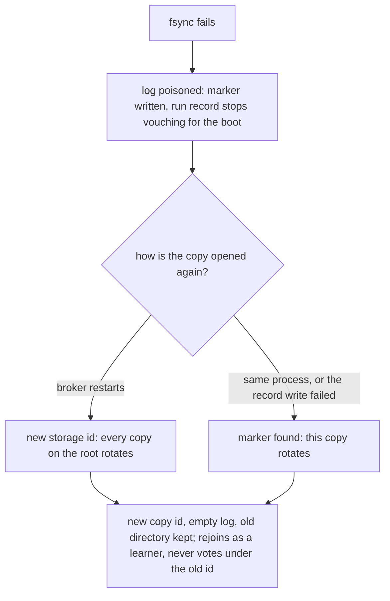

How the rule holds:

- **The cut and the rotation read the same file.** The cut to the last
  sync happens only when an open finds the marker, and a copy's directory
  with the marker is rotated instead.
- **No open goes round it.** `DiskLog::open` refuses a directory that
  holds both a copy file and the marker, and leaves the marker in place.
  A tool or a test that opens the directory directly cannot cut the log
  and remove the evidence before the copy root sees it.
- **It does not ask who counted what.** The copy cannot know whether a
  leader counted its written position, so every poisoned log rotates it,
  whatever the stream's settings. A disk that failed an fsync is suspect
  anyway, and the group replaces the copy the way it replaces a wiped one.

A marker that cannot be read rotates the copy too. If the directory cannot
be checked for a marker, that is an error and the member does not open.

**If the marker was not written.** The marker goes to the disk that just
failed, so its write can fail too. No marker means no cut to the last
sync, but an open still repairs a torn tail, and after a failed fsync the
kernel may have dropped pages, which then read as one. Two cases:

- **The broker restarts.** The run record rotates every copy in the root,
  as above. Opening a copy root registers its root for this
  (`run_state::watch_poison`), so it does not depend on the caller. That
  record is written to
  the same disk without a sync. If the new record cannot be written, as
  on a full disk, the record there is cut to nothing in place, which needs
  no free block on ext4 or XFS and also rotates on the next start. If the
  marker and the record change are lost and the machine lost power, the start rotates if the run was relaxed. A
  copy that never vouched keeps its id, and loses nothing a peer counted: it
  was counted only for synced records, and the failed flush acknowledged
  none. Only if the marker, the new record and the cut all fail and the
  process alone restarts does nothing on disk say a flush failed, and the
  copy keeps its id. The broker logs an error when that happens.
- **The copy is closed and opened again in the same process.** The
  process does not re-read the run record, so the storage crate remembers
  every directory whose log was poisoned in this process, and opening one
  as a copy rotates it, marker or not (issue #2475). The rotation forgets
  the directory, so the new copy opens normally after that. A storage id rotation by
  the restore check (issue #2441) stops the broker instead of reopening
  in place.

**A kept directory that was poisoned** still holds its copy file and its
marker, so `DiskLog::open` refuses it for good. That is intended: a
re-form must not read a cut log as that copy's records. The re-form is not
built, and when it is, it has to read such a directory without repairing
it and treat it as a copy that may hold less than it reported.

> Tests: `raft_copy::tests::judge::a_copy_whose_flush_failed_rotates`
> (storage) and
> `raft::tests::identity::a_copy_whose_flush_failed_does_not_vote_with_the_cut_log`
> (three members: a record acknowledged on the written count by the
> leader and a follower whose flush then fails, with the third member cut
> off; the record survives and the follower does not vote).

**What this does not catch.** Two restores to a state no older than the
last mark write, with no vote saved since, pass every check. The batch runs
once a second, so that is about the last second, longer while the mark
writer is backed up behind its own fsync or queued votes, and about six
seconds at most (see below):

- **One shard directory** put back to such a state. A steady leader's term does not change, so the copy's vote equals
  its mark, and its log is not below the trailing mark. Example: A and C
  acknowledge R inside the last interval, C's shard directory goes back to
  before R, A dies, and C votes for B, which lacks R. No leader is left to
  notice.
- **The whole root** put back, in the same run, to a copy taken after the
  last mark write. The witness holds the sequence the copy holds, so the
  gate passes it ("The root sequence").

Anything older is caught: the next batch raises the mark above the copy's
log and the root's sequence above the copy's, so a restored directory
rotates and a restored root fails the gate. A member that opens marks what
it recovered at once (`RaftLog::mark_recovered`), so an idle copy after a
restart does not keep an old mark. A batch write that fails stops the
root's mark log: from then on every shard on the root fails its appends and
votes until the disk takes writes again, rather than let the log run ahead
of a mark that no longer moves. Then the mark log is rewritten from its
synced marks and the stopped members open again ("A member that stops on a
storage error"). A write that hangs is not a failure. Once the
marks are five intervals old, appends on the root's batched shards wait
until a batch is written, then go on; nothing fails and nothing restarts.
The age is checked once an interval, so no acknowledged entry is more than
about six seconds ahead of its mark. While the write hangs, a vote waits on
the same mark writer, so votes wait too rather than fail. The hybrid engine
and an exact mark also stall on a hung disk and resume when it returns.
`felix_storage_raft_log_mark_age_seconds` shows how far behind the marks
are, and a warning is logged each second they are more than one interval
behind. A planned stop writes one last batch per data root after the
members close, waiting at most five seconds in all, so the marks end at the
flushed logs. A failed exact mark write fails the same way as a batch. Wipes, lost roots and crashes
do not depend on the log mark at all. The design accepts this residual
(Questions, 11); restoring one shard directory is unsupported.

`Config::allow_log_reversion` stays off for shard groups. It lets a voter
come back with a shorter log under the same id. Off, a leader that sees a
follower go backwards stops instead of carrying on. That protects a leader.
It does not stop the reverted copy from voting, which is why the rotation
rules and the restore check above carry the safety, and reversion-off is
the backstop. (The engine page says the adapter sets it for every group.
See Questions, 2.)

A new group is created from a first set that names copy ids. Each broker
placement names for the shard mints its copy id when its member opens. The
broker that forms the group asks each of the others which copy it holds
and whether a group has reached it, and forms the group from the answers
("Forming a group"). A member initializes only when its own member id is
in the set. A copy wiped after that has a new id that the set does not
name, so it can never initialize a second time on an empty log.

**Where it is built.** `felix_storage::raft_copy` keeps the copy file in
each shard directory and the marks at the data root, in one append-only
file whose writes are group-committed, so many groups voting at once share
one fsync. `CopyRoot::open_copy` judges a directory and rotates it: the old
directory is renamed into `.kept/` beside it as `<name>.<copy id>` (a number
follows if that name is taken), which is the record a re-form reads, and a new
directory gets a new copy id. A directory holding
only a copy file has no records, so it is reused rather than kept. A
directory whose log was poisoned in its last run is rotated before its log is opened
(`RotateReason::Poisoned`). A `CopyRoot` opens
only from a `GatePassed`, which the gate (`raft_copy::check`) returns for a
root that passed, or `Behind::rotate` returns after giving the root a new
storage id. An unchecked root yields none, so no member opens on it. `GroupRuntime::open_copy` opens a
member that way. The broker batches the log mark
(`LogMarkMode::Batched`, from `RuntimeConfig::default`): once a second, one
synced write carries the flushed position of every shard on the root whose
position moved. The batch reads the position a flush has already covered,
never the written one, so a mark is never above what is on disk. A vote
mark is not batched: `save_vote` returns only after it is synced and the
witness has heard it. `LogMarkMode::Exact` is still there for tests: it
syncs the mark before the flush is reported to Raft (Questions, 11).
`felix_replication::raft::open_root` runs the gate for a broker: it asks
the control plane for its copy, rotates a root that is behind and returns
it unopened (`RootOpened::Rotated`, on which the broker stops), and checks
a held root again every interval until a copy arrives or the broker stops.
The broker's heartbeat reports the open root through a slot that is set
when the root opens (`RootSequenceSlot`). The broker opens its root through
`open_root` and every member through `GroupRuntime::open_copy`
(`node/cluster.rs`, `shards/raft.rs`). `GroupRuntime::open`, which checks
nothing and keeps no marks, is compiled only for tests and the simulator.

The broker marks a shard directory as a Raft member's (the `engine` file)
before the member first opens, so the hybrid engine never opens it. The
marker is not a record: a directory holding only the marker is a new one,
and when a directory is rotated into `.kept/` the new directory is marked
again before its copy file is written.

**Directories from before copy ids are refused.** Builds from before the
broker opened its members through the gate ran every member as copy 0, with
a log and no copy file. Opened as a copy, such a directory has no copy
file and would rotate. Every member of its group is such a directory, so
all of them would rotate, the group would be left with no voter, and the
brokers would form it again on empty logs: records the old group
acknowledged would be gone from the stream with nothing said. Adopting the
directory as it is would need proof that it was not put back from a copy,
and it never had marks to give one. So the broker refuses it: a shard
directory that holds a log and no copy file is not opened, is left
untouched, and is logged once at error level, and the shard answers "not
ready". No release ran Raft shards, so only test clusters hold such
directories. To clear one, delete the stream and create it again, or stop
every broker that holds the shard and remove the shard's directory on each.
Removing a copy file by hand is refused the same way; to make a copy start
over, remove its whole shard directory. A directory from such a build that
never wrote a segment, a follower that only saved a vote for one, is not
refused and rotates. That is safe: its group's leader wrote segments and is
refused, so the group does not form again.

### Reclaiming kept copies

A kept directory that holds records is deleted once the copy now in the
shard directory shows all four of these in its own log:

- its saved committed index, the commit offset in the log's replica state
  on disk, is at or above the kept log's last index. A snapshot install does
  not move it, and the state machine's applied index, which an install
  publishes early, is not used. Neither is the commit offset in memory, which
  is saved behind the call that raises it: after a power cut the copy comes
  back with the saved one, and the group vouches for its log only up to that;
- its entry at the kept log's last record has the same term as the kept
  log's entry there, read from both logs. A missing or purged entry holds;
- its flushed tail, the last index on disk, is at or above the kept log's
  last index;
- its first index is at or below where the kept log's lowest segment that
  holds a record starts, read after the term.

Every entry the kept directory holds is at or below an index the group has
committed, so a committed one is in the group's log, and an uncommitted one
was never acknowledged. Two logs with the same index and term at one entry
hold the same entries below it, so the matching term makes the current
copy's prefix the kept one's, and a deposed leader's other branch does not
pass. The flushed tail and first index make the copy hold those entries
itself, on disk: a commit index can be saved before its entry is flushed, and
a snapshot carries no records. The lowest record is where the kept
directory's lowest segment starts, not the purged id plus one: a purge drops
whole segments, so the segment holding the purged id keeps the records below
it. A kept directory with no records is covered by the saved committed index
alone.
Only that evidence counts: no age and no timer.

A kept directory is also held while its reservation (`raft-reserved`, see
`docs/storage-format.md`) is above the current copy's. A rotation carries the
highest reservation into the new copy, so this holds only a directory some
other path left uncovered, and deleting it would lose how far a re-form must
pad.
Each held directory is logged with both reservations, the kept one's and the
current copy's, so an operator can check the damaged-file step in
`docs/storage-format.md` against them.

The first index comes from the running member, so a purge held only in memory
counts. The flushed tail is read from the log's durable offset, so a copy
that restarted and has not appended since is not stuck. A kept directory is
read without opening it for writing, so a held directory is left byte for
byte as it was, and its segments are scanned up to the durable mark an open
would use, so an unsynced tail does not make it unreadable. A directory that
cannot be read, a damaged segment for one, is held and logged.

`GroupRuntime::open_copy` runs the pass after the member starts, which covers
a restart after the copy caught up. The pass's file work (listing `.kept`,
reading each kept log, the delete) runs on the blocking pool. If a kept
directory is ahead of the copy, one task per group wakes when the group's
applied index or flushed tail moves, checks the log's saved commit and flushed
tail against the kept directory, and runs the pass again once both reach it.
While only the save is missing it looks again every second, since nothing
signals a save. The task ends when the group closes or the runtime stops, and
a pass checks for that right before each delete, so a stopped group deletes
nothing. A pass also never judges a kept directory holding its own copy id:
that copy was itself rotated aside, so it no longer speaks for the shard. A
directory held for another reason (the copy does not hold its records, it
cannot be read, a delete failed) is not retried until the next open. Deleting
a stream deletes the kept copies of that stream's incarnation too, even when
the live directory is gone.

A Raft log saves its committed index behind the commit, in every fsync mode,
at most once a second, because a save is a file create, two fsyncs and a
rename that the log's own fsyncs would queue behind, and openraft waits for
`save_committed` to return before it applies. A clean close waits for a save
in flight, then writes the last index saved. The last commit before a group goes idle
is saved within that second, so a kept directory waits at most that long on
the save.

One case is never reclaimed automatically yet, and is tracked in #2442: a
group that has purged its log. After a snapshot the copy's first index is
above the base of the kept directory's lowest segment unless the purge fell
exactly on a segment boundary, so the kept directory stays. That is safe,
only wasteful.

A re-form that starts a copy at a base without the base's records must not
count that as holding them (issue #2441): the rule above reads the copy's
committed index, so such a copy has to carry the base's records, or hold the
kept directories until it does.

`felix_storage_raft_kept_copies` and `felix_storage_raft_kept_copy_bytes` give
the directories still on disk and what they hold, summed over data roots.
They are measured on a thread of their own after a rotation, a reclaim or a
stream delete, so a rotation of every shard costs a few walks of `.kept`, not
one per shard. There is no `felixctl`
command for this yet. By hand: stop the broker, or confirm that the group has
a leader and that this copy's committed index is past the kept directory's
records in the broker status, then delete `<root>/.kept/<name>.<copy id>`.
Deleting one while a re-form may still need the copy can lose acknowledged
records.

### Re-forming a group

Rotating ids keeps one failure safe. It also means that several at once can
leave a group without a majority of voters: lose the disks of two of three
brokers, or restore both from backups, and every group they share has one
voter left. An RF 1 shard has that problem after any rotation. Raft cannot
elect in such a group, and some acknowledged records may be gone.

An RF 1 shard whose copy a relaxed crash rotated is the one exception: its
broker re-forms it through the control plane once the fleet finalizes
`raft_alone_reform` ("A cluster's RF 1 shard re-forms itself"). Any other
rotation, and any shard on a fleet that has not finalized it, waits for the
operator.

**A group is never formed again on rotated copies.** When every copy of a
shard rotated, as after `rotate-storage-id` on each of its brokers, a
fleet-wide restore, or a power cut across relaxed brokers, each copy comes
back with a new copy id, no vote and an empty log. That is what a copy no
group has reached looks like, and a group formed from them would start at
index 0 and give out offsets it already acknowledged (issue #2620). So a
copy whose directory has a kept copy in `.kept/` holding a log entry or a
reservation, or into which a rotation carried a reservation
(`raft-reserved-carried` beside `raft-reserved`) and that holds no entry
yet, never says it is blank. A copy's own reservation does not count, even
with no entry: every copy reserves before its first write, so a broker
that dies before that write reaches the disk leaves a reservation on a
copy no group reached, and the shard forms as usual. Such a copy refuses the
question the forming broker asks, and a broker whose own copy is like that
does not form the group. A kept copy that cannot be read counts as one
that holds entries, and so does a group that never acknowledged a record
but wrote its first entry. The shard answers "not ready" until it is
re-formed. Until `apply` below is built, opening it means
giving up its records: delete the stream and create it again. That makes a
new incarnation, which starts clean. Do not stop the brokers and remove the
shard's directory and its kept copies by hand: the shard then re-forms as
the same incarnation at index 0 and gives out offsets it already
acknowledged (issue #2620), which is the case this rule exists to stop.
A shard whose
every broker lost its whole data root leaves no kept copy, so nothing
holds it; only the offset floor below covers that case.

Decided (issue #2167): Felix does not repair this by itself. Re-forming
is an operator command. It is explicit, it is documented, and it can lose
records. Nothing starts it automatically: no timer, no report from a
broker, no rule in the control plane. A group without a majority of voters
is unavailable until an operator runs the command. An automatic re-form
has to prove that no copy it cannot see holds a newer record, and each
proof the first design tried had a hole (issues #2304 and #2311). An
operator who knows which machines are gone does not need the proof. There
is one exception, for a restored RF 1 copy, at the end of this section.

The mechanism is the one the switch from the hybrid uses: a base recorded
once in the control plane.

**One command for many groups.** Two lost brokers leave thousands of
groups without a majority, so the command is not per group. Its scope is
the groups of one broker or the whole cluster, and it has two steps:

- `plan` is a dry run. It changes nothing. It prints, for every group in
  scope that needs a re-form, what `apply` would do, and it ends with
  totals: groups to re-form, groups blocked and why, and groups that may
  lose records.
- `apply` carries out a plan. It checks each group again first and skips
  any group whose facts differ from the plan, so nothing is done that the
  operator did not see.

**Running a plan.** `plan` and `apply` are built (see "Applying a plan"
below). Run

```bash
felixctl raft reform plan                          # every Raft shard
felixctl raft reform plan --scope node broker-2    # the shards placed on broker-2
felixctl raft reform plan --json                   # the plan as the control plane returns it
```

with a control-plane token allowed `node.manage` on `cluster:*`. It prints
one line per shard: `reform` with the copy it would start from and the new
voters, `blocked` with the reason, or `left_alone` when a copy reports a
leader for the epoch. A line that says `MAY LOSE ACKNOWLEDGED RECORDS` is a
plan `apply` will carry out only with the loss accepted, and the line says
why: which voters' votes are unknown, or that a vote cut a copy below what
it holds. Entries a re-form drops are listed per broker. For an unmarked
plan they were never committed.

How the plan is made:

- `POST /v1/raft/reform/plans` takes the scope and answers a plan id at
  once. The plan lists every Raft stream shard in scope with a `placed`
  record, and starts a survey of each from the record alone
  (`ShardAssignment::reform_record`). Nothing is written to the store.
- Every broker polls `GET /v1/nodes/{id}/reform/surveys` every 2 s with its
  node credential, and answers each survey on
  `POST /v1/nodes/{id}/reform/reports`. It reads its copy, kept copies
  included, without stopping the member, and says whether it leads the
  epoch. A survey names its plan id and round, and an answer counts only
  for the current round and only from a broker that round asked, so no
  earlier answer is reused (issue #2304). The answer is keyed by the
  broker the credential belongs to.
- The control plane plans from the answers (`raft_copy::wire::survey_step`).
  A plan that needs a broker's commit or last index it was not told asks
  again, at most 8 rounds. A broker that does not answer a round within
  30 s blocks the shard, as does one placed in the epoch that runs no
  survey (an older broker).
- `GET /v1/raft/reform/plans/{id}` reads the plan: `surveying` until every
  shard settles, then `done`. `felixctl` polls it.

A plan covers cache shards as well as stream shards: on a Raft cluster
every cache shard runs a group (see "Serving a cache shard from its group"),
and it loses its majority the same way. A broker reads a cache shard's copy
under the cache store's root, where its member lives.

**Applying a plan.** The epoch write, the stop, compare and start rounds
(`store/reform/apply.rs`, and the broker's `stop_for_reform` and
`start_reformed`), `felixctl raft reform apply` and `POST
/v1/raft/reform/plans/{id}/apply` are built. A survey carries a `kind`
(`survey`, `stop` or `start`) and so does its answer; a broker that predates
the kind answers a stop as a read-only survey, without the kind, so the
control plane ignores the answer and the stop round fails after 30 s with
nothing written. The design:

```bash
felixctl raft reform apply <plan-id>                              # re-form every group the plan marks `reform`
felixctl raft reform apply <plan-id> --accept-loss t1/ns/orders/2 # also a group that may lose acknowledged records
```

`apply` names a plan the operator has read. Each shard the plan marked
`reform` goes through three more rounds on the same survey channel, so the
control plane still never calls a broker:

1. **Stop.** The control plane asks every listed broker to stop its copy.
   A broker first checks again that its member leads no term of the epoch,
   and refuses the stop if it does. Otherwise it stops the member, fsyncs
   `raft-stopped` (`raft_copy::stop`) and answers with a fresh read of the
   copy, taken after the stop.
2. **Compare.** The control plane plans again from the post-stop reads. A
   group whose new plan differs from the one the operator saw (source,
   base, first index, voters, learners, mark or dropped records) is
   skipped as `changed`: nothing is done that the operator did not see. A
   group the operator did not name with `--accept-loss` whose plan needs it
   is skipped too.
3. **Write.** The control plane commits `StartReformedEpoch`: the shard
   key, the incarnation and epoch the plan was made at, the floor it read,
   the base, the voters and the dead set the plan used. It is a compare
   and swap. The apply refuses another incarnation, another epoch, or a
   floor raised since the plan, and the base checks of
   `ShardAssignment::start_reformed_epoch` hold. It writes the next
   `placed` record, appends the base to `raft_bases`, sets the voters as
   the epoch's seed with each broker's part of the plan (`raft_seed.starts`)
   and starts an empty ordered list, in one write the shard feed carries to
   every broker. The command is level 51, so no member
   that cannot apply it is ever asked to: a member below that level would
   refuse the entry and keep the old epoch while the others start the next.
4. **Start.** Each listed broker sees the new epoch in its shard feed and,
   with its part of the plan from the seed, runs
   `CopyRoot::start_stopped` on its stopped copy, then opens the member at
   the new epoch. A fresh learner placed later gets its `raft-epoch`
   before it can vote (#2882).

A crash between the stop and the write leaves the copies stopped, and a
second `apply` (or a new plan) finishes the group. The epoch write cannot
land twice: the second one finds the group one epoch on, which the control
plane reads as written when the record holds this plan's base and voters.
So a request dropped while its write is in flight leaves nothing stuck: the
write goes back to due and the next request writes it again or finds it
written.

**What a start needs.** A broker cannot plan on its own: the plan reads
every broker's copy. So the epoch write records each broker's part of the
plan in the seed's `starts`, keyed by node id, and the `start` survey also
carries it in an optional `start` field, which a survey of any other kind
leaves out, so an older broker and the `survey` and `stop` rounds see
byte-identical JSON. The broker takes the seed's part first. Plans live only
in the metadata leader's memory, so a leader change after the write would
otherwise leave a broker that had not polled yet with no start and its copy
stopped for good:

- `role`: `voter` with the copy id the plan named, or `learner`. A
  voter whose directory now holds another copy id does not start; it waits
  stopped, and the shard stays at `starting`.
- `kept`: the kept directory the base is read from, sent only to the
  source broker when the plan's source is a kept copy.
- `floor`: the plan's highest floor with its trim's headers, raised into
  every copy's `raft-floor`.
- `needs_accept_loss` and `accepted`: whether the plan needs the loss
  accepted and whether the operator named the shard. A start with the
  first and not the second is refused, as `AcceptLoss::of` refuses it.

The epoch's bases come from the shard feed, not the survey: the `placed`
record the epoch write made. The broker starts only when that record's
epoch is the seed's or the survey's epoch, so a survey cannot start a copy
into an epoch the store did not record.

**A learner always empties.** A learner keeps a prefix only where its terms
match the base's at every index (`base_terms`). The reports carry terms at
the probed indexes only, so the control plane does not know where each of
the base's terms starts, and a prefix check against a guess could keep a
divergent log. The start survey therefore sends no `base_terms`, and every
learner holding a record empties its log and catches up from the new
leader by snapshot. It costs a transfer, never a disagreement at the base.
Sending exact terms needs the source to report where each of its terms
starts, which is left for later.

**A voter's snapshot at the gap's end is a fold.** A voter's purged id sits
at `first_index - 1`, so the member applies nothing at or below it: the
snapshot stored there must hold the state machine as of the base, not the
empty data a switch from the hybrid writes. A stream shard's snapshot holds
its group table and the cuts it must still refuse; a cache shard's holds
the cache. The broker builds it like a purge snapshot
(`felix_replication::raft::GapSnapshot`): the copy's stored snapshot, with
every entry after it through the base's last index applied, and the new
voters (the record's seed) as the membership at the gap's end. It runs once
the voter's log ends at the base, after a kept directory is copied in and
anything past the base is cut, so it never folds an entry the re-form
drops; a stored snapshot past the base is refused. The state machine is
deterministic and every voter holds the same base, so every voter stores
the same state whatever snapshot its fold began from, and a learner that installs it from the leader gets the
same state.

**The marks follow the start.** A start can leave a log below its marks: a
learner empties, a voter cuts what it held past the base. The copy's next
open would then rotate it for a log below its marks, and a voter rotated
to a new copy id is no longer the voter the seed names. So before
`start_copy` runs the broker lowers the copy's log mark to the base's last
entry for a voter and to nothing for a learner, as a truncation lowers the
mark before it cuts. A voter's log after the start ends at its purged id
in the base's term, at or above that mark. The vote mark is untouched.

**Crash points.** Each step is synced before the next, and the start is
resumed from the feed, not from the survey answer. The feed carries each
broker's part of the plan, so none of these needs the plan that started it:

- After the stop, before the write: the copies stay stopped. A second
  `apply` (or a new plan) re-reads them.
- After the write, before a broker sees it: the feed carries the epoch on
  the next pass; the broker starts then. A metadata leader change or restart
  here drops the plan and its `start` survey, and changes nothing: the
  broker's part of the plan is in the record the new leader serves.
- After the mark is lowered, before `reform-building`: the mark is below
  the log, which opens. The start is run again from the feed, since the
  copy's `raft-epoch` is still the old one.
- Under `reform-building`: the directory does not open and no plan reads
  it. The next pass runs the start again, which redoes every step.
- After `reform-building` is removed, before the member opens: the copy's
  `raft-epoch` is the new one, so the stop marker is spent and the open is
  an ordinary one.
- After the member opens, before the answer reaches the control plane: the
  `start` survey is asked again, and answered once the copy's `raft-epoch`
  names the new epoch. After a metadata leader change nothing asks; the
  plan's view then reads 404 and the epoch shows in the shard record.

Across real brokers: two of three `periodic` brokers lose power while the
leader's process is killed, and an RF 2 shard loses its only other copy to
a wipe. Each group stays closed and acknowledges nothing until `plan` and
`apply` re-form it, and the new epoch's voters then serve every
acknowledged record at its offset and give out no offset twice. Only the
voters are checked, since a stream learner cannot catch up across the
re-form yet (#3005).

> `crates/testing/felix-cluster/tests/raft_shards/reform.rs`,
> `a_group_whose_relaxed_followers_lose_power_re_forms_with_every_ack`,
> `a_group_whose_only_other_copy_was_lost_re_forms_from_the_copy_left`.

**A restore from a backup point is a re-form.** A whole-cluster restore
rotates every broker's storage id, so every Raft copy comes back with a new
copy id and no vote, and the shard does not form again (#2620). The restore
runs as a re-form from the backup point rather than as a separate
mechanism:

- `felixctl backup-point` reads each shard's committed offsets from its
  leader, and the operator copies the leaders' shard directories while they
  run. Every broker is asked, since the elected leader need not be the one
  placement names. Each broker lists every member it has open, not just
  the ones its copy id report holds (a member off placement or at an
  unproven epoch can still lead), and the collector decides which shards
  are Raft ones again on every round (#2995). The list reaches
  `/backup/offsets` through the engine check that wraps the Raft engine in
  every cluster (`shards/engine_match.rs`), so `EngineShards` has no default
  methods: a wrapper that forgot one would answer with nothing, as this one
  once did for `backup_members`. The point is read only from a member serving its term
  at the newest term any member reports: a leader at an older term may be
  deposed without knowing it, and a new one knows the commit index only
  once it has committed in its own term. That check means something only
  when the answering members include a majority of each voter set of the
  newest membership any of them reports (by its entry's log id), so the
  collector requires one (#3179). Every answer is read after the barrier
  and terms only grow, so that majority meets the voters that elected any
  leader that acknowledged a write before the barrier. A joint membership
  needs both majorities; a learner, or a copy back under a new copy id, is
  in no voter set. A member that reports no voters counts toward none. The point is one past the furthest
  entry of that term the leader acknowledged, which is its commit index or
  past it: a `Quorum` write on a `Periodic` stream is answered on a written
  majority, and a `Leader` write on the lease, before the commit reaches
  it. The point is the base: every write acknowledged before it was read is
  below it, and everything below it is on the leader's log and so in the
  copied directory. A written-majority entry is in every later leader's
  log, so a leader change before the copy cannot cut it; a lease entry
  can be, as the `Leader` level allows. The point records the term of the
  entry below it, and the restore refuses that shard when the copy does not
  reach the point or holds an entry of another term there, which is what a
  later leader leaves after it overwrote the lost entry.
- `felix-broker restore-point` rotates the storage id and cuts each
  restored leader copy back to the point. The copy's saved commit is set to
  the point, raised if it was below: the copy may have saved its commit
  before the acknowledged entries committed, or a follower's flush held it
  back, and the operator chose to restore that state. The broker's next open of the
  shard rotates the copy and keeps the cut log in `.kept` as `restore`,
  where the plan reads it. A follower copy is removed, not restored.
- On start the shards wait for a re-form. `felixctl raft reform plan
  --restore-point FILE` names the point, and `plan` reads each restored
  leader copy as the only copy holding the base and every other broker as
  empty, so the plan re-forms from the restored copy. It is marked: the
  votes of the rotated copies are unknown, so applying it needs
  `--accept-loss`, and what it loses is exactly what was acknowledged after
  the point. A shard the point does not name, names at another incarnation,
  or whose base does not end at the point's offset is blocked with the
  reason: below the point the base would drop acknowledged records, above
  it keep ones the point left out.
- The new epoch's first index is

  ```text
  max(2^14 * plan time + offset gap, point, restored floor + 1,
      restored reservation + 1)
  ```

  together with the other bounds every re-form takes. The plan time is the
  control plane's wall clock in Unix milliseconds, stamped once when the
  plan is made, so the re-plan after the stop reaches the same index. The
  offset gap defaults to 2^40 and is never above it (`--offset-gap N`;
  below 2^32 it also needs `--accept-short-gap`, which also takes a plan
  whose line plus gap falls below the point's end, as when the control
  plane's clock is far behind; otherwise the plan is blocked). The point's `taken_at_millis` comes from the
  clock of the host that ran `felixctl backup-point`; it is shown in the
  plan and never used for the index.

  The restored files cannot tell three cases from a clean restore: offsets
  acknowledged after the directory copy and the control-plane export,
  an offset acknowledged before the copy when the copied leader stepped
  down after the point and fell behind its own reservation, and offsets
  an earlier restore, from this backup or any other, acknowledged. Two
  restores from one backup read the same copy, floor, reservation and
  bases, so the index cannot come from them.

  It comes from a time line instead. The assumption: a shard gives out at
  most 2^13 offsets per millisecond (8 per microsecond, half the line's
  slope R = 2^14), counting every offset a re-form skips. Epoch 0 starts
  near 0, far below the line. Every restored epoch starts on the line at
  its plan time, and the line rises twice as fast as the epoch can give
  out offsets, so at any time t every offset ever given out is below
  `R * t + gap` plus what skew added. A later restore planned at t2 starts
  at `R * t2 + gap`, past all of them.

  Skew and the gap are what is left. Being above an earlier epoch's first
  index is not enough: if the clock that planned it ran 2 minutes ahead and
  the next restore comes 2 minutes and 1 ms later on a correct clock, its
  line is 1 ms above that first index, while the earlier epoch can have
  given out 2 minutes of offsets past it. An earlier epoch planned with a
  larger gap than this one starts higher still. So a restore whose line
  plus gap is not more than `2^32 + (2^40 - gap)` above the floor and every
  earlier epoch's first index is blocked (`not far enough above index`).
  With the default gap that is a full 2^32, about four and a half minutes of
  line, the bound an abandon uses. Why it is enough: say the earlier epoch
  was planned on a clock D ahead with a gap g0 of at most 2^40, and this
  plan comes E later. The line plus gap is then `R * (E - D) + gap - g0`
  above that epoch's first index, and the epoch gave out at most
  `R/2 * E` past it. The check covers that for every g0 up to 2^40 and
  every D up to 2^18 ms. So the bound needs control-plane clocks that agree
  within about four minutes, and no epoch planned with a gap above 2^40,
  which is why a larger gap is refused. A restore with a smaller gap after
  a recent one with the default gap waits longer, up to about 37 hours for
  a 2^32 gap: plan it with the default gap instead.

  The gap is added to the line, never to the point: a backup taken from a
  restored epoch ends near the line, and adding the gap past its end would
  start the next epoch a gap above the line, where the lead shrinks only
  at R/2 per millisecond (about 37 hours for 2^40) and an older backup
  restored before then lands below it. The first index costs about 2^54
  at today's Unix time and stays below 2^63 for thousands of years; a
  plan time whose index would overflow is refused.

  The first index is written in the epoch's base before any copy opens it,
  so a crash mid-restore and every later re-form keep it. The control plane
  also refuses to apply a plan made before another plan whose epoch write
  for the same shard went through (state `stale`). The write itself
  compares the epoch, so this only matters when the record went back, as
  when the metadata is restored while the leader still holds the older
  plan; plans live in the leader's memory, so a new leader starts clean.
  `FelixRaftRestore.tla` checks a single restore: with no gap the first two
  cases reuse an offset (`FelixRaftRestoreAfterBackup`,
  `FelixRaftRestoreLeaderMoved`), a gap at least as large as the offsets
  acknowledged after the point closes both (`FelixRaftRestoreGap`,
  `FelixRaftRestoreGapShort`). The code's first index is the larger of the
  point's end and the time line plus the gap, so repeated restores rest on
  `FelixRaftRestoreRepeated`, not on this model. `FelixRaftRestoreRepeated.tla` checks two backups and three
  restores, each planned on a clock off by up to a tick: no offset is given
  out twice (`FelixRaftRestoreRepeated`); without the line a second restore
  from one backup reuses one (`FelixRaftRestoreRepeatedNoTime`), and so does
  adding the gap past the backup's end (`FelixRaftRestoreRepeatedEndGap`).
- What this does not cover: a shard giving out offsets faster than 2^13
  per millisecond sustained, or control-plane clocks more than about four
  minutes apart. Either can give an offset out again, and readers who kept
  offsets past the point must then treat them as reassigned. The check
  reads the floor and bases the control plane holds, so a restore over
  metadata restored from before an epoch does not see that epoch. The line
  alone covers it then only when this restore's gap is no smaller than
  that epoch's and it comes more than twice as long after that epoch began
  as the earlier clock ran ahead of this one.
- The gap costs no space. The first append past it starts a segment whose
  header carries `FOLLOWS_GAP` and the low 32 bits of where the gap starts
  (`docs/storage-format.md`), so neither the segments nor the sparse
  indexes grow with it.

**An RF 1 copy restored alone.** An RF 1 group re-forms like any other: its
only copy is the source and the only voter, and the plan is unmarked when
the copy kept its records. A rotated RF 1 copy restarting as its own voter
without the command (the exception the decision on #2167 names) is not
built. The command covers it, and an automatic path would need its own
proof that no newer copy exists.

Plans live on the metadata Raft leader, in memory, for its term. A plan
asked through a follower is forwarded to the leader, and so are broker
answers. A leader change drops every plan (the read answers 404 with "plan
again"), and since a plan changes nothing, planning again is always safe.
An applied plan whose epoch was written needs nothing from its plan after
that: each broker starts from the record.
A control plane without the routes answers 404, and one whose metadata
leader runs a version without them answers 409.

**Declaring a broker dead.** The command never guesses that a broker is
gone. An operator declares a broker dead in the control plane, as a
separate and recorded act. The command refuses a group while any broker
placed for it in the epoch is unreachable and not declared dead. A broker that was
declared dead must not come back with its old data: its data root is
wiped, or its storage id is rotated, before it starts again, and the
control plane refuses its old storage id.

What `plan` works out for one group, and `apply` then does:

1. **List.** Every broker the control plane placed for the group in its
   current epoch, voter or learner, including brokers a later change
   removed. The control plane records a broker as placed in the epoch
   before the leader sends it anything, and for a move's target before the
   leader proposes the change ("Membership"). Nothing takes a broker off
   that record until the next epoch starts. So the target of a move that
   was under way is listed, and so is a voter that was moved away. The
   command asks each listed broker for its copy when it runs. It keeps no
   earlier answer. For each one it shows the copy id, whether the copy
   rotated, the last log id of the records on its disk, the commit index
   the copy saved, and the newest membership in those records. A broker
   declared dead is shown as missing. The cost: the list grows with every move for the life of the
   epoch, every broker the group ever sat on in it must answer or be
   declared dead, and the re-form places the removed ones again as
   learners.

   The removed brokers are on the list because their disks can hold the
   newest records. Take {A, B, C} moved to {A, B, D} and back to {A, B, C},
   both changes committed by A and B. C never received anything, and then
   A and B lose their disks. Every copy of {A, B, C} is empty, and only
   D's disk holds the acknowledged entries. A list of the brokers placed
   now leaves D out and re-forms from nothing
   (`FelixRaftReformStaleMembershipTwoMovesForgotten.cfg`). With D listed,
   the base comes from D's log, or the group is blocked until D answers
   or is declared dead.

   If a copy's records name a voter that is not on the list, the group is
   blocked. With every placed broker recorded this cannot happen, so it
   only fires when the record is wrong.

   The record is the shard assignment's `placed` field
   (`docs/control-plane.md`, "Shard ownership"): the group epoch and the
   brokers. The store adds a broker in the same write that first names it
   and never removes one. The shard's first assignment starts it, and so
   must the switch from the hybrid and each re-form, for the epoch they
   begin. A group whose shard has no record (first assigned below metadata
   level 31, or of a stream or cache restored from an export, even one first
   assigned after the import) is blocked: no list of its brokers can be
   trusted. In code,
   `PlacedInEpoch::unaccounted` gives the brokers that block a group,
   `off_record` the voters a copy names off the record, `only` the RF 1
   test below, and `next_epoch` the record a re-form writes.
2. **Refuse.** A group is left alone if any reachable copy reports a
   leader for the epoch, and blocked if a listed broker is unreachable and
   not declared dead.
3. **Stop the old epoch** (`apply` only). Before it stops a copy, `apply`
   asks the listed copies for a leader again, and leaves the group alone
   if one answers. Each reachable copy stops its
   member of the current epoch and fsyncs a marker in the shard directory
   that says so. A stopped member never votes, acknowledges or appends in
   that epoch again, also after a restart. Only then does it report its
   last log id. A rotated copy reports the records it kept. They are
   evidence, not votes.
4. **Record the base.** The control plane writes, by compare-and-swap on
   the group epoch: the next epoch, the base, and the voter set, which is
   exactly the copies whose reports hold the base. The base is the highest
   last log id reported, if some copy holds the entry the offset floor
   names. If none does, the base is the longest log a copy can vouch for
   (see "Offsets are not reused" below). Every other listed copy is a
   learner. The record of brokers placed in the new epoch starts with the
   brokers placed now and every listed broker, voter or learner.
5. **Start.** Members start at the new epoch from the base, as in the
   switch. Messages carry the epoch, so the two never mix. See "Starting
   the new epoch" below for what a start writes.

**What it keeps and what it loses.** Every record held by a copy the
command reached is at or below the base, or is cut as uncommitted. What is
lost is a record that only brokers declared dead held, and, when no copy
holds the floor's entry, a record that no copy holding it can vouch for
(see "Offsets are not reused" below). `plan` marks a group when the
brokers whose votes it cannot read are a majority of some voter set of the
epoch, since only then can a term have been elected that no vote it read
knows of (see "When a copy vouches for its whole log" below). On Linux a process crash does not rotate ids and never
needs a re-form. A power cut rotates a broker's copy only when its run was
relaxed or a copy in its root had vouched, and the old voter seat then
stays empty until membership changes exist, so a group that loses a
majority of its voters to power cuts is in the same place as one whose
voters died.

**Why reachable copies stop first.** With a majority gone the old epoch
cannot commit. But the list can be read while a slow voter is still about
to answer an old leader. Stopping every reachable copy durably before the
base is written closes that: after step 3 no reached copy can help the old
epoch commit.

**What the command cannot protect against** is a wrong declaration. Two
brokers declared dead that are in fact alive and can reach each other are
a majority of the old epoch. They can elect and acknowledge writes until
they learn of the new epoch, which voids their messages and stops them.
Those writes are lost. This is why declaring a broker dead is its own
step, and why the operations docs tie it to wiping the machine.

**The two holes of the automatic design.** Issue #2304 was a re-form
resting on the stored report of a copy that had since rotated and
rejoined. No report is stored now: step 1 reads each copy when the command
runs, step 3 reads it again after it has stopped, and `apply` skips a
group that changed in between. Issue #2311 was a re-form of {A, B, C}
while D, the target of a move, held the committed change. What is left of
it is the rule in step 1: the list is every broker placed in the epoch,
including a move's target. D's newer log is in the plan and the base comes from it. If
D is unreachable the group is blocked until D answers or is declared dead,
and then the plan says that D's records are not counted.

An `apply` that stops copies and then fails before step 4 leaves them
stopped. Running it again finishes the group. If the group elects without
the stopped copies in between, the next `plan` leaves it alone, and each
stopped copy comes back the way a wiped one does (#2403):

- The marker (`raft-stopped`, `docs/storage-format.md`) names the epoch.
  While the copy is still in that epoch, no member runs on its directory,
  also after a restart: an open refuses it, and a message for its member
  id gets a refusal and nothing else. It never votes or serves.
- It rejoins only once it hears a committed leader whose commit is past
  the copy's last entry, which the marker records. A majority without the
  copy committed that entry, so the group goes on without it and a re-run
  of `apply` needs none of its votes. A leader that only proves an
  election may have been elected, and may commit, only with the copy, so
  until then the copy waits stopped.
- The broker's next open of the shard then rotates the copy (rotation
  reason `Stopped`): a new copy id that never voted, an empty log, and the
  old directory kept in `.kept` as `restore`, so a later re-form reads its
  records as evidence like any kept copy's.
- The leader learns the new copy id from the refusal of the old one, and
  the target swaps the old member for a learner with the new id. The
  learner catches up from the leader (a cache group's from its snapshot,
  a stream group's from its log) and is promoted once caught up, as in
  "Membership" below.

A re-form that finishes first starts the copy in the next epoch, and the
marker of the old one no longer stops it.

> `crates/server/felix-replication/src/raft/tests/identity.rs`,
> `a_copy_stopped_by_an_unfinished_reform_rejoins_under_a_new_id`;
> `crates/server/felix-storage/src/raft_copy/tests/stop.rs`.

**Offsets are not reused.** The leader's report to the control plane
("Membership") carries the log id of its commit: the index, and the epoch
and term of the entry there. The control plane keeps the highest it has
seen as the offset floor. Every re-form starts the new epoch at an offset
not below that floor. Offsets between the end of the base and the floor
are never given out again, and a reader sees them as a gap, which is how a
lost record already shows. The floor is still needed with an operator-only
re-form, because the one case left, a majority of disks lost at once, is
exactly the case where the base can end below what was acknowledged. The
case the model first found, a majority power loss on relaxed fsync (issue
#2305), cannot happen now that Raft logs are fsync on commit (the proposal
to commit on a written majority would bring it back, and says how it keeps
the floor). The floor is
the last value the control plane stored, so offsets acknowledged after it
and then lost with a majority of the disks can be given out again. That is
one report interval while the control plane is reachable and the whole
outage while it is not, since writes go on without it. Brokers batch the
floors of their shards into one report, so the control plane makes one
metadata write per broker per interval, not one per shard. The new epoch's
log starts above the base with an index gap up to the floor. How a copy
holds that gap is in "Starting the new epoch" below.

**Starting the new epoch.** openraft numbers entries densely after the
last log id it knows, so a copy cannot simply leave the gap empty. A
voter's start keeps its base records and writes a purged id, a snapshot id
and a saved commit, all at `first_index - 1` in the base's last term. The
first leader then appends at `first_index`, and nothing is ever written in
the gap. On the next re-form, a copy whose purged id ends its newest
epoch's gap and whose records end at that epoch's base reads as its base:
its last log id is the base's, and terms below come from its records. A
record in the gap, or a base whose records are gone, keeps the purged id,
and the plan refuses with a record in the gap.

A voter whose base is in a kept directory, the records a rotation moved
aside, rebuilds its log from there: each segment and the durable mark are
copied in under a temporary name and synced, then renamed into place. So
are the kept log's forgotten batches (`producers.forgotten`) and carried
floor (`raft-floor`), which no record holds; the voter's own are removed
first, since they describe the log being replaced. Without that a re-send
of a batch the kept log forgot would be taken as new. The
kept directory is only read, and read whole before the voter's own log is
touched, so a missing or damaged one fails the start with that log intact. A voter holding records past the base cuts
them. When its saved commit covers any of them (for a copy rebuilt from a kept
directory, the higher of its own and the kept one's), those records were acknowledged, and
only a re-form that accepts the loss may cut them. Either way the log must
then end at the base's last index in the base's term, or the start fails.

A voter's saved commit is set to `first_index`. One saved above it claims
entries past the base that the copy does not hold, so it is lowered only by
a re-form that accepts the loss, and the start refuses otherwise. A start
takes both the plan and the operator's `--accept-loss` (`AcceptLoss::of`):
a marked plan, or one a vote cut, is refused unless the operator accepted
the loss, and an unmarked plan never lowers a commit.

A saved commit in `(base_end, first_index]` on a voter holding no record past
the base is overwritten with `first_index` without accepting a loss. On a
relaxed broker the commit is saved behind openraft and can name entries the
last sync never covered, so it is not evidence of a record this disk holds;
the plan already read each copy's commit cut to what it holds. That saved
commit can still be the only trace that an acknowledged entry existed. The
start does not refuse here, because every relaxed power cut would then need
an operator to accept a loss of records no reached disk holds.

A learner keeps its log only when all of it is a prefix of the base: no
record past the base's last index, no purged id, and every record in the
base's term at its index, none in a gap an earlier re-form left. Anything else empties it, rather than cutting it
to the part that agrees, and it catches up from the leader by snapshot. An
empty learner's saved commit is set to zero, so it never counts entries it
does not hold. Its forgotten batches and carried floor go with its records:
a snapshot install merges into them rather than replacing them, so a cut
only its old log made would refuse a re-send its voters take.

Two promises the vouch rule depends on are checked before a start
finishes, and a start that cannot keep them fails (#2640):

- every copy is reserved through `first_index - 1` before its first
  append, so an offset below the new first index is never given out again;
- a voter's saved commit is at or above the base's end, which the gap
  clause of the vouch rule relies on.

The first index also stays above the shard record's `offset_floor`, the
highest index any leader of the incarnation reported committed.

A start runs under a `reform-building` file in the copy's directory, and
`raft-epoch` is written before the purged id, because a purged id at the
gap's end only reads as the base under the epoch that made the gap. A
directory holding the marker does not open and is not read by a plan, and
running the start again over a crashed one redoes every step: a rebuilt
voter empties its log and copies again.

Each leader's offset floor report names the group epoch from the copy's
`raft-epoch`, so a floor from before a re-form is never taken for one of
the new epoch.

#### A copy's group epoch

A copy counts in an epoch only when it can prove it is in that epoch. Its
`raft-epoch` names the epoch. A copy without the file is at epoch 0 only
while the group never re-formed. Past epoch 0, two copies have no file and
are of an unknown epoch: a learner placed fresh into the group, and a
directory restored from a backup older than the epoch.

The broker reads the group epoch the control plane's record is at from
`placed.epoch` in the shard assignments it watches. Absent reads as 0, the
same as the control plane's floor check reads it, unless the record holds
re-form bases (below). For each
member it holds, it checks both:

| The copy's `raft-epoch` | The record's epoch | Floor report | Copy id report |
|---|---|---|---|
| names epoch `e` | `e` | at `e` | sent |
| names epoch `e` | another | at `e`, which the control plane refuses | not sent |
| none | 0 | at 0 | sent |
| none | above 0 | not sent | not sent |

Without its copy id the control plane never puts the copy in the shard's
target, so the leader never makes it a voter: an unknown-epoch copy does
not vote, and a re-form plan does not have to mark around it. The floor
check is a second line: the control plane already refuses a floor report
for an epoch other than its record's (`OtherEpoch`), but a broker that
sent one at epoch 0 would retry it forever and the group's floor would
stay where it was.

The broker reads the epoch from `placed`. A shard restored from an export
has no `placed` record, so the broker then counts the re-form bases the
record holds for the shard's incarnation (`raft_bases`): only a re-form
adds one, so a restored shard that re-formed is not read as epoch 0. The
control plane's own checks still read a missing `placed` as epoch 0, so
the floor of such a shard is refused until a new record starts. A backup
taken before the group's first re-form has no bases either, and its shards
read as epoch 0; the copies that did re-form then prove another epoch and
count nowhere.

The control plane also refuses a copy id report whose epoch is not its
record's (from metadata level 47), which covers a broker named in both
epochs whose directory came back from an old backup and that reads a stale
epoch-0 view.

**A learner placed fresh takes the record's epoch.** Before its member
opens, a broker whose view is past epoch 0 and holds one base per epoch for
the shard's incarnation writes `raft-epoch` from those bases into the
copy's directory, if the directory holds nothing but its copy id and an
empty log: no entry, vote, reservation, saved commit or snapshot, no kept
copy and no stop marker. The copy then proves the epoch, sends its copy
id, joins the target as a learner, and catches up from the leader, whose
log already starts past the epoch's gap. A file this wrote from a view an
epoch behind is replaced the same way while the directory still holds
nothing. `raft_copy::write_fresh_epoch` holds the rules.

A directory that holds anything is left without the file and never
counts: it is a restore older than the epoch, and its log or vote may be
from an epoch it was never part of. A stop marker refuses it too: a copy
without `raft-epoch` is stopped at epoch 0, and naming a later epoch over
it would spend the marker and let it rejoin under its old copy id. Such a
copy stays out of the group until a re-form places it, whose learner start
empties it. Besides that start and a rotation, which carries the file into
the fresh directory it makes, nothing else writes `raft-epoch`.

**Why the floor is a log id, not an offset (#2402).** An offset alone
covers offsets above the end of the base, not offsets inside it. Take
{A, B, C}. A leads term 1 and appends a record that reaches nobody. B
leads term 2 with C and acknowledges another record at the same offset.
Then B and C lose their disks. A's log reaches the floor's offset, so
nothing is padded, and the new epoch would serve A's record under an
offset that was acknowledged with B's. With the term in the floor, the
command sees that A does not hold the floor's entry.

If any copy the command reads holds the floor's entry, the highest copy
does too, and Raft's log matching means its log agrees with every
committed entry up to the floor. The base is that copy's log, as before.
If no copy holds it, even the highest log can hold an uncommitted entry at
an acknowledged offset. So the command keeps, from each copy, only what
that copy can vouch for as committed:

- **Its whole log, if its last log id has the floor's epoch and term** and
  its index is not above the floor's. One leader wrote that entry and the
  floor's entry into one log, so by log matching the copy's log is the
  start of the log the floor's entry committed in. This is the common
  case: a follower that was a little behind when the other disks were
  lost. Its saved commit index can lag what it holds, and the command
  does not need it.
- **Its log up to its saved commit index, otherwise.** The log ends in
  another term, and the command cannot tell a committed entry above the
  saved index from one that never committed.

The base is the longest log kept that way, padded up to the floor. A
record is lost only if every copy that holds it has it above its saved
commit index, in a log that ends in a term other than the floor's.

Cutting a copy to its saved commit index can drop an entry it fsynced and
counted, so the cut base can end below a committed offset even on a
broker that fsyncs on commit. That is why every copy reserves offsets in
every fsync mode (below): the new epoch starts above the reservations it
reads, so a committed offset the cut dropped is lost, never given out
again.

The model checks each part. With one term every copy can vouch for all it
holds, and no record a disk holds is lost
(`FelixRaftReformTwoRotatedOffsets.cfg` passes `LossNeedsLostDisk`).
Cutting every log to its saved commit index instead loses a record no disk
lost (`FelixRaftReformTwoRotatedOffsetsCutToCommit.cfg`). With two terms
no offset is reused (`FelixRaftReformTwoRotatedOffsetsTerms.cfg` passes;
`FelixRaftReformTwoRotatedOffsetsTermsIndexOnly.cfg`, with an offset-only
floor, does not), and the loss above can happen
(`FelixRaftReformTwoRotatedOffsetsTermsUnvouched.cfg`).

**When a copy vouches for its whole log.** A copy whose last entry has
the highest term read vouches for everything it holds, unless the group is
marked. Every elected term took votes from a majority of some voter set of
the epoch, and a vote is fsynced before the reply and kept across a power
cut, so while the unknown votes are a minority of every voter set, some
vote read is at least as new as every elected term.

A voter is a copy, named by its broker and copy id, not a broker. A broker
whose disk was replaced runs a new copy that never gave the old one's votes,
even after it saves votes of its own as a learner. The unknown votes are
those of:

- voters on dead brokers;
- voters on a broker with a copy of the epoch a restore rotated;
- a voter whose copy id is not the broker's current copy and no chain of
  power cuts leads from it to the current copy. The chain is read from the
  kept copies of the epoch: each holds its own copy id and a `rotated-by`
  of `power-cut <to>`, and a power cut keeps its copy's newest vote. A
  replaced disk keeps nothing, and an empty rotation keeps no directory, so
  their old ids have no chain and stay unknown;
- the current copy when it never voted, unless a power cut of the epoch
  rotated into it (the kept copy holds its newest vote), and when it voted
  but is not of the epoch. A rotation carries `raft-epoch` into the new
  copy, so a copy a power cut minted votes as of its epoch. A copy that
  reads as an older epoch than the one it voted in would key its vote
  below the terms it decided, so its vote is never counted.

The voter sets are the epoch's seed voters, both halves of every membership
entry of the epoch in every copy read (uncommitted ones included), and every
target the control plane ordered in the epoch, which it records before it
asks the leader. If any of these is not known, the group is marked. The set
of placed brokers is never used: learners and brokers not yet added inflate
it.

A broker builds its answer from disk without opening the copy
(`felix_replication::raft::reform_report`). It reads the membership
entries of the record's epoch, from the epoch's first index up, in the
current copy and every kept one. A purge drops entries once a snapshot
covers them, and the snapshot then holds the newest membership, so each
copy's snapshot is read too when its membership entry is in the epoch.
A membership purged below the snapshot's own was replaced by a committed
one, so no term is elected under it alone. A copy purged past its snapshot
fails the answer. A copy whose `raft-epoch` names another epoch adds no
voter set; one with no `raft-epoch` past epoch 0 (a learner placed fresh,
an old restore) adds every membership it holds, which can only mark the
plan. Below the first index is the base, whose voters are the seed. A
membership or snapshot that does not decode fails the answer.

With one of three seeded voters dead, a read follower that holds a
committed entry it has not yet seen committed keeps it in the base; with two
of three dead, or a dead single seed voter, or a joint target whose new half
is mostly dead, the group is marked and the plan names the voter set.

What the implementation stores for this:

- **Each copy keeps its commit index on disk.** It is the log id openraft
  passes to `save_committed`, kept in the shard's Raft log next to the
  records (the segment store's commit offset, with the term of the entry
  there). It is written behind the call and is not fsynced before the
  commit or the client's acknowledgement: after a crash it can read back
  older, never newer, and a stale one only cuts a base shorter. It never
  names an entry the log does not hold: an open lowers a saved id whose
  entry a crash took and refuses one whose index holds another term's
  entry, and the log refuses a cut below it (`BelowCommit`). A rotated
  copy keeps it with what is left of its records. A member starting a new
  epoch saves the end of the base (or of its common prefix with the base,
  for a learner) as its commit index before it takes an append (#2419), so
  a late append of the old epoch cannot cut the base either. The model's
  `FelixRaftReformEpochNotChecked.cfg` drops the epoch check on appends
  and still passes, and it passes only because of this save.
- **The control plane records the floor as a log id**: index, epoch and
  term. A report replaces it only with a higher index. A re-form does
  not change it: a copy whose entry at the floor's index is a gap that a
  later re-form padded counts as holding the floor's entry, since its
  log up to there is that epoch's base.
- **The command reads, from each copy,** its last log id, the epoch and
  term of the entry at the floor's index, if it holds one, and its saved
  commit index.

**A restored RF 1 copy starts by itself.** An RF 1 shard has one copy, so
no other disk can hold a newer record. If that copy rotated but still has
its records (the root was restored from a backup, or failed the restore
check) and that broker is the only one the control plane placed for the
shard in the epoch, the copy restarts as the single voter of the next
epoch without the command. It is a re-form of one: the same
compare-and-swap on the epoch, its own last log id as the base, and the
offset floor. What is lost is what the restore lost. If the shard was
moved in this epoch, or a move is under way, a second broker was placed,
and the shard waits for the command like any other group. An RF 1 shard
whose copy is gone or empty is re-formed empty by the command. See
Questions, 10.

**After a re-form the group may have one voter.** If only one report holds
the base, that copy is the only voter and the rest are learners. The leader
promotes each learner by a membership change as soon as it has caught up.
A cache learner catches up from the leader's snapshot. A stream learner
cannot yet: the snapshot at the gap's end carries no records, so the learner
refuses it and stays a learner (#3005).
Until the voters are again a majority of the placed set, the control plane
shows the shard as under-replicated and does not count it as RF 3, and a
`Quorum` acknowledgement rests on as many copies as there are voters,
which can be one. The same holds for a switch that started with two voters.

The control plane is on this path. It already is for placement, and a
group that needs re-forming is not serving.

### Writing through openraft

Decided (issue #2167): in 0.8 a write goes through openraft's
`client_write`, and the adapter does the append. This is the fallback the
engine page names under Decisions, 2. Adopting records the broker has
already appended is left for later ("Later, only if the gate's latency
cells need it, and modelled first").

The publish path on a Raft shard:

1. The broker hands the batch to `propose`, in its commit order.
2. The engine hands openraft one entry per record, in one write, and
   names the term the publish was admitted at ("A batch is written only at the term it
   was admitted at"). openraft assigns each the next index, which is the
   record's offset.
3. openraft calls the adapter's `append`. The adapter runs `begin_append`
   and `commit` on the `DiskLog`, under group commit.
4. `propose` returns the `Written` position. A `Leader` write is then
   checked by `admit_local_ack`, and a `Quorum` write waits on
   `await_commit`.

**Two signals from one append.** Decided (issue #2167): Raft's own flush
is always a real fsync, and the publisher's acknowledgement follows the
stream's fsync policy. The adapter's `append` gives two signals for the
same entries:

- **Flushed.** The adapter calls openraft's flush callback only after the
  fsync has finished, on every stream and whatever its policy (issue
  #2248). Votes, a follower's answer to an append and the commit index
  rest on this one. A power cut cannot shorten what a peer counted from
  this signal.
- **Written at index.** As soon as the records are written to the log,
  before the fsync, the adapter publishes the shard's written position:
  the index and term of the last record. `client_write` cannot give a
  proposer this, because it answers only when an entry is applied. So a
  proposed command carries a token (`raft_log::WrittenToken`), and when
  the adapter's `append` has written the entry it resolves the token with
  the entry's index and term. `propose` will put one on the last record
  of a batch, which gives it the `Written` it returns.

**The token is a field of the command, and it is never stored or sent.**
The shard's command has a `written` field that serde skips and the codec
does not encode. The codec hands the token to the adapter through
`EntryCodec::written_token`. openraft moves the proposer's command from
`client_write` into the leader's own `append` as it is, so the token
arrives with the entry it belongs to. A follower's copy came over the
wire or out of the log, so it has no token. The alternative was a table
beside the log, keyed by the order of proposals. It was dropped because
the adapter would have to match appends to proposals, and a refused
proposal or a follower's append would shift the match.

What a token says, and what it does not:

- It resolves once, after the whole `append` is written and after the
  written position has moved. At that moment the position is at or past
  the record. A truncation after it can move the position back.
- An `append` that fails resolves none of its tokens, and a command
  dropped before it reached the log resolves none either. The proposer
  reads that as an unknown outcome.
- Written is not flushed and not committed. A power cut can take the
  record, and a later leader can cut it and give the index to another
  record. That is why the token carries the term: `await_commit` checks
  the term at that index again.

`propose` returns on the signal the stream's policy asks for. On a stream
with fsync on commit it waits for the flush. On a `Periodic` stream it
returns once the records are written, as 0.7 does, so the default
configuration acknowledges a `Leader` write at the same point 0.7 does. A
power cut can then lose the same unsynced tail it can in 0.7, and those
records were acknowledged on one broker only, which is the loss `Leader`
already documents. Nothing else changes with the policy: the log is still
fsynced under group commit, the commit index counts fsynced copies only,
and subscribers are still fed up to `read_bound`.

**`Quorum` on a `Periodic` stream.** Decided (issue #2167): the
acknowledgement waits until a majority has written the record, or until it
is committed, whichever is first. This count releases the publisher's
acknowledgement and nothing else. The commit index, `read_bound`, apply,
the offset floor and the root's log marks use fsynced positions only, so
no member can come to hold a different record at a committed offset. On a
stream with fsync on commit, `Quorum` waits for the commit index. The
publish path answers this way (`AnswerAt::Majority`, "Acknowledging a
write"). A proposal to commit on a written majority on relaxed brokers is
under "Proposal: commit on a written majority on relaxed brokers". Its log
side is built but not enabled.

Votes are the exception, and must be. A voter compares the candidate's
last log id with the last entry its own log has accepted, written or not
(openraft's `handle_vote_req`). Were it to compare fsynced positions, a
follower that had written an acknowledged record but not yet fsynced it
would vote for a candidate without the record, and that candidate's first
append would cut the record from the follower: an acknowledged record lost
with no crash at all.

A follower's answer to an append comes after its fsync, so its written
position travels in a message of its own (`raft::RaftEngine::await_quorum_ack`,
`crates/server/felix-replication/src/raft/written.rs`):

1. A leader's append that carries entries asks the follower for a report.
   It asks only once a publisher on the shard has waited on the written
   count, so a shard whose writes never do costs its followers no message.
   The first such wait finds no report and ends at the commit.
2. The follower hands the append to openraft and watches its log's written
   position while openraft's answer waits for the fsync. Once the log holds
   the append's last entry, the follower sends the leader its member id and
   the id (term and index) of the last entry it has written. If the fsync
   is done first, the append's answer already says more, and no report is
   sent.
3. The leader keeps the furthest position each member has named.

The leader counts a member as having written a record when all of these
hold:

- **Its own word.** The report names the member. Nothing is inferred for a
  member that has said nothing, and a lost report only means the write
  waits for the commit.
- **The leader's term.** The log id in the report carries the term the
  record was written in, and its index is at or past the record. An entry
  of a term comes from that term's one leader, so such a log matches the
  leader's up to there. A log id of another term, older or newer, says
  nothing about what the log holds below it, however high its index.
- **A voter.** Only voters of the leader's effective membership count,
  read from a state of the leader's log that already holds the record. A
  joint membership needs a majority of both halves. openraft goes through
  one only when a majority of the old voters could miss every majority of
  the new ones; otherwise the log holds one voter set and that set is
  counted. A learner never counts, and a leader that is not a voter does
  not count itself.

The leader counts itself, since `propose` returned once its own copy was
written. A deposed leader that has not heard of the new term yet can
still acknowledge this way. That is safe: the written majority it counted
overlaps every majority that can elect a later leader, and a voter refuses
a candidate whose log is behind its own, unsynced entries included.

A report does not wake every write waiting on the count. A write that needs
two followers cannot have its majority before two senders have reported
positions at or past it. It sleeps in a queue (`felix_storage::waiters`)
under its own entry and wakes when the second furthest position heard
reaches it. A write that position has passed without a majority, because
a learner or another term's report is ahead, wakes on every report as
before. Each wake still reads the reports and the
voters again and applies the rules above, so the queue changes when a write
looks, never what it counts. A change of voters is seen at the write's next
look; until then the commit answers it as before.

> `crates/server/felix-replication/src/raft/tests/written.rs`,
> `a_report_wakes_only_the_writes_it_can_complete`,
> `no_report_is_lost_between_a_look_and_a_sleep`,
> `a_learner_ahead_does_not_hide_a_voters_report` and
> `a_report_of_a_newer_term_ends_a_wait_on_a_lost_term`.

What the acknowledgement promises, and what it does not
(`docs/formal/FelixRaftWritten.tla`):

- With no power cut, an acknowledged record is in every later leader's
  log: a killed broker keeps what it wrote. The model has checked this to
  the end for one term with process crashes (`FelixRaftWrittenCrash.cfg`),
  across a change of leader with a power cut (`FelixRaftWrittenFailover.cfg`)
  and across a membership change (`FelixRaftWrittenJoint.cfg`). Two terms
  with two writes (`FelixRaftWrittenTerms.cfg`) and the membership change
  across a change of leader (`FelixRaftWrittenJointFailover.cfg`) found no
  violation but have not finished.
- A failed flush counts as a power cut for that copy in the model. A log
  whose flush failed is cut back to its last sync when it opens, and a
  written-majority acknowledgement may have counted a record past it. The
  code is stricter than the model: the copy restarts under a new copy id
  and never votes with the cut log (see "A poisoned log").
- Without the rotation below, it could be lost if a copy that held it lost
  power, or failed a flush, before its fsync and a majority then elected
  without a copy that still holds it. At RF 3 one power cut is enough. The leader and one follower hold the record. One
  of the two loses power and comes back without it, and it and the third
  broker elect a leader while the last copy is unreachable. The copy that
  loses power can be the leader's own. The window is one group-commit
  fsync. The offset is then given to another record, which no subscriber
  saw, because subscribers are fed committed records only.
- Raft closes that case the way 0.7 does (issue #2423). A copy syncs a
  marker in its data root before its first written report leaves, and
  before it counts its own unsynced write as leader. A copy on a
  written-commit log sends no report, because its answer is one: its root's
  run is already relaxed, or the log would not open that way. A root with the
  marker records every run as relaxed, so after a power cut it comes
  back under a new storage identity, and its copies under new copy ids.
  The old identity no longer votes or counts, so the shard stays closed
  until the copy that holds the record returns, as a 0.7 shard does
  ([Replication design](replication-design.md), "Storage identities").
  `FelixRaftWrittenPowerCut.cfg` checks this with `AckedNeverLost`, and
  `FelixRaftWrittenPowerCutKeeps.cfg` pins the loss when the cut keeps the
  copy.
- What a site-wide power loss does depends on the mode. In a cluster
  where every broker is on `on_commit`, a leader acknowledges at its flush
  or the commit and asks for no written report, so no copy vouches, every
  broker keeps its id, and the shard reopens with every acknowledged
  record. Brokers on `periodic` or `none` all rotate. A `Quorum`
  stream on a relaxed mode is answered on a written majority, so its
  leader asks for written reports. An `on_commit` broker that answers
  such an ask vouches for the record before its fsync, and rotates on a
  site-wide power loss too. A shard whose every voter rotated
  has no voter left and needs a re-form, as a 0.7 shard whose copies all
  rotated stays closed. It is never formed again from the empty logs
  (#2620; "Re-forming a group").
- The cost is a voter seat. The rotated copy rejoins only through a
  membership change, which per-shard Raft does not make yet, so until then
  a group that lost a seat this way has one fewer broker to lose, as a 0.7
  shard closed by the same crash has.

> `crates/server/felix-replication/src/raft/tests/written.rs`,
> `a_quorum_write_is_acknowledged_once_a_majority_has_written_it`,
> `a_learner_that_has_written_does_not_make_a_majority`,
> `a_majority_of_one_half_of_a_joint_membership_is_not_enough`,
> `a_report_from_another_term_does_not_make_a_majority`,
> `a_deposed_leader_acknowledges_nothing_on_reports`,
> `a_follower_that_has_written_a_record_refuses_a_candidate_without_it`,
> `a_majority_is_the_leader_and_the_voters_that_said_so`,
> `a_learners_report_is_not_counted`,
> `a_leader_outside_the_voters_does_not_count_itself`,
> `a_joint_membership_needs_both_halves`,
> `a_report_at_another_term_is_not_counted` and
> `the_furthest_report_of_each_sender_is_kept`.

Only openraft writes to a Raft shard's log. The blank entry, membership
entries and publishes all get their index from openraft, so they cannot
collide, and there is nothing for Felix to keep in step. A deposed leader
appends nothing new, because openraft stops proposing once it has seen a
higher vote and the adapter takes appends from nobody else. What such a
leader still had in flight is an ordinary uncommitted tail, which the next
leader keeps or cuts. So 0.8 has no term gate in the adapter, no cut of a
tail openraft has not seen, and no write pause around a membership step.
The service's write fence (`ShardFence`) stays for routing and as the fast
refusal. Safety does not rest on it.

The engine runs each proposal in a task it owns, not in the caller's
future. A publisher that goes away cannot leave a batch half proposed, and
the batch behind it keeps its place. The outcome is unknown to that
publisher, as today.

**`propose` as built** (`raft::RaftEngine::propose`, in
`crates/server/felix-replication/src/raft/propose.rs`). It is on the Raft
engine only, like `await_commit`, `read_bound` and `confirm_read`. There is
no `impl Engine for RaftEngine`. The broker's `StreamEngine` dispatches by
shard: a shard this broker holds a Raft member of goes to the Raft engine,
and every other `Engine` call goes to the hybrid.

A batch is a list of records, where its acknowledgement waits (`Written`
or `Flushed`), and the term its caller was admitted at, if it names one.
`AckAt::for_fsync` picks `Flushed` for a stream that fsyncs on commit and
`Written` for any other.

Each shard has a queue, and the queue is the shard's commit order. Under
Raft a record has no offset until openraft gives it one, so there is no
offset to order by before the write. The order is the order of the calls:

1. `propose` puts the batch on the queue before it returns its future.
   Dropping the future takes nothing back.
2. One task per shard takes everything queued that was admitted at one
   term and hands it to openraft in one go, one entry per record. Batches
   that arrive while an append runs go down together in the next call. The
   task starts with the shard's first publish, so a shard that takes none
   has no task. It runs on the runtime the group was opened on, not on the
   first publisher's, so it lasts as long as the group.
3. The task does not wait for a call to commit before it makes the next.
   openraft takes calls in the order they are made, so offsets follow the
   queue.

The task does not hand answers back. Each record of a call goes to
openraft with a responder tied to its batch (`Raft::write_many`). openraft
calls it where it applies the entry, or where it refuses or discards it,
and the batch's last record to be answered tells the publisher. So a call
wakes the task once, however many batches it carries. A responder openraft
drops unanswered, as a stopped group does, answers its record as stopped.

A call takes no batch that would bring it past 4 MiB of payload or 4096
records, so batches with empty payloads are bounded too. A batch past
either limit on its own goes down alone, and the batch behind it starts the
next call. So does a batch admitted at another term than the one before
it. openraft appends as much of a call as it finds waiting in one go,
and the group handles no heartbeat or vote while an append runs. The queue itself has no limit yet. The publish
path bounds what is in flight when it is wired to `propose`.

**A batch is written only at the term it was admitted at.** The broker
admits a publish at the term it serves, and the proposal happens a moment
later. In between, the broker can be deposed and elected again. Its stream
may not be at the new term's committed tail yet, so a batch written then
could not be delivered or acknowledged. It would still commit, and a
publisher that retried its failed publish would write the records twice.

So a batch carries its admitted term into the queue, and the task names
that term on each call it makes (openraft's `write_many` with
`WriteOption::expect_leader`). openraft compares the term with the one it
leads inside its own loop, in the same step that appends the call's
records. No election can fall between the check and the append. A call
whose term is not the one led is refused before anything is appended, and
its publishers are told the broker does not lead the term their batches
were admitted at.

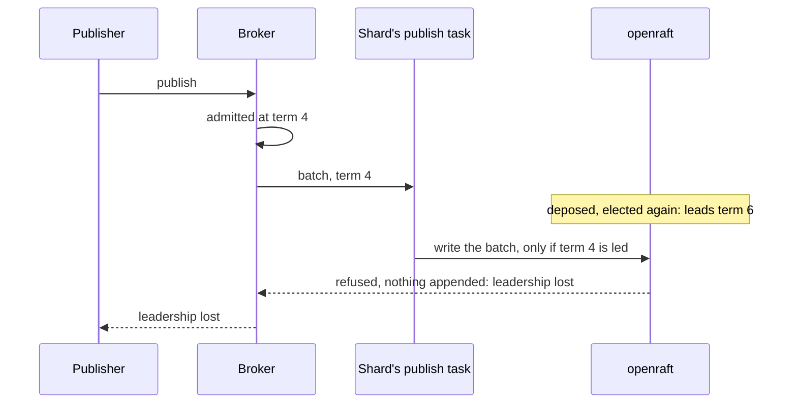

A call is one message to openraft, whether it names a term or not, and
openraft admits or refuses it whole. The term check and the write lease
("openraft's write lease") are checked once for the call, so a call is
either appended in full, at consecutive indexes, or not at all. No other
write can land between two of its records.

A batch can still end up written in part after it was appended. If the
leader stops before the call commits, the next leader may hold only the
start of it. It commits that start and discards the rest, so the cut is a
prefix of the call. openraft answers each discarded record with
`LogEntryDiscarded`. The publisher is told only some of the batch was
written, which is an unknown outcome like any other: the written records
may commit. Only the broker core learns where the last of
them ends: `RaftEngine::publish` hands it to the broker to move the stream's
offsets, and the publisher gets the bare error, as a `RaftEngine::propose`
caller does. The batch is not delivered live on the leader, whose
subscribers see its offsets as a drop. The stream's offsets move past the
written records that are already committed, so a reader resuming at one
of them is sent to the log for it instead of joining live above it. They
move no further: an uncommitted record can be cut, and the next leader
can commit a different one at the same offset. On a broker that no
longer leads, the offsets do not move at all, and its subscribers get
whatever commits there from the log, which is the only place a follower
delivers from. The same holds for a batch that was written whole and then
lost its acknowledgement.

A caller that names no term (`None`) gets the same call with
`WriteOption::default()`, which takes any term. The broker always names
one.

> `crates/server/felix-replication/src/raft/tests/propose.rs`,
> `a_batch_admitted_at_an_earlier_term_is_not_written`,
> `a_drain_takes_batches_admitted_at_one_term`,
> `a_batch_written_in_part_is_told_so`,
> `a_batch_cut_part_way_is_told_how_far_it_was_written`,
> `a_term_bound_drain_lands_as_one_run_beside_another_writer` and
> `a_batch_known_written_says_where_it_ends`.
> `crates/server/felix-replication/src/raft/tests/deliver.rs`,
> `a_reader_resuming_in_a_batch_written_in_part_goes_to_the_log`.

**openraft's write lease.** At the pinned commit openraft refuses a write
when no majority has answered the leader for its lease, which is the
longest election timeout (2 s). It does not wait for commit. An idle group
heartbeats about that far apart, so its first write after a pause could be
refused. Before a call, the task checks how old the majority's last answer
is. If it is older than half the lease, the task asks for a heartbeat,
again every heartbeat interval, and waits up to one lease for a majority
to answer. The batches behind
wait in the queue, so nothing is proposed twice and nothing changes
place. A leader that is the only voter needs no answer and is not held. If
no majority answers, the write is sent and openraft refuses it, with
nothing of the call appended. A refused batch is not proposed again by the task:
later batches may already be on their way, and it would land behind them.
A refused publisher is told by its batch's responders when openraft
refuses the call, whatever the task is doing by then, so it hears within
one lease, not two.

The publisher's future then waits. It puts a fresh token on the first and
on the last record of its batch, and reads the batch's place from both. It
does not work the first offset out from the last, and it does not accept
two tokens that are not one run of the batch's length in one term.

| The publisher waits for | It ends on |
| --- | --- |
| `Written`: both tokens | The tokens, or openraft's answer |
| `Flushed`: both tokens, then the flushed position at or past the last record in the same term | The flush, or openraft's answer |

openraft answers a write when it is applied, which is after it committed.
A committed record is fsynced on a majority, which is more than either
acknowledgement asks of the leader's own disk, so an answer ends either
wait.

A token has no time limit of its own, so every wait also ends when:

- openraft refuses the write. A member that does not lead, and a leader
  no majority has answered for its lease, append nothing. openraft gives
  this refusal only before an append: an appended entry is answered when
  it is applied, or as discarded when it is cut, never on a step-down.
- This member stops leading, or leads at another term than the one that
  wrote the batch. The group's role watcher says so ("When it closes"). A
  member standing for election says the batch may still be written,
  because if it wins it appends what it was sent.
- The group's core stops, as it does on a storage error. The publisher is
  told the group stopped.
- The flushed position shows a later term. Another leader wrote there, and
  whether the batch is still under it is not known.
- The group is closed or the runtime shuts down.

Each of those is an unknown outcome, never "not written": the batch may be
in the log and may commit. `propose` makes one attempt and never proposes a
batch again, because a second attempt could land beside the first. A
failed flush stops the group in openraft, which reaches the publisher as
openraft's answer.

After `propose` returns, a `Leader` write is acknowledged at once if
`admit_local_ack` passes and waits for commit if it does not. See
"Acknowledging a write". `RaftEngine::publish` asks that check for a
`Leader` stream and answers the publisher when it passes.

An answer given on the lease is given before the commit outcome is known.
If this broker then stops leading before the batch commits, the publisher
has been told and the batch may be gone: a later leader that never held it
replaces it. That is the `Leader` level's contract on Raft, as it is on the
hybrid. Such a publisher never hears of an unknown outcome, because it was
already answered. A publisher that needs the outcome uses a `Quorum`
stream.

Answers can overtake each other. Batch N can miss the lease and wait for
its commit while N+1, written a moment later, is answered on the lease.
If the leader is deposed before N commits, N's publisher gets an error
while N+1's was already acknowledged. That is within the `Leader`
contract, and the log keeps no hole: N+1 sits after N, so the next leader
keeps N+1 only if it keeps N.

> `crates/server/felix-replication/src/raft/tests/propose.rs`,
> `batches_queued_together_go_to_openraft_in_one_call`,
> `a_drain_wakes_the_publish_task_once`,
> `a_call_cut_short_answers_every_batch_as_stopped`,
> `a_publisher_that_goes_away_keeps_its_place`,
> `a_member_that_does_not_lead_refuses_and_appends_nothing`,
> `a_deposed_leaders_propose_returns_leadership_lost_and_appends_nothing`,
> `a_drain_stops_at_its_bounds`,
> `the_publish_task_outlives_the_first_publishers_runtime`,
> `an_answer_is_not_held_behind_the_next_calls_lease`,
> `a_candidates_publisher_is_told_the_batch_may_still_be_written`,
> `a_publisher_is_told_when_the_groups_core_stops`,
> `an_ack_follows_the_policy_and_not_the_commit`,
> `a_write_after_a_silence_renews_the_lease_first`,
> `a_leader_no_majority_answers_refuses_and_appends_nothing`,
> `a_call_cut_short_answers_every_batch_as_stopped`,
> `a_written_ack_does_not_wait_for_the_flush`,
> `a_flushed_ack_waits_for_the_fsync`,
> `a_deposed_leaders_publisher_stops_waiting`,
> `a_stopped_groups_publisher_stops_waiting` and
> `a_batch_not_reported_whole_is_an_unknown_outcome`.

**Publishes queued on one lane are one proposal.** The broker's publish
lane for a Raft shard does what the hybrid's claim does. When a plain
publish's turn comes, the plain publishes already queued behind it on the
lane join it, up to 64 publishes or 1 MiB of payload. They are then one
batch: one `propose`, one place in the commit order, one openraft write,
one wait and one delivery. Nothing waits for more to arrive, so a lone
publish costs what it did. A publish joins only if it is for the same
shard, was admitted at the same term, has records and no headers, has the
first one's publisher when publishers are recorded, and its connection
has no idempotent batch waiting for its turn on the shard. The first one
that does not qualify ends the batch, so lane order holds. Idempotent
batches, conditional publishes, commits and trims never join.

Each publish gets its own offsets, sliced from the batch's first by record
count, and is answered when the batch is: at the point the stream's ack
level names for the batch's last record. The level belongs to the stream,
so all members share it. If the batch fails, every member gets the same
error: failed when openraft refused the whole write before appending any of
it, and outcome unknown otherwise. When a leader change cuts a merged
batch, every publish in it is answered outcome unknown, including one whose
records were kept, where that publish sent alone and fully inside the kept
part would have been acknowledged. It never goes the other way: no publish
in a merged batch is acknowledged, or told nothing was written, when alone
it would not have been. Refusals of one publish (authorisation, quotas, rates,
size) happen at admission, before the publish is queued, so one bad
publish cannot fail its neighbours.

> `services/felix-broker-service/src/serving/quic/handlers/publish/worker/tests.rs`,
> `queued_publishes_to_a_raft_shard_are_one_proposal`,
> `a_merge_stops_at_its_cap`,
> `a_refused_publish_does_not_refuse_its_neighbours`,
> `a_refused_merged_proposal_fails_every_publish_in_it`,
> `a_cancelled_publisher_keeps_its_place_in_the_merge`,
> `an_idempotent_batch_is_never_merged`,
> `a_merged_batch_that_cannot_commit_leaves_every_member_unknown`,
> `a_mixed_merged_proposal_keeps_one_bound_per_member`,
> `an_all_bounded_merged_proposal_drops_the_engine_deadline`,
> `merged_members_timed_out_by_their_sweeps_are_each_answered_once` and
> `a_shared_raft_error_keeps_its_class_for_every_member`.

**A token never leaves the broker.** The codec does not encode it, and the
router clears it from every append it sends. A transport inside one
process hands a message over as it is. A token that went with it would be
resolved by the follower's append, and the publisher would read that as
the leader's write.

The cost is on the hot path: each batch crosses into the Raft task before
it reaches the disk, and the payload moves into an entry on the way. The
single-node and RF 3 steady cells at 1 KiB price it against the hybrid. A
miss there is what brings adoption back.

## One timer for every group

Every group is built with `enable_tick: false`, so openraft's heartbeat
deadline stays unset and wakes nothing (measured on the previous pin, whose
internal ticker it replaces: idle CPU 0 at 5,000 groups, against 86% of a
core per 1,000 members with the default tick). One task per broker,
the node ticker, runs a timer check on every due group each interval. On a
leader the check is `Raft::trigger().heartbeat()`: the ticker has already
found the heartbeat due by the group's own gap, so one goes out. On any
other member it is `Raft::trigger().tick()`, which openraft 0.10.1 adds
(openraft#2305). openraft's own heartbeat timer is not asked, because its
`heartbeat_interval` is set to something else: the deadline of a call
("A call's deadline" below).

openraft 0.10.1 also times elections on a deadline of its own, whatever
`enable_tick` says (openraft#2343). That deadline is the fixed election
timeout after the leader was last heard, which an idle leader's 2 s
heartbeats outlast, so groups are built with `enable_elect: false` too. The
ticker turns a member's election timer on at the first tick after its wait
runs out (below), as long as the broker has a place for one more election
("Many groups electing at once"), and the member turns it off again when it
takes an append or grants a vote. While it is on, openraft starts the election at its own
deadline and runs the retries. A member inside its vote hold is not ticked,
unless it promised nobody (below), so it does not stand there.

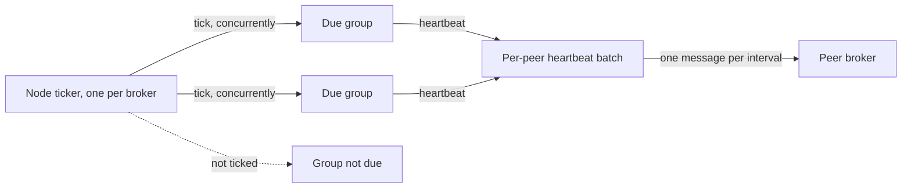

Rules for the ticker:

- **Tick concurrently.** `tick()` waits while a group's API channel is full,
  so a loop that awaits each group in turn lets one busy group delay the
  rest. The ticker polls all of an interval's ticks together in its own task.
  It spawns nothing per tick.
- **Drop, never queue.** A tick still waiting when the next interval starts
  is dropped. A leader's due time moves only when its check has run, so a
  late tick sends one heartbeat and a dropped tick loses nothing. Each group counts its
  dropped ticks (`GroupStatus::dropped_ticks`), and the broker counts them all
  in one metric, `felix_broker_raft_dropped_ticks_total`. A label per group
  would be a label per shard.
- **Only due groups.** Decided (issue #2167). The ticker keeps, for each
  group, the time its next tick is due, and ticks only the groups that
  are due. A leader is due when its next heartbeat is. A follower is due
  when its election timeout could have run out, counted from the last
  message openraft accepted from the current leader, not from any
  heartbeat, so a stale leader's heartbeats cannot keep a follower
  unticked. A follower that keeps hearing its leader is not ticked at all.
  Past its wait, a follower or candidate is ticked once a heartbeat
  interval, only so the ticker sees it become leader: openraft's own timer
  runs its elections from there. The ticker does not read every group's due time every
  interval either: anything but a tick moves a due time at least one
  heartbeat ahead, so a group found not due is left alone for that long.
- **Slower idle timers.** Decided (issue #2167), and built. A leader that
  has sent no entry for the idle time heartbeats at the idle interval, and
  its followers wait longer before they may stand. Any entry brings the
  short interval back. See "Idle groups" below.
- **The interval adds to timeouts.** A timeout is noticed at the next tick,
  so the tick interval is added to heartbeat latency, and to election
  latency only where the follower's wait ends past openraft's deadline. The lease
  margin (engine page, Decisions, 5) counts it. For the heartbeat that is
  the whole interval: the next one is due just over 200 ms after the check
  that sent the last, and the tick 200 ms later arrives a moment too
  early. So a busy leader heartbeats every 250 ms, not every 200.
- **A ticker that panics is started again.** With no ticker, no leader on
  the broker heartbeats and no follower starts a new election, and nothing else would
  show it. The runtime catches the panic, logs it at error, adds one to
  `felix_broker_raft_ticker_restarts_total` and to
  `GroupRuntime::ticker_restarts()`, waits one heartbeat and starts the
  ticker again. Restarting was chosen over failing the runtime: a restart
  has every group ticked again well inside the election timeout, and
  failing would stop every group on the broker for a bug that may be in
  one. Any restart is a bug to look at, so the count is there for the
  broker's health check to read when the runtime is wired in (#2233).

Cost: 9 microseconds is a floor. It is the average over ticks every
10 ms, four of five of which send nothing, while a due tick sends a
heartbeat at up to about 43 microseconds. So 2,000 members at a 500 ms
idle heartbeat cost 1.2% to 5.7% of a core against the 2% limit, before
follower handling. The #2231 stub-group run decides. A late or
skipped tick is safe for the same reason a dropped one is. Idle CPU is
measured now, on the group runtime with stub groups, before any shard
runs on it. See Questions, 15.

Timer values are in Questions, 4. The hybrid suspects a leader after 5
seconds, so Raft does not need 50 ms heartbeats to match its failover time.

A member told its group's first members may stand at the first tick, once
it has a place. If several members are told at the same moment their votes
can split, and the next election waits for a timeout like any other.

### A call's deadline

A leader gives an append or a heartbeat up when no answer has come within
`RuntimeConfig::peer_deadline()`, and sends it again. A follower's written
report to its leader has the same deadline. So a shard commits over a link
whose round trip is under that, and over a slower one it does not commit at
all: every append is given up before its answer arrives. The deadline is
`RuntimeConfig::max_peer_deadline`, 800 ms by default, cut to the shortest
election timeout less one heartbeat where that is shorter, and never under
the heartbeat. So no setting can put it past a follower's shortest wait.

The deadline is not the heartbeat interval. openraft uses its
`heartbeat_interval` for both (`replication/mod.rs` and
`core/heartbeat/worker.rs` in 0.10.1), so with the two equal a shard stopped
committing once a link's round trip passed 200 ms (#3101). Felix sets
openraft's `heartbeat_interval` to the deadline and paces the heartbeats
from the ticker, which openraft's tick being off leaves free.

What a longer deadline changes:

- **Not the lease.** The lease counts from when openraft handed off the
  message a majority answered, never from when the answer came
  ("Acknowledging a write"). An answer 700 ms late gives a lease already
  700 ms old. `a_link_slower_than_the_heartbeat_commits_and_ages_the_lease`
  answers every append 400 ms late and checks the write commits, the lease
  is never younger than the trip, and no election follows.
- **Not a follower's wait.** A follower counts from when it takes a
  message. openraft sends a follower one heartbeat at a time, so over a
  slow link its heartbeats arrive a round trip apart, which the bound
  below `election_min` keeps inside the follower's shortest wait.
- **A commit over a healthy majority is no slower.** Each follower has its
  own stream, so a call waiting on a slow or dead follower holds up nothing
  sent to the others.
- **A dead broker is found later.** A call to a broker that answers nothing
  fails at its deadline, and the broker counts as down once calls have kept
  failing for a heartbeat ("Group runtime"). That is about 1.6 s after it
  went silent, where it was about 400 ms. A broker whose connection is
  refused still fails at once. Elections do not wait on this: they run on
  the followers' own timers.
- **A lease close to its end over a slow link.** With round trips near the
  deadline the newest answered heartbeat is up to two trips and a heartbeat
  old, which can pass the 1.5 s lease. A `Leader` write then waits for its
  commit instead of the lease. Nothing is acknowledged that should not be.

### Idle groups

A group is idle when its leader has sent no entry for `idle_after` (5 s).
An idle leader heartbeats every `idle_heartbeat` (2 s) instead of every
250 ms (the 200 ms heartbeat, sent at the next tick). The cost is that a dead leader of an idle group is noticed later.
A group that takes writes is unchanged.

The rule that keeps a slow leader from being deposed by its own followers:
a follower must never wait less than its leader's current heartbeat allows.
Nothing is negotiated. Each side acts only on what it has seen:

- Every append and heartbeat carries the longest the leader may now stay
  silent, called the gap: 200 ms, or the idle interval once the group is
  idle. It travels in Felix's envelope around the Raft message, not in
  the message.
- A follower that takes the message waits by that gap. At the short gap
  the ticker leaves it alone for the shortest election timeout, as before.
  At the idle gap it leaves it alone for three idle intervals, plus a
  spread per member so the followers do not stand in the same tick. Two
  lost heartbeats therefore start no election. openraft's own timeout
  still applies on top, so the wait is the longer of the two.
- A follower holds the gap it is told to its own idle interval. The value
  comes from a peer, and no message may make a follower wait longer than
  the timers it was configured with.
- A leader goes on heartbeating at the short interval, naming the idle gap,
  until every follower has answered a message that named it. Only then
  does it slow down. Sending a new entry voids those answers and makes the
  next heartbeat due within 200 ms. A publish does the same when it hands
  its batch to the group, before anything is sent. So a group with one
  member, or with no follower in reach, is fast again on its first write.
- Every append carries a send number, which rises with each append the
  leader sends. A follower stores a gap only from an append numbered above
  the one it stored a gap from last, in the same term or a later one. A
  follower stores the gap once it has handled the append, and an append
  that is slow in transit or in its fsync can finish after a later
  heartbeat's. Without the number, its short gap would overwrite the idle
  one the leader already counted as heard, and leave the follower
  impatient under a slow leader. The numbers start at the wall clock, so a
  leader that restarts within its term numbers above its earlier sends,
  unless its clock stepped back across the restart. Then the follower
  keeps the gap it has until the numbers pass the old ones or the term
  changes.
- An entry is new the first time any append carries it. Sending it again,
  to a follower that did not take it or to one catching up, does not
  count. So a follower that is down does not keep its leader at the short
  interval by being retried.
- A follower that restarts has forgotten the gap and may stand as soon as
  openraft lets it. So a message a follower does not take, because it was
  lost, refused or rejected, voids that follower's answer too. The leader
  is back at the short interval within one heartbeat and stays there until
  the follower answers again.

So a lost message can leave a leader fast or a follower patient, and
never a slow leader with an impatient follower. A follower that has
answered nothing for 5 s stops holding the leader at the short interval,
so a broker that is down does not keep its groups' leaders fast. That is
less than the 6 to 7 s an idle follower waits, and that is the safe side:
a follower that still hears the leader was told the idle gap, so the 2 s
heartbeats still reach it inside its wait even when all its answers are
lost.

One window is left open. A follower silent for 5 s since its last answer,
which can be about 3 s of downtime, no longer holds the leader fast, so if
it restarts and the first idle heartbeat to it is lost, it can stand
before the next one. That costs an election in an idle group and no
record.

openraft has one heartbeat interval and one election timeout per group,
fixed when the group starts, so none of this changes its configuration.
The leader slows down because the ticker asks it for a timer check less
often, and a follower waits longer because the ticker does not ask it at
all until its wait is over. A follower in openraft 0.10 stands only when
it has heard nothing for the leader lease (the longest election timeout,
2 s) plus its own election timeout (1 to 2 s), so 3 to 4 s after the
leader's last message whether the group is idle or not. At the default
idle interval of 2 s the follower waits three intervals, 6 s plus its
spread, so a dead leader of an idle group is noticed in 6 to 7 s.

Pre-vote is on (openraft's `enable_pre_vote`; off by default there). A
member that stands first asks the others whether they would vote for it,
and raises its term only when a majority says yes. A member nobody can hear,
such as one whose outbound connections fail, keeps its term. When it is
heard again it follows the leader instead of deposing it with a higher term
(#2630). Three cases skip the question and stand at once: a leadership
transfer's target (so a transfer costs at most one term), a restarted
leader whose stored vote is its own (`enable_leader_restore`), and a sole
voter.

openraft refuses a pre-vote only inside its own lease of `election_max`
(2 s) from the last message a member took. In an idle group that lease
ends just before each idle heartbeat, so a member coming back could still
win a pre-vote there. Felix closes that gap. A follower refuses a pre-vote
for as long as it would wait for its leader itself (6 to 7 s at the idle
interval), and a leader refuses one while a majority answered it within
three idle intervals. The refusal is an ordinary not-granted answer, so
the candidate still counts the broker as reachable, adopts a higher term
or backs off for a longer log as openraft does, and asks again at its
next timeout. A member that takes a leadership transfer stops counting
on the old leader, so if the target never stands, the old leader's own
pre-vote at the transfer's expiry is granted at once. After a leader
dies, the first follower to time out may have to wait for the others to
time out too, which still falls inside the 6 to 7 s above.

A candidate reads a refused pre-vote's vote as uncommitted. openraft ends
the round when a refusal names a vote above the candidate's own, and it
counts a committed vote above the same vote uncommitted. A follower that
voted for a leader and never took an append from it holds that vote
uncommitted, so the leader's refusal, sent for its longer log, ended the
follower's round without teaching it anything. When that refusal came
before the other follower's grant, it did so on every retry, and a leader
whose appends were lost but whose answers arrived kept the group from
electing for good (#2889). Read uncommitted, the refusal ends the round
only for a vote that is really higher. The candidate's vote, its term and
the real vote rules are unchanged.

Because a cut-off member keeps its term, openraft keeps naming the leader it
last heard, and it never steps a leader down for losing its majority. Felix
serves readers only from a member that is still in touch with its group:

- A follower counts on its leader only while it would refuse a pre-vote
  for it.
- A leader counts as heard while a majority answered it within three idle
  intervals (6 s at the default). A new term no majority has answered yet
  is timed from when the leader was first seen. A sole voter needs nobody.

Past that, the member ends its subscribers and refuses new ones with
`not_ready`. A follower still forwards writes to the leader openraft names,
so one that has just restarted forwards at once, before it hears that
leader. A forward to a leader that is gone fails, and the client retries.

> `crates/server/felix-replication/src/raft/tests.rs`,
> `a_cut_off_member_keeps_its_term_and_does_not_depose_the_leader_on_return`,
> `a_leader_no_majority_answers_names_no_leader`,
> `an_idle_group_refuses_a_pre_vote_past_the_openraft_lease`,
> `an_idle_group_elects_soon_after_a_transfer_to_a_dead_target`,
> `a_leader_that_loses_its_appends_does_not_stall_the_next_election` and
> `a_pre_vote_refusal_names_its_vote_uncommitted`.

A member whose placement no longer names its broker routes by placement
instead, once it hears no leader: its group may have removed it without
telling it. A refusal there would keep a client that enters on that broker
retrying on it, so the member redirects readers and forwards writes to the
leader placement names, as a broker with no member does.

> `services/felix-broker-service/src/shards/raft/tests.rs`,
> `a_leaderless_member_placement_moved_off_routes_by_placement`;
> `services/felix-broker-service/src/shards/routing/tests.rs`,
> `a_subscribe_to_a_member_placed_elsewhere_is_redirected`.

### Many groups electing at once

A vote is a small file per shard, the ballot, written whole and renamed
into place: two fsyncs, the file's and its directory's, and each group does
its own. A vote at a new term does not also wait for the shard's replica
state. An open takes the term from a ballot ahead of the replica state
(the ballot is written first for that reason), so the ballot alone makes
the vote durable, and the next commit write carries the term into the
replica state. That halved the fsyncs of nearly every vote in a storm,
since a candidate's own vote and each vote it is granted are at a new term.
The vote mark at the root is one synced write for every shard's queued
marks, so it is shared across groups already.

When every group on a broker loses its leader in the same moment, or many
groups are formed together, every member reaches its election timeout in
the same second. If the disk cannot take that round of vote saves within
the timeout, the timeouts fire again, each adding more saves, and no group
settles. On a 4-vCPU machine 2,000 groups formed at once never elect this
way, and on a disk held to a few hundred fsyncs a second neither do 2,000
groups that lose their leader together (issue #2317).

So each broker bounds how many of its members are in an election at once
(`RuntimeConfig::max_elections_at_once`, 64 by default, 0 for no bound;
`FELIX_SHARD_RAFT_ELECTIONS_AT_ONCE` on a broker). That is where a storm
starts and where the limit falls back to; it rises to four times that while
elections win and vote saves keep up (below). The bound only decides
when a member's election timer is turned on. openraft still picks the
moment it stands, and the vote and commit rules are unchanged: holding a
member back is the same as its timeout coming later.

- A member whose wait for its leader ran out joins a queue. The ticker
  turns its timer on only while a place is free. Members of groups whose
  leader was at the short heartbeat gap when last heard, that is, groups
  that took writes, queue ahead of idle ones. Within each class, members
  that come due in the same interval are ordered by a hash of group and
  member, so two brokers go through their groups in different orders, and
  one member of a group usually wins before the others get a place.
- A member keeps its place until it leads, hears a leader, or grants a
  vote. It also gives it back if it lost: every vote or pre-vote request
  it sent is answered and it does not lead (seen on two ticks), it has not
  stood within `election_max` of getting the place, or it has no result
  within `election_min` of standing. A candidate whose pre-vote round is
  answered and that is still saving its own vote, counted from the save's
  start, before openraft calls it a candidate, has not lost: its vote
  requests go out once the save ends. One that lost has its timer turned
  off and waits again at the back of the queue, behind idle groups too.
  Its last round can still win.
- The limit follows the disk while elections here are losing, that is,
  while at least as many lost as won lately (counts halved every
  `election_max`). The broker keeps a moving average of the vote saves
  that had the disk to themselves, with no other vote save under way. A
  save more than four times slower than that (and over a twentieth of
  `election_min`) cuts the limit to what the disk would have saved in
  that time. Before any save was alone, a quarter of `election_min` is
  the mark. Slow saves while elections win cut nothing: every group still
  takes one round, so a slow disk is not one the elections overload, and
  queueing would only add to each wait. The limit never falls below 8 (or
  the bound, if lower). Once elections stop losing it climbs back by the
  elections that won, and by at least one a tick. While they lose, it
  climbs one place each `election_min`. A member that never stood within
  `election_max` of getting its place gives the place back but does not
  count as a lost election: it says nothing about the disk.
- Places do not bound the disk's queue: a round that gave up leaves its
  saves queued, and nothing cancels them. The broker keeps a moving
  average of the time between two vote saves ending while others were
  still under way, which is what the disk gets through whatever its width.
  The first save to end after an idle spell is not timed, and the average
  fades while no save is under way, so a disk that recovered is not held
  to its slow past. No member is let in while the pending saves, counting
  each member in flight as at least one, times that gap, would take over a
  quarter of `election_min` to drain. One member is always let in when none is. On a disk held to 100
  saves a second this stops a queue from outgrowing the timeout, where
  rounds would otherwise lose faster than they finish.

- The bound is where the limit starts and where it returns to, not a
  ceiling. While fewer than one election in eight lost lately and the
  queued vote saves would drain within a quarter of `election_min`, the
  limit grows by the elections that won, up to four times the bound. A
  higher loss rate or a backed-up queue brings it back to the bound at
  once. So `FELIX_SHARD_RAFT_ELECTIONS_AT_ONCE` is what a broker starts a
  storm with and falls back to when rounds fail, and the most it ever
  allows is four times that.

A group that loses its leader alone is never held back: a place is free.
Groups that cannot win, for example because two of their three brokers are
down, cost the others little: their requests are refused or time out, so
each gives up its place after a round.

How long a member can wait: with `p` members queued ahead of it and the
limit at `l`, about `p / l` rounds, each one ending at most `election_min`
after the member stands, or `election_max` if it never stands. That is the
worst case, with the limit pinned at the floor of 8 and every round lost:
about 90 rounds for 700 groups whose leader's broker crashed. Usually the
first member of a group to stand wins, and the limit climbs back by the
elections that won once it is not cut.

A deterministic model measures this: `ticker/tests/storm.rs` runs the
real election bound on two live brokers whose groups all lost their leader
to the third, on a mock clock, with one disk per broker that saves one vote
at a time. Pre-vote, a candidate saving its own vote before it asks, and a
voter saving before it answers are all modelled. On a disk held to 5 ms an
fsync:

| groups | fsyncs a vote, bound | all led | elections | highest term |
|---|---|---|---|---|
| 100 | 4, 64 | 4.5 s | 245 | 5 |
| 500 | 4, 64 | 11.8 s | 600 | 4 |
| 2,000 | 4, 64 | 42.7 s | 2,207 | 7 |
| 100 | 2, 64 | 2.4 s | 210 | 5 |
| 500 | 2, 64 | 6.9 s | 646 | 5 |
| 2,000 | 2, 64 | 22.6 s | 2,347 | 7 |
| 2,000 | 2, none | 54.8 s | 8,872 | 11 |

With the bound, a group takes about one election, and the time to all led
is the time the disks take to save two votes per group: the disk is the
whole cost. Without it, members that cannot get their vote saved in time
stand again, and four times the elections cost more than twice the
fsyncs. `two_thousand_groups_elect_once_each_after_a_broker_dies` holds the
2,000-group row to 30 s, and `storm::table` prints the rest (2 ms rows
too).

`GroupRuntime::election_load` and the gauges
`felix_broker_raft_elections_in_flight` and
`felix_broker_raft_elections_waiting` show the bound at work.

Not bounded: a leadership transfer's target stands at once, without its
timer, and a leader's timer is on as it was without the bound. openraft
starts a leader's election only when its transfer is not taken in time,
and the old leader must not wait for a place to lead again (the queue
only takes followers and candidates).

The runtime's test forms 40 groups at once on three brokers and has each
take a write: on Linux every group is led within 2 s. On macOS it still
does not settle in 30 s, so it is skipped there. The time goes to creating
and renaming the vote files, which wait behind the `F_FULLFSYNC` calls in
flight.

## Group runtime

The runtime is built, in `crates/server/felix-replication/src/raft.rs`,
behind the `raft` cargo feature of `felix-replication`, which the broker
service turns on by default. A broker with a node id runs it unless
`FELIX_SHARD_ENGINE` is `hybrid` (deprecated), and refuses to start without
the internal listener. Without durable storage it runs no group, and the
control plane gives it only in-memory stream shards (`docs/control-plane.md`,
"Nodes without durable storage"). A standalone broker, with no node
id, runs it too, when it has durable storage: each durable stream shard and
each durable cache shard is a group of one voter, named `standalone`, with
no peer (every send is refused as unreachable), no internal listener and no
control-plane placement. `shards/raft/standalone.rs` gives the runtime the
assignments a control plane would: this broker as leader, at the incarnation
the stream or cache registered with, and it forms and leads each group off
the broker's own registrations. The broker is its whole fleet, so every
`raft_*` feature is finalized from the start. Under `OnCommit` fsync a
commit waits for one fsync on the single voter. Under `Periodic` or `None`,
when the data directory's run is one a crash rotates
(`run_state::rotates_on_crash`), a commit waits only for the write and a
synced offset reservation: the log fsyncs on the broker's `Periodic`
schedule, and once a second under `None`. Otherwise it fsyncs on every
commit ("Proposal: commit on a written majority on relaxed brokers"). A standalone broker with no durable storage keeps every
stream in memory and runs no group. `FELIX_SHARD_ENGINE=hybrid` still
selects the hybrid, deprecated. After a machine crash under `Periodic` or
`None` fsync each group re-forms itself from its own copy ("A standalone
broker re-forms itself"). A standalone data directory the hybrid wrote is refused at startup
with an error naming `FELIX_SHARD_ENGINE=hybrid`, which keeps serving it; 0.8 does not migrate it.
The cluster
test suites run on Raft by default too; the hybrid runs report only (see
`docs/hybrid-retirement.md`).

A `GroupRuntime` holds one broker's member of every group it is told to
open:

- `start(broker, timers, transport)` starts the runtime and its one ticker
  task.
- `open(group, copy, log)` starts a member on a shard's log. The log must
  be a Raft log that fsyncs on commit. The member reads its vote, entries
  and membership back from the log, so opening after a restart needs
  nothing else. A Raft log locks its directory while it is open, so a Raft
  open from another process or a second one in this process cannot open
  the shard's log under a running member (`docs/storage-format.md`, "Records
  as Raft entries").
- `initialize(shard, members)` forms a new group from its first member
  set. A member refuses a set that does not name it. Once a member has
  voted or holds an entry the call does nothing.
- `handle(request)` takes a Raft message from a peer. A message names the
  group (shard and epoch) and the member (broker and copy id). The runtime
  hands it on only if both match the member it holds. A message for an
  older copy or another epoch is refused.
- `close(shard)` stops one member and leaves its log to the caller. The
  shard stays taken until the member has stopped, even if the caller stops
  waiting: an `open` before that is refused as `Closing`, so two members
  never run on one log. A caller that gave up on a close and calls it
  again waits for the same stop and is told `true`, unless `shutdown()`
  has taken the member over, which itself waits for the stop. Told "no
  group" while the member could still write, it might close the log under
  it.
  `shutdown()` stops the ticker and every member.
  Neither writes anything: what a member acknowledged is already on disk.
- `status(shard)` reports the member's role, term, leader, last index,
  committed index, the last entry written and the last entry flushed, and
  the ticks it was sent and the ticks dropped. The committed index is the
  last one openraft published and can trail the read bound for a moment
  (see "Reads"). The written and flushed positions are read together, in
  one look at the log's positions.
- `log_positions(shard)` gives the written and flushed positions as they
  change, to wait on. These are the two signals of "Two signals from one
  append". The adapter moves `written` as soon as an append has handed its
  entries to the log and `flushed` once they are fsynced, and a truncation
  moves both back. The publish path that waits on them is #2233.
- A command may carry a `WrittenToken`. The leader's `append` resolves it
  with the record's index and term once the record is written.
  `RaftEngine::propose` sets them ("Writing through openraft").
- `report_to(serving, fence)` names who is told when a shard opens and
  closes here ("When a leader opens"). It is called once, before the first
  `open`.
- `status(shard)` also counts `client_writes`: the times the publish task
  handed queued batches to openraft. Each carries every batch that was
  queued at one term when it was made, so under load the count is well
  below the number of batches.

Messages leave through a `RaftTransport`, one for all groups, so groups
share connections. The runtime wraps it in an `openraft-multi`
`GroupRouter`; heartbeats sent together wrap the transport under it.
`PeerTransport` is the one over the broker's peer connections: it sends
each message through the peer pool as an internal `Raft` frame, and a
listener given the runtime (`PeerServer::with_raft`) hands it to `handle`
and sends back the answer. Only a listener that runs the runtime offers the
`RAFT` capability, and a broker that has not offered it is never sent a
Raft message: the transport answers `Unreachable` without sending. The
bytes are Felix's own layout, not openraft's serde output
(`docs/internal-protocol.md`, "Raft messages"). The broker builds the
runtime in `node/cluster.rs` whenever it runs Raft shards.

**Mixed layouts during an upgrade.** Each listener states the Raft layouts
it reads in the handshake (`RAFT_LAYOUTS`). Each build reads and writes one
layout today. When a peer's range does not hold it, the sender sends
nothing: Raft sees the peer as unreachable, the reason names both, and the
broker logs it about once a minute per peer and counts each refused send in
`felix_broker_raft_peer_refusals_total{reason="layout"}`. A group keeps
quorum only while a majority of its voters share a layout. The stated range
is what lets a later build read two layouts and pick the one its peer
reads. Two brokers on the same build always share their layout. A peer that offers `RAFT` but
states no layouts predates the handshake field and is read as layout 6;
if that reading is wrong the peer refuses the body at its first byte, so
nothing is misread. The unit tests join three runtimes with a transport that calls `handle`
directly; one test forms a group over real listeners on loopback.

A leader's messages carry the gap described in "Idle groups", which is
how idle groups slow down.

What the runtime sets in openraft: the timers from Questions, 4;
`enable_tick` off; no snapshot policy for a stream shard, since its records
leave by retention and never because a snapshot was taken; and
`allow_log_reversion` off (Questions, 2). Every log is opened with `purge_within`, so a purge
past the stored snapshot is refused.

The retry delays start as openraft's defaults; a stream shard's grow
longer while a broker is down (below). After a call to a follower is
refused, openraft waits before it sends that follower's stream again:
200, 400 and 800 ms, then 1 s each, and only a call that succeeds ends the
wait. Left alone, a follower back from a cut of a second or two would wait
up to a second more before it is sent what it missed.

So the router reports the outcome of every call. A call *fails* when the
transport refuses it or its deadline passes. Any other reply is an
*answer*, including a refusal from the member it was for: the broker that
sent it is up. A broker counts as down only once its calls have kept
failing, with no answer between, for at least a heartbeat, so one slow
call is not an outage.

The first answer from a broker that was down marks it back. At its next
interval the ticker has every group that leads here retry its members on
that broker at once, through openraft's `Trigger::reset_backoff`, which
cuts a running wait short. Heartbeats are not held by the backoff, so this
happens within about a heartbeat (200 ms by default) of the heal. A group
that has gone idle heartbeats every `idle_heartbeat` (2 s by default), but
the walk does not wait for its heartbeat: any answer from the broker is
enough.

A restarted broker opens its groups over time, and until one opens its
member refuses with "no such member". Such a group is left out of the
walk, since the broker being up says nothing about it, and is retried on
its own member's first answer instead: a heartbeat once it opens. For an
idle group that heartbeat can take up to `idle_heartbeat`.

While a broker is down, the waits of its stream shard members keep
doubling past that second, up to 10 s. A dead broker then costs each such
group about one call every 2 s, its idle heartbeat, plus a retry every
10 s, instead of a heartbeat every 200 ms and a retry every second. In
the idle-CPU test with 300 groups and one broker of three dead, that took
the calls to it from 5.1 a second per group to 0.6. The longer wait does
not slow recovery: the heartbeats are not held by it, and the first
answer from the broker ends every wait, as above. Two rules keep that
answer within about a heartbeat (200 ms) of the broker coming back,
although most groups heartbeat it only every 2 s. A leader with an entry
not yet committed stays at the short heartbeat. And while a broker is
down, the ticker has one group that leads here heartbeat it every short
gap: the last leader whose append to it failed. That is 5 calls a second per
dead broker, whatever the number of groups. A cache shard keeps
openraft's delays, since they also pace its snapshot pieces, and the walk
cannot cut those short.

None of this calls a peer more often than openraft would. A broker is
walked at most once a second, openraft's longest delay, and never twice
at once, and each group's member is retried early at most once a second.
A dead peer answers nothing, so it costs what it costs without the retry.
A peer that answers only some of its calls can count as down now and then,
and is then retried early at most once a second, which openraft's backoff
would do anyway.

**Retention.** A Raft log takes no retention bounds of its own, since only
a purge may drop its entries. Its leader enforces them with head trims
instead, and every member then purges below the floor ("Purging below the
floor"). On the storage's retention
timer (`FELIX_DURABLE_RETENTION_INTERVAL_SECONDS`) it reads the stream's
bounds, the control plane's `retention` with the broker-wide
`FELIX_DURABLE_RETENTION_BYTES` and `FELIX_DURABLE_RETENTION_SECONDS` for a
bound it leaves unset, and works out where a hybrid sweep would start the
log: one past the last whole sealed segment the bounds drop. When that is
past the current floor, it proposes the head trim of "Head trims" below to
that offset. Unlike a client's trim, this one is not conditional on the
tail: on a busy shard a publish would land first nearly every time. It does
not need to be. The cut is at or below the tail the leader read, and the
leader appends the entry after every entry it holds, so the entry's index
is past the floor it sets; a later leader holds the entry only at that
same index. A stream's atomic commits are checked below that tail, and one
appended after the check is above the floor. On the wire and in the log
the entry is a trim like any other.

Followers never evaluate the bounds: their clocks and segment sizes differ,
and two members hiding different prefixes would serve different reads. Each
applies the floor at the trim's entry, so every member hides the same
records. The size bound counts the hidden segments too, until a purge
deletes them, so it keeps about that many bytes readable.

The trim only hides records. The same timer then has every member purge
its log below the floor, which is what frees the disk, once the fleet has
finalized `raft_stream_purge`; until then the hidden records stay on disk.
A trim needs the fleet to have finalized `raft_head_trim`; until then the
log grows as before. A pass that cannot trim counts
`felix_broker_raft_retention_trims_refused_total` and logs a warning when
its reason changes. A leader deposed mid-pass says nothing, and the next
one runs its own pass. A zero retention interval, valid while no stream
sets retention, starts no timer. The pass judges only segments above the
floor: the ones already hidden are taken as dropped without reading them,
so an age bound does not reread them on every tick. A stream holding atomic commits
refuses trims, so retention does not hide its records either. A Raft log
never offloads (`FELIX_DURABLE_OFFLOAD_DIR`), since only a purge may drop its
segments.

With the purge on, a member's segment files stay near the bound: the bound
itself, the segment the purge point falls in, and the open segment. On a
leader that holds only once every live member has caught up, since its
purge waits for their match. A member cut off while the others purged
installs the leader's purge snapshot when it is back and keeps the floor it
carries; the install starts its log at the purge point, so it holds no more
than the others.

A leader's openraft runs the purge on its Raft core, and holds it back while
a replication stream still reads the range, even one to a member that is
going away; it runs it when that stream answers or fails. A purge that
waited on the disk there would stop the leader's heartbeats and writes
right after a follower went away, long enough on a slow disk to lose the
lease. So the purge only writes its purged id and returns, and the segments
are unlinked behind it (`docs/durable-storage.md`, "Deleting below the
floor"). Every call openraft makes into the log that outlasts a heartbeat is
counted in `felix_storage_raft_log_slow_calls_total`, labelled by `call`,
and logged as a warning at most every ten seconds.

> `services/felix-broker-service/src/shards/raft/tests/retention.rs`,
> `the_leader_trims_what_the_streams_retention_drops`,
> `retention_trims_a_shard_when_a_publish_lands_mid_pass`,
> `a_member_not_leading_proposes_no_trim`,
> `retention_writes_nothing_until_raft_head_trim_is_finalized`,
> `a_zero_retention_interval_starts_no_timer`,
> `a_raft_member_does_not_offload`;
> `services/felix-broker-service/src/shards/raft/tests/purge.rs`,
> `retention_frees_every_members_disk_and_a_member_cut_off_catches_up`;
> `crates/testing/felix-cluster/tests/raft_shards.rs`,
> `retention_frees_the_disk_of_every_raft_member`;
> `crates/server/felix-storage/src/disk_log/tests/retention.rs`,
> `a_retention_cut_does_not_judge_hidden_segments`

A snapshot must not cost a record, and a stream shard's snapshot holds none.
Two settings keep that true:

- `max_in_snapshot_log_to_keep` is the largest value there is. openraft's
  default keeps only the last 1,000 entries under a snapshot and purges
  the rest, which here would be records.
- A member takes a snapshot from a peer only if every entry the snapshot
  skips is below the floor that snapshot carries (a purge snapshot, below).
  Installing one purges the log up to it, so any other snapshot would make a
  member behind its leader drop records it was never sent, or still serves.
  The member's own floor does not count. Otherwise it answers `NoSnapshots`
  and logs an error. A member behind a leader that has not purged past it
  is sent the entries.

So the snapshot message between brokers carries its metadata and the cut
batches its sender refuses by name ("Idempotent publishes"), never records. A
stream shard that needs more than entries, a learner started below the
switch's base, is caught up by copying segments from a starting offset, as a
rebuild does.

A cache shard is the other way round. Its state is its snapshot plus the
entries above it, so its log is cut to the snapshot:

- Each member snapshots by itself once `cache_snapshot_every` entries
  (16,384) have committed since its last snapshot. openraft checks that
  after each batch of messages, so it needs no tick.
- Building a snapshot does not hold apply. Between two entries the state
  machine freezes its maps as they are, without copying them, and the
  build encodes the frozen maps on a blocking thread. Meanwhile apply
  writes to an overlay of changes (new values, deletes, raised floors),
  and reads look in the overlay first, then in the frozen maps. When the
  build is done, the overlay is folded back into the maps a few hundred
  changes at a time, so apply and reads wait at most one such chunk. The
  snapshot is exactly the state as of its last entry, never a mix of that
  and later writes. Between builds there is no overlay, and reads and
  apply cost what they would without snapshots.
- The overlay is bounded by what is touched from the moment the maps are
  frozen until it is folded back: one record per distinct key and counter
  written, the answers kept for each producer that wrote, and the expiry
  entries added or removed. A wait for a CPU slot (see below) lengthens
  that window. That is the build's memory cost, plus the encoded snapshot.
- The fold runs on the state machine's task, after each run of applied
  entries: a few hundred changes, or eight per entry in the run if that is
  more, so the overlay shrinks however fast writes come. A fold on another
  thread would compete with apply for the lock and a core. A group that
  stops writing keeps its overlay until its next write; reads still see
  the right values.
- A snapshot due while the last build's overlay is still folding back is
  deferred: taking it would mean finishing the fold, or copying the
  overlay, on the state machine's task. openraft asks again once another
  `cache_snapshot_every` entries have committed, and purging the log
  waits until then. Only a snapshot openraft must have (one it forces)
  is taken anyway, and pays that cost.
- Encoding a snapshot and parsing one are CPU work. Across all groups on a
  broker, at most half the cores (at least one) do it at once. The rest
  wait, so many groups snapshotting or restarting together do not take
  the blocking threads that disk flushes need.
- The member then purges the entries the snapshot covers, except the newest
  `cache_log_keep` (1,024). A member a little behind still catches up from
  the log.
- A member behind its leader's purge is sent the leader's snapshot and
  installs it. The snapshot goes in pieces, each sized like an append, and
  the member installs it when the last piece arrives. How it is bounded is
  in [the replication engine](replication-engine.md), "Sending a snapshot".

A shard's log therefore holds at most about `cache_snapshot_every` plus
`cache_log_keep` entries, whatever the shard has written.

Each group has a small state machine that keeps the last applied entry and
the membership in memory. A shard's state is its log. A membership record's
payload is JSON: a layout version, the voter sets (two during a joint
change), the learners, each member as its broker id and copy id, and the
version of the target the membership was made from ("Membership"). Layout 1
had no target version and reads as the zero version. A layout 2 record with
no version is refused, not read as zero.

Two things are left for the pull request that puts stream shards on Raft
(#2233):

- An entry carries a record's payload, timestamp,
  publisher and headers. Marks come with adoption.
- The state machine keeps nothing on disk, so a restarted member applies
  its committed entries again, which reads them. That is fine for the
  tests here and too slow for a real shard.

Memory per member is measured by a test
(`crates/server/felix-replication/tests/raft_memory.rs`): 120 idle members
in one process, a third of them leaders, counting live heap bytes added on
top of the open logs. It fails above 256 KB per member and runs in pull
request CI with the rest of the `raft` feature's tests. Run it by hand with
`cargo test -p felix-replication --features raft --test raft_memory -- --nocapture`.
`RAFT_MEMORY_TRACE=<bytes>` makes the test print the call sites of the live
allocations of at least that size.

openraft runs on tokio through `ShardRuntime`
(`crates/server/felix-replication/src/raft/draws.rs`), which changes two
things. Election timeouts come from a seedable random stream, so a
simulation run repeats. And a sleep whose deadline is under a millisecond
away yields instead of arming a timer (`raft/sleep.rs`). Tokio's timer
fires on whole milliseconds, and openraft's IO completion forwarder sleeps
1 us whenever a second write completes right after the first, so with
tokio's sleep that write was answered up to a millisecond late. The sleep
yields at most 32 times, then arms the timer, and it never ends before its
deadline. Longer sleeps use the timer as before. Election and heartbeat
deadlines are timeouts, not sleeps, and are unchanged.

### Group threads

A write wakes several tasks in turn: the publish task, openraft's core, its
state machine worker, its IO forwarder and the replication streams. On the
broker's multi-thread runtime each of those wakes can be a hop to another
worker thread, which costs a scheduler pass and a kernel wake-up.

So a broker runs every group's tasks on a few group threads instead
(`raft/executor.rs`): one per four cores it may use, at most 8. Under four
cores it runs none, because a group thread would take half the machine or
more from the broker runtime. Operators have no setting for it. Each thread is a single-threaded tokio runtime, and a
group is placed on the thread with the fewest groups when it opens. It
stays there until it closes, since a task cannot move between runtimes.
openraft spawns its tasks on the runtime it is started from, so starting a
group's `Raft` on its thread puts all of them there without changing
openraft. A wake between them is then a push onto that thread's queue, and
one wake-up of the thread runs every ready task of every group on it.

- On the group thread: openraft's tasks, the publish task, the membership
  driver and the group's other tasks.
- Elsewhere: publishers, subscribers, the peer transport, the ticker and
  `follow_commits` stay on the broker runtime, and log IO on the log's own
  thread. `follow_commits` is kept off because one pass can fan a page of
  records out to many subscribers without yielding. A write
  still crosses threads where it enters a group (publisher to publish task,
  peer to core) and where it leaves (answers, fanout, network sends).
- A group thread does not wait on disk in normal operation. Log work goes
  to the log thread or a blocking task and is awaited. A caller of the log
  thread on a group thread does not poll for its answer, since other
  groups' tasks are waiting behind it. A flush capture that runs inline
  only tries the segment lock: if an append is rolling a segment under it,
  the capture goes to the log thread instead of waiting there.
- A hot group shares its thread: the thread runs ready tasks in turn, and
  tokio makes a task that keeps finding work on channels give the thread up
  after a bounded number of steps. The state machine gives it up the same
  way while it applies a long run of entries. A single step that takes long
  (a large snapshot cut, say) still delays the thread's other groups.
- The peer transport never runs on a group thread. A connection's quinn
  driver and its stream pumps run on the dedicated QUIC I/O runtime when
  there is one, and otherwise on the runtime the peer endpoint was bound on,
  whatever thread dials. A group thread only hands frames to them.
- A panic in a group task ends only that task, as on the broker runtime.
  The thread and its other groups keep running.

On the perf hosts (16 cores, so 4 group threads) this cut Raft's CPU per
message by 12-33% in every cell, with throughput within a few points of
running without them.

The simulator never uses group threads: it runs every broker on one
simulated runtime. `FELIX_TEST_RAFT_GROUP_THREADS=<n>` overrides the count
for tests and A/B runs, on a broker or for the `raft::` unit tests. It is
not supported in production. `0` runs
the groups without group threads, which keeps that path tested.

`FELIX_TEST_RAFT_ELECTION_MAX_MS=<ms>` sets the longest election timeout, which
is also how long a leader with no answer from a majority keeps accepting
writes. The client conformance fixture sets it so a leader it cuts off from its
followers still takes the one write the scenario sends and cannot say whether
it survived. It is not supported in production.

## Heartbeats sent together

Without coalescing, each leader sends each follower one empty
AppendEntries per heartbeat interval. A broker with 2,000 members at RF
3 leads about 667 groups, so it sends about 1,300 heartbeats per interval and
answers about as many.

The runtime wraps its transport (`raft/beats.rs`). A heartbeat, an append
with no entries, waits up to `beat_window` (1 ms by default) for others to the
same broker, and then all of them go as one message, answered with one result
per heartbeat in order. This is the pattern openraft points to in
openraft#2390 (`examples/multi-raft-kv`). Since the node ticker checks every
group on the same tick, the heartbeats of all the groups due on a tick land in
the same window. Everything else goes at once on its own: an append that
carries entries never waits.

- **Bounded.** One message holds at most 512 heartbeats. A batch that fills
  goes at once, and the next one starts its own window.
- **Negotiated.** Only a peer that offered `RAFT_BEATS` is sent the batch
  (`docs/internal-protocol.md`, "Heartbeats together"). Any other is sent
  each heartbeat on its own, the bytes it always read, and so is a batch of
  one.
- **One group cannot hold up the rest.** The receiver hands every
  heartbeat to its member at once. Once one has answered, a member that stays
  silent for one window past the latest answer is answered *slow*, which the
  leader counts as not answered, with the broker up. A failure for one
  group's heartbeat is that group's alone.
- **Off.** `beat_window` zero sends each heartbeat on its own. It must be
  shorter than `heartbeat`; the runtime refuses a config where it is not.

Measured in the unit harness
(`idle_groups_cost_a_broker_fewer_messages_with_heartbeats_together`), with
every idle group at the short gap: 24 groups cost each broker 72 messages a
second each on its own and 6 together.

### The lease under the wait

The wait can only shorten a lease, never lengthen it:

1. A leader's lease counts from when openraft handed off the message a
   majority answered (`Lease::admit`, "Acknowledging a write"). openraft
   stamps that instant when it builds the request, before it reaches the
   transport, so before the wait.
2. A follower's promise not to vote for anyone else starts when it takes
   the heartbeat, after the wait and the trip.

So for every answer, hand-off <= taken, and a lease of `lease` after the
hand-off ends no later than `lease` after the follower took it, inside its
`election_max` promise by the drift bound of `RuntimeConfig::lease`. The
window does not appear in that bound at all. What it costs is liveness: the
lease the leader holds is up to one window older than it would be, and a
follower's heartbeats can arrive up to one window further apart. With the
1 ms default against a 200 ms heartbeat, a 1.5 s lease and a 1 s shortest
election timeout, both are far inside the margin, and the runtime refuses
any window as long as the heartbeat. Pre-vote reads the same instants: a
follower refuses a pre-vote while its leader is recent by when it took the
last heartbeat, which the wait only makes later.
`the_lease_is_no_younger_than_the_heartbeat_wait` holds an 80 ms window and
checks the leader's lease is never younger than the wait.

## A commit goes on the next append

Right after a leader commits, openraft sends each follower an AppendEntries
with no entries whose only news is the new commit index. When writes come
one at a time, that is one extra message and one extra answer per follower
per write. And openraft
sends one append at a time to a follower, so the next write's append waited
for the answer to it.

Felix's client to each follower (`raft/network/client.rs`) holds such an
append for up to `RuntimeConfig::commit_hold`, 1 ms by default and always
shorter than the heartbeat. If the leader's next append to that follower comes
in that time, it goes instead, and the held one is never sent. Otherwise the
held one goes as it was.

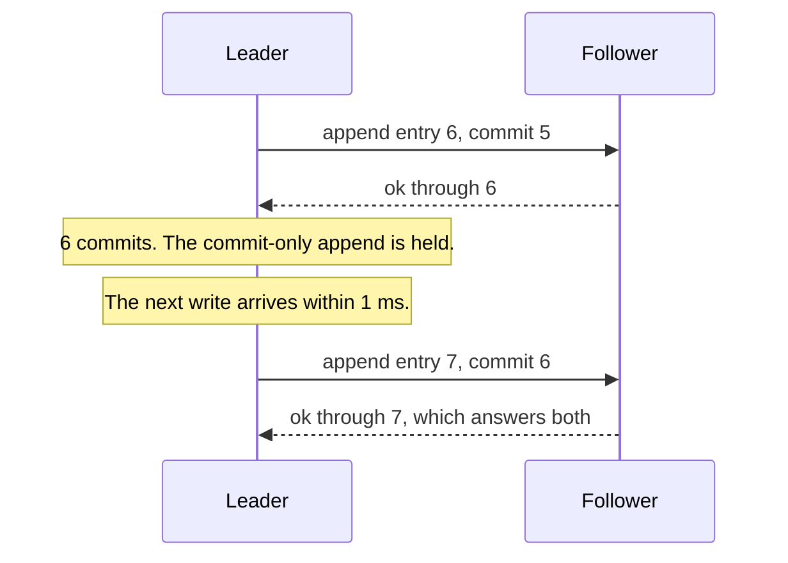

The next append replaces the held one only when the follower's answer to
it is also its answer to the held one: the same vote, the same previous
entry to check, and a commit index no lower. openraft needs no answer per
request. An answer "ok through 7" acknowledges every request up to entry 7,
the held one included, and the lease counts from the later request's send
time, which openraft takes before the request leaves. A held append that goes
out alone is credited from when openraft built it, which is earlier than it
left, so the lease errs short.

What waits on it. A follower learns a commit up to the hold later when no
write follows it; tokio's timer fires on whole milliseconds, so the default
hold lasts 1 to 2 ms. Applying on a follower, delivering to a follower's subscribers
and serving a read on a follower wait for that. Under load the next append
follows at once, and it no longer waits behind a commit-only append's round
trip. A write that comes just after the hold ends does wait: the held append
has gone out, and openraft sends one append at a time, so that write can
take up to one follower round trip longer than without the hold. The leader's acknowledgement to a publisher, written reports, lease
reads, elections and heartbeats do not wait on it, and heartbeats do not go
through this path. No member applies or decides anything differently:
followers apply what the leader committed, only later, and Raft's safety
never rests on how soon they hear of it. The models agree: in
`docs/formal/FelixRaft.tla` a follower learns the commit in a step of its
own that may come at any time.

## Write fence, leases and read bound under Raft

### When a leader opens

The engine calls `EngineHost::opened(shard, term)` when the blank entry of
its term is committed. At that point the leader holds every committed
record, its commit index is current, and its lease clock has started.
openraft writes the blank entry and the adapter stores it as the
generation-start record. This costs one round at the start of a term, as
the hybrid's fence does today.

### When it closes

The engine calls `deposed` and the write fence closes on any of:

- openraft reports a vote for a higher term, or a role other than leader.
- A leadership transfer starts.
- The group stops on a storage error.

A failed lease check is not on this list. A leader whose lease has lapsed
is still the leader until Raft says otherwise.

**As built.** Each member has one small task, the role watcher
(`crates/server/felix-replication/src/raft/lead.rs`). It watches openraft's
server metrics, which change only with the role, the vote and the
membership, so a heartbeat answer does not wake it. While a term waits to
open it also watches the commit table ("Reads"). It calls
`opened(shard, term)` when this member leads `term` and the last applied
entry has that term. The blank entry is the first entry of a term, so by
then it is committed. It calls `deposed(shard, term)`, once, for a term it
opened, when openraft no longer names this member the leader of that term,
or when the group has stopped. A storage error stops the group.

`RaftEngine::transfer(shard, to)` is the one way a transfer is asked for.
It calls `transfer_starting(shard)` and then asks openraft. That call asks
the group's core which term this member leads, not the metrics, which can
trail an election. When it returns, the lease for that term is given up
and the shard is closed. Neither comes back in that term, whether or not
the transfer goes through. The shard opens again in a later term. The call
returns the term it closed, or nothing when this member leads no term, and
then no transfer is asked for.

Nothing else calls `deposed`. A write openraft refuses because its lease
lapsed, a refused `admit_local_ack` and a read-index round no majority
answers all leave the shard open. A round no majority answers within the
lease (1.5 s by default) is refused as retryable then, not held to the
election timeout, so a group call to a leader cut off from its peers
fails fast and the client's retry deadline decides when to stop.

A publisher's wait and a commit wait end when the watcher says the term is
lost. The watcher hears of an election a moment after openraft does, so
neither wait takes "not leading" on the watcher's word alone: openraft's
own role is read as well. A term closed for a transfer is not lost to them
while openraft still leads it. A write already in that term's log can still
commit, and its waiter is answered by the commit, not told the outcome is
unknown.

> `crates/server/felix-replication/src/raft/tests/commit.rs`,
> `a_leader_opens_only_once_its_blank_entry_commits`,
> `leaders_that_commit_nothing_open_nothing`,
> `a_write_whose_index_commits_under_another_term_is_refused`,
> `a_transfer_about_to_start_closes_the_shard`,
> `a_term_closed_before_it_opened_is_not_waited_on`,
> `a_group_that_stops_on_a_storage_error_closes_the_shard` and
> `a_lapsed_lease_and_an_unconfirmed_read_do_not_close_the_shard`.

openraft reports role changes through its metrics channel, which is
asynchronous, so the fence can close a moment late. That is safe. A write
proposed in the gap is refused by openraft, or appended as an uncommitted
entry of the old term whose waiter gets leadership lost. Nothing reaches
the log except through openraft ("Writing through openraft").

### A member that stops on a storage error

openraft stops a member's core on any log-store error and never starts it
again. Without help such a member would answer nothing until the broker
restarted. Instead, the broker's feed pass sees the core stopped
(`GroupRuntime::storage_failure`), closes the member and its log, and opens
it again once the disk takes writes:

1. A probe file at the data root is written, fsynced and removed
   (`CopyRoot::heal`). While that fails, nothing opens.
2. A failed mark log is rewritten from the marks as last synced
   (`MarkLog::reopen`). Marks only ever lower-bound a copy, so going back to
   the synced ones can rotate a copy but never lets one vote below what it
   promised.
3. The member opens through `open_copy`, as at a start. The copy is judged
   against its marks and its log recovered from disk. A log poisoned by a
   failed fsync rotates to a new copy id that never voted, so nothing the
   failed fsync touched is trusted. Any other log keeps its copy id, with its
   torn tail repaired, and catches up from the leader. A rotated copy has no
   group of its own: with other copies alive it catches up from them. With
   one copy, or when every copy rotated, the shard is held and serves
   nothing until an operator re-forms it ("Re-forming a group").

The reopened member is a restarted one: it votes and acknowledges only from
what is on disk, as after a crash. The first stop reopens on the next pass. A
member that stops again within a minute of its reopen waits longer each time,
from a second up to 30, since every open scans its log.

The broker reports the stop until the copy hears a leader again, or the
shard leaves the broker. A copy that reopens and leads hears itself, so it
clears too. A rotated copy clears once the group takes it in as a voter and
its leader reaches it. A rotated copy with no other copy to catch up from
stays reported.

- `felix_broker_raft_shards_stopped_on_storage_error` counts such copies.
- `shard_inspect` shows `raft.stopped` with the term the copy stopped at and
  the error. While the copy is closed, `raft.role` is `stopped`.
- A publish or subscribe that would get "still opening the shard" gets
  `not_ready` with "this broker's copy of the shard was stopped by a storage
  error", at once: a write is not held waiting for a takeover. The error
  itself is not in the refusal, because it can name the broker's data paths
  and segments. It is in the broker log and in `shard_inspect`, which needs
  `node.view:cluster:*`. A request this broker can forward to the leader is
  still forwarded.
- `/ready` stays 200. Only a poisoned hybrid log or a failed node record
  fails it.

Nothing the stopped copy did is trusted after it. Its core refuses appends,
votes and read rounds, its role watcher closes the write fence
(`deposed`), and a commit or publish wait ends as leadership lost. A
poisoned log comes back under a new copy id, which is not a voter in the
group's membership, so it is never counted in a quorum with the cut log.

> `crates/server/felix-replication/src/raft/tests/identity.rs`,
> `a_member_stopped_on_a_storage_error_reopens_once_the_disk_heals`,
> `a_poisoned_single_copy_group_comes_back_empty_and_serves_nothing`;
> `services/felix-broker-service/src/shards/raft/tests.rs`,
> `a_member_stopped_on_a_storage_error_reopens_once_the_disk_heals`;
> `services/felix-broker-service/src/shards/raft/tests/stopped_copy.rs`,
> `a_poisoned_log_stops_its_shard_alone_and_is_reported`,
> `a_copy_that_reopens_and_leads_is_no_longer_reported` and
> `a_rotated_follower_is_reported_until_it_hears_the_leader`;
> `crates/server/felix-storage/src/raft_copy/tests/marks.rs`,
> `a_reopen_after_the_disk_heals_starts_from_the_synced_marks`,
> `a_failed_fsync_is_not_retried_by_the_reopen` and
> `a_reopen_restarts_the_batched_marks`.

### Acknowledging a write

A `Quorum` write is acknowledged when `await_commit` returns: the commit
index has passed it and the entry there has the term it was written at. On
a `Periodic` stream it is acknowledged earlier if a majority has written
it: `await_quorum_ack` is `await_commit` raced with the written count
("Two signals from one append"). `RaftEngine::publish` does this for a
`Quorum` stream that is not fsynced on commit (`AnswerAt::Majority`): the
publisher is answered at the first of the two, and subscribers still get the
batch at its commit. The early answer is paced like a `Leader` one ("A
`Leader` publisher that outruns the commits is slowed down"), and answers
can overtake each other the same way. If
the leader is deposed first, the waiter gets leadership lost and the client
gets an unknown outcome, as today. Nothing on this path asks the control
plane anything, which is the property issue #1792 asks for.

Where each stream is answered, and what that answer promises. The answer
point and the loss are the same on Raft and on the hybrid:

| Stream | Answered on Raft | Answered on the hybrid | Lost by |
| --- | --- | --- | --- |
| `Quorum`, fsync on commit | At the commit: a majority has fsynced it | A majority has fsynced it | Losing the disks of a majority |
| `Quorum`, `Periodic` or `None` | A majority has written it, or at the commit if that is first | A majority has written it | Lost only if a majority of copies each lose their unsynced tail, by a power cut or a failed flush, on both. One such loss does not: that copy comes back under a new copy id and cannot vote the record away (issues #2423, #2469) |
| `Leader` | On the leader's log while the lease holds, else as `Quorum` on the same stream | On the leader's log | A change of leader before the commit |

A record a majority has written in the leader's term survives a change of
leader without a power cut. Any majority that elects a later leader holds a
voter with the record, and that voter refuses a candidate whose last log id
is behind its own, unsynced entries included (openraft's `handle_vote_req`,
`engine/engine_impl.rs:448` at the pinned rev; Raft's election restriction,
§5.4.1 of the Raft paper). Its own term matters: a majority holding an
entry of an older term proves nothing, which is why the count reads the
term on each report.

> `crates/server/felix-replication/src/raft/tests/deliver.rs`,
> `a_quorum_publish_is_answered_once_a_majority_has_written_it` and
> `a_majority_answered_publish_survives_its_leader`.
> `crates/server/felix-replication/src/raft/tests/identity.rs`,
> `a_publish_answered_on_a_written_majority_survives_a_power_cut`.
> `services/felix-broker-service/src/shards/raft/tests.rs`,
> `a_periodic_quorum_stream_is_answered_on_a_written_majority` and
> `a_quorum_stream_fsynced_on_commit_is_not_answered_on_a_written_majority`.

**`await_commit` as built** (`RaftEngine::await_commit`, in
`crates/server/felix-replication/src/raft/commit.rs`). It takes the
`Written` that `propose` returned and waits on the commit table ("Reads")
until the record's offset is applied. Then it checks the term of the entry
at that offset:

| The entry at the offset | The waiter gets |
| --- | --- |
| Has the term the record was written at | Committed |
| Has another term: a later leader's entry took the offset | Leadership lost |
| Is older than the terms this member remembers | Leadership lost |

The table keeps the first applied index of each of the last eight terms.
Terms never go down along a log, so that is enough to name the term at any
index since. The wait also ends, as leadership lost, when this member stops
leading the term it wrote in, and with a timeout when the caller's budget
runs out. Each is an unknown outcome. A commit that is already visible
wins over all of them.

The wait is not woken by every apply. It sits in a queue under its offset
(`felix_storage::waiters`), beside the commit table, and only the apply that
reaches the offset wakes it to read the table. With hundreds of writes in
flight, each wait is woken about once instead of once per applied run. An
`AckAt::Flushed` publish waits for the log's flushed position the same way,
and so does a follower's report of what it has written.

> `crates/server/felix-replication/src/raft/tests/commit.rs`,
> `a_write_waits_for_its_commit`,
> `a_write_whose_index_commits_under_another_term_is_refused`,
> `the_commit_table_knows_the_term_at_every_applied_index`,
> `a_commit_wait_is_answered_by_the_apply_that_reaches_it` and
> `a_commit_wait_ends_on_a_lost_term_with_nothing_applied`;
> `crates/server/felix-storage/src/waiters/tests.rs`,
> `an_advance_between_the_look_and_the_sleep_is_not_lost` and
> `an_advance_wakes_the_waiters_it_satisfies_not_the_whole_queue`.

A `Leader` write is acknowledged on local durability if `admit_local_ack`
passes: `now < last_quorum_acked + lease`, or the leader is the group's
only voter (below). openraft 0.10 publishes
`last_quorum_acked` as an instant; the older `millis_since_quorum_ack` is
deprecated. The value only moves forward, so a stale read errs toward
refusing. The lease must satisfy the inequality on the engine page
(Decisions, 5). The tick interval and the heartbeat batch window are not
added to it: both only make a message or a timeout later, and the lease is
counted from the hand-off of the message, on a clock read by the check
itself.

If the check fails, the write is answered as a `Quorum` write is: once a
majority has written it under `periodic`, at its commit under `on_commit`. Its commit renews the lease, and later writes are local again. The
shard stays open. The lease rests on openraft's `last_quorum_acked` and on
nothing else: store liveness is not part of it.

A publisher that gets too far ahead of the commits is left waiting for its
commit too, with the lease intact. "Delivering committed records" has the
two limits. An idempotent producer's batch is not answered on the lease:
it waits for its commit on either level ("Idempotent publishes").

**As built.** `RuntimeConfig` has the lease (1.5 s) and the clock drift
bound `p` (10%, as `clock_drift_ppm`), and refuses to start unless
`lease * (1 + p) / (1 - p) <= election_max`. `admit_local_ack(shard, term)`
passes when all of these hold, read in this order:

1. The broker was not suspended less than one lease ago (below).
2. openraft's metrics say this member leads `term`.
3. The newest message a majority answered was handed off less than one
   lease ago, or this member is the group's only voter: openraft's newest
   membership, committed or not, is one voter set holding this member
   alone. Learners do not count.
4. The term is above the member's void (below).

**A leader that is not a voter.** openraft lets a leader go on leading
after a membership that drops it as a voter, and its quorum is then the
other voters alone. Its lease would rest on their answers, and one of them
can restart and lead a later term on its own while that lease still runs.
So no lease holds while the leader is missing from any voter set of its
newest membership (`Group::admit_local_ack`). Felix never writes such a
membership itself (a step that drops the leader is refused); the check
keeps the lease right whatever wrote it.

**A sole voter.** Nobody answers a group's only voter, so the third rule
would never hold for it by the majority half, and every `Leader` write
on a single-node shard would be answered as a `Quorum` one. It needs no
answer. Every membership is written to the log by the leader, and
openraft's effective membership is the newest one appended, so the rule
stops holding once a membership with a second voter is appended, before it
commits. The member reads it from openraft's metrics, which publish once
per core loop, so a write in the same loop as the change can still be
answered locally; that is safe because the first membership after `{a}`
still needs `a`'s vote, and voting voids the lease. Until then no majority can leave this member out:
openraft writes a change from `{a}` as one entry only when every majority
of the new set holds `a`, and otherwise writes a joint membership first,
which already has more than one voter and needs `a` in both halves. A zero lease turns this off with the rest.
`FelixRaftLease.tla` checks the single-server case with the fixed
`Servers = {a}` (`FelixRaftLeaseRestoreSingle.cfg`); the change of
membership is argued here and tested, not modelled.

> `crates/server/felix-replication/src/raft/tests/change.rs`,
> `a_sole_voter_loses_its_lease_when_it_appends_a_second_voter` and
> `a_sole_voter_loses_its_lease_on_a_direct_change_to_two_voters`.

`RaftEngine::await_ack(shard, written, timeout)` is the acknowledgement of
a `Leader` write: it returns at once when the check passes, and otherwise
when the write is committed.

`RaftEngine::publish` makes the same decision for a `Leader` stream
(`AnswerAt::Lease`). Once `propose` has returned, so the batch is on this
leader's log as far as the stream's fsync policy asks, and written under
the term the publish was routed at, it asks `admit_local_ack` once. If the
check passes the publisher is answered then. If it does not, the publisher
is answered where a `Quorum` publisher on the same stream would be: once a
majority has written the batch on a stream not fsynced on commit
("`Quorum` on a `Periodic` stream"), and otherwise when the batch has
committed and taken its place in the delivery order. A `Leader` write
never waits longer than a `Quorum` one, and the answer it falls back to
promises more than the lease does. The check is not asked again for that
batch. Subscribers are not part of this: they get the batch at its commit
whichever way the publisher was answered ("Delivering committed records").

The order matters. The check runs after the write, so anything that ended
the lease while the batch was being written counts: a term given up, a
suspend, or a write slow enough that the last majority answer is now a
lease old. Asked before the write, the check would pass on a lease that
is gone by the time the publisher is answered.

A leader cut off from its followers rarely gets as far as the check.
openraft takes no write from a leader no majority has answered for
`election_max`, and the publish task waits for a heartbeat's answer first
("Writing through openraft"). Such a publish is not written and not
answered. The check is what covers the time before that: the lease is
shorter than `election_max`, and a batch already on its way to the log
when the leader was cut off still lands.

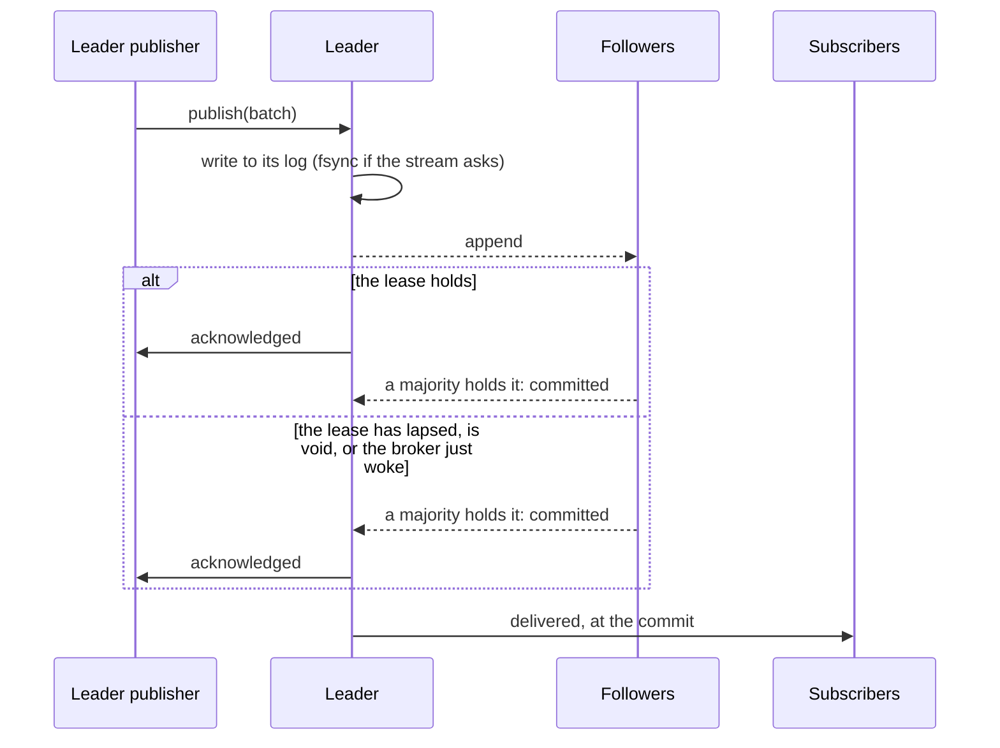

The lease is set with `FELIX_SHARD_RAFT_LEASE_MS` (1500 by default). `0`
turns the local acknowledgement off: the check never passes, a sole
voter's included, and every `Leader` publish is answered as a `Quorum` one. A broker refuses to start with a
lease the inequality above does not allow, which with the shipped
election timeout and drift bound is anything over 1636 ms.

> `crates/server/felix-replication/src/raft/tests/deliver.rs`,
> `a_leader_publish_is_answered_on_the_lease_and_delivered_at_its_commit`,
> `a_term_given_up_after_the_write_landed_is_not_answered_on_the_lease`,
> `a_leader_publish_written_across_a_suspend_waits_for_its_commit`,
> `a_leader_publish_outside_the_lease_waits_for_its_commit`,
> `a_sole_voter_answers_a_leader_publish_on_its_lease`,
> `a_sole_voter_with_no_lease_answers_a_leader_publish_once_written`,
> `a_replaced_leader_answers_no_leader_publish`,
> `a_batch_written_at_another_term_is_not_answered_on_the_lease` and
> `a_publish_answered_on_the_lease_and_then_replaced_reaches_no_subscriber`;
> `crates/server/felix-broker/src/broker/publish/proposed/tests.rs`,
> `a_batch_answered_where_it_was_written_is_delivered_only_at_its_commit`;
> `services/felix-broker-service/src/config/tests/shard_engine.rs`,
> `the_raft_lease_is_the_default_unless_set` and
> `a_raft_lease_that_is_not_a_number_is_refused`.

**Giving the lease up.** openraft's role reaches Felix through its
metrics, a moment after openraft has changed it. In that moment a leader
that has just stepped down would still pass the check, and it may already
have granted another candidate. So each member keeps one number in memory,
the void: the highest term it has given up. The check refuses every term
at or below it. The void only grows, and a restart starts it at zero with
no lease. It is raised where the messages pass, before openraft sees them
(`raft/network.rs` and `Group::dispatch`):

| Message | The void becomes at least |
| --- | --- |
| An append or snapshot request arrives | The term it names, less one |
| An answer names a vote (an append's `HigherVote`, a vote's or a snapshot's answer) | That vote's term, less one |
| This member grants a vote | The granted term, less one. Raised on the answer, before it leaves |
| A `TransferLeader` request leaves, or `transfer_starting` is called | The leader's own term |

A vote request openraft refuses changes no vote and raises nothing, so a
candidate nobody follows does not cost a healthy leader its lease. A
pre-vote changes no vote either, granted or not. Giving a term up costs
the lease for the rest of that term only. The same broker passes the check
again in a later term.

**Suspend.** openraft measures `last_quorum_acked` on the monotonic clock,
which stops while the host or VM is suspended. After a wake the last
answer looks as new as it did before. The check therefore reads the
monotonic clock and boottime together each time it runs, after it has
read openraft's answer, so a suspend between the two is seen. If boottime has
moved ahead by more than 10 ms since the last jump, the broker was
suspended, and the check refuses until the monotonic clock has run one
more lease. By then every answer from before the suspend is too old on
its own. A smaller jump is added to the answer's age. The comparison is
inside the check and not in a background task, which would see the jump
after the checks it has to stop. Boottime is `CLOCK_BOOTTIME`, on Linux
only. Elsewhere no clock counts suspended time and a suspend is not seen.

**A paused VM is not seen.** The check sees a suspend of the machine the
broker's kernel runs on: a laptop lid, `systemctl suspend`. It does not
see the hypervisor stopping the VM under that kernel: a paused guest, a
snapshot that freezes it, or the blackout of a live migration. The guest's
monotonic clock and its boottime stop together and start together, so
they never move apart, and to the broker no time has passed. A leader
paused that way for longer than the slack below wakes with a lease that
looks fresh, while its followers, which kept running, may have elected
another leader. Until it hears of that leader it acknowledges `Leader`
writes that the new leader's log will replace. This is the case
`FelixRaftLeaseSuspendUnchecked.cfg` fails on, and on Linux VMs it is an
assumption, not a rule the code keeps: **a broker's VM is not paused for
longer than the slack**.

The slack is what the inequality leaves between the end of the lease and
the end of a follower's promise: `election_max / (1 + p) - lease / (1 - p)`
of real time. With the shipped timers that is 0.15 s at the drift bound
and 0.5 s on exact clocks. A live migration's blackout is often shorter,
and is not bounded.

What an operator can do:

- Keep brokers on hosts that are not paused: no VM snapshots with memory,
  no `virsh suspend`, and a host-maintenance policy that stops and
  restarts the instance, where the provider offers one, in place of live
  migration. A restart is safe: the lease dies with the process.
- Where that cannot be had, set `FELIX_SHARD_RAFT_LEASE_MS=0` on every
  broker. The check then never passes, and every `Leader` write waits for
  its commit like a `Quorum` write.
- `Quorum` streams never use the lease and are not affected.

Under the simulator boottime is the simulator's clock while the
monotonic side is tokio's, so the two drift apart and the check may
refuse for good. The simulator's Raft groups never ask the check: they
publish with `AnswerAt::Commit`, because the history checker takes every
acknowledged append as committed. Before a simulated publish is answered
on the lease, both sides must read one clock and the checker must allow a
`Leader` acknowledgement to be lost across a change of leader (issue
#2514).

> `crates/server/felix-replication/src/raft/tests/lease.rs`: one test per
> rule, each named for it. The model is `docs/formal/FelixRaftLease.tla`.

**A restarted member grants no vote at first** (issue #2307). The leader
lease rests on each follower's promise not to vote for one election
timeout after it took the leader's message. openraft keeps that window in
memory. Decided (issue #2167): `Leader` streams keep the local
acknowledgement, and the window is waited out after a restart, not
stored. The node layer drops vote and pre-vote requests for a group, before
they reach openraft, until `election_timeout_max` has passed on the
monotonic clock since that member started, not since the process started.
The member started after the last message the old one took, so the wait
covers the promise. A held member is not ticked, unless it stands at
once (below). One request is let through (below). A held member's first
election waits past the hold by a fixed per-member jitter, under
`election_timeout_max - election_timeout_min`. openraft's own random
deadline falls inside the hold, so without it every held member of a
group whose leader did not come back would stand the moment its hold
ended, and the votes would split. The jitter only delays standing: the
member grants votes again once the hold ends.
Nothing is written, on the heartbeat path or anywhere else, and no clock
has to survive the restart. Dropping is enough, because a candidate asks
again at its next timeout.

A member with no vote on disk has never taken a message, and is not held
(below). Two more promised nobody, and stand at once, but they still grant
no other candidate a vote until the hold ends. One whose stored vote is
its own committed vote led when it stopped. Every message that names a
later term saves that term's vote before it is answered, so this member
took none, and no follower can have promised it anything it would now
break. openraft has it stand for the next term as it starts
(`enable_leader_restore`), and its followers grant the vote of the leader
they follow. The second is a sole voter: a promise binds nobody else. The
member's newest set must name it as the only voter, and the committed set
must name no other. While a change down to one voter is not committed,
the other voters still follow a leader, and the member is held. A learner
beside a sole voter is held.
The model lifts only the campaign side for these two (`HoldSkipped` in
`Elect`). Its `MayGrant` has no such exemption: a restarted member grants
only the leader its stored vote names, which for a member that led is
itself.
`FelixRaftLeaseRestoreLed.cfg` and `FelixRaftLeaseRestoreSingle.cfg`
check both.

**A held member grants the leader it followed.** When every member
restarts together, the old leader stands at once and its followers are
inside their hold. Dropping its request would leave the group with no
leader until the holds end. A held member's promise was made to one
leader, and granting that leader breaks nothing. So a held member lets
one vote request through to openraft: the first from the candidate its
stored vote names, and only if that vote is committed.

| The vote on disk when the member started | Let through |
| --- | --- |
| Committed, names member L | L's first vote request |
| Not committed (a vote granted to a candidate, a higher vote adopted from an answer, its own candidacy) | Nobody's |

A committed vote names a leader that was elected and whose message this
member took. A vote that is not committed can name a candidate that never
led: a leader that adopts a candidate's higher vote and restarts has that
candidate on disk, and whatever it promised, it promised somebody else.
The vote is read from the log, not from openraft, which at a start
demotes a member's own committed vote in memory.

The stored vote stops counting once anything can have replaced it: an
append under another vote, a cache shard's snapshot installed under another
vote, a `TransferLeader` request (the member may stand), and the grant
itself, after which the vote on disk is the
candidate's new one and is not committed. A second request from the same
leader is dropped like any other. Only a vote request is let through,
never a pre-vote: openraft refuses a pre-vote inside the window whoever
sends it, so letting one through gains nothing. openraft then decides
the request as it decides any, and grants it because the candidate is
the leader the member follows.

This is the model's `HoldExemptsNamed`, in the narrower form its
`StoredLeader` comment gives. `FelixRaftLeaseRestoreNamed.cfg` passes
with two of three members inside their hold, and
`FelixRaftLeaseRestoreNamedAny.cfg`, where the stored vote lets any
candidate through, fails.

A held member does not campaign early either. It is not ticked, so no
timeout makes it stand. openraft 0.10.0 also does part of the vote side.
At start it renews the window for a full `election_timeout_max` when the
stored vote is committed and names another member, which is the vote of
a follower that took a leader's message (`Engine::startup`). Felix does
not rest the lease on that code staying as it is, so the hold applies to
every member that may have promised.

The cost: a leader restarted alone leads again within one vote round. A
restarted member cannot help elect anyone but the leader it followed
(itself, for a member that led) for up to two seconds. When every member restarts together, the old
leader stands as it starts. If a follower is already open it grants, and
the group has its leader back within one vote round: 16 ms in the
runtime's tests, against 2.1 to 3.2 s when the followers dropped the
request. If the leader opens first, its request finds nobody. It asks
again at its next election timeout with a pre-vote, which the followers
refuse until their own hold and openraft's start-up lease end, about
`election_max` after they open. The group then elects at the next term up:
2.2 to 4.0 s over eight runs. Without pre-vote the retry was a vote, which
the followers let through, at 1.3 to 2.1 s.

**As built.** `Group::open` reads the vote from the log before openraft
starts, and the voters once it has. Until `election_max` has passed since the open, the
member answers no pre-vote request and no vote request but the one above.
Unless the vote is the member's own committed one or the member is the
only voter, it is not ticked in that time either. A request is dropped as
unreachable, so the candidate asks again. A held member that receives
`TransferLeader` from the leader it follows stands, if it has taken an
append from that leader since it started: openraft ignores the request
otherwise. Once it leads it is ticked, so it heartbeats. A member with no vote on disk has never taken
a message, so it has promised nothing and is not held. That is every
member of a group being formed.

> `raft/tests/lease.rs`,
> `a_restarted_member_holds_its_vote_after_a_leaders_term`,
> `a_restarted_member_holds_its_vote_after_an_election_nobody_won`,
> `a_restarted_member_is_not_ticked_while_it_holds_its_vote`,
> `a_restarted_leader_leads_again_within_one_vote_round`,
> `a_restarted_sole_voter_stands_at_once`,
> `a_restarted_leader_grants_no_other_candidate`,
> `a_restarted_learner_beside_a_sole_voter_is_held`,
> `a_restarted_member_alone_in_a_set_not_committed_is_held`,
> `a_held_member_grants_the_leader_its_stored_vote_names`,
> `a_later_leaders_append_ends_what_the_stored_vote_lets_through`,
> `a_group_restarted_whole_has_its_leader_back_within_one_vote_round`,
> `a_group_restarted_whole_with_its_leader_first_has_a_leader_within_its_holds` and
> `a_held_member_handed_the_leadership_stands_and_is_ticked`.

### Reads

`read_bound` is the commit index plus one, for every stream and every
consistency level. Subscriber fanout, cursor replay, Kafka fetch and cache
watch all take it. The engine publishes each commit index advance into the
table the commit hold already waits on.

**As built.** Each group's state machine keeps what it has applied: the
last entry, and where each recent term starts. It publishes that once per
run of applied entries, into a watch channel the group holds. This is the
commit table. Nothing reads openraft's metrics for it: they change on every
heartbeat answer, and every waiter would wake. An entry is applied only
after it is committed, so `RaftEngine::read_bound`, the last applied index
plus one, can trail the commit index and never passes it. A follower has a
bound too, from what it has applied. While the applied entries end inside a
conditional batch, the bound stays at the batch's first piece ("Conditional
publishes", below); waits on an applied index use the applied index itself.

> `crates/server/felix-replication/src/raft/tests/commit.rs`,
> `the_read_bound_never_passes_the_commit_index` and
> `an_undecided_batch_holds_the_read_bound_until_it_is_whole`.

The commit index to compare the bound with is the one the Raft core holds.
`status(shard).committed` is not: it comes from openraft's metrics, which
the core publishes once per turn of its loop, after it has told its
followers about the commit and handed the entries on to be applied. So a
status read just after a bound can show a lower commit index, on the leader
as well as on a follower. That is a late report, not a bound past the
commit index.

`confirm_read` is a read-index round (`Raft::get_read_log_id` with
`ReadPolicy::ReadIndex`). As built, a reader takes `RaftEngine::open_term`
first, then calls `RaftEngine::confirm_read` with that term, then takes its
value. The read is confirmed only if the shard is still open in that term,
the round's answer is for it, this broker has applied the read index
before the same deadline, and the shard is still open in that term after
the apply. A broker deposed during the wait still applies the index as a
follower, so the apply alone does not show it still leads. The value comes after that wait, because a write
can be answered before the leader applies it. A value taken from the read
bound before the wait could miss a write whose client already has its
answer. The term open at confirm time is not
enough. A broker that was deposed and elected again after the read is open
in a later term, and the value it read can miss a record the leader in
between committed. A member that does not lead is refused as leadership lost. A majority that does not
answer within the longest election timeout is a timeout, not a lost
leadership. A read-index round does not use the leader's lease: the pinned
openraft always asks the core for a fresh quorum confirmation for
`ReadPolicy::ReadIndex` (`Raft::get_local_read_linearizer` in
`openraft/src/raft/mod.rs`), so a lapsed lease costs a read that round and
nothing more. A round that has not answered within the longest election
timeout is dropped and the next one is asked. openraft reports a lapsed lease to writes only. If a later openraft
reports one to a read, the engine asks for a heartbeat, waits for a majority
to answer and asks again within the same bound.

> `crates/server/felix-replication/src/raft/tests/commit.rs`,
> `a_lapsed_lease_and_an_unconfirmed_read_do_not_close_the_shard` and
> `a_read_from_before_the_shard_was_opened_again_is_not_confirmed`.
> `crates/server/felix-replication/src/raft/tests/deliver.rs`,
> `a_read_confirmed_after_a_leader_answer_sees_the_write_or_is_refused` and
> `a_read_confirmed_after_a_majority_answer_sees_the_write_or_is_refused` and
> `a_read_is_refused_if_the_shard_closes_while_it_waits_for_the_apply`.

Which answered writes a confirmed read observes depends on when the write
was answered:

| Answered | Observed by a read that starts after the answer |
|---|---|
| At its commit: `Quorum`, idempotent, `Leader` with no lease on a stream fsynced on commit | Always |
| On the lease, after the leader's own write (`Leader`) | Always, by the wait in the next row: the leader keeps the furthest entry it answered on the lease too. A failover between the answer and the commit can lose the write, and a read waiting for it is then refused |
| When a majority has written it (`Quorum`, or `Leader` with no lease, not fsynced on commit) | Always. The leader keeps the furthest entry it answered this way, and `confirm_read` waits to have applied it as well as the read index. It is of the leader's term and on a majority, so it commits unless the leader is deposed, and then the read is refused. A stream read that could start below a head trim's floor takes it on the leader ("Head trims"); a tail subscribe and live delivery are bounded by the commit (`read_bound`) alone. A `state_get` does ("Atomic commits") |

So a read never misses a write that committed before the read began,
whatever answered it.

A consumer-group poll is such a read. The group reader runs `confirm_read`,
which also waits for the furthest entry answered on the lease or on a written
majority, and takes the poll's bound (`read_bound`) only after it. A poll that
starts after a publish's answer therefore hands the record out, and never one
above the commit. A seek to `latest` and a describe take their end after the
same wait.

Reads of one shard share rounds. A group asks one round at a time, and a
round confirms every read that arrived before it was asked. A read that
arrives while a round is out waits for the next one, which is asked when
the current one ends: the round out may have been asked before the reader
took its value, and its answer would not cover that value. So a burst of
reads costs two rounds at most, not one each, and a read waits at most the
rest of one round and one more. The bound above is on that whole wait.

> `crates/server/felix-replication/src/raft/read_rounds/tests.rs`,
> `a_read_that_arrives_during_a_round_waits_for_the_next_one`, and
> `crates/server/felix-replication/src/raft/tests/read.rs`,
> `reads_that_arrive_together_share_read_index_rounds`.

Raft lease reads (`get_local_read_linearizer`) would save that round. They
stay off until they are measured and the model covers the lease (engine
page, "openraft version").

A follower serves a read that starts at an offset or at `earliest`, and a
tail subscribe, only after it has applied a read index asked of the
leader, so it is never served below a head trim the leader already
answered ("Head trims"). The leader runs its own read-index round before
the same reads, bar a tail subscribe. Live delivery takes no round.

A broker that restarts answers reads again once its member has caught up
and a leader is known. It needs the restore check once per start ("Group
and member identity"), and nothing per shard: no assignment has to be
confirmed, which is what kept shards unreadable in issue #1914.

### Delivering committed records

A subscriber of a Raft shard gets a record only once it is committed. On
the leader the record it gets is the publisher's own batch, held in memory.
Nothing is read back from the log or decoded in apply for it.

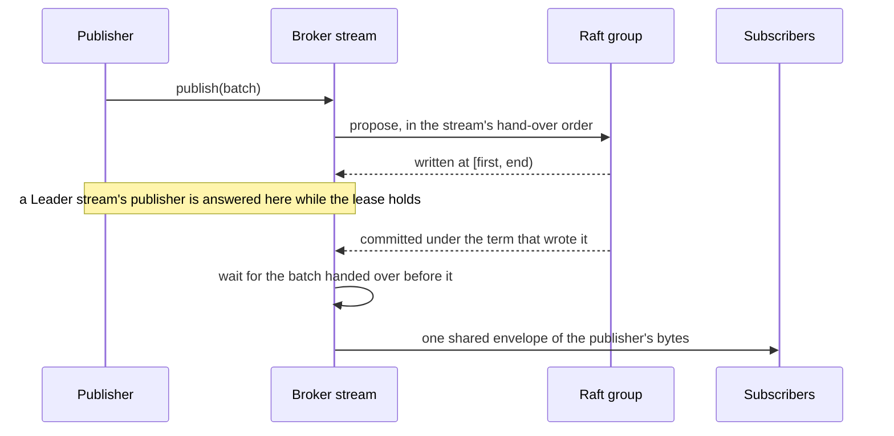

**As built.** `RaftEngine::publish` hands a batch to
`Broker::propose_publish`. The broker takes the batch's place in the
stream's hand-over order and calls `propose` while it holds that place, so
the order of hand-overs is the order openraft gives out indexes. The
batch then waits for `await_commit`, which checks the term of the entry at
its offset, and for the batch handed over before it. If nothing is held
ahead of it and the read bound covers it, the publisher's own task appends
it to the replay ring and fans it out as one shared envelope, encoded once
per frame shape, then answers the publisher. A stream whose subscribers
`Block` skips this, so a full subscriber never holds up an answer.
Otherwise the batch joins the stream's commit hold,
whose release task does the same once the bound passes it, the way a held
`Quorum` batch is released on the hybrid. Either way the batch keeps its
place in the hand-over order until it is fanned out, so the next batch
cannot overtake it.

A publish answered at its commit waits for openraft's answer at the
apply, not for the write or the leader's own flush first: the commit
already puts the batch on a majority's disks, so either wait would only
wake the publisher once more. The state machine answers a run of entries
after it shows the run as applied, so the commit wait that follows is
already met. If this broker stops leading, or its group stops, before the
answer comes, the publisher is told what the write says, as it would have
been had it waited for the write.

- A batch that times out keeps its place. The publisher is answered with
  the timeout, but delivery keeps waiting for the commit, so the batches
  behind it still go out after it. That wait has no deadline and arms no
  timer: only the commit, a lost leadership, or the group stopping or
  closing ends it.
- The publisher's timeout is `FELIX_PUBLISH_QUORUM_TIMEOUT_MS` on every
  path, answered with `quorum_timeout`. A plain publish a QUIC client waits
  on an ack for gets it from its control stream's ack sweep, the one that
  also runs the longer ack timeout, so it arms no timer of its own.
  Idempotent, forwarded, direct, Kafka and MQTT publishes, and those
  acknowledged on enqueue, keep a timer per publish for it.
- A merged batch (see "Publishes queued on one lane are one proposal")
  arms no timer only if every publish in it is such a QUIC ack. Then each
  one's deadline goes into its own control stream's sweep. If any publish
  in it is not, none is put in a sweep and the batch keeps one timer, which
  answers them all. Every publish in the batch has exactly one bound, and
  either way a timeout is `quorum_timeout`, outcome unknown. A sweep answers
  only its own publish, and the batch's later commit answers none of them
  again.
- A publish looks its shard's group up in the runtime's registry once, when
  the publish lane picks the Raft path (`RaftEngine::shard`), and a merged
  batch once for all its publishes. The proposal,
  the skip count, the lease or majority answer and the commit wait all use
  the group it found. A close or a shutdown marks the group released under
  the registry's lock, before the shard can be opened again, and every one
  of those steps checks the mark. So a publish that found a group that has
  since closed, or been replaced by another member of the shard, is refused
  as a publish finding no group is, and never reaches or is answered by the
  other member. The broker asks the read bound once more before it releases
  the committed batch.
- A batch of one record is answered by that record's responder alone. A
  batch of several counts its records' answers in one shared tally.
- A batch whose `await_commit` fails because this broker stopped leading,
  or the group stopped, is never delivered: a deposed leader's record may
  have been replaced. It may also have committed, so in its place in the
  order the replay ring is emptied. The next batch starts the ring again,
  and a reader resuming below that batch is served from the log, which has
  the record if it committed. A live subscriber sees the batch's offsets as
  a drop.
- A publisher that goes away does not leave a gap. The rest of its publish
  runs on a task of its own and keeps its place, so the batches behind it
  wait for it.
- Blank and membership entries take an offset and hold no record. The
  state machine remembers each run of them, and a batch right after one
  tells its subscribers how many offsets it skipped (`skipped_before`), so
  the jump is not read as a drop. This is the rule `FelixRaft.tla` checks;
  its twin `FelixRaftSkipsNotCounted` must fail. The run is counted in
  memory, so after a restart or a snapshot install the first record above
  the cut is told too few, by the blank entries just under the cut.
- Every reader of the stream is bounded by `read_bound`, at every
  consistency level (`StreamHandle::bound_every_level`, answered by
  `RaftReads`). On a follower that bound is what the follower has applied,
  so its readers stop there. A failed flush that poisons the local log
  bounds them too, and until `RaftReads` is installed they see nothing.
- `RaftEngine::follow_commits` kicks the stream each time the commit index
  moves here. Held batches the bound now covers are released, and readers
  waiting at the bound for the log look again.
- On a broker that does not lead, the same kick makes the stream deliver
  from its member's log (`deliver_from_log`). It reads the records from
  where the stream stands up to the bound, and never past the log's tail,
  and hands them to the same append and fan-out a leader's released
  batches use. Its subscribers get them as they commit, at the offsets the
  leader acknowledged. The pass waits while the broker still holds a batch
  it was handed as leader, so a record is never delivered once from the
  batch and again from the log.
- With no subscriber registered, and no state view a state read built,
  the pass reads nothing: the stream moves to the bound with an empty
  replay ring, so a follower does no read of its log per commit. A
  subscriber registers under the same ring lock the move takes, so it
  either joins above the move and reads what lies below from the log, or
  is registered first and the pass reads for it. The move does not count
  the generation-start records just below the bound, so the first pass
  that reads after it, or the term that opens there, counts them from the
  log and reports them as skipped.
- Records are grouped into frames by append time, so a follower's frame
  boundaries can differ from the leader's. Order and offsets are the same.
- A batch that reaches the stream at offsets the log already delivered is
  dropped, so a deposed term's batch settling just as the pass reads the
  same records is not delivered twice.
- A deposed term's batch that failed with an unknown outcome leaves its
  offsets to the log. A batch behind it that did commit is dropped too and
  delivered by the pass, in order, after whatever committed at those
  offsets. Whether the broker still leads is decided together with the
  append, under the lock that ending the deposed term's readers takes, so a
  reader that joins after they are ended either joins above the batch or
  gets it from the pass.
- A member that becomes leader finishes the pass first, then marks the
  stream as led. A deposal clears that mark under the same lock the pass
  and an opening term hold, so an earlier term's deposal that runs late
  cannot clear the mark of the term that is opening. If a `Block` subscriber's queue is still full 50 ms after
  a term asks to open, or after a deposal asks for the lock, the pass stops waiting for it: the subscriber is
  ended, with the batch counted as its drop, so it knows where to resume. A slow reader never holds up a new term's
  writes.
- A pass that keeps failing (a read error on the member's log) backs off,
  and on the fifth failure in a row ends the stream's subscribers so they
  resubscribe instead of waiting.
- A tail-only subscribe on a follower that nobody else reads yet first
  brings the stream up to what is committed, so it joins there and not at
  older records. While a pass is already running, it joins where that
  pass stands and may get the rest of its backlog.
- A subscribe that asked for event offsets and starts at the latest record
  joins by offset instead, at the committed end. No pass runs first: the
  records the pass still delivers below that offset are skipped for it.

> `crates/server/felix-broker/src/broker/shards/tests.rs`,
> `a_follower_with_no_subscriber_reads_nothing_back`,
> `a_subscriber_joining_mid_stream_gets_every_offset_once`,
> `a_jump_past_a_generation_start_still_reports_it_skipped` and
> `leading_after_a_jump_reports_the_generation_start_run`;
> `crates/server/felix-replication/src/raft/tests/deliver.rs`,
> `a_record_a_later_leader_replaced_reaches_no_subscriber`,
> `a_record_is_delivered_only_once_a_majority_holds_it`,
> `a_followers_readers_stop_at_what_it_applied`,
> `a_followers_subscriber_gets_what_its_member_applied`,
> `an_entry_cut_from_a_deposed_leaders_log_reaches_no_subscriber`,
> `a_reader_resumes_on_another_member_by_offset`,
> `a_batch_committed_after_its_timeout_goes_out_before_the_next` and
> `entries_holding_no_record_reach_subscribers_as_skipped`;
> `crates/server/felix-broker/src/broker/publish/proposed/tests.rs`,
> `batches_go_out_in_hand_over_order_whoever_hears_first`,
> `only_what_the_engine_committed_is_delivered`,
> `every_subscriber_shares_one_envelope_of_the_publishers_bytes`,
> `a_leader_stream_bounded_at_every_level_waits_for_the_bound`,
> `a_batch_that_commits_after_its_publisher_timed_out_goes_out_first`,
> `a_batch_given_up_on_restarts_the_ring_above_it`,
> `offsets_holding_no_record_are_reported_skipped` and
> `a_shard_bounded_at_every_level_with_no_bounds_shows_nothing`.

**A stream over the member's log.** `Broker::open_stream_on_engine_log`
opens a durable stream shard over a log that belongs to its Raft member.
The broker never appends to that log, and four rules follow from it.

- send every publish and trim of a Raft stream through the engine. The
  ordinary claim path takes offsets from the broker's own log, and a trim
  waits at the bound only on a `Quorum` stream;
- keep the commit hold of a Raft stream on deposition. Everything in it
  already passed `await_commit`, and the hybrid's "discard what is held"
  would drop committed records from live delivery;
- answer `ReadBounds` from `RaftReads` for Raft shards only and from the
  hybrid for the rest. The broker has one `ReadBounds`, and `RaftReads`
  refuses any shard it holds no group for;
- bound the batches waiting for commit. A leader cut off from its majority
  is not deposed, so each publish leaves a task waiting until the partition
  heals (#2428);
- move the ring's start past a gap batch, so a reader resuming while the
  ring is empty reads that batch from the log instead of missing it (#2428);
- answer a `Quorum` publisher on a stream that does not fsync on commit
  from `await_quorum_ack`, through the same early answer as a `Leader`
  publisher's. Live delivery stays at the commit. Answers can come out of
  order, but a follower writes its log in order, so a batch on a majority
  has every batch before it there too.
- The stream starts at what the engine committed, never at the log's tail.
  Entries past the commit index may be cut by a later leader, so a reader
  asking for the latest must not join above them. While the engine cannot
  say what is committed the stream starts at 0 with an empty replay ring,
  and readers are served from the log up to the bound. When this broker
  becomes leader, `Broker::lead_from_tail` moves the stream up to the
  committed end. It has to run before the first publish of the new term is
  handed over.
- Every write that takes its own offsets is refused with
  `NotOnEngineStream`: an ordinary publish, a conditional or idempotent
  one, an atomic commit and a head trim. A record the broker appended by
  itself would be an entry the group never agreed on. Publishes go through
  `propose_publish`, and an idempotent producer's through
  `propose_idempotent` ("Idempotent publishes", below), and a conditional
  one through `propose_publish_at` ("Conditional publishes", below), a
  head trim through `propose_trim_at` ("Head trims", below), and an atomic
  commit through `propose_commit` ("Atomic commits", below). So none of
  these refusals is reached from a served route on a Raft shard; each is a
  backstop.
- The commit hold survives deposition. A batch joins the hold only after
  `await_commit`, so `discard_uncommitted`, which the hybrid uses to drop
  what a deposed leader held, drops nothing here.
- A broker that runs its durable streams on Raft opens no log of its own
  for one (`Broker::leave_durable_streams_to_engines`). Registering a
  stream does not open shard 0, and a request for a shard its group has
  not opened here is answered `ShardNotOpen` (retry). Opened on first use,
  as the hybrid does, the shard would be served from an empty log beside
  the group's.

**Batches waiting for a commit are bounded.** A leader cut off from its
majority is not deposed, and each batch handed to it waits with its payload
in memory, whether or not its publisher was answered on the lease.
`propose_publish` refuses a new batch with `ProposalsStalled` while the
oldest unsettled one has waited longer than the publish timeout, so what is
held is at most one timeout's worth of publishes. The refused batch was
never proposed, so it is answered `shard_unavailable` (retry). A batch that
was proposed and whose wait ends without a commit is answered outcome
unknown (`quorum_timeout` or `leadership_lost`): it may still commit after
a heal or under the next leader, and a retry could write it twice.

**A `Leader` publisher that outruns the commits is slowed down, not
refused.** Answered on the lease, a publisher comes back for more before
its last batch committed. If the followers answer heartbeats but take
records slower than the leader writes them, the lease holds and the waiting
batches would grow until that refusal. So a batch is answered on the lease
only if, when it was handed over, the stream had

- fewer than 256 batches waiting for their commit (`ANSWERED_AHEAD`), and
- none that had waited longer than a quarter of the publish timeout.

Otherwise its publisher waits for the batch's own commit, as a `Quorum`
publisher does, within the same publish timeout. The first limit holds back
a fast publisher, the second one followers too slow to commit even a few
batches in time. Both are read under the lock that orders the hand-overs
and nothing waits while holding it. The count is per stream, across every
connection, so a stream busy enough to keep 256 batches uncommitted on a
healthy group answers its `Leader` publishers at the commit too.

> Tests: `a_publisher_answered_early_waits_once_enough_batches_are_uncommitted`,
> `a_publisher_answered_early_waits_once_the_oldest_batch_is_late`
> (`felix-broker`, `broker/publish/proposed/tests.rs`) and
> `a_leader_publisher_ahead_of_slow_followers_waits_for_its_commit`
> (`felix-replication`, `raft/tests/deliver.rs`).

**A reader resuming after a batch that was given up on starts above it.**
The gap that stands in the batch's place carries the end of what the engine
wrote, and the stream's sequence moves up to it when the ring is emptied.
A reader that resumes while the ring is empty then reads the batch from the
log, where it is if it committed, instead of joining live below it.

> `crates/server/felix-broker/src/broker/shards/tests.rs`,
> `it_starts_at_the_committed_end_not_the_tail`,
> `leading_moves_it_to_the_committed_end`,
> `every_write_outside_its_engine_is_refused`, `a_head_trim_is_refused`,
> `a_deposed_leader_still_delivers_what_it_holds` and
> `a_shard_its_engine_has_not_opened_is_refused`;
> `crates/server/felix-broker/src/broker/publish/proposed/tests.rs`,
> `an_engine_that_settles_nothing_is_handed_no_more_batches` and
> `a_reader_resuming_after_a_batch_given_up_on_starts_above_it`.

**How the service routes a Raft shard.** The routes the hybrid publishes
never hold a shard a Raft group runs, so the service asks the group first.
On a broker that holds a member:

| The member | A publish or a redirect is |
|---|---|
| leads, and its stream is at the committed tail | served here, at the term |
| follows a leader | forwarded to that leader |
| has no leader, or leads and is still moving to the tail | answered `shard_unavailable` (`not_ready`), which a client retries |
| leads, but no majority answers it | a publish is served here, where it waits for its commit; a subscribe is answered `not_ready` |

A publish served here is proposed in the order the shard's publishes
arrive. On a `Quorum` stream it is answered at its commit under `on_commit`,
and on a written majority under `periodic` or `none`. On a `Leader` stream it is answered once it is on this
leader's log, while the group's leader lease holds, and as a `Quorum`
publish is while it does not ("Acknowledging a write"). Either way its subscribers
get it at the commit. It does not enter the hybrid's write fence and does
not need the hybrid's ownership lease on this broker: the term is what
holds the shard. A publish routed at a
term the broker no longer serves is refused with nothing written. Readers
at every level are bound by the commit index. A forwarded publish is
checked against the term the owner serves now, not the one the sender saw.

`FELIX_ACK_ON_COMMIT` does not apply to a shard on Raft. With it set to `0`
a hybrid `Leader` stream is acknowledged when the publish is queued; a Raft
shard still answers only after the write, at the commit, on a written
majority or on the leader lease as above, since an answer on enqueue would
promise a write the term may not live to make.

> `services/felix-broker-service/src/serving/quic/handlers/publish/tests/on_raft.rs`,
> `a_quorum_stream_on_raft_answers_at_the_commit_with_ack_on_commit_off`,
> `a_periodic_quorum_stream_on_raft_answers_after_its_write_with_ack_on_commit_off` and
> `a_leader_stream_on_raft_answers_after_its_write_with_ack_on_commit_off`.

A publish sent with no acknowledgement asked for takes the same path. It is
proposed and delivered at its commit like any other. If the term moved while
it waited in the queue it is dropped, since there is nobody to tell. A
publish whose write was not confirmed is counted in
`felix_publish_requests_total{result="unacked_failed"}`. That includes one
whose commit wait timed out, which may still commit and be delivered.

A `Quorum` publisher on a stream that does not fsync on commit is answered
from `await_quorum_ack` once a majority has written the batch, or at the
commit if that is first. See "`Quorum` on a `Periodic` stream".

The term a publish was routed at goes with it into the group. A broker
deposed and elected again between the route and the proposal leads a newer
term, where its stream may not be at the committed tail yet. That batch is
not written: openraft appends it only while the broker leads the term it
was routed at ("Writing through openraft"). The publisher is told
leadership was lost and can retry.

A broker that holds no member of the shard forwards to the broker the
shard's placement names as leader. That broker holds a member, and answers
with the group's leader when it is not the leader itself. A member placed
here that is not open yet is answered `not_ready`.

During a move outside the set, placement names the destination leader
before the group has added it. Until its learner hears from the leader, the
destination knows no leader to forward to. So while placement's leader is
not among the voters the group's leader last reported for the shard, a
broker with no member, or with a member that knows no leader and is not a
reported voter, forwards to a reported voter instead (#3011). That voter
knows the leader. Before any report, placement's leader is used as before.

> `services/felix-broker-service/src/shards/raft/tests/seat_move.rs`,
> `a_destination_with_no_member_forwards_to_a_reported_voter`,
> `routes_skip_a_placed_leader_that_is_not_a_voter`.

When the broker stops, every member is stopped and its log closed before
storage is flushed.

> `services/felix-broker-service/src/shards/raft/tests.rs`,
> `a_led_term_is_served_only_after_the_stream_is_at_the_committed_tail`,
> `a_publish_on_a_raft_shard_commits_through_its_group`,
> `a_request_off_the_leader_is_routed_to_it`,
> `readers_of_a_raft_shard_get_what_committed`,
> `a_stopped_leader_is_replaced_and_no_acked_record_is_lost` and
> `shutdown_stops_the_members_and_closes_their_logs`.
> `crates/server/felix-replication/src/raft/tests/deliver.rs`,
> `a_batch_admitted_at_another_term_is_not_written`.

**Subscribing.** A subscribe to a Raft shard is served by any broker whose
member knows its group's leader. The leader serves it live. A follower
serves it from its own log, up to what it has applied ("Delivering
committed records"), so what a follower's subscriber sees is at most what
that member has committed, and it can trail the leader by the time the
member takes to hear the commit. Every subscribe, a resume, a cursor
subscribe, a history page and a stream read follow the rules in "Head
trims": until the fleet finalizes `raft_follower_read` a follower
redirects them to the leader, and after it the follower first applies a
read index asked of the leader. The leader confirms by a read-index round
that it still leads before each of them but a tail subscribe, or skips
the round while its lease holds. The
broker's lease and the hybrid's fence are not asked.

- A member with no known leader serves no subscriber: a new subscribe is
  refused with a retryable `not_ready`, and the ones it has are ended on
  the next feed pass, since a member cut off from its group may be
  reading a log that group has moved past. A publish there is still
  forwarded to the leader openraft last named, but a subscribe is not
  redirected to it, because that leader may be the one that is gone. A
  restarted follower therefore answers a new subscribe with `not_ready`
  until it hears its leader, up to one idle heartbeat.
- A leader that is deposed ends the subscribers of its term, because
  records it had not seen committed may be replaced, and a gap would read
  as a drop. Each is told `shard_moved` with no `resume_from` and no
  owner named, so a cluster client subscribes again after the last record
  it saw, through any broker; the same one now serves it from its log. A
  member that knows no leader ends its subscribers the same way. A
  subscribe that registers after the deposal is kept.
- A resume offset past the end of a follower's log is answered with a
  redirect to the leader, with the leader's client address, since the
  leader may hold records the follower has not received yet. An offset
  between the follower's applied index and its log's tail is accepted,
  and waits.
- Each page of a replay's history passes the read barrier again. A page
  that is refused (the follower's leader gave no read index, or the leader
  serving the replay has not opened its term) ends the replay with a reset
  event stream, not a clean end: the pages already sent are a prefix of
  the history. The client resumes after the last record it received
  (`docs/protocol.md`, "Shard moves"). A reader that takes that prefix for
  the whole history skips acknowledged records, which is what issue #3112
  saw in a test.

> `services/felix-broker-service/src/serving/quic/handlers/subscribe/tests/handle_subscribe.rs`,
> `a_raft_shard_is_subscribed_to_on_its_leader_and_followers`,
> `a_follower_behind_a_resume_offset_redirects_to_its_leader`,
> `a_member_with_no_leader_serves_no_reader`,
> `a_leader_no_majority_answers_serves_no_reader`,
> `a_replay_that_loses_its_shard_part_way_is_reset_not_finished`;
> `services/felix-broker-service/src/shards/raft/tests.rs`,
> `a_restarted_follower_forwards_before_it_hears_its_leader`,
> `a_deposed_leader_lets_its_subscribers_go`;
> `crates/server/felix-broker/src/broker/shards/tests.rs`,
> `a_follower_delivers_what_is_committed_and_no_further`,
> `a_follower_waits_for_a_handed_over_batch_to_settle`,
> `leading_finishes_the_log_and_keeps_its_subscribers`,
> `a_term_that_ended_is_not_marked_as_led`,
> `a_follower_far_behind_skips_ahead_only_with_no_subscriber`,
> `a_batch_the_log_delivered_is_not_delivered_again`,
> `a_deposed_leaders_failed_batch_leaves_its_offsets_to_the_next_leader`,
> `a_deposed_leaders_batch_behind_a_failed_one_is_left_to_the_log`,
> `a_batch_released_across_a_deposal_is_left_to_the_log`,
> `an_earlier_terms_deposal_waits_for_an_opening_term`,
> `a_deposal_as_the_term_opens_leaves_the_stream_followed`,
> `a_full_block_subscriber_does_not_hold_up_a_new_term`,
> `a_snapshot_ends_readers_where_they_stood` and
> `a_tail_only_subscriber_joins_at_the_committed_end`;
> `crates/testing/felix-cluster/tests/raft_shards.rs`,
> `a_followers_subscriber_keeps_every_acknowledged_record_when_the_leader_dies`;
> `services/felix-broker-service/src/serving/quic/handlers/publish/worker/tests.rs`,
> `a_queued_publish_to_a_raft_shard_commits_through_its_group`;
> `services/felix-broker-service/src/serving/quic/handlers/publish/tests/ownership_gate.rs`,
> `a_raft_shard_led_here_resolves_without_the_broker_lease`.

A deposed leader ends its subscribers from a task. If the same broker leads
again at once, the new term is not served until that task is done, so it
never ends a subscriber of the new term.

> `services/felix-broker-service/src/shards/raft/tests.rs`,
> `a_term_led_again_keeps_its_subscribers`.

Consumer-group operations on a Raft shard go to the shard's own groups
("Consumer groups", below), and are refused by name until the fleet
finalizes `raft_consumer_groups`, as a new cluster does. A head trim and an atomic commit
go to the shard's engine ("Head trims" and "Atomic commits", above).

> `services/felix-broker-service/src/serving/quic/streams/tests/raft_groups.rs`,
> `group_operations_on_a_raft_shard_are_answered_as_on_the_hybrid`.

**Kafka produce and MQTT publish.** Both work on a Raft shard and get the
same answers as on the hybrid.

Kafka is not forwarded: Metadata tells the client which broker leads each
partition. A broker whose member follows a leader names that leader, read
from the same member state `dispatch` forwards by, and names it even where
`dispatch` would not forward (a region this broker has no bridge to, or no
peer address for it). Elsewhere Metadata names the broker a forward would go
to, as above (#3105).

> `services/felix-broker-service/src/shards/routing/tests.rs`,
> `kafka_metadata_names_the_elected_leader_a_forward_cannot_reach`.

A Kafka produce goes to the shard's leader, as on the hybrid, and is
proposed to its group. A plain batch is one proposal. An idempotent
producer numbers records, not batches, so each record is stored as a
one-record idempotent batch at its own sequence. That is how the hybrid
stores Kafka records too, so a re-send finds the records the log holds,
writes only the rest, and is answered with the first arrival's offsets. A
request's records for a partition are checked and proposed together, as one
proposal under one producer turn, so they share a drain instead of taking a
round trip each. The entries are the ones a proposal per record would
write: a leader change that cuts them leaves whole one-record batches, and
the re-send finishes the rest. A produce cancelled while it waits for its
turn has proposed nothing. The
sequence errors (`OUT_OF_ORDER_SEQUENCE_NUMBER`, `UNKNOWN_PRODUCER_ID`,
`DUPLICATE_SEQUENCE_NUMBER`) are the hybrid's. The answer waits for what the
stream's level asks for, as any Raft publish does, so `acks=1` on a `Quorum`
stream is answered at the commit: later than on the hybrid, never weaker.
Kafka keys and headers are stored once the cluster finalizes
`raft_record_headers`. Before that a produce whose records carry any is
refused with `INVALID_RECORD`, before the tenant's quota is charged and
with nothing written, as a native publish with headers is refused, and
counted in `felix_kafka_produce_refused_total`; a produce without them is
written.

An MQTT connection's messages are written as idempotent batches, as on the
hybrid, and each is answered at its commit. A broker that runs Raft shards
gives each message of a connection's batch a producer sequence of its own, the way
a Kafka producer's records are numbered, so a leader change never leaves part
of a message's batch. When this broker leads the shard,
it proposes the batch's messages together, as a Kafka producer's records
are: one proposal under the producer's turn, each message a one-record
batch at its own sequence. A batch of queued messages costs one commit
round trip and one turn on the log, as one batch does on the hybrid.
Proposing them one at a time, each once the one before it was on the log,
cost a turn per message and kept a 64-message window well below the
hybrid's throughput. If the proposal is refused, or a leader change leaves
its outcome unknown, the messages are settled in order: each is sent again
on its own and answered from whichever log holds it by then.

A member that does not lead the group forwards the whole batch to the
leader in one forward, `RecordSequencedForwardPublish`, which marks each
message as its own batch at the next sequence, and the leader proposes them
in one proposal, so the batch again costs one commit round trip
plus the forward, as on the hybrid. That needs a leader that offers
`RECORD_SEQUENCED_FORWARDS`; to any other, and from a broker that is not a
member, each message is forwarded on its own under its sequence. A forward
that fails partway is answered as a lost leadership, and the sender sends
each message again on its own, answered from the log. Until
the cluster finalizes `raft_record_headers` an MQTT message, which always
carries headers, is refused `record_headers_disabled`. While the shard has
no leader (an election), a broker that is a member of its group waits for
one within the forward budget, as the hybrid's dispatch waits for a shard
that is not ready, rather than refusing the message `not_owner`. A refusal
that waiting cannot change, such as an anonymous connection's message for
a shard led elsewhere, is answered at once. If a message partway through a
batch fails, the messages before it are acknowledged and only it and the
ones after it get the refusal, or the closed connection when their outcome
is unknown.

> `services/felix-broker-service/src/serving/kafka/tests.rs`,
> `a_produce_to_a_raft_shard_lands_once`;
> `services/felix-broker-service/src/serving/mqtt/writes/tests.rs`,
> `a_message_for_a_raft_shard_lands_once_with_its_headers`,
> `a_batch_for_a_raft_shard_takes_a_sequence_per_record` and
> `a_message_for_a_raft_shard_between_leaders_waits_for_the_next`;
> `services/felix-broker-service/src/serving/mqtt/writes/tests/cluster.rs`,
> `a_lasting_refusal_is_answered_at_once_on_a_broker_that_runs_raft`;
> `crates/server/felix-mqtt/src/service/tests/publish.rs`,
> `sequences_count_records_when_the_broker_numbers_each`;
> `crates/testing/felix-cluster/tests/failures/kafka_produce.rs`,
> `an_idempotent_kafka_producer_on_a_raft_shard_lands_each_record_once_through_failover`;
> `crates/testing/felix-cluster/tests/failures/mqtt_publish.rs`,
> `qos1_on_a_raft_shard_survives_its_leader_without_duplicates` and
> `pipelined_qos1_on_a_raft_shard_survives_its_leader_in_order`.

**Idempotent publishes.** A producer that names itself and numbers its
batches (`publish_idempotent`, `docs/protocol.md`) gets the same contract on
a Raft shard as on the hybrid: the next sequence is written, a batch sent
again is answered with the offsets its first arrival got and nothing is
written, and a gap, an unknown producer, an expired sequence and a reused
one are refused with the same errors.

What makes it hold across a leader change is where the sequences live.
A producer's batch is one record, and its entry carries the producer's
mark: the producer id, the sequence, the record's position in the batch and
the batch's length. The mark is stored in the record and
sent with the entry, so every member's log holds it, and each member
derives every producer's place from its own log, the same way a hybrid
replica does (`docs/storage-format.md`, "Producer marks"). A log that a
later leader cuts back forgets the batches that were cut. Nothing about a
producer is kept in a leader's memory alone.

`FelixRaftIdempotent.tla` checks this over Raft elections, for a producer
with two batches in flight: a re-send to any leader, after a change of
leader and after a batch cut short by one, never commits a record twice. Its twin `FelixRaftIdempotentMemory`, where a leader
keeps the table in memory and starts it empty when it wins a term, writes a
re-send to the next leader a second time.

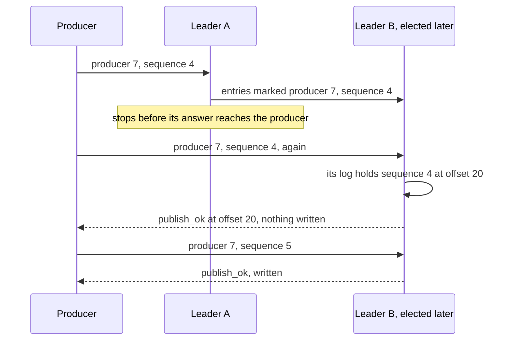

The leader checks a batch against its own log before it proposes it. That
is safe because of two rules.

- A term is served only once its stream is at the committed tail, so by
  then the log holds everything earlier leaders committed, and the check
  sees it.
- The log learns a batch when openraft writes it, not when the batch is
  handed over. So one producer's batches take turns: the next is checked
  only once the one before is written to this leader's log or was given
  up on. A batch refused before it is written stays unwritten, because an
  idempotent batch is written only while the broker leads the term it was
  routed at. The producer's next batch is then refused as a gap instead
  of landing ahead of it.

Only the producer's own batches, and what its connection sends behind
them, wait for its turn. A batch takes its place in its producer's line as
it arrives, in the shard's publish order. If the turn is taken, the batch
waits off the shard's publish lane, so other connections' publishes to the
shard go ahead meanwhile.

The broker commits a shard's publishes in the order it read them from a
connection (`docs/protocol.md`, "Answers on completion"), and a batch that
waits must not lose its place to a publish sent after it. So while a
connection has a batch waiting on a shard, its later publishes to that
shard, plain or idempotent, queue behind the batch and are proposed in
order once its turn comes. A queued publish still holds its share of the
connection's in-flight byte budget, which bounds the queue.

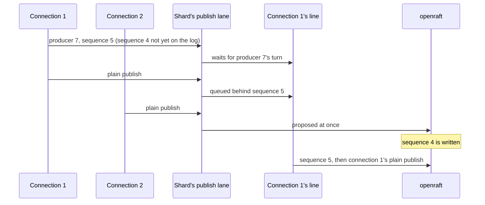

A batch the log already holds is answered once it is committed. Below the
read bound it already is. Above it, the leader wrote it in this term and
the answer waits for that entry's commit, so a re-send is never
acknowledged ahead of the batch it repeats.

**A batch of several records is one write.** An entry's index is its
record's offset, so a batch of several records is several entries.
openraft appends a drain whole or not at all, so a lapsed lease cannot
leave a hole in a batch (#2472). But nothing commits several entries all
or none: a leader can stop with only the start of the batch replicated.
Written again whole, that start would be in the stream twice (#2516).

So every record of a batch is an entry that names the batch and its own
position in it (`docs/storage-format.md`, "Producer marks"). That is
enough for each member to know exactly which records of a batch its log
holds, even with other entries between them.

**A batch cut by a leader change is finished, not written again.** Say a
leader stops with the first two of a batch's four records replicated. The
next leader's log holds those two, and its blank entry follows them. Each
member's log remembers the batch as cut: two of four held. When the
producer sends the batch again, the leader

1. checks the two records it holds against the start of the re-send, the
   way it checks a whole batch that is sent again, and refuses a different
   batch under the same sequence (`sequence_reused`);
2. writes only records three and four, as pieces of the same batch;
3. answers with the first record's original offset and the last piece's
   offset.

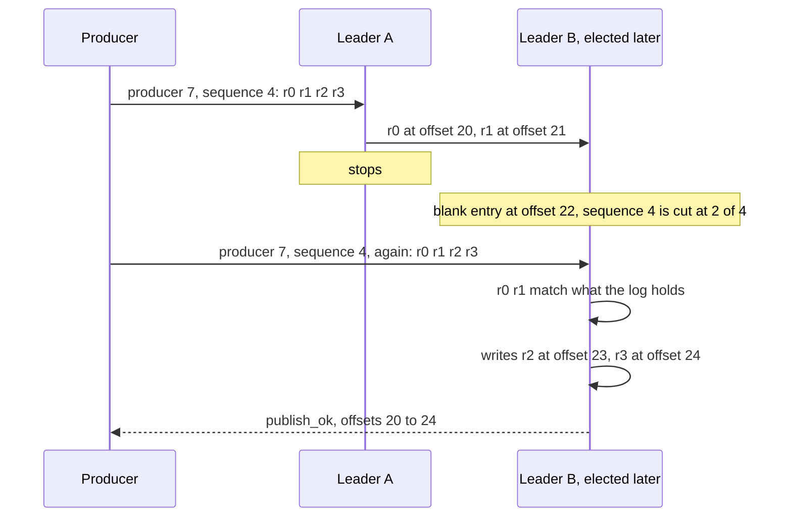

Three things follow, and a client has to know them.

- **A reader sees each record once, in order, but not as one run.** The
  records of a finished batch keep the order the producer gave them. Other
  records (here the blank entry, which no reader is sent) can lie between
  the part an earlier leader wrote and the rest.
- **The start is visible before the batch is acknowledged.** Records the
  earlier leader committed are delivered when they commit, as on the
  hybrid. A batch is not an atomic unit for readers.
- **The answer's offsets are the first and the last record's.** A client
  must not compute a record's offset as the first offset plus its position.

**A batch the log cannot account for is refused, never rewritten.** The
re-send is refused with `sequence_expired` when the member cannot tell what
it holds of the batch:

- its log starts inside the batch (a purge, or a copy that started above
  the batch's first record), so it holds later records of the batch
  without the first;
- a purge removed every record the log held of it, or the member already
  remembers 4096 other cut batches. The member keeps only the producer and
  the sequence then, and refuses that sequence and older ones, a first
  batch's sequence 0 included, until a purge passes a later batch of the
  producer. It is saved before the purge removes anything, so a restart,
  a truncation or a reset keeps the refusal;
- the records it holds of the batch do not follow one another;
- the re-send has a different number of records than the batch in the log.

Refusing is the only safe answer there. Writing the batch again would put
the records that are still in the log into the stream a second time. The
cut batch is remembered for as long as one of its records is in the log,
and by name after that. A restart keeps it: while records of it are in the
log, the log's marks rebuild it, and the by-name entry is in a flushed
`producers.forgotten` file in the log's directory. A member that was caught
up by copying segments derives it from the records it was sent, since a
segment copy carries no producer state, so it does not know a cut batch none
of whose records it was sent.

A member that installs a snapshot holds no record below it, so it cannot
read those refusals from its log. They travel in the snapshot instead. A
stream shard's snapshot data is the list of cut batches, by producer and
sequence, that a log starting right after the snapshot's last entry has to
refuse, and the group table as of that entry ("Consumer groups", below).
It is what the committed records up to that entry say, and nothing
else: the cut batches in those records, plus the ones earlier purges and
installs carried. The sender's own refusals do not go in. A batch evicted
from a full table of cut batches goes in only once a purge passes its
records, and the cut batches a reset dropped after an install never do,
since the records they came from may be ones the leader never had. So every
member's snapshot at one entry carries the same list. The member saves the
list to its own `producers.forgotten` before it stores the snapshot, and
the reset to the snapshot's base then drops what its old records said, so
it answers a re-send the way a member that holds the records does. A crash
in between leaves the old snapshot and only more refusals. Empty data
carries none: a switch's base snapshot, or a snapshot taken with nothing
forgotten.

A producer whose batches a purge removed altogether is not just dropped. Its
newest sequence stays as a tombstone, carried in the snapshot data with the
cut batches, so a re-send of its first batch is refused as expired instead of
being written a second time. Kafka producers are the exception: they
restart at sequence 0 under the same id after an epoch bump, so their re-send
is written. Up to 4096 are kept per shard, oldest out first;
see "`producers`: the producer snapshot" in `docs/storage-format.md`.

The sender reads its log from its base to build the list, a chunk at a
time, so appends go on while it does. That read is as long as the log.

Whole batches below the snapshot do not travel. A member that installs one
knows a producer only from the batches it holds, as a member whose own
purge passed every batch of that producer does, and takes its sequence 0
as a new batch.

Nothing sends a stream shard's snapshot to a member yet: a member still
refuses it, because it carries no records (see "Group runtime"). The
install that ships the records below it will take these refusals with it.

A batch with a hole is refused if one is ever found, though a drain is one
write that openraft checks once ("A batch is written only at the term it
was admitted at"), so a lapsed lease cannot make one.

An idempotent batch keeps its publisher and its records' headers as any
other publish does ("Publishers and record headers", below).

An idempotent batch can also reach the leader as a forward from another
broker. One whose records carry no key-and-headers block travels as
`PlainSequencedForwardPublish`. One with a block travels as
`SequencedForwardPublish` (`docs/internal-protocol.md`, "A forward that
names its producer"). The leader takes both.

> `crates/server/felix-replication/src/raft/tests/idempotent.rs`,
> `a_batch_sent_again_is_answered_and_not_written_again`,
> `a_resend_of_an_uncommitted_batch_waits_for_its_commit`,
> `a_producers_next_batch_is_checked_once_the_one_before_is_written`,
> `a_batch_refused_at_its_term_stays_unwritten_and_the_next_is_a_gap`,
> `a_batch_of_several_records_is_written_once`,
> `a_record_of_a_batch_names_its_place_in_the_log`,
> `a_batch_cut_by_a_leader_change_is_finished_by_its_resend` and
> `a_batch_resent_to_the_next_leader_is_not_written_again`;
> `crates/server/felix-storage/src/disk_log/producers/tests.rs`,
> `a_purge_past_a_cut_first_batch_refuses_its_resend`,
> `a_purge_past_an_open_batch_refuses_its_resend` and
> `past_the_bound_a_cut_first_batch_is_still_refused`;
> `crates/server/felix-storage/src/disk_log/tests/producers.rs`,
> `a_purge_past_a_cut_batch_refuses_its_resend` and
> `a_copy_past_a_cut_batch_refuses_its_resend_with_the_carried_cuts` and
> `a_snapshot_carries_nothing_its_sender_alone_held`;
> `crates/server/felix-replication/src/raft/tests/idempotent.rs`,
> `a_member_installed_past_a_cut_batch_refuses_its_resend`;
> `services/felix-broker-service/src/shards/raft/tests.rs`,
> `an_idempotent_batch_sent_again_after_its_leader_stopped_is_written_once`;
> `services/felix-broker-service/src/serving/quic/handlers/publish/worker/tests.rs`,
> `queued_idempotent_publishes_to_a_raft_shard_are_written_once`,
> `a_batch_waiting_for_its_producers_turn_holds_up_only_its_own_connection`,
> `an_idempotent_batch_of_several_records_is_written_once_on_raft`,
> `a_batch_of_several_records_is_checked_at_its_producers_turn`,
> `a_resent_cut_batch_is_finished_and_answered_from_its_start`,
> `a_resent_batch_the_log_holds_whole_is_answered_as_a_duplicate` and
> `a_resent_forgotten_batch_is_refused_as_expired`;
> `services/felix-broker-service/src/serving/forward/owner/tests.rs`,
> `a_forward_to_a_raft_leader_commits_through_its_group`,
> `a_forwarded_resend_of_a_cut_batch_is_finished_on_the_owner` and
> `a_forwarded_resend_of_a_forgotten_batch_is_refused_as_expired`;
> `crates/protocol/felix-wire/src/internal/tests/forward.rs`,
> `a_sequenced_forward_without_a_block_round_trips_without_headers`.

**Conditional publishes.** A `publish_if` (`docs/protocol.md`) names the
offset its record must land at. On a Raft shard the record lands there or
not at all, as on the hybrid, and the answer is `publish_ok` with that
offset or `publish_refused` with `offset_mismatch` and the shard's tail.

The difference is what a refusal costs. The hybrid checks the tail under
its append lock and writes nothing when it misses. A Raft leader cannot
check that way: the entry's index is fixed only when openraft appends it,
and another writer's entry, or the blank a new leader appends when its
term starts, can land ahead of it after the leader looked. So the
condition is decided by the leader's log append, at the entry's final
index, from that index alone:

- At the expected offset, the leader stores the record.
- Anywhere else, it stores a blank entry in its place. Readers skip it like
  any other blank (`skipped_before`), and subscribers are never sent it.

Followers do not decide. openraft sends them entries read back from the
leader's log, which holds only the outcome, so they copy the record or the
blank the leader stored. Because the decision is made at the final index
and from nothing else, a deposed leader or a re-proposal cannot store the
record anywhere but its expected offset, and an entry a later leader cuts
takes its decision with it. The leader answers once the entry commits,
whatever the stream's consistency level: `publish_ok` when the record was
kept, `offset_mismatch` otherwise, with the offset after the blank as the
tail.

So on a Raft shard **a refused `publish_if` consumes one offset** per record. A client
that retries at the tail it was given asks for the offset right after the
blank. On the hybrid a refusal consumes none.

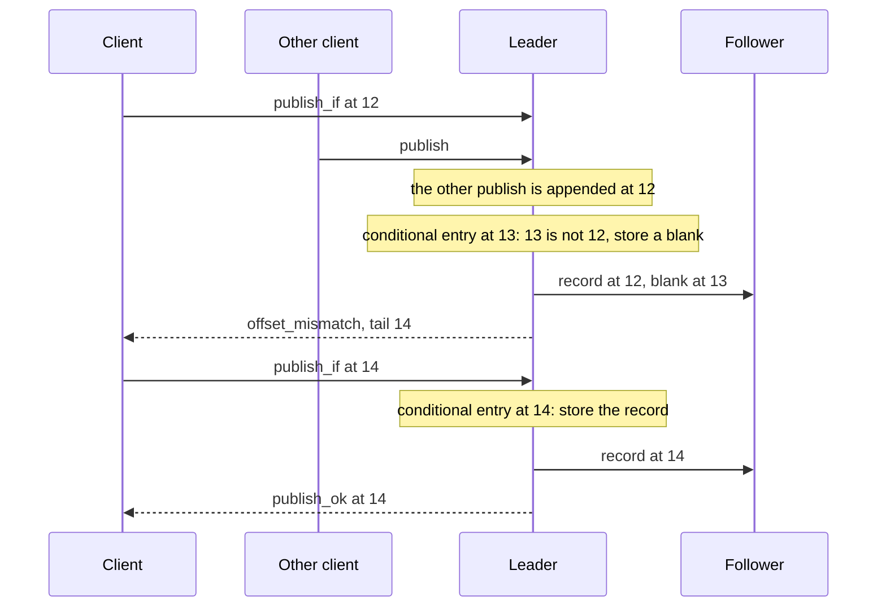

A conditional publish may carry several records. A cluster takes such a
batch once its fleet finalizes `raft_conditional_batches`, as a new cluster
does; until then it is refused by name. A lone broker takes it from the
start. Each record of such a batch is its own entry, a
conditional piece that names its place in the batch, and the leader keeps a
piece only at the expected offset plus its place. The batch is appended as
one run, so every piece is kept or every piece is blanked, on every member.
A leader change can still commit only a prefix of a kept batch, so every
reader applies the whole-batch rule (`docs/storage-format.md`, "Conditional
batches") in two places. The state machine holds the read bound at the
first piece of a batch it has not yet seen end, so no reader at any level
gets past it, and a confirmed read still waits only for the apply. When the
entry where the next piece belongs is anything else, the batch is cut: its
pieces hold no record, the bound moves past them, and the next record's
publisher reports them as skipped with the entry that cut them. A member
that restarts or installs a snapshot inside a batch reads the open batch
back from its log while the log still holds the snapshot's last entry.
Once a purge or an install has dropped it, the member counts the rest of
the batch the way a disk read of that log does, and its bound can sit just
above the snapshot, inside the batch. That is harmless: the snapshot is
below the trim floor, and no reader reads below the floor. Every disk read goes through `read_log_from`, which
drops a cut batch's pieces like blanks and stops before an undecided one,
so history reads, follower delivery, consumer groups, queues and Kafka
fetches see a batch whole or not at all. A blanked batch moves the stream
past all its offsets, so a refused batch of n records consumes n offsets.
A piece is an entry (tag 10) and a record kind an older build refuses,
which the fleet gate also covers. A batch with no record is refused as on
the hybrid. Like a plain Raft publish, a `publish_if` keeps the publisher id
on every piece when the publisher features are finalized, and stores none
otherwise ("Publishers and record headers").

A conditional publish of one record needs no fleet setting. On disk the
leader writes only
a plain record or a blank, and followers copy that, so a member on an older
build replicates a conditional publish's outcome like any other entry and a
downgraded broker reads the log. The conditional entry also has its own
tag, 5, in the Raft wire's entry payloads (`docs/internal-protocol.md`).
The layout stays 5, so heartbeats, votes and every other append are
byte-identical to an older build's. openraft never sends the tag at this
pin, since it replicates from storage, so it is defence-in-depth: should a
leader ever send the command itself, a member built before it refuses the
entry by its tag instead of storing the record unconditionally at whatever
offset it lands.

`FelixRaftCond.tla` checks the rule: a kept record is always at its
expected offset, at most one publish naming an offset is kept, members
agree, and each answer matches what every member committed. The model lets
every member decide at the entry's index; that has the same outcomes as the
leader deciding and followers copying, because the decision is a function
of the index. Its twin `FelixRaftCondLeaderDecides`, where the leader
decides from its guess of the index before the append, keeps a record off
its offset once an entry openraft writes itself (a membership entry in the
model) lands between the guess and the append.

> `crates/server/felix-replication/src/raft/tests/deliver.rs`,
> `a_conditional_publish_off_its_offset_is_a_blank_on_every_member` and
> `a_conditional_publish_of_other_than_one_record_is_refused`;
> `crates/server/felix-replication/src/raft/tests/commit.rs`,
> `a_leader_change_that_cuts_a_batch_leaves_no_bound_inside_it`,
> `a_lapsed_lease_mid_batch_keeps_readers_out_of_it`,
> `a_batch_cut_by_the_next_leader_is_never_read_into_and_is_skipped`,
> `a_member_resuming_inside_a_batch_reads_it_back_from_its_log` and
> `a_batch_applied_from_mid_way_is_counted_as_resolve_reads_it`;
> `crates/server/felix-replication/src/raft/tests/deliver.rs`,
> `a_blanked_batch_of_three_is_skipped_by_the_next_record`;
> `crates/server/felix-broker/src/durable/tests.rs`,
> `a_read_skips_a_cut_conditional_batch_and_stops_before_an_undecided_one`;
> `crates/server/felix-broker/src/stream/state/tests.rs`,
> `a_blanked_batch_of_three_releases_three_offsets`;
> `crates/server/felix-broker/src/broker/publish/proposed/tests.rs`,
> `a_refused_conditional_batch_releases_every_offset`;
> `crates/server/felix-replication/src/raft/wire/tests.rs`,
> `a_conditional_entry_is_refused_by_its_tag_on_an_older_build`;
> `crates/server/felix-storage/src/raft_log/tests.rs`,
> `a_command_the_codec_blanks_is_stored_as_a_blank_entry`;
> `services/felix-broker-service/src/serving/quic/streams/tests/raft_publish_if.rs`,
> `a_publish_if_to_a_raft_shard_is_written_only_at_its_offset` and
> `a_publish_if_batch_to_a_raft_shard_is_written_or_refused_whole`;
> `crates/testing/felix-cluster/tests/raft_shards.rs`,
> `a_conditional_batch_on_a_raft_shard_is_read_whole_or_not_at_all`.

**Head trims.** A `trim_before` (`docs/protocol.md`) on a Raft shard is
answered as on the hybrid. `Broker::propose_trim_at` runs the hybrid's
checks in the hybrid's order before anything is proposed: `before` past
`expected_offset` is `trim_past_tail`, a tail other than `expected_offset`
is `offset_mismatch` with nothing written, a stream holding atomic commits
is `stream_has_commits`, and a trim at or below the current floor writes
nothing and answers with the floor.

Otherwise the trim is one entry, conditional on landing at
`expected_offset` exactly as a conditional publish is. Its record is a trim
record holding the floor and the trim's headers, the same record the
hybrid writes. Only a tail that moved between the check and the append
costs an offset: the leader's log stores a blank there, and the answer is
`offset_mismatch` with the offset after it.

The floor comes from the log on every member. A Raft log applies a trim
record's floor once the record is below its commit offset, and rebuilds it
at open from the trim records and the `head` file, as the hybrid does
(`docs/durable-storage.md`, "Conditional head trim"). So once a member's
commit passes the trim it hides the same records as every other member.
A floor also waits for the member's own sync of the record, and a leader can
answer a trim that its followers synced before it did. So the floor check of
`propose_trim_at` and of retention's trim first waits for every trim the
leader's log holds to apply, as a read does; a lower trim checked in that
gap would otherwise be written below a floor the client was already given.

On the hybrid only the leader serves readers, so once a trim is answered
no reader on any broker is served below its floor. A Raft follower serves
from its own log, which may not hold a trim the leader has already
answered, and so may a leader cut off from a successor that trimmed: it
never heard the later term, so in its own view it still leads. So before
a follower serves a resume from an offset or from `earliest`, a cursor
subscribe, a tail subscribe, a history page or a stream read, it asks the
leader for a read index (the `ReadIndex` peer message) and waits until it
has applied that index. The leader answers with the larger of its commit index (after
a majority confirms it still leads) and one past the last write it
answered once a majority had written it: the same value `confirm_read`
waits for. Every trim
answered before the read began is then committed in the follower's log,
so its floor applies there. A tail subscribe asks too, with or without
event offsets: it starts at the follower's committed tail, which can be
below a floor it has not received, and the records between would reach
the subscriber live. Once the index is applied the tail is past the trim,
so past its floor. A tail subscriber then starts at that committed tail
(and never below the floor): a log pass already running, or one held up
by another subscriber, may still be delivering what the member applied
below it, and the subscriber drops those records.

The leader needs a read index of its own before the same reads, a Kafka
fetch below its tail included, but not before a tail subscribe. While its
leader lease holds (`admit_local_ack`, "Acknowledging a write") it takes
its own commit index with no round. The lease is shorter than
`election_max` by the clock drift bound, and every voter in the majority
that answered refuses a vote for `election_max` after that answer, so no
successor can have been elected and trimmed yet. This rests on the same
clock assumption as the `Leader` acknowledgement: no broker's clock
drifts by more than `clock_drift_ppm` (10%), checked at start by
`lease * (1 + p) / (1 - p) <= election_max`. With the lease lapsed, void
or just woken from a suspend, the leader runs a read-index round
(`confirm_read`). A deposed leader cannot get a majority's answer, so it
refuses the read as retryable instead of serving a log its successor has
trimmed. Concurrent rounds are shared. Under steady traffic the lease
holds, so a leader read pays no round trip; an idle leader pays one.

A deposed leader's tail subscribers end with its term. The leader lets a
tail subscribe through with no round, so once the subscriber is
registered it checks it still leads the same term. If it stepped down in
between, the end of its term's subscribers may have run before the
registration, so the subscriber is dropped and the subscribe refused
with a retryable `not_ready`. Asking for a read index as a follower at
that point is too late: the log pass may already have handed the
registered subscriber records below the successor's floor.

A member cut off from its leader refuses these reads with a retryable
`not_ready` for as long as it is cut off. The Rust client, and the
clients built on it, retry `not_ready` with backoff on the same entry
broker: it does not move to another broker on that answer, only on a
broken connection or `draining`. A client whose entry broker is the
cut-off member gets `not_ready` until its retries run out
([#2665](https://github.com/GetFelix/felix/issues/2665)).

The wait is bounded by the longest election timeout from when the read
began. A follower that knows no leader, gets no answer, or does not apply
the index in time refuses the read as retryable
(`NotReadable::Settling`), so a follower cut off from its leader serves no
read from an offset. After the read index, a follower still holds a read
that starts below a trim its log holds but its commit has not passed, for
at most 5 s, then refuses it as retryable. Such a trim was not answered
before the read index was taken, but may be by the time the read is
served. A read at or above its floor goes ahead.

The read index is a peer message a build that predates it does not know,
so it waits for the fleet feature `raft_follower_read` (a lone broker has
it from the start). Until then a follower refuses such a read with
`NotReadable::OnLeader`, which the subscribe handler answers with a
redirect to the leader when it knows one and with `shard_unavailable`
(`not_ready`) otherwise.

> `services/felix-broker-service/src/shards/raft/tests/trim.rs`,
> `a_follower_without_the_trim_is_not_read_below_it_after_the_answer`,
> `a_follower_holding_the_trim_is_not_read_below_it_after_the_answer`,
> `a_reachable_follower_holding_an_uncommitted_trim_holds_reads_below_it`,
> `a_follower_cut_off_from_its_leader_refuses_offset_reads_as_retryable` and
> `a_follower_leaves_offset_reads_to_the_leader_until_raft_follower_read`,
> `a_tail_read_on_a_follower_behind_a_trim_starts_at_or_above_its_floor`,
> `a_deposed_leader_that_missed_the_trim_is_not_read_below_it` and
> `a_resume_redirected_before_the_finalize_is_not_served_by_a_deposed_leader`;
> `services/felix-broker-service/src/serving/quic/handlers/subscribe/tests/handle_subscribe.rs`,
> `a_follower_resume_before_raft_follower_read_redirects_to_its_leader` and
> `a_follower_with_no_leader_answers_on_leader_as_not_ready`.

A Raft trim that does not commit and reach the leader's ring within 30 s
of its proposal (one budget for both) is answered as on the hybrid: `unacknowledged` with `detail.reason` = `trim_timed_out`, and it
may still land.

The other difference from the hybrid is deletion:
a Raft log's retention sweep never deletes a segment below a floor, because
only openraft's purge may move a Raft log's start. The disk below a trim is
freed by that purge, below, on the storage's retention timer. Retention on a
Raft shard is a trim the leader proposes, so the same holds for it
("Retention", above).

**Purging below the floor** (gated by the `raft_stream_purge` fleet
feature, which needs `head_trim` and `raft_head_trim`). The design is checked in
`docs/formal/FelixRaftStreamPurge.tla`. A member purges in two steps: it
writes and fsyncs a stream snapshot at a point P below its floor, with the
cut batches and group table as of P and the floor and headers it serves,
then drops its log up to P. A member behind the purge installs that
snapshot only when P is below the floor the snapshot carries. On install it
keeps the higher of its own floor and the snapshot's, with that floor's
headers, in the raise-only `raft-floor` file (`docs/storage-format.md`), and
stores the snapshot with that higher floor in place of the one it was sent,
so the snapshot it sends as leader passes the higher floor on. Without it, a later snapshot
from a leader that had not applied the newest trim would lower the floor at
the next restart, and a re-form reading that copy could give out an offset
again. A re-form reads every copy's floor, from `raft-floor` or a trim
record at or below its saved commit, starts the new epoch past the highest
floor's trim, and raises that floor and its headers into every started
copy's `raft-floor`, so reads below it stay refused even when no copy still
holds the trim. A leader purges no further than the lowest match among
the members that answered it lately (within the time after which a peer
counts as silent, at least two idle heartbeats). A member that is down is
not waited for, so it cannot keep the leader's disk; when it is back it is
behind the purge and installs the snapshot. openraft itself holds a
leader's purge while a replication stream still reads the range, a stream
to a down member included, and runs it on that stream's next answer or
error; a purge pass reports a purge only once openraft has run it. The
model's leader cap ranges
over live members the same way, and the design passes without the cap
(`FelixRaftStreamPurgeNoCap.cfg`): the cap only saves sending a snapshot.

> `services/felix-broker-service/src/shards/raft/tests/purge.rs`,
> `a_member_behind_a_purge_installs_the_snapshot_and_keeps_the_floor`,
> `a_leader_keeps_the_log_a_lagging_member_needs`,
> `a_leader_purges_past_a_member_that_stopped_answering` and
> `a_member_back_after_a_purge_leads_with_no_record_lost_or_offset_reused`

On the leader the trim reaches the replay ring in its entry's turn and
drops the ring's records below the floor, and the answer waits for that, so
no reader is served below the floor after `trim_ok`. A follower's ring
keeps records below the floor until they age out. It never serves them:
every resume checks the log's floor first.

Every member writes the data directory's `head-trimmed` marker before its
log stores a trim record, the leader's append and a follower's copy alike,
so a copy holding a trim refuses to join a fleet that has not finalized
`head_trim` (`felix_storage::run_state::head_trimmed`).

A trim entry has its own tag, 6, in the Raft wire's entry payloads, and
openraft does send it: leaders replicate entries read back from their log,
which hold the trim mark. A member built before it refuses the whole append
by that tag, and replication to it stops at the entry. So a Raft trim waits
for the fleet feature `raft_head_trim`, which needs `head_trim`. Every
build of this release reports it: one built without the Raft engine holds
no Raft shard, so it never receives the entry. A new cluster starts with it
finalized. Until the control plane finalizes it a clustered broker refuses a trim on a Raft shard with
`feature_not_enabled` and nothing proposed. A lone broker allows it from
the start. The layout stays 5, so every other frame is byte-identical to an
older build's.

`FelixHeadTrim.tla` covers the rule: the trim is a record, its floor is
applied at the commit offset, and a broker deletes below it at most up to
the floor. A Raft log deleting nothing below a floor is a case of that. The
condition is `FelixRaftCond.tla`'s, decided at the entry's final index.

> `services/felix-broker-service/src/shards/raft/tests/trim.rs`,
> `a_trim_hides_the_shard_below_its_floor_on_every_member`,
> `a_trim_holds_after_a_restart`,
> `a_trim_is_refused_until_raft_head_trim_is_finalized` and
> `a_follower_holding_the_trim_is_not_read_below_it_after_the_answer`;
> `services/felix-broker-service/src/serving/commit_ops/tests.rs`,
> `a_raft_trim_that_does_not_commit_in_time_is_the_hybrids_trim_timeout`;
> `services/felix-broker-service/src/serving/quic/streams/tests/raft_publish_if.rs`,
> `a_trim_before_to_a_raft_shard_is_answered_as_on_the_hybrid`;
> `crates/server/felix-replication/src/raft/tests/deliver.rs`,
> `a_trim_entry_is_counted_as_skipped`;
> `crates/server/felix-replication/src/raft/wire/tests.rs`,
> `a_trim_entry_is_refused_by_its_tag_on_an_older_build`;
> `crates/server/felix-storage/src/raft_log/tests.rs`,
> `a_trim_entry_applies_once_it_is_committed`;
> `crates/server/felix-storage/src/raft_log/tests/purge.rs`,
> `a_trim_entry_deletes_no_segment`.

**Atomic commits.** A `commit` ([atomic commits](atomic-commit.md)) on a
Raft shard keeps the hybrid's guarantee: the event and its state updates
apply at one offset, on every member, or not at all. The commit is one
entry whose record is the commit record the hybrid writes (the event and
the updates, with the commit mark), so every member's log holds it whole
or not at all.

The state view is fed from what the group committed, never from the
claim:

- On the leader the commit joins the commit hold like a publish. When it
  reaches the replay ring, its updates go to the state view under the
  ring's lock, so no reader sees the event without its state. The commit
  is answered only after that, so a writer's next `state_get` reads it.
- A follower delivers from its own log. It reads the commit record whole,
  hands its event to subscribers and applies its updates to the view at
  the same offset.
- A view that does not exist yet (after a restart, a catch-up, or a reset
  of the ring) is rebuilt from the member's own log, which holds the
  commit mark, exactly as on the hybrid. As there, state lives in the
  retained log and no snapshot carries it.

A `commit_if` is decided as a conditional publish is, at the entry's final
index: off `expected_offset`, the leader's log stores a blank in its place,
which takes one offset, and the answer is `offset_mismatch` with the offset
after it. Nothing of the commit is written.

A `Quorum` commit is answered at its Raft commit under every fsync policy,
never once a majority has only written it, as a plain publish can be under
`Periodic`. That is stronger than the stream asks for, and simpler: the
answer waits for the view anyway.

A `state_get` on a Raft shard confirms the term with a read-index round
before it takes its value, instead of the hybrid's lease. It then waits
until the view holds everything committed at that point, so it never misses
a commit whose event a history read already returns: history reads stop at
the commit, but the view moves only when the leader releases the commit
from the hold, and a full `Block` subscriber can hold that release up.
"Everything committed" means every record: a leader's blank entry or a
membership change after the last record moves the commit but holds no
record, and the view does not wait for it. A read that waits past the
request's quorum timeout is answered `shard_unavailable` with reason
`not_ready`.

A commit entry has its own tag, 8, in the Raft wire's entry payloads. A
member built before it refuses the whole append by that tag, so a commit
on Raft waits for the fleet feature `raft_atomic_commit`, which needs
`atomic_commit`. A new cluster starts with it finalized. Until the control
plane finalizes it a clustered broker refuses a commit on a Raft shard with
`invalid_request` and nothing proposed. A lone broker allows it from the
start. The layout stays 5. A head trim on a stream holding commits is
refused (`stream_has_commits`), as on the hybrid.

> `crates/server/felix-replication/src/raft/tests/deliver.rs`,
> `an_atomic_commit_applies_whole_on_every_member`;
> `crates/server/felix-replication/src/raft/wire/tests.rs`,
> `a_commit_entry_reads_back_and_is_refused_by_its_tag_on_an_older_build`;
> `services/felix-broker-service/src/serving/quic/streams/tests/raft_publish_if.rs`,
> `a_commit_to_a_raft_shard_is_answered_as_on_the_hybrid`.

**Consumer groups.** Served on a Raft shard once the cluster finalizes
`raft_consumer_groups` (a new cluster starts with it); until then a group
operation on one is refused as `invalid_request`, since an older member
refuses the entry. Only the shard's leader serves its groups. Every
operation, read or write, first confirms the leader's term by a read index
and waits for this member to apply it, so it sees every group write
committed before it. A write is proposed at that term, refused by openraft
if the member no longer leads it, and answered only once applied. If the
append's outcome is unknown, the leader closes the term before answering, so
only a later term's read index can see the entry. A write is retryable
only when it provably was not appended: refused before the proposer took
it, or by openraft on a lapsed lease. Any other error, while proposing or
while waiting for the apply, is outcome unknown (`quorum_timeout` when the
wait ran out, otherwise `leadership_lost`), as a stream write is: the entry
may commit under the next leader, and a retry there would redrive, delete
or claim a second time. Claims are group entries
too: a poll that hands records out, and an extension, writes a claim and
answers once it applied. A poll waits for the read index first and then
hands out only what this member has applied, so a poll sent after a
publish's ack includes the record at every ack level (#3146). An ack sent on
enqueue comes before the write and is the one exception.
A leader that stops leading drops the shard's
trackers, and the next one rebuilds them from the table, claims included,
each held for its full visibility again from then. Group writes are log entries, so they
take stream offsets that readers skip. A poll passes over them, so they sit
below the tracker's high water, yet nobody was handed one. A settle or an
extension naming an offset the group holds no claim on is checked against
the log first, and one that names an entry is refused as never handed out
(#2784). A claim is always a record, so a settle for one skips that read. A group's writes (a cursor advance, a dead letter, a redrive and
its finish, a discard, a seek, a delete, a claim) are entries in the shard's own Raft
log, stored as group records (`docs/storage-format.md`, "Group records").
Every member folds them, in log order, into the same group table, so a
new leader serves the group from exactly the state the old one committed.
`docs/formal/FelixRaftGroups.tla` models the rules the fold follows; it
leaves out discard, which only drops a dead letter, and `if_new`, which the
leader decides before it proposes the seek.

The group table is the shard's consumer groups as one member has applied
them: per group, its creation token, its cursor (everything below it is
settled, dead or redriven), its standing claims, its dead letters, and the dead letters redriven
but not yet settled. The shard also keeps the index of its latest delete.
The state machine folds a group entry when it applies it, before the commit
table moves, so a write that waits for its apply finds it folded. It is
kept in memory, and every member gets there the same way:

- At apply, only committed entries fold. A log truncation never touches
  the table, because nothing above the commit index is in it.
- After a restart, the member loads the table its stored snapshot carries
  (none without one) and openraft applies the log above the snapshot
  again, which folds the group entries there.
- At a snapshot install, the member replaces its table with the one the
  snapshot carries and forgets its trackers. The entries above the snapshot
  fold on top. A stream member refuses every install today ("Group
  runtime"), so this is for the purge that will send them (#2602).

A shard switched from the hybrid starts with an empty table: its cursors
and dead letters stay in the hybrid's side logs until the switch seeds
them ([#2659](https://github.com/GetFelix/felix/issues/2659)), which has
to land before groups are served on a switched shard.

So the stream snapshot carries the table as of its last entry, beside the
cut batches ("Idempotent publishes"): a member that installs it holds no
group entry below it to fold. A snapshot with no group writes is still the
older layout, cut batches only. A group entry a member cannot decode stops
the member, as a cache entry does: skipping it would leave that member's
table unlike the others'.

The payload is a `GroupEntry` (`felix-broker`, `queue/entry.rs`): the
group's name, the operation, and for every write a tracker decides, the
group's creation token. The token names the incarnation of the group the
write was decided for (the term and index of the seek that created or last
reset it, or of the hydrate that created it), so a write that lands after a
seek or a delete of its group is dropped rather than applied to the group
that replaced it. A seek's own token is its entry's log id.

A group entry has its own tag, 9, in the Raft wire's entry payloads, and a
member built before it refuses the whole append by that tag. Groups are
served on Raft once the fleet finalizes `raft_consumer_groups`, which every
broker on this build reports.

> `crates/server/felix-replication/src/raft/wire/tests.rs`,
> `a_group_entry_reads_back_and_is_refused_by_its_tag_on_an_older_build`;
> `crates/server/felix-replication/src/raft/tests.rs`,
> `a_group_write_round_trips_through_its_record`;
> `crates/server/felix-broker/src/queue/entry/tests.rs`,
> `the_layout_is_the_documented_one`;
> `crates/server/felix-replication/src/raft/tests/groups.rs`,
> `every_member_folds_the_same_group_table_and_keeps_it_across_a_restart`,
> `an_installed_snapshot_carries_the_group_table`,
> `a_group_entry_that_does_not_decode_stops_the_apply`;
> `crates/server/felix-broker/src/queue/table/tests.rs`,
> `the_same_entries_fold_to_the_same_table`.

**Publishers and record headers.** A record on a Raft shard keeps what it
keeps on the hybrid: the publisher id (the principal that published it,
which is not the producer id) and its key-and-headers block
(`docs/protocol.md`, "Record headers"). Both are stored in the record's own
entry, so every member's log holds them, and a follower's subscriber, a
restarted member and a history read get them back.

The rules for using them are the hybrid's, plus one fleet feature:

- The publisher id is stored only when `publisher_principal` and
  `raft_record_headers` are both finalized. Without them the record is
  stored with no publisher, and the publish is not refused.
- Headers need `record_headers` and then `raft_record_headers`. A publish
  with headers before both are finalized is refused with
  `feature_not_enabled`, naming the missing feature, and nothing is
  proposed. A lone broker takes them from the start.
- A conditional publish (`publish_if`) carries no headers, the same as on
  the hybrid.

`Broker::admit_attribution` applies these rules before the batch is
proposed, so a refused batch takes no offset.

On the wire a record with either one is wrapped in entry tag 7: a flags
byte says which follow, each is a length and its bytes, and then comes the
record laid out under its own tag (1, 3, 4 or 5). A record with neither
keeps the frame it always had, and the layout stays 5. A member built
before tag 7 refuses the whole append by that tag rather than store the
record without them, so `raft_record_headers` waits for every broker to
report it. A trim never names a publisher or headers.

Every member writes the data directory's `record-headers` marker before its
log stores a record with headers, so a copy holding one refuses a fleet
that has not finalized `record_headers`
(`felix_storage::run_state::has_record_headers`).

A follower builds its batches from its log, and a batch names one
publisher. So two publishes stamped at the same time by different
publishers are delivered as two batches, as the leader delivers them.

> `crates/server/felix-replication/src/raft/tests/deliver.rs`,
> `a_records_publisher_and_headers_reach_every_member` and
> `headers_are_refused_until_the_fleet_stores_them_on_raft`;
> `crates/server/felix-replication/src/raft/wire/tests.rs`,
> `an_attributed_entry_reads_back_and_is_refused_by_its_tag_on_an_older_build`;
> `crates/server/felix-broker/src/broker/shards/tests.rs`,
> `a_follower_starts_a_batch_where_the_publisher_changes`;
> `crates/server/felix-storage/src/raft_log/tests/marks.rs`,
> `a_record_with_headers_marks_the_root`;
> `services/felix-broker-service/src/serving/quic/handlers/publish/worker/tests.rs`,
> `a_queued_publish_to_a_raft_shard_keeps_its_publisher_and_headers`;
> `crates/testing/felix-cluster/tests/raft_shards.rs`,
> `record_headers_on_a_raft_shard_replay_from_every_member`.

A broker started with `FELIX_SHARD_ENGINE=raft` runs its durable stream
shards this way. Use it on a fresh cluster only, with the variable set on
every broker and on the control plane: a shard that already holds data
cannot change engines yet, a broker refuses to start under a control plane
whose identity names the other engine, and only a Raft control plane stores
the target a group forms on.
Publishes, routes, subscribes and a leader stopping are tested across three
brokers in one process and across three broker processes. Both failover
tests read every acknowledged payload back from the new leader, and the one
across processes stops the leader while the control plane is down: the
group elects without it.

> `crates/testing/felix-cluster/tests/raft_shards.rs`,
> `a_publish_through_any_broker_reaches_a_subscriber`,
> `a_leader_lost_with_the_control_plane_down_loses_nothing_acknowledged`.

**Forming a group.** Placement says where a shard's group forms. After
that the group's leader moves its members to the target the control plane
stores ("Membership"). Placement changes a set only to replace a follower on
an internal node. Because a group forms from a full set, and a set is filled
later by no report a Raft shard sends:

- A group forms only when placement names as many brokers as the stream's
  replication factor. The control plane can place a shard on the brokers it
  has and fill the set later. A group of the brokers placed first would
  acknowledge on its own, and the brokers placed later would form the full
  set again on empty logs, elect each other and overwrite what the first
  group acknowledged. On a short set every member waits and the shard
  answers "not ready". Placement fills a short set only after the shard's
  leader has reported to it, which a Raft shard does not do, so today a
  shard placed short stays short: create a stream once as many brokers as
  its replication factor are registered. The hold is not silent: the broker
  warns once per shard and placement generation, naming the shard, the
  replication factor and the brokers placed, and counts held shards in
  `felix_broker_raft_shards_short_placement`. The control plane's create
  response warns when the replication factor exceeds the registered brokers.
- One broker forms the group: the one with the lowest id in the set. It
  first asks every other broker which copy of the shard it holds and
  whether a group has reached that copy, with Raft pre-votes, which change
  nothing on the member asked. The first goes to copy id 0, which no copy
  has, and is refused with the copy id the broker does hold. The second
  goes to that copy. It forms the group, from its own member and the
  copies the others named, only when each one answers that it holds no
  vote and no entry. A broker that does not answer, that has not opened its
  member yet (its data root may be held by the restore gate), or whose copy
  holds either, stops it, and it asks again on the next routing pass. If a
  copy rotates after it answered, the set names its old copy id and not the
  new one. The new copy is a member no group knows, like any copy wiped
  after its group formed, and the group runs with one voter that never
  answers: at three replicas it cannot lose another. Nothing replaces such a
  copy yet: placement swaps a member only off an internal node, and
  wiped-copy replacement is
  [#2235](https://github.com/GetFelix/felix/issues/2235). The question names the stream's incarnation,
  so a member still on an older incarnation of the stream (its broker has
  not seen the stream recreated yet) does not answer it, and that also
  stops it. The other members never form a group. They
  open on an empty log and join when the leader's first append arrives.
- The set formed is the target the control plane stored, copy ids
  included (#2688). The broker compares the members it asked with the
  feed's `target` and forms only when they are equal. With no target, a
  withheld one, or one naming another copy, it forms nothing and asks again
  on a later pass. A re-form reads the voter sets of the epoch from the
  control plane ("Targets ordered in an epoch"), and the stored target is
  on that list before any broker can read it, or the list reads as lost.
  A set formed from copies no record names could lose
  its majority with no re-form source seeing that set. In a cluster this
  takes a Raft control plane: a hybrid one stores no target.
- The answers hold only for the set they were asked for. Placement can move
  while the broker asks: with {A,B,C} moved to {B,C,D}, B asks C and D, and
  C answers blank to both because neither has formed yet. If both formed,
  each could win a term and the shard would run two groups. So just before
  it initializes, the broker checks, under the lock the routing pass holds,
  that the last pass still fed the same full set and the same stored target,
  and otherwise forms nothing and asks again on a later pass.
  That check is only as fresh as the broker's feed, so a broker cut off
  from the control plane could still form the old set while another forms
  the new one. The control plane closes that (#2794): once it stores a
  target for a set, it refuses any write that changes the set until a
  leader the target names has sent it a floor report at the record's
  reform epoch, which marks the group formed at that stream incarnation
  and epoch (`raft_formed`). A leader of an older epoch marks nothing, and
  a re-form starts a new group whose first target is held again: the old
  epoch's mark releases nothing. Every broker that can
  form therefore reads the same set and target, and only the lowest broker
  of that set forms it. Placement waits for the mark too, showing "waiting
  for the group to form before changing its set". A member that dies before
  the first form holds the form, and so the set, until it is back: no group
  formed, so nothing was acknowledged, and deleting the stream is the way
  out. The same goes for a former whose copy is wiped after a member voted
  for it: the voter is no longer blank, the wiped former has no group, so
  no leader reports and the set stays held until the stream is deleted
  (the same class as #2235). A shard restored from an export has no
  recorded epoch, so the control plane reads it as epoch 0; if its group
  had re-formed, its leader reports a later epoch, which marks nothing,
  and a stored target holds the set until a re-form records the epoch.
  The hold is on from metadata level 45; below it a set change before
  the first form applies as before on every member. Once any entry at
  level 45 is in the log, every member holds unformed sets whatever the
  proposer saw, so a control-plane member that is down, and counted at a
  lower level, cannot lift the hold. The copy-id report that stores a
  target carries a level 45 field for exactly this reason, and so does a
  fleet feature finalize. A new cluster finalizes its features once every
  control-plane member answers at this build, so it is at 45 before its
  first stream. What is left is a group whose log has no level 45 entry yet,
  with a control-plane member that has not answered the leader since the
  leader started: a new cluster with a member down from the start, or one
  upgraded from before 45. Floor reports come only from a member that
  leads its group and has a committed log id. Every 30 s a leader sends
  again each group it leads that the shard feed does not show marked
  formed at the group's incarnation and epoch, so an idle group formed
  before the upgrade gets its mark without a publish. A marked group is
  sent only when its commit moves, so once every group is marked the
  refresh sends nothing. A mark the broker has not seen, from a control
  plane that predates the field or a feed that has not caught up, leaves
  the group in the refresh.
- Leaders follow placement. Placement names one broker as each shard's
  leader, and the member that leads the group hands the leadership to that
  broker's member when nothing else is going on. See "Leaders follow
  placement" below. That covers the first term too: the broker that formed
  the group is the lowest id of its set and wins the first election, so
  without this one broker would lead every group it formed.
- A formed group keeps its members. A member that placement drops stays
  open and keeps voting, and it opens again after a restart: the broker
  reads the `engine` marker of each shard placed elsewhere, and opens the
  ones it marked. The reads run before the routing pass takes the lock that
  stream deletes wait on, so a slow disk mostly holds up only the pass. A
  shard is read again under the lock only when another pass claimed a
  directory meanwhile or the shard was not read beforehand. A broker that
  placement adds opens an empty member that no group knows: it serves
  nothing for the shard and answers "not ready".

**What placement does with a Raft shard.** On a cluster whose
`shard_engine` is `raft`, the control plane leaves a durable stream's group
alone and names the member it wants leading. It changes a placed shard's
set only by the one-member swaps and additions below, and drops the copy a
move from an older control plane added:

- A balance pass, a drain and an operator move each name another member of
  the set as leader, in one write that changes only `leader`. Nothing is
  staged or copied. The group's leader then hands its leadership there (see
  "Leaders follow placement"). An operator's move goes through with one
  member of three down, and is refused (`member_down`) when fewer than a
  majority are serving (#3234).
- A drain moves every shard the draining broker leads to a live member, so
  its shutdown hand-off finishes. A shard with no other live member, such
  as one at replication factor 1, keeps its leader and shows as waiting
  with "no live node can take this shard".
- A follower that must leave is replaced: one on a draining broker, on a
  node marked internal, or on a broker down or gone for
  `restore_after_millis`. One write swaps it for a live node outside the
  set, once the control plane has stored the group's target for the current
  set and every other member is serving, so the group's leader adds the new
  member as a learner and then changes the voters (see "Membership"). A lost
  member goes first. With no such node the set stays and the shard waits.
- A set with fewer members than the replication factor is topped up
  (`raft_top_up`). An abandon leaves a set like this, since it places the
  leader alone, and so does a shard placed while too few brokers were live.
  Each write adds one live broker from outside the set, under the same
  checks as a follower replacement and from the same budget. The new member
  joins as a learner and votes once it has caught up, and the next is added
  only after that, so the voters the leader reported always hold at least
  half of the next set. Until the set is full, a `Quorum` write is
  acknowledged by a majority of the voters it has, not of its factor. With
  no broker outside the set the shard stays short and shows as
  under-replicated.
- On the way from one copy to three the group has two voters and needs
  both. If the second copy's broker goes down before the third votes, the
  shard takes no writes until that broker is back or an operator re-forms
  the group without it ("Re-forming a group"): replacing the down member is
  a joint change that needs its vote as well. Two voters are never less
  durable than one, so the top-up still adds one copy at a time.
- The replication count counts copies the group reports voting. A stream
  learner a re-form started cannot catch up across the re-form's gap yet
  (#3005), so a re-formed stream group stays below its factor, shows as
  under-replicated, and waits each pass for its group to report voters
  that keep a majority of the next set. Only that shard's leader balance
  stops; the rest of the pass goes on.
- A balance pass gives a seat to a live broker outside the set when it
  leads two fewer than the shard's leader and no member does (#3113). A
  broker a drain swapped out of every set, then restarted, is that broker:
  renaming within sets would never give it a shard again. One write swaps
  a follower for it and names it leader, under the same checks as a
  follower replacement, sharing its budget of 16 set changes a pass. The
  follower given up is one in the new broker's zone first, then the
  busiest, and never one whose swap would leave a set spread across zones
  short of a zone.
  The group's leader keeps its seat, adds the new copy as a learner, swaps
  the voters, and hands leadership over once the copy votes and has caught
  up. A copy the broker kept from before its drain rejoins under its old
  copy id with its log intact.
- An RF 1 shard has no follower to give, so the same balance rule moves
  it the way an operator move does (#3118): one write grows the set to the
  leader and the broker, and the shrink below ends the move. Each write
  takes a slot from the budget of 16. The leader tally counts the shard
  for the destination from the first write while the destination is live,
  so later passes start no more moves than the gap calls for. A move for
  the stream's spread needs the destination to lead fewer in total too,
  or the totals rule would trade a shard straight back. The undo and
  stranded rules below apply to it unchanged: between the destination's
  copy voting and the shrink the group has two voters and needs both.
- A leader that goes down is renamed to a live member, in the same kind of
  write, because a broker with no member forwards to the leader placement
  names. The group elects a new one without the control plane, so placement
  counts no unplaceable shard. With no live member left the name stays.
- A leader-only write keeps the shard's Raft target and its version, so it
  does not cancel a membership change in flight.
- An operator move to a broker outside the set gives it the leader's seat
  and names it leader, in one write. The group's leader adds it as a
  learner, grows the voters to the target plus itself, and hands leadership
  to a voter both keep, which shrinks the voters; placement's leader rule
  then hands leadership to the new broker once it has caught up. It is
  refused while a member is not serving (`member_down`), while the target is
  not stored for the current set (`set_unsettled`), and while the
  destination is still a learner (`not_a_member`).
- An RF 1 shard keeps its leader and grows to the destination first, since
  one voter has no voter to share with the next set. Placement shrinks the
  set to the destination once the leader reports its copy voting, and the
  store's formed-set hold refuses that write any earlier (#3012).
- An RF 1 move is undone, back to the old broker alone, when the destination
  stops being live before it votes (down, draining or gone), or when an
  operator moves the shard back to the old broker (step `raft_move_undone`).
  The store takes that write because the old broker is a reported voter.
  This is also how a drain of the old broker gets past a move that cannot
  finish. A draining destination that already votes is undone the same way,
  since it still serves and can vote for its own removal.
- Once the destination votes, the group has two voters and either set of one
  needs both. If the destination is then down, placement waits and says why
  ("votes in this group of two and is not serving"), and an operator move
  back is refused with `member_down`.
  The shard serves again when the broker comes back, or after a re-form
  without it ([Re-forming a group](#re-forming-a-group)): `felixctl raft
  reform plan --scope node <destination>`, then `felixctl raft reform apply`.
- A move an older control plane started on the shard is dropped at the next
  pass, with any copy it added.

So a broker that holds Raft shards can be drained and removed, or replaced once it has been gone for `restore_after_millis`: each of its copies is swapped for another broker, one shard member at a time. A removed copy keeps its directory, since nothing deletes it yet. While a group converges to a swapped set, a broker counts
the shards it holds whose voters are not the brokers placement names in
`felix_broker_raft_shards_off_placement`, and logs each one once at warn
level. Requests that reach a broker with no formed member go to the leader
placement names, which is wrong while placement and the group differ, so
wait for the gauge to reach zero before stopping a drained broker.
`docs/control-plane.md`, "Raft shards", has the placement side.

#### Changing a formed group's set

A formed group must never be placed on a set its brokers could form
again: if every broker in the new set is one the group never reached,
they all answer that no group reached them, and the lowest forms a second
group. That can happen in one write, or one swap at a time when the
group never adds the brokers swapped in before the next swap (#2905).

So every floor report a leader sends carries the group's voters, copy id
by broker, once its membership is committed at the reported index and is
not joint. The control plane keeps the last voters a leader reported at
the placed incarnation and reform epoch, and never older than the voters it
already keeps, so a late report cannot bring them back. It takes them only
from a leader the stored target names under the copy id the leader reports
for itself. While a set change has cleared the target, it takes them from a
broker still in the set that the kept voters name under that copy. A broker
moved off the set never reports voters, so it cannot name itself back into
the voters a blank copy admits, or freeze the record with a report at a
huge index. Any broker can raise the floor, so from metadata level 48 the
floor does not decide whose voters count; below 48 voters count only from a
report the floor takes. It then refuses a set change on a formed group unless those
voters hold at least half of the new set, rounded up. With the bound on
empty voters below, the new set keeps a copy that holds the group's log, and
the first form, which needs every member empty, never runs on it. A chain of swaps waits at each step until the group reports
the last one applied; replacing a broker the group never added still goes
ahead, since the rest of the set is unchanged.

A broker counts only under the copy id the report names. A voter whose
directory was wiped reopens under a new copy id, and the old copy, the one
the group counts as a voter, is gone, so two wiped voters and a new broker
are three empty copies, not a majority of the group. The same check runs
again when the new set's target is stored, against the copy ids it would
name: a voter wiped after the move but before the target is stored is
caught there. A reported voter can still be empty under its id only if it
was in the minority the group's first membership committed without, so at
most a minority of the voters are empty, fewer than the half a target of
the same size must keep. A shorter set never forms: a broker forms only a set
as large as the replica count. A copy that has held the group's log is never empty under the same id.
So no target names a set of empty copies, and none of its brokers can form
it. A single wiped copy of three
still gets its target, and the leader replaces it.

At replication factor 1 the set is one broker, so any re-placement
replaces every member and is refused. An RF 1 Raft shard's set does not
move; to get it onto another broker, delete and recreate the stream. A
hand-off through a two-broker set is not built yet (#2916).

If the group cannot report (its majority is gone, or a majority of its
copies was wiped), no step past its last reported voters goes ahead. The way out is a re-form, which starts a new
epoch and is held by the first-form hold above until a leader of the new
epoch reports. Above epoch 0 the control plane plans a re-form only from the bases its
earlier re-forms recorded (`raft_bases`, level 47), and refuses a record
without them (`BasesNotRecorded`). The hold applies once the metadata join floor is at level
46; a fleet feature finalize at 46 lifts it there for a new cluster.
Until then a formed group's set does not move at all, since no voters are
stored below 46, so placement replacements and drains of Raft shards wait
for the finalize. A leader re-sends a formed group's floor every 30 seconds
until the feed shows its voters, so a group that sat idle across the upgrade
still gets them recorded.
Placement waits with `waiting for the group to report voters that keep a
majority of the next set`.

> `services/felix-controlplane-service/src/model/shard/raft_target/tests.rs`,
> `a_swap_chain_waits_for_the_group_to_report_its_voters`,
> `a_replication_factor_1_set_does_not_move`,
> `an_even_set_moves_keeping_half_of_its_voters`,
> `voters_count_only_at_the_placed_epoch`,
> `a_voter_that_reopened_empty_does_not_count`,
> `a_target_waits_for_reported_voters_to_keep_a_majority_of_its_copies`;
> `services/felix-controlplane-service/src/store/contract/raft_targets.rs`,
> `a_set_holds_until_its_group_forms`;
> `docs/formal/FelixRaftFormedSet.tla`, where `FelixRaftFormedSetNoHold.cfg`
> finds a second group after a chain of swaps the leader never joins,
> `FelixRaftFormedSetByBroker.cfg` finds one when the hold counts brokers
> instead of copies, `FelixRaftFormedSetKeepOne.cfg` finds one when a move
> keeps a single reported voter, which can be an empty one, and
> `FelixRaftFormedSet.cfg`, `FelixRaftFormedSetEven.cfg` and
> `FelixRaftFormedSetSingle.cfg` pass with empty voters, wipes and lagging
> reports.

> `services/felix-broker-service/src/shards/raft/tests.rs`,
> `a_short_placement_forms_no_group`,
> `a_group_forms_only_when_every_member_answers_the_lowest`,
> `a_broker_placed_on_a_formed_group_does_not_form_it_again`,
> `a_member_placement_drops_keeps_serving`,
> `a_dropped_member_reopens_after_a_restart`,
> `a_dropped_member_reopens_after_a_failed_read`,
> `a_member_of_an_earlier_incarnation_does_not_answer_for_a_later_one`;
> `crates/server/felix-replication/src/raft/tests.rs`,
> `a_vote_or_an_entry_alone_is_not_blank`;
> `crates/testing/felix-cluster/tests/raft_shards.rs`,
> `a_short_placement_acknowledges_nothing`;
> `services/felix-controlplane-service/src/store/contract/raft_targets.rs`,
> `a_set_holds_until_its_group_forms`;
> `services/felix-controlplane-service/src/store/raft/state_machine/tests/raft_targets.rs`,
> `a_held_set_stays_held_when_a_proposer_sees_a_lower_level` and
> `a_finalize_at_level_45_holds_later_sets`;
> `services/felix-broker-service/src/shards/raft/floor/tests/control_plane.rs`,
> `a_refresh_marks_an_idle_group_formed`;
> `services/felix-broker-service/src/shards/raft/floor/tests.rs`,
> `a_refresh_skips_a_group_marked_formed`;
> `services/felix-controlplane-service/src/model/shard/raft_target/tests.rs`,
> `a_reform_holds_the_new_epochs_first_target`;
> `docs/formal/FelixRaftFirstForm.tla`, where `FelixRaftFirstFormNoHold.cfg`
> finds two leaders without the hold, `FelixRaftFirstFormNoEpoch.cfg` finds
> two in a re-form's epoch with a mark that ignores the epoch, and
> `FelixRaftFirstFormDisjoint.cfg` and `FelixRaftFirstFormSingle.cfg` check
> sets that share no broker.

**Every broker that holds a shard must run it on the same engine.** A
hybrid broker placed in a Raft shard would keep a log of its own that no
quorum covers, and a Raft group would run short of a member that never
votes. So each broker asks the peers it shares a durable stream shard with
which engine they run, and refuses the shard when one answers with the
other engine, whichever side it is on. The question goes over a connection
of its own that is closed after, so it leaves nothing behind for other
requests to that peer to trip over once the peer restarts. Once a peer has
answered it is not asked again: an open connection to it answers each time,
and without one its last answer stands. A peer that restarted on the other
engine is noticed when a connection to it opens again. The exception is a
peer whose shards are refused: they are closed, so no request opens a
connection to it, and the broker keeps asking it on every routing pass.

- It closes the shard and stops serving it. Nothing is acknowledged.
- Every request for it is refused with "the shard's brokers run different
  shard engines", both engines and the name of the odd broker.
- It logs the refusal once at error level and counts it in
  `felix_broker_shard_engine_refused_total{engine}`, where `engine` is the
  refusing broker's own.

The fix is to set `FELIX_SHARD_ENGINE` the same on every broker and restart
the odd one. The refusal ends on its own at the first routing pass after
the restarted broker answers with the matching engine. Durable cache
shards are checked the same way. Streams and caches in memory are not: they
run on the hybrid engine everywhere.

A broker asks without waiting for the answer, and asks again on every
routing pass until the peer answers, and after that only while the peer's
shards are refused. A peer that has not answered yet refuses nothing, because a
peer that is down says nothing about its engine and waiting for it would
keep a shard closed through an ordinary outage. When an answer arrives
that differs, the shard closes at once.

Until then, a stream acknowledged by a quorum is still safe: a Raft group
commits on a majority of members, and a hybrid leader's acknowledgement
needs followers that the Raft brokers never give it. A stream acknowledged
by its leader alone is not covered in that window. A hybrid broker the
control plane names as its leader can acknowledge into its own log until a
Raft peer answers.

A broker restarted on the other engine over its old data does not get this
far. The shard directory shows which engine wrote it, and the broker
refuses to open it under the other one.

> `services/felix-broker-service/src/shards/engine_match/tests.rs`,
> `a_hybrid_broker_refuses_a_shard_shared_with_a_raft_broker`,
> `a_raft_broker_refuses_a_shard_shared_with_a_hybrid_broker`,
> `a_peer_reached_late_closes_the_shard_it_shares`,
> `a_refusal_ends_once_the_engines_match`.

Under a control plane, a broker on the other engine does not get that far:
the control plane's identity names the cluster's engine, and a broker that
runs another refuses to start and says so.

> `crates/testing/felix-cluster/tests/raft_shards.rs`,
> `a_broker_on_another_engine_is_refused_at_start`;
> `services/felix-broker-service/src/cluster/controlplane_group/tests.rs`,
> `a_raft_broker_is_admitted_by_a_raft_cluster_only`.

A member's log directory is locked while the member is open, so a second
broker process started on the same data directory cannot open that log
(`docs/storage-format.md`, "Records as Raft entries").

> `services/felix-broker-service/src/shards/raft/tests.rs`,
> `an_open_member_holds_its_log_directory`.

A forwarded publish that reaches a member that does not lead is answered
with the leader, and the requester sends it there.

> `services/felix-broker-service/src/serving/forward/owner/tests.rs`,
> `a_forward_to_a_member_that_does_not_lead_is_followed_to_the_leader`.

A follower's subscriber gets each record's publisher and headers from its
log ("Publishers and record headers", above). The state machine remembers the last 64 runs
of entries that hold no record; a batch committed after more runs than
that, or on a member that resumed from a snapshot above its run, reports
none skipped.

### Membership

The control plane still chooses the replica set and paces moves. It records
the target set before it asks the leader for anything, so it always knows
every broker placed for a group, which the re-form command lists
("Re-forming a group", step 1). The group's leader makes Raft's membership
match it:

1. Add each new member as a learner. Catch-up happens with the fence open.
2. Call `change_membership` with the new set. openraft goes through joint
   consensus on its own and commits the membership as the typed record.
3. If the leader is not in the new set, transfer leadership first.

A copy that left the target keeps its directory until a committed
membership that is not joint has no vote for its member id. Only then does
the control plane tell its broker to delete it, and it never places that
member id again. A copy deleted when the target drops it may still be a
voter, and the deletion is then a lost disk the group did not have to lose:
one real loss on top of it loses an acknowledged record
(`FelixRaftPlacementDeleteOnTarget.cfg`). An id told to delete that is placed
again has the same end (`FelixRaftPlacementPlaceDoomed.cfg`); the broker
comes back under its next copy id.

**A leader never goes back to an older target (#2385).** The check is made
once and the deletion happens later, so a leader acting on a target the
control plane has replaced could give the id its vote back in between.
The driver refuses that: it takes no step from a target older than the
membership in its log (`Wait::StaleTarget`), and a step whose version is
older than the leader's membership fails with `StepError::OlderVersion`.
With that rule the model passes with stale targets and a deleted copy
(`FelixRaftPlacementStaleWipe.cfg`); without it a stale target loses the
disk (`FelixRaftPlacementStaleWipeNoVersion.cfg`).

#### What a membership holds, and how a step is written

Every target the control plane writes has a version: its restore
incarnation, then a counter that rises with each target. A membership entry
carries the version of the target it was made from, next to its voter sets
and learners. The version is in the entry itself, so it is committed,
replicated and kept through a snapshot with the sets it describes, and a new
leader reads it from its own log. A group formed from its first set starts
at the zero version, which no target is older than.

The version never changes a vote. Quorums come from the voter sets alone,
and whether a change needs a joint membership is openraft's answer for
those sets. The joint membership on the way to a new set already carries
the new set's version, so a leader that finds a joint does not mistake an
older target for a newer one.

openraft asks a membership about one member (`get_node`: its role and
whether it votes) several times for every append, on the leader and on each
follower. openraft's own membership type works that out from the voter sets
on every ask. Felix's membership works it out once for every member when the
value is built, from openraft's own answer, and keeps it with the sets it
came from. A membership never changes after it is built: a change makes a
new one, with its own answers. So no answer can outlive the sets it
describes, and there is nothing to invalidate.

A leader writes four kinds of step (`raft/group/membership.rs`): add a
learner, change the voters, leave a joint membership, and write the same
voters again at a newer version. Each one is sent to openraft with two
preconditions, the term the leader decided in and the log position of the
membership it decided on. If either has moved, openraft writes nothing and
the leader decides again. So two steps decided on the same membership never
both land, and a leader deposed and elected again does not finish a step it
decided in its earlier term.

Two rules hold for every step, whoever asks for it:

- **A voter that leaves is dropped from the membership.** It is never kept
  as a learner. openraft lets a learner go on leading, so a leader kept as a
  learner would still hold a lease built on acknowledgements from a set it
  is no longer in (#2498).
- **No step writes a membership without the leader that writes it.** That
  covers leaving a joint membership whose new set leaves the leader out. The
  leader hands leadership to a voter of the new set first. On a joint
  membership the only step written is leaving it, because any other edit
  would also flatten the joint.
- **The version never goes back.** A step that would write a version below
  the one the membership has is refused before openraft is asked, so an
  older target cannot undo a newer one.

The decision of which step comes next (`raft/membership.rs`) follows
the leader actions of the placement model (`docs/formal/FelixRaftPlacement.tla`
as #2413 extends it) guard by guard.

#### The driver

Each group has one task, the driver (`raft/group/driver.rs`), that makes
the membership match the target. A broker is told a target with
`GroupRuntime::retarget`: the voters the group should have, the
target's version, and the term it is told for. It keeps only the newest
target it was told, or the same one told for a newer term, in memory.
Every member can be told. Only the one that leads acts, and only on a
target told for the term it leads: one elected later does nothing until
it is told again.

A target names members, not brokers, and a member is a copy id. The copy
id of a broker the group does not have yet is minted on that broker, when
it opens its shard directory with `GroupRuntime::open_copy`, so it is
asked for, never guessed: each broker reports its copy id to the control
plane, and the target the control plane stores names it. The leader is
told exactly that stored set. A broker whose copy was wiped reports its
new id, so the next target names the new copy: the driver adds it as a
learner and drops the old id once the new copy has caught up.

`GroupRuntime::target_members` asks the brokers for their copies the way
the first members are asked for ("Forming a group"). It exists only in
test builds, standing in for the control plane: a set it derives may be
one the control plane never ordered, which no re-form source holds.

Where a broker's targets come from is in "Where a target comes from"
below.

The driver works in looks. On each look it reads, from the leader's own
log, the latest membership, whether that entry is committed, whether an
entry of its own term is committed. From openraft's replication progress
it reads how far each other member's log reaches, which only decides when
a learner is promoted and who can take a transfer. It asks the decision for one step, takes it, and looks again:

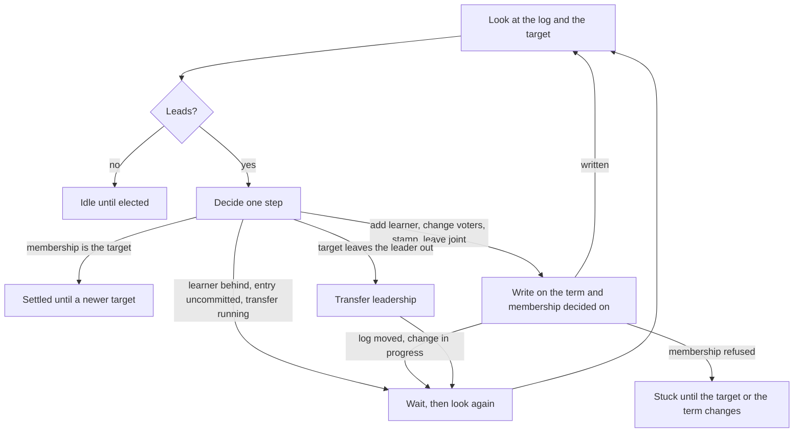

What the driver keeps between looks only paces it: the term a transfer
was asked in and its retry counts. A
new leader, or the same broker after a restart, starts from what its log
holds: it leaves a joint membership it finds before it reads the target,
and otherwise does nothing until it is told one. With no target and no
joint membership it reports idle, even before its first entry commits.

**A move off the leader.** When the target leaves the leader out, the
leader first adds the new members as learners, then grows the voters to
the target plus itself, and then hands leadership to a voter the target
keeps that holds its whole log. The next leader shrinks the voters to the
target. If the transfer does not go through, openraft ends the term after
one election timeout. Whoever wins the next election looks again: the old
leader asks for the transfer again, and never falls back to a change that
removes itself. A leader that a joint membership leaves out prefers a
successor its own newer target keeps, so the next leader is not one that
target moves out again.

**A target lasts one term.** A member acts on a target only in the
term its broker read it for, and a new leader waits for a fresh one
("Where a target comes from"). Without that, two members holding targets
that each leave the other's seat out would hand leadership back and forth:
the grown set keeps the membership's version, so neither sees the other's
step as stale. With it, every leader acts on a target at least as new as
the one its predecessor acted on, so no successor shrinks the grown set
back to an older target or parks on it holding none (#2591).

**Refusals.** A step can fail in two ways, and the driver treats them
differently:

| What happened | What the driver does |
| --- | --- |
| The log or the term moved since the look, the leader was deposed, openraft has a change in progress, or nothing of the term is committed yet | Looks again after a wait. The same step can go through later |
| A step did not commit within 10 seconds | Looks again. The entry stays in the log, and the next look waits for it |
| openraft refused the membership itself (an unknown member, for example), or the step would take the version back | Reports the group stuck and stops until the target or the term changes. Asking again would change nothing |

The wait starts at 50 ms and doubles up to 5 seconds. After eight looks in
a row in which nothing moved (no new membership entry, no member's log
further along), the group is reported stuck and the driver looks only
every 30 seconds. A learner that is behind but still catching up is not
stuck. One that stops, or a move with no caught-up successor, ends there:
the group keeps serving with the membership it has, and the control plane
can send another target. A new target, or a new term, starts the count
again.

Transfers are counted separately, because each one closes the shard for
writes until the next term opens. After eight transfers that did not go
through, the group is reported stuck and the next transfer is asked no
sooner than 30 seconds after the last. A written step or a new target
starts that count again; the same target told again for a new term does
not. Each failed transfer ends a term, and the member that leads the next
one waits to be told the target for it, so for those 30 seconds the group
stays reported stuck while this member does not lead or has not been told
yet. Without that, the stuck gauge would drop to zero once a term during
the very failure it reports.

**The two rules, checked again.** The decision never names a set without
the leader, and the step writers refuse one. The driver checks a third
time before it writes, and after every write it reads the membership back
(for a step that timed out, when its entry shows up) and checks that it is a voter of every set and that no voter that left is
still a learner. If either check fails, the driver writes nothing more in
that term and reports the group stuck, with the reason in the broker's log
at error level. That is a bug, not an operating condition.

**Deposal.** A leader that is deposed takes no further step: every write
carries the term it was decided in, and openraft writes nothing for a term
this member no longer leads. A transfer is asked only if the member still
leads the term its successor was picked in. The driver then waits to be elected again. It
ends when the member is closed.

**What to watch.** `GroupRuntime::status` reports the leader's progress
as idle, settled, converging or stuck with a reason. Across the broker:

| Metric | Meaning |
| --- | --- |
| `felix_broker_raft_membership_converging` | Groups this broker leads that are on the way to their target |
| `felix_broker_raft_membership_stuck` | Groups this broker leads where no step has gone through. Not zero for long means a target cannot be reached |
| `felix_broker_raft_membership_steps_total` | Steps written, by `step`: `add_learner`, `change`, `stamp`, `leave_joint`, `transfer`, `placed_transfer` |
| `felix_broker_raft_membership_refusals_total` | Steps not written, by `kind`: `transient`, `permanent`, or `broken` for a failed rule check |

Only the leader acts, one change at a time, and the steps can be repeated
safely. A leader that acts on a target the control plane has since replaced
is safe too: a change goes through a joint configuration whenever a
majority of the old voters could miss a majority of the new ones. Writes go on during every step, because membership entries and
publishes both get their index from openraft. A copy with a new copy id is
handled by the same loop: the set names the broker, the member id differs,
so the old member is swapped for a learner with the new id.

The control plane no longer assigns leaders. The design has brokers
report who leads each shard, the committed membership and the commit
offset; those reports are not built yet. The routing table
uses the leader as a hint, and the offset is the floor a re-form starts
from. A broker that gets a write
for a shard it does not lead answers with the leader it knows. To balance
leaders the control plane names another leader in placement, and the
group's leader hands it over, as the next section describes.

#### Leaders follow placement

Placement names one broker as each shard's leader. Every broker tells its
member of the group which broker that is on each feed pass. The member that
leads hands its leadership to that broker's member once handing it over is
safe and cheap. The rule runs in the membership driver, after everything
else: any membership step, and any transfer a membership step needs, comes
first.

A leader hands over only when all of these hold:

1. The membership is not joint, it is committed, an entry of this term is
   committed, and no transfer is in flight.
2. Placement's broker holds a voter of the group. A broker the group does
   not hold, or holds only as a learner, is no preference at all.
3. That voter is caught up (within the learner lag threshold) and has
   answered lately, and has stayed so for `settle` (5 s). A broker that just
   restarted is still opening members and may go away again.
4. Every other voter is caught up and answering too. A group with a voter
   down keeps its leader: a transfer then could leave a bare majority with
   no leader. An operator's move is the exception (#3234): it goes ahead
   when the target is caught up and the caught-up voters, counting this
   leader and the target, are a majority. If the target then dies mid-transfer, the group is left with
   the members it would have had anyway, and the leader stands again at the
   transfer's expiry if a majority is still up.
5. This member has led its term for `led_min` (10 s), so a group that just
   elected does not elect again at once. A group's first term is exempt,
   along with `settle`, for its first `led_min`: the broker that formed the
   group wins it, and there is no earlier leader to churn with.
6. The last transfer is not inside its backoff, and the broker's budget has
   a permit.

The transfer closes the shard for the term first (the lease is given up).
It then waits, up to the shortest election timeout, until the target holds
the whole log and the leader has applied all of it, and only then asks
openraft. Publishes in that window are told the shard is not ready. The
refusal is retryable and nothing was written, so the client sends every
publish kind again under its reconnect policy (a plain one too, since
nothing of it was applied); a hand-over that outlasts the policy returns the
refusal. A write in flight when the hand-over began is answered by its
commit if it commits before the hand-over, which the wait for the apply
lets the old leader see. Two cases still end in `leadership_lost` (outcome
unknown). A batch already queued for openraft can be appended in the short
window after the leader's last check and before it asks for the transfer.
And if the wait runs out first, the transfer is asked anyway, since the
term cannot open again, with writes still in flight. Such a write may
commit under the new leader, which the old one cannot confirm, or be
truncated by it; either way the publisher is told the outcome is unknown,
and a plain publish returns that rather than risk a duplicate. A write is
acknowledged only when its entry committed in the term that wrote it,
never for one that did not. A transfer a membership step asks for (a move off the leader)
waits the same way. The target campaigns while the other followers still
hear the old leader, so their pre-vote check lets a transfer target
through.

> `crates/server/felix-replication/src/raft/tests/commit.rs`,
> `a_placed_transfer_waits_for_its_terms_writes_to_be_answered`,
> `a_placed_transfer_with_nothing_in_flight_is_not_held`,
> `a_closed_terms_write_the_new_leader_truncates_is_not_acked` and
> `a_closed_terms_waiter_is_told_promptly_once_a_later_term_is_seen`.

A new group goes through this once: the broker that formed it leads its
first term, then hands over. The test harness's
`Cluster::await_raft_leaders_placed` waits until every shard's placed leader
leads. `Cluster::start` returns only after it, unless the test sets
`ClusterConfig::pending_raft_hand_overs`, and so does the `client-fixture`
cluster (#3130, #3157).

Pacing keeps this from churning:

- **Backoff.** If the leader still leads after the term ends (the transfer
  failed, or it won the election again), it waits `backoff` (30 s) before
  the next try, doubling up to `backoff_cap` (10 min), with 20% jitter. A
  new placement leader, or the leadership landing elsewhere, starts it
  again. A target that lags never passes rule 3, so it costs nothing.
  A member counts as answering for about 5 s after its last answer, so a
  broker that died just now can still get one transfer, which fails and
  starts the backoff.
- **Budget.** Each broker runs at most `permits` (2) placement transfers at
  once and starts at most `starts_per_second` (5). Waiters are served in
  order, so a group that just finished cannot take its permit again ahead
  of the others, and a group waiting its turn still takes a new target. When
  placement names a restarted broker leader again, the others hand its
  shards back a few at a time.

The values are fields of `RuntimeConfig::placement`. Placement's leader is
only a preference: routing follows the group's real leader.

Rule 4 means a group with a voter down keeps whatever leader it elected. If
placement then named a different member, the two would disagree until the
broker came back, and anything that reads the assignment as the shard's
server (discovery, `felixctl`, dashboards) would point at a follower
(#3041). So placement follows the group instead:

- Every floor report a leader sends ("Offset floor") also tells the control
  plane that its sender leads the group, with the term of the entry it
  reports. The control plane keeps the sender with the highest term as the
  shard's `raft_leader`. A second sender at the same term is not taken: a
  new leader reports an older term's entry until its own first entry
  commits, so a later report at that term can come from a deposed leader.
  Only a broker in the set, and in the voters the report names, counts.
  The record is kept from metadata level 52.
- When placement renames a leader that is down, it names that broker if it
  is a live, serving member of the set and a voter as last reported. With
  no such report, while the group is still electing, it names the member
  leading fewest, as before.
- While any member of the set is down, a live placement leader that is not
  the reported one is renamed to it, unless an operator named it. An
  operator's move within the set carries `move_reason` `operator` to the
  brokers, so the group's leader hands over (rule 4), and placement leaves
  the name alone until the group reports it leading, then takes the mark
  off. If it has not landed in two minutes, placement names the reported
  leader again and takes the mark off (`raft_leader_timed_out`). While the
  move is pending, a drain of either broker or a swap of a leaving follower
  on that shard waits for it, up to those two minutes. A broker
  that predates the mark ignores it and keeps holding, so the move times
  out the same way. That covers a rename made before the
  report arrived. Both writes go ahead while placement is paused: they move
  nothing and ask for no transfer, they record what the group did.
- A reported broker the leave rules rename a leader away from (draining,
  internal, or outside the stream's region) is not followed. Placement keeps
  its own choice there, so the leave rename is not undone on the next pass.

Nothing acts on this name in a way Raft does not judge. A member that leads
hands over only through rule 2 to 6, a broker with no member forwards to
the name and is redirected by the member there, and only the group's leader
answers a write, after the group commits it. A wrong or stale report costs
at most a redirect or a hand-over the leader refuses. Once the broker is
back, the hand-over rules apply again and balancing decides the leader as
before.

| Metric | Meaning |
| --- | --- |
| `felix_broker_raft_shards_led_off_placement` | Shards this broker leads whose placement names another leader. Above zero for long means a hand-over is held back, or placement names a broker that holds no voter of the group |
| `felix_broker_raft_membership_steps_total{step="placed_transfer"}` | Placement transfers asked |
| `felix_broker_raft_placed_transfers_total` | By `outcome`: `landed` (this member stopped leading), `failed` (it still led a later term), `held` (counted once per reason, `why`: `unsettled`, `lagging`, `degraded`, `budget`) |
| `felix_broker_raft_snapshot_unsendable_total` | Snapshot sends a leader refused, one per attempt, because the snapshot was over the 1 GiB a member takes, for stream and cache groups; each is also logged with the group and member, once a minute per member ("How big a cache group gets") |

#### Where a target comes from

The control plane writes each Raft shard's target on its shard record: the
member ids that should vote, and a version. The member ids are the brokers
placement names, each with the copy id its broker last reported for the
shard. The version is the restore incarnation followed by the record's
target counter (metadata level 36):

- **The counter rises only when the target set changes.** A move, a drain,
  a removal, or a placed broker reporting a new copy id writes the next
  counter value in the same CAS as the new set. A change of placed brokers
  drops the target until every new broker reports its copy id, and keeps the
  counter the dropped target reached (`raft_target_counter`, metadata level
  50), so the next target is newer than the membership the group already
  made. A leader takes only a newer version, so a count started again would
  leave the group on its old voters. A new broker that dies before it
  reports would hold the target dropped for good, so placement gives its
  seat to another live broker once it is lost, provided the group formed and
  its reported voters do not name it (`docs/control-plane.md`, "Raft
  shards"). The group never heard of the set that named it, and the next
  set still needs a majority of the reported voters. A placement write that
  keeps the set, a leader report and a doomed-set write leave it alone. So
  within one incarnation a version names exactly one member set.
- **It counts within one stream incarnation.** A stream deleted and
  created again gets a new shard record under the same key, and its counter
  starts at 1 again. The feed sends the stream incarnation beside the
  target, and a broker keys a target by shard key and stream incarnation,
  so a recreated stream is a new group, never a newer target for the old
  one.
- **It survives a control-plane leader change.** The counter is part of the
  shard record, written through the metadata Raft log by CAS, so a new
  control-plane leader starts from the last committed value and the next
  write takes the one after it.
- **A restore raises the incarnation (#2529).** A backup brings back an
  older counter, which may name a set different from what the counter later
  named. Versions compare by incarnation first, and a restore raises it
  (metadata level 35), so every target written after the restore, including
  the restored record's own, is newer than anything a group took before.
- **Nothing moves until all brokers have acknowledged the incarnation.**
  "All brokers" here means every broker registered with the control plane,
  serving or not, as `AllAcked` counts them in the model. The control plane
  refuses a target write, a copy-id report that would rewrite a target, and
  a doom write, and the feed leaves out the current target, while any of
  them has not acknowledged the current incarnation (#2529). A restored
  record's target is never written again, so the gate has to be on
  delivery as well as on writes. The acks and the incarnation are in the
  same metadata log, so a follower's answer is consistent with itself.

  A broker that never acknowledges, one that died after the restore, stops
  all of it, the move that would take its seat included. That costs
  liveness only. The way out is to deregister it, which takes it out of
  all brokers, and targets resume.

How a broker reports its copy id:

- **Only once the copy is synced.** A broker reports the copy id of each
  member it has open, and a member opens only after its copy file is synced,
  so no target names a copy a crash could take back. A broker reports
  only for a placement that names it and names as many brokers as the
  stream's or cache's replica count: a short set forms no group, so it gets no target
  either. The control plane checks the replica count itself and refuses a
  report for a shorter set, whatever the broker saw.
- **With its registration and the stream incarnation.**
  `POST /v1/nodes/{node_id}/raft-copy-id` carries the reporting process's
  `incarnation` and `registered_at_millis`, and the `shard_incarnation` of
  the group the copy is in. The control plane refuses a report from an
  earlier process of the node, or for another incarnation of the stream,
  so a late retry never lands on a newer copy or a recreated stream.
- **Until the target names it.** A report is idempotent. The broker sends
  it again 5 seconds after the control plane refuses it (a shard not on Raft
  yet, a placement not acknowledged by every broker, a control plane below
  metadata level 41), doubling the wait with each refusal in a row up to a
  minute, since each refused report is still an entry in the metadata log.
  It logs the first refusal. A report that got no answer wrote nothing and
  is sent again every 5 seconds. It sends a taken report again every 30
  seconds, until the feed's target names this broker's copy. The control plane drops a
  shard's copy ids when its set changes, and a restore can bring back older
  ones, so a taken report is not enough.

The control plane writes a target in place, at the generation placement
already gave the shard. A broker's shard watch drops any other change at a
generation it holds as stale, but it takes one at the same generation and
set whose target is newer than the one it holds
(`ShardOwnership::apply`), so the target reaches the brokers through the
feed and not only through a resync.

Withholding is decided when the feed is read, and the acknowledgement that
ends it writes no change, so a target read while withheld would never be
sent again. A Raft broker's watch therefore takes a snapshot while a
stream or cache shard it holds no target for is withheld: first after one sync
interval (`FELIX_CONTROLPLANE_SYNC_INTERVAL_MS`), then twice as long each
time up to 30 seconds, and from the sync interval again once none is. It
keeps long-polling between them, so placement changes still arrive at
once. A shard whose target it already holds keeps that target through a
withheld view and starts no re-reads. Each re-read reads every assignment
and runs a routing pass, so a registered broker that stays down after a
restore costs one such pass per broker every 30 seconds
(`felix_broker_shard_watch_withheld_rereads_total`). A copy id
report the control plane refused while the view was withheld goes again on
the first tick after the view stops withholding, instead of waiting out its
backoff.

The control plane takes ids for a shard that switched from the hybrid, and
from metadata level 41 for a shard that started on Raft: a durable stream's
shard or a cache's shard on a cluster whose engine is Raft
(`FELIX_SHARD_ENGINE=raft` on the control plane, or the group identity it
recorded), with no switch record. Cache groups, which hold the cache's
counters too, form only on a stored target like stream groups, so they take
the same reports and checks. The control plane keeps no durability for a
cache: a broker runs a cache on Raft only when its cache is a log, and only
then has a copy id to report. Only a report that carries `shard_incarnation`
counts for such a shard, and it must name the stream's or cache's current
incarnation.
A shard that started on Raft starts epoch 0's list of ordered targets
("Targets ordered in an epoch") in the write that stores its first copy id,
and only while its record of placed brokers is complete, so a restored
shard's list reads as unknown.

A wiped copy reopens under a new copy id ("Group and member identity"). Its
broker reports the id, and the control plane writes the target again with
that id in place of the old one at the next counter value. The leader keeps
only a target strictly newer than the one it holds, or an equal one told
in a newer term (`Group::retarget`), so this write is what makes it act: it adds the new id
as a learner and drops the old one once it has caught up. The control plane
must own copy ids this way before it dooms any, because the doomed set
names member ids.

#### A target lasts one term

The broker hands a target to its member only while that member leads, and
only for the term it leads in. The driver acts on a target only when it was
told in the current term, and a new term needs it told again. A tell of
the same version in a new term is accepted: the group holds the target
with the term it was told in (`Told { target, term }`), and a newer term
replaces it even at an equal version.

A view taken after the term began is not enough on its own. The shard feed
can be answered by a control-plane follower that has not applied the latest
write, so a request that started late can still return an old target. The
broker therefore waits for two things before it hands a target to a member
that started leading at time `since`:

1. **A head from the control-plane leader.** A heartbeat sent at or after
   `since` asks for `assignment_seq`; one already in flight when the term
   began does not count. The control plane reads it with
   `confirmed_shard_assignment_head` after it accepted the heartbeat, so
   every target written before then has a lower sequence. This is the bar
   `RoutesWanted` sets for a broker that serves again after a surrender
   (`cluster/lease.rs`), with one difference: an answer with no head (a
   control plane that predates it, or a leader that cannot answer) means no
   handover, where a lease falls back to time alone. A linearizable read of
   the feed head would do as well.
2. **A view that reaches it.** A feed answer whose request started after
   `since` and whose checkpoint is at or past that head.

On the broker, `LeaseState::record_head` keeps the newest head a heartbeat
brought with the time that heartbeat was sent, the heartbeat asks for one
while a led shard has no bar (`LeaseState::wants_head`), and
`Lead::met_by` in `shards/raft.rs` is the check above. The broker tells
each leading member its target on every feed pass that meets it; the
member keeps only a newer version, or the same one for a newer term.

The members told are the control plane's stored `target.members`, copy ids
included, never a set the broker derives from the copies it sees. A set
the control plane never ordered is in no re-form source, so a leader that
wrote it and then lost a majority of it would leave nothing to re-form
from.

A view that meets the bar and carries no target for a led shard is told
too, as "no target" for that term (`GroupRuntime::untarget`). Placement
moves a leader only once the target is told for its term, and a leader
that still holds a target from an earlier term would otherwise wait for a
tell that never comes while the control plane has no target for the shard.

"No target" is told only from a view that says it has none. While some
registered broker has not acknowledged the placement incarnation, or a
restore landed during the read, or the read was a confirmed one, the feed
leaves every target out and sets `targets_withheld` on each item. A broker
reads that as no view at all and tells nothing, so a leader keeps the
target it holds and does not hand leadership away by placement during a
restore. The field is absent whenever targets are not withheld.

A new leader waits for a feed request that started after its term began.
A long poll already in flight does not count, and with nothing changing on
the feed it would answer only when it times out, about 20 s later. So a new
term asks the watch for a view (`LeaseState::want_view`): the watch drops
the held poll and asks again at once without the hold, and that answer
wakes the routing feed even when nothing changed. A head lower than the bar
moves `since` the same way and asks again too. The asks are counted, and a request
serves every ask made before it started, so terms that open together cost
one request. Terms that open one after another each end the poll held at
the time, about two requests per term, at the pace terms open.

A target write is a shard-record change, so it is on the assignment feed
with its own sequence. A restore brings the feed's sequence back with the
backup, so a head taken before it can sit above every sequence the new
feed reaches. When the broker acknowledges a new incarnation it should
drop every bar and move each `since` to that moment, so it takes a new
head and a view of the restored feed. That is not built yet: today a head
lower than a shard's bar replaces the bar and moves its `since`, which
reaches the same state once a heartbeat brings the restored feed's head.

Moving `since` does not let an old target through. A control-plane
follower that has not applied the restore can still answer with
checkpoint 41, past a new head of 12, and with target (0, 9). The
heartbeat that brought head 12 also brought placement incarnation 1, and
the broker records the incarnation before the head
(`LeaseState::record_placement`), so any pass that sees the new bar sees
incarnation 1 too. Two checks then hold (0, 9) back:

- The broker does not tell a target whose incarnation is below the one the
  heartbeat reported. That view came from a member that has not applied
  the restore, so it is not fresh at all (`RaftShards::answered`).
- The broker hands the same incarnation to every leader it runs
  (`GroupRuntime::ack_incarnation`), and the driver refuses a target below
  it or below the one its log holds (`Wait::StaleTarget`). This covers a
  target told before the restore that the leader still holds.

So (0, 9) is never acted on, and the restored feed's (1, 0) replaces it.

Why the versions leaders act on never go back: a leader acts on a target
only after the control plane committed it. It hands leadership over after
that, and its successor's term begins after the handover. The successor's
head is read after that, so it is at or past the target's write, and the
view that reaches the head holds that target or a newer one. Whatever the
old leader did, the new one is told a version at least as new.

The driver's own rule covers the rest. A target older than the membership
in the leader's log, or from an incarnation below one the leader has seen,
is refused (`Wait::StaleTarget`, `StepError::OlderVersion`),
so even a target that slipped past the delivery rule cannot undo a change.
Delivery makes that refusal rare: a new leader is not left parked on a
target older than its log while a newer one exists. A group can still
grow and then shrink, but only because the control plane wrote two sets in
that order, so the number of direction changes is bounded by the number
of target writes.

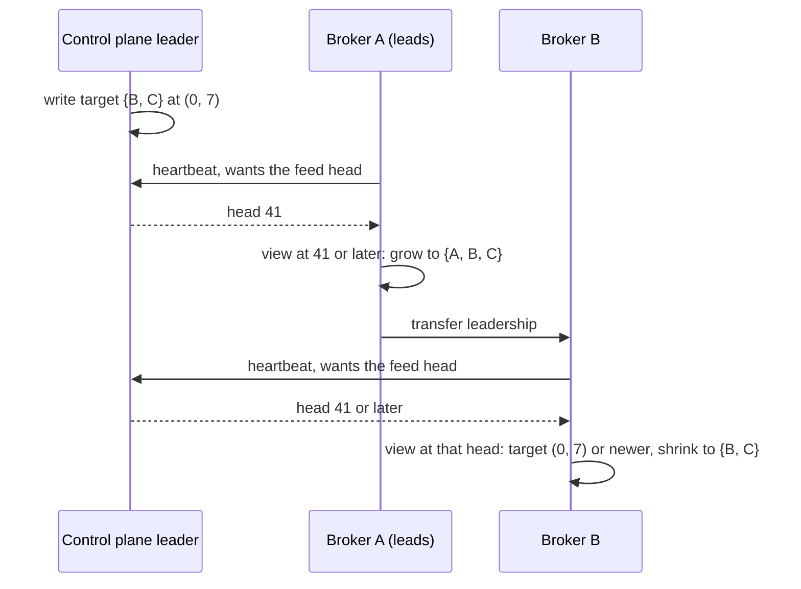

While the control plane is down a new leader gets no head, so it takes no
step: the group keeps serving with the membership it has, a grown set
included, and moves on once the control plane answers. That costs liveness
only. The placement model checks safety with a leader acting on any target
ever written (`StaleTargets`), and with the current target delivered and
written only once all brokers have acknowledged the incarnation
(`AllAcked`), the same gate as above. Together they cover every target
this rule lets through.

The doomed set and its reports are metadata level 36 and are enabled only
once the control plane knows that level is in force
(`cluster_version_if_known`, so an unknown level enables nothing). The
level in force is the lowest any control-plane member can apply, and a
build that applies 36 applies 35, so 36 in force means the restore
incarnation is too. Each doom write, like each target write, also checks
that all brokers have acknowledged the current incarnation. A doom written
before the incarnation existed could be undone by a restore that brings
the id back as a voter.

What placement does not do yet for a Raft shard:

- **A dropped copy keeps its directory.** Deleting it needs the control
  plane's doomed set and the leaders' membership reports ("Membership"
  above, `DoomGuard` in the model), which are new metadata.
- **A move waits on a report Raft shards do not send.** Placement's move
  adds the new broker and drops the old one once the leader reports the
  new copy caught up. A Raft leader reports nothing to placement yet, and
  a shard that switched to Raft is not placed at all.
- **A short set forms nothing.** A group forms only once placement names
  as many brokers as the stream's replica count ("Forming a group").
- **Requests to a broker with no member go by placement.** A broker with
  a member routes by its group's leader hint. One without a member still
  sends to the leader placement names, which can be wrong mid-move.
#### The restore incarnation

A control-plane restore puts back an older store, and with it an older
target counter. Without anything else, the next target written after the
restore could reuse a version a leader already acted on, and a copy delete
told before the restore could pass the version rule again
(`FelixRaftPlacementStaleWipeRewindSameInc.cfg`). The restore incarnation is
what stops that.

- **Every import raises it.** The control plane keeps a placement
  incarnation, 0 until the first restore. An import sets it one above the
  higher of the incarnation it replaces and the one in the backup
  (`restored_placement_incarnation`, the model's `CpRewind`). It is worked
  out from the store before the import, so every control-plane member raises
  to the same value. Importing the same backup twice, or an older one, never
  reuses an incarnation. The raise is metadata level 35: below it an import
  keeps the backup's value, and an export carrying an incarnation is refused.
  An import that would raise past `u64::MAX` is refused rather than reuse it.
- **Every broker acknowledges it.** Each heartbeat answer carries the
  incarnation, left out while it is 0. A broker with a Raft data root open
  writes it to `raft-placement-incarnation` in the root and syncs it before
  its next heartbeat reports it. The file never goes back. The control
  plane keeps the highest acknowledgement each broker process reported. The
  apply keeps one only from the process the node record holds, so a late
  beat of an earlier process changes nothing. Another process replaces it
  whatever it reports, and only the record's process counts, so a broker
  that registered again (its root perhaps wiped) is not counted at its
  predecessor's value.
- **An acknowledgement above the incarnation raises it.** A broker can hold
  more than the control plane issued, when the control plane was rebuilt
  from a backup older than its last restore. Recording that acknowledgement
  raises the incarnation one above it, so every broker has to acknowledge
  again before anything goes out. One more than `MAX_PLACEMENT_ACK_AHEAD`
  (2^20) above is refused and logged: the gap counts restores the backup
  missed, and the bound keeps a broker from walking the incarnation to its
  limit.
- **A broker a restore rewound registers again.** A restore puts back each
  node record's incarnation as the backup held it. A broker that registered
  after the backup keeps beating under its newer incarnation, which the
  control plane accepts, but its acknowledgements are not from the record's
  process and are dropped. The heartbeat answer to such a beat carries
  `register_again: true`, and the broker registers again without giving up
  its lease. The new registration takes the record's next incarnation, so
  only acknowledgements that process reports count. See "Registering again
  after a restore" in `docs/control-plane.md`.
- **Nothing goes out until every broker has.** `placement_acked_by` holds
  only while every broker named has acknowledged exactly the current
  incarnation (the model's `AllAcked`). A broker that never reported counts
  as 0, which is enough only before the first restore. On a Raft control
  plane it also waits until every member is known to apply level 35, and it
  answers from the member's own copy, so a caller asks it on the leader. A
  restore made while the group was below level 35 raised nothing and is not
  fenced by it. Target writes and their delivery wait for it, over every
  registered broker (metadata level 36). Copy deletes are to wait for it
  too; they are not built yet
  (`FelixRaftPlacementStaleWipeRewindNoAck.cfg` is what happens without it).

A broker is to refuse a delete told at an incarnation below the highest it
has seen, its acknowledgement or any membership in the copy's log
(`copy_delete_is_void`). That check lands with the delete itself.

#### Targets ordered in an epoch

A re-form counts every target the control plane ordered in the group's epoch
as a voter set (`GroupRecord::ordered` in `raft_copy/vouch.rs`), so the control
plane keeps them all on the shard's record as `raft_ordered`: the stream
`incarnation`, the group `epoch`, and each distinct target (`counter` and
`members`) in the order it was written.

- **When an epoch starts.** Epoch 0 starts when the switch to Raft is recorded
  (`accept_seal_report` in `store/memory/switch.rs`), before any target can be
  written, and the list starts empty there. A shard that started on Raft has
  no switch: its list starts in the write that stores its first copy id, if
  its record of placed brokers is complete (`start_native_raft_ordered`). A re-form starts the next epoch
  where it writes `PlacedInEpoch::next_epoch` and must start a new list in the
  same write. A recreated stream is a new incarnation and a new group; a
  placement write drops a list from another incarnation.
- **Listed before a leader hears of it.** A new target is added in the same
  write that stores it (`record_raft_copy_id`). Brokers read a target only from
  the stored record, so it is on the list before any leader is asked for it.
- **Kept through the epoch.** A copy-id change, a counter bump and a set change
  (which drops the target but keeps its counter) all leave the list as it
  is. Only a new epoch or a new incarnation replaces it.
- **Bounded.** At most 64 distinct targets per epoch; a target ordered again is
  listed once. The 65th marks the list `lost`.
- **Unknown reads as unknown.** `ShardAssignment::ordered_voter_sets` answers
  `None`, and the re-form stays marked, when the list is from another epoch or
  incarnation, is `lost`, or was never started. A shard that switched before
  level 39 has no list for the rest of its epoch.

A control-plane restore brings back each list as the backup had it, with the
same incarnation and epoch, so a target ordered after the backup would be
missing. From metadata level 40 an import marks every list `lost`
(`ImportState::lose_ordered`), and the re-form stays marked for that epoch.

The list is metadata level 39. Below it, `settle_for_level` leaves
`keep_ordered` off `accept_seal_report` and `record_raft_copy_id`, so no member
starts a list, and a target written by such an entry marks a started list
`lost`. The feeds do not send it.

#### Offset floor

The control plane keeps `raft_floor` on each Raft shard's record, per stream
`incarnation`. It holds two separate things:

- `offset_floor`: the highest committed index any leader reported, in any
  reform epoch of the incarnation. The re-form start reads it ("Offsets are
  not reused") so a new epoch gives out no offset at or below one that was
  acknowledged.
- `epoch`, `index` and `term`: the exact last committed log id a leader of
  the current epoch reported. A rule that matches a copy's log against a log
  id reads this one. Its index and term always come from the same report.

- **Every leader reports once a second.** Each broker batches the commit log
  id of every group it leads into one `POST /v1/nodes/{node_id}/raft-floors`,
  so the control plane makes one metadata write per broker per second. A
  request carries at most 1024 entries; the rest go on the next tick.
- **An entry is owed until a 200 answers it.** A group's entry stays pending
  until a 200 answers a batch that carried it. A 404, 409, 503 or any other
  error keeps it pending. So the first accepted report after level 38 goes
  live covers every group the broker leads, idle ones included. A group that
  stops leading on the broker is dropped, and is owed again if it leads there
  again.
- **Cache groups are reported too.** The control plane skips a shard it does
  not keep a floor for, a cache shard or one not on Raft, without failing the
  batch.
- **It only rises within an epoch.** A report replaces the exact log id when
  its index is higher and its term is not lower. An equal or lower index
  changes nothing. A higher index at a lower term contradicts the held log
  id and is skipped.
- **It is kept per incarnation and epoch.** A report for another stream
  incarnation, or for a reform epoch other than the shard's
  (`placed.epoch`), is skipped, so a late report from an old group never
  sets the new group's floor. A new epoch's first report replaces the exact
  log id with its own, whatever its index, since the earlier epoch's id says
  nothing about the new log. `offset_floor` keeps the higher index, since
  offsets the earlier epoch gave out stay given out. Terms are compared only
  within one epoch. A write at the same stream
  incarnation keeps the floor, a recreated stream starts without one, and
  an export and import carry it.
- **Each entry is decided on its own.** A skipped entry is not counted and
  the rest of the batch still applies. The answer is `raised`, the number of
  floors that moved.

The floor is metadata level 38. Below it every report is refused with 409,
by the store and again by the leader that would append it. Nothing reads
the floor yet: the re-form's refusal to run a first form for an incarnation
that has a floor is not built.

#### Declaring a broker dead

A re-form waits for every broker placed in the epoch until it answers or
an operator declares it dead (`felixctl node declare-dead <id>`,
`POST /v1/nodes/{node_id}/declare-dead`). The control plane records the
node with the storage id it is registered under at that moment
(`DeclaredDead`), and the record is never removed, not by a node delete
either:

- Only a node that is down or left can be declared dead. This guard is a
  sanity check, not proof. Down means only that its heartbeats stopped, and a
  Raft shard does not serve on a control-plane lease, so a Down broker that
  can still reach a majority of its group keeps voting and acking. The
  control plane cannot see that. Before declaring, the operator must make
  sure the broker process is stopped or its host fenced, and that its disk is
  gone for good.
- A registration under a dead storage id is refused, and so is one with no
  storage id from a node that has any directory declared dead. The broker
  comes back only with a new data directory (a wiped disk, or
  `rotate-storage-id`), so a copy the plan left out never votes as itself.
- The dead set a plan takes (`ControlPlaneStore::dead_nodes`) is the nodes
  whose registered storage id was declared dead, plus those declared and
  since deleted. A broker that registered again under a new storage id is
  live again and must answer like any placed broker. Returning never
  unmarks an epoch.

The declaration is metadata level 42. Below it the store and the leader
both refuse it: a member that could not apply it would take a
registration the others refuse. `GET /v1/fleet/declared-dead` lists the
records. Nothing reads the dead set yet; the plan and apply that will are
not built. When they are, they must require survey proof that the broker
is gone (or a minimum time in Down plus an unanswered survey) before they
use a dead node, and not rely on the declaration alone.

#### The control plane's record for a re-form

The re-form planner (`plan_reform` in `raft_copy/vouch.rs`) takes what the
brokers report and what the control plane holds, the `GroupRecord`.
`ShardAssignment::reform_record` builds the second from the shard's record and
the brokers declared dead:

| `GroupRecord` field | From the shard's record |
|---|---|
| `incarnation` | the stream `incarnation` |
| `placed` | `placed.brokers`, `None` when the shard has no `placed` record |
| `ordered` | `ordered_voter_sets()`, see "Targets ordered in an epoch" |
| `floor` | `raft_floor`'s exact log id, at this incarnation and epoch |
| `offset_floor` | `raft_floor.offset_floor`, at this incarnation |
| `dead` | the brokers the caller passes as declared dead (`dead_nodes`, see "Declaring a broker dead") |
| `seed` | `raft_seed` at this incarnation and epoch: the epoch's first target, or the voters the re-form that started the epoch wrote; `None` when not recorded |
| `bases` | empty at epoch 0; past it, `raft_bases` at this incarnation with one base per epoch, or no record (`BasesNotRecorded`) |

Anything the record cannot vouch for stays unknown, and the planner reads
unknown as a block or a mark, never as empty. A floor or seed from another
stream incarnation belongs to an earlier group, so it is dropped rather than
read as this group's.

From metadata level 47 the shard record keeps two more store-owned fields:

- **`raft_seed`**, the voters the epoch started with. At epoch 0 it is
  written in the copy id report that stores the epoch's first target, and only
  when the epoch's list of ordered targets holds that target alone. A broker
  forms the group only on a stored target, and every later one (a wiped
  copy's new id, a set change) is on the list, so a seed that is not the
  target the group formed on can only add a voter set to check, never hide
  one. With the seed and the list known and every placed broker alive and
  read, a plan is unmarked.
- **`raft_bases`**, each re-form's base and first index, oldest first. Only
  the re-form's own write appends to it, in the same step that writes the
  next epoch's placed record, its seed and an empty list of ordered targets.
  That write is refused unless the record is still at the epoch the plan was
  made for, every earlier base is recorded, and the floor is no higher than
  the plan read: a leader that reports a later commit after the plan was
  made refuses the start, since the plan may cut those entries. A base must
  end below its first index, which must be above the floor and every earlier
  epoch's, and a base ending on an entry of a re-formed epoch must end at or
  past that epoch's first index.

A write passing either field has it replaced by the stored one, and a new
stream incarnation starts with neither. Below level 47 neither is written:
a group whose first target was stored there has no seed, so its plans stay
marked and `apply` needs the operator to accept the loss.

From level 51 the re-form's write is its own command,
`StartReformedEpoch`, which carries the plan's incarnation, epoch, floor,
base, voters and dead set and applies `ShardAssignment::start_reform`. Every
member decides it from the record and the command alone, and the command
is refused below level 51.

From level 55 a group of one has a command of its own,
`StartAloneEpoch { key, node_id, start }`, for the broker that holds its only
copy, sent as `POST /v1/nodes/{node_id}/reform/alone` once the fleet
finalizes `raft_alone_reform`. In the same apply as the epoch compare and
swap it refuses, and changes nothing, unless the stream or cache has
replication factor 1; the shard's set and `placed` record are `node_id`
alone; no pending set, successor, joining follower, learner, move reason or
`Draining` state is on it; the epoch's seed, every target ordered in it and
the stored target name only `node_id` (an unknown seed or list refuses); the
plan's voters and starts name only `node_id` and its dead set is empty;
`node_id` is not declared dead; and the plan is for the incarnation and
epoch the shard is at, with the floor and base checks of
`StartReformedEpoch`. Checking before the write would let placement grow
between the check and the swap. A request the shard already holds the result
of (`started_by`) answers the recorded shard without a second epoch; any
other request from the old epoch is refused as moved. The broker plans and
stops its copy first, asks for the epoch, then starts from the `starts` in
the seed it reads back.

From level 47 a copy id report also carries the group epoch the copy runs
(`group_epoch`, absent meaning 0; epoch 0 is sent as absent and records
at any level), and one for another epoch than the
shard's `placed` record is refused (#2882). A directory restored from an
old backup can otherwise report its copy id from a stale view of an earlier
epoch. A broker sends the epoch its copy proved, and reports nothing for a
copy that cannot prove the record's epoch.

### Shards with one replica

An RF 1 shard runs a group with one voter. It elects itself and commits on
its own disk, and moving it to another broker is an ordinary membership
change. This removes the last use of the control-plane lease. If its one
copy rotates its id, the group has no voter. A copy that kept its records
restarts as the single voter, and one that lost them waits for the
operator command ("Re-forming a group"). See Questions, 1.

In a cluster, a copy that a relaxed crash rotated re-forms itself through
the control plane ("A cluster's RF 1 shard re-forms itself"), and needs no
operator while the fleet has finalized `raft_alone_reform`. Until it has, the
shard stays not ready for an operator's re-form, and re-forms itself once the
fleet finalizes it.

### A cluster's RF 1 shard re-forms itself

The standalone rules ("A standalone broker re-forms itself") apply with one
change: the control plane's record decides the epoch, not a file beside the
copy. Before the member opens, the broker:

1. Plans the next epoch from its kept copy with the standalone rule and
   decides what the plan owes the control plane's record. A record one
   epoch behind the plan gets a request. A record that already holds the
   plan's epoch, with the same bases and this copy as its only voter, is
   started from. Anything else, such as a directory restored from before an
   earlier re-form, leaves the copy as it is and the shard not ready. Only
   then is the copy stopped (`CopyRoot::stop_alone`). Nothing is started
   and no epoch is written. The plan is recorded on disk, so after a crash
   the same request is built again.
2. Sends `POST /v1/nodes/{node_id}/reform/alone`. The control plane applies
   `StartAloneEpoch` (metadata level 55) in one command: the group must be
   alone on this broker, with no set change or move in flight, and the epoch
   compare-and-swaps from the one the broker planned from. A request for an
   epoch the record already holds is answered with the recorded shard and
   writes nothing.
3. Starts the copy from the seed the record holds, as an operator's re-form
   would.

A crash before step 2 sends the same request again. A crash between steps 2
and 3 finds the epoch recorded, sends nothing, and starts from the recorded
seed. After step 3 nothing is owed. A lost answer or a timeout is retried
on the next pass, since the open of a stopped copy fails and the next pass
claims it again. A refusal leaves the shard not ready and the copy stopped
where an operator's own stop leaves it, so an operator's re-form still
works: its stop round answers, and the next pass starts the copy from the
epoch the operator's re-form wrote.

The open may run before it can decide: before registration has said which
fleet features are enabled, before the broker can reach the control plane,
or on an assignment that does not yet name this broker the group's only
broker. The member then opens held, with its copy rotated and the old one
kept, and the broker logs why. The feed pass checks those conditions again
and, once they all hold, closes the member and opens it again, and that open
re-forms it. Only a member that never formed is reopened, so nothing it
served is lost, and the reopen runs every check above again.

Why it is safe:

- An RF 1 shard acks on its one copy, so the ack level does not matter.
  Under `Periodic` or `None` only the unsynced tail is lost, as it already
  could be, and every synced record is kept: the plan vouches for the whole
  log, not the saved commit.
- `OnCommit` never takes this path. It rotates nothing, so there is no
  evidence.
- Offsets start past every reserved index plus the gap, so none given out
  before is given out again.
- An RF 3 group that lost members is refused by the control plane's atomic
  check, and the broker only asks when membership and placement both name
  only itself.
- After a restore the plan's line is read from the broker's clock, as on a
  standalone broker, and the same refusal applies, with the offset floor
  the broker's assignment carries as one more index the line must clear.
  The control plane checks only that the first index is above the floor.
- A directory restored from before an earlier re-form plans an epoch the
  record already holds, for another copy, so the broker neither asks nor
  stops it. A start from that record's seed would be refused anyway: the
  restored copy was rotated to a new copy id, and a start refuses a plan
  whose voter is another copy. A second writer is refused by the epoch
  compare-and-swap.

### A standalone broker re-forms itself

Under `Periodic` or `None` fsync a machine crash rotates the data
directory's storage id, and every Raft copy on it reopens as a new, empty
member. In a cluster the other voters catch it up. A standalone broker's
groups have no other voter and no control plane, so each one re-forms
itself, before its member opens (`shards/raft/standalone.rs`,
`CopyRoot::reform_alone` in `raft_copy/alone.rs`). A data directory put
back from a backup and passed through `felix-broker rotate-storage-id`
re-forms the same way, in every fsync mode:

1. The start reads `relaxed-crash-id` (`docs/storage-format.md`). It acts
   only when that file names the current storage id, and only on a copy
   whose kept copies were all minted under an id a relaxed crash or the
   restore tool rotated away. A clean stop, an `OnCommit` crash and a
   `storage-id` deleted by hand leave no such evidence, and the copy stays
   as it is. The file keeps an id for as long as a copy on disk was minted
   under it, so a shard that no start opened through any number of crashes
   in a row is still re-formed when it opens.
2. It plans the next group epoch from its kept copy with the same rule
   every re-form uses, with one difference: it keeps the copy's whole log,
   not only what the saved commit covers. The commit is saved at most once
   a second, so cutting there would drop records that were synced. The loss
   is the unsynced tail `Periodic` already allows, or, after a restore,
   what was acknowledged after the copy was taken.
3. The new epoch starts above every index the copy reserved. After a relaxed
   crash that is every offset the crashed run handed out. A restored copy
   holds the reservation of the moment it was copied, which the run after
   it may have passed, by handing out more than a reservation step or by a
   re-form of its own. So when a restore is among the rotations since the
   kept copy was minted, the epoch also starts no lower than the time line
   a backup-point restore uses ("A restore from a backup point is a
   re-form"), read from the broker's own clock, with the default gap.

   Being above an earlier epoch is not enough when the clock is behind the
   one that planned it: after the clock steps back by S, or on a host whose
   clock is S behind the old one, a plan made a true time E after that
   epoch began has moved the line only `2^14 * (E - S)`, while the epoch
   can have given out `2^13 * E`. Any E up to 2S gives offsets out again.
   So the plan is refused unless its line clears the copy's last index,
   the control plane's offset floor in a cluster, and every earlier epoch's
   first index by 2^32, the margin a backup-point restore takes. That is
   2^18 ms, about 4.4 minutes of clock. The broker leaves the shard closed,
   with the copy not stopped, and plans again on each pass, so the shard
   starts by itself once the line clears. The log line says how long that
   is. If the wait is longer than about 4.4 minutes, the clock is behind
   the one that planned the last epoch; fix it, or wait.

   Why it is safe: the check sees only epochs the restored copy holds, or,
   in a cluster, the control plane's record holds. For such an epoch, with
   S at most 2^18 ms, a plan let through has `E - S > 2^18 ms >= S`, so
   E > 2S and the line is past everything that epoch gave out. It assumes,
   as every restore does, a shard that gives out at most 2^13 offsets per
   millisecond, and a clock never more than about 4.4 minutes behind the
   one that planned an earlier epoch. A clock further behind is refused for
   as long as it reads below that epoch's plan time plus the margin, but
   not for the whole 2S.

   What the code does not enforce: a standalone broker restored from a
   backup taken before its last restore's epoch has no record of that
   epoch, so nothing refuses a plan made too soon after it. In a cluster
   the control plane's record holds it, and a plan that does not lead to
   that record is refused. On a standalone broker the line alone covers it
   only when the clock has not gone back. If the clock was set back, fix
   it, or wait until it has passed the time of the last restore, before
   starting the broker.

   Only restores wait: a relaxed crash's epoch starts past the copy's own
   reservation, not on the clock, so an RF 1 shard that crashes twice in a
   minute re-forms each time with no wait. A second restore within about
   4.4 minutes of the first waits out the rest of that time.

   The tool writes
   `restore-pending` first and removes it last, and a start that finds it
   refuses, so a crash part way through the tool never starts the restored
   data under its old id. A copy put back without the tool, by hand or by
   rolling back a volume or VM snapshot, is not detected and can give out
   offsets again ([#3048](https://github.com/GetFelix/felix/issues/3048)),
   as a standalone broker on the hybrid engine can.
4. The plan is written to `raft-reform-alone` and synced before the copy is
   stopped and started in the new epoch. A crash part way resumes that plan,
   with the first index it recorded. A plan made under an older storage id,
   left by a second crash during the re-form, is dropped and the group is
   planned again.

The planner refuses this mode unless the group's only placed broker is this
one and every voter set it reads names only it. `FelixRaftReform` checks it
with `Alone`: `FelixRaftReformAlone` holds `KeptLossBound`, and
`FelixRaftReformAloneCutToCommit`, which cuts at the saved commit, breaks it.
`FelixRaftReformAloneTwoCuts` allows a second relaxed crash, between any two
steps of the re-form or after it finished, and holds the same checks. In the
model a crash after the epoch is written and before the start leaves the copy
to start as a learner and re-form once more, where the broker replaces the
unstarted plan under the same epoch; nothing was served under that plan, and
both read the same kept copies. `FelixRaftReform` does not model a standalone restore. Its first index is
the rule `FelixRaftRestoreRepeated` checks with `Line`, with the broker's
clock as the planner's.

## Cache and counters

A cache shard's group has one log holding puts, deletes and counter deltas
(engine page, Decisions, 4). For track 4 that means:

- **One wait.** A cache or counter write waits on `await_commit` at its
  position in the one log.
- **The state machine is the projection.** The cache index and the counter
  sums are rebuilt from a snapshot plus the log, as the cache index is
  today.
- **Compaction is each member's own snapshot.** The leader proposes no
  compaction entries: no copies of live records and no counter checkpoints.
  A member snapshots the state it has applied and purges its log up to that
  snapshot. The snapshot is a function of the applied entries alone, so two
  members that snapshot at the same index hold the same state. It writes
  nothing to the log, so offsets never differ between members.
- **The snapshot** is the applied state as of one log id: the cache records
  that are unexpired at the log's time, with their values, versions and
  expiries, the counter sums, the
  log's time (the stamp of the last stamped entry applied), when the last
  watched entry's life ends and, per producer, its floor and the answers
  it still keeps. The format is versioned; this build writes version 2 and
  still reads version 1, which has no watched entry's end.
- **Apply never reads a clock.** The leader stamps each entry, no earlier
  than the last stamped entry in its log (the uncommitted tail it inherited
  included, blank and membership entries skipped), or the snapshot's time
  when its log holds none. Expiry in apply is judged by the entry's stamp.
  The leader's clock is read only to stamp an entry, to judge a get and to
  find values to expire and when the next one is due. The hybrid engine's
  cache compaction and counter log stamp records from the local clock; the
  group uses neither, and a unit test fails if the state machine's source
  names a clock or those logs.
- **Expiry is a conditional delete.** The leader proposes a delete that names
  the version it saw expire. A key written again meanwhile keeps its value.
- **A read never serves an expired key.** A read evaluates expiry at the
  leader's read time, the later of its clock and the log's time. If that
  finds a key expired that the log's time does not, the leader commits the
  conditional delete first and answers after applying it.
- **An expired record is absent to every write.** A put-if-absent takes the
  key, a delete answers "absent", and a put or delete that names a version
  finds none. Each judges expiry at its own entry's stamp. A snapshot leaves
  out records that had expired at the log's time, so a member that restored
  one may lack a record that a member replaying the log still holds. Because
  no write treats an expired record as present, both give the same answers.
- **A put or a delete can name a version.** It applies only if the key holds
  that version, unexpired, at the entry's stamp. Otherwise it is refused
  with the current version, or none.
- **Every write carries a request id** and is applied once. A retry gets the
  answer the first commit gave. The id must name the client across
  connections and leaders (a producer id and a sequence).
- **The answers are trimmed by the log.** Each write also carries its
  producer's floor: the lowest sequence the producer has no answer for yet.
  Applying it drops that producer's answers below the floor. A retry below
  the floor answers "forgotten" and is not applied; the producer already had
  its answer. A producer that is done sends a retire entry, which drops its
  answers but keeps its floor, raised past its last sequence. A retry still
  in a queue or on the network can commit after the retire, and without the
  floor it would be applied a second time. The snapshot holds each
  producer's floor and kept answers.
- **A watched entry changes nothing a read or a write sees.** It moves the
  log's time to its stamp, as every stamped entry does, and changes no
  key, answer or floor. When its life ends is a function of the applied
  entries, so it is in the snapshot and in state equality. What a member
  records because of it is that member's own memory, kept out of the
  snapshot and out of every answer, so two members that applied the same
  entries hold the same state whether or not they record. A build that predates the entry stops at
  it, as at any cache entry it cannot read; skipping it is never safe in
  general, so no entry kind is skipped.
- **A group's state has a bound.** A put or an add that would take its
  values and counters past it answers "full", writes nothing, and keeps
  that answer like any other, so a retry is answered "full" too. Deletes
  and expiry deletes are never refused. See "How big a cache group gets".

`FelixRaftCache.tla` checks these rules (`docs/formal/README.md`, "Raft
cache state machine").

The broker hands a cache shard's writes to `RaftEngine::write_cache` and
its reads to `cache_read` and `counter_read`. A write either carries the
client's producer id and sequence, and is applied once across retries and
leader changes, or carries none. A write with none gets a producer id the
engine draws at random when it starts, with the top bit set. Client ids
never have that bit, so the two cannot collide, and a restarted broker never
reuses a sequence that an earlier floor has passed. Each such write's floor
is the lowest of the engine's sequences on that shard still waiting for an
answer, so concurrent writes keep each other's answers and the shard holds
no more of them than are in flight. A write that fails or whose caller gives
up stops holding the floor. Such a write has no retry guarantee: a client that
sends it again after an unknown outcome may apply it twice, as on the
hybrid.

### How big a cache group gets

A member that is behind its leader's purge, or a new member, catches up
only from a snapshot, and a member takes none over 1 GiB
(`raft/install.rs`). So a cache group's state is held under that, and
every state it reaches can be sent (`raft/cache/size.rs`):

- **The bound.** Values and counters may take up to the cap less a
  sixteenth and the snapshot's header, counted in the bytes the snapshot
  writes for them. A put or an add that would pass it answers "full"
  (`CacheReply::Full`), and a client is told `limit_exceeded` with
  `detail.reason` = `cache_full` ([protocol](protocol.md), "Error
  codes"). A put that replaces a value with one no longer, or an add to a
  counter that exists, always fits.
- **What counts.** A value counts only while it is unexpired at the
  write's own stamp. A member that restored a snapshot, which left out
  values expired at the log's time, and a member that replayed the log and
  still holds them then judge every write the same. Judging by what is
  held would make them disagree (`FelixRaftCacheFullSnapshotRawSize.cfg`).
  Each member keeps a running total of what it holds and of what had
  expired by the last stamp it judged at. A value is added to the second
  once, as the stamps pass its expiry, so a write costs a constant amount
  however many values it judges against.
- **The answer is kept.** A "full" answer is kept like any other, so a
  retry, or a copy of the write still in flight, is answered "full" even
  after deletes free room. One that was not kept could apply after its
  client was told it had not (`FelixRaftCacheFullNotRecorded.cfg`). A
  retry of a write applied before the group filled still gets its own
  answer: kept answers are looked up before the bound is judged.
- **Deletes and expiries always apply,** and free the bytes of the values
  they remove. Nothing frees a counter's bytes yet: no command removes a
  counter, so a group filled by counters stays full
  ([#3243](https://github.com/GetFelix/felix/issues/3243)).
- **The sixteenth left over** holds the producers' floors and kept
  answers, which the bound does not count. Each producer keeps only the
  answers at or above its floor. A broker writes as one producer per
  start, whose floor follows its writes in flight, so a shard keeps about
  as many answers as it has writes in flight, plus a floor and the
  answers that were in flight for each broker start that wrote to it. That
  is far under 64 MiB. A client that names its own producer id and never
  raises its floor could fill it with refused writes; no client path
  names one yet.
- **The bound is a constant,** never a setting: two members with
  different bounds would judge the same write differently.
- **A group already past the bound** starts and serves as before. Its
  puts and adds answer "full" until deletes and expiries of values bring it under,
  and nothing it holds is dropped.

The leader also checks a snapshot's size before it sends one
(`raft/network.rs`, `full_snapshot`). One over the cap is not sent: it
counts `felix_broker_raft_snapshot_unsendable_total` and logs a warning
naming the group and the member, once a minute while that member stays
behind, and openraft tries again after its backoff. Only a group already
past the bound when it was built can have such a snapshot.

### Cache entry and snapshot bytes

Both are little-endian and start with a version byte
(`raft/cache/record.rs`, `raft/cache/snapshot.rs`). A key is a four-byte
length and its UTF-8 bytes. A member refuses an entry or a snapshot whose
version or kind it does not know: an entry stops the member, as skipping
it would leave its state unlike the others', and a snapshot is refused
before it is stored.

A cache entry is version 1, then a one-byte kind. A request is three
eight-byte fields: producer, sequence and floor. A condition is a tag byte
(0 none, 1 absent, 2 version) and an eight-byte version.

| Kind | Name | After the kind |
|---|---|---|
| 0 | put | request, condition, expiry (8), key, then the value to the entry's end |
| 1 | delete | request, condition (none or version), key |
| 2 | expire | version (8), key |
| 3 | add | request, delta (8, signed), key |
| 4 | retire | producer (8), floor (8) |
| 5 | watched | nothing |

A cache snapshot is version 2:

| Field | Size |
|---|---|
| version | 1 |
| log's time | 8 |
| end of the last watched entry's life, in the log's time (0 for none) | 8 |
| value count, then per value: key, version (8), expiry (8), value length (4), value | 8 + each |
| counter count, then per counter: key, sum (8, signed) | 8 + each |
| producer count, then per producer: id (8), floor (8), answer count (8), then per answer: sequence (8), answer tag (1), answer value (8) | 8 + each |

An answer tag is 0 written, 1 removed, 2 absent, 3 refused with no
version, 4 refused with a version, 5 a sum, 6 forgotten and 7 full. A build
that predates tag 7 refuses a snapshot holding one.

Version 1 is the same without the watched entry's end. This build still
reads it, as a snapshot with no live watched entry, and writes only
version 2.

### Serving a cache shard from its group

A broker that runs Raft shards (`FELIX_SHARD_ENGINE=raft`) also runs every
cache shard it is placed on as a Raft group, when it has durable storage
and the cache is registered here. The group's replica count is the cache's
`replication_factor` from the control plane; a cache whose control plane
does not send one is never formed, like a stream. An in-memory cache stays
on the hybrid.

- **Where the log lives.** The member's directory is the hybrid cache shard's
  own, under the cache store's root (`<data>/caches/<incarnation dir>`), never
  the stream store's, so a cache named like a stream shares nothing with it.
  The claim marks the directory, and the hybrid cache store refuses to open a
  marked one, so the log never has two writers. A cache shard directory
  that already holds hybrid segments is refused, as for a stream, and so is
  a shard whose counters the hybrid already holds under `<data>/counters/`.
  Its counters are in the member's log; no `counters/` directory is made
  for it.
- **One chokepoint each side.** A local operation goes through
  `apply_cache_local` and `apply_counter_op`, a forwarded one through the
  owner's `apply_cache`. On a Raft shard each goes to the group before the
  hybrid's fence, store or quorum wait is touched. A local operation must
  have been routed at the term the broker serves now, or it is refused as
  not ready and the client retries; a forwarded one is proposed at the term
  led now, as a forwarded publish is.
  An operation for a shard whose member is not open here yet is refused as not
  ready too; the hybrid stores open no cache or counter log on a Raft broker.
- **Answers match the hybrid's.** A refused conditional write names the
  key's version; an applied conditional delete names none. A plain delete
  answers the value it removed: the group's delete answers only a version, so
  the broker reads the value and then deletes at that version, going round
  again if a write landed in between. After three rounds it deletes whatever
  the key holds and answers the value it read last, so a key written that
  often cannot starve the delete. A delete of an absent key writes nothing.
- **Reads** are confirmed by a read-index round on the leader, so they need
  no lease, and never answer an expired value.
- **A lease token** is minted after an applied conditional put, with the
  entry's expiry taken from the broker's clock before the write, as on the
  hybrid: the leader stamps the entry later, so the token never outlives it.
- **An unknown outcome** (a timeout, a lost leadership) is answered as the
  stream Raft paths answer it: a write may still commit. Writes carry no
  client producer id yet, so a client retry after one may apply twice, as
  on the hybrid.
- **Placement** treats a cache shard like a Raft stream shard: a drain,
  balance or operator move is one write that names another member as
  leader, and a hybrid move left on the shard is dropped
  (`docs/control-plane.md`, "Raft shards").
- **Watches** are served by any member that knows its leader. Each member reports the changes its applied entries make
  to the broker's watch hub, under the state's lock, and a change's offset
  is its entry's index, which is also the version a put writes. Only
  committed entries apply, so a watch is never handed a change a failover
  takes back, it waits on no commit mark, and it keeps going when the group
  changes leader. A retry, a refused conditional write and a delete of an
  absent key change nothing and report nothing. A watch joins at the
  member's applied edge, read under the same lock as the values a retained
  watch is handed. That edge is the member's own, so a follower that is
  behind can hand a retained watch a value older than one the client just
  read from the leader. The newer value is committed and arrives as a
  change once the follower applies it; nothing is lost. Every member
  keeps its latest applied changes in memory while the shard is watched
  anywhere in the group, so a client that reconnects to another member
  after a dropped connection or a broker failover, the new leader
  included, is replayed. A member that serves a watch has the group's
  leader append a watched entry when the watch joins, takes a change or
  ends: the leader appends it itself, and a follower asks its leader with
  the `Watched` peer message, again every 10 s until one is applied.
  Every member that applies the entry records from that entry on, until
  ten minutes past its stamp (in the log's time). The leader appends
  another only once the last has less than five minutes left, so a
  watched shard costs one entry about every five minutes and an unwatched
  one costs none. A member that serves a watch also records from the
  first change the watch took, and for five minutes after it ends. A
  member keeps up to 4096 changes or 1 MiB per shard, counting each
  change's key, value and slot (`raft/cache/recent.rs`). A member that is
  not recording keeps nothing and pays nothing extra per write; its tick
  frees what an idle shard kept. Where a member's recording starts is its
  floor: every change from there on is kept, so a resume from below it,
  for example from before the first watched entry, or on a member that
  is not recording, is resnapshotted. A resume
  whose offset is still kept is replayed `[from_offset, edge)` from them,
  deletes included, exactly as the hybrid replays its log, then joins live
  delivery. One from below the oldest kept change is answered with
  `resnapshot` and each key's current value, read after the member has
  applied every put acknowledged before the watch began. A snapshot
  install or a restart starts the kept changes empty, past the snapshot's
  entry: recording again at once if the snapshot is inside a watched
  entry's life, which the snapshot carries, and otherwise from the next
  watched entry applied. A resume from at or before the snapshot's entry
  resnapshots. A value
  bigger than the byte bound still reaches live watches, and moves the
  oldest kept change past it. A resume from past the
  edge, an offset a member further ahead gave out, waits for this one to
  apply that far, up to the publish quorum timeout, and is then refused as
  retryable. A snapshot install ends the shard's watches as lagged at the
  first change they were not told of. A member left with no leader ends
  them at the same change as moved, with no new owner named, for a client
  that follows moves, and as lagged for one that does not.
  Closing a member, when its cache is deleted or made again, ends them
  outright.
  See [cache-on-log.md](cache-on-log.md#watch).

## Moving a shard from the hybrid to Raft

The switch is per shard, one way, and looks to Raft like a snapshot install.
It needs the `record_generations` fleet feature finalized (records carry
their term) and a new fleet feature, `shard_raft`, that says every broker
can run the Raft engine.

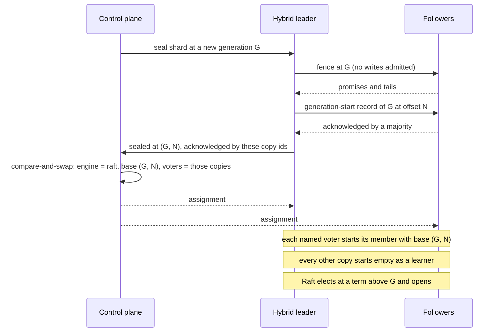

1. **Seal.** The control plane promotes the shard to a new generation `G`
   with a seal flag. The hybrid leader runs its ordinary fence and catch-up
   and appends the generation-start record at offset `N`, but does not open
   for writes. For a cache shard it first appends one counter checkpoint
   holding the counter log's sums, so the cache log alone carries the state.
   The record at `N` names a start offset `S` and carries a digest of the
   records from `S` up to `N` (see "What a holder holds").
2. **Record the base.** A follower acknowledges the record at `N` with its
   copy id, and only if its own digest matches. When a majority of the
   hybrid's set has acknowledged, the leader reports `(G, N)` and the copy
   ids that acknowledged. The control plane commits, in one
   compare-and-swap on the shard's generation and replica set version, that
   the shard's engine is Raft, its base is `(G, N)`, and its voters are
   exactly the reported copy ids. Every other copy in the set is a learner.
   This write is the switch. Before it, the shard is a hybrid shard that
   happens to be closed, and can be opened again. After it, no broker runs
   the hybrid for this shard. If the generation or the set changed in
   between, the write fails and the seal starts over. The write itself
   bumps the replica set version, so a second report of the same seal fails
   the compare. If no majority
   acknowledges because followers fail the digest, the shard opens again as
   a hybrid shard, each mismatching copy is rebuilt from the leader by the
   hybrid's ordinary rebuild, and the seal is retried afterwards.
3. **Start the voters.** A copy whose copy id is in the recorded voter set
   cuts anything above `N` and starts its Raft member with the log purged
   up to `(G, N)`, the base as its snapshot id, and the recorded
   membership. Everything up to `N` stays on disk as readable records and
   is never compared by term, so records whose writer is unknown
   (generation 0) are never Raft entries.

   Before it starts, the copy checks the base again: it accepted no
   generation above `G`, its log starts at or below `S`, the record at `N`
   is the seal's generation-start record of generation `G`, and its own
   digest from `S` to `N` is the recorded one.
   A copy that fails any check starts as a learner, with its directory
   untouched. One that passes writes, in this order: the cut above `N`,
   the base snapshot, the purged id, a vote for itself at the base's term,
   the commit at `N`, the removal of the hybrid's replica-set file, and
   last the engine marker with the base. No retention runs while it does,
   so a start that crashes and runs again checks the same records. The vote is the term floor:
   without it the member would campaign at term 1, below the base, and its
   entries would compare older than the base's. A crash before the marker
   leaves a directory that is started again from the first step with the
   same result. The first Raft entry is the blank entry at `N + 1`. The
   check also covers the dead-letter and group-cursor logs fenced with the
   shard, against the ranges the seal recorded (see "The seal on the
   hybrid side" below), and the payload of the record at `N`, which names
   `S` and every digest.
   `felix_storage::disk_log::switch::start_voter` and
   `felix_replication::raft::switch::start_voter` do this.
4. **Start the rest as learners.** Every other copy starts empty as a
   learner: one that lagged, one that was halted, one whose digest
   differed, and one whose copy id changed after it acknowledged. It
   receives a snapshot install from the Raft leader, which is the record
   range below the base copied the way a rebuild copies it today. The
   leader promotes it by a membership change once it has caught up.
5. **Elect.** Voters campaign at a term above `G`. The winner commits its
   blank entry and opens.

Why it is safe: the hybrid's fence guarantees that every acknowledged record
is at or below `N` on the leader and that no lower generation can commit
again. Only copies that proved they hold everything up to `N` can vote, so
no set of voters can elect a leader that lacks an acknowledged record. The
base and the voters are recorded once, in the control plane's Raft, so no
two brokers can start from different bases.

The case this closes: A leads, A and C acknowledge `N`, B lags, and C is
wiped before the control plane's write. The record names A and C's old copy
id. B and the new C are learners with nothing to vote with. A alone cannot
elect, so the shard is unavailable, not wrong, and an operator brings it
back from A's log ("Re-forming a group").

**What a holder holds.** Two copies that hold the same records below `N`
do not hold the same bytes. A record written before generations were
recorded has generation 0 in its header on one copy and may carry a real
generation on another. So the digest covers each record's offset, key,
payload and flags, and leaves the generation field out. A snapshot install
and any later comparison follow the same rule. The digest is also why the
switch does not rest on the hybrid's log matching for prefixes with
generation 0, which has not been verified: a copy that differs below `N`
fails its digest and is rebuilt as a learner. Computing it reads each
shard's log once on each copy, which is part of what paces the switch.

Hybrid copies do not share a log start. Retention is local, and a rebuilt
follower starts later than its leader (`replication-design.md`,
"Replication"). So the digest cannot start at each copy's own
first record. Followers send their log start with their fence promise, and
the seal names `S`, the highest start among the leader and the copies that
answered. Every one of them holds `S` up to `N`. A copy whose log starts
above `S` cannot acknowledge and becomes a learner. Records below `S` stay
readable on the copies that have them, as today, and the switch proves
nothing about them.

A cache shard has no range to digest, because each copy compacts its cache
log on its own and the copies hold different records for the same state.
For a cache shard the digest is over the live state at `N`: every live
key with its value, expiry and version, in key order, and the counter
checkpoint. Whether a key is live is judged from the log at `N`, by the
time the record at `N` carries, and never from a copy's own clock, so two
copies with skewed clocks compute the same digest. A voter's base snapshot is that state, and the log below `N` is
never compared.

**Fsync on commit, on every copy.** The switch needs every copy of the
shard on `OnCommit`, not only the seal leader. A copy that is not neither
answers the seal's fence nor acknowledges `N`. Otherwise a `Periodic`
follower could acknowledge `N`, be recorded as a voter, and then never
start, because a Raft log refuses to open unless it fsyncs on commit
(`crates/server/felix-storage/src/raft_log.rs`). Today there is no per-stream fsync policy: the mode is
one broker-wide setting read at start (`FELIX_DURABLE_FSYNC_MODE`), and the
default is `Periodic` at 250 ms. Neither the control plane's shard record
nor `felix-replication` holds it. So each copy reports its fsync mode as a
new field, the mode cannot change during a switch without a restart, and a
cluster on the default must restart every broker on `on_commit` before any
shard switches. That is one of the `shard_raft` prerequisites.

**The control plane's record.** The shard's assignment carries a `switch`
record, which only three writes set. Each is a compare-and-swap on the seal
order standing at the shard's generation, and each needs every control-plane
member at metadata level 34.

- *The seal order.* `POST /v1/placement/seal/{tenant}/{namespace}/{stream}/{shard}`
  names the shard's leader and set again at the next generation `G`, with
  `switch` holding `G`, the leader as the sealer, and the sealer's storage
  identity. It is refused until the fleet has finalized `shard_raft`,
  while the shard is not active or a move or a set change is in progress,
  and while the leader has no registered storage identity, since the report
  is checked against it. The route names stream shards only. The order
  stands only at `G`. Ordering again on a sealed shard seals it at `G+1`,
  which gives up the first seal: its report then loses the compare.
- *The report.* The seal leader sends its report to
  `POST /v1/nodes/{node_id}/seal-report`: `G`, `N`, `S`, the digests, the
  side-log ranges and the copy ids that acknowledged. It is recorded only
  while the order of `G` stands with no report, so one report wins a
  generation. The voters must be a majority of the shard's set and include
  the sealer under the storage identity the order named. The other voters'
  copy ids are recorded as reported: the digest each one checked before it
  acknowledged is what proves its copy. The reporting node is part of the
  compare, so only the broker the order names can win or give up its seal. The write keeps
  generation `G`, the base's, and from then on the shard's engine is Raft:
  every later assignment write, adoption of a hybrid election and second
  seal is refused with a conflict as it applies. So is deleting the
  assignment alone, which would let the next write assign the shard afresh
  on the hybrid engine; deleting the stream still removes its shards'
  assignments. The recorded report sent again by the sealer is answered as
  accepted, so a lost answer is safe to retry.
- *The give-up.* A leader whose seal cannot finish (a follower's digest
  differs, it restarted after its claim, it lost its promise) sends
  `POST /v1/nodes/{node_id}/seal-give-up`. The shard is named again at
  the next generation without an order, which ends every copy's promise and
  opens the hybrid. Any other write to a later generation does the same: a
  failover away from a seal leader whose lease lapsed gives its seal up.
  Because the report and the give-up compare on the same order, a give-up
  never lands beside a recorded report, and a report of a seal that was
  given up finds nothing to win.

Placement does not know about seals yet. A move, a replacement or a
rebalance it starts on a sealing shard is a write to a later generation, so
it gives the seal up; the control plane logs a warning when that happens,
and the seal can be ordered again. Pause placement
(`POST /v1/placement/pause`) around a seal to avoid it.

The report is the one assignment change that keeps its generation. A broker
that follows the change feed must take a change at the generation it holds
when `switch` differs, and the snapshot pairs the recorded report with the
set before the seal, as it did the seal order.

An import restores `switch` as the export holds it, like every other
field of an assignment. Restoring an export taken before a shard switched
brings back a hybrid record for a shard whose brokers run Raft, so an
export older than a switch must not be imported over it. Refusing such an
import is [#2548](https://github.com/GetFelix/felix/issues/2548).

A report for a shard with no standing order is answered `accepted: false`
and changes nothing, so the control plane never names Raft for a shard
whose seal it did not order and accept. The seal can be ordered again after
a give-up; an earlier seal's report still on its way loses the compare.

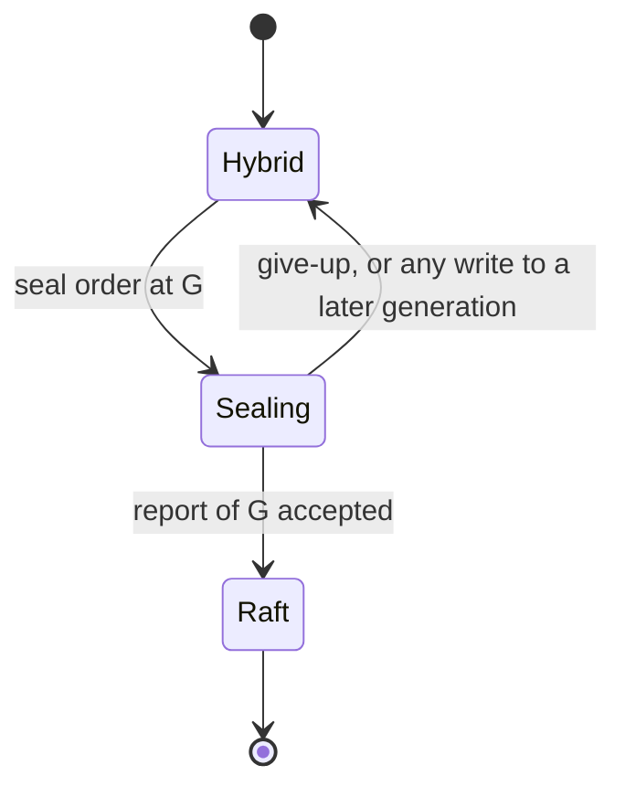

**The seal on the hybrid side.** Three steps on disk, each on a log
that fsyncs on commit, and the leader's count and report:

- *The promise.* A copy that takes the seal's fence accepts `G` for the
  seal leader in its ballot, then writes a `switch-seal` file naming `G`
  and the sealing copy id, and only then answers. While it holds, the copy
  takes the shard's records only from that copy id, refuses rebuilds and
  bootstraps at `G` and a candidate's ballots, grants no pre-vote, and
  never stands for election itself. A batch the leader sent before its own
  promise names no copy id; the copy asks for it again instead of treating
  the leader as replaced. Retention
  deletes nothing from its log, so it keeps the start it answered with.
  Nothing reopens the shard on a timeout: the promise
  lapses only when the copy accepts a later generation, which only the
  control plane's promotion gives it.
- *The claim.* Once a majority answered and the shard's fence is quiet (no
  write admitted before the seal is still on its way to an offset), the
  leader marks the claim in its `switch-seal` file, then appends the
  generation-start record at `N`. Its payload is the generation, then `S`,
  the digest of `S..N`, and for each side log the range the leader holds
  and its digest. `S` and each side log's start are the highest among the
  copies that answered. The claim mark comes first, so a leader that
  crashes or loses its tail never appends a second record at `G`; the
  control plane seals again at a later generation instead. The side logs
  are synced before the claim, so the ranges it names are on disk.
- *The acknowledgement.* A follower appends the record at `N` only if its
  log ends at `N - 1`, starts at or below `S`, matches the digest from
  `S`, and each side log holds the leader's range and nothing past it. It
  answers once the record is on disk. The digest reads the whole range, so
  the check runs apart from the request that asked for it: a request that
  cannot wait is told to ask again, and the next one finds the check
  running or done. The promise is checked again as the record is written,
  under the lock a later generation is accepted under, so a copy that
  accepted a later generation while it digested writes no record for the
  older seal.
- *The report.* The leader counts acknowledgements by copy id and reports
  `(G, N)`, the base and the copy ids once a majority holds `N`. A leader
  that restarted before it reported has lost its count and reports
  nothing for that seal.

`DiskLog::promise_seal`, `claim_seal` and `ack_seal` in
`felix_storage::disk_log::switch::seal` do the disk steps, and
`felix_replication::seal::SealRound` the count. `SealRound::step` runs one
pass of the leader's round over the wire: the seal's fence to each copy, the
claim, `SealAck` to each copy, and the report. The messages are in
`docs/internal-protocol.md`, "Sealing a shard for the switch to Raft", and
only a build with the Raft engine offers them. Nothing calls `step` yet: the
control plane's seal flag, the leader's quiesce and the compare-and-swap that
records the report come next, so nothing seals a shard.

**Only the sealing copy leads.** A follower takes catch-up records for the
seal only from the copy that sealed. Catch-up batches carry the leader's
copy id, and the sealed promise stores it beside the follower's own. A seal
leader that was wiped comes back under a new copy id, so no follower takes
records from it or cuts its tail to it. This is the same storage identity
rule the hybrid already follows for a leader that lost records: it "leads
nothing from the copy it led" (`replication-design.md`, "Failure model").

**What a sealed leader still serves.** The seal leader keeps serving
catch-up and rebuilds below `N` while sealed. A copy that holds the sealed
promise refuses hybrid batches, rebuild writes and ballots for the shard;
a copy without it, such as a wiped follower back under a new id, can still
catch up from the seal leader and acknowledge `N` under its new id.

The shard is closed from the seal until the Raft leader opens: one hybrid
promotion plus one Raft election. Shards switch a few at a time, paced like
moves. There is no switch back. See Questions, 6.

**Before it touches real data.** Decided (issue #2167): the switch is
modelled and run in the simulator before any build can switch a shard
that holds real data. The model is the switch module of the TLA+ model
(pull request #2306). The simulator runs are in "Simulator: the switch":
power loss at every step, on logs that are fsync on commit (`OnCommit`).
The `shard_raft` fleet feature is not finalized anywhere until both pass.

## Testing

### Simulator: Raft clusters

The simulator builds Raft-engine clusters through the same service code. All
four modes (`off`, `clocks`, `placement`, `power-loss`) run against them,
with the history checkers unchanged. They are turned on as the code they
need lands: `off` and `clocks` with stream shards, `placement` with
membership, `power-loss` with copy ids and re-forming. Cluster checkers
named after
`FelixShard.tla` invariants are replaced by the same checks named after
`FelixRaft.tla`: one leader per term, acknowledged records held by the
leader, election settles.

Acceptance cases carried over from open issues:

- **#1331.** A copy that was wiped has a new copy id and never votes under
  its old member id. It rejoins as a learner. A test wipes a voter that held an
  acknowledged record and checks the record survives every later election.
- **#1914.** After a killed broker returns, every shard is served and
  readable. No read is refused once the faults heal.
- **#1792.** With the control plane paused for the whole run, `Quorum`
  acknowledgements continue. The acknowledgement path makes no control-plane
  request.
- **#1009 and #1197.** With the control plane down, a leader crash fails
  over, writes continue and consumer groups keep working. Passing this in
  the Raft cluster closes both.
- **#2032.** Seed 4 is rerun under Raft.
- **Majority power loss.** Two of three brokers lose power together. No
  copy rotates and no record is lost.
- **Majority disk loss.** Two of three brokers lose their data roots
  together, also during a move. Nothing re-forms by itself: the shards
  stay unavailable, and `plan` shows them blocked until both brokers are
  declared dead. The test then runs `plan` and `apply` for the cluster.
  Every shard is served again, the only records lost are ones only the
  dead brokers held, the plan lists the move's target, and no offset is
  given out twice.
- **Re-form refused.** `plan` changes nothing. `apply` leaves a group
  that has a leader alone, and skips one that changed since the plan.
- **Restored RF 1 copy.** An RF 1 shard whose root is restored from a
  backup is served again without the command, at a new epoch, and no
  offset is given out twice. With a move under way it waits for the
  command.
- **Live snapshot.** A broker restarted on a copy of its data root taken
  earlier in the same run never votes under its old ids.
- **Restored directory.** A broker restarted on an older copy of its
  directory never votes under its old ids.
- **Membership under load.** A move while publishers write pauses no
  write and loses no acknowledged record.
- **Restart inside the window.** A restarted follower grants no vote for
  `election_timeout_max`, with a committed stored vote and with one that
  is not.
- **Periodic acknowledgement.** On a `Periodic` stream a `Leader` write is
  acknowledged before its fsync, and a power cut then loses no record
  that was committed or delivered.

### Simulator: the switch

Clusters start on the hybrid, take writes, and switch shards to Raft while
the faults run. The logs are fsync on commit, as the switch requires. The
schedule aims power loss and unclean crashes at each step: the seal, a
follower's digest acknowledgement, the control plane's compare-and-swap,
a voter starting from the base, and a learner's snapshot install. The
history checkers judge it unchanged, and two cluster checks are added: no
record acknowledged before the switch is missing after it, and no two
members start from different bases.

### Reproducible seeds are added to the release bar

Decided (issue #2167): a few hundred simulator seeds on Raft shards are
added to the release bar: power loss, unclean crashes and the switch.
They are on top of the 2000-seed bar the release gate already has, not
instead of it. A seed is reproducible when running it again gives the same
history. The exact counts and modes are set in
[`release-gate.md`](release-gate.md) (issue #2298).

### History checker and scale

Every nemesis in `history.yml` runs against a Raft cluster, including the
duplicate-offset nemesis of the engine page. `scale-nightly.yml` adds a run
that kills a broker at the design point and reports the time until every
shard is served.

## The TLA+ model

`FelixRaft.tla` (pull request #2220) models one group with a fixed voter
set and no leases. Track 4 needs these added before its pull requests that
touch them are labelled reviewed.

**Joint consensus.** Membership is carried by the membership entry. A member
uses the latest membership in its log, committed or not. Add learners, a
joint configuration that needs a majority of both the old and the new set
for election and commit, and the rule that a new change starts only after
the previous one is committed. Add a removed leader stepping down. Checks:
the existing ones across a change, plus no two leaders in one term under any
pair of overlapping configurations. Twin configs that must fail: a change
that skips the joint step with two members changed, a second change before
the first commits, and a learner counted toward a quorum.

**Member identity.** A wipe gives a copy a new member id. A twin where a
wiped copy keeps its id and votes must violate `LeaderCompleteness`. A
second twin restores a copy to an older log and vote under its old id and
lets it vote, and must fail the same way. A third restores one shard
directory to a state younger than the log mark with no vote since, which
shows the residual of Questions, 11 and is pinned as an expected violation
(`FelixRaftIdentityMarkBatched.cfg`, and `FelixRaftIdentityRootRestoreYoung.cfg`
for a whole root), since that residual is accepted. This is the model's side
of #1331.

**Re-forming.** Add the group epoch, brokers declared dead, and the
re-form step as an operator action. It is enabled only when every placed
broker is reached or declared dead, and a declaration can be wrong. Check
that a record committed in the old epoch and held by a copy the command
reached is in the base, and that no offset is given out twice. Twins that
must fail: reachable copies that report without stopping first; old and
new epochs exchanging messages; a list that leaves out a move's target
while it holds the records; and a re-form while a placed broker is
unreachable and not declared dead. One expected violation is pinned: two
live brokers are declared dead and commit in the old epoch before they
learn of the new one. Add the restored RF 1 copy that starts by itself,
with a twin where a second broker is placed and it must not.

**Written-majority acknowledgements.** Modelled in `FelixRaftWritten.tla`:
a follower's written report, the leader's count, process crashes, power
cuts and one joint change. It checks that an acknowledged record is missing
from no broker that could win an election unless a power cut took it from a
copy before its fsync, and that with no power cut it is never missing.
Twins that fail: a learner's report counted, a report counted whatever its
term, one half of a joint configuration taken as enough, and the commit
index counting written reports. With every rule on and a power cut that
rotates the broker's copy, as a broker that vouched does, `AckedNeverLost` holds
(`FelixRaftWrittenPowerCut.cfg`). One expected violation is pinned: the
same with the copy kept (`FelixRaftWrittenPowerCutKeeps.cfg`), the loss
"Two signals from one append" describes.
The one-term configurations, the change of leader
(`FelixRaftWrittenFailover.cfg`) and the joint change
(`FelixRaftWrittenJoint.cfg`) run to the end. Two terms with two writes and
the joint change across a change of leader have found no violation but have
not finished (`docs/formal/README.md`).

**Leader leases.** Add a clock per broker with bounded drift, the leader's
lease from the send time of its last majority-acknowledged message, and the
follower's vote refusal from its receive time. Add `Leader`
acknowledgements on local durability under the lease. Check that no two
brokers pass the lease check for one shard at the same real time, and that a
`Leader` record delivered to a subscriber is never replaced. Twins that must
fail: a lease longer than the margin allows, a lease measured from the
acknowledgement instead of the send, and a follower that votes inside its
refusal window. A `Leader` acknowledgement on a `Periodic` stream is taken
before the leader's fsync, with power loss, and the delivered-record check
must still pass.

**The switch.** Start a group from a base `(G, N)` with records below it
that differ in term between members (the generation 0 case). The twin that
compares terms below the base must fail, as the engine page already asks.
Voters are the copies that acknowledged `N`. A twin that makes the whole
set voters, with one member lagging and one wiped, must lose an
acknowledged record. Power loss is allowed at every step of the switch.

**Rules the model found.** The first run of these modules found six holes
in this page. Five have a rule above. The sixth (#2310) is about sleep
and is kept under "Deferred: sleep and wake". The table says which pull
request builds the rule and what the model must show before that pull request is
labelled reviewed. A config named as "must still fail" has the rule turned
off and stays registered as an expected violation.

| Issue | Rule | Built in | What the model must show |
| --- | --- | --- | --- |
| #2303 | The root sequence, held by the run witness and the control plane. Marks name their copy id | #2250 | A new knob that drops the sequence. With the rule on, the same-run root restore passes every identity check while the witness exists. Must still fail: the same config with the knob set, and the marks without a copy id (`MarkForgetsCopy`). Two residuals are pinned as expected violations: with a witness, a restore younger than one mark interval; without one, a restore newer than the last sequence the control plane stored, with the control plane down while the broker votes |
| #2304 | No report is stored. The command reads each reachable copy when it runs and again after the copy has stopped, and `apply` skips a group that changed since the plan | #2250 | The automatic path and its `JoinKeepsReport` twin are removed with the stored reports. Rotated copies are still read (`RotatedNotWaited` off). Must still fail: the twin where copies report without stopping |
| #2305 | Raft logs are fsync on commit. The offset floor for every re-form, which is still needed when re-forming is operator-only | #2248, #2250 | Rotation only by disk loss or restore, since a power cut no longer rotates. A new floor variable. The two-rotation config passes `OffsetNeverReused` with the floor exact, with one term and with two. The two-term case needs the floor to be a log id and a saved commit index per copy (#2402); a twin with an offset-only floor violates it. A twin whose floor is the last value the control plane stored, with commits after it, is pinned as the accepted residual |
| #2307 | A restarted member grants no vote for `election_timeout_max` | #2249 | `RestartForgetsWindow` off: the restart lease config passes `LeaseExclusive`. Must still fail: the twin with no window after a restart (`FelixRaftLeaseRestartForgets.cfg`). Checked against openraft 0.10.0, which renews the window for a follower's committed stored vote: with the hold off and that renewal on the model passes too (`FelixRaftLeaseRestartRenews.cfg`), so no trace goes through a vote that is not committed. The hold stays, as the guard that does not rest on the engine |
| #2311 | The control plane records the target first and keeps every broker placed in the epoch, removed ones included. The command lists all of them and refuses while one is unreachable and not declared dead | #2235, #2250 | `WaitPlaced` restated as the command's list: the stale-membership config with two lost disks and no client write passes `AckedSurvive` when the target is reached. The same with a move and the move back has not finished a run yet (no violation in the states explored so far). The same with a client write has not finished a run, so nothing is claimed for it yet. Must still fail: the same with the target left off the list, and the two moves with removed brokers left off (`PlacedForgotten`) |

**Placement and lost disks.** `FelixRaftPlacement.tla` puts the control
plane in front of the membership model: it moves a seat, removes one, and
swaps a seat's id when a broker reports a new copy, and the leader follows
the target it read, which may be an old one. One disk may be lost at any
step of a move in one term, and across a leader change for a seat swap.
A move with a lost disk and a leader change has no result yet: those
configurations have not finished. A lost disk together with a leader on an old target is the gap above
(#2385). It adds the two rules above (a request names its member id, a removed
copy is deleted only after it has no vote) and checks the offsets
subscribers were given. The same module has the metadata group's rejoin,
where a wiped member keeps its id, and found that a leader must not count
such a member while its vote is withheld, and that with five members even
that is not enough (#2365). Shard groups do not have the problem, because a
wiped copy takes a new id. The module has the metadata group's first start as
well: an empty member forms only when every other member answers empty
(#2371), and a volume lost before the group's first log entry is a pinned gap
(#2374).

**Later, with store-liveness leases:** support with epochs and expiry, a
lease that holds while a majority supports the leader's store, and a vote
refused while support stands. Not needed for the first version.

The hybrid's `FelixShard*` specs stay until the gate passes. How they and the
rest of the hybrid are removed is in
[`hybrid-retirement.md`](hybrid-retirement.md).

## Performance plan

Two comparisons, both needed.

**Against the hybrid, same commit.** While both engines are in the tree, the
build that has the Raft engine picks one at start. `perf-env-ab.yml` runs
both sides on one runner, interleaved, six rounds. This is the gate on the
engine page: throughput within 10% and p99 within 20% in every cell,
failover no worse.

**Against the latest v0.7 release.** The release A/B builds the v0.7 tag and
the candidate and runs them on the same runners. Steady and single-node
cells must match the release. This catches a regression that both engines
share.

Cells, each at 1 KiB and 64 KiB where payload size applies:

| Cell | What it prices |
| --- | --- |
| Single node, RF 1 | `client_write` and the single-voter group on the hot path |
| RF 3 steady, `Quorum` | The Raft core's cost per record, pipelined appends |
| RF 3 steady, `Leader` | The lease check; delivered latency (commit before delivery) |
| RF 3 promotion burst | Election plus blank entry against fence plus generation-start |
| Cache, mixed puts and counter adds | One log: fsyncs per write |
| `Quorum` read p99 | Read-index rounds |
| Failover time, control plane up and down | Timer values |
| Move under load | Catch-up and the joint change while publishers write |
| Broker loss, design point | Time until every shard is served |

Rules for the runs: a clean machine and clean artifacts, nothing compiled
during a run, throughput and delivered throughput reported separately, and
batched cells read as throughput only. Functional runs are in Actions. The
real-network cells run on cloud VMs with separate disks per broker.

A miss is fixed in the engine or upstream. It is not written up as a limit.
If the single-node or RF 3 steady latency cells miss because of
`client_write`, adoption is the fix, modelled first ("Later, only if the
gate's latency cells need it, and modelled first").

## The groups-per-broker gate

Criterion 6 of the gate, made concrete. Three real brokers on real
transport, RF 3, so each broker holds every shard: 5,000 shards is 5,000
members per broker, about a third of them leaders. No group sleeps in
0.8, so "idle" means ticked when due and sending idle heartbeats.

| Measure | At 2,000 members (design point) | At 5,000 members (gate) |
| --- | --- | --- |
| Idle CPU per broker, 60 s after settling | under 2% of one core | under 5% of one core |
| Ticks and heartbeat messages per second per broker, idle | reported | reported |
| Ticks to followers that hear their leader | 0 | 0 |
| Resident memory added by Raft, against the hybrid on the same shards, idle | reported | reported |
| The same, one broker killed, under load | reported | under 1 GB |
| One broker killed: time until every shard is served | no worse than the hybrid | reported, no stall |
| Broker start to all members caught up | reported | reported |

The idle CPU limits were set when idle groups slept. Decided (issue #2167):
they stay, and the due-group ticker with slower idle timers has to meet
them. That is measured now, on the group runtime (#2231) with stub
groups, before stream shards exist. The cell is given a new budget only if
that run still misses, and sleep returns only after that ("Deferred: sleep
and wake"). `release-gate.md` still asks for every group asleep and no
ticks to sleeping groups. Those two conditions go with the gate follow-up
(issue #2298).

Measured on the group runtime (Linux, release build, three runtimes in one
process as three brokers, RF 3, real peers and no network, 1 s idle
heartbeat): 1,500 members cost 2.1% to 2.3% of a core per broker and 2,000
cost 2.8%, so the limit is still missed. A profile puts about nine tenths
of that inside openraft: a heartbeat round wakes the leader's core task
three times and each follower's once, and every wake rebuilds and
republishes the member's metrics. Felix's ticker and message envelope are
the other tenth. A 2 s idle heartbeat measures 1.2%, at the price of
noticing a dead leader of an idle group later ("Idle groups"). The
upstream asks are on issue #2215.

10,000 members is a stress run. Its numbers go upstream and nothing passes
or fails on it.

The `Raft idle groups` workflow (`.github/workflows/raft-idle.yml`) runs
the measurement every night and on demand, and puts the numbers in the run's
summary. It runs the idle measurement twice: 5,000 groups led by one runtime
whose peers are stubs, the worst case for one broker, and three runtimes in
one process joined by the real peer transport on loopback
(`RAFT_IDLE_PEERS=transport`), so the figure includes framing, QUIC and the
listener. Until idle groups sleep, both report what ticking every group
costs; nothing waits on them. A third step, the write burst, is described
with the memory figures below.

Idle memory fits, with openraft at `5c3ad1bc2d` (the pin when measured) (openraft#2313, openraft#2314 and openraft#2324).
The design assumed 180 KB per leader member and 145 KB per follower. The
runtime's memory test (Linux, release build, 120 idle members, a third
leading) measures 150 KB of live heap per member and no large per-member
reserve. The process reserves about 26 MiB once, for openraft's latency
histogram tables, however many members it hosts. The same
three-runtime run, 1,500 members per broker, holds 232 MB resident per
broker, 17 MB of it the logs alone. Subtracting the logs and the 26 MiB of
tables leaves about 189 MB, or 126 KB per member; counting the tables as
part of each member, (232 - 17) / 1500 is 143 KB. Either way it is under
150 KB, and 5,000 members at 150 KB are about 0.72 GB.

What a member keeps after it was busy is measured by the workflow's write
burst step (`RAFT_IDLE_BURST_SECS`, #2415): 300 groups on three runtimes over
the real peer transport take pipelined writes for 120 s, then go idle. The
run reports resident memory per broker at the end of the burst and again
after a settle delay of 25 s (`idle_after` plus 20 s), and the difference
from before the burst per member. These are resident set sizes, not live
heap: pages the allocator has freed and not handed back to the system still
count, so the figure can sit above what the members hold. It is a report
with no bound on it, and no figure is quoted here until the nightly run has
produced one. Memory while publishers are writing is not measured.

The earlier pin measured 414 KB of live heap per member and 1.4 MB
reserved, and the same run grew from 233 MB to 313 MB resident in ten
minutes. The engine's command and response queues were preallocated for
4,096 commands and walked as a ring, so an idle member slowly made every
page of them resident (openraft#2312, Felix #2335). openraft#2313 resets a
drained queue to its start, and openraft#2314 starts the queues at 64
slots and grows them on demand.

The two kinds of number are not the same measure. The design's figures were
resident memory, and the test counts allocated bytes. Resident memory on
real brokers, against the hybrid, is still to be measured (#2314).

Each member's log also keeps its newest records in memory, so replication
reads fresh entries without the segments. A log keeps at most 4 MiB, and the
shard groups' logs of a broker share one budget, 256 MiB by default
(`RuntimeConfig::tail_cache_bytes`). While the total is under the budget,
every log keeps its full 4 MiB, however many groups there are and however
idle most of them are. When the total goes over, one append runs an eviction
pass that walks the logs from the one appended to least recently until the
total is down to seven eighths of the budget. A log that has not appended
since the previous pass is emptied. A log that has is trimmed from its oldest
records to half of what it holds, and never below its newest record, so the
entries replication is about to read stay in memory. Idle groups give up
their bytes first, and when only busy logs are left they all shrink a little.
A dropped cache costs a read from the segments and nothing else, and the
bound is soft: a log whose cache is in use is skipped until the next pass. The metadata group's log is
not counted; it keeps its own 4 MiB. The gauge
`felix_broker_raft_tail_cache_bytes` reports the bytes held, and with several
runtimes in one process the last one to report wins. Without the budget, 2,000
groups that had each taken 4 MiB of writes would hold 8 GB.

So the memory row is measured twice: idle with three brokers, and with one
broker killed while publishers write. The 1 GB limit applies to the second.
If that run is over, the fix is the upstream ask for fewer tasks per member
(openraft#2304, item 3).

`max_shards` defaults to the largest member count at which the
one-broker-killed run stays under the limit, which may be below 5,000. It
is not set to the gate size because the gate names it. Placement answers
`at_capacity` past it.

### Open files

A Raft member opens no file of its own. The count is the log's: six
files per held shard (the active segment three times, its index, the
durable mark, and the shard's directory, held open for the lock that
refuses a second open of a Raft log). A log without Raft takes no lock and
holds five. Sealed segments that were
read stay open in one cache shared by every log the broker opens (stream,
cache, counter and group logs, and Raft copies given the same
`LogConfig::sealed_cache`), at most 1,024 of them by default
(`FELIX_DURABLE_MAX_OPEN_SEALED_SEGMENTS`, held to a quarter of the
open-file limit), so they add a fixed amount per broker and nothing per
shard. A broker that opens a cache or counter shard
pays for it like any other. Votes and replica state are written to a temporary file, renamed
and closed. `crates/server/felix-replication/tests/raft_open_files.rs`
measures it on 120 idle members, and on logs that rolled several segments
and were read back, and fails if the count passes
`felix_storage::log::FDS_PER_SHARD_LOG` per shard plus the sealed cache and
a few files of slack. The idle members are checked with only the few files.

So 1,500 members are 9,000 open files and 5,000 are 30,000, against the
soft limit of 1,024 a process usually starts with (issue #2351). The
hybrid holds one file fewer per shard. The broker now raises
its soft limit to the hard limit at start, which is 524,288 under systemd
and that or more in most container runtimes, and warns when the result
holds fewer than 2,000 shards once the sealed cache and about 1,000 files
for sockets come off. `felix_broker_open_file_limit` reports it. The
operator's side is on the site, under Production, "Open files".

Closing the files of idle shards was priced and not built: it would put
an open on the first write after idle, and the default hard limits
already hold over 80,000 shards.

## Pull request split

Each pull request is safe to merge on its own. Raft is now the default
engine on main and the hybrid is frozen; `hybrid-retirement.md` orders its
deletion.

| # | Pull request | Depends on | Why it is safe alone |
| --- | --- | --- | --- |
| 1 (#2227) | Engine trait gains `appended`, `Written`, `admit_local_ack`, `opened`, `placement_changed`, implemented by the hybrid. Nothing is removed: `read_skips_lease`, `await_readable` and the rest stay until the hybrid is deleted. Merged | | Additions only. No behaviour change. Existing tests and seeds pass unchanged |
| 2 (#2229) | Store liveness: disk probe, epochs, per-peer exchange. Deferred to the next release with sleep ("Deferred: sleep and wake"). Nothing in 0.8 reads it | | Not built for 0.8 |
| 3 (#2231) | Group runtime: type config, member id, group registry, node ticker with idle heartbeats, the written and flushed positions. Built. Peer messages for Raft on the broker transport, behind the negotiated `RAFT` capability, built in #2314 | track 2 adapter; openraft main at the commit that adds `Trigger::tick`, until 0.10.1 is released (#2215, #2313) | Behind the feature. No shard uses it. A peer without the capability is never sent a Raft message |
| 4 (#2233) | Stream shards on Raft: `propose` through `client_write` with the adapter appending and its two signals (flushed, written at index), `await_commit`, `read_bound`, read index, `opened` and `deposed`, and the written-majority acknowledgement for `Quorum` on a `Periodic` stream. No adoption and no term gate. The publish path answers `Leader` writes on the lease (row 11). Simulator `off` and `clocks` on fresh Raft clusters with a fixed member set. Built so far: the group simulation (`docs/simulation.md`, "Raft groups"), which runs the engine without a broker service. Whole-broker seeds and the history campaign wait for a broker that routes a shard to Raft | 1, 3, and #2248 (a Raft log refuses any fsync mode but on commit) | Behind the feature, fresh clusters only. The lease is row 11. No membership change, no power loss yet |
| 5 (#2235) | Membership: the target set recorded before the leader proposes, learner, joint change, transfer, leader reports with the commit offset, routing hints, single-voter RF 1 groups. Simulator `placement` | 4 | Behind the feature. Needs the model's joint consensus config first |
| 12 (#2250) | Copy ids per shard directory, the restore check and the root sequence before voting, votes always fsynced: built (`felix_storage::raft_copy`, `GroupRuntime::open_copy`), including the control plane's copy of the root sequence and the broker opening its groups through the restore check (#2441). A shard whose every copy rotated is held instead of formed again (#2620). Not built yet: declaring a broker dead, the bulk re-form command with `plan` and `apply` (list of placed brokers, stop marker, base by compare-and-swap), the restored RF 1 copy that starts by itself, and the offset floor. No other automatic re-form. Simulator `power-loss` | 5 | Behind the feature. Needs the model's identity and re-form configs first |
| 11 (#2249) | The leader lease: the vote hold for restarted members, then `admit_local_ack` on `last_quorum_acked`, falling back to the commit wait. Built: the vote hold with its exemptions, `admit_local_ack` and `await_ack`, the void, the transfer entry point, the suspend check and the config inequality ("Acknowledging a write"), and the publish path asking the check for a `Leader` stream (#2436) | 4 | Behind the feature. The model's lease configs passed (#2422) |
| 6 (#2238) | Cache and counters in one group: state machine, compaction by each member's snapshot, conditional expiry delete, request ids on every write | 4 | Behind the feature |
| 7 (#2239) | Deferred out of 0.8 ("Deferred: sleep and wake"). Sleep and wake, the hold on restarted members from campaigning, and the `sleep` simulator mode | 2, 4 | Not built for 0.8 |
| 8 (#2241) | Heartbeat coalescing: heartbeats for one broker sent together within a 1 ms window, behind the negotiated `RAFT_BEATS` capability. Built (#2939) | 3 | A peer without the capability is sent each heartbeat on its own |
| 9 (#2242) | The switch from the hybrid: seal with digest, base and voters by compare-and-swap, `shard_raft` fleet feature, and the switch in the simulator with power loss | 4, 5, 6, 12 | Gated by a fleet feature nobody finalizes before the gate passes. Needs the model's switch config and the simulator runs first |
| 10 (#2243) | Gate runs: A/B cells, groups-per-broker run, the added Raft-shard seeds, write-up in `docs/` | 4 to 6, 8, 9, 11, 12 | Workflows and docs only |

Rows are in merge order. 11 and 12 were split out after review, which is
why their numbers are out of sequence.

TLA+ additions (issue #2244, part of #2198) land in the model's own pull
requests, ahead of the pull requests that name them.

## Later, only if the gate's latency cells need it, and modelled first

Decided (issue #2167): 0.8 writes through `client_write` ("Writing through
openraft"). Adoption comes back only if the single-node or RF 3 steady
latency cells miss the gate because of `client_write`, and only after the
model covers the rules below. It is more of Felix's own code on the safety
path: a term gate, a tail cut and a write pause around every membership
step. This section keeps the design so it does not have to be found again.

### Adopting the leader's appends

The engine page first chose this (Decisions, 2): the broker keeps
appending on the leader and openraft adopts the records. In openraft
terms: after the broker's `commit`, `appended` hands openraft one entry
per record through `client_write_many`, in commit order. openraft assigns
each the next index and calls the adapter's `append`. The adapter finds
the record already durable at that index with that term and reports it
flushed.

Two rules make this safe.

**The vote is the fence.** The adapter keeps a term gate under `DiskLog`'s
append lock. `save_vote` for a term above `T` closes the gate for `T` before
it returns. A broker append at generation `T` after that fails. So once
openraft has voted in a later term, no record of the old term can reach the
log, whatever the service's write fence believes at that moment. The
service-level fence (`ShardFence`) stays as the fast path and for routing. It
is not what safety rests on.

**No tail openraft has not seen.** When the gate closes, the adapter cuts any
records above the last index openraft accepted, before `save_vote` returns.
Those records were never committed. A `Leader` publisher may have been
acknowledged for them, which is inside the loss window `Leader` already
documents. After a crash the same tail is read back as uncommitted entries of
the old term, and the next leader keeps or cuts it, as the engine page says.

**Entries openraft writes itself.** A membership entry is created by
openraft, not by a publish. If a publish has claimed offset `X` in
`begin_append` and openraft gives `X` to a membership entry, the two
collide. So the engine never lets them race. Before it calls `add_learner`
or `change_membership`, the engine closes the write fence for the shard,
waits until the host reports `quiesced` (no claim outstanding) and every
`appended` has been handed to openraft, and only then makes the call.

The fence opens again, at the same term, only when every entry the call
proposed is known to be committed or known to be dead. Dead means openraft
refused the proposal before appending it, or this broker was deposed, in
which case the fence stays closed for that reason. A call that returned is
not enough, and neither is a timeout: an entry still queued inside openraft
would take the next index after the fence opened. So the engine runs the
call in a task it owns, never in a caller's future that can be dropped, and
on a timeout it keeps the fence closed and keeps waiting on the log.

`add_learner` is called without blocking on catch-up. It returns when the
learner's membership entry is committed, the fence opens, and the learner
catches up while writes flow. The engine watches replication progress and
starts the joint step when the learner is level.

The blank entry at the start of a term needs none of this, because the
fence is still closed then.

The cost is a write pause on that shard for each membership step: the drain
plus one commit round for a learner, and two rounds for a joint change. A
move is a learner step and a joint step. Publishers wait or retry as they
do during a promotion. The "move under load" cell prices it.

If openraft still assigns an index the record is not at, the group stops.
That means the commit order and openraft disagree, which is a bug.

Before any of it is built, adoption is proved on the pinned openraft with
a test, and the model has it:

**Membership and adoption.** A twin where a publish claims an offset while
a membership entry is proposed must reach the stop. So must a twin where a
broker append at an old term lands after the vote for a newer one.

## Proposal: commit on a written majority on relaxed brokers

> **Built, on in a new cluster.** Every build reports the fleet
> feature `raft_written_commit` and a new cluster finalizes it, so a relaxed
> broker's Raft logs count an entry once it is written and fsync on the
> broker's own schedule. An upgraded cluster keeps fsyncing on commit
> until an operator finalizes it. Reservations are taken in every fsync
> mode with no gate. The text below was written as the proposal; "What is
> built" lists the parts, and "Why it can be on before the re-form" says
> why it does not wait for the re-form command.

A broker whose `fsync_mode` is `periodic` or `none` (a relaxed broker)
does not wait for the disk before it acknowledges a write. Its Raft logs
do. `RaftLog::new` refuses any mode but `OnCommit`, so every commit on a
Raft shard waits for an fsync on the leader and on a follower. On one box
at RF 3, a `Quorum` stream on `periodic` runs at 118k msg/s on Raft and
198k on the hybrid, and Raft's `periodic` and `on_commit` cells are the
same number. The shard is bound by commit latency, and the fsync is most of
it.

The proposal: on a relaxed broker, the adapter tells openraft an append is
flushed as soon as it is written, before the fsync. openraft then counts
written copies for the commit index, so commit, apply, `read_bound` and
delivery move on a written majority, as the hybrid's mark does on
`periodic`. A broker on `on_commit` is unchanged, byte for byte.

### Why this can be safe

Written is not on disk, so the rest of this section is about one fault:
a power cut, which can take a written tail. Two things already hold on a
relaxed broker:

- **A power cut rotates every copy on the broker.** The run record of a
  relaxed broker says the run was relaxed, so a start after a machine
  crash takes a new storage id, and every copy on the root comes back
  under a new copy id that never voted and rejoins as a learner (#2557).
  The old seat never votes with the cut log. A failed fsync rotates the
  copy too (#2475, "A poisoned log").
- **A process crash on Linux loses nothing written.** The page cache
  outlives the process, and a crash of the process alone keeps the
  storage id. macOS rotates on every relaxed crash (#1367).

So a copy that counted an entry either still holds it, or no longer
votes. That is the argument `FelixRaftWrittenPowerCut.cfg` already checks
for the written acknowledgement. The proposal extends it to the commit.

### What each signal means

| Signal | `on_commit` broker | relaxed broker (proposal) |
|---|---|---|
| openraft's flush callback (`IOFlushed`) | after the fsync | after the write, and after the copy's reservation covers the entries (below) |
| `LogPositions::written` | after the write | after the write |
| `LogPositions::flushed` | after the fsync | after the fsync, from the log's durable bound, never from the early callback |
| commit index, apply, `read_bound` | a fsynced majority | a written majority |
| a `Leader` write's acknowledgement | the leader's flush | the leader's write (as today) |
| a `Quorum` write's acknowledgement | the commit | the commit, which is now a written majority |
| the vote (`save_vote`) and its root mark | synced before it returns | synced before it returns |
| the root's log mark | a fsynced log id | a fsynced log id, batched |
| the offset floor report | the commit | the commit |

`flushed` keeps meaning a real fsync, because three things read it as
one: the root's log mark (an unsynced id would read as a restore after a
power cut), a `Leader` write on a stream that fsyncs, and the snapshot
rule below. It rises when the log's durable bound covers the entry, raised
by the sync itself, so the append does not hand the wait to a task.

Each follower answers an append by its own mode. Every leader asks for
the written report (`await_quorum_ack`, `Request::Written`) once a
`Quorum` write waits on it:

- **A relaxed follower** answers at the write and sends no separate
  report: its answer is the report. The answer commits, but the commit
  only acknowledges once the leader's state machine has applied the
  entry. So the leader also counts each successful answer to an append it
  asked about as a written report for the answer's last log id
  (`Reports::answered`). That lets it acknowledge at the written majority
  without the apply wait, as the hybrid does, at no extra message or task
  per append.
- **A strict follower** answers after its fsync, and sends the written
  report first, at the write. Its answer is counted too; it says more.
  Only the report waits on the `vouched-unsynced` marker: the answer
  names synced entries, so it needs none, and a follower whose marker
  fails is still counted up to its fsync.
- **Every leader asks** once a `Quorum` write has waited on reports, and
  counts reports and answers the same way: the leader's own term only,
  voters only, a majority of each set.

openraft answers an append only once the log id it names is through the
follower's log (`IOFlushed` above), so a counted answer never names an
entry the follower has not written. In the model it is a `Report` of an
entry the sender holds, named by that entry's own log id, which
`FelixRaftWritten.tla` allows.

A group can have members on both kinds of broker. The argument is meant
to hold member by member: a strict copy answers after its fsync, and a
relaxed copy rotates if it loses what it answered for. The model does not
check a mixed group yet (below).

### What readers and subscribers see

- **Sooner delivery.** A subscriber is given a record once a majority has
  written it, not once a majority has fsynced it. `read_bound` and
  `read_committed` move with it.
- **One power cut, or any number of process crashes, loses nothing.** A
  committed record is in every broker that can still win an election
  (`CommittedHeld`, `AckedNeverLost` in
  `FelixRaftWrittenCommitsPowerCut.cfg`).
- **A power cut of a majority can lose committed records.** If the
  leader and enough followers to make a majority lose power before their
  fsync, the records they had written and nobody had fsynced are gone,
  and some may have been given to subscribers. The group has no voter left
  and stays closed until an operator re-forms it ("Re-forming a group").
  This is what a `periodic` stream already accepts for acknowledged
  records, and what the hybrid does on `periodic`: its mark moves on
  followers' written answers, and after correlated machine crashes the
  shard waits for `felixctl placement abandon`, which keeps the furthest
  copy and loses the rest. On `on_commit` this cannot happen
  (`FelixRaftWrittenReformOnCommit.cfg`).
- **Lost offsets are a gap, never another record.** After the re-form, a
  reader that asks for a lost offset finds a gap, the way a lost record
  already shows, and no offset a subscriber was given is given out again
  with a different record. That needs the reservation below. It covers
  committed offsets only. A `Leader` write is still acknowledged at the
  leader's write, before any reservation counts it, so the offset a
  publisher was told can be given out again after a majority power cut,
  as it can be on a relaxed broker today.

### Keeping the re-form floor

"Offsets are not reused" relies on a floor: the re-form starts the new
epoch at an offset at or above the last commit the control plane stored.
That floor trails the commit by up to one report interval, and the page
says the gap it leaves "cannot happen now that Raft logs are fsync on
commit". Under this proposal it can again, and after an ordinary power
cut rather than a lost disk: records committed on a written majority
after the last report are lost with the cut tails, and the new epoch
gives their offsets out again (`FelixRaftWrittenCommitsReformTrailing.cfg`
finds it).

The hybrid closes the matching window by ordering: a leader's report
reaches the control plane before its mark moves (replication-design.md,
"The report cannot be allowed to trail the acknowledgement"). Reused
here, that puts a control-plane round trip on every commit and stops
delivery whenever the control plane is unreachable. Raft shards were
built to write on without it, so the proposal keeps the hybrid's rule,
the bound is stored before the count, and stores the bound on the copy:

- **Each copy reserves offsets ahead of what it counts.** A copy keeps a
  reservation, an index, in a synced file in its shard directory. In every
  fsync mode, not only on a relaxed broker, before
  its flush callback fires for entries past the reservation, it raises
  the reservation well ahead (a step of about a million entries) and
  syncs it. So the leader's own count and every follower's answer are
  below a reservation that is on disk.
- **The reservation outlives the copy.** A rotation renames the old
  directory into `.kept/`, with the file. The new copy starts its own
  reservation at the old one's. The rotation moves the old directory
  into `.kept/`, creates the new one, writes the reservation and only then
  the copy file, so a crash leaves a directory with no copy file, which
  the next open rotates again, or one that carries it. A kept directory is
  reclaimed only after the new copy's reservation is synced.
- **The re-form pads up to the highest reservation it reads.** The new
  epoch starts above the stored floor and above the highest
  reservation of every copy the command reads, current or kept. Every
  committed offset was counted by a majority, so at least one of those
  copies reserved past it.

`FelixRaftWrittenCommitsReform.cfg` checks `OffsetNeverReused` with the
reservation, after a power cut of two of three copies.

What it costs: one synced write per shard per step, about one every half
minute on a shard taking 30k records a second, and a gap of up to one step
of offsets after a re-form. Offsets are 64 bits, so the gap is free. What
it does not cover is the residual that exists today: if every copy that
counted a record is on a broker declared dead or on a disk that was lost
outright, no reservation that covers it is read, and the trailing floor
is all that is left (Questions, 13;
`FelixRaftReformReplacedDiskLost.cfg`).

### Cache shards

A cache shard's state machine applies entries as they commit, so under
this proposal it can apply an entry its own log has not fsynced. A
snapshot built then would be synced while the log below it is not. The
rule: `build_snapshot` covers no entry above the log's durable bound. It
waits for `flushed` to reach the last applied entry, forcing a flush if
the periodic one is not due, before it stores the snapshot. Under `none`
there is no periodic flush, so the snapshot's own flush is the one that
moves `flushed`, and the batched log mark moves only then. So a
snapshot is always backed by synced records, `purge` (which only follows a
snapshot) never drops an unsynced entry, and a kept directory's snapshot
and log agree. A snapshot a follower installs from its leader is unchanged:
it holds committed entries, and installing it syncs it. The cost is one
extra fsync per snapshot build, which is rare next to the commits it
saves.

### Every start that must rotate first

The argument needs the rotation to happen before a member opens and
answers. These are the starts, and what each relies on:

1. **A start after a machine crash or power cut.** `run_state` reads a
   crashed relaxed run and rotates the storage id before any copy root
   opens. Built.
2. **A start whose boot cannot be compared.** Read as a machine crash, so
   it rotates. Built.
3. **A start after a failed fsync**, including one in the periodic
   flusher. The failure poisons the log (`disk_log/sync.rs`) and the run
   record stops vouching for the boot. The proposal must check that the
   periodic tick's failure takes the same path as a flush on commit, with
   a test, since it has never mattered for a Raft log before.
4. **A reopen in the same process after a failed flush.** The directory
   is remembered and rotates (#2475). Built.
5. **A restore, a copy put back, a deleted `storage-id`, the operator's
   `rotate-storage-id`, a registration behind the control plane's.**
   Rotate today. Built.
6. **A broker moving from `periodic` to `on_commit`.** The run record
   names the run that crashed, so a crash under the relaxed run still
   rotates at the next start, whatever the new mode. A test pins it (the
   code-change table).
7. **The switch from the hybrid.** A relaxed broker's switched member
   opens on the gate like any other copy, and the hybrid log it starts
   from was already judged by the same storage id. Its Raft log opens
   with the early callback from the first append.
8. **A re-form's new epoch and a restored RF 1 copy starting by itself.**
   Each starts a member on a root that passed the gate. They must read
   the reservations before they write the epoch (above).

### Expected gain

The profile puts the gap between Raft and the hybrid on `Quorum
periodic` at the fsync on the commit path: 97 `fdatasync` calls per 1,000
messages on Raft against 0.4 on the hybrid, with p50 latency at 4.1 ms
against 1.95 ms. Taking the fsync off the commit should move that cell
from 118k toward the hybrid's 198k (+40 to +65 percent), and `Leader
periodic`, which also commits behind the fsync, a little. Part of the fsync
count is the exact log mark, a second synced write per flush, which the
batched mark removes on its own (Questions, 11), so the gain must be
measured after that change, on the three-box layout. `on_commit` cells do
not move.

The same fsync sets single-node latency at low load, even where the ack
does not wait for it. A `Quorum` or `Leader` publish on a `periodic`
broker is answered once its entry is written, but its log still flushes
behind every append, so with one publish in flight each publish shares the
machine with the last one's flush. Measured with `FELIX_HOP_TRACE=1`, one
publish in flight, 1 KiB, on a Mac (microseconds, p50 / p99):

| Engine, consistency | Append begins | Written | Ack written |
|---|---|---|---|
| Hybrid, `Leader` | (no Raft log) | 13 / 19 | 17 / 24 |
| Raft, `Leader` | 10 / 56 | 42 / 2762 | 55 / 2803 |
| Raft, `Quorum` | 19 / 62 | 97 / 2548 | 119 / 2607 |
| Raft, either, log flushed on the broker's own mode | 6 / 9 | 20 / 27 | 28 / 41 |

The last row is a local experiment, not a setting: the log opened with the
broker's `periodic` mode, as counting a written entry would. The write
itself costs the same as the hybrid's (about 14 us). Every stage is slower
under the per-append flush, including the ones before the log, so this is
contention with the flush, not work the append does. On macOS that flush
is `F_FULLFSYNC`, which empties the drive's cache and takes about 1.8 ms;
Linux's `fdatasync` on NVMe is far cheaper, so the gap there should be
smaller, and it needs measuring on the boxes. The fix is this proposal,
not a weaker flush.

### What is built

- The reservation file, carried by a rotation and holding a kept
  directory against reclaim, and loaded on every open: a copy whose
  `raft-reserved` does not decode does not open.
- Every Raft log, in every fsync mode, raises the reservation, synced, a
  million entries past an append it does not cover, before the write. A
  failed raise fails the append and writes nothing, and no callback
  fires. Raft counts every entry it finds at start as flushed, so every
  open first raises the reservation over the entries already on disk (a
  copy written by a build that reserved only under `periodic` or `none`
  has none), and the open fails if that raise does. In steady state that
  is one extra synced small-file write per million entries per shard.
- `RaftLog::new` accepts `periodic` and `none` only on a root whose run in
  this process began relaxed (`run_state::rotates_on_crash`). Such a log
  fires `IOFlushed` once the entries are written and reserved, where an
  `on_commit` log waits for the fsync. A flush or exact log mark that fails after the callback
  stops the log, except one that fails because the log was closed: a
  close syncs the log itself. A member's stop waits for its queued
  flushes before the log closes, so a clean stop never rotates. `flushed` and the exact log mark still wait for
  the log's own fsync; the batched mark reads `flushed`, so it never names
  an unsynced entry. A truncation, a purge and a cache log's admit sync
  first, since under `none` nothing else would.
- A snapshot, of either shard kind, syncs the log before it is stored.
- A failed fsync, the periodic tick's included, wakes every flush waiting
  on the log, and `flushed` stays behind.
- A crash under `periodic` restarted on `on_commit` rotates, and the
  strict run's logs fsync on commit again (item 6 under "Every start
  that must rotate first").
- A broker opens a shard's Raft log with its own fsync mode only when the
  fleet has finalized `raft_written_commit` and the root's run is relaxed;
  otherwise `OnCommit`.
- The written report follows "What each signal means": every leader asks
  with `Ask::Written`. A strict follower reports at the write. A follower
  on a written-commit log sends nothing extra, and the leader counts its
  answer to the append instead. The ask byte 2 that older builds send
  reads as `Ask::Written`. A lost report can only make a `Quorum` write
  wait for the commit, and so can a leader from a build that does not
  count answers, while its written-commit followers send no report.
- What a re-form reads from a broker's copies, in `felix_storage::raft_copy`
  (`read_copies`, `kept_logs`): every reservation in the shard directory and
  its kept directories, from which the plan's first index is set
  (`ReformPlan::first_index`: above the base, the stored offset floor, every
  reservation read, every earlier epoch's first index, every record a copy
  of the incarnation holds, and every floor a copy carries); and for each
  kept directory, read
  without opening it, its last index and the commit it can vouch for, its
  saved commit cut to the last entry that decodes as an open cuts it, or
  its purged id if that is higher.
- The re-form rule, pure and called by the plan survey through
  `raft_copy::wire::survey_step` (`raft_copy::plan_reform`, with
  `read_copies` for the survey and `probes` for the indexes it needs): per
  copy, current and kept, it reads the epoch (`raft-epoch`), last log id,
  vote, saved commit, reservation and `rotated-by`, which every rotation
  now writes. A crash in the middle of a rotation can turn a power cut into
  a restore, which only asks for `--accept-loss`. It keys log ids by (epoch, term), takes T as the highest key
  of any vote or entry read and of the floor, and vouches each copy for
  its saved commit, the floor's index if it holds the floor's entry, and
  its whole log if its last key is T and the group is unmarked, capped at
  the lowest base end of the later epochs. The base is the longest
  vouched prefix; the voters are the brokers with a copy that holds its
  last log id; the first index is above the base, the floor and every
  reservation read. It marks the group when a broker placed in the epoch
  is dead, has no vote of the epoch read or has a copy of the epoch a
  restore rotated, and flags a vote above every entry that cut a copy below what it holds. Either
  needs the operator to accept the loss. It refuses on an unanswered
  placed broker, a leader, a voter off the record, a copy ahead of the
  record's epoch or whose bases differ from it, a record inside a gap, and
  an index nobody was asked about, and a base that ends below what its
  source purged. A broker with no copy id is never a voter, and a plan
  with no voter refuses. A placed broker whose current copy never voted
  or has no copy file marks the group unless a power-cut kept copy names
  that current copy as the one it rotated into: a wiped directory or an
  empty rotation leaves nothing kept, so an older power cut does not
  count. A current copy that voted counts only if it reads as the group's
  epoch, which a rotation carries into it before its copy file. The first index is also
  never below an earlier epoch's first index or any record a copy of the
  incarnation holds. A later epoch's gap counts as holding the floor's
  entry only on a copy with a record past the gap, so the start, not
  built, must save each voter's commit at or above the base end and
  reserve through the first index minus one (#2640). This is `ReformKept` in
  `docs/formal/FelixRaftReform.tla`.

Not built: the re-form command and the RF 1 restore themselves (item 8
under "Every start that must rotate first"), and with them the offset
floor ("Re-forming a group"). A shard whose every copy rotated is held,
not formed again at index 0 (#2620). Not measured yet: the perf A/B.

### Why it can be on before the re-form

What written commits add is the loss the `Periodic` contract already
names: a power cut of a majority before the periodic flush takes entries
that committed and were acknowledged. What could make that worse is an
offset given out again, and only a new epoch over cut copies can do that:
the re-form or an RF 1 restore. Neither exists yet, and the re-form rule
already built (`plan_reform`) starts above every reservation it reads.
Until they ship, a group that lost a majority of copies stays closed,
which is what it does with the feature off too: a relaxed run rotates its
storage id after a machine crash whatever its Raft logs' fsync mode, so the
cut copies no longer vote either way. The vote and the term are synced
before `save_vote` returns in every mode.

### Code changes it would take

| Change | Where | Test |
|---|---|---|
| Accept `Periodic` and `None` on a Raft log opened on a relaxed root, with a proof from the gate that the root rotates on a crash; keep refusing otherwise | `felix-storage/src/raft_log.rs:205-227`, `run_state.rs:168` | opens on a relaxed root; refused on a strict one |
| Fire `IOFlushed` at the write on such a log; set `flushed` only from the log's durable bound | `felix-storage/src/raft_log/writer.rs:266-302`, `raft_log/flush_queue.rs:57` | a power cut after the callback and before the fsync leaves `flushed` behind; the callback order still follows the appends |
| Batched log mark on relaxed roots, fed by `flushed` | `felix-replication/src/raft/runtime.rs:111`, `felix-storage/src/raft_copy/marks.rs:314-323` | the mark never names an unsynced id |
| The reservation: a synced file per shard directory, raised before the write and at open, inherited by the rotated copy | new `felix-storage/src/raft_log/reserved.rs` (on `state_file.rs:12`), `raft_copy/reclaim.rs` | no callback past the reservation; a failed reservation write fails the append; a rotation carries it |
| Open the shard's Raft log with the broker's own fsync mode instead of `OnCommit` | `felix-broker-service/src/shards/raft.rs:227` | a relaxed broker's shard commits before any fsync |
| The written report: every leader asks; a strict follower reports at the write, after its marker sync; a relaxed follower's answer at the write is its report, counted by the leader | Built: `Ask` and `Router::call` in `felix-replication/src/raft/network.rs`, `Reports::ask` and `Reports::answered` in `raft/written.rs`, `Group::answer` in `raft/group.rs` | `raft/tests/written.rs`: `a_relaxed_leader_acknowledges_on_relaxed_followers_reports`, `relaxed_followers_answer_with_their_written_position`, `a_relaxed_leader_counts_only_reports_of_its_term`, `a_relaxed_leader_acknowledges_on_strict_followers_reports` |
| A start after a crash under `periodic` rotates even when the broker now runs `on_commit` (item 6 above) | `felix-storage/src/run_state.rs:193` | crash a relaxed run, restart on `on_commit`: a new storage id before any copy opens |
| A restored RF 1 copy starting by itself reads the reservations before it writes its epoch (item 8 above) | the RF 1 restart ("Re-forming a group"), with the re-form | the epoch starts above the highest reservation, current or kept |
| A saved commit index ahead of the durable log is capped in a kept directory too: an open lowers it (`raft_log/writer.rs:91-99`), but the re-form reads kept directories without opening them, so it must cap it the same way | `felix-storage/src/raft_copy/reform.rs` (`read_kept`); the re-form that calls it is not built | a kept directory whose saved commit is past its last entry that decodes is cut at the entry, not at the saved index |
| Snapshot waits for the durable bound | `felix-replication/src/raft/machine.rs:286` | a snapshot never covers an entry above `flushed` |
| The periodic flusher's failure poisons a Raft log and rotates the copy | `felix-storage/src/disk_log/sync.rs:239` | a failed tick rotates, as a failed commit flush does |
| The re-form reads every reservation and pads above the highest (with the re-form command) | `raft_copy/vouch.rs` (`ReformPlan::first_index`); the re-form command is not built | `FelixRaftWrittenCommitsReform.cfg` as a cluster test |
| Docs: this page's commit, read-bound and floor claims, `docs/durable-storage.md`, the status table | `docs/` | |

Cluster and simulator tests: the `power-loss` nemesis on a relaxed RF 3
group, with a majority cut, must end in a closed group, and after the
re-form a history with gaps and no reused offset; the same on `on_commit`
must lose nothing.

What the model does not check yet: a re-form after two terms under the
proposal. There the longest kept log can hold an uncommitted entry at an
offset another term committed on a written majority, and only the
re-form's cut to the saved commit index ("Re-forming a group") keeps the
base right. Every re-form configuration of `FelixRaftWritten.tla` has one
term. Nor does it model a rotated copy coming back, so the inherited
reservation and the reclaim of a kept directory are argued, not
checked. Nor does it check a group with members on both kinds of
broker: `CutRotates` is one switch for the whole model, so no
configuration has a strict copy that keeps its log through a power cut
beside relaxed copies that rotate. All three are
[#2592](https://github.com/GetFelix/felix/issues/2592).

## Deferred: sleep and wake

Decided (issue #2167): sleep and wake are not in 0.8, and store liveness
is deferred with them. In 0.8 the node ticker ticks only due groups, with
slower idle timers ("One timer for every group"). Sleep comes back only if
that still misses the groups-per-broker gate after the cell has been
measured and given a new budget (Questions, 15). Issues #2239 and #2310
are in the next milestone. Nothing in this section is built or gated for
0.8. It is kept so the design, and the holes the model found in it, are
not lost.

What moves out with sleep:

- **Store liveness (#2229).** Nothing in 0.8 reads it. The 0.8 lease
  rests on openraft's `last_quorum_acked` and the follower's window
  ("Acknowledging a write"), and a dead leader is noticed by Raft's
  election timeout. Store liveness was there to wake sleeping groups and,
  later, to back leases that survive sleep. It moves to the next release
  with sleep and is not built for 0.8.
- The `sleep` simulator mode and its checkers.
- The model's sleep module and the rules for #2310.
- The gate rows and cells about sleeping groups: all groups asleep, no
  ticks to sleeping groups, the first write after sleep, broker loss with
  sleeping leaders, and the disk probe's cost.
- Questions 5, 8 and 14.

With sleep, an idle group is not ticked, sends no heartbeats and runs no
election timer. It wakes on a write, on any Raft message, or when the
brokers' own liveness exchange says a member's broker is gone or came
back.

### Store liveness

Sleep needs a way to notice that a sleeping leader's broker is gone without
per-group heartbeats. That is store liveness: each pair of brokers that
share a group exchanges one small heartbeat per interval. It rides in the
same per-peer message as the group heartbeats. It follows the rules on the
engine page ("What other multi-Raft systems learned", 1):

- **Peer to peer.** Brokers exchange it directly. The control plane is not
  involved, so a control-plane outage does not stop failover.
- **Tied to the disk.** A broker writes and fsyncs a small probe file on each
  volume that holds shard logs, once per interval. It sends liveness
  heartbeats only while the last probe finished within the stall limit. A
  broker whose disk has stalled goes silent, even if its process and
  network are fine. The stall limit is several probe intervals and is
  separate from the time after which a peer withdraws support for silence:
  one slow fsync (`F_FULLFSYNC` can take over a second) must not silence a
  healthy broker.
- **Epochs.** Each broker has a store epoch that rises at every start. A peer
  that sees a new epoch knows the broker restarted.

A broker that has not heard a peer for the suspect time withdraws support
for it and tells the sleep logic, which wakes the groups it shares with that
peer.

In this design store liveness decides only when to wake. A wrong answer is
never unsafe: a false alarm wakes groups whose followers then ask the
leader before they campaign ("When a broker dies with sleeping leaders"),
and a missed failure is caught by the audit described below. Using it to keep leases alive while a group sleeps is a later step
with its own safety argument (see "Leases that survive sleep").

`suspicion.rs` is the hybrid's version of this signal. It pings peers but
reports through the control-plane heartbeat and writes nothing to disk. It
is deleted with the hybrid.

### Sleep and wake

A member is awake or asleep. The node ticker holds the state. openraft does
not know about it: an asleep member is simply one that gets no ticks.

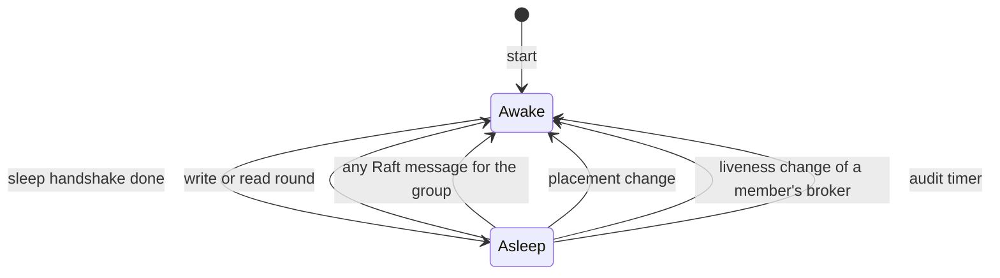

#### Going to sleep

The leader proposes sleep when all of these have held for the idle time:

- It is the leader and its blank entry is committed.
- Nothing has been proposed, and no read round is waiting.
- Every member matches the leader's last log id, and has acknowledged a
  heartbeat that carried the current commit index. A member whose broker
  store liveness says is down is left out, as long as a majority matches.
- Membership is committed and not joint. No snapshot is being sent and no
  leadership transfer is running.

It then opens a sleep proposal and sends every member a sleep request
naming the proposal, its vote, last log id and commit index. A follower
accepts only if all of these hold:

- Its own vote, last log id and commit index are the same.
- It supports the leader's broker. A request can outlive the leader that
  sent it, and accepting one from a dead broker would put the followers
  back to sleep with only the audit left to elect.
- It is not held after a liveness wake or a restart (below).

It then marks the group asleep and answers. A follower that does not accept
answers with a refusal, and a refusal wakes the leader as a wake message
does. The leader sleeps only after every member it counted has accepted.
Followers sleep first and the leader last, so a lost answer leaves the
leader awake, and its next heartbeat wakes the followers again.

Any append or heartbeat the leader sends while a proposal is open closes
the proposal, and answers to a closed proposal are ignored. Otherwise a
heartbeat could wake a follower that had already answered, the last answer
would arrive, and the leader would sleep under a follower that is awake
and about to time out.

A follower that is behind cannot be put to sleep, because the request names
the exact log position.

**A member the leader left out.** The alarm about its broker can be false.
The member is then healthy and awake, hears nothing from a sleeping leader,
and would time out and depose it. So the request goes to a left-out member
as well, though the leader does not wait for its answer. If the member
matches, it sleeps like the others. If it is behind, its refusal wakes the
leader, which catches it up before proposing again. If the request or the
refusal is lost, the vote hold under "Waking" keeps the other members from
electing it while the leader is healthy. The hold is the rule that keeps the
leader: the model passes with the request to the left-out member, the waking
refusal or the audit's ask turned off, which only cost a pre-vote round or a
later catch-up. A left-out member can still be asleep and behind for a
while: it accepted an older request, and the newer one never reached it. The leader's next audit round finds that and
replicates. The level check for a sleeping group is therefore: every member
the leader counted is level, and a member it left out is level within one
audit period. See Questions, 14 (issue #2310).

#### Waking

Any of these wakes a member. Waking always happens before the event is
handed to openraft.

- **A write, or a read that needs a round, on the leader.** The leader wakes
  and replicates. The append wakes each follower when it arrives.
- **Any Raft message for the group.** AppendEntries, a vote or pre-vote, a
  snapshot, a transfer.
- **A placement change** for the shard.
- **Liveness.** When support for a broker is withdrawn, or its epoch
  changes, every group shared with it wakes. A leader woken this way sends a
  heartbeat at once. A follower woken this way does not campaign at once
  (see the next section).
- **The audit timer.** Each sleeping leader wakes on a long, jittered timer
  (about a minute), sends one heartbeat round and sleeps again through the
  handshake. A sleeping follower that has heard nothing for two audit periods
  wakes and ticks, so ordinary Raft election takes over. At 5,000 members
  this is about 80 wakeups a second per broker. The audit bounds how long a
  bug in sleep or in liveness can leave a group without a leader.

**Votes after a wake.** A member that wakes for any reason other than a
message from its leader has not heard that leader for up to an audit
period, so openraft would grant a vote at once. The node layer drops vote
and pre-vote requests for the group for one election timeout after such a
wake, before they reach openraft, and sends the leader's broker a wake
message. A healthy leader heartbeats inside that time, and from then on
openraft's own refusal window applies. A sleeping leader woken by a vote
request does the same: it heartbeats at once and drops the request. The
hold ends early when the member itself withdraws support for the leader's
broker, so followers that liveness woke for a dead leader vote for each
other without delay. This gives a sleeping group what an awake one has: a
member that cannot hear the leader cannot depose it through the others.
The cost is a later election, by at most one election timeout, when the
leader is gone and a voter has not noticed yet.

#### When a broker dies with sleeping leaders

Every follower of every group it led wakes together. Pre-vote does not help
here. Pre-vote refuses a candidate only while the voter has heard from a
leader recently, and a sleeping follower has not heard from its leader for
up to an audit period. So a single false liveness alarm, followed by an
immediate campaign, would depose every sleeping leader on a healthy broker.
Three rules prevent that and keep a real failure from becoming a storm:

- **Ask before campaigning.** A follower woken by liveness sends a wake
  message for the group to the leader's broker. These travel in one message
  per peer. It is then given no ticks for one election timeout. A healthy
  leader wakes on the message and heartbeats, which resets the follower's
  election timer, and nothing changes. Only if nothing arrives do ticks
  start, and ordinary election follows. openraft measures its timeout from
  the last leader contact, so withholding ticks should be all this needs.
  The sleep pull request confirms that on the pinned version with a test.
- **Ranked starts.** When ticks do start, each follower's first tick is
  delayed by its rank among the group's live voters (a hash of the group id
  and member id), one election timeout per rank. The first usually wins
  before the second starts. This only shapes timing: if the ranks are
  wrong, the usual randomized timeouts decide.
- **A cap per tick.** The ticker starts at most a fixed number of elections
  per interval and queues the rest.

The cost is that a sleeping group fails over one election timeout later
than an awake one.

**Restarted members.** A member that starts after a broker restart is held
the same way: it gets no ticks until it hears from a leader, or until the
liveness suspect time plus one election timeout has passed since it
started. Without the hold it would campaign 1 to 2 seconds after start,
before the sleeping leaders on other brokers have noticed its new epoch and
sent a heartbeat.

The vote side of a restart is not part of sleep. A restarted member's
vote hold is in "Acknowledging a write" and is built for 0.8.

#### What sleep costs a write

A sleeping leader has not heard from a majority, so its lease has lapsed.
The first write after sleep is replicated and acknowledged by a majority
before a `Leader` publisher is acknowledged: one round trip, once. `Quorum`
writes wait for that round anyway.

#### Leases that survive sleep

CockroachDB's leader leases keep a sleeping group's lease valid for as long
as a majority of the group's stores support the leader's store. The first
write after sleep then pays nothing, and a dead broker's groups elect
without a storm. Felix wants this, but it moves store liveness into the
safety argument: a follower's promise not to vote has to be tied to the
support it gave, and the support has to survive a restart. That needs a
change inside openraft's vote handling (openraft#1651) and a checked model.
It is not in the first version. See Questions, 5.

Two rules belong to that later design, and the model has a twin for each.
Withdrawing support raises the epoch the supporter will accept, so
withdrawn support never comes back at the same epoch. A vote for another
broker waits for the withdrawal, not only for the expiry. The expiry is on
disk, so it is read on a clock that keeps running across a restart, or the
restarted broker waits out one full support period.

### Simulator: the sleep nemesis

A fifth mode, `sleep`. It sets the idle time to two seconds and the audit
period to twenty, and adds a schedule that stops client writes to a random
subset of shards long enough for them to sleep. Then it draws faults aimed
at sleeping groups:

| Fault | What it must not break |
| --- | --- |
| Crash, kill or power-cut the broker that leads the most sleeping groups | Every group elects; no storm stalls the run |
| Freeze a broker (process alive, silent) | Liveness withdraws support; groups move |
| Stall a broker's disk while its network works | The broker goes silent because its probe stalls; groups move |
| Drop or delay sleep requests and answers | A half-asleep group wakes fully or sleeps fully |
| Partition a sleeping leader, then write to it | The write is refused or times out; a new leader takes it |
| A write arriving during the handshake | It is committed; no member sleeps behind |
| Restart a sleeping follower | It hears the leader before it campaigns |
| A false liveness alarm for a healthy broker | No leader on it is deposed: followers ask first |
| A broker restart with sleeping leaders elsewhere | The restarted members hold until they hear a leader |
| The first `Leader` write after sleep | It is acknowledged after one round; the shard stays open |
| Liveness that misses a dead broker | The audit elects a leader within two periods |
| A placement change on a sleeping shard | The group wakes and applies it |
| Clock steps and skew (with `clocks`) | The lease margin holds |

New cluster checkers:

- `SleepersWake` (healed and end): every shard that slept is served, and a
  write to it is acknowledged within the settle time.
- `AsleepIsLevel` (every second): if every live member of a group is
  asleep, they have the same last log id and commit index.
- `IdleGroupsSleep` (end, a warning): in the quiet tail of a run, a group
  with no writes got no ticks. This catches a group that fails to sleep,
  which is a cost bug and not a safety bug.

The history checkers stay the judge of safety.

### The model, with sleep

**Sleep.** Add asleep members that take no timeout steps, the handshake, and
the wake rules. Sleep changes only liveness, so the check is a liveness one:
with a leader's broker gone and a majority alive, a leader is eventually
elected, through liveness or through the audit. A twin with neither wake
path must fail it. Safety checks must pass with members sleeping in any
state, including behind, to show safety does not rest on the handshake.

| Issue | Rule | Built in | What the model must show |
| --- | --- | --- | --- |
| #2310 | A send closes the proposal. A follower refuses a leader it does not support. The request goes to a left-out member, a refusal wakes the leader, and votes are held after a wake | #2239 | `HeartbeatKeepsProposal` and `SleepUnsupported` off, which the passing sleep configs already have. New: the request to a left-out member, the waking refusal and the vote hold. With them the two false-alarm configs pass, `NoNeedlessDeposal` as it is and `AsleepIsLevel` restated for counted members. Must still fail: both configs with the new rules off |

### Timer values, with sleep

Liveness heartbeat 500 ms, with support withdrawn after 1.5 s of silence.
The disk probe has its own limit: a broker stops sending only when no
probe has finished for 5 s, so a single slow fsync withdraws nothing. A
restarted member is held from campaigning until it hears a leader, or for
the suspect time plus one election timeout. A sleeping group's
first-ranked follower campaigns after the suspect time plus one election
timeout (2.5 to 3.5 s).

### Questions for when sleep returns

**Does 0.8 ship leases that survive sleep (store-liveness leases)?**
Recommended: no. Ship sleep with a lapsed lease first. It adds no safety
argument and costs one round on the first write after idle. Leases backed
by store liveness need a change inside openraft's vote handling and a
checked model, and a mistake there is two leaders acknowledging. Take it
after the model covers it and the upstream issue (openraft#1651) has a
shape.

**Is sleep on by default when Raft first lands?** Recommended: on by
default from the pull request that adds it, and every gate run has it
on. The pull requests before it (stream shards, membership, identity,
cache) first pass their sweeps with sleep off, so a failure there is not
confused with a sleep bug. A mode that is off by default is not the one
the sweeps test.
The audit timer bounds the damage of a sleep bug to availability for
about two minutes.

**What does a false alarm about a follower cost?** The leader leaves
out a member whose broker it does not support, and the alarm can be
wrong (issue #2310). Three options. (a) Leave a member out only when a
majority of the group's brokers withdrew support for it, which needs
brokers to share their liveness views. (b) Send the request to the
left-out member too, let a refusal wake the leader, and hold votes
after a wake. (c) Accept one election per sleeping group the two
brokers share. Recommended: (b). It adds no new message, the vote hold
is the one a restarted member needs anyway, and it also covers a
follower that cannot hear the leader for any other reason. (b) needs
pre-vote on: without it, a member that cannot hear the leader raises
its term when it campaigns, and its answer to the next heartbeat
deposes the leader whatever the others refused. (c) is
cheap to build but one bad link between two brokers would depose every
sleeping leader they share.

## Questions

Each has a recommendation, judged on safety and performance only. The
ones settled by the decisions of issue #2167 say so.

1. **Do RF 1 shards run a single-voter Raft group, or stay outside Raft on
   the control-plane lease?** Recommended: a single-voter group, and only
   together with the re-form path, because a single voter that rotates its
   id leaves a group nobody can elect in. It removes the control-plane
   lease and its bug class, and a move is a membership change instead of a
   second mechanism. The cost is about 180 KB per shard and whatever
   `client_write` adds per batch, which the single-node cell must show
   is within the gate. A restored RF 1 copy restarts as its own
   single voter. One that lost its records waits for the operator
   command.

2. **Is `allow_log_reversion` on for shard groups?** The engine page says
   the adapter sets it for every group. Recommended: off for shard groups.
   Off is not enough on its own: it stops a leader that sees a follower go
   backwards, and does not stop that follower from voting. The safety comes
   from copy ids per shard directory, rotation, and the restore check
   before a restarted broker votes. The control plane's group is track 3's
   call.

3. **What is the heartbeat-coalescing interim?** Decided: Felix sends
   heartbeats together itself, the way openraft#2390 shows, behind
   `RAFT_BEATS` ("Heartbeats sent together").

4. **Which timer values?** Decided, and the runtime's defaults: tick 50 ms,
   heartbeat 200 ms, idle heartbeat 2 s after 5 s without an entry,
   election timeout 1 to 2 s, and 800 ms for a follower's answer to an
   append or heartbeat ("A call's deadline"). A busy leader's heartbeat goes out at the
   next tick, every 250 ms ("One timer for every group"). That is a fifth
   of the default heartbeat traffic for a busy group and a fortieth for an
   idle one. A follower
   stands 3 to 4 s after its leader's last message, because openraft adds
   the leader lease (2 s) to the election timeout. That is ahead of the
   hybrid's 5 s suspicion. The failover cells decide the final values. A
   shorter election timeout shortens the lease, so the two are tuned
   together. A follower of an idle leader waits three idle heartbeats, so
   two can be lost ("Idle groups"). The liveness values
   are kept under "Deferred: sleep and wake".

5. **Does 0.8 ship leases that survive sleep?** Moot for 0.8: sleep is
   deferred. Kept under "Deferred: sleep and wake".

6. **Is the switch from the hybrid live and per shard, or done with the
   cluster stopped?** Recommended: live, per shard, with the voter rule
   above (only copies that acknowledged the base vote). Without that rule
   neither form is safe. With it both are, and the live switch is the one
   the simulator and the model can exercise under faults, and it keeps the
   closed window to one shard at a time. A stopped-cluster switch is
   simpler to build but is tested less, and closes every shard at once.

7. **Does a leader open at the blank entry's commit, or as soon as its vote
   is committed?** Recommended: at the blank entry's commit. Opening earlier
   saves one round per term but lets a leader take writes before it knows
   its commit index or has a lease, and every one of those writes would wait
   for the blank entry anyway.

8. **Is sleep on by default when Raft first lands?** Moot for 0.8: sleep
   is deferred. Kept under "Deferred: sleep and wake".

9. **Do Raft lease reads replace read-index rounds for `Quorum` reads in
   0.8?** Recommended: not at first. Read index is safe without any clock
   assumption. Turn lease reads on only if the `Quorum` read p99 cell misses
   the gate, and only after the model's lease configs pass.

10. **Is re-forming a group automatic?** Decided (issue #2167): no. It is
    an operator command, explicit, documented and lossy, and nothing
    triggers it. This reverses the earlier recommendation. A group that
    lost a majority of its voters stays unavailable until the command is
    run. It is one bulk command for a broker or the cluster, with a dry
    run. It lists every broker placed in the epoch, removed ones included,
    with what it holds, refuses while one of them is unreachable and not
    declared dead, leaves a group
    with a leader alone, and stops the reachable copies durably
    ("Re-forming a group"). The one exception is a restored RF 1 copy
    that is the only broker placed in the epoch, which restarts as its
    single voter.

11. **Is the per-shard log mark exact, or a floor that trails?** A shard
    directory that goes back by less than one mark interval, with no vote
    saved since, can vote for a candidate that lacks an acknowledged record
    ("What this does not catch"). Two options. (a) Accept it as a named
    residual: keep the trailing floor with a short interval (start: one
    second), say in the operations docs that restoring a single shard
    directory is unsupported unless its copy id is removed first, and pin
    the model twin as an expected violation. (b) Make the mark exact by
    syncing it on the group-commit flush, so any reverted directory is
    below its mark. That is a second synced write on the hot path, and an
    A/B cell must price it. Recommended: (a). The fault needs something
    outside Felix to roll back one directory under a running data root
    within a second of an acknowledged write, and whole-root restores,
    wipes and crashes are all caught by other checks. (b) charges every
    write for it. If the A/B cell shows the exact mark is free because it
    shares the flush that already happens, take (b).
    Decided: (a), with a one-second interval. The exact mark was not free:
    every flush round on every member appended to the root's mark file,
    synced it and rewrote the run witness before Raft heard of the flush,
    one shared writer for every shard of the root. On three build boxes
    (RF 3, six shards, 1 KiB records in batches of 16) the batched mark
    raised Quorum throughput by 23% with fsync on commit and 27% with
    periodic fsync, cut the batch ack p50 and p99 by about a fifth, left
    Leader unchanged, and cut fdatasync calls per 1000 messages from about
    104 to 69 and renames from about 41 to 0.15. The broker now ships
    `LogMarkMode::Batched(1 s)`, and the model pins the residual
    (`FelixRaftIdentityMarkBatched.cfg` and
    `FelixRaftIdentityRootRestoreYoung.cfg` must fail `AckedHeldByLeader`;
    `FelixRaftIdentityBatched.cfg`, `FelixRaftIdentityDirRestore.cfg` and
    `FelixRaftIdentityRootRestoreBatched.cfg` pass).

12. **Does the control plane keep each broker's root sequence?** The run
    witness alone catches a same-run restore only while the machine stays
    up. The usual restore is the other one: the latest snapshot put on a
    restarted or replaced machine, which has no witness (issue #2303). Two
    options. (a) The heartbeat carries the synced sequence and the control
    plane stores the highest. (b) Witness only, and every restore of a
    live snapshot needs the operator command. Recommended: (a), with the
    command documented as the supported way either way. (a) costs one
    metadata write per broker per heartbeat in which the sequence changed.
    It leaves a window back to the last value the control plane stored:
    one heartbeat normally, the whole outage when the control plane was
    down while the broker voted. (b) makes safety rest on an operator
    remembering a step every time, and a miss is two leaders in one term.
    Decided (issue #2441): (a), and the command is
    `felix-broker rotate-storage-id`.

13. **Is the trailing offset floor enough?** After a majority of a group's
    disks is lost at once, offsets acknowledged since the last floor the
    control plane stored can be given out again (issue #2305). That is one
    report interval, or the whole outage if the control plane was down. A
    crash or a power cut cannot cause it, since Raft logs are fsync on
    commit. Closing it fully means telling the control plane of every
    commit, which puts the control plane on the write path.
    Decided: accept. A re-form after a majority of disks is lost or
    restored at once starts at the last reported commit floor, so offsets
    acknowledged inside the last report interval and lost with that
    majority can be reused. The trailing-floor TLA twin pins it. The
    report interval stays short (start: one second, one batched metadata
    write per broker), and the loss of a majority of disks is documented
    as where this shows. The records themselves are already lost in that
    case. The floor only keeps a reader from seeing other records under
    most of their offsets. Issue #2305 closes when the re-form command of
    #2250 uses `ReformPlan::first_index`.

14. **What does a false alarm about a follower cost?** Moot for 0.8: it
    is about sleep, which is deferred. Kept under "Deferred: sleep and
    wake".

15. **Does the due-group ticker meet the idle CPU limits without sleep?**
    The limits (under 2% of a core at 2,000 members, under 5% at 5,000)
    were set when idle groups slept. Decided (issue #2167): keep them,
    tick only due groups with slower idle timers, and measure now on the
    group runtime with stub groups. By the estimate, 5,000 members at a
    500 ms idle heartbeat is about 3,300 ticks a second, or 3% of a core,
    before the cost of sending and answering the heartbeats. Measured: it
    misses, at 2.8% for 2,000 members with a 1 s idle heartbeat ("The
    groups-per-broker gate"). Recommended: first a longer idle heartbeat
    and coalescing, then a new budget for the cell, and sleep only after
    that.
