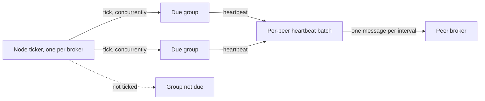
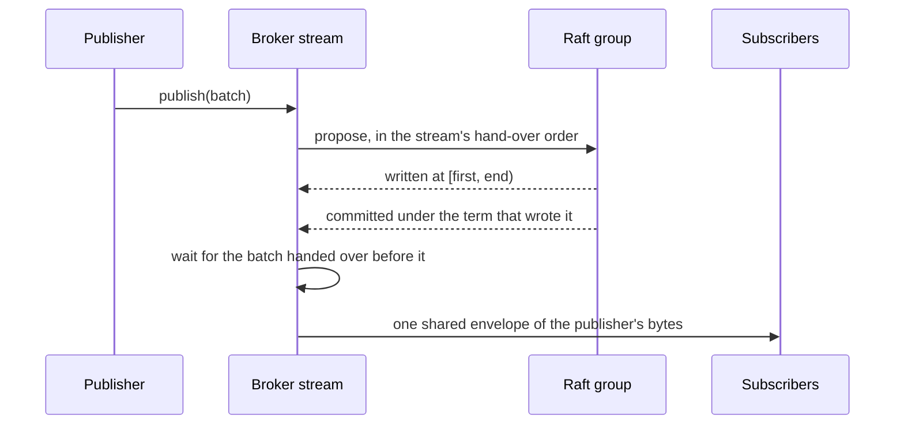
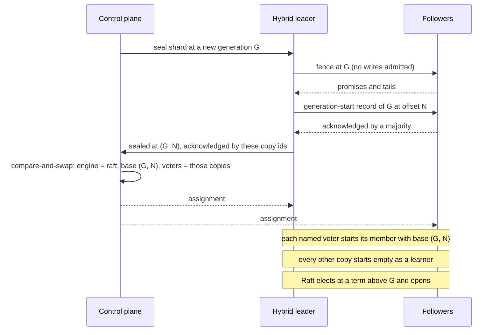
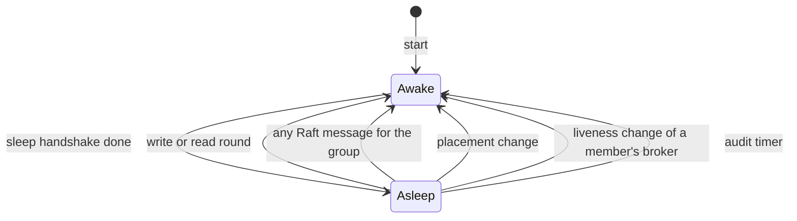

# Per-shard Raft

This page is the design for track 4 of the one-engine plan (issue #2167):
every shard runs one Raft group, through openraft, behind the engine
interface. The group runtime and its ticker are built ("Group runtime"
below) and no shard runs on them. The rest is not built yet. The decisions
it rests on are in
[`replication-engine.md`](replication-engine.md), which this page calls "the
engine page". Read its "Decisions" first. The protocol being replaced is in
[`replication-design.md`](replication-design.md) and is called "the hybrid"
here.

The page covers the engine interface as Raft needs it, how thousands of
groups share one timer and one heartbeat message per peer, how the write
fence, leases and read bound map to Raft, how a shard moves from the hybrid
to Raft, and how all of it is tested and gated. It ends with the pull
request split, what is left for later, and the questions.

Six scope decisions for 0.8 were made after a design review (issue #2167).
The aim is that Raft carries the safety and Felix's own layer around it
stays small. Each is marked "Decided" where it applies:

- Writes go through openraft's `client_write` and the adapter appends
  ("Writing through openraft"). Adopting the leader's own appends is left
  for later.
- Re-forming a group is an operator command and never automatic
  ("Re-forming a group").
- `Leader` streams keep the local acknowledgement. A restarted member
  waits out the promise behind it and stores nothing ("Acknowledging a
  write").
- Sleep and wake are deferred out of 0.8, and store liveness with them
  ("Deferred: sleep and wake"). The node ticker ticks only the groups
  whose timer is due.
- The switch from the hybrid is modelled and run in the simulator with
  power loss before it touches real data, and reproducible simulator seeds
  on Raft shards are added to the release bar ("Testing").
- Raft's own flush is always a real fsync, and a publisher's
  acknowledgement follows the stream's fsync policy ("Writing through
  openraft").

## Summary

A broker holds one Raft member per shard copy. The design point is 2,000
members per broker (engine page, "How many groups a broker carries"). Two
things keep that affordable in 0.8:

1. One timer per broker ticks the groups whose timer is due. Groups do
   not run their own timers, and an idle group's timers are slower.
2. Heartbeats travel as one message per peer broker.

Idle groups do not sleep in 0.8 ("Deferred: sleep and wake"). An idle
group still heartbeats, less often than a busy one.

Safety comes from Raft alone. The shared timer and coalescing only decide
when a group does work. If either is wrong, a group is slow to elect or
elects when it did not need to. Neither can make two leaders commit at one
offset. What Felix adds around Raft is member identity, the lease check,
and an operator command for a group that lost its majority.

## What changes for the rest of the broker

| Today (hybrid) | Under per-shard Raft |
| --- | --- |
| The control plane assigns a leader and a generation | Raft elects the leader. The term is the generation. The control plane only places replica sets |
| A promoted leader runs a fence, then opens | A leader opens when the blank entry of its term commits |
| A `Leader` shard serves on the control-plane lease | A Raft leader lease, checked when a write is acknowledged |
| `Quorum` reads confirm by lease or read round | A read-index round |
| Cache shards have a cache log and a counter log | One log, one group |
| A wiped copy is vouched back in | A wiped copy has a new copy id, is a new member and joins as a learner. A group that lost its voters stays down until an operator re-forms it |
| Suspicion is reported through the control plane | Raft's heartbeats and election timeout. Nothing goes through the control plane |

## The engine interface

The trait in `crates/server/felix-replication/src/engine.rs` was shaped by
routing the hybrid's callers through it. Raft needs it smaller. The target:

```rust
/// Where a write landed: the offset one past its last record, and the
/// generation (Raft term) it was written at.
pub struct Written {
    pub end: u64,
    pub generation: u64,
}

pub trait Engine: Send + Sync {
    /// Write `batch` on this leader. Raft assigns the offsets and the
    /// adapter appends. Returns when the records are on this leader's log
    /// as far as the stream's fsync policy asks: written, or fsynced.
    fn propose(&self, shard: &ShardKey, batch: Batch)
        -> impl Future<Output = Result<Written, CommitError>> + Send;

    /// Wait until `written` is committed. An error means this broker cannot
    /// say so, not that the write is lost.
    fn await_commit(&self, shard: &ShardKey, written: Written, timeout: Duration)
        -> impl Future<Output = Result<(), CommitError>> + Send;

    /// May a write at `generation` be acknowledged on local durability
    /// alone? The leader lease check for `Leader` streams. On an error the
    /// caller waits on `await_commit`. A refusal never closes the shard.
    fn admit_local_ack(&self, shard: &ShardKey, generation: u64) -> Result<(), CommitError>;

    /// One past the highest committed offset, at every consistency level.
    fn read_bound(&self, shard: &ShardKey) -> Result<u64, Unreadable>;

    /// Confirm this broker still leads `shard`, for a read of state.
    fn confirm_read(&self, shard: &ShardKey)
        -> impl Future<Output = Result<(), CommitError>> + Send;

    /// The control plane placed `shard` on `placement`.
    fn placement_changed(&self, shard: &ShardKey, placement: &Placement);

    /// A peer's replication message.
    fn handle(&self, from: Option<&str>, caller: PeerCapabilities, request: InternalMessage)
        -> impl Future<Output = InternalMessage> + Send;
}

pub(crate) trait EngineHost: Send + Sync {
    /// This broker leads `shard` at `generation` and may take writes.
    fn opened(&self, shard: &ShardKey, generation: u64);
    /// This broker no longer leads `shard` at `generation`.
    fn deposed(&self, shard: &ShardKey, generation: u64);
    /// Whether `shard` is closed with no write still inside.
    fn quiesced(&self, shard: &ShardKey) -> bool;
}
```

The hybrid keeps implementing everything it has today until it is deleted.
The first pull request only adds to the trait. What goes away when the
hybrid is deleted, and why it is safe to drop then:

- `appended` is how the hybrid learns of a write the broker has already
  appended. A Raft shard writes through `propose` ("Writing through
  openraft"), which the stream shards pull request adds.
- `cache_write_at`, `await_cache_quorum` and `await_counter_quorum` become
  `await_commit`. A cache shard has one log and one commit index (see "Cache
  and counters").
- `committed_bound` merges into `read_bound`. Today it differs by a lease
  check. Under Raft a deposed leader's commit index is still a true lower
  bound on what is committed, so delivering up to it is always safe and needs
  no lease.
- `read_skips_lease` and `await_readable` go with the control-plane lease,
  which the shipping hybrid still serves on. Under Raft every read is bounded
  by `read_bound`.
- `EngineHost::generation` and `replicated` go. The engine tells the host the
  generation through `opened`, and every shard is a group.
- The `HybridHost` callbacks stay on the hybrid until it is deleted.

The interface does not assume one group per stream. A `ShardKey` maps to a
group through a registry inside the engine, so several small streams could
later share a group without changing a caller.

### Group and member identity

A group id is the `ShardKey` plus a group epoch, which starts at 0 and rises
only when the group is re-formed (below). A member id is the pair of broker
id and copy id.

The copy id is minted in the shard's own directory when the member is first
created there, and is fsynced with the directory. It is per shard on
purpose. The broker's storage id is one per data root and rotates only when
the broker notices a loss at start (`node/storage.rs`, `start_run`), so it
cannot tell a broker that lost one shard's directory from one that lost
nothing. An empty shard directory has no copy id, so the member made there
is new to Raft whatever the storage id says.

Every Raft request names the member id it is for, and a copy refuses one
that names another id, an older copy id of its own broker included. Without
that, a wiped copy would answer a vote request sent to the id it replaced,
from an empty log (`FelixRaftPlacementAnswerAnyId.cfg`).

A member with a new id has never voted. It joins as a learner and the old
member is removed by a membership change. This is the rule issue #1331 asks
for, and it replaces vouching and copy trust. The copy ids of a shard
rotate, and the directory's log is kept as plain records, in each of these
cases:

- The shard directory is missing or empty.
- The storage id rotated: the data root was lost, or it failed the restore
  gate below. A crash or a power cut alone takes nothing a peer counted,
  because a Raft log is opened only with fsync on commit (decided, issue
  #2248).
- The directory fails the restore check below.

**Votes are always fsynced.** The vote, the copy id and the membership are
synced before they are answered. Votes are rare, so this costs nothing on
the write path. The log is fsync on commit and refuses any other mode
(decided, issue #2248): a member acknowledges an append only once it is on
disk, so a power cut cannot shorten what a peer counted.

**The restore check.** A directory restored from a backup or a VM rollback
keeps its copy id with an older log and an older vote. Raft cannot see
that: the copy would vote under an id that already promised more. A gate in
front of Raft (`raft_copy::check`) judges the data root once per broker
start, not per shard, from three pieces of evidence: the incarnation
verdict (the control plane registered the node after the root last recorded
a registration, `restored` in `start_run`), the run witness's copy of the
root sequence, and the control plane's copy (both below). The gate has
three outcomes:

- **Behind** any of the three: the root gets a new storage id and every
  copy id in it rotates.
- **Unchecked:** the root holds marks but there is no copy of its sequence
  to compare against, because the machine rebooted (the witness is gone)
  and the control plane has none. No member opens until evidence arrives.
  A hold acts on evidence, never on silence.
- **Passed:** otherwise, including a root with no marks yet.

The control plane's copy is not built yet (issue #2441). Until it lands, a
broker whose machine rebooted holds once its root has marks, and so does
every start on a host with no witness directory (anything but Linux with
`/dev/shm`). Brokers that stayed up are not affected, so failover with the
control plane down still works. What waits is the restarted broker's own
vote.

One more case holds until then. The witness keeps a root's sequence under
its storage id. If the id changes anywhere but the gate's own rotation (a
start after a crash or a restore, `felix-broker restore-point`, or a restore the
cluster's registration reveals), or the broker crashes after the gate
rotates the id but before it records the witness, the witness has nothing
under the new id. A root with marks then reads as Unchecked on the next
start and holds. That is safe, since a hold never lets a copy vote twice,
but the broker waits for the control plane's copy like a rebooted one.

**The root sequence.** The incarnation and the run token change once per
start. A root put back from a backup taken during the run it interrupts
carries both, so on their own they read it as a crash, and its copies
would vote a second time in a term they already voted in (issue #2303).
Something outside the root has to move during a run. The root keeps a
sequence number that rises with every synced write of a mark (below), so
with every vote and every batch of log marks. Two places outside the root
hold a copy of it:

- **The run witness.** It is written after the root's write is synced and
  before the vote is answered. The witness is in memory, so this adds no
  fsync. For as long as the machine stays up it is exact for votes, and
  for the log it trails by up to one mark interval, like the log mark.
- **The control plane.** The broker's heartbeat carries the last synced
  sequence, never one whose write is still in flight, and the control
  plane stores the highest it has seen for that storage id. The stored
  value survives a machine restart, a replaced machine and a VM rollback,
  none of which leave a witness. It is one metadata write per broker per
  heartbeat in which the sequence changed.

The gate fails a root whose sequence is below either copy, and its copy
ids rotate. A root that is ahead of a copy crashed between the two writes
and passes. That is why the heartbeat carries only a synced value: a power
cut after an unsynced one would leave the root behind and rotate every
copy for nothing.

What the gate cannot see:

- **With a witness,** a root that goes back by less than one mark interval
  with no vote saved since. Example: a mark batch is written, the root is
  copied, C acknowledges R, C is killed before the next batch, and the
  copy is put back. This is the residual of "What this does not catch"
  below at the scale of a root, and Questions, 11 decides both. The
  witness cannot count appends itself, because an ordinary crash would
  then leave it ahead of the root and read as a restore.
- **Without a witness,** a root restored from a backup newer than the last
  value the control plane stored. That is one heartbeat while the control
  plane is reachable. It is the whole outage while it is not, because
  failover goes on without the control plane: with the control plane down
  for ten minutes, a copy taken at sequence 7, a vote at sequence 8 and a
  restore to the copy pass the gate when the control plane returns holding
  7, and the broker votes again in the same term.

So restoring a live snapshot is supported only after an operator command
that rotates the storage id, and the operations docs say so. See
Questions, 12.

**Per directory, not only per root.** The check above judges a data root,
and the copy id is per shard directory, so two more things are checked when
a member opens its directory:

- The directory records the storage id its copy id was minted under. If
  that is not the root's current storage id, the copy is rotated. This
  also makes rotation lazy: when the storage id rotates, one synced write
  at the root does it, and each shard directory is judged when it is
  opened. There is no pass over thousands of directories that a crash
  could leave half done. A new copy id and its storage id are written
  together by one rename.
- The root keeps a high-water mark for each shard: the copy id it belongs
  to, the vote and a last log id. A directory whose copy id is not the one
  its marks name is rotated. Without the name, a wipe would reset the marks
  for the new copy, and the old directory put back later would pass them
  under its old id. If a directory's vote or last log id is below its
  mark, that one directory was restored or copied back, and its copy is
  rotated. The order
  is pinned: the vote mark is synced at the root before `save_vote`
  returns, and both the mark and the vote are durable before the vote is
  answered to anyone. The last log id is marked in batches, one synced
  write per root per mark interval, so it is a floor that trails the log by
  up to that interval. The id in the mark is an fsynced one, because an
unsynced id after a power cut would read as a restore and rotate the copy.

**What this does not catch.** A single shard directory that goes back to a
state younger than one mark interval, with no vote saved since, passes
both checks. A steady leader's term does not change, so the copy's vote
equals its mark, and its log is above the trailing floor. Example: A and C
acknowledge R inside the last interval, C's shard directory goes back to
before R, A dies, and C votes for B, which lacks R. No leader is left to
notice. Whole-root restores are caught by the gate, down to the window
named under "The root sequence". Whether to accept this
residual or pay for an exact mark is Questions, 11.

`Config::allow_log_reversion` stays off for shard groups. It lets a voter
come back with a shorter log under the same id. Off, a leader that sees a
follower go backwards stops instead of carrying on. That protects a leader.
It does not stop the reverted copy from voting, which is why the rotation
rules and the restore check above carry the safety, and reversion-off is
the backstop. (The engine page says the adapter sets it for every group.
See Questions, 2.)

A new group is created from a first set that names copy ids. Each broker
the control plane places the shard on mints its copy id and reports it, and
the control plane then writes the first member set once. Every member in
that set calls `initialize` with it, which openraft allows. A member
initializes only when its own member id is in the set. A copy wiped after
that has a new id that the set does not name, so it can never initialize a
second time on an empty log.

**Where it is built.** `felix_storage::raft_copy` keeps the copy file in
each shard directory and the marks at the data root, in one append-only
file whose writes are group-committed, so many groups voting at once share
one fsync. `CopyRoot::open_copy` judges a directory and rotates it: the old
directory is renamed aside as `<dir>.kept-<copy id>`, which is the record a
re-form reads, and a new directory gets a new copy id. A directory holding
only a copy file has no records, so it is reused rather than kept. A `CopyRoot` opens
only from a `GatePassed`, which the gate (`raft_copy::check`) returns for a
root that passed, or `Behind::rotate` returns after giving the root a new
storage id. An unchecked root yields none, so no member opens on it. `GroupRuntime::open_copy` opens a
member that way. The log mark is exact by default (`LogMarkMode::Exact`,
synced before the flush is reported to Raft) and can be batched
(`LogMarkMode::Batched`) until the A/B cell prices the two (Questions, 11).
Not built yet (issue #2441): the control plane's copy of the root
sequence, and the broker opening its Raft groups through all this. Until
the first lands, a root with marks passes only on a witness record, so a
rebooted host holds.

### Re-forming a group

Rotating ids keeps one failure safe. It also means that several at once can
leave a group without a majority of voters: lose the disks of two of three
brokers, or restore both from backups, and every group they share has one
voter left. An RF 1 shard has that problem after any rotation. Raft cannot
elect in such a group, and some acknowledged records may be gone.

Decided (issue #2167): Felix does not repair this by itself. Re-forming
is an operator command. It is explicit, it is documented, and it can lose
records. Nothing starts it automatically: no timer, no report from a
broker, no rule in the control plane. A group without a majority of voters
is unavailable until an operator runs the command. An automatic re-form
has to prove that no copy it cannot see holds a newer record, and each
proof the first design tried had a hole (issues #2304 and #2311). An
operator who knows which machines are gone does not need the proof. There
is one exception, for a restored RF 1 copy, at the end of this section.

The mechanism is the one the switch from the hybrid uses: a base recorded
once in the control plane.

**One command for many groups.** Two lost brokers leave thousands of
groups without a majority, so the command is not per group. Its scope is
the groups of one broker or the whole cluster, and it has two steps:

- `plan` is a dry run. It changes nothing. It prints, for every group in
  scope that needs a re-form, what `apply` would do, and it ends with
  totals: groups to re-form, groups blocked and why, and groups that may
  lose records.
- `apply` carries out a plan. It checks each group again first and skips
  any group whose facts differ from the plan, so nothing is done that the
  operator did not see.

**Declaring a broker dead.** The command never guesses that a broker is
gone. An operator declares a broker dead in the control plane, as a
separate and recorded act. The command refuses a group while any broker
placed for it in the epoch is unreachable and not declared dead. A broker that was
declared dead must not come back with its old data: its data root is
wiped, or its storage id is rotated, before it starts again, and the
control plane refuses its old storage id.

What `plan` works out for one group, and `apply` then does:

1. **List.** Every broker the control plane placed for the group in its
   current epoch, voter or learner, including brokers a later change
   removed. The control plane records a broker as placed in the epoch
   before the leader sends it anything, and for a move's target before the
   leader proposes the change ("Membership"). Nothing takes a broker off
   that record until the next epoch starts. So the target of a move that
   was under way is listed, and so is a voter that was moved away. The
   command asks each listed broker for its copy when it runs. It keeps no
   earlier answer. For each one it shows the copy id, whether the copy
   rotated, the last log id of the records on its disk, the commit index
   the copy saved, and the newest membership in those records. A broker
   declared dead is shown as missing. The cost: the list grows with every move for the life of the
   epoch, every broker the group ever sat on in it must answer or be
   declared dead, and the re-form places the removed ones again as
   learners.

   The removed brokers are on the list because their disks can hold the
   newest records. Take {A, B, C} moved to {A, B, D} and back to {A, B, C},
   both changes committed by A and B. C never received anything, and then
   A and B lose their disks. Every copy of {A, B, C} is empty, and only
   D's disk holds the acknowledged entries. A list of the brokers placed
   now leaves D out and re-forms from nothing
   (`FelixRaftReformStaleMembershipTwoMovesForgotten.cfg`). With D listed,
   the base comes from D's log, or the group is blocked until D answers
   or is declared dead.

   If a copy's records name a voter that is not on the list, the group is
   blocked. With every placed broker recorded this cannot happen, so it
   only fires when the record is wrong.

   The record is the shard assignment's `placed` field
   (`docs/control-plane.md`, "Shard ownership"): the group epoch and the
   brokers. The store adds a broker in the same write that first names it
   and never removes one. The shard's first assignment starts it, and so
   must the switch from the hybrid and each re-form, for the epoch they
   begin. A group whose shard has no record (first assigned below metadata
   level 31, or of a stream or cache restored from an export, even one first
   assigned after the import) is blocked: no list of its brokers can be
   trusted. In code,
   `PlacedInEpoch::unaccounted` gives the brokers that block a group,
   `off_record` the voters a copy names off the record, `only` the RF 1
   test below, and `next_epoch` the record a re-form writes.
2. **Refuse.** A group is left alone if any reachable copy reports a
   leader for the epoch, and blocked if a listed broker is unreachable and
   not declared dead.
3. **Stop the old epoch** (`apply` only). Before it stops a copy, `apply`
   asks the listed copies for a leader again, and leaves the group alone
   if one answers. Each reachable copy stops its
   member of the current epoch and fsyncs a marker in the shard directory
   that says so. A stopped member never votes, acknowledges or appends in
   that epoch again, also after a restart. Only then does it report its
   last log id. A rotated copy reports the records it kept. They are
   evidence, not votes.
4. **Record the base.** The control plane writes, by compare-and-swap on
   the group epoch: the next epoch, the base, and the voter set, which is
   exactly the copies whose reports hold the base. The base is the highest
   last log id reported, if some copy holds the entry the offset floor
   names. If none does, the base is the longest log a copy can vouch for
   (see "Offsets are not reused" below). Every other listed copy is a
   learner. The record of brokers placed in the new epoch starts with the
   brokers placed now and every listed broker, voter or learner.
5. **Start.** Members start at the new epoch from the base, as in the
   switch. Messages carry the epoch, so the two never mix.

**What it keeps and what it loses.** Every record held by a copy the
command reached is at or below the base, or is cut as uncommitted. What is
lost is a record that only brokers declared dead held, and, when no copy
holds the floor's entry, a record that no copy holding it can vouch for
(see "Offsets are not reused" below). `plan` marks every
group where a dead broker was a voter, since those are the groups that may
have lost something. A crash or a power cut does not rotate ids and never
needs a re-form.

**Why reachable copies stop first.** With a majority gone the old epoch
cannot commit. But the list can be read while a slow voter is still about
to answer an old leader. Stopping every reachable copy durably before the
base is written closes that: after step 3 no reached copy can help the old
epoch commit.

**What the command cannot protect against** is a wrong declaration. Two
brokers declared dead that are in fact alive and can reach each other are
a majority of the old epoch. They can elect and acknowledge writes until
they learn of the new epoch, which voids their messages and stops them.
Those writes are lost. This is why declaring a broker dead is its own
step, and why the operations docs tie it to wiping the machine.

**The two holes of the automatic design.** Issue #2304 was a re-form
resting on the stored report of a copy that had since rotated and
rejoined. No report is stored now: step 1 reads each copy when the command
runs, step 3 reads it again after it has stopped, and `apply` skips a
group that changed in between. Issue #2311 was a re-form of {A, B, C}
while D, the target of a move, held the committed change. What is left of
it is the rule in step 1: the list is every broker placed in the epoch,
including a move's target. D's newer log is in the plan and the base comes from it. If
D is unreachable the group is blocked until D answers or is declared dead,
and then the plan says that D's records are not counted.

An `apply` that stops copies and then fails before step 4 leaves them
stopped. Running it again finishes the group. If the group elects without
the stopped copies in between, the next `plan` leaves it alone, and how
those copies come back is not decided yet (#2403).

**Offsets are not reused.** The leader's report to the control plane
("Membership") carries the log id of its commit: the index, and the epoch
and term of the entry there. The control plane keeps the highest it has
seen as the offset floor. Every re-form starts the new epoch at an offset
not below that floor. Offsets between the end of the base and the floor
are never given out again, and a reader sees them as a gap, which is how a
lost record already shows. The floor is still needed with an operator-only
re-form, because the one case left, a majority of disks lost at once, is
exactly the case where the base can end below what was acknowledged. The
case the model first found, a majority power loss on relaxed fsync (issue
#2305), cannot happen now that Raft logs are fsync on commit. The floor is
the last value the control plane stored, so offsets acknowledged after it
and then lost with a majority of the disks can be given out again. That is
one report interval while the control plane is reachable and the whole
outage while it is not, since writes go on without it. Brokers batch the
floors of their shards into one report, so the control plane makes one
metadata write per broker per interval, not one per shard. The new epoch's
log starts above the base with an index gap up to the floor, and how the
adapter represents that gap is settled in the pull request that builds
re-forming. See Questions, 13.

**Why the floor is a log id, not an offset (#2402).** An offset alone
covers offsets above the end of the base, not offsets inside it. Take
{A, B, C}. A leads term 1 and appends a record that reaches nobody. B
leads term 2 with C and acknowledges another record at the same offset.
Then B and C lose their disks. A's log reaches the floor's offset, so
nothing is padded, and the new epoch would serve A's record under an
offset that was acknowledged with B's. With the term in the floor, the
command sees that A does not hold the floor's entry.

If any copy the command reads holds the floor's entry, the highest copy
does too, and Raft's log matching means its log agrees with every
committed entry up to the floor. The base is that copy's log, as before.
If no copy holds it, even the highest log can hold an uncommitted entry at
an acknowledged offset. So the command keeps, from each copy, only what
that copy can vouch for as committed:

- **Its whole log, if its last log id has the floor's epoch and term** and
  its index is not above the floor's. One leader wrote that entry and the
  floor's entry into one log, so by log matching the copy's log is the
  start of the log the floor's entry committed in. This is the common
  case: a follower that was a little behind when the other disks were
  lost. Its saved commit index can lag what it holds, and the command
  does not need it.
- **Its log up to its saved commit index, otherwise.** The log ends in
  another term, and the command cannot tell a committed entry above the
  saved index from one that never committed.

The base is the longest log kept that way, padded up to the floor. A
record is lost only if every copy that holds it has it above its saved
commit index, in a log that ends in a term other than the floor's.

The model checks each part. With one term every copy can vouch for all it
holds, and no record a disk holds is lost
(`FelixRaftReformTwoRotatedOffsets.cfg` passes `LossNeedsLostDisk`).
Cutting every log to its saved commit index instead loses a record no disk
lost (`FelixRaftReformTwoRotatedOffsetsCutToCommit.cfg`). With two terms
no offset is reused (`FelixRaftReformTwoRotatedOffsetsTerms.cfg` passes;
`FelixRaftReformTwoRotatedOffsetsTermsIndexOnly.cfg`, with an offset-only
floor, does not), and the loss above can happen
(`FelixRaftReformTwoRotatedOffsetsTermsUnvouched.cfg`).

What the implementation stores for this:

- **Each copy keeps its commit index on disk.** It is the log id openraft
  passes to `save_committed`, kept in the shard's Raft log next to the
  records (the segment store's commit offset, with the term of the entry
  there). It is written behind the call and is not fsynced before the
  commit or the client's acknowledgement: after a crash it can read back
  older, never newer, and a stale one only cuts a base shorter. It never
  names an entry the log does not hold: an open lowers a saved id whose
  entry a crash took and refuses one whose index holds another term's
  entry, and the log refuses a cut below it (`BelowCommit`). A rotated
  copy keeps it with what is left of its records. A member starting a new
  epoch saves the end of the base (or of its common prefix with the base,
  for a learner) as its commit index before it takes an append (#2419), so
  a late append of the old epoch cannot cut the base either. The model's
  `FelixRaftReformEpochNotChecked.cfg` drops the epoch check on appends
  and still passes, and it passes only because of this save.
- **The control plane records the floor as a log id**: index, epoch and
  term. A report replaces it only with a higher index. A re-form does
  not change it: a copy whose entry at the floor's index is a gap that a
  later re-form padded counts as holding the floor's entry, since its
  log up to there is that epoch's base.
- **The command reads, from each copy,** its last log id, the epoch and
  term of the entry at the floor's index, if it holds one, and its saved
  commit index.

**A restored RF 1 copy starts by itself.** An RF 1 shard has one copy, so
no other disk can hold a newer record. If that copy rotated but still has
its records (the root was restored from a backup, or failed the restore
check) and that broker is the only one the control plane placed for the
shard in the epoch, the copy restarts as the single voter of the next
epoch without the command. It is a re-form of one: the same
compare-and-swap on the epoch, its own last log id as the base, and the
offset floor. What is lost is what the restore lost. If the shard was
moved in this epoch, or a move is under way, a second broker was placed,
and the shard waits for the command like any other group. An RF 1 shard
whose copy is gone or empty is re-formed empty by the command. See
Questions, 10.

**After a re-form the group may have one voter.** If only one report holds
the base, that copy is the only voter and the rest are learners. The leader
promotes each learner by a membership change as soon as it has caught up.
Until the voters are again a majority of the placed set, the control plane
shows the shard as under-replicated and does not count it as RF 3, and a
`Quorum` acknowledgement rests on as many copies as there are voters,
which can be one. The same holds for a switch that started with two voters.

The control plane is on this path. It already is for placement, and a
group that needs re-forming is not serving.

### Writing through openraft

Decided (issue #2167): in 0.8 a write goes through openraft's
`client_write`, and the adapter does the append. This is the fallback the
engine page names under Decisions, 2. Adopting records the broker has
already appended is left for later ("Later, only if the gate's latency
cells need it, and modelled first").

The publish path on a Raft shard:

1. The broker hands the batch to `propose`, in its commit order.
2. The engine calls `client_write_many` with one entry per record.
   openraft assigns each the next index, which is the record's offset.
3. openraft calls the adapter's `append`. The adapter runs `begin_append`
   and `commit` on the `DiskLog`, under group commit.
4. `propose` returns the `Written` position. A `Leader` write is then
   checked by `admit_local_ack`, and a `Quorum` write waits on
   `await_commit`.

**Two signals from one append.** Decided (issue #2167): Raft's own flush
is always a real fsync, and the publisher's acknowledgement follows the
stream's fsync policy. The adapter's `append` gives two signals for the
same entries:

- **Flushed.** The adapter calls openraft's flush callback only after the
  fsync has finished, on every stream and whatever its policy (issue
  #2248). Votes, a follower's answer to an append and the commit index
  rest on this one. A power cut cannot shorten what a peer counted.
- **Written at index.** As soon as the records are written to the log,
  before the fsync, the adapter publishes the shard's written position:
  the index and term of the last record. `client_write` cannot give a
  proposer this, because it answers only when an entry is applied. So a
  proposed command carries a token (`raft_log::WrittenToken`), and when
  the adapter's `append` has written the entry it resolves the token with
  the entry's index and term. `propose` will put one on the last record
  of a batch, which gives it the `Written` it returns.

**The token is a field of the command, and it is never stored or sent.**
The shard's command has a `written` field that serde skips and the codec
does not encode. The codec hands the token to the adapter through
`EntryCodec::written_token`. openraft moves the proposer's command from
`client_write` into the leader's own `append` as it is, so the token
arrives with the entry it belongs to. A follower's copy came over the
wire or out of the log, so it has no token. The alternative was a table
beside the log, keyed by the order of proposals. It was dropped because
the adapter would have to match appends to proposals, and a refused
proposal or a follower's append would shift the match.

What a token says, and what it does not:

- It resolves once, after the whole `append` is written and after the
  written position has moved. At that moment the position is at or past
  the record. A truncation after it can move the position back.
- An `append` that fails resolves none of its tokens, and a command
  dropped before it reached the log resolves none either. The proposer
  reads that as an unknown outcome.
- Written is not flushed and not committed. A power cut can take the
  record, and a later leader can cut it and give the index to another
  record. That is why the token carries the term: `await_commit` checks
  the term at that index again.

`propose` returns on the signal the stream's policy asks for. On a stream
with fsync on commit it waits for the flush. On a `Periodic` stream it
returns once the records are written, as 0.7 does, so the default
configuration acknowledges a `Leader` write at the same point 0.7 does. A
power cut can then lose the same unsynced tail it can in 0.7, and those
records were acknowledged on one broker only, which is the loss `Leader`
already documents. Nothing else changes with the policy: the log is still
fsynced under group commit, the commit index counts fsynced copies only,
and subscribers are still fed up to `read_bound`.

**`Quorum` on a `Periodic` stream.** Decided (issue #2167): the
acknowledgement waits until a majority has written the record, or until it
is committed, whichever is first. This count releases the publisher's
acknowledgement and nothing else. The commit index, `read_bound`, apply,
the offset floor and the root's log marks use fsynced positions only, so
no member can come to hold a different record at a committed offset. On a
stream with fsync on commit, `Quorum` waits for the commit index.

Votes are the exception, and must be. A voter compares the candidate's
last log id with the last entry its own log has accepted, written or not
(openraft's `handle_vote_req`). Were it to compare fsynced positions, a
follower that had written an acknowledged record but not yet fsynced it
would vote for a candidate without the record, and that candidate's first
append would cut the record from the follower: an acknowledged record lost
with no crash at all.

A follower's answer to an append comes after its fsync, so its written
position travels in a message of its own (`raft::RaftEngine::await_quorum_ack`,
`crates/server/felix-replication/src/raft/written.rs`):

1. A leader's append that carries entries asks the follower for a report.
   It asks only once a publisher on the shard has waited on the written
   count, so a shard whose writes never do costs its followers no message.
   The first such wait finds no report and ends at the commit.
2. The follower hands the append to openraft and watches its log's written
   position while openraft's answer waits for the fsync. Once the log holds
   the append's last entry, the follower sends the leader its member id and
   the id (term and index) of the last entry it has written. If the fsync
   is done first, the append's answer already says more, and no report is
   sent.
3. The leader keeps the furthest position each member has named.

The leader counts a member as having written a record when all of these
hold:

- **Its own word.** The report names the member. Nothing is inferred for a
  member that has said nothing, and a lost report only means the write
  waits for the commit.
- **The leader's term.** The log id in the report carries the term the
  record was written in, and its index is at or past the record. An entry
  of a term comes from that term's one leader, so such a log matches the
  leader's up to there. A log id of another term, older or newer, says
  nothing about what the log holds below it, however high its index.
- **A voter.** Only voters of the leader's effective membership count,
  read from a state of the leader's log that already holds the record. A
  joint membership needs a majority of both halves. openraft goes through
  one only when a majority of the old voters could miss every majority of
  the new ones; otherwise the log holds one voter set and that set is
  counted. A learner never counts, and a leader that is not a voter does
  not count itself.

The leader counts itself, since `propose` returned once its own copy was
written. A deposed leader that has not heard of the new term yet can
still acknowledge this way. That is safe: the written majority it counted
overlaps every majority that can elect a later leader, and a voter refuses
a candidate whose log is behind its own, unsynced entries included.

What the acknowledgement promises, and what it does not
(`docs/formal/FelixRaftWritten.tla`):

- With no power cut, an acknowledged record is in every later leader's
  log: a killed broker keeps what it wrote. The model has checked this to
  the end for one term with process crashes (`FelixRaftWrittenCrash.cfg`),
  across a change of leader with a power cut (`FelixRaftWrittenFailover.cfg`)
  and across a membership change (`FelixRaftWrittenJoint.cfg`). Two terms
  with two writes (`FelixRaftWrittenTerms.cfg`) and the membership change
  across a change of leader (`FelixRaftWrittenJointFailover.cfg`) found no
  violation but have not finished.
- A failed flush counts as a power cut for that copy. A Raft log is fsync
  on commit, and a log whose flush failed is cut back to its last sync when
  it restarts, on the grounds that nothing past it was acknowledged. A
  written-majority acknowledgement makes that untrue, so the copy comes
  back without the record exactly as if it had lost power. Before routing
  calls `await_quorum_ack`, such a copy must not vote with the cut log
  (issue #2469).
- It can be lost only if a copy that held it loses power, or fails a
  flush, before its fsync and a majority then elects without a copy that
  still holds it. At RF 3 one power cut is enough. The leader and one follower hold the record. One
  of the two loses power and comes back without it, and it and the third
  broker elect a leader while the last copy is unreachable. The copy that
  loses power can be the leader's own. The window is one group-commit
  fsync. The offset is then given to another record, which no subscriber
  saw, because subscribers are fed committed records only.
- 0.7 does not lose the record in that case. Its follower comes back from
  a machine crash under a new storage identity and is not counted, so the
  shard stays closed until the copy that holds the record returns
  ([Replication design](replication-design.md), "Storage identities").
  Under Raft a power cut rotates nothing, and the group elects. Whether
  to close that gap before a shard is routed to Raft is issue #2423.

> `crates/server/felix-replication/src/raft/tests/written.rs`,
> `a_quorum_write_is_acknowledged_once_a_majority_has_written_it`,
> `a_learner_that_has_written_does_not_make_a_majority`,
> `a_majority_of_one_half_of_a_joint_membership_is_not_enough`,
> `a_report_from_another_term_does_not_make_a_majority`,
> `a_deposed_leader_acknowledges_nothing_on_reports`,
> `a_follower_that_has_written_a_record_refuses_a_candidate_without_it`,
> `a_majority_is_the_leader_and_the_voters_that_said_so`,
> `a_learners_report_is_not_counted`,
> `a_leader_outside_the_voters_does_not_count_itself`,
> `a_joint_membership_needs_both_halves`,
> `a_report_at_another_term_is_not_counted` and
> `the_furthest_report_of_each_sender_is_kept`.

Only openraft writes to a Raft shard's log. The blank entry, membership
entries and publishes all get their index from openraft, so they cannot
collide, and there is nothing for Felix to keep in step. A deposed leader
appends nothing new, because openraft stops proposing once it has seen a
higher vote and the adapter takes appends from nobody else. What such a
leader still had in flight is an ordinary uncommitted tail, which the next
leader keeps or cuts. So 0.8 has no term gate in the adapter, no cut of a
tail openraft has not seen, and no write pause around a membership step.
The service's write fence (`ShardFence`) stays for routing and as the fast
refusal. Safety does not rest on it.

The engine runs each proposal in a task it owns, not in the caller's
future. A publisher that goes away cannot leave a batch half proposed, and
the batch behind it keeps its place. The outcome is unknown to that
publisher, as today.

**`propose` as built** (`raft::RaftEngine::propose`, in
`crates/server/felix-replication/src/raft/propose.rs`). It is on the Raft
engine only, like `await_commit`, `read_bound` and `confirm_read`. The
`Engine` trait gains `propose` in the pull request that routes a shard to
the Raft engine: until then the trait's cache, counter and peer-message
methods have no Raft answer.

A batch is a list of records and where its acknowledgement waits: `Written`
or `Flushed`. `AckAt::for_fsync` picks `Flushed` for a stream that fsyncs
on commit and `Written` for any other.

Each shard has a queue, and the queue is the shard's commit order. Under
Raft a record has no offset until openraft gives it one, so there is no
offset to order by before the write. The order is the order of the calls:

1. `propose` puts the batch on the queue before it returns its future.
   Dropping the future takes nothing back.
2. One task per shard takes everything queued and makes one
   `client_write_many` call for all of it, one entry per record. Batches
   that arrive while an append runs go down together in the next call. The
   task starts with the shard's first publish, so a shard that takes none
   has no task. It runs on the runtime the group was opened on, not on the
   first publisher's, so it lasts as long as the group.
3. The task does not wait for a call to commit before it makes the next.
   openraft takes calls in the order they are made, so offsets follow the
   queue.

A call takes no batch that would bring it past 4 MiB of payload or 4096
records, so batches with empty payloads are bounded too. A batch past
either limit on its own goes down alone, and the batch behind it starts the
next call. One call is one append, and the group handles no heartbeat or
vote while an append runs. The queue itself has no limit yet. The publish
path bounds what is in flight when it is wired to `propose`.

**openraft's write lease.** At the pinned commit openraft refuses a write
when no majority has answered the leader for its lease, which is the
longest election timeout (2 s). It does not wait for commit. An idle group
heartbeats about that far apart, so its first write after a pause could be
refused. Before a call, the task checks how old the majority's last answer
is. If it is older than half the lease, the task asks for a heartbeat,
again every heartbeat interval, and waits up to one lease for a majority
to answer. The batches behind
wait in the queue, so nothing is proposed twice and nothing changes
place. A leader that is the only voter needs no answer and is not held. If
no majority answers, the write is sent and openraft refuses it, with
nothing appended. A refused batch is not proposed again by the task:
later batches may already be on their way, and it would land behind them.
While the task waits on the lease for the next call, it still hands on
openraft's answers to the calls it already made, so a refused publisher
hears within one lease, not two.

The publisher's future then waits. It puts a fresh token on the first and
on the last record of its batch, and reads the batch's place from both. It
does not work the first offset out from the last, and it does not accept
two tokens that are not one run of the batch's length in one term.

| The publisher waits for | It ends on |
| --- | --- |
| `Written`: both tokens | The tokens, or openraft's answer |
| `Flushed`: both tokens, then the flushed position at or past the last record in the same term | The flush, or openraft's answer |

openraft answers a write when it is applied, which is after it committed.
A committed record is fsynced on a majority, which is more than either
acknowledgement asks of the leader's own disk, so an answer ends either
wait.

A token has no time limit of its own, so every wait also ends when:

- openraft refuses the write. A member that does not lead, and a leader
  no majority has answered for its lease, append nothing. openraft gives
  this refusal only before an append: an appended entry is answered when
  it is applied, or as discarded when it is cut, never on a step-down.
- This member stops leading, or leads at another term than the one that
  wrote the batch. The group's role watcher says so ("When it closes"). A
  member standing for election says the batch may still be written,
  because if it wins it appends what it was sent.
- The group's core stops, as it does on a storage error. The publisher is
  told the group stopped.
- The flushed position shows a later term. Another leader wrote there, and
  whether the batch is still under it is not known.
- The group is closed or the runtime shuts down.

Each of those is an unknown outcome, never "not written": the batch may be
in the log and may commit. `propose` makes one attempt and never proposes a
batch again, because a second attempt could land beside the first. A
failed flush stops the group in openraft, which reaches the publisher as
openraft's answer.

After `propose` returns, a `Leader` write is acknowledged at once if
`admit_local_ack` passes and waits for commit if it does not
(`RaftEngine::await_ack`). See "Acknowledging a write". The publish path
does not call it yet: `RaftEngine::publish` answers every publisher at
commit (issue #2436).

> `crates/server/felix-replication/src/raft/tests/propose.rs`,
> `batches_queued_together_go_to_openraft_in_one_call`,
> `a_publisher_that_goes_away_keeps_its_place`,
> `a_member_that_does_not_lead_refuses_and_appends_nothing`,
> `a_deposed_leaders_propose_returns_leadership_lost_and_appends_nothing`,
> `a_drain_stops_at_its_bounds`,
> `the_publish_task_outlives_the_first_publishers_runtime`,
> `an_answer_is_not_held_behind_the_next_calls_lease`,
> `a_candidates_publisher_is_told_the_batch_may_still_be_written`,
> `a_publisher_is_told_when_the_groups_core_stops`,
> `an_ack_follows_the_policy_and_not_the_commit`,
> `a_write_after_a_silence_renews_the_lease_first`,
> `a_leader_no_majority_answers_refuses_and_appends_nothing`,
> `a_call_cut_short_answers_every_batch_as_stopped`,
> `a_written_ack_does_not_wait_for_the_flush`,
> `a_flushed_ack_waits_for_the_fsync`,
> `a_deposed_leaders_publisher_stops_waiting`,
> `a_stopped_groups_publisher_stops_waiting` and
> `a_batch_not_reported_whole_is_an_unknown_outcome`.

**A token never leaves the broker.** The codec does not encode it, and the
router clears it from every append it sends. A transport inside one
process hands a message over as it is. A token that went with it would be
resolved by the follower's append, and the publisher would read that as
the leader's write.

The cost is on the hot path: each batch crosses into the Raft task before
it reaches the disk, and the payload moves into an entry on the way. The
single-node and RF 3 steady cells at 1 KiB price it against the hybrid. A
miss there is what brings adoption back.

## One timer for every group

Every group is built with `enable_tick: false`. Its internal ticker task
stays parked and costs no CPU (measured: idle CPU 0 at 5,000 groups, against
86% of a core per 1,000 members with the default tick). One task per broker,
the node ticker, calls `Raft::trigger().tick()` on every due group each
interval. openraft 0.10.1 adds that call (openraft#2305). It runs the same
check the internal ticker runs: a follower past its election timeout starts
an election, a leader whose heartbeat is due sends one.



Rules for the ticker:

- **Tick concurrently.** `tick()` waits while a group's API channel is full,
  so a loop that awaits each group in turn lets one busy group delay the
  rest. The ticker polls all of an interval's ticks together in its own task.
  It spawns nothing per tick.
- **Drop, never queue.** A tick still waiting when the next interval starts
  is dropped. openraft reads the clock when it handles a tick, so a late tick
  sends one heartbeat and a dropped tick loses nothing. Each group counts its
  dropped ticks (`GroupStatus::dropped_ticks`), and the broker counts them all
  in one metric, `felix_broker_raft_dropped_ticks_total`. A label per group
  would be a label per shard.
- **Only due groups.** Decided (issue #2167). The ticker keeps, for each
  group, the time its next tick is due, and ticks only the groups that
  are due. A leader is due when its next heartbeat is. A follower is due
  when its election timeout could have run out, counted from the last
  message openraft accepted from the current leader, not from any
  heartbeat, so a stale leader's heartbeats cannot keep a follower
  unticked. A follower that keeps hearing its leader is not ticked at all. A group with no leader is due
  every interval. The ticker does not read every group's due time every
  interval either: anything but a tick moves a due time at least one
  heartbeat ahead, so a group found not due is left alone for that long.
- **Slower idle timers.** Decided (issue #2167), and built. A leader that
  has sent no entry for the idle time heartbeats at the idle interval, and
  its followers wait longer before they may stand. Any entry brings the
  short interval back. See "Idle groups" below.
- **The interval adds to timeouts.** A timeout is noticed at the next tick,
  so the tick interval is added to election and heartbeat latency. The lease
  margin (engine page, Decisions, 5) counts it. For the heartbeat that is
  the whole interval: openraft sends one only once 200 ms have passed since
  it handled the last, and the tick 200 ms later arrives a moment too
  early. So a busy leader heartbeats every 250 ms, not every 200.
- **A ticker that panics is started again.** With no ticker, no leader on
  the broker heartbeats and no follower stands, and nothing else would
  show it. The runtime catches the panic, logs it at error, adds one to
  `felix_broker_raft_ticker_restarts_total` and to
  `GroupRuntime::ticker_restarts()`, waits one heartbeat and starts the
  ticker again. Restarting was chosen over failing the runtime: a restart
  has every group ticked again well inside the election timeout, and
  failing would stop every group on the broker for a bug that may be in
  one. Any restart is a bug to look at, so the count is there for the
  broker's health check to read when the runtime is wired in (#2233).

Cost: 9 microseconds is a floor. It is the average over ticks every
10 ms, four of five of which send nothing, while a due tick sends a
heartbeat at up to about 43 microseconds. So 2,000 members at a 500 ms
idle heartbeat cost 1.2% to 5.7% of a core against the 2% limit, before
follower handling. The #2231 stub-group run decides. A late or
skipped tick is safe for the same reason a dropped one is. Idle CPU is
measured now, on the group runtime with stub groups, before any shard
runs on it. See Questions, 15.

Timer values are in Questions, 4. The hybrid suspects a leader after 5
seconds, so Raft does not need 50 ms heartbeats to match its failover time.

The first election of a group needs no tick. A member told its group's
first members stands at once. If several members are told at the same
moment their votes can split, and the next election waits for a timeout
like any other.

### Idle groups

A group is idle when its leader has sent no entry for `idle_after` (5 s).
An idle leader heartbeats every `idle_heartbeat` (2 s) instead of every
250 ms (the 200 ms heartbeat, sent at the next tick). The cost is that a dead leader of an idle group is noticed later.
A group that takes writes is unchanged.

The rule that keeps a slow leader from being deposed by its own followers:
a follower must never wait less than its leader's current heartbeat allows.
Nothing is negotiated. Each side acts only on what it has seen:

- Every append and heartbeat carries the longest the leader may now stay
  silent, called the gap: 200 ms, or the idle interval once the group is
  idle. It travels in Felix's envelope around the Raft message, not in
  the message.
- A follower that takes the message waits by that gap. At the short gap
  the ticker leaves it alone for the shortest election timeout, as before.
  At the idle gap it leaves it alone for three idle intervals, plus a
  spread per member so the followers do not stand in the same tick. Two
  lost heartbeats therefore start no election. openraft's own timeout
  still applies on top, so the wait is the longer of the two.
- A follower holds the gap it is told to its own idle interval. The value
  comes from a peer, and no message may make a follower wait longer than
  the timers it was configured with.
- A leader goes on heartbeating at the short interval, naming the idle gap,
  until every follower has answered a message that named it. Only then
  does it slow down. Sending an entry voids those answers and makes the
  next heartbeat due within 200 ms. A publish does the same when it hands
  its batch to the group, before anything is sent. So a group with one
  member, or with no follower in reach, is fast again on its first write.
- A follower that restarts has forgotten the gap and may stand as soon as
  openraft lets it. So a message a follower does not take, because it was
  lost, refused or rejected, voids that follower's answer too. The leader
  is back at the short interval within one heartbeat and stays there until
  the follower answers again.

So a lost message can leave a leader fast or a follower patient, and
never a slow leader with an impatient follower. A follower that has
answered nothing for 5 s stops holding the leader at the short interval,
so a broker that is down does not keep its groups' leaders fast. That is
less than the 6 to 7 s an idle follower waits, and that is the safe side:
a follower that still hears the leader was told the idle gap, so the 2 s
heartbeats still reach it inside its wait even when all its answers are
lost.

One window is left open. A follower silent for 5 s since its last answer,
which can be about 3 s of downtime, no longer holds the leader fast, so if
it restarts and the first idle heartbeat to it is lost, it can stand
before the next one. That costs an election in an idle group and no
record.

openraft has one heartbeat interval and one election timeout per group,
fixed when the group starts, so none of this changes its configuration.
The leader slows down because the ticker asks it for a timer check less
often, and a follower waits longer because the ticker does not ask it at
all until its wait is over. A follower in openraft 0.10 stands only when
it has heard nothing for the leader lease (the longest election timeout,
2 s) plus its own election timeout (1 to 2 s), so 3 to 4 s after the
leader's last message whether the group is idle or not. At the default
idle interval of 2 s the follower waits three intervals, 6 s plus its
spread, so a dead leader of an idle group is noticed in 6 to 7 s.

Pre-vote is off, as it is by default in openraft. A member cut off from
its leader therefore raises the term when it stands. That is unchanged by
idle groups and is a separate decision.

### Many groups electing at once

A vote is a small file per shard, written whole and renamed into place,
and a vote at a new term also writes the shard's replica state. That is
two to four fsyncs per vote, and each group does its own.

On Linux that is fast enough. The runtime's test forms 40 groups at once on
three brokers and has each take a write: every group is led within 2 s, at
the first term that can elect. Sharing one flush of the device between the
groups that vote in the same moment was tried and dropped. It was slower
(2 to 6 s) and took more election rounds.

On macOS the same test does not settle in 30 s, so it is skipped there
(issue #2317). The time goes to creating and renaming the vote files, which
wait behind the `F_FULLFSYNC` calls in flight, and sharing flushes did not
help. Brokers run on Linux, so this affects development on a Mac only: form
groups a few at a time there.

## Group runtime

The runtime is built, in `crates/server/felix-replication/src/raft.rs`,
behind the `raft` cargo feature of `felix-replication`. No release enables
the feature and nothing in the broker calls the runtime, so a shipping
broker is unchanged.

A `GroupRuntime` holds one broker's member of every group it is told to
open:

- `start(broker, timers, transport)` starts the runtime and its one ticker
  task.
- `open(group, copy, log)` starts a member on a shard's log. The log must
  be a Raft log that fsyncs on commit. The member reads its vote, entries
  and membership back from the log, so opening after a restart needs
  nothing else.
- `initialize(shard, members)` forms a new group from its first member
  set. A member refuses a set that does not name it. Once a member has
  voted or holds an entry the call does nothing.
- `handle(request)` takes a Raft message from a peer. A message names the
  group (shard and epoch) and the member (broker and copy id). The runtime
  hands it on only if both match the member it holds. A message for an
  older copy or another epoch is refused.
- `close(shard)` stops one member and leaves its log to the caller. The
  shard stays taken until the member has stopped, even if the caller stops
  waiting: an `open` before that is refused as `Closing`, so two members
  never run on one log. `shutdown()` stops the ticker and every member.
  Neither writes anything: what a member acknowledged is already on disk.
- `status(shard)` reports the member's role, term, leader, last index,
  committed index, the last entry written and the last entry flushed, and
  the ticks it was sent and the ticks dropped. The committed index is the
  last one openraft published and can trail the read bound for a moment
  (see "Reads"). The written and flushed positions are read together, in
  one look at the log's positions.
- `log_positions(shard)` gives the written and flushed positions as they
  change, to wait on. These are the two signals of "Two signals from one
  append". The adapter moves `written` as soon as an append has handed its
  entries to the log and `flushed` once they are fsynced, and a truncation
  moves both back. The publish path that waits on them is #2233.
- A command may carry a `WrittenToken`. The leader's `append` resolves it
  with the record's index and term once the record is written.
  `RaftEngine::propose` sets them ("Writing through openraft").
- `report_to(serving, fence)` names who is told when a shard opens and
  closes here ("When a leader opens"). It is called once, before the first
  `open`.
- `status(shard)` also counts `client_writes`: the calls made to openraft
  for publishes. Each carries every batch that was queued when it was
  made, so under load the count is well below the number of batches.

Messages leave through a `RaftTransport`, one for all groups, so groups
share connections. The runtime wraps it in an `openraft-multi`
`GroupRouter`, which is the seam the upstream heartbeat coalescing wraps.
`PeerTransport` is the one over the broker's peer connections: it sends
each message through the peer pool as an internal `Raft` frame, and a
listener given the runtime (`PeerServer::with_raft`) hands it to `handle`
and sends back the answer. Only a listener that runs the runtime offers the
`RAFT` capability, and a broker that has not offered it is never sent a
Raft message: the transport answers `Unreachable` without sending. The
bytes are Felix's own layout, not openraft's serde output
(`docs/internal-protocol.md`, "Raft messages"). Nothing in the broker
builds the runtime yet, so no shipping broker offers the capability. The
unit tests join three runtimes with a transport that calls `handle`
directly; one test forms a group over real listeners on loopback.

A leader's messages carry the gap described in "Idle groups", which is
how idle groups slow down.

What the runtime sets in openraft: the timers from Questions, 4;
`enable_tick` off; no snapshot policy, since a shard's records leave by
retention and never because a snapshot was taken; and `allow_log_reversion`
off (Questions, 2). Every log is opened with `purge_within`, so a purge
past the stored snapshot is refused.

A snapshot must not cost a record either, and a shard group's snapshot
holds none. Two settings keep that true until retention is designed:

- `max_in_snapshot_log_to_keep` is the largest value there is. openraft's
  default keeps only the last 1,000 entries under a snapshot and purges
  the rest, which here would be records.
- No member takes a snapshot from a peer. Installing one purges the log up
  to it, so a member behind its leader would drop records it was never
  sent. The member answers `NoSnapshots` and logs an error. A leader keeps
  its whole log, so a member that is behind is sent the entries.

So the snapshot message between brokers carries only its metadata. A
stream shard that needs more than entries, a learner started below the
switch's base, is caught up by copying segments from a starting offset, as a
rebuild does. A cache group's snapshot does carry data (#2238). That body
will use the staged receive, framing, size cap and install slot that
`felix-storage` shares with the control plane's group (#2364), sent as its
own streamed message rather than inside one frame.

Each group has a small state machine that keeps the last applied entry and
the membership in memory. A shard's state is its log. A membership record's
payload is JSON: a layout version, the voter sets (two during a joint
change) and the learners, each member as its broker id and copy id.

Two things are left for the pull request that puts stream shards on Raft
(#2233):

- An entry carries a record's payload and timestamp only. The publisher,
  headers and marks come with adoption.
- The state machine keeps nothing on disk, so a restarted member applies
  its committed entries again, which reads them. That is fine for the
  tests here and too slow for a real shard.

Memory per member is measured by a test
(`crates/server/felix-replication/tests/raft_memory.rs`): 120 idle members
in one process, a third of them leaders, counting live heap bytes added on
top of the open logs. It fails above 256 KB per member and runs in pull
request CI with the rest of the `raft` feature's tests. Run it by hand with
`cargo test -p felix-replication --features raft --test raft_memory -- --nocapture`.
`RAFT_MEMORY_TRACE=<bytes>` makes the test print the call sites of the live
allocations of at least that size.

## Heartbeat coalescing

Without coalescing, each leader sends each follower one empty
AppendEntries per heartbeat interval. A broker with 2,000 members at RF
3 leads about 667 groups, so it sends about 1,300 heartbeats per interval and
answers about as many.

### The upstream shape

openraft sends a heartbeat through the group's network handle, and
`openraft-multi` routes it through `GroupRouter::append_entries(target,
group, request)` with no entries. The pull request Felix sends to
`openraft-multi` (openraft#2304, item 2) has three parts:

1. A wrapper router that implements `GroupRouter` over any other
   `GroupRouter`. An AppendEntries with no entries is parked in a buffer for
   its target. Anything else passes straight through.
2. A new `GroupRouter::heartbeats(target, batch)` method that carries many
   `(group, request)` pairs and returns one result per pair. Its default
   implementation calls `append_entries` for each, so existing routers keep
   working. A router that implements it sends one message.
3. A receive helper that hands each request in a batch to its group's
   `Raft::append_entries` concurrently and collects the answers.

The buffer flushes when the oldest heartbeat in it has waited a short window
(a few milliseconds), or when the batch reaches a size cap. Since the node
ticker ticks all groups together, their heartbeats arrive in the same
window, and one flush carries them all. One heartbeat is about 60 bytes
(vote, previous log id, commit index), so 2,000 fit in one message.

The delay is safe for leases. openraft takes the lease's start from when it
handed the heartbeat to the network, which is before the wait, and a follower
starts refusing votes when it receives it, which is after. Both err on the
safe side. The window is added to the margin like the tick interval.

### The interim

Felix does not coalesce privately (engine page, "Limits found in openraft are
fixed upstream", and #2215). Until the upstream change ships, groups
heartbeat one by one over the shared peer connection. A busy group's
appends already serve as its heartbeats, so the load is from idle and
lightly written groups, and with no sleep in 0.8 that is most of them. The
design-point run measures that traffic on real transport first, and the
numbers go on openraft#2304. If it breaks a gate cell before the release,
the wrapper is carried in the tree as an exact copy of the upstream pull
request and deleted when the release that has it is pinned. See Questions,
3.

## Write fence, leases and read bound under Raft

### When a leader opens

The engine calls `EngineHost::opened(shard, term)` when the blank entry of
its term is committed. At that point the leader holds every committed
record, its commit index is current, and its lease clock has started.
openraft writes the blank entry and the adapter stores it as the
generation-start record. This costs one round at the start of a term, as
the hybrid's fence does today.

### When it closes

The engine calls `deposed` and the write fence closes on any of:

- openraft reports a vote for a higher term, or a role other than leader.
- A leadership transfer starts.
- The group stops on a storage error.

A failed lease check is not on this list. A leader whose lease has lapsed
is still the leader until Raft says otherwise.

**As built.** Each member has one small task, the role watcher
(`crates/server/felix-replication/src/raft/lead.rs`). It watches openraft's
server metrics, which change only with the role, the vote and the
membership, so a heartbeat answer does not wake it. While a term waits to
open it also watches the commit table ("Reads"). It calls
`opened(shard, term)` when this member leads `term` and the last applied
entry has that term. The blank entry is the first entry of a term, so by
then it is committed. It calls `deposed(shard, term)`, once, for a term it
opened, when openraft no longer names this member the leader of that term,
or when the group has stopped. A storage error stops the group.

`RaftEngine::transfer(shard, to)` is the one way a transfer is asked for.
It calls `transfer_starting(shard)` and then asks openraft. That call asks
the group's core which term this member leads, not the metrics, which can
trail an election. When it returns, the lease for that term is given up
and the shard is closed. Neither comes back in that term, whether or not
the transfer goes through. The shard opens again in a later term. The call
returns the term it closed, or nothing when this member leads no term, and
then no transfer is asked for.

Nothing else calls `deposed`. A write openraft refuses because its lease
lapsed, a refused `admit_local_ack` and a read-index round no majority
answers all leave the shard open.

A publisher's wait and a commit wait end when the watcher says the term is
lost. The watcher hears of an election a moment after openraft does, so
neither wait takes "not leading" on the watcher's word alone: openraft's
own role is read as well.

> `crates/server/felix-replication/src/raft/tests/commit.rs`,
> `a_leader_opens_only_once_its_blank_entry_commits`,
> `a_write_whose_index_commits_under_another_term_is_refused`,
> `a_transfer_about_to_start_closes_the_shard`,
> `a_term_closed_before_it_opened_is_not_waited_on`,
> `a_group_that_stops_on_a_storage_error_closes_the_shard` and
> `a_lapsed_lease_and_an_unconfirmed_read_do_not_close_the_shard`.

openraft reports role changes through its metrics channel, which is
asynchronous, so the fence can close a moment late. That is safe. A write
proposed in the gap is refused by openraft, or appended as an uncommitted
entry of the old term whose waiter gets leadership lost. Nothing reaches
the log except through openraft ("Writing through openraft").

### Acknowledging a write

A `Quorum` write is acknowledged when `await_commit` returns: the commit
index has passed it and the entry there has the term it was written at. On
a `Periodic` stream it is acknowledged earlier if a majority has written
it: `await_quorum_ack` is `await_commit` raced with the written count
("Two signals from one append"). The publish path does not call it yet
and answers every publisher at the commit. If
the leader is deposed first, the waiter gets leadership lost and the client
gets an unknown outcome, as today. Nothing on this path asks the control
plane anything, which is the property issue #1792 asks for.

**`await_commit` as built** (`RaftEngine::await_commit`, in
`crates/server/felix-replication/src/raft/commit.rs`). It takes the
`Written` that `propose` returned and waits on the commit table ("Reads")
until the record's offset is applied. Then it checks the term of the entry
at that offset:

| The entry at the offset | The waiter gets |
| --- | --- |
| Has the term the record was written at | Committed |
| Has another term: a later leader's entry took the offset | Leadership lost |
| Is older than the terms this member remembers | Leadership lost |

The table keeps the first applied index of each of the last eight terms.
Terms never go down along a log, so that is enough to name the term at any
index since. The wait also ends, as leadership lost, when this member stops
leading the term it wrote in, and with a timeout when the caller's budget
runs out. Each is an unknown outcome. A commit that is already visible
wins over all of them.

> `crates/server/felix-replication/src/raft/tests/commit.rs`,
> `a_write_waits_for_its_commit`,
> `a_write_whose_index_commits_under_another_term_is_refused` and
> `the_commit_table_knows_the_term_at_every_applied_index`.

A `Leader` write is acknowledged on local durability if `admit_local_ack`
passes: `now < last_quorum_acked + lease`. openraft 0.10 publishes
`last_quorum_acked` as an instant; the older `millis_since_quorum_ack` is
deprecated. The value only moves forward, so a stale read errs toward
refusing. The lease must satisfy the inequality on the engine page
(Decisions, 5). The tick interval and the heartbeat batch window are not
added to it: both only make a message or a timeout later, and the lease is
counted from the hand-off of the message, on a clock read by the check
itself.

If the check fails, the write waits on `await_commit` like a `Quorum`
write. Its commit renews the lease, and later writes are local again. The
shard stays open. The lease rests on openraft's `last_quorum_acked` and on
nothing else: store liveness is not part of it.

**As built.** `RuntimeConfig` has the lease (1.5 s) and the clock drift
bound `p` (10%, as `clock_drift_ppm`), and refuses to start unless
`lease * (1 + p) / (1 - p) <= election_max`. `admit_local_ack(shard, term)`
passes when all of these hold, read in this order:

1. The broker was not suspended less than one lease ago (below).
2. openraft's metrics say this member leads `term`.
3. The newest message a majority answered was handed off less than one
   lease ago. A leader that is the only voter is answered by nobody, so
   past its first lease its `Leader` writes wait for commit, which needs
   nobody else.
4. The term is above the member's void (below).

`RaftEngine::await_ack(shard, written, timeout)` is the acknowledgement of
a `Leader` write: it returns at once when the check passes, and otherwise
when the write is committed. `RaftEngine::publish` does not use it yet
(issue #2436).

**Giving the lease up.** openraft's role reaches Felix through its
metrics, a moment after openraft has changed it. In that moment a leader
that has just stepped down would still pass the check, and it may already
have granted another candidate. So each member keeps one number in memory,
the void: the highest term it has given up. The check refuses every term
at or below it. The void only grows, and a restart starts it at zero with
no lease. It is raised where the messages pass, before openraft sees them
(`raft/network.rs` and `Group::dispatch`):

| Message | The void becomes at least |
| --- | --- |
| An append or snapshot request arrives | The term it names, less one |
| An answer names a vote (an append's `HigherVote`, a vote's or a snapshot's answer) | That vote's term, less one |
| This member grants a vote | The granted term, less one. Raised on the answer, before it leaves |
| A `TransferLeader` request leaves, or `transfer_starting` is called | The leader's own term |

A vote request openraft refuses changes no vote and raises nothing, so a
candidate nobody follows does not cost a healthy leader its lease. A
pre-vote changes no vote either, granted or not. Giving a term up costs
the lease for the rest of that term only. The same broker passes the check
again in a later term.

**Suspend.** openraft measures `last_quorum_acked` on the monotonic clock,
which stops while the host or VM is suspended. After a wake the last
answer looks as new as it did before. The check therefore reads the
monotonic clock and boottime together each time it runs, after it has
read openraft's answer, so a suspend between the two is seen. If boottime has
moved ahead by more than 10 ms since the last jump, the broker was
suspended, and the check refuses until the monotonic clock has run one
more lease. By then every answer from before the suspend is too old on
its own. A smaller jump is added to the answer's age. The comparison is
inside the check and not in a background task, which would see the jump
after the checks it has to stop. Boottime is `CLOCK_BOOTTIME`, on Linux
only. Elsewhere no clock counts suspended time and a suspend is not seen.

**A paused VM is not seen.** The check sees a suspend of the machine the
broker's kernel runs on: a laptop lid, `systemctl suspend`. It does not
see the hypervisor stopping the VM under that kernel: a paused guest, a
snapshot that freezes it, or the blackout of a live migration. The guest's
monotonic clock and its boottime stop together and start together, so
they never move apart, and to the broker no time has passed. A leader
paused that way for longer than the slack below wakes with a lease that
looks fresh, while its followers, which kept running, may have elected
another leader. Until it hears of that leader it acknowledges `Leader`
writes that the new leader's log will replace. This is the case
`FelixRaftLeaseSuspendUnchecked.cfg` fails on, and on Linux VMs it is an
assumption, not a rule the code keeps: **a broker's VM is not paused for
longer than the slack**.

The slack is what the inequality leaves between the end of the lease and
the end of a follower's promise: `election_max / (1 + p) - lease / (1 - p)`
of real time. With the shipped timers that is 0.15 s at the drift bound
and 0.5 s on exact clocks. A live migration's blackout is often shorter,
and is not bounded.

What an operator can do:

- Keep brokers on hosts that are not paused: no VM snapshots with memory,
  no `virsh suspend`, and a host-maintenance policy that stops and
  restarts the instance, where the provider offers one, in place of live
  migration. A restart is safe: the lease dies with the process.
- Where that cannot be had, run with `RuntimeConfig::lease` at zero. The
  check then never passes, and every `Leader` write waits for its commit
  like a `Quorum` write. No broker setting exposes the lease yet. Nothing
  acknowledges on the lease yet either (issue #2436), so no shipped broker
  is exposed today, and the setting has to exist before one is.
- `Quorum` streams never use the lease and are not affected.

Under the simulator boottime is the simulator's clock while the
monotonic side is tokio's, so the two drift apart and the check may
refuse for good. The simulator's Raft groups never ask the check, since
nothing acknowledges on the lease yet (issue #2436); before one does,
both sides must read one clock.

> `crates/server/felix-replication/src/raft/tests/lease.rs`: one test per
> rule, each named for it. The model is `docs/formal/FelixRaftLease.tla`.

**A restarted member grants no vote at first** (issue #2307). The leader
lease rests on each follower's promise not to vote for one election
timeout after it took the leader's message. openraft keeps that window in
memory. Decided (issue #2167): `Leader` streams keep the local
acknowledgement, and the window is waited out after a restart, not
stored. The node layer drops vote and pre-vote requests for a group, before
they reach openraft, until `election_timeout_max` has passed on the
monotonic clock since that member started, not since the process started.
The member started after the last message the old one took, so the wait
covers the promise. A held member is not ticked. One request is let
through (below).
Nothing is written, on the heartbeat path or anywhere else, and no clock
has to survive the restart. Dropping is enough, because a candidate asks
again at its next timeout.

A member with no vote on disk has never taken a message, and is not held
(below). Two more promised nobody, and stand at once, but they still grant
no other candidate a vote until the hold ends. One whose stored vote is
its own committed vote led when it stopped. Every message that names a
later term saves that term's vote before it is answered, so this member
took none, and no follower can have promised it anything it would now
break. openraft has it stand for the next term as it starts
(`enable_leader_restore`), and its followers grant the vote of the leader
they follow. The second is a sole voter: a promise binds nobody else. The
member's newest set must name it as the only voter, and the committed set
must name no other. While a change down to one voter is not committed,
the other voters still follow a leader, and the member is held. A learner
beside a sole voter is held.
The model lifts only the campaign side for these two (`HoldSkipped` in
`Elect`). Its `MayGrant` has no such exemption: a restarted member grants
only the leader its stored vote names, which for a member that led is
itself.
`FelixRaftLeaseRestoreLed.cfg` and `FelixRaftLeaseRestoreSingle.cfg`
check both.

**A held member grants the leader it followed.** When every member
restarts together, the old leader stands at once and its followers are
inside their hold. Dropping its request would leave the group with no
leader until the holds end. A held member's promise was made to one
leader, and granting that leader breaks nothing. So a held member lets
one vote request through to openraft: the first from the candidate its
stored vote names, and only if that vote is committed.

| The vote on disk when the member started | Let through |
| --- | --- |
| Committed, names member L | L's first vote request |
| Not committed (a vote granted to a candidate, a higher vote adopted from an answer, its own candidacy) | Nobody's |

A committed vote names a leader that was elected and whose message this
member took. A vote that is not committed can name a candidate that never
led: a leader that adopts a candidate's higher vote and restarts has that
candidate on disk, and whatever it promised, it promised somebody else.
The vote is read from the log, not from openraft, which at a start
demotes a member's own committed vote in memory.

The stored vote stops counting once anything can have replaced it: an
append under another vote, a `TransferLeader` request (the member may
stand), and the grant itself, after which the vote on disk is the
candidate's new one and is not committed. A second request from the same
leader is dropped like any other. Only a vote request is let through,
never a pre-vote: openraft refuses a pre-vote inside the window whoever
sends it, so letting one through gains nothing. openraft then decides
the request as it decides any, and grants it because the candidate is
the leader the member follows.

This is the model's `HoldExemptsNamed`, in the narrower form its
`StoredLeader` comment gives. `FelixRaftLeaseRestoreNamed.cfg` passes
with two of three members inside their hold, and
`FelixRaftLeaseRestoreNamedAny.cfg`, where the stored vote lets any
candidate through, fails.

A held member does not campaign early either. It is not ticked, so no
timeout makes it stand. openraft 0.10.0 also does part of the vote side.
At start it renews the window for a full `election_timeout_max` when the
stored vote is committed and names another member, which is the vote of
a follower that took a leader's message (`Engine::startup`). Felix does
not rest the lease on that code staying as it is, so the hold applies to
every member that may have promised.

The cost: a leader restarted alone leads again within one vote round. A
restarted member cannot help elect anyone but the leader it followed
(itself, for a member that led) for up to two seconds. When every member restarts together, the old
leader stands as it starts. If a follower is already open it grants, and
the group has its leader back within one vote round: 16 ms in the
runtime's tests, against 2.1 to 3.2 s when the followers dropped the
request. If the leader opens first, its request finds nobody, and it asks
again at its next election timeout: 1.3 to 2.1 s over five runs.

**As built.** `Group::open` reads the vote from the log before openraft
starts, and the voters once it has. Until `election_max` has passed since the open, the
member answers no pre-vote request and no vote request but the one above.
Unless the vote is the member's own committed one or the member is the
only voter, it is not ticked in that time either. A request is dropped as
unreachable, so the candidate asks again. A held member that receives
`TransferLeader` from the leader it follows stands, if it has taken an
append from that leader since it started: openraft ignores the request
otherwise. Once it leads it is ticked, so it heartbeats. A member with no vote on disk has never taken
a message, so it has promised nothing and is not held. That is every
member of a group being formed.

> `raft/tests/lease.rs`,
> `a_restarted_member_holds_its_vote_after_a_leaders_term`,
> `a_restarted_member_holds_its_vote_after_an_election_nobody_won`,
> `a_restarted_member_is_not_ticked_while_it_holds_its_vote`,
> `a_restarted_leader_leads_again_within_one_vote_round`,
> `a_restarted_sole_voter_stands_at_once`,
> `a_restarted_leader_grants_no_other_candidate`,
> `a_restarted_learner_beside_a_sole_voter_is_held`,
> `a_restarted_member_alone_in_a_set_not_committed_is_held`,
> `a_held_member_grants_the_leader_its_stored_vote_names`,
> `a_later_leaders_append_ends_what_the_stored_vote_lets_through`,
> `a_group_restarted_whole_has_its_leader_back_within_one_vote_round` and
> `a_held_member_handed_the_leadership_stands_and_is_ticked`.

### Reads

`read_bound` is the commit index plus one, for every stream and every
consistency level. Subscriber fanout, cursor replay, Kafka fetch and cache
watch all take it. The engine publishes each commit index advance into the
table the commit hold already waits on.

**As built.** Each group's state machine keeps what it has applied: the
last entry, and where each recent term starts. It publishes that once per
run of applied entries, into a watch channel the group holds. This is the
commit table. Nothing reads openraft's metrics for it: they change on every
heartbeat answer, and every waiter would wake. An entry is applied only
after it is committed, so `RaftEngine::read_bound`, the last applied index
plus one, can trail the commit index and never passes it. A follower has a
bound too, from what it has applied.

> `crates/server/felix-replication/src/raft/tests/commit.rs`,
> `the_read_bound_never_passes_the_commit_index`.

The commit index to compare the bound with is the one the Raft core holds.
`status(shard).committed` is not: it comes from openraft's metrics, which
the core publishes once per turn of its loop, after it has told its
followers about the commit and handed the entries on to be applied. So a
status read just after a bound can show a lower commit index, on the leader
as well as on a follower. That is a late report, not a bound past the
commit index.

`confirm_read` is a read-index round (`Raft::get_read_log_id` with
`ReadPolicy::ReadIndex`). As built, a reader takes `RaftEngine::open_term`
first, then its value, then calls `RaftEngine::confirm_read` with that
term. The read is confirmed only if the shard is still open in that term
and the round's answer is for it. The term open at confirm time is not
enough. A broker that was deposed and elected again after the read is open
in a later term, and the value it read can miss a record the leader in
between committed. A member that does not lead is refused as leadership lost. A majority that does not
answer within the longest election timeout is a timeout, not a lost
leadership. If openraft reports a lapsed lease, the engine asks for a
heartbeat, waits for a majority to answer and asks again within the same
bound.

> `crates/server/felix-replication/src/raft/tests/commit.rs`,
> `a_lapsed_lease_and_an_unconfirmed_read_do_not_close_the_shard` and
> `a_read_from_before_the_shard_was_opened_again_is_not_confirmed`.

Raft lease reads (`get_local_read_linearizer`) would save that round. They
stay off until they are measured and the model covers the lease (engine
page, "openraft version").

A broker that restarts answers reads again once its member has caught up
and a leader is known. It needs the restore check once per start ("Group
and member identity"), and nothing per shard: no assignment has to be
confirmed, which is what kept shards unreadable in issue #1914.

### Delivering committed records

A subscriber of a Raft shard gets a record only once it is committed. On
the leader the record it gets is the publisher's own batch, held in memory.
Nothing is read back from the log or decoded in apply for it.



**As built.** `RaftEngine::publish` hands a batch to
`Broker::propose_publish`. The broker takes the batch's place in the
stream's hand-over order and calls `propose` while it holds that place, so
the order of hand-overs is the order openraft gives out indexes. The
batch then waits for `await_commit`, which checks the term of the entry at
its offset, and for the batch handed over before it. Only then does it
join the stream's commit hold. The hold appends it to the replay ring and
fans it out as one shared envelope, encoded once per frame shape, the same
way a held `Quorum` batch is released on the hybrid.

- A batch that times out keeps its place. The publisher is answered with
  the timeout, but delivery keeps waiting for the commit, so the batches
  behind it still go out after it.
- A batch whose `await_commit` fails because this broker stopped leading,
  or the group stopped, is never delivered: a deposed leader's record may
  have been replaced. It may also have committed, so in its place in the
  order the replay ring is emptied. The next batch starts the ring again,
  and a reader resuming below that batch is served from the log, which has
  the record if it committed. A live subscriber sees the batch's offsets as
  a drop.
- A publisher that goes away does not leave a gap. The rest of its publish
  runs on a task of its own and keeps its place, so the batches behind it
  wait for it.
- Blank and membership entries take an offset and hold no record. The
  state machine remembers each run of them, and a batch right after one
  tells its subscribers how many offsets it skipped (`skipped_before`), so
  the jump is not read as a drop. This is the rule `FelixRaft.tla` checks;
  its twin `FelixRaftSkipsNotCounted` must fail.
- Every reader of the stream is bounded by `read_bound`, at every
  consistency level (`StreamHandle::bound_every_level`, answered by
  `RaftReads`). On a follower that bound is what the follower has applied,
  so its readers stop there. A failed flush that poisons the local log
  bounds them too, and until `RaftReads` is installed they see nothing.
- `RaftEngine::follow_commits` kicks the stream each time the commit index
  moves here. Held batches the bound now covers are released, and readers
  waiting at the bound for the log look again.

> `crates/server/felix-replication/src/raft/tests/deliver.rs`,
> `a_record_a_later_leader_replaced_reaches_no_subscriber`,
> `a_record_is_delivered_only_once_a_majority_holds_it`,
> `a_followers_readers_stop_at_what_it_applied`,
> `a_batch_committed_after_its_timeout_goes_out_before_the_next` and
> `entries_holding_no_record_reach_subscribers_as_skipped`;
> `crates/server/felix-broker/src/broker/publish/proposed/tests.rs`,
> `batches_go_out_in_hand_over_order_whoever_hears_first`,
> `only_what_the_engine_committed_is_delivered`,
> `every_subscriber_shares_one_envelope_of_the_publishers_bytes`,
> `a_leader_stream_bounded_at_every_level_waits_for_the_bound`,
> `a_batch_that_commits_after_its_publisher_timed_out_goes_out_first`,
> `a_batch_given_up_on_restarts_the_ring_above_it`,
> `offsets_holding_no_record_are_reported_skipped` and
> `a_shard_bounded_at_every_level_with_no_bounds_shows_nothing`.

Not built yet: the stream's handle and the Raft member do not share one
log, because nothing routes a shard to the engine, so a follower's history
reads are bounded but not yet served from the member's log. The routing
change has to:

- send every publish and trim of a Raft stream through the engine. The
  ordinary claim path takes offsets from the broker's own log, and a trim
  waits at the bound only on a `Quorum` stream;
- keep the commit hold of a Raft stream on deposition. Everything in it
  already passed `await_commit`, and the hybrid's "discard what is held"
  would drop committed records from live delivery;
- answer `ReadBounds` from `RaftReads` for Raft shards only and from the
  hybrid for the rest. The broker has one `ReadBounds`, and `RaftReads`
  refuses any shard it holds no group for;
- bound the batches waiting for commit. A leader cut off from its majority
  is not deposed, so each publish leaves a task waiting until the partition
  heals (#2428);
- move the ring's start past a gap batch, so a reader resuming while the
  ring is empty reads that batch from the log instead of missing it (#2428);
- answer a `Quorum` publisher on a stream that does not fsync on commit
  from `await_quorum_ack`. `propose_publish` answers at the commit today,
  and live delivery stays at the commit either way. The answer has to wait
  for the batch's turn in `ProposalOrder`, because written-count wakeups
  arrive in no particular order;
- keep a Raft copy whose flush failed from voting with its cut log, by
  restarting it as a rotated copy or refusing to open it, before
  `await_quorum_ack` is wired (#2469).

The records a Raft stream stores carry no publisher or headers, so its
subscribers are told neither. The state machine remembers the last 64 runs
of entries that hold no record; a batch committed after more runs than
that, or on a member that resumed from a snapshot above its run, reports
none skipped.

### Membership

The control plane still chooses the replica set and paces moves. It records
the target set before it asks the leader for anything, so it always knows
every broker placed for a group, which the re-form command lists
("Re-forming a group", step 1). The group's leader makes Raft's membership
match it:

1. Add each new member as a learner. Catch-up happens with the fence open.
2. Call `change_membership` with the new set. openraft goes through joint
   consensus on its own and commits the membership as the typed record.
3. If the leader is not in the new set, transfer leadership first.

A copy that left the target keeps its directory until a committed
membership that is not joint has no vote for its member id. Only then does
the control plane tell its broker to delete it, and it never places that
member id again. A copy deleted when the target drops it may still be a
voter, and the deletion is then a lost disk the group did not have to lose:
one real loss on top of it loses an acknowledged record
(`FelixRaftPlacementDeleteOnTarget.cfg`). An id told to delete that is placed
again has the same end (`FelixRaftPlacementPlaceDoomed.cfg`); the broker
comes back under its next copy id.

**Known gap (#2385).** The check is made once and the deletion happens
later. A leader acting on a target the control plane has replaced can give
the id its vote back in between, and the deletion is then a lost disk again
(`FelixRaftPlacementStaleWipe.cfg`, pinned). The driver needs a rule that
stops a leader going back to an older target before it is built.

Only the leader acts, one change at a time, and the steps can be repeated
safely. A leader that acts on a target the control plane has since replaced
is safe too: every change goes through a joint configuration. Writes go on during every step, because membership entries and
publishes both get their index from openraft. A copy with a new copy id is
handled by the same loop: the set names the broker, the member id differs,
so the old member is swapped for a learner with the new id.

The control plane no longer assigns leaders. Brokers report who leads each
shard, the committed membership and the commit offset. The routing table
uses the leader as a hint, and the offset is the floor a re-form starts
from. A broker that gets a write
for a shard it does not lead answers with the leader it knows. To balance
leaders the control plane asks the current leader for a transfer.

### Shards with one replica

An RF 1 shard runs a group with one voter. It elects itself and commits on
its own disk, and moving it to another broker is an ordinary membership
change. This removes the last use of the control-plane lease. If its one
copy rotates its id, the group has no voter. A copy that kept its records
restarts as the single voter, and one that lost them waits for the
operator command ("Re-forming a group"). See Questions, 1.

## Cache and counters

A cache shard's group has one log holding puts, deletes and counter deltas
(engine page, Decisions, 4). For track 4 that means:

- **One wait.** A cache or counter write waits on `await_commit` at its
  position in the one log.
- **The state machine is the projection.** The cache index and the counter
  sums are rebuilt from a snapshot plus the log, as the cache index is
  today.
- **Compaction is each member's own snapshot.** The leader proposes no
  compaction entries: no copies of live records and no counter checkpoints.
  A member snapshots the state it has applied and purges its log up to that
  snapshot. The snapshot is a function of the applied entries alone, so two
  members that snapshot at the same index hold the same state. It writes
  nothing to the log, so offsets never differ between members.
- **The snapshot** is the applied state as of one log id: the cache records
  that are unexpired at the log's time, with their values, versions and
  expiries, the counter sums, the
  log's time (the stamp of the last stamped entry applied) and, per
  producer, its floor and the answers it still keeps.
- **Apply never reads a clock.** The leader stamps each entry, no earlier
  than the last stamped entry in its log (the uncommitted tail it inherited
  included, blank and membership entries skipped), or the snapshot's time
  when its log holds none. Expiry in apply is judged by the entry's stamp.
- **Expiry is a conditional delete.** The leader proposes a delete that names
  the version it saw expire. A key written again meanwhile keeps its value.
- **A read never serves an expired key.** A read evaluates expiry at the
  leader's read time, the later of its clock and the log's time. If that
  finds a key expired that the log's time does not, the leader commits the
  conditional delete first and answers after applying it.
- **An expired record is absent to every write.** A put-if-absent takes the
  key, a delete answers "absent", and a put or delete that names a version
  finds none. Each judges expiry at its own entry's stamp. A snapshot leaves
  out records that had expired at the log's time, so a member that restored
  one may lack a record that a member replaying the log still holds. Because
  no write treats an expired record as present, both give the same answers.
- **A put or a delete can name a version.** It applies only if the key holds
  that version, unexpired, at the entry's stamp. Otherwise it is refused
  with the current version, or none.
- **Every write carries a request id** and is applied once. A retry gets the
  answer the first commit gave. The id must name the client across
  connections and leaders (a producer id and a sequence).
- **The answers are trimmed by the log.** Each write also carries its
  producer's floor: the lowest sequence the producer has no answer for yet.
  Applying it drops that producer's answers below the floor. A retry below
  the floor answers "forgotten" and is not applied; the producer already had
  its answer. A producer that is done sends a retire entry, which drops its
  answers but keeps its floor, raised past its last sequence. A retry still
  in a queue or on the network can commit after the retire, and without the
  floor it would be applied a second time. The snapshot holds each
  producer's floor and kept answers.

`FelixRaftCache.tla` checks these rules (`docs/formal/README.md`, "Raft
cache state machine").

## Moving a shard from the hybrid to Raft

The switch is per shard, one way, and looks to Raft like a snapshot install.
It needs the `record_generations` fleet feature finalized (records carry
their term) and a new fleet feature, `shard_raft`, that says every broker
can run the Raft engine.



1. **Seal.** The control plane promotes the shard to a new generation `G`
   with a seal flag. The hybrid leader runs its ordinary fence and catch-up
   and appends the generation-start record at offset `N`, but does not open
   for writes. For a cache shard it first appends one counter checkpoint
   holding the counter log's sums, so the cache log alone carries the state.
   The record at `N` names a start offset `S` and carries a digest of the
   records from `S` up to `N` (see "What a holder holds").
2. **Record the base.** A follower acknowledges the record at `N` with its
   copy id, and only if its own digest matches. When a majority of the
   hybrid's set has acknowledged, the leader reports `(G, N)` and the copy
   ids that acknowledged. The control plane commits, in one
   compare-and-swap on the shard's generation and replica set version, that
   the shard's engine is Raft, its base is `(G, N)`, and its voters are
   exactly the reported copy ids. Every other copy in the set is a learner.
   This write is the switch. Before it, the shard is a hybrid shard that
   happens to be closed, and can be opened again. After it, no broker runs
   the hybrid for this shard. If the generation or the set changed in
   between, the write fails and the seal starts over. The write itself
   bumps the replica set version, so a second report of the same seal fails
   the compare. If no majority
   acknowledges because followers fail the digest, the shard opens again as
   a hybrid shard, each mismatching copy is rebuilt from the leader by the
   hybrid's ordinary rebuild, and the seal is retried afterwards.
3. **Start the voters.** A copy whose copy id is in the recorded voter set
   cuts anything above `N` and starts its Raft member with the log purged
   up to `(G, N)`, the base as its snapshot id, and the recorded
   membership. Everything up to `N` stays on disk as readable records and
   is never compared by term, so records whose writer is unknown
   (generation 0) are never Raft entries.
4. **Start the rest as learners.** Every other copy starts empty as a
   learner: one that lagged, one that was halted, one whose digest
   differed, and one whose copy id changed after it acknowledged. It
   receives a snapshot install from the Raft leader, which is the record
   range below the base copied the way a rebuild copies it today. The
   leader promotes it by a membership change once it has caught up.
5. **Elect.** Voters campaign at a term above `G`. The winner commits its
   blank entry and opens.

Why it is safe: the hybrid's fence guarantees that every acknowledged record
is at or below `N` on the leader and that no lower generation can commit
again. Only copies that proved they hold everything up to `N` can vote, so
no set of voters can elect a leader that lacks an acknowledged record. The
base and the voters are recorded once, in the control plane's Raft, so no
two brokers can start from different bases.

The case this closes: A leads, A and C acknowledge `N`, B lags, and C is
wiped before the control plane's write. The record names A and C's old copy
id. B and the new C are learners with nothing to vote with. A alone cannot
elect, so the shard is unavailable, not wrong, and an operator brings it
back from A's log ("Re-forming a group").

**What a holder holds.** Two copies that hold the same records below `N`
do not hold the same bytes. A record written before generations were
recorded has generation 0 in its header on one copy and may carry a real
generation on another. So the digest covers each record's offset, key,
payload and flags, and leaves the generation field out. A snapshot install
and any later comparison follow the same rule. The digest is also why the
switch does not rest on the hybrid's log matching for prefixes with
generation 0, which has not been verified: a copy that differs below `N`
fails its digest and is rebuilt as a learner. Computing it reads each
shard's log once on each copy, which is part of what paces the switch.

Hybrid copies do not share a log start. Retention is local, and a rebuilt
follower starts later than its leader (`replication-design.md`,
"Replication"). So the digest cannot start at each copy's own
first record. Followers send their log start with their fence promise, and
the seal names `S`, the highest start among the leader and the copies that
answered. Every one of them holds `S` up to `N`. A copy whose log starts
above `S` cannot acknowledge and becomes a learner. Records below `S` stay
readable on the copies that have them, as today, and the switch proves
nothing about them.

A cache shard has no range to digest, because each copy compacts its cache
log on its own and the copies hold different records for the same state.
For a cache shard the digest is over the live state at `N`: every live
key with its value, expiry and version, in key order, and the counter
checkpoint. Whether a key is live is judged from the log at `N`, by the
time the record at `N` carries, and never from a copy's own clock, so two
copies with skewed clocks compute the same digest. A voter's base snapshot is that state, and the log below `N` is
never compared.

**Fsync on commit, on every copy.** The switch needs every copy of the
shard on `OnCommit`, not only the seal leader. A copy that is not neither
answers the seal's fence nor acknowledges `N`. Otherwise a `Periodic`
follower could acknowledge `N`, be recorded as a voter, and then never
start, because a Raft log refuses to open unless it fsyncs on commit
(`crates/server/felix-storage/src/raft_log.rs`). Today there is no per-stream fsync policy: the mode is
one broker-wide setting read at start (`FELIX_DURABLE_FSYNC_MODE`), and the
default is `Periodic` at 250 ms. Neither the control plane's shard record
nor `felix-replication` holds it. So each copy reports its fsync mode as a
new field, the mode cannot change during a switch without a restart, and a
cluster on the default must restart every broker on `on_commit` before any
shard switches. That is one of the `shard_raft` prerequisites.

**Only the sealing copy leads.** A follower takes catch-up records for the
seal only from the copy that sealed. Catch-up batches carry the leader's
copy id, and the sealed promise stores it beside the follower's own. A seal
leader that was wiped comes back under a new copy id, so no follower takes
records from it or cuts its tail to it. This is the same storage identity
rule the hybrid already follows for a leader that lost records: it "leads
nothing from the copy it led" (`replication-design.md`, "Failure model").

**What a sealed leader still serves.** The seal leader keeps serving
catch-up and rebuilds below `N` while sealed. A copy that holds the sealed
promise refuses hybrid batches, rebuild writes and ballots for the shard;
a copy without it, such as a wiped follower back under a new id, can still
catch up from the seal leader and acknowledge `N` under its new id.

The shard is closed from the seal until the Raft leader opens: one hybrid
promotion plus one Raft election. Shards switch a few at a time, paced like
moves. There is no switch back. See Questions, 6.

**Before it touches real data.** Decided (issue #2167): the switch is
modelled and run in the simulator before any build can switch a shard
that holds real data. The model is the switch module of the TLA+ model
(pull request #2306). The simulator runs are in "Simulator: the switch":
power loss at every step, on logs that are fsync on commit (`OnCommit`).
The `shard_raft` fleet feature is not finalized anywhere until both pass.

## Testing

### Simulator: Raft clusters

The simulator builds Raft-engine clusters through the same service code. All
four modes (`off`, `clocks`, `placement`, `power-loss`) run against them,
with the history checkers unchanged. They are turned on as the code they
need lands: `off` and `clocks` with stream shards, `placement` with
membership, `power-loss` with copy ids and re-forming. Cluster checkers
named after
`FelixShard.tla` invariants are replaced by the same checks named after
`FelixRaft.tla`: one leader per term, acknowledged records held by the
leader, election settles.

Acceptance cases carried over from open issues:

- **#1331.** A copy that was wiped has a new copy id and never votes under
  its old member id. It rejoins as a learner. A test wipes a voter that held an
  acknowledged record and checks the record survives every later election.
- **#1914.** After a killed broker returns, every shard is served and
  readable. No read is refused once the faults heal.
- **#1792.** With the control plane paused for the whole run, `Quorum`
  acknowledgements continue. The acknowledgement path makes no control-plane
  request.
- **#1009 and #1197.** With the control plane down, a leader crash fails
  over, writes continue and consumer groups keep working. Passing this in
  the Raft cluster closes both.
- **#2032.** Seed 4 is rerun under Raft.
- **Majority power loss.** Two of three brokers lose power together. No
  copy rotates and no record is lost.
- **Majority disk loss.** Two of three brokers lose their data roots
  together, also during a move. Nothing re-forms by itself: the shards
  stay unavailable, and `plan` shows them blocked until both brokers are
  declared dead. The test then runs `plan` and `apply` for the cluster.
  Every shard is served again, the only records lost are ones only the
  dead brokers held, the plan lists the move's target, and no offset is
  given out twice.
- **Re-form refused.** `plan` changes nothing. `apply` leaves a group
  that has a leader alone, and skips one that changed since the plan.
- **Restored RF 1 copy.** An RF 1 shard whose root is restored from a
  backup is served again without the command, at a new epoch, and no
  offset is given out twice. With a move under way it waits for the
  command.
- **Live snapshot.** A broker restarted on a copy of its data root taken
  earlier in the same run never votes under its old ids.
- **Restored directory.** A broker restarted on an older copy of its
  directory never votes under its old ids.
- **Membership under load.** A move while publishers write pauses no
  write and loses no acknowledged record.
- **Restart inside the window.** A restarted follower grants no vote for
  `election_timeout_max`, with a committed stored vote and with one that
  is not.
- **Periodic acknowledgement.** On a `Periodic` stream a `Leader` write is
  acknowledged before its fsync, and a power cut then loses no record
  that was committed or delivered.

### Simulator: the switch

Clusters start on the hybrid, take writes, and switch shards to Raft while
the faults run. The logs are fsync on commit, as the switch requires. The
schedule aims power loss and unclean crashes at each step: the seal, a
follower's digest acknowledgement, the control plane's compare-and-swap,
a voter starting from the base, and a learner's snapshot install. The
history checkers judge it unchanged, and two cluster checks are added: no
record acknowledged before the switch is missing after it, and no two
members start from different bases.

### Reproducible seeds are added to the release bar

Decided (issue #2167): a few hundred simulator seeds on Raft shards are
added to the release bar: power loss, unclean crashes and the switch.
They are on top of the 2000-seed bar the release gate already has, not
instead of it. A seed is reproducible when running it again gives the same
history. The exact counts and modes are set in
[`release-gate.md`](release-gate.md) (issue #2298).

### History checker and scale

Every nemesis in `history.yml` runs against a Raft cluster, including the
duplicate-offset nemesis of the engine page. `scale-nightly.yml` adds a run
that kills a broker at the design point and reports the time until every
shard is served.

## The TLA+ model

`FelixRaft.tla` (pull request #2220) models one group with a fixed voter
set and no leases. Track 4 needs these added before its pull requests that
touch them are labelled reviewed.

**Joint consensus.** Membership is carried by the membership entry. A member
uses the latest membership in its log, committed or not. Add learners, a
joint configuration that needs a majority of both the old and the new set
for election and commit, and the rule that a new change starts only after
the previous one is committed. Add a removed leader stepping down. Checks:
the existing ones across a change, plus no two leaders in one term under any
pair of overlapping configurations. Twin configs that must fail: a change
that skips the joint step with two members changed, a second change before
the first commits, and a learner counted toward a quorum.

**Member identity.** A wipe gives a copy a new member id. A twin where a
wiped copy keeps its id and votes must violate `LeaderCompleteness`. A
second twin restores a copy to an older log and vote under its old id and
lets it vote, and must fail the same way. A third restores one shard
directory to a state younger than the log mark with no vote since, which
shows the residual of Questions, 11 and is pinned as an expected violation
if that residual is accepted. This is the model's side of #1331.

**Re-forming.** Add the group epoch, brokers declared dead, and the
re-form step as an operator action. It is enabled only when every placed
broker is reached or declared dead, and a declaration can be wrong. Check
that a record committed in the old epoch and held by a copy the command
reached is in the base, and that no offset is given out twice. Twins that
must fail: reachable copies that report without stopping first; old and
new epochs exchanging messages; a list that leaves out a move's target
while it holds the records; and a re-form while a placed broker is
unreachable and not declared dead. One expected violation is pinned: two
live brokers are declared dead and commit in the old epoch before they
learn of the new one. Add the restored RF 1 copy that starts by itself,
with a twin where a second broker is placed and it must not.

**Written-majority acknowledgements.** Modelled in `FelixRaftWritten.tla`:
a follower's written report, the leader's count, process crashes, power
cuts and one joint change. It checks that an acknowledged record is missing
from no broker that could win an election unless a power cut took it from a
copy before its fsync, and that with no power cut it is never missing.
Twins that fail: a learner's report counted, a report counted whatever its
term, one half of a joint configuration taken as enough, and the commit
index counting written reports. One expected violation is pinned: every
rule on and one power cut, which is the loss "Two signals from one append"
states.
The one-term configurations, the change of leader
(`FelixRaftWrittenFailover.cfg`) and the joint change
(`FelixRaftWrittenJoint.cfg`) run to the end. Two terms with two writes and
the joint change across a change of leader have found no violation but have
not finished (`docs/formal/README.md`).

**Leader leases.** Add a clock per broker with bounded drift, the leader's
lease from the send time of its last majority-acknowledged message, and the
follower's vote refusal from its receive time. Add `Leader`
acknowledgements on local durability under the lease. Check that no two
brokers pass the lease check for one shard at the same real time, and that a
`Leader` record delivered to a subscriber is never replaced. Twins that must
fail: a lease longer than the margin allows, a lease measured from the
acknowledgement instead of the send, and a follower that votes inside its
refusal window. A `Leader` acknowledgement on a `Periodic` stream is taken
before the leader's fsync, with power loss, and the delivered-record check
must still pass.

**The switch.** Start a group from a base `(G, N)` with records below it
that differ in term between members (the generation 0 case). The twin that
compares terms below the base must fail, as the engine page already asks.
Voters are the copies that acknowledged `N`. A twin that makes the whole
set voters, with one member lagging and one wiped, must lose an
acknowledged record. Power loss is allowed at every step of the switch.

**Rules the model found.** The first run of these modules found six holes
in this page. Five have a rule above. The sixth (#2310) is about sleep
and is kept under "Deferred: sleep and wake". The table says which pull
request builds the rule and what the model must show before that pull request is
labelled reviewed. A config named as "must still fail" has the rule turned
off and stays registered as an expected violation.

| Issue | Rule | Built in | What the model must show |
| --- | --- | --- | --- |
| #2303 | The root sequence, held by the run witness and the control plane. Marks name their copy id | #2250 | A new knob that drops the sequence. With the rule on, the same-run root restore passes every identity check while the witness exists. Must still fail: the same config with the knob set, and the marks without a copy id (`MarkForgetsCopy`). Two residuals are pinned as expected violations: with a witness, a restore younger than one mark interval; without one, a restore newer than the last sequence the control plane stored, with the control plane down while the broker votes |
| #2304 | No report is stored. The command reads each reachable copy when it runs and again after the copy has stopped, and `apply` skips a group that changed since the plan | #2250 | The automatic path and its `JoinKeepsReport` twin are removed with the stored reports. Rotated copies are still read (`RotatedNotWaited` off). Must still fail: the twin where copies report without stopping |
| #2305 | Raft logs are fsync on commit. The offset floor for every re-form, which is still needed when re-forming is operator-only | #2248, #2250 | Rotation only by disk loss or restore, since a power cut no longer rotates. A new floor variable. The two-rotation config passes `OffsetNeverReused` with the floor exact, with one term and with two. The two-term case needs the floor to be a log id and a saved commit index per copy (#2402); a twin with an offset-only floor violates it. A twin whose floor is the last value the control plane stored, with commits after it, is pinned as the accepted residual |
| #2307 | A restarted member grants no vote for `election_timeout_max` | #2249 | `RestartForgetsWindow` off: the restart lease config passes `LeaseExclusive`. Must still fail: the twin with no window after a restart (`FelixRaftLeaseRestartForgets.cfg`). Checked against openraft 0.10.0, which renews the window for a follower's committed stored vote: with the hold off and that renewal on the model passes too (`FelixRaftLeaseRestartRenews.cfg`), so no trace goes through a vote that is not committed. The hold stays, as the guard that does not rest on the engine |
| #2311 | The control plane records the target first and keeps every broker placed in the epoch, removed ones included. The command lists all of them and refuses while one is unreachable and not declared dead | #2235, #2250 | `WaitPlaced` restated as the command's list: the stale-membership config with two lost disks and no client write passes `AckedSurvive` when the target is reached. The same with a move and the move back has not finished a run yet (no violation in the states explored so far). The same with a client write has not finished a run, so nothing is claimed for it yet. Must still fail: the same with the target left off the list, and the two moves with removed brokers left off (`PlacedForgotten`) |

**Placement and lost disks.** `FelixRaftPlacement.tla` puts the control
plane in front of the membership model: it moves a seat, removes one, and
swaps a seat's id when a broker reports a new copy, and the leader follows
the target it read, which may be an old one. One disk may be lost at any
step of a move in one term, and across a leader change for a seat swap.
A move with a lost disk and a leader change has no result yet: those
configurations have not finished. A lost disk together with a leader on an old target is the gap above
(#2385). It adds the two rules above (a request names its member id, a removed
copy is deleted only after it has no vote) and checks the offsets
subscribers were given. The same module has the metadata group's rejoin,
where a wiped member keeps its id, and found that a leader must not count
such a member while its vote is withheld, and that with five members even
that is not enough (#2365). Shard groups do not have the problem, because a
wiped copy takes a new id. The module has the metadata group's first start as
well: an empty member forms only when every other member answers empty
(#2371), and a volume lost before the group's first log entry is a pinned gap
(#2374).

**Later, with store-liveness leases:** support with epochs and expiry, a
lease that holds while a majority supports the leader's store, and a vote
refused while support stands. Not needed for the first version.

The hybrid's `FelixShard*` specs stay until the gate passes. How they and the
rest of the hybrid are removed is in
[`hybrid-retirement.md`](hybrid-retirement.md).

## Performance plan

Two comparisons, both needed.

**Against the hybrid, same commit.** While both engines are in the tree, the
build that has the Raft engine picks one at start. `perf-env-ab.yml` runs
both sides on one runner, interleaved, six rounds. This is the gate on the
engine page: throughput within 10% and p99 within 20% in every cell,
failover no worse.

**Against the latest v0.7 release.** The release A/B builds the v0.7 tag and
the candidate and runs them on the same runners. Steady and single-node
cells must match the release. This catches a regression that both engines
share.

Cells, each at 1 KiB and 64 KiB where payload size applies:

| Cell | What it prices |
| --- | --- |
| Single node, RF 1 | `client_write` and the single-voter group on the hot path |
| RF 3 steady, `Quorum` | The Raft core's cost per record, pipelined appends |
| RF 3 steady, `Leader` | The lease check; delivered latency (commit before delivery) |
| RF 3 promotion burst | Election plus blank entry against fence plus generation-start |
| Cache, mixed puts and counter adds | One log: fsyncs per write |
| `Quorum` read p99 | Read-index rounds |
| Failover time, control plane up and down | Timer values |
| Move under load | Catch-up and the joint change while publishers write |
| Broker loss, design point | Time until every shard is served |

Rules for the runs: a clean machine and clean artifacts, nothing compiled
during a run, throughput and delivered throughput reported separately, and
batched cells read as throughput only. Functional runs are in Actions. The
real-network cells run on cloud VMs with separate disks per broker.

A miss is fixed in the engine or upstream. It is not written up as a limit.
If the single-node or RF 3 steady latency cells miss because of
`client_write`, adoption is the fix, modelled first ("Later, only if the
gate's latency cells need it, and modelled first").

## The groups-per-broker gate

Criterion 6 of the gate, made concrete. Three real brokers on real
transport, RF 3, so each broker holds every shard: 5,000 shards is 5,000
members per broker, about a third of them leaders. No group sleeps in
0.8, so "idle" means ticked when due and sending idle heartbeats.

| Measure | At 2,000 members (design point) | At 5,000 members (gate) |
| --- | --- | --- |
| Idle CPU per broker, 60 s after settling | under 2% of one core | under 5% of one core |
| Ticks and heartbeat messages per second per broker, idle | reported | reported |
| Ticks to followers that hear their leader | 0 | 0 |
| Resident memory added by Raft, against the hybrid on the same shards, idle | reported | reported |
| The same, one broker killed, under load | reported | under 1 GB |
| One broker killed: time until every shard is served | no worse than the hybrid | reported, no stall |
| Broker start to all members caught up | reported | reported |

The idle CPU limits were set when idle groups slept. Decided (issue #2167):
they stay, and the due-group ticker with slower idle timers has to meet
them. That is measured now, on the group runtime (#2231) with stub
groups, before stream shards exist. The cell is given a new budget only if
that run still misses, and sleep returns only after that ("Deferred: sleep
and wake"). `release-gate.md` still asks for every group asleep and no
ticks to sleeping groups. Those two conditions go with the gate follow-up
(issue #2298).

Measured on the group runtime (Linux, release build, three runtimes in one
process as three brokers, RF 3, real peers and no network, 1 s idle
heartbeat): 1,500 members cost 2.1% to 2.3% of a core per broker and 2,000
cost 2.8%, so the limit is still missed. A profile puts about nine tenths
of that inside openraft: a heartbeat round wakes the leader's core task
three times and each follower's once, and every wake rebuilds and
republishes the member's metrics. Felix's ticker and message envelope are
the other tenth. A 2 s idle heartbeat measures 1.2%, at the price of
noticing a dead leader of an idle group later ("Idle groups"). The
upstream asks are on issue #2215.

10,000 members is a stress run. Its numbers go upstream and nothing passes
or fails on it.

The `Raft idle groups` workflow (`.github/workflows/raft-idle.yml`) runs
the measurement every night and on demand, and puts the numbers in the run's
summary. It runs twice: 5,000 groups led by one runtime whose peers are
stubs, the worst case for one broker, and three runtimes in one process
joined by the real peer transport on loopback (`RAFT_IDLE_PEERS=transport`),
so the figure includes framing, QUIC and the listener. Until idle groups
sleep, both report what ticking every group costs; nothing waits on them.

Idle memory fits, with openraft at `30c947ef38` (openraft#2313 and openraft#2314).
The design assumed 180 KB per leader member and 145 KB per follower. The
runtime's memory test (Linux, release build, 120 idle members, a third
leading) measures 142 KB of live heap per member, plus 535 KB per member
that openraft reserves in a large buffer and does not touch while idle
(#2415). The same three-runtime run, 1,500 members per broker, holds
222 MB resident per broker, 17 MB of it the logs alone, and does not grow:
217 MB ten minutes earlier. That is about 137 KB per member,
and 5,000 members at 142 KB are about 0.7 GB. The loaded run, with publishers
writing, is not measured yet (#2415).

The earlier pin measured 414 KB of live heap per member and 1.4 MB
reserved, and the same run grew from 233 MB to 313 MB resident in ten
minutes. The engine's command and response queues were preallocated for
4,096 commands and walked as a ring, so an idle member slowly made every
page of them resident (openraft#2312, Felix #2335). openraft#2313 resets a
drained queue to its start, and openraft#2314 starts the queues at 64
slots and grows them on demand.

The two kinds of number are not the same measure. The design's figures were
resident memory, and the test counts allocated bytes. Resident memory on
real brokers, against the hybrid, is still to be measured (#2314).

So the memory row is measured twice: idle with three brokers, and with one
broker killed while publishers write. The 1 GB limit applies to the second.
If that run is over, the fix is the upstream ask for fewer tasks per member
(openraft#2304, item 3).

`max_shards` defaults to the largest member count at which the
one-broker-killed run stays under the limit, which may be below 5,000. It
is not set to the gate size because the gate names it. Placement answers
`at_capacity` past it.

## Pull request split

Each pull request is safe to merge on its own. Until the gate passes, the
Raft engine is compiled only with a cargo feature that no release enables,
and the hybrid is what ships.

| # | Pull request | Depends on | Why it is safe alone |
| --- | --- | --- | --- |
| 1 (#2227) | Engine trait gains `appended`, `Written`, `admit_local_ack`, `opened`, `placement_changed`, implemented by the hybrid. Nothing is removed: `read_skips_lease`, `await_readable` and the rest stay until the hybrid is deleted. Merged | | Additions only. No behaviour change. Existing tests and seeds pass unchanged |
| 2 (#2229) | Store liveness: disk probe, epochs, per-peer exchange. Deferred to the next release with sleep ("Deferred: sleep and wake"). Nothing in 0.8 reads it | | Not built for 0.8 |
| 3 (#2231) | Group runtime: type config, member id, group registry, node ticker with idle heartbeats, the written and flushed positions. Built. Peer messages for Raft on the broker transport, behind the negotiated `RAFT` capability, built in #2314 | track 2 adapter; openraft main at the commit that adds `Trigger::tick`, until 0.10.1 is released (#2215, #2313) | Behind the feature. No shard uses it. A peer without the capability is never sent a Raft message |
| 4 (#2233) | Stream shards on Raft: `propose` through `client_write` with the adapter appending and its two signals (flushed, written at index), `await_commit`, `read_bound`, read index, `opened` and `deposed`, and the written-majority acknowledgement for `Quorum` on a `Periodic` stream. No adoption and no term gate. The publish path answers `Leader` writes at commit until it uses the lease (row 11, issue #2436). Simulator `off` and `clocks` on fresh Raft clusters with a fixed member set. Built so far: the group simulation (`docs/simulation.md`, "Raft groups"), which runs the engine without a broker service. Whole-broker seeds and the history campaign wait for a broker that routes a shard to Raft | 1, 3, and #2248 (a Raft log refuses any fsync mode but on commit) | Behind the feature, fresh clusters only. The lease is row 11. No membership change, no power loss yet |
| 5 (#2235) | Membership: the target set recorded before the leader proposes, learner, joint change, transfer, leader reports with the commit offset, routing hints, single-voter RF 1 groups. Simulator `placement` | 4 | Behind the feature. Needs the model's joint consensus config first |
| 12 (#2250) | Copy ids per shard directory, the restore check and the root sequence before voting, votes always fsynced: built (`felix_storage::raft_copy`, `GroupRuntime::open_copy`), except the control plane's copy of the root sequence and the broker opening its groups through them. Not built yet: declaring a broker dead, the bulk re-form command with `plan` and `apply` (list of placed brokers, stop marker, base by compare-and-swap), the restored RF 1 copy that starts by itself, and the offset floor. No other automatic re-form. Simulator `power-loss` | 5 | Behind the feature. Needs the model's identity and re-form configs first |
| 11 (#2249) | The leader lease: the vote hold for restarted members, then `admit_local_ack` on `last_quorum_acked`, falling back to the commit wait. Built: the vote hold with its exemptions, `admit_local_ack` and `await_ack`, the void, the transfer entry point, the suspend check and the config inequality ("Acknowledging a write"). Not built: the publish path calling it (issue #2436) | 4 | Behind the feature. The model's lease configs passed (#2422) |
| 6 (#2238) | Cache and counters in one group: state machine, compaction by each member's snapshot, conditional expiry delete, request ids on every write | 4 | Behind the feature |
| 7 (#2239) | Deferred out of 0.8 ("Deferred: sleep and wake"). Sleep and wake, the hold on restarted members from campaigning, and the `sleep` simulator mode | 2, 4 | Not built for 0.8 |
| 8 (#2241) | Heartbeat coalescing: the `openraft-multi` pull request, then adopting the release that has it | 3 | Upstream change is additive. Felix adopts it by a version pin |
| 9 (#2242) | The switch from the hybrid: seal with digest, base and voters by compare-and-swap, `shard_raft` fleet feature, and the switch in the simulator with power loss | 4, 5, 6, 12 | Gated by a fleet feature nobody finalizes before the gate passes. Needs the model's switch config and the simulator runs first |
| 10 (#2243) | Gate runs: A/B cells, groups-per-broker run, the added Raft-shard seeds, write-up in `docs/` | 4 to 6, 8, 9, 11, 12 | Workflows and docs only |

Rows are in merge order. 11 and 12 were split out after review, which is
why their numbers are out of sequence.

TLA+ additions (issue #2244, part of #2198) land in the model's own pull
requests, ahead of the pull requests that name them.

## Later, only if the gate's latency cells need it, and modelled first

Decided (issue #2167): 0.8 writes through `client_write` ("Writing through
openraft"). Adoption comes back only if the single-node or RF 3 steady
latency cells miss the gate because of `client_write`, and only after the
model covers the rules below. It is more of Felix's own code on the safety
path: a term gate, a tail cut and a write pause around every membership
step. This section keeps the design so it does not have to be found again.

### Adopting the leader's appends

The engine page first chose this (Decisions, 2): the broker keeps
appending on the leader and openraft adopts the records. In openraft
terms: after the broker's `commit`, `appended` hands openraft one entry
per record through `client_write_many`, in commit order. openraft assigns
each the next index and calls the adapter's `append`. The adapter finds
the record already durable at that index with that term and reports it
flushed.

Two rules make this safe.

**The vote is the fence.** The adapter keeps a term gate under `DiskLog`'s
append lock. `save_vote` for a term above `T` closes the gate for `T` before
it returns. A broker append at generation `T` after that fails. So once
openraft has voted in a later term, no record of the old term can reach the
log, whatever the service's write fence believes at that moment. The
service-level fence (`ShardFence`) stays as the fast path and for routing. It
is not what safety rests on.

**No tail openraft has not seen.** When the gate closes, the adapter cuts any
records above the last index openraft accepted, before `save_vote` returns.
Those records were never committed. A `Leader` publisher may have been
acknowledged for them, which is inside the loss window `Leader` already
documents. After a crash the same tail is read back as uncommitted entries of
the old term, and the next leader keeps or cuts it, as the engine page says.

**Entries openraft writes itself.** A membership entry is created by
openraft, not by a publish. If a publish has claimed offset `X` in
`begin_append` and openraft gives `X` to a membership entry, the two
collide. So the engine never lets them race. Before it calls `add_learner`
or `change_membership`, the engine closes the write fence for the shard,
waits until the host reports `quiesced` (no claim outstanding) and every
`appended` has been handed to openraft, and only then makes the call.

The fence opens again, at the same term, only when every entry the call
proposed is known to be committed or known to be dead. Dead means openraft
refused the proposal before appending it, or this broker was deposed, in
which case the fence stays closed for that reason. A call that returned is
not enough, and neither is a timeout: an entry still queued inside openraft
would take the next index after the fence opened. So the engine runs the
call in a task it owns, never in a caller's future that can be dropped, and
on a timeout it keeps the fence closed and keeps waiting on the log.

`add_learner` is called without blocking on catch-up. It returns when the
learner's membership entry is committed, the fence opens, and the learner
catches up while writes flow. The engine watches replication progress and
starts the joint step when the learner is level.

The blank entry at the start of a term needs none of this, because the
fence is still closed then.

The cost is a write pause on that shard for each membership step: the drain
plus one commit round for a learner, and two rounds for a joint change. A
move is a learner step and a joint step. Publishers wait or retry as they
do during a promotion. The "move under load" cell prices it.

If openraft still assigns an index the record is not at, the group stops.
That means the commit order and openraft disagree, which is a bug.

Before any of it is built, adoption is proved on the pinned openraft with
a test, and the model has it:

**Membership and adoption.** A twin where a publish claims an offset while
a membership entry is proposed must reach the stop. So must a twin where a
broker append at an old term lands after the vote for a newer one.

## Deferred: sleep and wake

Decided (issue #2167): sleep and wake are not in 0.8, and store liveness
is deferred with them. In 0.8 the node ticker ticks only due groups, with
slower idle timers ("One timer for every group"). Sleep comes back only if
that still misses the groups-per-broker gate after the cell has been
measured and given a new budget (Questions, 15). Issues #2239 and #2310
are in the next milestone. Nothing in this section is built or gated for
0.8. It is kept so the design, and the holes the model found in it, are
not lost.

What moves out with sleep:

- **Store liveness (#2229).** Nothing in 0.8 reads it. The 0.8 lease
  rests on openraft's `last_quorum_acked` and the follower's window
  ("Acknowledging a write"), and a dead leader is noticed by Raft's
  election timeout. Store liveness was there to wake sleeping groups and,
  later, to back leases that survive sleep. It moves to the next release
  with sleep and is not built for 0.8.
- The `sleep` simulator mode and its checkers.
- The model's sleep module and the rules for #2310.
- The gate rows and cells about sleeping groups: all groups asleep, no
  ticks to sleeping groups, the first write after sleep, broker loss with
  sleeping leaders, and the disk probe's cost.
- Questions 5, 8 and 14.

With sleep, an idle group is not ticked, sends no heartbeats and runs no
election timer. It wakes on a write, on any Raft message, or when the
brokers' own liveness exchange says a member's broker is gone or came
back.

### Store liveness

Sleep needs a way to notice that a sleeping leader's broker is gone without
per-group heartbeats. That is store liveness: each pair of brokers that
share a group exchanges one small heartbeat per interval. It rides in the
same per-peer message as the group heartbeats. It follows the rules on the
engine page ("What other multi-Raft systems learned", 1):

- **Peer to peer.** Brokers exchange it directly. The control plane is not
  involved, so a control-plane outage does not stop failover.
- **Tied to the disk.** A broker writes and fsyncs a small probe file on each
  volume that holds shard logs, once per interval. It sends liveness
  heartbeats only while the last probe finished within the stall limit. A
  broker whose disk has stalled goes silent, even if its process and
  network are fine. The stall limit is several probe intervals and is
  separate from the time after which a peer withdraws support for silence:
  one slow fsync (`F_FULLFSYNC` can take over a second) must not silence a
  healthy broker.
- **Epochs.** Each broker has a store epoch that rises at every start. A peer
  that sees a new epoch knows the broker restarted.

A broker that has not heard a peer for the suspect time withdraws support
for it and tells the sleep logic, which wakes the groups it shares with that
peer.

In this design store liveness decides only when to wake. A wrong answer is
never unsafe: a false alarm wakes groups whose followers then ask the
leader before they campaign ("When a broker dies with sleeping leaders"),
and a missed failure is caught by the audit described below. Using it to keep leases alive while a group sleeps is a later step
with its own safety argument (see "Leases that survive sleep").

`suspicion.rs` is the hybrid's version of this signal. It pings peers but
reports through the control-plane heartbeat and writes nothing to disk. It
is deleted with the hybrid.

### Sleep and wake

A member is awake or asleep. The node ticker holds the state. openraft does
not know about it: an asleep member is simply one that gets no ticks.



#### Going to sleep

The leader proposes sleep when all of these have held for the idle time:

- It is the leader and its blank entry is committed.
- Nothing has been proposed, and no read round is waiting.
- Every member matches the leader's last log id, and has acknowledged a
  heartbeat that carried the current commit index. A member whose broker
  store liveness says is down is left out, as long as a majority matches.
- Membership is committed and not joint. No snapshot is being sent and no
  leadership transfer is running.

It then opens a sleep proposal and sends every member a sleep request
naming the proposal, its vote, last log id and commit index. A follower
accepts only if all of these hold:

- Its own vote, last log id and commit index are the same.
- It supports the leader's broker. A request can outlive the leader that
  sent it, and accepting one from a dead broker would put the followers
  back to sleep with only the audit left to elect.
- It is not held after a liveness wake or a restart (below).

It then marks the group asleep and answers. A follower that does not accept
answers with a refusal, and a refusal wakes the leader as a wake message
does. The leader sleeps only after every member it counted has accepted.
Followers sleep first and the leader last, so a lost answer leaves the
leader awake, and its next heartbeat wakes the followers again.

Any append or heartbeat the leader sends while a proposal is open closes
the proposal, and answers to a closed proposal are ignored. Otherwise a
heartbeat could wake a follower that had already answered, the last answer
would arrive, and the leader would sleep under a follower that is awake
and about to time out.

A follower that is behind cannot be put to sleep, because the request names
the exact log position.

**A member the leader left out.** The alarm about its broker can be false.
The member is then healthy and awake, hears nothing from a sleeping leader,
and would time out and depose it. So the request goes to a left-out member
as well, though the leader does not wait for its answer. If the member
matches, it sleeps like the others. If it is behind, its refusal wakes the
leader, which catches it up before proposing again. If the request or the
refusal is lost, the vote hold under "Waking" keeps the other members from
electing it while the leader is healthy. The hold is the rule that keeps the
leader: the model passes with the request to the left-out member, the waking
refusal or the audit's ask turned off, which only cost a pre-vote round or a
later catch-up. A left-out member can still be asleep and behind for a
while: it accepted an older request, and the newer one never reached it. The leader's next audit round finds that and
replicates. The level check for a sleeping group is therefore: every member
the leader counted is level, and a member it left out is level within one
audit period. See Questions, 14 (issue #2310).

#### Waking

Any of these wakes a member. Waking always happens before the event is
handed to openraft.

- **A write, or a read that needs a round, on the leader.** The leader wakes
  and replicates. The append wakes each follower when it arrives.
- **Any Raft message for the group.** AppendEntries, a vote or pre-vote, a
  snapshot, a transfer.
- **A placement change** for the shard.
- **Liveness.** When support for a broker is withdrawn, or its epoch
  changes, every group shared with it wakes. A leader woken this way sends a
  heartbeat at once. A follower woken this way does not campaign at once
  (see the next section).
- **The audit timer.** Each sleeping leader wakes on a long, jittered timer
  (about a minute), sends one heartbeat round and sleeps again through the
  handshake. A sleeping follower that has heard nothing for two audit periods
  wakes and ticks, so ordinary Raft election takes over. At 5,000 members
  this is about 80 wakeups a second per broker. The audit bounds how long a
  bug in sleep or in liveness can leave a group without a leader.

**Votes after a wake.** A member that wakes for any reason other than a
message from its leader has not heard that leader for up to an audit
period, so openraft would grant a vote at once. The node layer drops vote
and pre-vote requests for the group for one election timeout after such a
wake, before they reach openraft, and sends the leader's broker a wake
message. A healthy leader heartbeats inside that time, and from then on
openraft's own refusal window applies. A sleeping leader woken by a vote
request does the same: it heartbeats at once and drops the request. The
hold ends early when the member itself withdraws support for the leader's
broker, so followers that liveness woke for a dead leader vote for each
other without delay. This gives a sleeping group what an awake one has: a
member that cannot hear the leader cannot depose it through the others.
The cost is a later election, by at most one election timeout, when the
leader is gone and a voter has not noticed yet.

#### When a broker dies with sleeping leaders

Every follower of every group it led wakes together. Pre-vote does not help
here. Pre-vote refuses a candidate only while the voter has heard from a
leader recently, and a sleeping follower has not heard from its leader for
up to an audit period. So a single false liveness alarm, followed by an
immediate campaign, would depose every sleeping leader on a healthy broker.
Three rules prevent that and keep a real failure from becoming a storm:

- **Ask before campaigning.** A follower woken by liveness sends a wake
  message for the group to the leader's broker. These travel in one message
  per peer. It is then given no ticks for one election timeout. A healthy
  leader wakes on the message and heartbeats, which resets the follower's
  election timer, and nothing changes. Only if nothing arrives do ticks
  start, and ordinary election follows. openraft measures its timeout from
  the last leader contact, so withholding ticks should be all this needs.
  The sleep pull request confirms that on the pinned version with a test.
- **Ranked starts.** When ticks do start, each follower's first tick is
  delayed by its rank among the group's live voters (a hash of the group id
  and member id), one election timeout per rank. The first usually wins
  before the second starts. This only shapes timing: if the ranks are
  wrong, the usual randomized timeouts decide.
- **A cap per tick.** The ticker starts at most a fixed number of elections
  per interval and queues the rest.

The cost is that a sleeping group fails over one election timeout later
than an awake one.

**Restarted members.** A member that starts after a broker restart is held
the same way: it gets no ticks until it hears from a leader, or until the
liveness suspect time plus one election timeout has passed since it
started. Without the hold it would campaign 1 to 2 seconds after start,
before the sleeping leaders on other brokers have noticed its new epoch and
sent a heartbeat.

The vote side of a restart is not part of sleep. A restarted member's
vote hold is in "Acknowledging a write" and is built for 0.8.

#### What sleep costs a write

A sleeping leader has not heard from a majority, so its lease has lapsed.
The first write after sleep is replicated and acknowledged by a majority
before a `Leader` publisher is acknowledged: one round trip, once. `Quorum`
writes wait for that round anyway.

#### Leases that survive sleep

CockroachDB's leader leases keep a sleeping group's lease valid for as long
as a majority of the group's stores support the leader's store. The first
write after sleep then pays nothing, and a dead broker's groups elect
without a storm. Felix wants this, but it moves store liveness into the
safety argument: a follower's promise not to vote has to be tied to the
support it gave, and the support has to survive a restart. That needs a
change inside openraft's vote handling (openraft#1651) and a checked model.
It is not in the first version. See Questions, 5.

Two rules belong to that later design, and the model has a twin for each.
Withdrawing support raises the epoch the supporter will accept, so
withdrawn support never comes back at the same epoch. A vote for another
broker waits for the withdrawal, not only for the expiry. The expiry is on
disk, so it is read on a clock that keeps running across a restart, or the
restarted broker waits out one full support period.

### Simulator: the sleep nemesis

A fifth mode, `sleep`. It sets the idle time to two seconds and the audit
period to twenty, and adds a schedule that stops client writes to a random
subset of shards long enough for them to sleep. Then it draws faults aimed
at sleeping groups:

| Fault | What it must not break |
| --- | --- |
| Crash, kill or power-cut the broker that leads the most sleeping groups | Every group elects; no storm stalls the run |
| Freeze a broker (process alive, silent) | Liveness withdraws support; groups move |
| Stall a broker's disk while its network works | The broker goes silent because its probe stalls; groups move |
| Drop or delay sleep requests and answers | A half-asleep group wakes fully or sleeps fully |
| Partition a sleeping leader, then write to it | The write is refused or times out; a new leader takes it |
| A write arriving during the handshake | It is committed; no member sleeps behind |
| Restart a sleeping follower | It hears the leader before it campaigns |
| A false liveness alarm for a healthy broker | No leader on it is deposed: followers ask first |
| A broker restart with sleeping leaders elsewhere | The restarted members hold until they hear a leader |
| The first `Leader` write after sleep | It is acknowledged after one round; the shard stays open |
| Liveness that misses a dead broker | The audit elects a leader within two periods |
| A placement change on a sleeping shard | The group wakes and applies it |
| Clock steps and skew (with `clocks`) | The lease margin holds |

New cluster checkers:

- `SleepersWake` (healed and end): every shard that slept is served, and a
  write to it is acknowledged within the settle time.
- `AsleepIsLevel` (every second): if every live member of a group is
  asleep, they have the same last log id and commit index.
- `IdleGroupsSleep` (end, a warning): in the quiet tail of a run, a group
  with no writes got no ticks. This catches a group that fails to sleep,
  which is a cost bug and not a safety bug.

The history checkers stay the judge of safety.

### The model, with sleep

**Sleep.** Add asleep members that take no timeout steps, the handshake, and
the wake rules. Sleep changes only liveness, so the check is a liveness one:
with a leader's broker gone and a majority alive, a leader is eventually
elected, through liveness or through the audit. A twin with neither wake
path must fail it. Safety checks must pass with members sleeping in any
state, including behind, to show safety does not rest on the handshake.

| Issue | Rule | Built in | What the model must show |
| --- | --- | --- | --- |
| #2310 | A send closes the proposal. A follower refuses a leader it does not support. The request goes to a left-out member, a refusal wakes the leader, and votes are held after a wake | #2239 | `HeartbeatKeepsProposal` and `SleepUnsupported` off, which the passing sleep configs already have. New: the request to a left-out member, the waking refusal and the vote hold. With them the two false-alarm configs pass, `NoNeedlessDeposal` as it is and `AsleepIsLevel` restated for counted members. Must still fail: both configs with the new rules off |

### Timer values, with sleep

Liveness heartbeat 500 ms, with support withdrawn after 1.5 s of silence.
The disk probe has its own limit: a broker stops sending only when no
probe has finished for 5 s, so a single slow fsync withdraws nothing. A
restarted member is held from campaigning until it hears a leader, or for
the suspect time plus one election timeout. A sleeping group's
first-ranked follower campaigns after the suspect time plus one election
timeout (2.5 to 3.5 s).

### Questions for when sleep returns

**Does 0.8 ship leases that survive sleep (store-liveness leases)?**
Recommended: no. Ship sleep with a lapsed lease first. It adds no safety
argument and costs one round on the first write after idle. Leases backed
by store liveness need a change inside openraft's vote handling and a
checked model, and a mistake there is two leaders acknowledging. Take it
after the model covers it and the upstream issue (openraft#1651) has a
shape.

**Is sleep on by default when Raft first lands?** Recommended: on by
default from the pull request that adds it, and every gate run has it
on. The pull requests before it (stream shards, membership, identity,
cache) first pass their sweeps with sleep off, so a failure there is not
confused with a sleep bug. A mode that is off by default is not the one
the sweeps test.
The audit timer bounds the damage of a sleep bug to availability for
about two minutes.

**What does a false alarm about a follower cost?** The leader leaves
out a member whose broker it does not support, and the alarm can be
wrong (issue #2310). Three options. (a) Leave a member out only when a
majority of the group's brokers withdrew support for it, which needs
brokers to share their liveness views. (b) Send the request to the
left-out member too, let a refusal wake the leader, and hold votes
after a wake. (c) Accept one election per sleeping group the two
brokers share. Recommended: (b). It adds no new message, the vote hold
is the one a restarted member needs anyway, and it also covers a
follower that cannot hear the leader for any other reason. (b) needs
pre-vote on: without it, a member that cannot hear the leader raises
its term when it campaigns, and its answer to the next heartbeat
deposes the leader whatever the others refused. (c) is
cheap to build but one bad link between two brokers would depose every
sleeping leader they share.

## Questions

Each has a recommendation, judged on safety and performance only. The
ones settled by the decisions of issue #2167 say so.

1. **Do RF 1 shards run a single-voter Raft group, or stay outside Raft on
   the control-plane lease?** Recommended: a single-voter group, and only
   together with the re-form path, because a single voter that rotates its
   id leaves a group nobody can elect in. It removes the control-plane
   lease and its bug class, and a move is a membership change instead of a
   second mechanism. The cost is about 180 KB per shard and whatever
   `client_write` adds per batch, which the single-node cell must show
   is within the gate. A restored RF 1 copy restarts as its own
   single voter. One that lost its records waits for the operator
   command.

2. **Is `allow_log_reversion` on for shard groups?** The engine page says
   the adapter sets it for every group. Recommended: off for shard groups.
   Off is not enough on its own: it stops a leader that sees a follower go
   backwards, and does not stop that follower from voting. The safety comes
   from copy ids per shard directory, rotation, and the restore check
   before a restarted broker votes. The control plane's group is track 3's
   call.

3. **What is the heartbeat-coalescing interim?** Recommended: none in the
   tree. With no sleep in 0.8 every idle group heartbeats, so this is
   measured first: the traffic at the design point, posted upstream with
   the pull request. Only if an A/B or gate cell fails on heartbeat cost
   does Felix carry the wrapper, as an exact copy of the upstream pull
   request. The wrapper is safe either way, so this is about keeping one
   copy of the code.

4. **Which timer values?** Decided, and the runtime's defaults: tick 50 ms,
   heartbeat 200 ms, idle heartbeat 2 s after 5 s without an entry,
   election timeout 1 to 2 s. A busy leader's heartbeat goes out at the
   next tick, every 250 ms ("One timer for every group"). That is a fifth
   of the default heartbeat traffic for a busy group and a fortieth for an
   idle one. A follower
   stands 3 to 4 s after its leader's last message, because openraft adds
   the leader lease (2 s) to the election timeout. That is ahead of the
   hybrid's 5 s suspicion. The failover cells decide the final values. A
   shorter election timeout shortens the lease, so the two are tuned
   together. A follower of an idle leader waits three idle heartbeats, so
   two can be lost ("Idle groups"). The liveness values
   are kept under "Deferred: sleep and wake".

5. **Does 0.8 ship leases that survive sleep?** Moot for 0.8: sleep is
   deferred. Kept under "Deferred: sleep and wake".

6. **Is the switch from the hybrid live and per shard, or done with the
   cluster stopped?** Recommended: live, per shard, with the voter rule
   above (only copies that acknowledged the base vote). Without that rule
   neither form is safe. With it both are, and the live switch is the one
   the simulator and the model can exercise under faults, and it keeps the
   closed window to one shard at a time. A stopped-cluster switch is
   simpler to build but is tested less, and closes every shard at once.

7. **Does a leader open at the blank entry's commit, or as soon as its vote
   is committed?** Recommended: at the blank entry's commit. Opening earlier
   saves one round per term but lets a leader take writes before it knows
   its commit index or has a lease, and every one of those writes would wait
   for the blank entry anyway.

8. **Is sleep on by default when Raft first lands?** Moot for 0.8: sleep
   is deferred. Kept under "Deferred: sleep and wake".

9. **Do Raft lease reads replace read-index rounds for `Quorum` reads in
   0.8?** Recommended: not at first. Read index is safe without any clock
   assumption. Turn lease reads on only if the `Quorum` read p99 cell misses
   the gate, and only after the model's lease configs pass.

10. **Is re-forming a group automatic?** Decided (issue #2167): no. It is
    an operator command, explicit, documented and lossy, and nothing
    triggers it. This reverses the earlier recommendation. A group that
    lost a majority of its voters stays unavailable until the command is
    run. It is one bulk command for a broker or the cluster, with a dry
    run. It lists every broker placed in the epoch, removed ones included,
    with what it holds, refuses while one of them is unreachable and not
    declared dead, leaves a group
    with a leader alone, and stops the reachable copies durably
    ("Re-forming a group"). The one exception is a restored RF 1 copy
    that is the only broker placed in the epoch, which restarts as its
    single voter.

11. **Is the per-shard log mark exact, or a floor that trails?** A shard
    directory that goes back by less than one mark interval, with no vote
    saved since, can vote for a candidate that lacks an acknowledged record
    ("What this does not catch"). Two options. (a) Accept it as a named
    residual: keep the trailing floor with a short interval (start: one
    second), say in the operations docs that restoring a single shard
    directory is unsupported unless its copy id is removed first, and pin
    the model twin as an expected violation. (b) Make the mark exact by
    syncing it on the group-commit flush, so any reverted directory is
    below its mark. That is a second synced write on the hot path, and an
    A/B cell must price it. Recommended: (a). The fault needs something
    outside Felix to roll back one directory under a running data root
    within a second of an acknowledged write, and whole-root restores,
    wipes and crashes are all caught by other checks. (b) charges every
    write for it. If the A/B cell shows the exact mark is free because it
    shares the flush that already happens, take (b).

12. **Does the control plane keep each broker's root sequence?** The run
    witness alone catches a same-run restore only while the machine stays
    up. The usual restore is the other one: the latest snapshot put on a
    restarted or replaced machine, which has no witness (issue #2303). Two
    options. (a) The heartbeat carries the synced sequence and the control
    plane stores the highest. (b) Witness only, and every restore of a
    live snapshot needs the operator command. Recommended: (a), with the
    command documented as the supported way either way. (a) costs one
    metadata write per broker per heartbeat in which the sequence changed.
    It leaves a window back to the last value the control plane stored:
    one heartbeat normally, the whole outage when the control plane was
    down while the broker voted. (b) makes safety rest on an operator
    remembering a step every time, and a miss is two leaders in one term.

13. **Is the trailing offset floor enough?** After a majority of a group's
    disks is lost at once, offsets acknowledged since the last floor the
    control plane stored can be given out again (issue #2305). That is one
    report interval, or the whole outage if the control plane was down. A
    crash or a power cut cannot cause it, since Raft logs are fsync on
    commit. Closing it fully means telling the control plane of every
    commit, which puts the control plane on the write path. Recommended: accept it, keep the report
    interval short (start: one second, one batched metadata write per
    broker), and say so where the loss of a majority of disks is
    documented. The records themselves are already
    lost in that case. The floor only keeps a reader from seeing other
    records under most of their offsets.

14. **What does a false alarm about a follower cost?** Moot for 0.8: it
    is about sleep, which is deferred. Kept under "Deferred: sleep and
    wake".

15. **Does the due-group ticker meet the idle CPU limits without sleep?**
    The limits (under 2% of a core at 2,000 members, under 5% at 5,000)
    were set when idle groups slept. Decided (issue #2167): keep them,
    tick only due groups with slower idle timers, and measure now on the
    group runtime with stub groups. By the estimate, 5,000 members at a
    500 ms idle heartbeat is about 3,300 ticks a second, or 3% of a core,
    before the cost of sending and answering the heartbeats. Measured: it
    misses, at 2.8% for 2,000 members with a 1 s idle heartbeat ("The
    groups-per-broker gate"). Recommended: first a longer idle heartbeat
    and coalescing, then a new budget for the cell, and sleep only after
    that.
