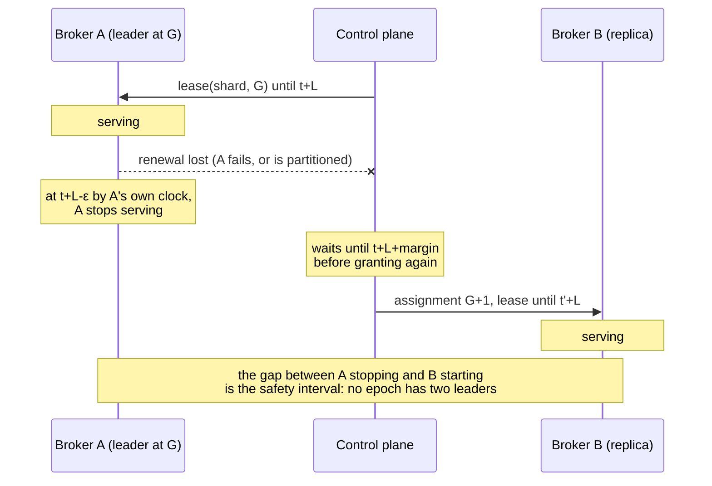
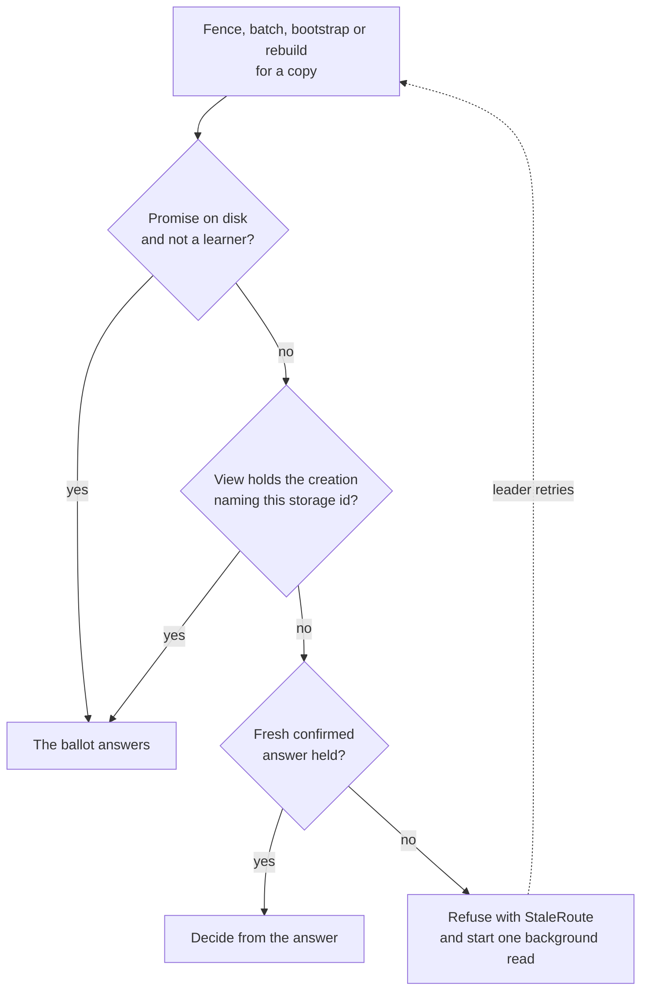
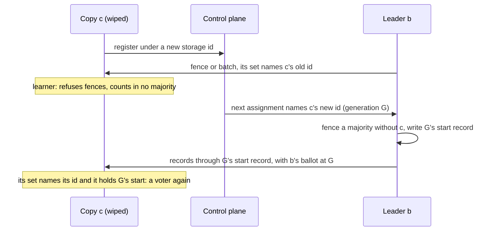
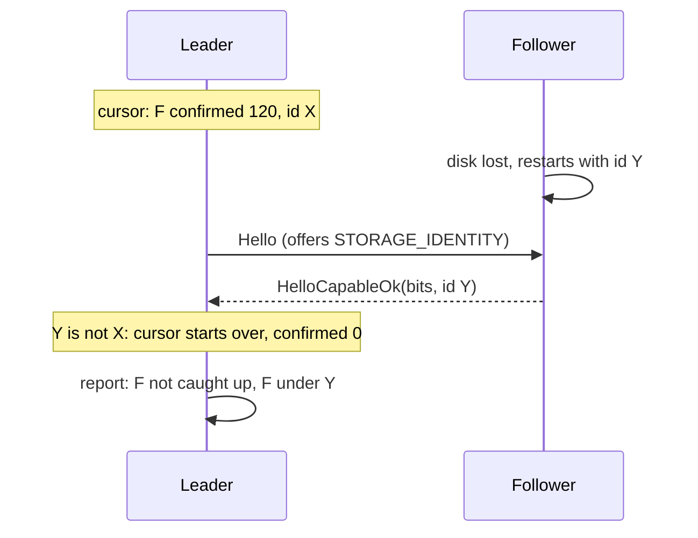
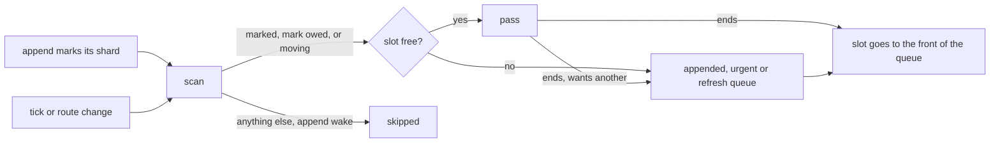

# Shard replication and leader failover

**Decision: leadership is a time-bounded lease issued by the control plane, and
replication is log shipping from the leader to its followers. Per-shard Raft is
rejected.**

Recorded with the replication design (#110). The rejected alternative and what would overturn the
decision are both below.

## What has to be true

Constraints first, because the comparison is only meaningful against them.

**Safety.** At most one broker may commit writes for a shard at a given epoch,
under any combination of partition, pause, and clock error the failure model
admits. A record acknowledged under `Quorum` must survive any failure the
configured majority tolerates.

**Availability.** A shard survives its leader failing. It also survives the
control plane being briefly unreachable: a broker must not stop serving because
a metadata service restarted.

**Write latency.** A publish already crosses ingress, offset assignment,
durability, and fanout in a fixed order. Replication adds one network round trip
for `Quorum` and none for `Leader`. It must not add a *consensus* round trip to
the common path.

**Operational.** A broker holds many shards. Whatever runs per shard runs
hundreds or thousands of times per broker.

**Dependency.** The storage layer is fixed. Its invariants are load-bearing and
documented, and a replication design that violates them is not a replication
design, it is a storage rewrite.

## The constraint that decides it

`docs/storage-format.md` and `docs/durable-storage.md` state it plainly:

> **Records are never rewritten**, which is what lets recovery keep trusting
> "valid bytes end at EOF".

That single property is why torn-tail repair is sound, why a missing index can
be rebuilt, and why preallocation reserves blocks without changing `st_size`.

**The invariant is narrower than "never rewritten", and it has to be.**

An earlier version of this document argued that Felix avoids truncation
entirely, because a leader only ships records it has committed. That is false
under `Quorum`, where shipping is what *produces* the commit: a follower stores
a record before any majority holds it, so a leader that dies mid-flight leaves
that record on some followers and not others. The next leader may legitimately
reuse the offset. Every leader-change scheme has to reconcile that, and Felix is
not an exception. `Divergence::Conflict` exists precisely because it happens.

The invariant that actually holds, and that recovery depends on, is:

> **No record at or below the high-water mark is ever rewritten.**

Below the mark a record is on a majority and can never be un-committed. Above it
a record is a proposal, and discarding a proposal the cluster did not adopt is
not the same act as rewriting history. Torn-tail repair and interior-corruption
detection rest on the *committed* prefix being immutable, which this gives them.

So the case against per-shard Raft is not about truncation, because truncation
is required either way. It is:

1. **Election and clock trade-offs.** Raft elects by term and majority vote,
   which needs no clock assumption but adds a round of voting to every failover
   and a second failure detector beside the one the control plane already runs.
   Leases reuse the heartbeat the broker already sends, and pay for it with the
   safety interval described below.
2. **Two logs, or one.** Raft over the stream log means either the segment log
   *is* the Raft log (with Raft's index and term bookkeeping in the record
   format), or every record is written twice and the two can disagree after a
   crash. The second is a durability path the storage design deliberately does
   not have.

Neither is a tuning problem. Both are a different storage layer.

The storage layer was in fact built anticipating the other answer:
`docs/durable-storage.md` was written with replication in mind: `seal`'s
checksum and `read_range`'s bounded paging exist to serve it. Sealed-segment checksums and
bounded range reads are the primitives of *shipping*, not of consensus.

## Why the control plane being Raft-backed does not settle this

Making control-plane metadata highly available is separate work, and Raft is
the right tool there. It does not follow that payload replication should use Raft, and the
issue asks for this to be said explicitly.

The two have opposite cost profiles:

| | Control-plane metadata | Stream payload |
| --- | --- | --- |
| Volume | Assignments, tenants, streams: kilobytes, changing rarely | The entire data plane |
| Groups | One, for the cluster | One per shard: hundreds or thousands per broker |
| What consistency buys | Linearizable reads of small state everyone must agree on | Durability of records already ordered by a single writer |
| Cost of a round trip | Paid once per metadata change | Paid on every publish |

A stream's records are already totally ordered by their leader. Consensus is not
being asked to *establish* an order; the log has one. It is being asked to
replicate an existing order durably. That is a weaker requirement than Raft
solves, and paying Raft's price for it is paying for agreement that has already
happened.

## The selected design

### Leases

The control plane grants a **lease** on `(shard, generation)` to one broker for a
bounded duration `L`. The lease is the authority to serve; the assignment alone
is not.

A lease is bound to the generation. A new generation is a new lease, never a
renewal of the old one, which is what makes generation the epoch that fences
writes.

The leader renews through the heartbeat it already sends. A renewal that does not
arrive before expiry means the lease lapses; nothing revokes it explicitly,
because a revocation cannot be delivered to a partitioned broker, which is
precisely the case that matters.

### The exact condition under which a broker may accept a write

A broker may accept a write for shard `S` if and only if **all** of:

1. It holds a lease for `S` at generation `G`.
2. Its own monotonic clock reads earlier than `expiry(G) − ε`, where `ε` covers
   clock drift and the time between this check and the record reaching disk.
3. Its local shard state for `S` is open at exactly generation `G`, the check
   `IngressRouter::dispatch` already performs.
4. For a `Quorum` stream, a majority of the replica set for `G` **including the
   leader** has durably stored the record. For a `Leader` stream, the leader's
   own configured durable commit point has been reached.

Conditions 1–3 are checked **twice**: once when the request is admitted, and
again immediately before the record is committed to the log. The second check is
not redundant. Everything between them can take arbitrarily long (a full ingress
queue, a slow fsync, a VM pause), and a lease that was valid on admission may
have expired by the time the bytes reach the disk. Fencing only at the routing
boundary leaves exactly the window this design exists to close.

**As built, the commit check is one gate.** Every write path already enters the
shard's write fence right before it claims its place in the log: a direct or
idempotent publish, a forwarded publish on the owner, a cache put or delete, a
counter add, a consumer-group ack, nack or dead-letter change, and a Kafka
produce. The fence checks the generation (condition 3) and reads the lease
against the clock (conditions 1 and 2), so no path can skip either. A write
that took its place at admission and waited in a queue has the lease read
again when it claims its offsets. While the lease has lapsed the fence refuses
everything, retryably, and serves again once a heartbeat renews it.

For a `Quorum` write, condition 4 is followed by the lease once more, when the
mark releases the acknowledgement: a broker whose lease lapsed while it waited
answers "unknown" rather than acknowledging, which is `AckChecksLease` in
`FelixShard.tla`. The model says that check is not what keeps an acknowledged
record: `FelixShardAckWithoutLease.cfg` drops it, lets the leader act on its
report's answer as the code does, and with clocks drifting under the real
margins TLC finds leaders acknowledging on a lapsed lease, and after being
replaced, and no acknowledged record lost. What does keep it is the report:
a leader acknowledges only on a report stored for its own generation, and
promotion reads that generation's report.

Once the fleet finalizes `majority_ack`, a `Quorum` stream shard takes the
clock out of this altogether: a promoted leader fences a majority and takes
any tail ahead of its own before it serves, and a write is acknowledged once a
majority has answered that it holds it at the current generation, with no
lease at admission, at the commit or at the acknowledgement, and no report.
See [Acknowledging by the followers](#acknowledging-by-the-followers).
`FelixShardFencedAck.cfg` keeps every acknowledged record with no margin on
either side of the lease; `FelixShardUnfencedAck.cfg`, the same without the
fence, loses one. See [`docs/formal/README.md`](formal/README.md). A `Leader`
stream, a cache, and every shard in a fleet that has not finalized
`majority_ack` keep the lease and the report exactly as above.

The commit check refuses a publish even when it was acknowledged on enqueue
(`ack_on_commit` off), since writing it would be the split brain. So admission
reads the clock for such a publish and, with little lease left, waits for the
write instead of acknowledging the enqueue. A pause after the ack can still
strand one; it is counted in `felix_broker_acked_publishes_dropped_total`. See
`docs/semantics.md`, "Consistency".

### Failover

1. The lease lapses (no renewal within `L`).
2. The control plane selects an eligible replica: one whose durable high-water
   mark is within the configured catch-up bound of the last known committed
   offset.
3. It publishes assignment generation `G+1` naming that replica as leader, and
   grants it a lease.

The control plane must not publish `G+1` before it is certain no broker can still
believe it holds `G`. With lease duration `L` granted at control-plane time `t`,
`G+1` may be granted no earlier than `t + L + margin`, where `margin` covers
clock drift between the two parties and the network delay of the grant itself.
The leader stops at `t + L − ε` by its own clock. The gap between those two
instants is the safety interval, and it is why leases are safe without
synchronized clocks.

The broker cannot observe `t`, so it anchors at the instant it **sent** the
heartbeat. That is always at or before `t`, so the round trip comes out of its own
lease rather than out of the margin. Anchoring at the instant the *response* was
handled runs the other way: a buffered read or a VM pause in between would push
the lease past `t + L`, which is the safety interval being spent by the same
kind of stall the twice-checked conditions above exist to survive.

The safety interval is the whole mechanism, so it is worth seeing:

  

Nothing in that sequence requires A and CP to agree on the time. It requires only
that neither clock runs more than `ρ` faster or slower than real time, so the two
instants cannot cross.

As built, `L` is the control plane's `expiry_timeout_ms`, which every heartbeat
response carries. The broker gives up `ε = L/4`. The control plane marks a
silent broker down, which is what lets placement hand its shards on, only after
`L + margin`, where the margin is `FELIX_NODE_REGRANT_MARGIN_MS` and defaults to
`L/4` (it may not be set lower). Silence is measured twice and both have to
agree: against the store's clock, which stamps heartbeats, and by the sweeping
instance's own monotonic clock, which starts over whenever it sees the stamp
change and whenever the instance starts watching (a restart, a Raft election, or
the store coming back). The store's clock is a wall clock, and after an election
or a database failover a different machine's, so a step forward alone could
otherwise expire a broker still inside its lease. `FelixShardRealMarginsLease.cfg`
checks these margins, a quarter each side against clocks that drift by a
quarter, and passes; with the control plane's margin at zero it finds two
brokers serving. `FelixShardRealMargins.cfg` adds a `Quorum` write carried
across a promotion under the same margins and drift, and every acknowledged
record survives.

### Failover on the followers' word

The lease decides when failover happens: a dead leader is replaced only once
it is marked down, `L + margin` after its last heartbeat, and a leader that
still heartbeats is never replaced at all, even when none of its followers
can reach it. Once a deposed leader is kept out by the fence instead of the
clock, the wait buys nothing. So the followers say when the leader is gone,
and the control plane acts on that.

**Which shards.** A durable `Quorum` stream, once the fleet has finalized
`generation_start`, `majority_ack` and `lease_free_reads`, which is what a
broker needs to acknowledge and read without the lease: it uses either of
the last two only alongside `generation_start`, and the control plane
refuses to finalize them before it. With `majority_ack` a deposed
leader cannot get a write acknowledged once its successor has fenced a
majority, and with `lease_free_reads` it cannot serve a read or a group
commit without a round of fences either. Without the second it still serves
reads on its lease, and replacing it before that runs out would let it hand
out values its successor has since overwritten. `Leader` streams and caches
keep the lease.

**Which leaders.** The enabled set says what brokers may do, not what a given
leader does. A broker learns the set on its next heartbeat after the finalize,
so for up to a heartbeat a leader can still be on the lease in a fleet that
has finalized all three. So each leader says in its replica report whether it
serves the shard by round (`by_round`): true only while it acknowledges by its
followers and its `Quorum` reads go by a round. Placement acts on suspicion
against a leader only when its latest report at the current generation says
so (`suspects` in `placement/replica_positions.rs`), and only if that report
came from the node's current incarnation. A broker that restarts within a
report's lifetime can lead again at the same generation, and its last report,
from the process that is gone, still says `by_round`. Registration moves the
node to a new incarnation before the new process can hold a lease, so a
placement pass that reads incarnations after it no longer counts the old
report. A pass that read them before can still promote on it once the new
process holds a lease, so that process acknowledges nothing on the lease
alone until it has decided how it serves the shard. It takes the enabled set
from its registration answer, before the heartbeat that grants the lease, and
in a fleet that reads by round it refuses group writes, the one thing it would
acknowledge on the lease alone, until a replication pass has passed over the
shard at its generation with that set. Replication starts before registration,
so an earlier pass can see an empty set; it decides nothing and does not count
(`Serving::decided` in `quorum.rs`). Its writes wait for a mark its followers
decide and its `Quorum` reads for a round, and a promotion's fence ends both.

Changing a stream's consistency bumps no generation, and a report at that
generation that says `by_round` stands until the leader's next one. Placement
acts on suspicion only on a shard whose stream it read as a durable `Quorum`
stream in the same pass, so a report left over from before a change to
`Leader` is never read on its own. What remains is a pass that read the
stream before the change and writes after it, while the leader serves on its
lease. A change to a stream's consistency or durability advances the
placement token, so that pass's write is fenced and it replans from the new
catalog (`docs/control-plane.md`, "How shards get placed"). The token moves in
the same lock, transaction or log entry as the change, and the broker learns
the change only from the catalog after it commits, so no pass that read the
old consistency can write once the leader serves on its lease. The same fence
covers a change to `Quorum`: a pass that read `Leader` planned a failover that
need not keep a majority of the set. Under Raft this holds once every member
is at metadata level 19; before that a patch moves no token.

Reports carry the incarnation the broker last registered,
and the control plane stamps `leader_incarnation` only when it matches. A
Postgres member that predates the column updates a report without it, so the
flag is read as true only while `by_round_at` matches the row's
`reported_at_millis`. A report without the
field, from an older broker or a Raft group not yet at level 11, reads as the
lease, and the leader is replaced only once its lease has lapsed. `FelixShardSuspicion.cfg` lets placement promote on any read
before the lease lapses, the old leader alive and renewing, and loses
nothing and opens no second leader at a generation; `FelixShardSuspicionLease.cfg`, the same where the lease still
decides who serves, finds two brokers serving.

**The followers' half.** Every broker pings each broker that leads a shard
it follows, four times per `FELIX_LEADER_SUSPECT_AFTER_MS` (5 s by default),
with `Ping` on the peer connection's control lane. The leader answers it at
once, never behind a slow fence, from its serving runtime
(`docs/internal-protocol.md`, "Pinging a leader").
A leader that has not answered for the whole window is named in the
follower's next heartbeat, which goes at once rather than an interval later.
A leader first watched gets a whole window, and a peer that did not offer
`PING` is not watched, so an upgrade does not read as a death. A leader the
follower's node list has no address for yet is not watched either: not being
able to reach it says nothing about whether it is up.

**The control plane's half.** It keeps the names as soft state, like a
heartbeat: in the store under the memory and Postgres backends, and in the
Raft leader's memory under Raft. A name counts for two heartbeat intervals,
since a broker that still suspects says so on every beat and one that has
stopped says nothing. Placement then treats a live leader as gone when the
followers naming it are a majority of the set, the leader counted in the set
but not among them, and a reported follower can take over
(`deposed_by_followers` in `placement/plan.rs`). From there it is an
ordinary `Quorum` promotion: the follower furthest ahead in the last report,
the set kept with the old leader in it, and the new leader fencing a
majority before it serves. Not while a move or a replacement is under way,
since those change the set the fence counts and end through their own steps.
With no reported follower the leader keeps the shard, since it is alive and
may be the one the rest can still reach.

A majority is the right number from both sides. A leader that a majority of
its set cannot reach cannot get a write acknowledged anyway, so replacing it
costs nothing that was working. And those followers are a majority that can
answer the new leader's fence. One follower cut off alone moves nothing.

**Failover time** is then the replica set's own: the suspect window, plus
the heartbeat that carries it, which goes as soon as the window ends, plus
the placement pass it wakes on the instance it reaches (or the next pass,
`FELIX_SHARD_RECONCILE_INTERVAL_MS`, on another), plus the fence. With the
defaults that is a little over 5 s, against at least `L + margin` (15 s plus
3.75 s) for a lease lapse, and it does not depend on the control plane's
expiry timeout. A leader partitioned from its followers but not from the
control plane, which the lease never replaced, is replaced the same way.

A detector that is wrong costs availability, never safety: the replaced
leader rejoins as a follower. A slow leader that misses a whole window of
pings from a majority is replaced, which is the trade a shorter window makes.

**What it does not change.** The control plane still makes the decision, so
with the control plane down a dead leader is not replaced, unless the fleet has
finalized `replica_election`. Replicas electing a leader among themselves is
the rest of issue #1009, designed in
[Electing without the control plane](#electing-without-the-control-plane).

Evidence: `a_leader_a_majority_cannot_reach_is_replaced_while_it_heartbeats`,
`one_follower_alone_does_not_move_the_shard`,
`a_leader_stream_is_not_moved_on_the_followers_word`,
`with_nobody_caught_up_the_leader_keeps_the_shard` (placement);
`a_suspicion_counts_only_with_all_three_features`,
`a_suspicion_counts_for_two_heartbeats`; `a_leader_silent_for_the_window_is_suspected_until_it_answers`,
`a_ping_is_answered_and_an_older_broker_is_not_pinged` (the follower);
`a_suspicion_is_sent_without_waiting_for_the_next_beat` (the heartbeat);
and the cluster test
`a_leader_its_followers_cannot_reach_is_replaced_while_it_heartbeats`.

### Fencing a promotion

The lease keeps a deposed leader out only while clocks drift within the bound
the margins assume. The fence is the part of the modelled design that does not
need that: a promoted leader asks each replica to take its generation before it
opens for writes, and a replica that has taken it refuses every older leader.
Any majority that could acknowledge a record overlaps the majority that took
the fence, so the deposed leader cannot find one. `FelixShardFencedAck.cfg`
checks the design with no margin on either side of the lease.

The replica's side is `AnswerFence` in the model. It persists the generation,
fsynced, in the same file that keeps the highest generation it accepted a
leader at, before it answers. From then on it refuses the older leader's
records, bootstraps, rebuilds, and gap answers, restarts included, whatever its
routing view says. The shard's cursor, dead-letter and counter logs check the
shard's own log as well as their own. It answers with how far its log reaches,
its commit offset, and the generation its last record was written at, which is
how the model orders logs (`Ahead`). A leader back from a crash that may have
cost it records refuses instead, for the copy it led, until a newer leader has
shipped to it; see [A leader's own crash](#a-leaders-own-crash).

It is negotiated, not assumed. A broker offers the `FENCE` capability in the
peer handshake, and a peer that did not offer it is never sent `Fence`
(`docs/internal-protocol.md`, "Capabilities"). `FELIX_INTERNAL_FENCE=false`
withdraws the offer.

**The leader's side** is `OpenForWrites`. A broker promoted to lead a stream
shard opens its log, persists its own generation, and then waits in a
`fencing` phase: the shard is routed to it but not servable, so writes are
refused retryably and nothing ships. Replication sends `Fence` to every
replica at once and opens the shard as soon as the answers, the leader's own
copy counted, prove two things:

- **Exclusion.** A majority of every set the fence must cover promised the
  generation, so no older leader can still acknowledge and no second leader
  opens at it. A promise counts only from a copy that kept its ballots.
- **Coverage.** The leader holds every acknowledged record. A leader
  continuing its own generation already does. Any other needs answers from
  trusted copies, ones that hold everything they acknowledged, that meet every
  majority of each set: `2 * trusted >= voters`, so one of two and two of
  three.

Each replica says in its answer whether its copy kept its ballots and whether
it is trusted (its attestation). The rule and what earns each mark are in
[One fence rule for every change of leader](#one-fence-rule-for-every-change-of-leader).
An answer without an attestation, from a broker that predates the rule,
counts for both when it passes today's copy pins, described below. A
memory-only broker, which keeps nothing to attest, and one with
`FELIX_UNIFIED_FENCE=0` count every answer that way.

Before it opens, a leader that is not continuing takes the log of the answer
furthest ahead by (generation of the last record, length), when that is ahead
of its own: it reads it with `ReplicateFetch` from where the two may disagree (the
later of its commit offset and the start of its own last generation), drops
its own records past the first disagreement and any past the end of that log,
and appends the rest. Its requests have a stream of their own on each peer
connection, so they never queue behind a forwarded publish waiting on a
quorum. Where this
leadership begins is recorded only then, so the records it took keep their
own generation. Answers that arrive after the majority are not waited for,
as in the model.

**The voters are the assignment's set, not the addresses the leader has.** A
broker learns where each node is from the control plane's node catalog
(`/v1/nodes`), separately from the assignments, and its routes can be built
before that read succeeds or after a node joined that the last read did not
include. A replica the catalog does not name stays in the route with no
address (`NodeRef::unresolved`), and the peer pool refuses to dial it, so it
counts as a replica that has not answered. Dropping it instead would shrink
every majority counted over the route: with an empty catalog a promoted
leader of three would need only itself and open with neither follower fenced
(#1845). The same list sizes the acknowledgement count, the read round, and
the set the fence carries.

The catalog read runs in the background, and routes never wait for it. A
broker publishes its routes as soon as it has reconciled its shards, with
the newest catalog it has. A control plane that takes the request and never
answers would otherwise hold every route behind a 5 s timeout, longer than
a candidate waits to open (3 s), and no election would settle.

**Without an attestation, an answer counts only from the copy the failover's
report named.** The pins below are how a fence counts an older broker's
answer, and every answer of a leader not counting by attestation. A
follower that crashed under `FsyncMode::Periodic` or `None` comes back under a
new storage identity without the tail it had not synced, and it may already
have answered for that tail: under `majority_ack` the old leader acknowledged
a record on itself and that follower. Counted in the fence, the short copy and
a successor that never held the record are a majority without it, and once
the old leader is gone the record is too (#1335). A wiped follower is the same
case with nothing left. So a failover's assignment carries the storage
identity the replica report it was decided on named for each replica, the old
leader's own included (`fence_storage_ids`), limited to the old set and the
new one, and the promoted leader counts an
answer only when the handshake identity of the connection it came over is
that one. An answer from another identity, or with none from a replica the
report named, still takes the promise and so still refuses the old leader
there, but it counts toward no majority and its log is not taken. The
promise cannot count on its own: the majority that took the fence is the
same one the catch-up trusts to hold every acknowledged record, so a
replica that may have lost some cannot be part of it. A member of the old
set the report named no identity for, but that is registered with one, was
not yet known to its leader when the report was made, so everything it
answered that leader came later and the report vouches for none of it
(`FelixShardFencedCrashCountsUnnamed.cfg` finds the record lost when it
counts).

The control plane keeps these pins when it names the same leader again at a
new generation (a refusal, a stuck rename, an undone move), until that leader
reports serving at the generation it is named at. A rename that dropped them
would let the next fence count the copy they rule out. A member's pin goes
once it is readmitted, since its new copy is then the one the set names.

A fence can also find its generation promised to another node, as a candidate
that stood and withdrew leaves it. When the members that promised it away
leave the old set or the new set short of a majority, the leader reports the
generation refused rather than wait; an answer from a copy the pins rule out
counts as one that cannot help. With no pins on the route that answer still
keeps the fence pending, as before. Every refusal carries the newest ballot
above the generation that the leader learned (from its own copy, a replica
that answered ahead, or, when the set before the generation is unknown, from
asking its set without taking a ballot), and placement names the leader again
above it. Under `joint_fence` it does so only at metadata level 29, where the
store records the generation a skip replaced; below that it renames one
generation up, and a rename that lands on the promised generation is refused
again and moves one more (#2046).

Such a member is named by the identity the reporting leader's own promotion
named it by, which the report carries for each follower the leader has not
reached at its generation (`inherited_storage_ids`, #1574). A leader learns a
follower's identity on its first contact with it, so one it has not reached
acknowledged nothing to it, and every acknowledgement that follower ever gave
went to an earlier leader, from the copy that promotion named or from one
before it. Storage identities never repeat: a wipe or a machine crash
rotates one, and a process crash keeps it only when nothing was lost. An
answer under the inherited identity therefore comes from a copy that has
kept everything it acknowledged. A set change that keeps the leader, such as
seating a replacement for a drained follower, is not a promotion: at the new
generation the leader names a follower it has not reached yet by the identity
it named it by at the generation before, the copy it answered from or its own
inherited one. Otherwise a follower cut off from the leader across the change
is named with an empty identity, and a failover whose majority needs it can
never open (#1922). A leader sends no report while it still
fences, so a copy whose fence answer it did not count is named in its
reports only once it has opened and ships to that copy. A leader that stood
for election inherits no identities, since its route names none. For a member
its report names no identity for and inherits none for, the control plane
takes the one the shard's previous report named it by, as its own identity or
an inherited one, when it stores the report. The argument is the same: the
new leader has not reached that member, so its acknowledgements all went to
earlier leaders, from that copy or one before it. Without it, a failover after
an elected leader crashes names every member that leader had not reached with
an empty identity and can wait for good. Without any identity, from a broker
or control plane that predates the field, the member is named with an empty
identity, which nothing matches. `FelixShardFencedLeaderCrashTwiceNamesByInheritance.cfg`
checks two leader replacements in a row with inherited names, and its witness
shows the second one counting an inherited name. With promotions on suspicion
(`FelixShardFencedCrashNamesByInheritance.cfg`,
`FelixShardFencedWipeNamesByInheritance.cfg` and
`FelixShardFencedLeaderCrashNamesByInheritance.cfg`) the state space is too
big to finish, so the nightly walks sample those instead. A replica the assignment does not
name counts as it always has: one outside the old set, which gave the old
leader nothing to count, such as a new copy a `Leader` failover brings in,
and one registered without an identity, a build from before them, where
there is no evidence either way. The fence waits for replicas that can
vouch for what they answered, which is the old leader itself when the other
follower is the one that lost the tail. The group logs' round follows the
same rule. Every other assignment carries no identities, and a fence on one
counts every answer, as does a broker under a control plane that predates
the field.

The identities are fixed when the failover is written, so a replica that
does not count stays uncounted for that generation, after a clean restart or
an upgrade too. With the old leader gone for good and the remaining followers
unable to make a majority that counts, the shard waits, and the old leader
coming back ends the wait. There are two ways to get there:

- A follower came back under a new identity after a crash or a wipe. With
  the leader gone too, that is two faults, and the records the follower lost
  may be on no copy at all.
- A follower the report named no identity for, because its leader had not
  asked it yet when it reported, and for which the report inherits none:
  neither the leader's promotion, its previous generation nor the shard's
  previous report named one, or it predates the field. It may hold
  everything; nothing vouches for it. Naming it by the
  identity it is registered under would not do: the report's incarnation for
  such a follower is the control plane's stamp as the report arrives, which
  can come after a crash the report predates
  (`FelixShardFencedCrashNamesByRegistration.cfg`). Re-planning the promotion
  on a timeout would not do either: another leader reads the same report.

The way out is the operator's, as for a crashed leader: stop the broker the
shard was promoted to, so placement finds no caught-up replica, run
`felixctl placement abandon`, and start the broker again. While the promoted
broker is up, placement keeps the shard where it is and `abandon` answers
`not_stranded`. `abandon` deletes no copy. It writes a fresh assignment on
live brokers chosen as for a new shard, each opens the copy it already holds,
and the new leader's fence names no identities, so it counts every answer and
takes the copy furthest ahead. What is lost is what no copy in the new set
holds: the old leader's, a copy left out of the new set, and whatever a
rotated follower had really lost. A waiting follower that holds everything
keeps it, as long as the new set includes it. Under Raft the
field waits for metadata level 16, and the inherited identities for level 20;
until then a report carries none and the member is named with an empty one. `FelixShardFencedCrash.cfg`,
`FelixShardFencedWipe.cfg` and `FelixShardFencedLeaderCrash.cfg` check it on
the fenced, follower-acked path, and `FelixShardFencedCrashCountsRotated.cfg`
finds the lost record when the rotated copy counts.

A joint fence that leaves a set with a staged learner can stall the same way
on a leader that does not count by attestation (`FELIX_UNIFIED_FENCE=0`, or an
older broker). It needs a majority of the set with its learner, the learner
refuses as not a replica, and one voter that cannot answer, down or refusing
until a set change readmits it, leaves the fence one short. The shard's status
then reads like `2 of 4 and 2 of 3 voters of the set being left`. The way out
is the same: stop the promoted broker, run
`felixctl placement abandon <name> <shard> --yes`, and start it again. A
leader that counts by attestation needs only half of the set with its learner
and does not stall here (see "One fence rule for every change of leader").

The identity is the evidence because it is what changes on every loss: a
wipe, a crash under a relaxed fsync mode and a restore all give a new one
(see [Storage identities](#storage-identities)). The same identity as the
report means the copy lost nothing since the leader counted it there. A copy
the old leader had already probed under its new identity is named under that
one, but only by a report made after the old leader started its count over,
and that report names the promoted leader caught up to the mark, so it holds
every record the follower's old answers released.

What makes the deposed leader harmless is the majority, not the clock. The
follower it can still reach may never have heard of the promotion from the
control plane, and its routing view would take the batch; the fence it took
refuses it (`a_partitioned_leader_is_refused_by_the_majority_its_successor_fenced`,
with the old leader cut off past its lease and its clock slowed a
hundredfold, and the same frozen).

When the fence applies:

- On every change of leader, not only a promotion: whenever a broker starts
  leading a shard at a generation it was not serving it at, the shard opens
  in `fencing` (`begin_open` in `shards/lifecycle.rs`). That covers a
  promotion, a fresh placement, a move's cut-over, a failover that names a
  move's destination, a cancelled move's hand-back, and a generation of a
  shard the broker serves that skips one, which a promotion of someone else
  that this broker saw only coalesced away gives it. Each of these is a
  generation the control plane picked from its own view, and the fence is
  what keeps out a leader it did not know about, while the catch-up takes
  what that leader acknowledged. Two opens are not fenced: the old leader's
  end of a move, which reopens the log to ship it, not to serve, and the
  generation right after one the broker is serving, which a move's staging or
  a follower replacement step gives it. Every assignment write raises the
  generation by one, so nobody led in between, and fencing it would close a
  serving shard at each step; a leader cut off from a majority of the new set
  would then stop reporting, and placement waits on that report to finish the
  step. See [Every change of leader](#every-change-of-leader).
- For stream shards and cache shards. A cache shard fences its cache log, which
  holds the shard's one promise per replica, then its counter log, and takes
  the furthest ahead of each by the same order
  (`the_counter_log_furthest_ahead_is_taken_too`). A follower refuses an older
  leader on both logs once it took the cache log's fence
  (`a_counter_fence_older_than_the_cache_fence_is_refused`). Taking another
  log drops the cache's index or the counter sums above the cut, so the
  shard serves what its log now holds (`a_superseded_put_is_gone_from_the_index`).
  A cache kept in memory has no log to fence and opens on the lease. A cache
  or counter log this broker has but cannot open (the shard is closing, out of
  file descriptors, a failed recovery) is not the same: under `fenced_caches`
  the shard stays closed and the next pass tries again
  (`a_cache_log_that_fails_to_open_keeps_the_shard_closed`,
  `a_counter_log_that_fails_to_open_keeps_the_shard_closed`); before it, the
  shard opens on the lease.
- Only when every replica in the new set offers both `FENCE` and
  `TAIL_FETCH`, and for a cache shard `CACHE_FENCE` too, as its latest
  handshake with this broker in either direction says, and this broker offers
  them too. Otherwise the shard opens at once
  on the lease, exactly as before (`a_mixed_fleet_fails_over_on_the_lease`),
  and a peer that did not offer them is never sent either message.
- A stream shard's consumer-group state as well, as one pair. See
  [Group state at promotion](#group-state-at-promotion) below.
  `felix_broker_promotions_opened_total{path}` says which path each new
  leadership took, promoted or not. It counts a leadership when the shard
  is let go to serve, so a refused open that is retried is counted once.

The cost is availability. A promoted leader that cannot reach a majority of
its replicas does not serve, where on the lease alone it would have opened;
it retries after 200 ms (`FENCE_RETRY`), doubling the wait with each failed
attempt up to 2 s (`FENCE_RETRY_MAX`). It retries only while it still leads
the route at the generation it is fencing. Once the route names another
leader, or the broker stands for a generation no route names yet, there is
nothing to retry until the route changes. The routing feed wakes replication
when it does, or the next tick picks it up (#1941). Every other change of leader pays a round trip to a
majority before it serves; a write that reaches the broker meanwhile waits
for it, within the move hold's window (`FELIX_SHARD_MOVE_HOLD_MS`), instead of
being refused. So does one that arrives while the shard's log is still
opening, or in the moment between the fence settling and the broker
publishing that it serves the shard (#1085). It could not have acknowledged a `Quorum` write
without that majority anyway, but a `Leader` write it would have.

**What this does not change on its own.** Until the fleet finalizes
`majority_ack`, acknowledgements still come from the report and the lease, so
a deposed leader's `Quorum` write is kept unacknowledged by the report gate as
before; the fence adds the followers' refusal on top.
`FelixShardFencedPromotion.cfg` checks this configuration, the fence with the
report and the lease, under the real margins. Once `majority_ack` is
finalized, see [Acknowledging by the followers](#acknowledging-by-the-followers).
A `Leader` stream acknowledges on the leader's own commit, which no follower
sees, so its deposed leader is kept out by the lease alone either way.

#### One fence rule for every change of leader

A leader that offers `UNIFIED_FENCE` counts every change of leader (failover,
election, rename, set change, readmission, a continuing leader) by one rule, instead of
a counting of its own for each with special cases for copies doubted after an
unclean crash. It offers it unless `FELIX_UNIFIED_FENCE=0`, and only with a
durable directory. `docs/formal/FelixShardUnified.tla` checks the rule.

A fence has to prove two separate things before the new leader at generation G
opens.

- **Exclusion.** No leader below G can acknowledge anything after G opens, and
  no second leader opens at G. Only ballots matter here. The fence needs a
  majority of every set it must fence to promise G, and a promise counts only
  from a copy that **kept** its ballots. Ballots are fsynced, so an unclean
  crash keeps them. A wipe or a restore loses them. Such a copy counts again
  only for a set introduced after the loss, once that set's leader has shipped
  to it (it was readmitted).
- **Coverage.** The new leader holds every acknowledged record. Only logs
  matter here. A continuing leader (it served G-1 in the same process, its
  ballot still names it at G-1 or G, and no flush failed since) has it
  already. Any other leader needs answers from
  **trusted** copies that meet every majority of each set it must fence
  (`2 * trusted >= members`), and takes the log furthest ahead by (last
  generation, length).

A copy is trusted when its process started clean and its ballots are kept, or
when, since its last unclean start, a leader shipped it a batch that left it
level through **max(the leader's start record, the batch's commit offset)**,
with a commit offset above zero. Both halves matter. The commit offset is the
quorum offset at the leader's generation, and right after an open it can sit
below records an earlier generation acknowledged (`VouchBelowStart`). The
start record alone is short of what the leader acknowledged since
(`StandInNoCatchUp`). For a copy that lost its ballots, only a leader that
readmits it may vouch for it.

On an idle shard nothing would vouch. The batch that brings a follower level
goes out before the follower's own answer raises the mark, so it carries a
commit offset of zero, and a level follower is sent nothing else. The copy
would stay untrusted until the next client write, and one more failure could
then leave a fence that never covers, although a caught-up copy exists. So a
leader of a `Quorum` shard sends a level follower its last record again, with
the current mark, until the follower has stored one batch that left it level
through the leader's start record and a commit offset above zero
(`FollowerCursor::mark_carried`). A new process on the follower is owed one
again, since it may not have the old process's trust. A follower that does
not take generation labels is never owed one: without labels no batch can
vouch for it. The batch holds only records the follower already has, so
the vouch is the same as for any other batch: level through the start record
and through the mark. `FelixShardUnifiedIdleVouch` checks that such a
follower is trusted again while its leader serves, with no writes. Its
`Legacy` twin, a leader that sends a level follower nothing, leaves it
untrusted.

The control plane keeps a durable form of a readmitting leader's vouch:
when the leader of a set that names a replaced copy by its new storage id
reports it caught up, the assignment records `readmitted {node, storage_id,
generation, offset}` (see `docs/control-plane.md`, "Re-admitting a replaced
copy"). The route carries these records to every broker, and the copy checks
them itself when it answers a fence. A record stands in for the directory's
vouch when it names this broker and its current storage id, and the copy's
log shows a last generation of at least `generation` and ends at or past
`offset`. It replaces only that vouch: a copy whose promises do not count,
that was given up, is doubted, is on a poisoned process, or started
uncleanly with no leader vouching since still attests untrusted. The leader
reads no records; it counts what each copy attests, its own included. The
generation clause is the commit-offset half above for this source: without
it the offset alone could vouch for a copy missing records an earlier
generation acknowledged. The record never makes a copy's promises count.
The control plane records it from metadata level 30, and not from a
leader that elected itself: that leader may have opened before the copy was
replaced, at a generation the control plane adopted later for a set naming
the new id, so it does not hold what the old copy acknowledged at that
generation. A control plane below level 30 sends no records, and the fence
then trusts on the answer alone. A broker that starts without the control plane
attests neither kept nor trusted until the restore check has run, because a
restored directory looks clean until then (`CountsForgotten`,
`TrustsRegistered`). Once the check passes, it attests kept ballots and
readmissions as a start that asked first would. A failed flush poisons the
log and may have dropped acknowledged pages, so from then on the process
attests no trusted copy, without waiting for the next start.

In the code a directory **kept** its ballots when it was never restored and
never replaced a lost copy, and, after an unclean start, the control plane's
record names the storage id it had before (`Kept` in
`services/felix-broker-service/src/node/storage.rs`). A directory that lost
them keeps that mark for good, so each of its copies counts again only once
readmitted: the copy's log counts a set newer than any ballot it took
unkept that names it under its storage id now, as a voter, and holds that
set's generation start, shipped by that set's leader or a later one. With no
unkept ballot to count from, that needs a start that minted the storage id
(a wipe, a rotation, or a corrupt id file replaced), so only a set written after the loss can name it. A
directory that lost its copies under an older id, as one swapped back after
the node ran under another, may be named by sets from before the loss, so
its copies get no readmission. So does a copy not yet readmitted when the
broker restarts cleanly, until a later rotation. The broker records the set's
generation in the directory's `copy-trust` file (`docs/storage-format.md`)
before the copy's promises count for that set and later ones, and marks the
copy untrusted until a vouch after the readmission. The record holds until
the storage id rotates. Trust after an unclean
start is `UncleanStart::trust`, set where a replicated batch is applied, and the
answer is `ReplicaHandler::attestation`.

#### Readmission and elections

Both readmission rules, the readmitting set's promises and the control
plane's record, assume the leader of the readmitting set opened its
generation after the copy was lost. A leader the control plane named always
did: a set naming the new storage id is written after the broker registered
it. An elected leader the control plane adopted may not have. It can open at
G before the loss, and the control plane can later adopt G for a set naming
the new id. That leader's generation start then comes before records the old
copy acknowledged at G. The control plane already records no `readmitted`
entry from a report that says the leader elected itself, but an elected
leader that restarts and is named again at the same generation reports
without saying so, and a copy readmitted at an adopted generation looks like
any other.

Elections run only once the fleet finalized `replica_election`, and the
control plane adopts an elected leader only then. So a readmission counts
only while the broker knows the fleet has not finalized it
(`QuorumMarks::readmission_counts`): on the copy, for what it attests, and on
the leader, which counts no promise kept only from a readmitting set and no
trust the answer says rests on the record alone. A copy can take a new
record from the watch before it hears the fleet finalized
`replica_election`, so the leader's view decides. A
broker that has not yet had a registration answer cannot rule elections out
and gives no credit. Once `replica_election` is finalized a copy on a
directory that lost its ballots counts as it did before readmission was
recorded: for no set, and untrusted. That costs
liveness for fleets that opt into internal election, which is off by default
(`FELIX_INTERNAL_ELECTION`), and nothing for the rest.

The full fix is planned for after 0.7. A leader would report whether its
epoch was fenced over a set of its own generation, the control plane would
record readmissions only from such a leader (a new report field and metadata
level), and the gate above would go.

Trust has to outlive the process. A copy that crashed uncleanly, answered a
fence and then restarted cleanly looks like any clean copy: the ballot it took
replaced whatever said it was short, and a clean start has no unclean record.
So a start that rotates the storage id first writes `copy-trust` at the
durable root saying no copy is trusted, and each vouch adds the copy to it,
synced, before the copy attests trusted (`docs/storage-format.md`). A later
clean start reads the file, and only the next rotation clears it again. The
same file names the copies this broker led before the crash, written before
such a copy takes a newer leader's ballot, so the refusal in "A leader's own
crash" also survives that ballot and a clean restart. It also names a copy that took a
ballot while its promises counted for nothing, such as a learner answering a
unified fence. Until a set newer than that ballot readmits it, that copy
attests no kept ballot, and an
older caller continuing from that ballot is refused as before, even after a
crash that kept the ballot. A record that does not decode, or names
another storage id than the directory's (an older release may have rotated
it), marks every copy all three ways. Only a leader's batch clears a doubt,
so while such a copy's leader is down an older caller's fence passes only by
the set-of-two exception (`acknowledged_by_two`) or a continuing leader.
Every rotation of the storage id, at startup, by a restore, or by the
deferred restore check while the broker runs, goes through
`copy_trust::rotate_storage_id`, which distrusts every copy, the running
broker's record included, before the new id is written. A memory-only broker has
no file and attests no kept ballot, so it never attests trusted.

The sets a fence must cover are its own and the set of every start from an
**anchor** up to G. The anchor is a generation with evidence it opened. In the
code that is the leader's own log holding a record written at its kept set's
generation; without one, every set the log kept as left across fences that
never opened is fenced too (`unopened_sets` in `promotion/joint.rs`). A set in
between is never dropped because nobody mentions it (`DropUnopenedLeaving`).

A replica answering a fence refuses only on ballots and sets: a newer ballot, the
same ballot for another node, or a newer set than the fence carries. A copy that
is doubted, led before or a learner answers, and says in the answer whether it
kept its ballots and whether it is trusted. The leader decides what the answer
counts for. An answer from a peer that predates the rule counts as it does
today.

On the leader's side the counting is `Counted` in
`crates/server/felix-replication/src/promotion.rs`: an attested answer is a
promise for a set when its `kept_from` is at or below that set's generation,
and coverage when it is trusted, whatever copy the route pins. Its own copy
counts by the attestation it would give another leader (`OwnCopy`). A joint
fence counts both per set. An attested answer that promises nothing still
takes the ballot, and its log may still be the one taken, but the fence
waits rather than report a refusal, since a later generation might count it.

A joint fence counts each set it leaves twice: its voters alone, and its
voters with its learners, because a leader that counted a staged learner as a
voter may have acknowledged on a majority of the larger set. A learner the new
route does not name refuses every fence as not a replica. With a majority of
the larger set needed, a set with one staged successor then needs every voter
but one, and one voter that cannot answer stalls the fence for good. So a
leader that counts by attestation needs only half of the set with its
learners (`2 * promised >= members`), beside a majority of its voters, and
does not ask a learner the route no longer names. Half of a set meets every
majority of it, so no acknowledgement on the larger set is missed, and two
fences that both know the learners meet in the voters. With one learner a
majority of the voters is already half of the whole set. With two it is not,
and the half still matters: without it, an acknowledgement on one voter and
both learners slips past a fence on the other two voters
(`FelixShardUnifiedLearnerVariantDropped.cfg`).
`FelixShardUnifiedLearnerBlocking.cfg` and
`FelixShardUnifiedLearnerBlockingTwo.cfg` check the rule, and
`promotion/tests/joint_learner.rs` the code. A leader that does not count by
attestation still needs a majority of both.

In the code the replica answers this way only to a caller that offered
`UNIFIED_FENCE`, since only such a caller gets the attestation, and only for
the shard's own log (`ReplicaHandler::fence_from`). A learner, or a copy the
fence's set lists only as a learner, answers with `kept_from` = `u64::MAX`, so
its promise counts for nothing, even when its ballot names the fencing leader
at the generation before: that ballot may be one a unified fence gave it while
its promises counted for nothing. Before it takes such a ballot the replica
records the copy as unkept in the directory's copy-trust record, so after a
crash that keeps the ballot an older caller still does not count it, until a
batch readmits the copy. A copy this broker led before an unclean crash
answers untrusted. Before it takes the new ballot the replica records the copy
as doubted, in the process and in the copy-trust record (refusing the fence
if it cannot write it), so after a clean
restart the copy still attests untrusted and an older leader's fence is still
refused. A copy given up on disk before a clean restart still refuses, as it
does an older caller. Group and counter logs carry no
attestation and refuse as before. Every other caller gets today's refusals.

For a leader and replicas that both use the rule, it replaces the short-copy
refusal, the learner's refusal, the continuing leader's ballot window and the
storage-id pins on a fence. The group and counter logs carry no attestation
and still count by the pins. A lone trusted copy with every other member doubted
or down still waits for the operator, as it does today.

#### Group state at promotion

A stream shard's consumer-group state is two logs: the dead letters and the
cursors. A group's dead letter is written before its cursor passes the
record, so a cursor is only good while the dead letters it passed records on
are beside it. Without them it passes a record that is neither redelivered
nor listed as dead. The two logs flush separately, are shipped separately,
and are each replaced on a follower by a newer leader's, so any copy can be
left with a cursor whose dead letters are gone. What keeps the guarantee is
one rule, applied wherever a copy is about to be served.

- **A cursor says what it needs.** Each cursor record carries the
  dead-letter log's end when it was committed and the generation that wrote
  the entry at that end, and the group's origin: where it was last placed
  needing no dead letter (see `docs/storage-format.md`, "Consumer-group
  cursor values"). The leader syncs its dead letters before a cursor that
  needs them and before it ships them, so one generation never puts two
  different entries at one offset where a cursor or a follower could see
  both, and the pair names those dead letters exactly
  (`a_commit_records_the_dead_letters_beneath_it`). Shipping unsynced dead
  letters was a hole TLC found: a leader that crashed after shipping one
  wrote another at the same offset and generation, and a cursor needing the
  second was taken by a follower holding the first.
- **It is checked before the shard is served.** Before a broker serves a
  shard's groups, once after it starts, again at each term and again after
  replication rewrites either group log, each group whose latest cursor does
  not stand on the dead-letter log it holds is put back, by appending, to its
  latest record that still stands or else to its origin, and that is synced
  first (`a_cursor_left_without_its_dead_letter_falls_back`,
  `the_latest_cursor_that_still_stands_is_kept`,
  `a_refilled_dead_letter_log_does_not_restore_a_cursor`,
  `a_replaced_dead_letter_leaves_its_cursor_unserved`,
  `a_rebuilt_dead_letter_log_leaves_its_cursor_unserved`). That covers a
  crash that kept one log's tail and not the other's, a follower's divergent
  suffix, a rebuild, and anything a promotion took. A group is never
  removed, so a seek `if_new` finds it where it fell back rather than
  creating it afresh at the tail
  (`an_if_new_seek_finds_a_group_that_fell_back`).
- **Fenced in one round.** The promoted leader sends `Fence` for both group
  logs to every replica at once, beside the records' fence, and counts a
  replica only once it has taken both
  (`a_replica_counts_once_it_took_both_group_fences`). Each group log keeps
  the promise on its own log, so the old leader is refused there whichever
  fence lands first.
- **Taken from the replica furthest ahead.** Of the answers and its own
  copy, the leader picks the pair furthest ahead, ranked by the dead-letter
  log first, each log by (last generation, length), and takes that replica's
  dead-letter log (`the_group_logs_furthest_ahead_are_taken_too`). It merges
  that replica's cursors into its own, each group going to the further
  position, by appending: its own further cursor survives while it still
  stands (`an_own_further_cursor_is_kept_while_it_stands`), and no group it
  had is erased (`a_group_only_this_broker_had_is_kept`). Merged cursors are
  checked like any other, so taking them from a different lineage than the
  dead letters is safe (`a_cursor_is_checked_against_its_dead_letters_generation`).
- **Labelled like the records.** A leader records where its generation
  begins on both group logs when it opens the shard and again when its fence
  opens it, and ships them labelled to followers that offer `GROUP_FENCE`. A
  newer generation's shorter pair then outranks an older generation's longer
  one (`a_newer_shorter_pair_is_kept_over_an_older_longer_one`,
  `an_open_labels_the_group_logs`,
  `a_fenced_open_labels_the_group_logs_past_what_the_fence_took`). A group
  log this broker cannot open or label at that point keeps the shard closed,
  as a stream or cache log does, and the next pass tries again.
- **Never waiting for good.** A replica without consumer groups answers the
  group fence as two empty logs (`a_replica_without_consumer_groups_counts_as_empty`,
  `without_consumer_groups_the_group_fence_answers_empty`). When fewer than a
  majority take both fences, because some replicas predate `GROUP_FENCE` or
  did not answer, the leader serves the pair it holds, checked like any other
  (`without_the_group_fence_the_group_logs_stay_as_they_are`). That can
  redeliver work a majority had finished but cannot skip a record. Only a
  refusal that would also stop the records' fence keeps the shard closed.
  A newer leader's answer keeps it pending. A newer ballot or replica set
  is reported to the control plane, which names the shard again one
  generation up (`a_newer_group_ballot_has_the_fence_refused`). A replica
  that promised the generation to another node counts against the
  majority: one promise does not hold the fence while the rest still make
  a majority (`a_group_fence_one_replica_promised_away_opens`). Once they
  cannot, the refusal is reported if the others were only silent
  (`a_group_fence_promised_away_is_refused`,
  `a_promise_away_and_silence_refuse_the_group_fence`), and the shard stays
  pending if another replica refused for some other reason
  (`a_promise_away_and_a_decline_keep_the_group_fence_pending`).

`FelixGroups.tla` models the two logs on every replica, independent flushes
and crashes, the check, the fence and the fallback, and checks that no
group's cursor passes a record that is neither finished nor dead
(`NoSkip`). See `docs/formal/README.md`.

### Ballots

A replica remembers whom it accepted a generation from, not only the
generation. The control plane issues each generation once, so today two nodes
never claim one, and a replica could treat a fence at its accepted generation
as the leader confirming it still leads. That stops holding once anything other
than the control plane picks a generation: two control-plane instances working
from a stale read, or replicas electing a leader without it, which is what
issue #1009 builds toward. Two candidates at one generation could then each
fence a majority, and followers would take batches from both.

So the promise is a ballot, `(generation, leader)`. At the generation it
accepted, a replica answers a fence, a batch, a bootstrap, a rebuild or a tail
fetch only from the leader it accepted it from, and refuses any other node with
`FencedEpoch`. A newer generation is a new ballot, whoever asks. The leader is
the node id the peer gave in its `Hello`, which mTLS checks against its
certificate. The shard's cursor, dead-letter and counter logs check the
shard's own log's ballot as they check its generation. A broker leading a
generation takes the ballot for itself first, and refuses to lead a
generation it already accepted from another node.

This is the prepare and promise pattern of Paxos. The generation is the ballot
number, a fence is the prepare round and needs a majority, and a replica's
ballot on disk is its promise not to accept an older leader. The new leader
takes the log of the answer furthest ahead, as Paxos adopts the value accepted at
the highest ballot. Felix does not run Multi-Paxos for the log: after the fence
the leader ships records and counts majority acks, and normally the control plane
names leaders. See Lamport, ["The Part-Time Parliament"](https://doi.org/10.1145/279227.279229)
(ACM TOCS, 1998) and ["Paxos Made Simple"](https://lamport.azurewebsites.net/pubs/paxos-simple.pdf) (2001).

The ballot is on disk before the replica answers: `DiskLog::accept_generation`
writes the shard's `ballot` file, fsynced and renamed into place with the
directory synced, then raises the generation in `replica`, and only then
returns. A crash between the two leaves a ballot ahead of `replica`, and the
open takes the higher generation from it; nothing was answered at that
generation yet, and taking it only refuses more. A ballot behind `replica`, or
none, names no leader, and the first leader to ask at the accepted generation
is written down as it. That is the state after an upgrade, and with
`FELIX_INTERNAL_FENCE=false`, which keeps no ballots. The file sits beside
`replica` rather than inside it so that a build without ballots still opens
the shard.

It is negotiated like the fence. A broker that keeps ballots offers the
`BALLOTS` capability (`docs/internal-protocol.md`, "Capabilities"), and only
with the fence. Nothing reads the offer yet: a broker without it answers as
before, and a later change that lets replicas elect will need every replica to
offer it.

The model has it as `Ballots` and `Elections` in `docs/formal/FelixShard.tla`
(`docs/formal/README.md`, "Ballots: one leader per generation").
`FelixShardElect.cfg` lets replicas elect themselves and passes with ballots;
`FelixShardElectNoBallot.cfg` finds two leaders opening at one generation
without them. `FelixShardElectStaleSet.cfg` shows what ballots do not cover: a
replica that left the set can still stand on the old one, which the set check
in [Electing without the control plane](#electing-without-the-control-plane)
refuses.

Evidence: `a_second_leader_at_an_accepted_generation_is_refused`,
`a_ballot_survives_a_crash_before_anything_is_acknowledged` and
`a_ballot_written_before_a_crash_is_taken_at_open` (storage);
`a_fence_from_a_second_leader_at_the_same_generation_is_refused`,
`a_ballot_is_on_disk_before_the_fence_is_answered` and
`the_ballot_names_the_peer_that_said_hello` (replica);
`a_generation_promised_to_another_node_is_not_led` (the leader's side).

#### A directory that lost its ballots

A ballot lives in the shard's directory, so a broker whose data directory was
wiped or replaced has none, and would answer a leader its old copy had
promised to refuse ([#1267](https://github.com/GetFelix/felix/issues/1267)).
Say B is promoted at generation 2 and fences C. C is wiped and comes back
empty. A, deposed but still running, retries a fence at generation 1, or
ships a batch: C has nothing on disk that refuses it, and its vote makes
A's majority. A crash does not do this, whatever the fsync mode: `ballot`
and `replica` are always synced, so only a lost directory loses them.

The broker cannot get the promise back, but the control plane can bound
it. Without elections the control plane issues every generation before
anyone fences for it, so the routing view a wiped broker seeds after it
restarts names the newest generation it ever promised, or a later one, and
the one leader named at it. So a copy that holds no promise on disk
answers a fence only as that view backs it (`refuse_unbacked` in
`crates/server/felix-replication/src/replica.rs`):

- With no route for the shard, it refuses with `StaleRoute`, which the leader
  retries, and writes nothing. The fence normally takes a view behind it,
  since it usually arrives before the watch does; here it waits.
- At the view's generation it answers only the leader the view names, and
  refuses any other with `FencedEpoch`, as a ballot would.
- An older generation is refused by the view, as on any broker, and a newer
  one was never promised.

This holds for every copy without a promise, on any broker, not only on a
directory whose storage id was created at this start. A wiped broker that
restarts again before its copy takes anything starts on the id the first
start wrote, so the start cannot tell it apart, and a copy that never held a
promise loses nothing by waiting for the view. Batches already need the view
at their exact generation. Once the copy has taken a generation, its ballot
answers, and the view is not consulted again. Nothing new is persisted or
sent: the refusals are the ones a fence already gets, so old and new peers
exchange the same frames.

This rests on the view being no older than the control plane was when the
directory was lost. The watch reads whichever control-plane member answers,
and a lagging Raft member can hand a restarted broker a view that still
names the deposed leader ([#1332](https://github.com/GetFelix/felix/issues/1332)).
So before such a copy takes a leader, by a fence, a batch, a bootstrap or a
rebuild, it also asks the control plane for the shard's assignment as its
Raft leader confirms it (`GET /v1/shard-assignments/confirmed`, a
read-index on the leader; `refuse_unconfirmed` in the same file). A
generation older than the confirmed one is refused with `FencedEpoch`, at
the confirmed generation only the leader it names is answered, and a read
that fails or finds no assignment refuses with `StaleRoute`, retryably,
writing nothing. The check only adds refusals to the view's, so it cannot
make a copy take anything it would have refused before.

A new shard's copy skips the read. When the view holds the shard's
creation, generation 1 of the incarnation the request names, naming this
copy under the storage id it holds now, and the request is from the leader
it names, the copy answers from its ballot alone. That set was written after this storage id registered, so
after any wipe of this broker: no earlier copy here ever held the shard,
and this one lost no promise for the read to stand in for. Its empty
ballot is true, as on any new follower, under elections too. This is the
same test `is_wiped_learner` uses for the shard's creation. A set at a
later generation, an older control plane's set with no storage ids, or one
naming another id is no such evidence, and the read decides. Neither is the
creation of a shard with no incarnation. The control plane refuses to
re-create a deleted name until incarnations are finalized, but if it did
not, the copy would keep its storage id and a lagging view's old creation
would look the same as the new one, so the copy does not rely on that.

No peer request waits on the read
([#1791](https://github.com/GetFelix/felix/issues/1791)). A fence that
waited on a control-plane round trip could outlast the leader's request
timeout, and it would hold one of its stream's control slots meanwhile
(see "A slow fence does not hold up a read round or a ping"). Instead a
background task reads for the shard, and the copy decides from the last
answer it holds. With no fresh answer it refuses with `StaleRoute`,
retryably, and the leader's retry finds the answer (`ConfirmedReads` in
`crates/server/felix-replication/src/confirmed.rs`).

Each step is cheap. A copy that holds a promise checks its ballot and
nothing else, as before. The creation test is a routing-view lookup.
Looking up a held answer is a lock-free map load and a few atomics, with no
lock and no allocation. Only the first request for a shard copies the map
to add it, and starting a read allocates its task. A shard has at most one read in flight, and at most 16 run at
once across all shards, so a bulk create does not hit the control plane
with hundreds at the same moment.

The task refreshes the answer shortly before it goes stale, leaving twice
what the last read took, and only while the shard is still being asked
about. A queue of reads at the control plane widens that margin rather
than letting answers lapse. A request that needs a fresher answer than the
task is keeping (elections just turned on) wakes it to read again at once.
A failed read or an unassigned shard
clears the answer and is not retried on its own: the next request starts
another read.

After a refusal the task keeps the answer fresh until the leader's retry
comes. A leader retries a copy that refused it on its driver tick, the
control-plane sync interval (`FELIX_CONTROLPLANE_SYNC_INTERVAL_MS`), so
the answer is kept for twice that interval, and at least 5 s. Kept any
shorter, a retry would find a stale answer, be refused again and start
another read, every time, and a move onto the copy would never finish.
A retry can still come later than that, for example when the leader's
fences queue behind others during a bulk failover. If a refused retry is
refused again, later waits for that shard grow to twice the longest such
gap, up to 60 s, so the next retry finds the answer. A retry more than
60 s after the last request is still refused.

Usually there is no refusal at all. When this broker's assignments first
name it a follower of a shard, as a move's destination or a follower just added,
the routing feed starts the read before the leader asks, so the leader's
first request usually finds the answer. The feed does this as it applies the
change, so a request pays nothing for it. It starts at most 64 such reads
per change and keeps each answer fresh for at least 5 s if no request
comes. It
skips any change that follows an empty view, such as the one a broker
starts with (those copies mostly hold promises already), and a shard's
creation (that copy skips the read). Every other copy is read on its first
request.

How fresh an answer must be depends on elections. Without them an answer
is used for 10 s, and its age is not what makes it safe. Answers live in
memory, so every one was read after the restart, after any wipe, and names
the newest generation the copy lost a promise for or a later one. That is
all the check needs: the model (`Forget` under `PromiseFromRoutes` in
`docs/formal/FelixShard.tla`) seeds the view at the wipe and never
refreshes it, which is older than any answer here, and finds nothing. An
old answer can let through a leader deposed after it was read, at the
generation it names. So does the model's view, and for a learner that is
`CatchUpFromDeposed`, which the model also explores. An old answer never
refuses the current leader: it refuses older generations and other leaders
at its own, and the control plane never names two leaders at one
generation. The 10 s bound is for liveness, so a control plane upgraded to
serve the read is asked again soon. Under elections an answer is used for
500 ms, since a promise to a candidate is in no read and only a recent read
sees the control plane move on. A shard with no incarnation gets 500 ms
too: it can be deleted and re-created at generation 1, and an older
answer would refuse the new leader.

Evidence (`replica/tests/fence.rs`):
`a_new_shards_first_fence_needs_no_confirmed_read`,
`a_later_set_or_another_storage_id_still_needs_the_read`,
`confirmed_reads_for_new_shards_do_not_hold_up_the_lane`,
`one_confirmed_read_answers_every_request_for_a_shard`;
`a_shorter_freshness_wakes_the_refresh`,
`a_retry_a_driver_tick_later_is_answered`,
`a_retry_that_came_late_is_waited_for_longer`,
`a_prefetch_keeps_a_refused_retrys_window`,
`a_prefetched_copy_answers_the_first_request`,
`early_reads_are_bounded_per_change`, `an_unasked_early_read_stops` and
`a_copy_named_again_reads_again` (`confirmed/tests.rs`); and
`only_newly_named_followers_are_read_early`
(`services/felix-broker-service/src/shards/routing/tests.rs`).

A control plane
that does not serve the read (404, or 501 while its Raft leader predates
it) leaves the view to answer alone, as before, so a mixed-version cluster
behaves as it did until every control-plane member has the route. A
Postgres or in-memory control plane answers from its one store, which is
already current.

It also does not cover elections: a candidate's generation is
not in the control plane until it is adopted, so no view can back a promise
made to one. For elections a wiped copy does not vote at all until it is
re-admitted; see [A copy that lost its storage does not
vote](#a-copy-that-lost-its-storage-does-not-vote).

The cost is a fence round trip or a few while a follower's watch catches up
or its confirmed read comes back. A new shard's copy costs neither once its
view has the shard. A wiped copy costs a read every few seconds without
elections, and a learner under elections about two a second per shard
while it takes batches. Those reads go up to 64 shards to a control-plane
request, so a broker with many learners needs a request per 64 of them, not
one per shard. With one replica of a
set of three wiped the other two make the majority anyway. With a majority
wiped at once their votes wait for their views; once they have them they
answer, so the shard is not stuck, but what it acknowledged was on those
copies and may be gone. That is the loss [Storage identities](#storage-identities)
and "Who may be promoted" already handle: placement does not promote a
follower on a report from before its wipe, and the operator's path is the
one for any lost shard, `felixctl placement abandon` or a restore to a
backup point.

`FelixShardSuspicionWipeUnbacked.cfg` lets a follower lose its promises
after taking the successor's fence, and TLC finds the deposed leader's
write acknowledged on it and lost; `FelixShardSuspicionWipeRoutes.cfg`
passes with the follower answering only what its view backs
(`docs/formal/README.md`, "A follower that loses its promises").

Evidence: `a_copy_with_no_promise_takes_no_fence_its_routes_do_not_have`,
`a_wiped_copy_refuses_a_deposed_leaders_fence_across_restarts` (over the
peer transport, after the wipe and after a second restart),
`a_copy_with_no_promise_answers_only_the_routed_leader_at_the_routed_generation`
and `a_copy_with_a_promise_answers_by_its_ballot` (replica);
`a_wiped_follower_refuses_the_leader_its_lost_promise_had_fenced_out`
(cluster: a follower wiped after it took the successor's fence refuses the
deposed leader's batches), and
`a_wiped_follower_takes_the_fence_but_does_not_count` (cluster: under its new
identity the wiped copy does not make the successor's majority, which waits
for the old leader; see [Fencing a promotion](#fencing-a-promotion)).

#### A copy that lost its storage does not vote

A copy whose disk was wiped, or replaced, comes back empty. It has also
forgotten every promise it made in a fence. If it voted straight away it
could help elect a leader that is missing acknowledged records, or promise
one generation to two leaders. So under the `joint_fence` fleet feature a
copy that lost its storage is a *learner*, a member that does not vote: it
copies the log, but its answers count toward no majority. It votes again
once it has caught up with a leader that was chosen without it. This is the
rule [#1331](https://github.com/GetFelix/felix/issues/1331) adopted, and what
Raft does with a new member. Without `joint_fence` brokers answer as before.

The control plane re-admits a learner and keeps placement off one
([#1737](https://github.com/GetFelix/felix/issues/1737); see "How the control
plane re-admits a copy" below), and the cluster test `failures/learners.rs`
follows a wiped copy through a failover until it counts again. Brokers report that they follow the rule
(`non_voting`), and the control plane finalizes `joint_fence` only once every
serving broker does.

**How a copy knows it is a learner.** A copy cannot see its own wipe, so it
looks for evidence. Every placement write names each member's registered
storage id (`member_storage_ids`, see `docs/control-plane.md`). A set written
before the wipe names the old id. A copy that learns a set naming another id
for itself, from a fence or from the route a batch is stamped with, marks
itself a learner and marks itself *wiped*. Both are kept in the log's
`replica-set` file, so a restart keeps them. They are kept apart from the
member lists, so a later set does not clear them either, even a move's set
that lists the copy only as leaving and a set after it that names the copy
again. The wiped mark is what tells a wiped learner from a move's staged
destination, which is a learner too but lost nothing.

That evidence alone is not enough. A copy wiped before it heard any set
could first hear a failover's set that already names its new id, and answer
that fence with no promise and an empty log
(`FelixShardElectWipeNonVoterEvidenceOnly.cfg` elects two leaders at one
generation this way). So the broker also looks at its own registration. At
startup it asks the control plane which storage id the node last registered
with. If that is another id, the node held copies under it. The broker then
writes a `replaced-storage` marker under its data root, before it registers
the new id, and from then on any shard copy on that directory that holds no
set yet is a learner, and is marked wiped when it learns its first set.
Once a copy holds a set, the marks in its `replica-set` file decide. The one
exception is a generation-1 set that names the copy under its new id: the
shard was created after the wipe and the copy has nothing to lose, so it
votes. A generation-1 set naming no ids is no such proof. A shard created
before sets named member ids keeps one until a placement writes another, and
a copy that held it before the wipe would vote with an empty log
(`FelixShardElectWipeNonVoterIdlessCreationExempt.cfg`).

The marker is not removed. It stands for the copies the node held under the
old id, and the wipe took the list of them, so no one copy's re-admission
says the others are safe: removing it then would let another shard's copy
that holds no set yet vote with an empty log. It only affects a copy that
holds no set. Such a copy is admitted once it catches up, as a staged
destination is, so the only change that waits on it is one that needs a
copy on a replaced broker to vote before that generation's leader has
opened, such as a swap of two members onto replaced brokers. The control
plane knows which assignments named the old id, and its re-admission write
(below) ends that wait.

A broker the control plane has never registered held nothing, however new
its directory, so its copies vote. That is what lets a new broker join a set,
for instance as one of two new members in a swap. Neither a set that names no
storage id, from a control plane that predates the field, nor a registration
from a broker that predates storage ids is evidence.

**What a learner does.**

- It refuses every fence, its own re-admission's included, after learning
  the set the fence carried (`Unauthorized`, no ballot taken). That includes
  a fence with no set, which a leader sends a replica whose capabilities it
  could not learn: the marker refuses it for a copy that holds no set
  (`FelixShardElectWipeNonVoterSetlessUnmarked.cfg` loses a write without
  that). A promoting leader asks a replica it has not heard from yet for its
  capabilities, so the set usually rides along. It answers a pre-vote with
  `NotVoting`.
- A cache's counter log and a stream's group logs keep no set, so their
  fences are judged on the shard's own log. Judged on the counter log, a
  learner's empty counter log counted, and counter updates a majority
  acknowledged were lost
  (`FelixShardElectWipeNonVoterCountersCountLearner.cfg`). A group log's
  fence is refused for as long as the copy is marked wiped, which outlasts
  its re-admission (below).
- It takes records only from the leader the control plane confirms at that
  generation. The confirmed answer is read in the background (above) and
  used for 500 ms under elections, 10 s without, rather than read for every
  batch. It is refreshed shortly before it goes stale while requests keep
  coming, and after a refused request for up to 5 s, so a retry spaced out
  by backoff finds it.
  Taking a batch records that leader's ballot, as it does for any follower.
- Its answers to those batches say it is a learner (`ReplicateLearnerOk` in
  `docs/internal-protocol.md`), and the leader leaves it out of its commit
  and counter marks until an answer does not. Counting it loses a write once
  elections run: the copy promised a candidate a newer generation before the
  wipe, catches up from the old leader, which acknowledges a write on itself
  and the copy, and the candidate opens on the copy's pre-wipe answer without
  that write (`FelixShardElectWipeNonVoterCreatesLearnerAcks.cfg`,
  [#1762](https://github.com/GetFelix/felix/issues/1762)).
- It is never promoted. A broker whose kept set marks it a wiped learner,
  or a learner under another storage id, refuses to open as leader before it
  fences or writes anything, so the mark survives. So does a copy that holds
  no set on a directory with the `replaced-storage` marker, unless the route
  is the shard's creation naming its new id. A
  move's staged destination is a learner under its own id, not marked wiped,
  and still opens.

**How it votes again.** A learner becomes a voter once its kept set names it
under the storage id it has now and its log holds the generation-start
record of that set's generation. Only the control plane names the new id,
and only after the wipe, so the leader at that generation fenced without the
learner, and every record a majority acknowledged comes before that start
record. If that leader is lost first, the next set naming the copy moves the
target to its generation. For a cache shard, the counter log must hold the
start record of that generation too. The leader ships the two logs apart, and
a copy admitted on its cache log alone would answer the next counter fence
with a counter log that lacks acknowledged updates
(`FelixShardElectWipeNonVoterCountersUnchecked.cfg`).

A stream's cursor and dead-letter logs carry no generation-start record, so
re-admission on the stream log says nothing about them. The copy keeps its
wiped mark until each group log holds a record written at the set's
generation or later. Until then it refuses group fences, and as a leader it
does not count its own group logs toward the group majority; if no other
copy answers its group fence, it stays closed rather than serve its own. Every
newer set it keeps carries the mark, whoever writes it, the leader's own
set included: a promotion that writes its route's set and then fails to take
a group log must still not count its own on the retry
(`FelixShardElectWipeNonVoterGroupsKeepDropsMark.cfg`). A leader at
that generation took its group logs from copies other than this one, and
ships them in order, so a record it wrote follows everything it took. A
quiet consumer group writes nothing, so the mark can last; that only leaves
group fences to the other copies, and a group log never keeps a shard
closed. Writing a start record into the group logs instead would have meant
every group-log reader and every older peer learning to skip it.
The ballot matters as much as the records. Before its wipe the copy may have
promised any generation up to the one it caught up at, to a candidate it no
longer knows of. Because its catch-up took the confirmed leader's ballot at
that generation, it never promises that generation, or an older one, to
anyone else. A copy re-admitted without that ballot elects two leaders at one
generation (`FelixShardElectWipeNonVoterNoCatchUp.cfg`).

**How the control plane re-admits a copy.** The control plane does the
naming, because only it knows a copy was replaced. With `joint_fence`
finalized, placement does three things (`docs/control-plane.md`,
"Re-admitting a replaced copy"):

1. It holds a replaced member as a learner. A member is replaced when the
   assignment names it under one storage id and it is registered under
   another. Placement leaves it out of every failover and every count of how
   many copies hold the log, the old set's majority of a move included.
2. It writes the re-admission. When the leader's report shows the replaced
   member caught up under its new id, placement writes the same set at the
   next generation. That write names the new id and lists the member in the
   assignment's `learners`.
3. It lets the member count again once the leader's report at that
   generation lists it in `holds_start`: the followers the leader saw holding
   that generation's start record (and, for a cache shard, its counter log's).
   That is the same evidence the copy uses for itself above.

The broker side needs two things from this. A leader reports `holds_start`,
and a joint fence treats a member kept under another storage id as a change
of set even when the node list is the same, so the old set's majority counts
only the copy it named.

A leader names a follower in `holds_start` only on an answer from that copy in
the same pass (one round of shipping to every follower), so a wiped copy's old
position is never reported. A learner can finish catching up on an exchange
that outlives its pass. The next pass then finds it holding everything the
leader has and would send it nothing, and on a shard with no further writes
nothing would ever name it. So each pass sends such a learner its last record
again, and its answer puts it in the report. This stops once the copy is
re-admitted and answers as a voter.

**Before the gate is known.** Whether a set naming another id makes a copy a
learner depends on the `joint_fence` gate, which the broker learns only when
it registers, after its peer listener is up. A broker that does not report
`joint_fence` knows the answer already: registration would refuse it if the
fleet had the feature, so it treats the gate as off. For one that does, until
then such a request is
refused as `Unavailable` and nothing is written. A request for a copy that
holds a promise answers as before, so a broker that restarts with its data
keeps serving the shards it held. A request for a copy with no promise is
handled as if the gate were on: it is refused, or refused retryably until a
fresh confirmed read of the control plane backs its leader. A mark already on
disk holds whatever the gate says.

Not covered yet, and needed before elections (#1009):

- The model's group logs (`GroupLogs`) stand in the counter log's place:
  one log beside the records, not the dead-letter and cursor pair, and the
  model waits for a majority where the code, short of answers, takes the
  furthest one it has.
- A learner takes a batch from a leader the control plane confirmed at that
  generation even after it moved on (a reused read, or one just before a
  failover). The model explores this without elections (`CatchUpFromDeposed`)
  and finds nothing. The leader leaves a learner's acknowledgements out of
  its marks, as above. The model's twin that counts them, with elections,
  loses a write (`FelixShardElectWipeNonVoterCreatesLearnerAcks.cfg`).
- A candidate's generation can be above anything the control plane has
  written, and a copy wiped after promising one cannot know it. With three
  copies that is safe: the set that re-admits it was fenced by both other
  copies, so its generation is at least any the wiped copy promised, and
  the catch-up's ballot is at that generation or a later one. With more
  copies the fence needs only a majority, so how a candidate picks its
  generation is part of the election design.

The model checks the rule and the variants that fail in
`FelixShardElectWipe*.cfg` (`docs/formal/README.md`, "A wiped voter in an
election").

Evidence (`replica/tests/non_voting.rs`):
`a_wiped_copy_refuses_a_fence_and_a_vote`,
`a_wiped_copy_answers_a_pre_vote_without_voting`,
`a_restart_keeps_a_wiped_copy_non_voting`,
`a_readmission_for_another_storage_id_does_not_readmit`,
`a_set_naming_its_storage_id_readmits_it_after_catch_up`,
`a_stranded_learner_is_readmitted`, `a_new_shard_opens_under_the_gate`,
`a_pre_set_copy_stays_a_voter_at_finalize`,
`a_wiped_copy_refuses_before_the_gate_is_adopted`,
`a_learner_reuses_a_confirmed_read`,
`a_route_naming_member_ids_makes_a_wiped_copy_a_learner`,
`a_replaced_storage_id_is_a_learner`, `a_replaced_storage_id_votes_at_creation`,
`a_replaced_copy_is_a_learner_in_an_idless_creation_set`,
`before_the_build_allows_it_a_read_since_the_restart_is_reused`,
`a_replaced_copy_refuses_a_fence_without_a_set`,
`a_counter_fence_is_refused_while_the_cache_copy_is_a_learner`,
`a_copy_is_readmitted_only_once_its_counter_log_caught_up`,
`a_readmitted_copy_keeps_the_ballot_of_a_later_leader`,
`a_new_brokers_copy_votes_past_creation`,
`a_readmitted_copy_keeps_the_ballot_its_catch_up_took`,
`a_learner_named_leader_refuses_and_keeps_its_mark`,
`a_readmitted_copy_answers_group_fences_once_its_group_logs_caught_up`,
`a_copy_whose_counter_log_cannot_open_stays_a_learner`,
`before_the_build_allows_it_a_wiped_copy_is_not_marked`,
`a_wiped_copy_refuses_records_from_an_unconfirmed_leader`, and
`with_the_gate_off_a_copy_with_no_set_answers_as_before`; and in
`services/felix-broker-service/src/node/storage/tests.rs`,
`a_node_registered_under_another_id_starts_replaced` and
`a_new_node_does_not_start_replaced`; and in
`crates/server/felix-replication/src/promotion/tests.rs`,
`a_promotion_fence_asks_a_replica_it_has_not_heard_from_whether_it_checks_sets`,
`a_copy_marked_on_the_replaced_marker_does_not_lead` and
`a_setless_replaced_copy_leads_creation_only_under_its_own_id`
(`promotion/tests/joint.rs`), `a_wiped_leaders_own_group_logs_do_not_count`,
`a_wiped_leader_keeps_its_mark_through_a_failed_group_take` and
`a_wiped_leader_with_no_group_answer_stays_pending`
(`promotion/tests/groups.rs`); `a_newer_set_keeps_the_wiped_mark` in
`crates/server/felix-storage/src/disk_log/tests/replica_set.rs`;
`a_member_named_under_another_storage_id_is_a_set_change`
(`promotion/tests/joint.rs`) and
`a_report_lists_the_followers_holding_the_generations_start`
(`driver/tests/joint_acks.rs`) in `crates/server/felix-replication/src`; and,
for the control plane's side in
`services/felix-controlplane-service/src/cluster/placement/tests/readmit.rs`,
`failover_skips_a_replaced_member_until_its_leader_shows_it_holding_the_start`,
`a_trim_does_not_count_a_learner_toward_the_rest_holding_the_tail` and
`a_wiped_member_is_readmitted_then_counts_once_it_holds_the_start`.

### Every change of leader

Ballots keep one leader per generation only if every leader asks for the
ballot. Before this, a move's cut-over and a cancel's hand-back opened at
once at the generation the control plane named, as did a generation of a
shard the leader served that skipped one. With only the control plane picking
generations that was safe. With a second source of generations, a candidate
electing itself or a planner working from an old read, it is not: the
control plane can name the destination at a generation a candidate already
took, and the destination opens there too. `FelixShardElectHandoffUnfenced.cfg`
finds exactly that (`OneLeaderPerGeneration`).

So every leadership a broker takes goes through the fence, the same one a
promotion does. The new leader persists its own ballot first, which it cannot
do at a generation it already promised to another node, then fences a
majority of its set and takes the answer furthest ahead. A majority that
promised another leader that generation refuses it, and it stays closed. The
lease fallback is unchanged: when some replica does not offer the fence, the
shard opens on the lease, as before, and
`felix_broker_promotions_opened_total{path}` counts every new leadership, not
only promotions.

The cost is the promotion's cost on more paths. A new leader that cannot
reach a majority retries the fence, backing off as a promotion does, and does not
serve or report until it gets one; it does not give up or step down. The
shard is unavailable until the leader reaches a majority, or dies and
placement promotes from the last report, which waits for a broker holding
the log if that report names no follower that does. A move's destination cut
off from its followers at the cut-over is now in that position, where before
it served unfenced. `FelixShardElectHandoff.cfg` checks the cut-over and the
hand-back fenced, with replicas electing themselves (`FenceEveryChange` in the
model); it runs nightly, and `FelixShardElectHandoffLeaders.cfg`, without the
write, runs on every pull request.

Evidence, each a leader from before the change sending a batch after it to a
replica the new leader fenced: `after_a_cut_over_the_drained_leader_is_refused`,
`after_a_failover_to_the_destination_the_old_leader_is_refused`,
`after_a_hand_back_an_older_leader_is_refused` and
`after_a_new_generation_of_a_served_shard_the_leader_between_is_refused`
(`services/felix-broker-service/src/shards/lifecycle/tests/every_change.rs`);
`a_write_to_a_shard_still_fencing_waits_for_the_fence` (the write hold).

### Electing without the control plane

**Status: built, off by default.** This is the last step of issue #1009.
The model checks it (below). A broker stands for election only when it
offers `ELECTION` (the test switch `FELIX_INTERNAL_ELECTION`) and the fleet
has finalized `replica_election`, which needs `joint_fence` first (see "What
is implemented so far"). Without both, a leader that dies while the control
plane is down is not replaced until the control plane is back.

A broker that restarts while the control plane is down waits for it before
it opens its data, so by default it neither votes nor stands until the
control plane is back, and a shard is elected during an outage only while a
majority of its copies kept running. With `FELIX_START_WITHOUT_CONTROLPLANE`
on it starts from what the control plane last told it and takes part again;
see [Rejoining without the control plane](#rejoining-without-the-control-plane).
With the unified fence on, the default, that broker does not vote or count
toward a promotion until it reaches the control plane, so a failover that
needs its vote waits for the control plane. Once the control plane answers
and the restore check finds the directory is the one it registered, the
broker attests its copies, readmissions included, as a start that asked
first would. `FELIX_UNIFIED_FENCE=0` restores
the pin-based rule, under which its vote counts.

**Which shards.** The ones failover on the followers' word already covers: a
durable `Quorum` stream with `majority_ack` and `lease_free_reads` finalized,
and a `Quorum` cache with `fenced_caches` as well. `Leader` streams,
in-memory shards and consumer-group state stay on the lease. A group on an
elected leader waits for the lease until the control plane is back (issue
#1197).

**The protocol.**

1. *Detecting.* A follower uses the detector it already runs: a leader that
   has not answered a ping for `FELIX_LEADER_SUSPECT_AFTER_MS` (S, 5 s by
   default) is gone as far as that follower is concerned. A durable broker
   answers pings only once it serves clients. One that restarted and is
   waiting for the control plane to seed it refuses them, and a refusal counts as no
   answer, so its followers elect around it instead of waiting for the
   control plane to come back.

   A follower also suspects one shard, though its leader's broker answers
   pings, when the shard is stuck there: the follower took a generation at
   or above its route's, that generation has not started on its copy (no
   start record), and for `FELIX_SHARD_SUSPECT_AFTER_MS` (120 s by default,
   0 turns it off) it has neither stored a batch nor taken a fence from the
   route's leader. A leader the control plane named that fences forever,
   refused by copies that promised a newer generation to a candidate that
   then withdrew, is the case this covers: with every broker alive, the
   broker detector never fires, and with the control plane down nobody
   else renames the shard.

   It does not fire in steady state. An idle shard ships nothing, but its
   generation started on every copy that took it, so silence alone is not
   a suspicion. The exception is deliberate: a copy left holding a newer
   ballot by a withdrawn candidate refuses its leader's batches for good,
   and after the bound it stands. On an idle shard the other follower may
   grant, which costs the working leader one generation and brings the
   copy back. Each standing it gives up restarts its clock, so the worst
   case is the bound plus about a minute per generation spent. A busy shard is heard on every batch. A copy behind its
   route, which the leader has not fenced yet (a restarted broker waiting
   its turn), is not stuck either; the copies the leader did fence decide.
   Suspecting a shard only lets the follower try: it still needs a majority
   of pre-votes, and a leader that is open and serving refuses, as do
   voters that heard it within S.

   The leader side has one case of its own. The control plane can name
   another broker leader at the very generation an election just opened at,
   then stop. That broker's route names it leader, so it refuses the elected
   leader's batches, and its copy may hold its own ballot there. The elected
   leader keeps serving one copy short, and no follower suspects anything:
   the other broker leads its own route. So when the elected leader has seen
   that collision for `FELIX_SHARD_SUSPECT_AFTER_MS`, and a copy of its set
   refused to follow it within that time while the rest answered, it takes a
   ballot one generation up and fences its kept set again, once per
   generation. There is no pre-vote: its voters hear it, and nobody is
   deposed. A copy that hears this leader takes its fence even though it is
   marked as a candidate's. The rule is general: a copy never refuses a
   candidate's fence for still hearing a leader when that candidate holds
   the copy's newest ballot, since following it deposes nobody. The ballot and kept-set rules are a
   standing's. The refused copy takes the newer fence and follows. With the
   control plane up, the refused broker's report renames the shard first,
   which ends the collision and the clock. A re-fence that does not open is given up only after
   `FELIX_ELECTION_DEFER_FOR_MS`, not the 3 s a standing gets: its ballot
   is past the generation the leader was serving, so giving it up leaves
   the shard leaderless until a follower's shard bound passes and it stands.

   A leader can also be stuck on its own ballot. The control plane named it
   at one generation, it was then elected one higher and opened, and it
   restarted with the control plane down. A restart forgets the election, so
   its route names it at the old generation, and its open there is refused
   for its own newer ballot. Its followers took its fence and start record,
   so none of them is stuck, and its broker answers pings. So a broker whose
   route names it leader, whose copy holds its own ballot above the route's
   generation, and which has no election recorded at that ballot, counts
   the shard stuck too, unless no standing in this process wrote that ballot
   and it was first seen less than 30 s ago: then the control plane may have
   named it there and the routes not caught up yet, as for any standing.
   After the same bound it stands like any follower:
   pre-vote, ballot one generation up, the kept set's fence. Its followers
   grant once they have not heard a leader within S.

   The clock restarts whenever the route's generation or leader, or the
   copy's ballot, changes. With the control plane up, it renames a stuck
   leader first (a refused report at once, or its stuck-leader backstop after
   70 s by default), and the follower
   never gets to stand: the two do not both spend a generation. Keep the
   shard bound above the backstop's. A round that fails on the shard's
   suspicion alone waits at least 5 s before the next, since a voter that
   still hears the leader refuses every round.
2. *Pre-vote.* Before it persists anything, a follower that suspects the
   leader asks its set whether it would get the next generation. A replica
   says yes only if it has not heard its own leader within S, it does not
   lead the shard itself (a leader hears itself, so its yes would let one
   follower with a wrong detector depose it), it is not still fencing a
   generation it won or has just opened it (for at most
   `FELIX_ELECTION_DEFER_FOR_MS`, 60 s by default, from its standing:
   a standing that never writes its start record must not hold its
   followers off for good), the asker's
   log is at least as far ahead as its own by (last generation, length), and
   the asker's set is no older than the one it knows. Nobody persists
   anything for a pre-vote. The follower stands only on a majority of yeses,
   its own included.
3. *Standing in order.* A follower that won its pre-vote waits for its place
   in the set's order by (last generation, length), ties broken by node id,
   lower first: 300 ms per place, so in a set of three the second waits
   300 ms and the third 600 ms. The first in the order does not wait. One
   that waited asks again, and does not
   stand if a voter that said yes now refuses (one that does not answer
   counts for nothing). A voter ahead that stood meanwhile has its ballot on
   disk and refuses, even when its fence has
   not reached the waiting follower yet, so the two do not split one
   generation. The replica furthest ahead usually stands
   alone. A candidate whose round fails (refused, or split with another)
   backs off for a random 200 to 800 ms before it tries again, doubling the
   upper end on each failure up to 3 s.
4. *The ballot.* A candidate takes the generation after the one it promised,
   persists the ballot `(generation, itself)`, and fences its set. The fence
   carries the generation of the assignment that wrote the set and the set
   itself. A replica answers only a ballot it may still promise, as today,
   only a set no older than the one it knows, and, if the fence is from a
   candidate rather than a leader the control plane named, only if it has
   not heard its own leader within S (stickiness). It then persists the
   set. A replica that knows a newer set refuses and names it. The candidate
   learns it and stops standing. It may stand again at a later generation,
   on that set from the start, if it is still a member, so each generation
   is fenced on one set. Only a member of the set it knows stands at all.
5. *Stepping down.* A broker leading, or standing, at a generation that gets
   a fence or a batch at a newer one stops leading before it applies it. It
   has promised its own generation away, and must not count
   acknowledgements against a set it learned from someone else.
6. *Opening.* As a promotion does: it takes the answer furthest ahead,
   writes its generation-start record and opens.
7. *Set changes fence jointly.* Any leadership that changes the set fences a
   majority of the new set and a majority of the old one before it serves,
   carrying the new set's generation to both. That covers a replacement's
   join and seat, a grow, and a move's cut-over, which can change several
   members at once: `replicas_after_cut_over` (placement/moves.rs) keeps
   some of the staying replicas and tops the set up from brokers outside it,
   so {X, b, c} can become {Y, X, Z}, and a majority of the new set need
   share no replica with a majority of the old. A staged copy is not part of
   the persisted set: it does not stand, answer a fence or count until a set
   change writes it in, and that change fences jointly like any other.
   A joint fence that never opens leaves its change half made: the replicas
   that answered keep the new set with the old one beside it, but a
   majority of the old set may never have heard of the change, and a write
   acknowledged before it may sit only there. So a failover whose log keeps
   such a pair fences the old set of the pair too, unless the log holds a
   record written at the pair's generation. That record is the evidence the
   fence opened, since its leader writes nothing before reaching both
   majorities, and `joint_fence` needs `generation_start`, so an opened
   generation always begins with its start record. Without the evidence the
   old set stays in the fence, and the failover waits for a majority of it:
   a log that missed an opened generation's records keeps fencing the old
   set. It stops once the log holds a record written at its own set's
   generation, from a batch or its own write, since that generation's fence
   covered every older set. Until then, a shard whose old set has lost its
   majority (say its members were decommissioned) stays without a leader;
   an operator restores one of those members or rebuilds the shard.

   Fences can fail to open several times in a row, with or without a set
   change: lease churn produces new generations that time out. So once
   `joint_fence` is finalized a replica keeps every set since the last
   generation it knows opened, not only the newest set being left. When it
   accepts a newer set, from a fence or a batch, and its log does not
   durably hold a record of the set it is replacing, it carries that set,
   the set being left and every older kept set into the new one's earlier
   sets. A batch raises the set before its records are stored, so the sets
   stay until those records are on disk and a later set replaces this one.
   A failover fences all of them, and its fence carries all of them to every
   member, so whichever replica fails over next fences them too. Sets with
   the same members are kept once. Before `joint_fence` is finalized nothing
   is carried, since only the joint fence reads them and an older build
   refuses a file that has them.

   The file keeps at most 16 earlier sets. A replica refuses a fence or
   batch that would add a set it does not keep once it would keep more
   than 17 distinct sets in all, counting the current set and the set
   being left, with `StorageFailed`, rather than forget one. It still takes one naming only sets it keeps. So lease churn on
   the current set, or a failover that abandons a pending change (rule 8),
   can still open on a kept set, and the record its leader writes ends the
   list at the next set change. A set change the control plane keeps
   retrying stays refused until then. A joint fence counts only replicas
   that offer the `KEPT_SETS` peer capability, since an older build keeps
   one set.
8. *The control plane flips only after the joint fence.* A cut-over that
   changes the set records the new set as pending; the old set stays the
   control plane's set until a leader on the new set reports its
   generation's start record acknowledged on a majority of both sets. Only
   then does the control plane take the new set, at a new generation naming
   the same leader, which fences the new set alone before it acknowledges
   on a majority of it. A candidate may have taken that generation already;
   a replica that answered one refuses the other, so the two cannot both
   win majorities (`FelixShardElectSwapFlip.cfg`). Until the flip the
   change is pending everywhere it went: a replica persists the
   old set beside the new one, a fence and a batch carry both, a leader
   acknowledges on a majority of both, and whoever stands next fences both,
   so a leader deposed mid-change leaves the change to the next one rather
   than leaving the old set electable. A failover abandons the pending
   change. A leader elected on the old set while it is pending is not
   adopted (rule 10). A cut-over that changes the set also waits for the
   drain, so the old leader has stopped and the joining copies hold the
   destination's log, which holds the old leader's. The control plane
   flips on the leader's report alone, and the report can be stale. If the
   leader promised the new generation to a candidate after sending it, the
   leader refuses that generation and reports the refusal, and the control
   plane names it again one generation up, as after an election it did not
   adopt (rule 10). The model checks the flip and the rename separately,
   not yet together.
9. *Redirects.* A follower answers `NotLeader` with the leader it promised,
   so clients find an elected leader without asking the control plane.
10. *Adoption.* The elected leader reports its generation and its set's
    generation. If the generation is above the control plane's and the set
    is the one the control plane records (the pending set, with its
    generation, while a change is pending), the control plane makes it the
    shard's leader at that generation, with the same conditional write as
    any assignment, so a planner acting on an older read loses. Otherwise it
    names the leader on the set it was elected on (in the control plane's
    set, at the next generation with the control plane's set pending from
    it, even when it is the leader the control plane already names). While
    a change is pending or a copy joins, it records the generation only. It
    issues every later generation above it. It
    never reissues a generation at or below one it was told was elected. A
    leader on the old set is passed over while a change is pending: the new
    set's leader, carrying a newer set generation, deposes it. If the
    control plane already named someone else at the elected generation, only
    one of the two can open there. If the elected leader opened, it keeps
    leading, and its report moves the shard to the next generation under it
    with the same fenced write placement uses. When it was elected on the
    control plane's set, that set is named. When the two sets differ, the
    elected set is written as the control plane's and its own as a pending
    change from it, so the change ends as a cut-over's does (see "Adopting
    an elected leader" in `docs/control-plane.md`). If the
    control plane still names the old leader at the elected generation, that
    leader cannot serve there: either it promised the generation to the
    elected one, so its open fails, or a majority of the set did, so its
    fence never reaches a majority. It reports the refusal (`refused`: the
    generation and the node it was promised to), and the control plane
    names it again at the next generation, on the same set. That generation
    is above the one promised away, so it opens and fences, and its
    followers depose the elected leader. The control plane acts on that
    report, not on silence (`CpRename` in the model); the one exception,
    a leader that shows no progress at all, is the backstop below. A ballot left by
    an election that never opened works the same way: the control plane
    never saw that generation, so it may name a leader below it. That
    leader's open is refused for the newer generation, or its fence is,
    whether the ballot is on a majority of its replicas or only in its own
    log (a standing it withdrew before fencing anyone leaves exactly that).
    It reports the refusal naming no node. The control plane names it one
    generation up each time until it is past the ballot (issue #1914).
    A ballot can also land after the fence: a follower stands, or takes
    another candidate's fence, once the leader has opened. That follower
    then refuses every batch. If the leader has no majority left without
    it, no write can be acknowledged at that generation again, so the
    leader reports the generation refused, carrying the newest ballot its
    followers named, so the control plane names it past that ballot in one
    step. It holds the report until that ballot has stayed for 10 s: a
    candidate standing there may still hold a majority and open, and any
    rename of the leader would depose it. The leader acknowledges nothing
    meanwhile, so the wait costs no writes. The wait restarts only when the
    ballot or the generation changes. If the leader's own copy
    holds a higher ballot, the report carries that one instead, so one
    rename gets past both. A refusal at the leader's own generation, which
    a follower promised to another node, is reported at once naming no
    ballot (issue #1949). A follower whose
    last batch did not get through does not count toward that majority,
    and only a refusal that names a newer generation counts, because a
    replica's generation never goes back. A
    follower that took another leader's fence above its route does not
    stand against that leader while it does not suspect it, and that
    leader answers its pre-vote as one fencing or leading the shard. It
    stands once that leader answers otherwise (it restarted before it
    opened and dropped its standing, say), or, if no start record from that leader ever
    reached it, once `FELIX_ELECTION_DEFER_FOR_MS` has passed. One
    follower's newer ballot or view does not end a leader's readers: only
    a follower saying the control plane assigned a newer generation does,
    since an election may leave a ballot behind with no leader. With a
    majority still answering the leader serves; with none, it reports the
    generation refused as above, and its rounds fail, so its readers end
    once no majority has confirmed it for a lease duration. A leader whose open fails
    for any other reason, an I/O error say, reports the generation refused
    too, once until the shard next opens, since the same assignment never
    retries the open, and so does a
    fence that meets a replica set newer than its own: a set never goes
    back.
11. *A restart.* A standing lives in memory, so an elected leader that
    restarts before the control plane names it would forget it. At startup
    the broker rebuilds it from its own log when all of these hold:
    - the ballot names this broker at generation `g`, and was not given up;
    - the route does not name it at `g`: its generation is below `g`, or it
      names another leader at `g` (a collision);
    - the log records that it opened at `g`, which a leader records only
      after a majority took its fence there;
    - it still votes in the set it keeps, with no change pending, and is not
      marked wiped;
    - the route names the incarnation the broker's catalog holds;
    - the kept set is one a candidate could stand on: it keeps no earlier
      sets, and a set kept beside it needs joint fences on.

    It then fences its kept set at `g` again, as any leader re-fences its own
    generation after a restart, and reports. Replicas whose ballot is
    `(g, itself)` answer it. If a replica of its set has promised a newer
    generation, the fence is refused. The standing is then withdrawn once
    `FELIX_ELECTION_DEFER_FOR_MS` has passed, not after the usual 3 s,
    because it is rebuilt only once: right after a restart its fence may
    wait behind others. Its ballot stays, so a later election takes a later
    generation. After a collision none may follow until the control plane
    renames the shard: the route's leader cannot open at `g` and nobody
    suspects it. A standing that never opened at `g` is not rebuilt.

**Why it is safe.** Ballots give one leader per generation: each generation
is fenced on one set, any two majorities of one set share a replica, and
that replica promised the generation to one leader only. That is why a
refused candidate does not fence on at the same generation with the set it
learned: the model's first version did, and TLC found two leaders at one
generation, each with a majority of a different set.

A record acknowledged at generation `g` sits on a majority of the set the
leader at `g` counted. A later leader fences a majority of its own set. If
that is the same set, the two majorities share a replica, which either held
the record when it answered or refused the old leader after, so the
catch-up brings it. If the later leader's set is newer, every change between
the two sets fenced a majority of the set before it and of the set after it,
so each step shares a replica with the step before, and the record, or the
refusal of the old leader, is carried across. A change whose fence never opened
carried nothing across, so the next failover fences the set that change was
leaving as well as the ones after it (rule 7). This covers one such change,
not two in a row. If the later leader's set is
older, a majority of it took the fence of the change that came after it,
learned the newer set, and refuses the candidate. Overlap comes from the
joint fence, not from the size of a change: without it, the cut-over above
lets a replica left on the old set stand and acknowledge on a majority of
the old set the new leader never reached (`FelixShardElectSwapNoJoint.cfg`). A leader that answers a
newer fence or batch stops, which keeps it from acknowledging against a set
it learned from someone else (`FelixShardElectAdopt.cfg` found one doing so).
A rebuilt standing is the state the broker had before it crashed: its
ballot was on disk before anything named it leader, and its log records
opening at `g` only after a majority of its set took the fence there. Ballots
give nobody else `g`, so fencing at `g` again cannot make a second leader
there. It is the model's leader crash without giving up the generation.
The generation-start record covers Raft's Figure 8 as it does for
promotions. Adoption cannot name a second leader: the control plane only
names the leader that opened at that generation, and its own next generation
is above it.

None of this rests on the detector, pre-vote or stickiness: the model checks
the ballots and fences with candidates standing at any time
(`FelixShardElect.cfg`, `FelixShardElectSwap.cfg`), and with the guards on
(`FelixShardElectPreVote.cfg`).

**Liveness.** Pre-vote and stickiness keep a follower that is cut off, or
whose detector is wrong, from deposing a leader the rest of the set still
hears. Its pre-vote fails, it persists nothing, and the generation does not
move, so a flapping link does not churn leaders. A leader that a majority of
its set cannot reach loses stickiness at those replicas after S, and they can
elect. Order by log and node id makes one candidate usual; randomised backoff
breaks the remaining ties within a round or two. With no majority able to
talk, nobody is elected, by design. The model checks that an election
finishes with the control plane down and any one broker stopped, given pre-vote
and backoff, and that it does not without backoff
(`FelixShardElectLive.cfg`, docs/formal/README.md). Against a candidate whose
own detector is wrong, that needs the open leader to refuse the pre-vote too,
as `pre_vote` does (#1815).

**The control plane's backstop.** The detector and the followers' word are
per broker: a follower suspects the leader's broker, not one shard on it. So
a leader whose broker is live but whose shard is stuck at its generation is
never suspected, deposed or elected against. A fence that never settles, an
open that failed, or a halt that lasts until the assignment changes stays
that way unless the broker reports it. For those the control plane renames
the shard itself (`MoveStep::Stuck`, issue #1914):

- *When.* The shard is fenced, has followers, and its leader's broker is
  live and not draining. For `FELIX_SHARD_STUCK_LEADER_MS` (70 s by default,
  never under two report TTLs) the control plane has seen no progress from
  the leader at its generation. Progress is the leader's first report at
  the generation, a report with nothing past what a majority holds, or the
  position a majority holds moving. So an idle shard that has opened, or a
  slow one that is still committing, is never renamed.
- *What.* The same leader, on the same set, at the next generation, written
  as any assignment is, conditional on the generation the pass read. That is
  a new fenced term: the leader fences a majority of its set before it
  serves, as at any promotion, so the term it leaves cannot acknowledge
  beside it, and every record acknowledged before is on the majority it
  fences.
- *When not.* While a move, a fence, a restore or a set change is under
  way, while a follower suspects the leader (the failover and the election
  own it), while the last report names a newer generation (an election the
  control plane has not adopted), and while fewer than a majority of the set
  is live and not halted (the new term would stall the same way). A leader
  whose broker has reported on no shard within the bound is not judged by
  its silence: that is the broker's stall, or the control plane's, and the
  same leader one generation up would stall with it. When more than 64
  leaders (or an eighth of those watched) are overdue at once, a pass
  renames one of them, the first the planner can rename: a network that
  carries pings but not shipping leaves them all stuck, and so does one
  restarted broker that leads many shards, which renames do heal. The clock
  starts again at every new generation, leader incarnation, watching
  instance, or gap of half the bound in this instance's watching. A leader
  that never opened waits twice the bound, since after a restart it may
  still be queued behind its broker's other fences.
- *How often.* Each rename of a shard within an hour doubles the wait for
  the next, at most four an hour, and one pass renames at most sixteen
  shards. The count is kept in the memory of the instance holding the
  placement lease, and only that instance renames, so several instances do
  not each rename on their own count. A new holder starts with no count and
  no watch, so it waits the bound out before its first rename. Each is logged as a warning with its reason and counted in
  `felix_shard_move_steps_total{step="stuck"}`.

This is the one place the control plane acts on the absence of progress
rather than on a report. It is safe because of what it does: it only ever
starts a newer fenced term under the leader already named. It never moves
leadership, declares a copy lost, or skips a fence, so being wrong costs a
fence and a moment of writes, never a record or a second leader. A rename
that races an election or another write loses the conditional write.

**Decisions** (from the discussion on issue #1009):

1. Once `replica_election` is finalized, replicas always elect, and the
   control plane adopts. Its promotion on the followers' word stays as a
   fallback, held back for 2×S so that it does not race an election, and
   promotion on a lapsed lease stays as the backstop.
2. Every set change under `replica_election` fences jointly, a majority of
   the old set and of the new. The product changes sets by more than one
   member at once at a move's cut-over, and without the joint fence TLC
   finds an acknowledged record lost there
   (`FelixShardElectSwapNoJoint.cfg`).
3. "One leader serving" means `OneLeaderPerGeneration` and the
   acknowledged-record invariants (`AckedHeldByLeader`, `AckedAgree`,
   `AckedOnMajority`, `NoTruncationBelowHwm`). `AtMostOneServing` stays
   unenforced under follower acks, as it is today: a deposed leader may go on
   taking writes it cannot get acknowledged.
4. A broker that restarts during a control-plane outage stays out of
   elections until the control plane is back, unless
   `FELIX_START_WITHOUT_CONTROLPLANE` is on (see
   [Rejoining without the control plane](#rejoining-without-the-control-plane)).
5. `replica_election` is one-way once finalized, like the other fleet
   features.
6. Consumer groups on an elected leader still wait for the lease (issue
   #1197).
7. The control plane keeps the old set as its own until the joint fence
   completes, Raft's joint consensus (rule 8 above). A cut-over that flipped
   the set at once left a window where a replica that never heard of the
   change acknowledged on a majority of the old set that was no longer a
   majority of the control plane's (`FelixShardWalkElectSwap.cfg`,
   `AckedOnMajority`). Chosen by the maintainer over keeping the flip and
   counting the outgoing set in the invariant.

**Failover time.** From the leader's last answer to the shard serving
again, with the defaults:

- *Typical:* S for the detector, the pre-vote and fence round trips and the
  fsync of the ballot and the set, with the replica furthest ahead standing
  first: S + 0.2 s, about 5.2 s.
- *One place down the order, or one refused round:* add 300 ms per place and
  up to 800 ms of backoff: S + 1.5 s.
- *A split round as well:* two candidates at one generation, neither with a
  majority, both backing off: up to S + 3 s, about 8 s.
- *Worst case:* each further split adds up to 3 s of backoff, and the
  control plane's fallback promotes after 2×S if it can be reached. With no
  majority of the set able to talk, the shard stays unavailable.

That compares with 13 to 26 s for a lapsed lease, and does not need the
control plane.

**Across versions.** Each piece goes behind a negotiation, as ballots did:

- *Storage.* A replica keeps its set in its own file beside `ballot`: the
  assignment's generation, the members, and while a change is pending the
  set it is leaving, fsynced before it answers at that set. A build without
  it still opens the shard.
- *Wire.* A broker that checks sets offers the `ELECTION` internal capability
  (bit `1 << 9`). The fence (with an explicit candidate flag, the set and
  the set being left), the pre-vote and the batch (stamped with the set's
  generation) are new kinds sent only to a peer that offered it, and a
  missing set generation means what it means today: no check
  (`docs/internal-protocol.md`, "Electing without the control plane"). The
  fence, the stamped batch and the pre-vote are sent and checked only
  under the test switch `FELIX_INTERNAL_ELECTION`.
- *Control plane.* Adoption, the pending set a cut-over records beside the
  current one, and the flip to it after the joint fence are new store
  writes, so under Raft they need metadata level 21 on every member, and a
  Postgres control plane gets migration 0038. Below that the control plane
  ignores election reports and goes on promoting on suspicion. All three are
  built.
- *The fleet feature.* Finalizing `replica_election` is refused while a
  serving broker lacks `ELECTION`, the control plane is below that level, or
  the fleet does not fence every change of leader and every change of set:
  cut-overs and hand-backs fenced (the fence on every change, which ships
  today), and set changes, including the next generation a leader opens for
  a replacement, fenced jointly (built, behind `joint_fence`). Only after it
  do followers stand.

The work lands in this order: the set file in storage (with the old set),
the `ELECTION` capability, the replica's checks, joint fences on every set
change and the fence on the next-generation open, the control plane's
pending set and flip, adoption in the control plane, then the
election driver with pre-vote and stickiness, then cluster and history tests
(`failures/replica_election.rs`, and a nemesis holding the control plane
down across a leader kill) and the docs that describe it as shipped. The
fenced changes land before the driver, since the driver is unsafe without
them.

**The model.** `SetCheck`, `JointFence`, `Adopt`, `AdoptMatch`, `Swaps` and
`PreVote` in `docs/formal/FelixShard.tla` (`docs/formal/README.md`, "The set
check: electing on the current set"). `FelixShardElectSwap.cfg` changes the
set at a cut-over by more than one member with the joint fence. It is too
big for one run, so it is checked in pieces split by how the cut-over went
(`FelixShardElectSwap{Keep,Drop}{0,1,2}{,Stood}.cfg`, with `Drop0Stood` and
`Drop1Stood` each split in four). Each passes in seconds to about 3 hours on a four-core runner,
and the ones over 45 minutes run nightly;
`FelixShardElectSwapNoJoint.cfg` without it loses a record.
`FelixShardElectStaleSet.cfg` without the set check finds a replica that left
opening on the old set. `FelixShardElectAdopt.cfg` replaces a follower under
adopted leaders and passes. `FelixShardElectPreVote.cfg` runs with pre-vote
and stickiness. `FelixShardWalkElect.cfg` and `FelixShardWalkElectSwap.cfg`
walk elections, replacements, cut-overs and promotions together.

### Rejoining without the control plane

**Status: built, off by default** (`FELIX_START_WITHOUT_CONTROLPLANE`). A
broker restarted while the control plane is down can vote and follow again
before the control plane is back. It stands for election and serves clients
only once it registers. How to turn it on, the rules a data directory must meet and
what happens when the control plane answers are in `docs/control-plane.md`,
"Starting while the control plane is down".

**What it starts from.** The control-plane view in the data directory
(`docs/durable-storage.md`, "The control-plane view"): the fleet's finalized
features, the routes of the shards the broker is in, the addresses of the
nodes they name, and the catalog entries those shards open at. Each part is
an answer the control plane gave this broker. The fleet gate is seeded from
it but not adopted, so a feature missing from the view stays undecided, not
off (`FleetGate::seeded`; see "Acknowledging by the followers" below).

**Why it is safe.** A broker that starts from its view holds three kinds of
state:

- *Its durable per-shard state*: ballot, kept set, log, start records and
  learner marks. Any process restart keeps these, and the model's `Crash`
  covers them.
- *What the control plane told it*: values it held in memory at an earlier
  moment. A broker that stayed up but was cut off from the control plane and
  its peers since then holds the same.
- *What it lost*: the lease, confirmed reads, suspicions, follower cursors.
  Losing each only refuses more. Without a lease nothing that rests on one
  runs; a copy that holds no promise needs a confirmed read, which fails
  without the control plane, so it refuses with `StaleRoute`.

So a start from the view looks, to every peer, like a broker partitioned
since it last wrote its view that then crashed. Elections are already safe
against a broker holding any past view: a candidate stands at the generation
after the higher of its ballot and its route, and the ballots of a majority
refuse a generation taken already, whatever the route says. A set change it
missed completed only after a joint fence, so a majority of the old set
refuses a fence or pre-vote at the older set and names the newer one.

The one thing registration gives that the view cannot is evidence that the
directory changed. That is why the storage id on disk must be the one the
view was registered under: a wiped directory, or one whose id rotated after a
crash that may have lost acknowledged records, waits for the control plane
and registers first, as the model's `Wipe` and rotating `Crash` assume.

A restored directory keeps its id and its view, so the id alone does not
catch it. A copy that voted on its old ballots could help elect two leaders
at one generation, and the model assumes a copy that lost its promises is
never the copy a leader expects (`ContinuingCountsForgotten`, which TLC finds
unsafe). So the start also needs the run witness, a file in `/dev/shm` that
every start rewrites and a restore cannot bring back
(`docs/durable-storage.md`, "The run witness"). Without it, after a reboot or
on a restored directory, the broker waits for the control plane. The restore
check still runs when the control plane answers.

**What it does not protect against.** A copy taken during the broker's last
run and put back before its next start holds the current witness token. The
control plane's check cannot see that either. A restore must delete
`storage-id` or use `felix-broker restore-point`.

**The model.** `docs/formal/FelixShard.tla` has no restart that runs before
the broker registers again: its `Crash` registers a rotated id at once. Such a
restart is the model's leader crash without giving up, enabled under
elections while the control plane is down, with the id unchanged.

**Tests.** The unit tests cover each rule on its own
(`node::from_view`), the control plane being down versus refusing, the
client gate before registration, the deferred restore check, and the catalog
snapshot unregistering what it lacks without deleting it.

### The generation-start record

A leader must not count a record it inherited toward its quorum mark on the
strength of a majority holding that record alone. This is Raft's Figure 8, and
the fence's catch-up is how it reaches Felix (`FelixShardFigure8NoStartRecord.cfg`):

1. a writes x at generation 1 and ships it nowhere. b, promoted at 2, writes y
   and ships it nowhere.
2. c is promoted at 3, fences a, takes x in the catch-up, and ships it back to
   a. With x on a and c, c's mark covers it and a client is told x is stored.
3. c dies and a is promoted at 4. Its fence compares a's log, whose last record
   is from generation 1, with b's, whose last is from 2. b's is ahead, so a
   takes y in place of the acknowledged x.

Raft's answer is to count only a majority holding a record of the leader's own
generation, which carries everything before it along, and to write a no-op at
the start of each term so that happens without waiting for a client. Felix does
the same:

- **The record.** A leader appends a generation-start record at the offset
  where its generation begins, its first record at the generation, and only
  then serves. A promoted leader does it after its fence and catch-up; if the
  append fails the shard stays closed, and the driver fences and tries again
  after a back-off that starts at 200 ms (`FENCE_RETRY`) and doubles with each
  attempt at the same generation that leaves the shard closed, up to 2 s
  (`FENCE_RETRY_MAX`). The record ships like any other and is labelled with the leader's
  generation, so a replica holding it answers a later fence with that
  generation as its last. The format is in `docs/storage-format.md`.
- **The mark.** A stream leader's mark counts a majority only once it reaches a
  record of the leader's own generation (`quorum::counted_offset`, used for
  the mark and for the report that releases it); until then the mark is zero,
  as it is before any generation's first mark. The start record is the first
  such record. In step 2 above, x is acknowledged only once a holds the record
  too, and a's log then ends at generation 3 and wins the fence.
- **Liveness.** Records a leader inherited, including ones the previous leader
  acknowledged, are readable at the new leader's mark as soon as its record is
  on a majority, one replication pass after it opens, whether or not a client
  writes. The same holds for an idempotent producer's re-send answered from an
  inherited batch.
- **Readers never see it.** It occupies a log offset, which subscriptions,
  replay, Kafka fetch, consumer groups and backups skip. How a subscriber tells
  that offset from a dropped record is in `docs/protocol.md`. A subscription's
  `live_offset`, and from `latest` its `start_offset` too, stops short of any
  such records the log ends with, so a reader
  that waits to reach it does not wait on an offset that never delivers an
  event, which is every new leadership until a client writes.

**Every leadership change, not only a promotion.** A move's cut-over hands the
destination a log whose tail it did not write, and a cancelled move hands the
old leader back its own log at a new generation. Either can inherit a record a
promoted leader took in its fence and never got acknowledged, and counting it
is the same Figure 8 one step later (`FelixShardFigure8CutOverNoStartRecord.cfg`
finds it; `FelixShardFigure8CutOver.cfg` checks the move and the hand-back
with the record). So the record is written whenever a broker starts leading a
stream shard at a new generation and its log is not empty: after a promotion,
at a fresh placement over an existing log, at either end of a move, and on a
hand-back. The control plane bumps the generation at each step of a move, so
the leader that stays writes one at the staging and the fence too; they cost
an offset each and nothing else. A cache shard writes one on its cache log and
one on its counter log, at the same points, since its fence can take a longer
log on either; each mark counts only past a record in its own log
(`a_cache_leader_counts_only_its_own_generation`). Cache replay, watches and
counter sums skip the record.

An open that does not fence writes none when the generation already has
records. That is a broker that does not fence its shards, or the old leader's
end of a move, coming back to a generation it led before: the mark already
counts from the generation's recorded start, and every record past that start
is the generation's own, so there is nothing inherited to cover. A shard whose
generation began before the fleet finalized `generation_start` keeps serving
the same way: it has records at that generation and no start record, and it
gets its first one at its next leadership change.

**A new stint at the same generation.** A replicated broker opens its shards
fenced, including after a restart. A fenced open at a generation this broker
already started, with records past its start record, writes another start
record at the tail. This holds when retention has dropped the first start
record too: the generation history says the generation began below what the
log still holds. A generation that began before the fleet finalized
`generation_start` still reopens without one: it has had no elections, so
every record past its start is its own, as for an open that does not fence.
If retention has dropped its first record too, the broker cannot tell it from
a trimmed start record and writes one, which costs an offset and nothing
else. Once elections ship, a broker also writes a stint record when it was
elected at a generation and is then named there by a cut-over the control
plane wrote without hearing of the election. Each such open is a new stint, and the leader counts
from the start record of its current stint (`own_start` in the driver). The
generation history still says where the generation began.

The difference matters for a set change. Records the elected stint
acknowledged on the old set alone sit between the two start records, and a
copy joining in the cut-over may not hold them. If the joint start were
counted from the first record, the control plane could flip to the new set
while such a record is on one copy of it
(`FelixShardElectSwapFlipJoinLagsFirstStart.cfg`, #1787). The current stint's
start reaches a majority of the new set only behind those records
(`the_joint_start_waits_for_the_current_stints_start`). The log remembers its
current stint's start in memory only; after a restart the next fenced open
writes a new one, even when the log already ends with an earlier stint's. A
cache shard's counter log counts its joint start from its current stint's
start record too
(`the_counter_logs_joint_start_waits_for_the_current_stints_start`). Its mark
still counts from the start the generation history records: the records
between the two starts are this generation's own, and only the flip needs
them on the new set.

An in-memory stream writes none either. Its publishes never reach the shard's
log: they take no offsets, nothing ships, the fence has nothing to take, and a
`Quorum` publish has no offset to wait on a mark for (`await_quorum`). With no
inherited record there is nothing for a start record to cover, and the broker
has no log to append one to, so a promoted in-memory shard opens as soon as
its fence settles.

**Across versions: the `generation_start` fleet feature.** The record and the
counting rule switch on together, when an operator finalizes
`generation_start` (see the upgrades page in the docs site). Until then a
leader writes no record and counts inherited records as before, with the
exposure above, and segments stay at format v3, so any broker can still be
rolled back. The control plane refuses the finalize while a serving broker
lacks the feature and refuses such a broker after it, so every replica can
decode the record before one is written. Finalizing is one-way: the first
record rolls a log onto a v4 segment, which an older build refuses to open.

### Acknowledging by the followers

With `majority_ack` finalized, a `Quorum` stream shard acknowledges a write
(and with `fenced_caches` too, a replicated `Quorum` cache a put, delete or
counter add) once a majority of its replica set, the leader included, has answered that it
holds the write at the leader's generation. That is `AckByFollowers` in
`docs/formal/FelixShard.tla`, `HeldAtGen` and `quorum::held_at_generation` in
code. The report and the lease leave the write's path:

- **Counting.** A follower counts up to the offset its own `ReplicateOk` at
  this generation confirmed (`FollowerCursor::confirmed`), never to where it
  asked shipping to resume, which nobody compared. A follower that refuses the
  leader as fenced is halted and counts for nothing from then on; one that
  answered before it took a newer leader's fence keeps counting, because that
  fence's answer carries what it confirmed. The leader counts its own tail only
  while its log has accepted no newer generation, read after the tail: once it
  has answered a newer leader's fence, what it writes next is in no fence
  answer. The generation-start rule still applies on top, so the mark moves
  only once the majority reaches a record of the leader's own generation.
  Every follower the assignment names is counted, including one the node
  catalog has no address for yet, which holds nothing (see
  [Fencing a promotion](#fencing-a-promotion)).
- **Which answers count.** A follower counts only on an answer that came from
  the copy of the log its cursor describes (the same storage identity and
  incarnation), and only up to what that answer said it holds. The answer
  keeps counting after the pass that heard it ends, so two slow followers
  that answer in different passes still make a majority together (#1895).
  It stops counting when the leader has reason to doubt the copy:
  - each exchange first asks the follower who it is, and until that check
    finds the same copy the old answer counts for nothing, so a follower
    found wiped is never counted on what its old copy held;
  - an answer from any other copy stops it at once, and starts the cursor
    over;
  - a follower that restarts, even on the same storage, counts again only
    once it answers.

  A wipe the leader has not heard about yet is not caught: neither within a
  pass nor across passes can the leader know what it has not been told.
  `FollowerCursor::vouched_at` and `vouched_only` in
  `crates/server/felix-replication/src` hold the rule; see
  [Storage identities](#storage-identities) for the probe.
- **The mark moves first.** The report still goes to the control plane every
  pass, for placement and promotion, but it is sent behind the mark and
  nothing waits for it to land.
- **No lease on the write's path.** The shard's write fence admits and claims
  its writes without the lease, and the acknowledgement is released without
  re-reading it. Consumer-group state on the same shard is acknowledged on the
  leader alone and still needs the lease.
- **No promotion on the lease alone.** A promoted leader never opens a stream
  shard, or under `fenced_caches` a cache shard, on the lease: a replica that does not offer the fence, or cannot be
  asked, is one that has not answered, and the shard waits for a majority that
  has. An old leader no longer stops at its lease, so a new one must fence.
  A broker that has not yet taken the enabled set from its registration
  answer does not know whether it is in such a fleet, so it fences nothing
  and opens nothing until it has (`Serving::decided`;
  `a_promotion_waits_for_the_fleet_view_before_the_lease`). It costs no
  availability: until registration answers there is no lease to open on either.
  The one exception is a gate seeded with features an earlier registration
  answered (`FleetGate::seeded`). Finalizing is one-way, so until registration
  answers a seeded feature is trusted as on. If a control plane that lost its
  state answers without it, the gate turns it off as it would for any
  registration. A gate holding every prerequisite of `replica_election` (and
  `fenced_caches`, for a cache shard) holds every feature a pass needs on;
  the others it reads, such as `replica_election` itself, only stop it doing
  something when read as off. Such a pass fences and decides before registration
  (`a_seeded_gate_fences_before_registration_only_with_what_it_reads`). A
  feature missing from the seed may have been finalized since, so
  `fleet_decides` reports it as undecided rather than off. A broker that
  starts from its control-plane view seeds its gate this way (see
  [Rejoining without the control plane](#rejoining-without-the-control-plane)).

Why this is safe without a clock: a newer leader serves only after a majority
took its generation, and every majority the old leader could count shares a
replica with it. That replica either confirmed the write before it took the
fence, and its answer carries the write into the new leader's catch-up, or
refuses the old leader from then on. So a leader cut off from the control
plane goes on acknowledging what its followers hold, past its lease, until its
successor's fence reaches them, and nothing it acknowledged is lost
(`majority_ack` in the cluster tests). `FelixShardFencedAck.cfg` checks this
with drifting clocks and no margin, `FelixShardUnfencedAck.cfg` loses a record
without the fence, and `FelixShardFigure8FollowerAcksNoStartRecord.cfg` loses
one without the own-generation rule.

What still needs the lease, and why:

- **`Leader` streams.** They acknowledge on the leader's own commit, which no
  follower sees, so only the lease keeps a deposed leader from acknowledging.
- **Caches and their counters, until the fleet finalizes `fenced_caches`.**
  Before that an older broker may be promoted to a cache shard without
  fencing it, so a deposed cache leader has to stop at its lease. A `Leader`
  cache, and a cache kept in memory, stay on the lease regardless.
- **Reads, until the fleet finalizes `lease_free_reads`.** Then a `Quorum`
  cache read confirms leadership by a round instead; see below.
- **A fleet that has not finalized `majority_ack`,** or has not finalized
  `generation_start`: both are needed.

**Across versions: the `majority_ack` fleet feature.** A broker reports it only
when it fences on promotion, so one running with `FELIX_INTERNAL_FENCE=false`
never does and the feature cannot be finalized while it serves. Once
finalized the control plane refuses such a broker, which is what lets an old
leader stop honouring its lease: every broker that could be promoted fences.
Nothing on the wire changes; the followers' answers are the `ReplicateOk`
they already send. The control plane refuses to finalize it before
`generation_start`, and `lease_free_reads` and `fenced_caches` before both,
since a broker uses none of them without the record. The runbook is on the upgrades page in the docs site.

**Across versions: the `fenced_caches` fleet feature.** The same rule for
cache shards. A broker reports it when it fences (`FELIX_INTERNAL_FENCE` not
`false`) and its build fences cache shards, which no earlier build does; it
takes effect alongside `majority_ack` and `generation_start`
(`cache_follower_acks_need_fenced_caches_too`). Until then a cache shard is
fenced on promotion whenever every replica offers `CACHE_FENCE`, and falls
back to the lease otherwise, but its writes are still acknowledged on the
report and the lease. `FelixShardFencedCache.cfg` checks the cache log and
the counter log together; `FelixShardFencedCacheNoCounterCatchUp.cfg` loses
a counter update when the fence takes only the cache log.

The cost is that a leader cut off from the control plane keeps taking writes
until its successor's fence reaches its followers. Those writes then time out
as unknown rather than being refused up front for the lease, and a client
retries them against the new leader.

### Reads without the lease

A read has its own question: has a newer leader acknowledged a write this
broker never saw? The lease answered it by the clock. With `lease_free_reads`
finalized (alongside `majority_ack` and `generation_start`), a read of a
replicated `Quorum` cache (get and counter get, local or forwarded to the
owner) answers it read-index style, with one round and no clock:

1. The read takes its value, and waits for the quorum mark to pass the tail
   it read, as before.
2. The broker then sends the promotion fence (`Fence`) at its own generation
   to every replica of the shard. A replica that has accepted no newer
   generation takes it, which at a generation it already had writes nothing,
   and answers `FenceOk`. One that has refuses with `FencedEpoch`. A cache
   replica also refuses when its counter log has accepted a newer leader,
   since a new cache leader that has only written counters reached it there
   and nowhere else.
3. The read is answered once a majority, the broker included, has taken the
   fence. The broker counts itself only while its own log (and for a cache its
   counter log) has accepted no newer generation, as `held_at_generation` does.

Why it is enough: any write a newer leader acknowledges is held by a majority
that accepted its generation. The promotion fence gets there before the leader
serves. Where a cache shard opened on the lease in a mixed fleet, a
replica persists a newer leader's generation before it stores anything that
leader sends (`accept_sender` in `replica.rs`), so every replica holding the
successor's write has accepted its generation all the same. Every majority the
round could reach shares a replica with that majority, and that replica refuses
the round from then on. A round that started after
the value was taken and reached a majority therefore proves no newer leader
had acknowledged anything before the read began, so the value holds every
write acknowledged before it. `ReadIndex` in
`crates/server/felix-replication/src/leadership.rs` is the code;
`docs/formal/FelixShardReads.tla` the model, where `FelixShardReadsRound.cfg`
passes `NoStaleRead` with drifting clocks and no margin, and
`FelixShardReadsNoRound.cfg` and `FelixShardReadsLease.cfg` find the stale
read.

The round confirms leadership, not the value, so the value must hold every
write the leader acknowledged. A put or delete the leader's own cache store
refuses (a failed fsync poisons the shard's log, and every later write fails
until the shard reopens) is answered as a storage error. Were it acknowledged,
the quorum wait would pass on the unchanged tail and the round would then
confirm reads that lack it. `store_failure` in
`services/felix-broker-service/src/serving/cache_routing/tests.rs` and
`a_forwarded_cache_op_the_store_refused_is_an_error` cover both paths.

Concurrent reads of a shard share rounds, but only forward in time: a read
that arrives while a round is in flight waits for the next one, because the
one in flight may have been answered before the read took its value. So a
shard has at most one round running and one queued, whatever the read rate.
The cost is a round trip to the nearest majority per batch of reads, and in
exchange a leader cut off from the control plane goes on serving reads its
replicas confirm, while one cut off from its replicas stops at once rather
than at its lease's expiry.

What is left on the lease:

- **`FELIX_QUORUM_READS=lease`** keeps a broker's reads on the lease, the
  faster path that is only as safe as the clocks and margins
  (`FelixShardRealMarginsLease.cfg`). Such a broker does not report
  `lease_free_reads`, so the fleet cannot finalize it while the broker
  serves, and once it is finalized the broker is refused at registration.
  Placement would not act on its followers' word anyway: its reports never
  say `by_round`.
- **An unreplicated shard**, which has no majority to ask, and `Leader`
  caches, whose writes are only as good as the lease anyway.
- **Stream readers** (subscriptions, replay, group polls, Kafka fetches) and
  cache watches still stop at the lease. They never see a record past the
  quorum mark, so what they deliver is never taken back; the lease is what
  moves them off a leader that has lost the shard. The next section is the
  design for taking them, and consumer-group writes, off the lease.

**Across versions: the `lease_free_reads` fleet feature.** The round is the
existing `Fence`, so nothing on the wire changes. A broker reports the
feature only when it fences (`FELIX_INTERNAL_FENCE` not `false`), because the
argument rests on every newer leader fencing before it serves, and only when
its reads are not kept on the lease (`FELIX_QUORUM_READS=lease`), because
placement reads the finalized feature as no leader serving reads on its lease.
Only this build refuses a cache round on its counter log's generation. Until the
feature is finalized every read is on the lease, as before.

### Readers and group sessions without the lease

Built once the fleet finalizes `lease_free_reads` (#885), for replicated
`Quorum` shards, and not for a broker started with `FELIX_QUORUM_READS=lease`.

On the lease, a lapse ends every subscription and cache watch on the broker,
refuses new ones (`redirect_for`), makes the committed mark answer `Refused`
to every reader (`committed_bound`), and refuses every consumer-group write
(`require_lease`). A leader cut off from the control plane but not from its
replicas would keep its writes and its `Quorum` reads and still drop all its
readers and group consumers. On a lease-free shard none of that happens.

The replication driver marks such a shard in its write fence on each pass
(`WriteFence::sessions_without_lease`), and the broker reads that mark in
`redirect_for`, in the group path and in `ShardReaders::watch_leadership`.
`committed_bound` decides the same from the marks: the fleet reads by round,
and the stream's mark was decided by its followers, or the shard is a cache.

**What a subscriber needs.** It must never see a record that is later lost,
it must see records in offset order, and a record it misses must show up as
a gap in the offsets. The last two hold without any leader check, because
delivery is by offset. The first is what the committed mark gives. A `Quorum`
shard hands out nothing past it (`CommitHold`), and under follower acks the
mark covers only records a majority held at the leader's generation, which
every later leader holds at the same offsets. That is as true on a deposed
leader as on a current one. A deposed leader's mark stops moving because no
majority answers it any more, so its readers see less, never something
wrong. A reader's safety needs neither the lease nor a round.

A cache's mark is not decided by its followers: it moves only once the control
plane has stored a report naming who holds the records, and promotion picks
from those reports. A deposed cache leader cannot move it without the control
plane, so its watches get the same promise. The model covers the stream case.

For readers the lease only provides liveness: it moves them off a leader that
has lost the shard. Without it the broker learns another way:

- A replica whose confirmed read of the control plane shows a newer
  assignment refuses the leader's ships with `FencedEpoch`, saying so, and the
  follower's cursor halts (`Halt::Fenced`). The driver reports it
  (`WriteFence::deposed`), and the first report at a generation ends the
  shard's readers the way a move does: each gets the offset to resume
  from and no named owner, and the client finds the shard again. From then on
  the broker refuses new readers of the shard at that generation, lease or no
  lease.
- So does the leader's own log taking a newer generation or set.
  A follower's newer ballot or view alone does not: an election may leave one
  behind with no leader, and a leader a majority still answers serves on.
- The new assignment reaching the broker does the same, as it always has.
- A leader that hears from no majority for a lease duration ends its readers
  too. A shard with nothing to ship exchanges nothing with its followers, so
  while the lease is lapsed the broker runs a round for each such shard every
  quarter lease, and treats a lease duration without a confirmed round as a
  deposal. That is the only clock left, and it decides only when a quiet feed
  gives up, never what it delivers. While the lease holds no rounds run: a new
  assignment reaches the broker the usual way.

  Unlike the endings above, silence names no newer leader, so this one is not
  for good. The broker keeps running rounds for the shard, with or without
  the lease, and the first one a majority confirms at that generation lets
  readers in again (`ShardFence::heard`). A renewed lease alone does not:
  the broker's routes may still predate a promotion made while it was cut
  off, and a newer leader's followers refuse the round. Without that, a leader whose
  followers came back would acknowledge `Quorum` writes, which need only
  their answers, while refusing every reader of the records it wrote.

Each of these endings runs once, over the readers registered at that moment.
A subscribe or watch is admitted (`redirect_for`) before it registers, so one
admitted just before an ending and registered just after would be missed. The
handler checks again after registering (`stopped_serving`): every ending first
changes what that check reads (the fence closes, the lease clock runs out, the
gate records the deposal), so a reader either sees the change and is refused,
or registered in time to be ended with the rest.

A `Latest` subscription on a deposed leader starts at that leader's mark,
which may be behind the real tail. That errs on the safe side: the reader may
see records it could have skipped, and misses none. No round is taken at
subscribe time.

**What a group write needs.** Group state (a poll's claims, acks, nacks,
dead-letter changes) is acknowledged on the leader's own durability and
replicated behind it. A failover that loses the unshipped tail redelivers
those records, and that stays as it is. What must not happen is a coordinator
acknowledging a group write after a newer coordinator has opened, because
then two coordinators of one group are both handing out claims and taking
acks. The lease prevents that only while the clocks keep their margins.

So each group write is confirmed the way a `Quorum` read is. Once the write
is durable here, the broker runs the same `ReadIndex` round at the shard's
generation, and answers the client only once a majority has taken it
(`Owned::confirm` in `serving/group_ops.rs`). Concurrent group writes of a
shard share rounds, as reads do. A refused round answers the client with
`leadership_lost`. It does not end the readers by itself, because a round
that timed out looks the same as one that was refused; the ship refusal or
the silence above does that. A deposal does not put group writes back on the
lease either: they keep going to the round, which is what refuses them.

A poll whose round is refused has already recorded its claims. They were never
handed out, so they lapse and are delivered again, as after any failover.

The alternative was to acknowledge group state on a majority. That would stop
the redelivery after a failover, but the promotion fence takes the group logs
only when a majority answers it and otherwise serves the leader's own, so a
group write a majority held could still be lost. Group writes are
acknowledged on the leader's own durability.

**What the lease still does**:

- It gates `Leader` shards and unreplicated shards, which have no majority to
  ask.
- It gates reads under `FELIX_QUORUM_READS=lease`.
- It gates writes to caches, and cache watches only where the fleet does not
  read by round. Kafka produce goes through the shard fence like a native
  publish, so a `majority_ack` shard takes Kafka writes without the lease.
- It sets the control plane's wait before it promotes, which decides how soon
  a failover starts but not whether it is safe.

**The model.** `docs/formal/FelixShardSessions.tla` extends
`FelixShardReads.tla` with a subscriber and a group write, on
`FelixShardReadsRound.cfg`'s writes and clocks: follower acks, the promotion
fence, the start record, drifting clocks and no margin. The subscriber reads
in offset order from any broker that believes it leads, and resumes at its
next offset when it moves. `NoLostDelivery` says every record it was handed
is at its offset in the current leader's log. `NoStaleGroupCommit` says no
group write is acknowledged at a generation older than one that had opened
before the write began. `FelixShardSessionsSubscriber.cfg` and
`FelixShardSessionsGroupRound.cfg` pass. `FelixShardSessionsPastMark.cfg`
delivers past the mark, `FelixShardSessionsGroupNoRound.cfg` acknowledges on
belief alone and `FelixShardSessionsGroupLease.cfg` on the lease, and TLC
finds the violation in each.

### The clock assumption, stated precisely

Safety requires a bound on clock **drift rate**, not synchronized clocks. For any
two nodes, over a real interval `T`, each monotonic clock advances by between
`T(1−ρ)` and `T(1+ρ)` for a known `ρ`.

This is a real assumption and it can be violated. The realistic violation is not
NTP error. It is **process suspension**: a VM migration, a stop-the-world pause,
a throttled container. A broker suspended past its expiry wakes believing it
still holds a lease.

Host or VM suspend is the worst case, because it can stop the clock itself:
`CLOCK_MONOTONIC` does not advance while the system is suspended, so a lease
timed on it would wake with its whole remainder intact. On Linux the lease
therefore reads `CLOCK_BOOTTIME`, which counts suspended time
(`cluster/lease/clock.rs`); other platforms fall back to `std::time::Instant`.
Timers that only schedule work stay on tokio's clock; every validity check reads
the lease clock.

That is exactly why condition 2 is re-checked at the durable-append boundary
rather than only at admission. A suspended broker's next check is after it wakes,
and it sees an expired lease before its bytes reach disk. A suspension *between*
that check and the write completing is bounded by `ε`, which is the parameter to
tune, and the residual risk to state honestly rather than claim away.

### Replication

The leader ships records to followers over the internal transport that already
exists (#105). Under `Quorum` it ships them *before* they are committed (that
is what makes the majority), so a follower can hold a record no majority ever
acknowledged, from a leader that then died.

A follower therefore truncates, but only **above** the high-water mark. Below it
a record is on a majority and is never discarded: it was ordered by a leader
holding an unexpired lease, and the safety interval means no other leader existed
at that generation. The follower learns the mark from the leader: under `Quorum`
every batch carries the leader's quorum mark (`ReplicateRecords.commit_offset`),
and the follower keeps the lower of it and the end of what the batch left level
with the leader. The leader keeps its own mark the same way, so a deposed leader
is held to it when it follows.

A follower also refuses a leader older than one it has already accepted. The
routing view answers that while it is current, but it is rebuilt after a restart
and may lag; so each shard log keeps the highest generation it accepted a leader
at, written and fsynced before the first batch at a new generation is stored or
acknowledged, and a leader claiming a shard records its own generation the same
way. The commit offset is kept in the same small file (`replica`, beside the
segments). It is written behind the batch that carried it, so it costs the
acknowledgement nothing: under `FsyncMode::OnCommit` the write starts at once
and one write in flight carries every advance made while it runs; under
`Periodic` and `None` it is written at most once a second. A failed write is
retried once a second until it lands. After a crash it may read back behind,
never ahead, which weakens the guard: truncation may cut into records committed
since, until the next batch carries the offset again. Above it, a record is a
proposal that the cluster may not have adopted, and a new leader reusing the
offset is ordinary rather than alarming.

**Why a commit offset behind on disk is acceptable.** It never protected every
acknowledged record. A client is answered once the leader's mark passes its
record, and a follower learns that mark only from the next batch, so at any
moment some acknowledged records lie above every follower's commit offset, on
disk or in memory. Those records are safe because a follower stores and fsyncs
them before it answers, and a leader at a generation this replica accepted
holds every committed record, so it never asks to cut one. The guard is the
second line, for a leader that does not. Writing it behind widens the window
it already had by one replica-state write (two fsyncs, a rename): a follower
that crashes in that window comes back guarding the offset of an earlier
batch, and only a leader that has lost committed records could then cut the
records between the two. Retention only holds more with a lower offset, and a
fence answer reporting one makes the new leader compare more of the log, not
less. Writing it through cost about two extra fsyncs on every `Quorum`
acknowledgement under `OnCommit`, on each follower and on the leader's pass
(#1456). The accepted generation is still written through: a fence must be on
disk before it is answered.

Reconciling that needs the two sides to agree on where their histories diverge,
which is what the generation of each record establishes; see
[Divergence and truncation](#divergence-and-truncation) (#406).

**What a batch carries.** Every field a stream's log keeps for a record travels
with it: the payload, the producer mark, the publisher, the time the leader
stored it, the generation that wrote it, and the key-and-headers block a client
sent (`ReplicateRecords.headers`, kind `ReplicateHeaderedRecords`). The follower
stores them at the leader's offset, so a record read back from either log is the
same record, and a promoted follower delivers the headers the old leader did.
The promotion catch-up fetch asks for the blocks too (`ReplicateHeaderedFetch`),
and a replica refuses a fetch that did not ask when its page holds one, because
the new leader would otherwise take those records bare.

The batch checksum covers the blocks, so a block altered in transit is refused
as corrupt, and a follower whose stored record differs from the leader's only in
its block answers `LogConflict` on a resend, like any other disagreement. Only
a stream's log has blocks: a follower refuses a headered batch for a cache, a
counter or a group log as `Malformed`.

A follower that did not offer `RECORD_HEADERS` is an older build and cannot read
a block. The leader ships it what precedes the first record with one and then
holds there, counting `headers_unsupported`, because sending the record bare
would let the follower acknowledge a record unlike the leader's. The shard
cannot rebuild, drain or move that follower past the record until it is
upgraded. A cluster accepts headers only once its fleet has finalized
`record_headers`, which needs every broker to report it, so in a finalized
fleet no follower is held this way.

> `a_follower_that_reads_headers_is_sent_them`,
> `a_follower_without_the_headers_offer_is_still_held`,
> `a_follower_on_legacy_frames_is_held_at_a_record_with_headers`,
> `a_follower_stores_the_leaders_header_blocks`,
> `a_tail_taken_from_a_replica_keeps_its_header_blocks`,
> `a_fetch_that_did_not_ask_for_blocks_is_refused_a_page_that_has_one`,
> `header_blocks_are_stored_as_shipped_and_compared_on_a_resend`,
> `the_checksum_changes_when_only_a_header_differs`

**Replication never waits behind a forwarded publish.** A leader that was sent
a forwarded `Quorum` publish answers it only once its replication reaches a
majority. If that replication could queue behind forwards on a peer stream
served one request at a time, two brokers forwarding to each other would each
hold up the other's quorum until every wait timed out (#1458). So replication
has its own peer streams and in-flight allowance, and a broker answers
forwards out of order instead of one at a time; see
`docs/internal-protocol.md`, "The transport". A stream a handler holds past
the requester's timeout is dropped by the listener and replaced by the
requester, so one stalled request cannot leave replication on a connection
timing out for as long as it lives. Per-shard order is the driver's,
not the stream's: it has at most one exchange outstanding per follower and log.

**A batch does not wait behind other shards' batches.** A follower stores the
record batches on one stream side by side, up to 16 at once per stream, 64 per peer
node and 256 across the broker, and answers each as it finishes. Stored in turn, a leader shipping many shards over a few
streams saw each round trip grow with the batches queued ahead of it on the
stream, while the store itself stayed fast (#1968). Bootstraps and rebuilds
replace a log, so they are still answered in turn.

> `brokers_forwarding_to_each_other_still_replicate`,
> `a_record_behind_a_waiting_forward_on_one_stream_is_served`,
> `forwards_at_their_limit_do_not_shed_replication`,
> `a_stalled_handler_does_not_wedge_replication_on_its_connection`,
> `the_listener_gives_up_a_stream_whose_handler_overran`,
> `record_batches_on_one_stream_are_stored_side_by_side`,
> `a_round_trip_does_not_wait_behind_other_shards_batches`,
> `the_listener_gives_up_a_stream_whose_record_batches_overran`,
> `record_batches_stored_at_once_are_bounded_across_streams`,
> `an_overrun_batch_keeps_its_place_in_the_broker_wide_limit`, and in the cluster suite
> `forwarded_quorum_publishes_from_every_broker_do_not_time_out`.

**A slow fence does not hold up a read round or a ping.** Fences, tail
fetches, pre-votes and pings share one control stream per peer connection.
A broker runs them side by side and answers each as it finishes. Otherwise
a burst of shard creates queues read-round fences (one per follower per read
round; confirmed cache reads share rounds) and pings behind the new shards'
promotion fences, and a queue longer than `FELIX_LEADER_SUSPECT_AFTER_MS` reads as a dead leader
(#1796). The orderings the protocol relies on are all kept by the requester,
which waits for an answer before anything that depends on it: the fence before
the tail fetch, the fence before the first batch at a new generation, and one
exchange per follower and log. Two fences for one shard could already run at
once, from two leaders or over two connections, and the log's ballot settles
them under its own lock. See `docs/internal-protocol.md`, "The transport".

Answers can go out in any order, but a follower still runs one leader's
promotion fences one at a time, across all of that leader's shards. Each can
open a log and write a ballot, and a burst of them together slows the
publishes the follower is already replicating. A read round's fence is at the
generation the log already took, writes nothing, and usually skips that queue
(right after a restart, a log's first one waits once). A fence waits at most 2
seconds for its turn, so one stuck on its disk does not hold up its leader's
other promotions for longer than that.

> `a_read_round_fence_and_a_ping_do_not_wait_behind_promotion_fences`,
> `a_leaders_promotion_fences_take_turns_and_a_read_round_does_not_wait`,
> `a_fence_runs_without_its_turn_once_the_wait_is_up`.

Catch-up for a new or lagging follower is a bounded `read_range` from the leader,
with sealed-segment checksums to verify wholesale rather than record by record,
the primitives the storage layer already exposes for this purpose.

**This works only while the leader still holds what the follower is missing.**
Once retention has trimmed past a follower's position, shipping cannot reach it:
the records are not on the leader to send, and starting the follower at the
surviving base offset would leave its log with a hole nothing downstream could
detect. Such a follower is offered a log that *begins* at the leader's oldest surviving
offset (`ReplicateBootstrap`). A replica holding nothing takes it and replication
resumes; one holding records of its own refuses, because a log placed over them
would have a hole nothing downstream could detect, and it is halted. The leader
then rebuilds it under the policy below, or leaves it to an operator when the
policy says so.

**Retention and the quorum mark.** A follower bootstrapped or rebuilt at the
leader's base answers as holding everything below its tail, and the mark counts
it that way. That is only true if every record below the base was already on a
majority. So on a `Quorum` shard, retention and compaction never delete at or
above the log's commit offset, on the leader or on a follower. The leader's
commit offset is raised to the quorum mark after each pass, so it never
runs ahead of the mark. Without the floor, a stream with a small retention
bound and both followers down lost records: retention deleted what the leader
alone held, the followers came back below the new base and were rebuilt
there, and their answers carried the mark over the gap, acknowledging the
publishes that were waiting on it for records no broker held (#1094).

The leader also refuses to bootstrap or rebuild a follower at a base above
both the mark and its own commit offset. With the floor in place that does not
happen; if a log reaches that state some other way, the follower waits and the
publishes time out rather than being acknowledged.

The hold is part of the log's persisted replica state. A broker that restarts
opens the shard held, at the commit offset it wrote last, before any pass or
batch has run. Without that, a sweep on an idle leader or on a follower cut off
from its leader could delete above the commit offset until replication reached
the shard again (#1109). A commit offset read back behind after a crash only
holds more. A stream or cache raised to `Quorum` is held when the broker
applies the new consistency, before any publish can wait on the mark, and
lowered to `Leader` it is lifted. A broker configured with neither membership
nor a peer transport never replicates, so it lifts every saved hold at open; a
clustered broker keeps them even before its replication starts.

A `Leader` stream acknowledges before shipping, so it has no mark to protect
and retention applies in full. An RF 1 `Quorum` stream is its own majority:
its mark follows its tail, and the floor costs nothing. No pass runs for it,
so its leader lifts a hold left from when it had followers; otherwise the
commit offset would never move again and nothing would be deleted.

> `retention_and_rebuilds_never_carry_the_mark_over_a_lost_record`,
> `a_quorum_follower_keeps_what_is_above_its_commit_offset`,
> `a_reopened_log_is_held_before_replication_touches_it`,
> `a_shard_whose_followers_are_removed_is_no_longer_held`,
> `a_stream_raised_to_quorum_is_held_before_the_first_pass`,
> `a_log_opened_lifted_drops_its_saved_hold`,
> `a_bootstrap_above_the_commit_offset_is_not_offered`,
> `a_rebuild_above_the_commit_offset_is_not_requested`, and in the cluster
> suite `retention_waits_for_the_followers_of_a_quorum_stream`.

**A batch shipped again never winds the commit order back.** A follower
answers a batch it already holds with that batch's end, and a broker moves its
stream's commit order to what it was answered, so the first publish it takes as
leader claims the offset after the log's end. A leader that loses its lease
while batches are held for the quorum drops them, but they stay in its log and
the commit order stays past them, while the stream's own position does not.
When the next leader ships the first of them again, the answer lands below the
log's end. Moving the commit order back to it left a turn below the tail that
no publish would take, so once the shard came back to this broker every publish
on it timed out (issue 881). The commit order now moves only forward
(`a_batch_shipped_again_after_the_hold_was_dropped_does_not_wedge_publishes`).
Lease-free brokers were not affected, because a leader's generation-start record
resets the order when it opens.

**A recreated cache is another log.** Once the fleet finalized
`cache_incarnations`, a cache shard's replication state (cursors, quorum marks,
the follower's verified and mismatched positions) is kept per cache
incarnation as well as per generation, as it is for streams, and every
replication request for a cache shard or its counter log names the
incarnation. A follower holding another incarnation refuses it, so records of
a recreated cache never land in the deleted one's logs and a mark measured on
the deleted cache never counts for the new one. See `docs/durable-storage.md`
("Deleting a cache").

### Idempotent producers across a leader change

An idempotent producer's sequence has to be wherever the shard's leader is, or
a re-send after a failover or a move lands a second time, or is refused as
`unknown_producer` with the producer left not knowing whether its batch
landed. It is not state beside the log: each record of a producer's batch is
stored with a mark naming the producer and the sequence (see
`docs/storage-format.md`, "Producer marks"), and the marks are shipped with
the records (`ReplicateMarkedRecords` in `docs/internal-protocol.md`). A
broker's producer state is derived from its own log, on every append and on
every open, so it is the same on any replica that holds the same records:

- **A promoted replica or a move's destination** knows every batch it was
  shipped. A re-send of one is answered with where it landed; the next
  sequence is appended. Nothing is sent at promotion, because there is nothing
  to send.
- **A restarted broker** rebuilds the state as it opens the shard, before the
  shard takes a write, from a snapshot saved at each rollover plus the active
  segment that recovery scans anyway.
- **A batch cut short** (its leader died while writing or shipping it, so the
  replica holds only its first records) is finished by the re-send: the
  missing records are appended, and the batch is not written twice. If
  anything else was appended after it first, it can never be finished, and the
  re-send is appended whole.
- **A replica that disagrees with the leader** about a record's mark has
  diverged, and is repaired or halted like one that disagrees about its bytes.
- **Truncation** takes the batches it removes out of the state with them.

What is remembered is a function of the log. A producer is known while any of
its batches is in the log; once retention removes the last of them it is
forgotten on every replica, and its next batch is refused as
`unknown_producer`. So is one evicted as the least recently written of more
than 4096 on a shard, and one whose batches all precede the base a follower
was bootstrapped or rebuilt at. `unknown_producer` after a leader change now
means the history is genuinely gone, not that the leader changed. The client
ends the producer on that stream and reports it rather than starting again
under a new id, because whether the batch in flight landed is exactly what
nobody can say any more.

An in-memory stream has no log and keeps sequences in its leader's memory, so
they last as long as the leader.

`FelixShardIdempotentFailover.cfg` and `FelixShardIdempotentHandoff.cfg` check
that a re-send never stores a write twice across a failover or a move;
`FelixShardIdempotentFailoverMemory.cfg` and
`FelixShardIdempotentHandoffMemory.cfg`, with the sequences in the leader's
memory, find the promoted broker storing it again.

### The `Leader` loss window, precisely

For `ConsistencyLevel::Leader`, a record is acknowledged once it is durable on
the leader alone. Records acknowledged but not yet shipped are lost at **any**
failover, not only when the leader's storage is lost: the promoted replica
writes new records at those offsets, and when the old leader returns as a
follower its unshipped suffix belongs to a previous generation and disagrees
with the new leader, so it is truncated (see
[Divergence and truncation](#divergence-and-truncation)). Losing the disk is
one way to reach that; a lease lapse is another.

The window is bounded by the leader's **replication lag**: the byte range between
its durable high-water mark and the lowest follower's acknowledged mark. It must
be exported as a metric, because a bound nobody can observe is not a bound. An
operator choosing `Leader` is choosing this window, and must be able to see how
large it currently is.

`Quorum` has no such window: a majority including the leader holds every
acknowledged record, so any failure within the configured majority preserves it.

### Replica reports and the committed mark

A `Quorum` acknowledgement is only as good as the report failover will read, so
the leader moves its quorum mark only once the control plane has **stored** a
report naming the replicas that hold the records. The report endpoint answers
each shard separately, in request order: `accepted`, `stale`, `not_leader`,
`unassigned` or `future_generation`. The status is 200 when every shard was
accepted and 409 when any was not. The leader moves a shard's mark only when
that shard's entry says `accepted` and names the shard and generation it sent.

Stored reports only move forward. A report replaces the held one at a later
generation, or at the same generation with a leader tail at least as far along
(`ReplicaReport::supersedes`, applied the same way by the memory, Postgres and
Raft stores). A slow request can otherwise land after a newer one and put back
a view in which a follower that has since fallen behind still looks caught up.
A report from a generation older than the assignment's is refused as stale.

A leader that lost an unsynced tail in a crash does not report on that
generation again: it comes back under a new storage identity and leads
nothing from the copy it led, so the report its previous process made stays
the one placement promotes from. See [A leader's own crash](#a-leaders-own-crash)
below.

**A follower counts only for what it has answered.** The mark and the report
count each follower up to the last offset it answered holding at the leader's
generation. A new leader starts its cursor for a follower it has not heard
from one record below where its own generation begins, so that the first batch
overlaps a record the follower holds. That start is a guess, and it used to be
counted as if the follower had said it. A leader that could reach none of its
followers, such as a move's destination cut off as it took over, or the move's
source at its draining generation, then published a mark over records it had
inherited and no follower held. Its commit offset rose to the mark, and
readers could be handed those records as committed. Once a follower without
them was promoted, the broker came back holding them below its commit offset,
refused to drop them, and refused every rebuild, so it never rejoined (issue
878, `a_move_cut_short_by_kills_leaves_no_replica_halted`). A leader that has
heard from nobody now moves no mark. A publish waiting on the mark was never
acknowledged this way, because a generation change drops it.

Across versions: a broker that predates per-shard answers treats 409 as the
whole batch failing and holds every mark in it for a pass, which is safe. A
new broker talking to a control plane that predates them gets 204 and treats
the batch as stored, which is the old behaviour and the old exposure, until
the control plane is upgraded.

**Readers stop at the committed mark.** On a `Quorum` shard with replicas, the
quorum mark at the leader's generation is the committed high-water mark:
consumer-group polls hand out nothing at or past it, Kafka `Fetch` returns
nothing past it and reports it as the high watermark and last stable offset,
and `ListOffsets` latest is the mark. Before the first mark of a generation,
as right after a failover onto this broker, there is no bound to give: zero
would send a reader asking for `latest` back to the start of the log. Kafka
`Fetch` answers empty. `ListOffsets` for `latest` is refused as Kafka refuses
it while a new leader's high watermark catches up: `OFFSET_NOT_AVAILABLE` from
v5 and `LEADER_NOT_AVAILABLE` before, both retriable. Earliest and timestamp
queries are still answered, bounded at the log start. Group polls, seeks and
describes are refused as `shard_unavailable` with reason `not_ready`. `Leader`
streams, shards placed without replicas and single-node brokers are unbounded, as their commit point is local durability. A shard
without replicas is unbounded only on the broker that serves it. Elsewhere,
such as on a leader deposed by a move to a route with no replicas, the bound
is refused, so that broker hands out nothing past the mark. Held batches stay
held, `read_committed` and group polls, seeks and describes are refused, and
Kafka `Fetch` and `ListOffsets` answer `NOT_LEADER_OR_FOLLOWER` (#1852).

QUIC subscriptions are gated too. A durable batch past the mark joins a
per-stream hold under its commit turn, so the hold is in offset order; when the
mark moves, the driver releases what it covers, appending to the replay ring
and fanning out together, with one shared envelope as an unheld publish does.
The bound also depends on the shard's route and lease, which can change with
no mark moving, so while anything is held the release also looks again every
250 ms. Otherwise a batch whose last mark arrived while the bound was
`Refused` or `Settling` stays held for good: readable from disk, never
delivered live. The ring therefore holds only committed records. A restart keeps that: a
`Quorum` ring is refilled from disk only when the commit offset reaches the
tail, and otherwise starts empty, since a ring stopping at the commit offset
would leave a hole before the tail. `Latest` and `cursor_tail`
are the mark, and resumed history is read with `Broker::read_committed`, which
stops at the mark and waits for it. Registration still happens before any
history is read. A broker that just took a shard has no mark for its
generation yet (`Settling`): a `Latest` subscribe is refused as retryable until
the first mark. Held batches are dropped when the shard is released (never
delivered as committed); subscribers are ended with where to resume and pick
up on the next leader. The resume position is at or below the first held
batch, since the batch stays on disk and the next leader can commit it. A
generation-start record written behind a held batch does not move it. While the lease is lapsed the bound is `Refused`: new
subscribes, watches and cache reads are refused (`felix_broker_lease_refusals_total{boundary="read"}`),
and the readers of every led shard are ended as for a move.
If the old leader's log takes the new leader's records, or is rebuilt at its
request, before its release ends its readers, they are ended then, at the
position they had reached. The resume is below those records and below
anything it held. A reader whose history is still waiting for the mark has
seen nothing past it: its stream is reset and it resumes after its last record.

### Storage identities

A follower's cursor says how far it has answered holding the leader's log. On
an idle shard nothing is shipped, so nothing ever corrects that answer, and a
follower that lost its disk and came back empty went on being reported as
caught up for as long as the shard stayed idle (#1266). Placement could then
promote it, and an acknowledged record was gone after two faults.

Each broker's data directory has a **storage identity**, 16 random bytes in
`<data dir>/storage-id`. A restart after a clean stop keeps it; a wiped or
replaced directory gets a new one. It names the directory, not what is in it.
Two things rotate it on a directory that kept its file: `felix-broker
restore-point`, and a start after a machine crash under `FsyncMode::Periodic`
or `None`, which may have dropped an unsynced tail the broker had already
answered for (`<data dir>/run-state` records whether the last run stopped
cleanly, and in which boot of the machine; see `docs/durable-storage.md`,
"Storage identity"). On Linux, a crash of the process alone keeps it: the page cache
outlives the process, and the broker acknowledges nothing it has not handed
to the kernel. Where the boot cannot be compared, the crash counts as the
machine's ([#1367](https://github.com/GetFelix/felix/issues/1367)). The rotation is
on disk before the broker registers or answers a handshake, so no peer or
control plane ever sees the old id from the new process. A cluster member
also rotates it when the control plane's incarnation for the node is ahead of
the one `<data dir>/registration` recorded, so a snapshot or copy older than
the node's last registration is caught (#1334). A copy taken during the
node's current registration, or moved to another node, can keep the id,
so a restore or copy made by hand must delete `storage-id` so the broker
creates a new one. The peer handshake carries it
(`STORAGE_IDENTITY`, see `docs/internal-protocol.md`), and the pool keeps it
with the connection.

At the start of each exchange with a follower, before anything is shipped,
the leader asks the pool for the follower's identity (`identity`),
dialling if there is no connection. When it differs from the one the cursor
was learned under, including a first identity from a follower that had none,
the cursor starts over at the shard's base with nothing confirmed, and the
follower's cursors on the group, dead-letter and counter logs start over at
zero. A rebuild the old copy held gives its slot back. A failed lookup leaves
the cursor alone; the shipping that follows meets the same failure. A
follower that stopped cleanly and restarted gives the same identity and keeps
its place; one that crashed under a relaxed fsync mode does not.

The exchanges run concurrently, and the pass recounts the mark as each one
lands, so a follower whose exchange has not got that far still carries the
old copy's `confirmed`. Counted there, it could release records only the
leader holds: a wiped follower that had confirmed more than the mark, beside
one that fails at once. So the mark and the counter mark count a follower,
and a drain judges its successor level, only on what an answer over a
connection whose identity is the cursor's said it holds (`Witness`,
`FollowerCursor::vouched`). That answer may come from an earlier pass. From
the moment an exchange starts until its probe finds the copy the answer came
from, the follower counts for nothing (`Unconfirmed`, `vouched_only`). An
answer from another identity starts the cursor over, and a request that
fails puts the follower back to counting for nothing. A follower that is down
keeps counting on its last answer only while its probe found the same copy
and no request to it has failed since. A probe that fails leaves it counting
for nothing. So does a follower whose exchange from an earlier pass is still
waiting on a request: it keeps counting on its last answer until that
request fails. The majority that answers carries the mark.

The probe settles less than an answer, because it reads the pooled
connection's handshake, and that connection can outlive the process it was
opened to (below). A follower wiped since its last answer, behind a
connection that still names the old copy, is counted on that answer until the
leader hears from the new copy or a request to it fails. That can take up to
the request timeout, since a request over the dead connection waits that
long. The old copy did hold those records when it answered. Losing them
also takes the leader failing inside that window, with a next majority that
holds no other copy.

A follower level with the leader is sent nothing, so on an idle shard it
would never answer. On a shard whose publishes wait on the mark, while this
broker still leads, the leader sends such a follower its last record again
(`reship_last`) when counting it would raise the mark, the counter mark
likewise, with the other followers that are not stalled counted as they
stand. A draining shard whose fence is quiet asks its successor the same
way, so a drain on an idle shard still completes. The follower compares the
overlap and answers where it is. That happens when the pass
that heard the answer could not count it, for instance an answer that
arrived after its pass had handed the exchange to the driver, or a report
that did not land. Once the mark has caught up, nothing extra is sent. While
a report keeps failing to land the record goes again each pass, since the
mark it would raise is not published.
The report is left alone: a leader cut off from its followers names them as
they last stood, which is what failover reads, and the identity each was
counted under goes with it.

The identity is learned once per connection, so a restart is noticed when the
old connection is gone and the pool dials again. A follower that shuts down
closes its connections, and the next exchange redials at once. One that
crashes leaves the leader's connection open until QUIC's idle timeout,
three quarters of `FELIX_INTERNAL_REQUEST_TIMEOUT_MS` (3.75 s by default),
because the restarted process cannot reset a connection it never had. Until
then the leader reports the old identity, which the restarted broker no
longer registers under. It counts nothing for that follower: no answer comes
back over the old connection.

The handshake also carries the follower's node incarnation, the number the
control plane gave it at its last registration (`NODE_INCARNATION`, see
`docs/internal-protocol.md`). A new storage identity starts the cursor over.
A new incarnation on the same storage identity is the same copy, so only the
incarnation is updated: a broker marked down that registers again keeps its
position, its halts and any rebuild under way. A follower that gives no
storage identity is held to its incarnation alone, and a new one starts its
cursor over, so the leader no longer counts a restarted process on its
predecessor's position. A process answers "not registered yet" until it
registers, and closes the connections it answered with another value each
time it registers, so its leaders dial again and learn the number. A
follower that predates the bit gives none, and its cursor is kept across a
restart as before.

Closing the connections also drops forwarded publishes in flight on them,
since peer connections are not split by purpose. It happens only at a
registration: at startup, before the broker leads anything, and after the
control plane marked it down, past its lease, when placement is replacing it
as a leader anyway. Keeping the
connections would leave a leader reporting the old incarnation for as long
as the connection lived, and an unverified follower uncounted for as long.

Each report names the identity every follower was counted under
(`replica_storage_ids`, lowercase hex, omitted when empty). A follower that
gives no identity, an older build, is reported without one. The control plane
keeps them with the report (`follower_storage`), and each broker registers its
own identity (`storage_id`). Placement compares the two for every follower it
might promote (see "Who may be promoted" below), so the stale identity a
crashed follower's old connection still shows only ever reads as a mismatch
once the restarted broker has registered. Each report also names the
incarnation every follower gave on the connection its positions came over
(`replica_incarnations`, `null` for one that had not registered yet, omitted
when empty). For a follower it has not reached yet at its generation, a
leader reports the identity it inherited for it, from the failover that
promoted it or from its own previous generation
(`inherited_storage_ids`, omitted when empty, kept as `inherited_storage`).
The control plane adds to it, for a member the report names no identity for,
the one the shard's previous report named it by. Placement reads it only to name that follower in the next failover's fence
(see "Fencing a promotion"), never to decide who is caught up.
`FelixShardWipe.cfg` checks the design with the identity
comparison in place, and `FelixShardWipeNoIds.cfg` finds the lost record
without it. `FelixShardWipeStripped.cfg` registers the wiped follower again
without an identity, with the leader still on its old connection, and passes
on the measured incarnation; `FelixShardWipeStrippedOnArrival.cfg` stamps the
incarnation as the report arrives instead and loses the record, and
`FelixShardWipeStrippedNoStamp.cfg` loses it with no incarnation check at all.
`FelixShardCrashKeepsId.cfg` replaces the wipe with a crash that keeps the
directory and the identity and loses the record.
`FelixShardProcessCrashKeepsId.cfg` tells the two crashes apart: a process
crash keeps the whole log and the identity, a machine crash may lose the
suffix and rotates, and it passes; `FelixShardMachineCrashKeepsId.cfg` lets a
machine crash keep the identity and loses the record, and
`FelixShardCleanStopUnsynced.cfg` loses it when a kept identity is not
synced before a later clean stop vouches for it.
`FelixShardLeaderProcessCrash.cfg` does the same for the leader. On the report path
the passing case with a partial suffix loss is too large for the CI job. On
the fenced, follower-acked path it is checked, with the promotion fence
counting only the identities the report named (`FelixShardFencedCrash.cfg`,
`FelixShardFencedWipe.cfg`; see [Fencing a promotion](#fencing-a-promotion)).
A leader's crash has a pair of its own, under
[A leader's own crash](#a-leaders-own-crash), and
`FelixShardFencedLeaderCrash.cfg` on the fenced path.

### Divergence and truncation

Two brokers can hold different records at the same offset. It takes a leader
dying mid-flight under `Quorum`: the record reached some followers, no majority
acknowledged it, and the next leader reuses the offset for its own. Nothing is
wrong with either broker.

Finding it is the easy half and is done: a batch's overlap with what a follower
already holds is compared byte for byte, and a mismatch is
`Divergence::Conflict`. Every overlapping offset is compared. The follower's
copy can be larger than the leader's, so it reads on until the whole overlap is
covered, and a record it cannot read refuses the batch for a retry rather than
counting as agreement (#2062). A follower answers with the end of the batch it was sent
rather than its own tail, so the leader cannot resume past records neither side
has compared (#406).

Repairing it needs the two to agree on where their histories part, and offsets
alone do not say: both logs have an offset 100, and being told "they differ at
100" does not say how far back the agreement goes. The generation does say,
because a generation belongs to exactly one leader: the highest generation both
brokers hold is the last one they cannot disagree within, and its end offset on
the leader is the furthest point the follower can keep.

So a follower records where each generation began in its log, as a small map
beside the segments. It then repairs itself, with no exchange at all: a
conflict is droppable when the batch that found it comes from a **newer**
generation than the one this follower last accepted, and the divergence sits at
or after where that older generation began. Both conditions matter. A leader
disagreeing with *itself* is an inconsistency rather than a predecessor's
leftovers, and repairing that would let a leader rewrite its own history.

**Each record keeps the generation it was written at.** The map is also what
a fence answer's last generation and promotion by log order read, and those
orderings are only safe when a label says who *wrote* the record. A leader
ships a follower records it inherited as well as its own, so "the generation
of the leader that sent it" is the wrong answer for the first kind. Labelled
that way, a follower's copy of an inherited record looks newer than it is: a
leader at 1 acknowledges x1 and x2 on a and b; b is promoted at 2, ships x1 to
c, and dies; c is promoted at 3, and its fence finds a's log (generation 1,
two records) behind its own (generation 2, one record), so x2 is never taken
(`FelixShardFollowerLabels.cfg`, and
`a_follower_keeps_the_generation_a_record_was_written_at`).

So a stream shard's batch carries the labels, and so do a cache shard's cache
and counter batches to a follower that offers `CACHE_FENCE`, since its fence
compares those logs the same way. The shard's other logs are not compared by a
fence, so their batches carry only the sender's generation.

**Every leader records where its generation began.** A stream leader does it
when its shard opens or its fence completes. A cache leader records it on the
cache log and the counter log when the shard opens or its fence completes, and
accepts the generation on both. Without that record, a cache leader
that died holding a record no majority had came back as a follower with no
history at all. Its divergence at that record then looked like one that could
reach anywhere, so it halted instead of dropping the record, and it refused the
rebuild that followed because the rebuild would have discarded its committed
records too (#863). A cache log written before this change still has no
history; the rebuild below keeps its committed records, so it rejoins that way
instead.
`ReplicateLabelledRecords` is a replication batch with the sender's history
over its records: the generation the first
record belongs to, and every later one that starts by the batch's end, which
includes the sender's own start once the batch reaches it. The follower
records exactly those for the records the batch appended, and first drops any
generation of its own that starts at or past them: one it led without
writing anything describes no record, and left in place it would label the
records that arrive after it. A leader taking a replica's tail in its fence
asks for the same labels (`ReplicateLabelledFetch`), so what it took keeps
its generation on the leader too, and on every follower it ships to. Once its
records past the end of that log are dropped, their labels with them, the
leader puts the replica's labels over everything it compared, including
records it already held and so never appended.

The labels are negotiated with the `GENERATION_LABELS` capability, offered
whatever `FELIX_INTERNAL_FENCE` says. A follower that did not offer it is sent
the batch it reads, and labels the records as before: the sender's
generation, from where the batch appended. That fallback is the overclaim
above, so a cluster is only as safe as its oldest broker until every one
offers the capability.

Each record's append time travels the same way, as a time per record on a
labelled batch, to a follower that offered `RECORD_TIMES`, and a fence's tail
fetch asks for them too. The follower stores the leader's times rather than
its own clock's, so a promoted replica reports the times readers already saw
and answers `offset_for_time` the same. Nothing about safety rests on them:
they are not compared, and a follower that did not get them stamps the records
itself, which only shifts those records' times by the replication delay.

Correct labels are not the whole of it. A promoted leader's quorum mark counts
the records it inherited as it counts its own, so it can acknowledge one on a
majority that a later leader's fence then replaces with a newer generation's
log: Raft's Figure 8, which `docs/formal/FelixShardFigure8.cfg` reaches from a
seeded history. Raft counts only records of the leader's own generation, and
appends one at the start of each term so the inherited ones are carried along;
Felix has no such record yet, and until it does this is an open gap.

Dropping a suffix also resets the stream's in-memory tail: the replay ring,
its next offset and the commit order. Storing the new leader's records only
moves that tail forward, so when they end below where the dropped ones did, the
ring kept the dropped records, and a reader of this broker once promoted was
handed them next to the records that replaced them. A rebuild resets it the
same way.

Anything else halts, as before. That is the same shape Kafka arrived at without
Raft (KIP-101, KIP-279), reached without adding a message: the generation is
already on every batch, and the follower's own history supplies the rest.

Not exchanging it is deliberate, and the reason has since narrowed. It used to
be that a new kind could not be sent to a peer that might not understand it: an
unknown kind ended the stream, and those streams are long-lived lanes carrying
every in-flight request, so a probe cost far more than it learned. A peer now
steps over a kind it does not know and refuses that one frame, so the cost is no
longer prohibitive, but it is still a round trip, and repairing from what a
follower already knows needs none, along with no negotiation and no
rolling-upgrade order. An older peer predating that change still drops the
stream, so a probe would also have to wait out a deployment.

What it gives up is the case where the follower's history is absent or does not
reach back far enough. Those halt, which is exactly today's behaviour.

The same map answers a second question, on the leader's side: **where a fresh
cursor starts.**

A cursor is a belief about a follower's position under one leadership, so a
generation change discards it. What replaced it was offset zero, which meant
every follower of every shard the failed broker led byte-compared the whole log
before anything new could move, the leader reading its own log off disk and
pushing records the follower already had. On a log of any size that turns a
failover into an outage, and it happened for every shard at once.

The leader records where *its own* generation begins, which until then only
followers did, leaving a broker's history with a hole over exactly the stretch
it led. It is recorded when the shard is taken, while it is still `Opening`:
that is the one moment the tail *is* the generation's start, because the phase
exists precisely to hold writes back until recovery finishes.

Below that offset, this broker's records were taken from earlier leaders while
it was a follower, and so were the follower's, and two prefixes of the same log
agree. At or above it is where they can differ: what this leadership wrote, and
what a predecessor left on the follower alone. So comparison starts one record
below the boundary, so the first batch overlaps something the follower already
holds and the boundary is checked rather than assumed. It is the same check Raft
makes at `prevLogIndex`. A follower further behind than that still says so with
a `LogGap`, and the leader rewinds in that one exchange.

The follower holds the other end of that check, because the leader's starting
point is only a guess about the follower: a batch can still begin at the
follower's tail with records it wrote under an older generation sitting just
below. Accepting it would leave those records uncompared, and one of them may
be a dead leader's unacknowledged write at an offset the new leader filled
differently: two brokers disagreeing at a committed offset. So a batch from a newer generation that begins past them is
answered with a `LogGap` naming the first uncompared record: the later of
where the older generation began here and the commit offset. The leader rewinds
and the overlap is compared like any other, so a conflict is found and repaired
as above. When that takes several batches, the follower remembers in memory how
far it has got. The newest generation it holds stays older than the leader's
until the batches reach where the leader's own began: before that it holds only
records the leader inherited, labelled with the generations that wrote them.
Until then a conflict below how far it has got is the leader disagreeing with
itself and halts, while one past it is still the older generation's suffix and
repairable. A restart forgets the progress and costs a re-compare, not
correctness.

Without a history entry for the generation it falls back to zero, which is slow
rather than wrong. A shard's consumer-group cursors, dead letters and counters
still start there: those logs are written only when their state changes, so the
comparison is over almost nothing.

Three things this deliberately does not do:

- **It does not go in the record format.** A generation per record would mean a
  segment format bump, and `SegmentHeader::decode` rejects an unknown version
  outright rather than guess. That is by design, since a moved field produces a
  plausible mis-parse. The map is derived state that can be rebuilt or absent.
- **It does not truncate below the high-water mark.** Everything there is on a
  majority. A truncation point computed below it is a bug, not a repair, and
  refuses rather than proceeds: the follower keeps the records, answers with
  the conflict, and counts `felix_broker_replicated_total{outcome="below_commit"}`.
  The storage layer refuses the cut on its own as well
  (`StorageError::BelowCommit`), so no caller can get round it.
- **It does not make a halted follower repair itself.** Truncating a divergent
  suffix is a decision with a policy attached (how many followers may rebuild
  at once, and at what bandwidth), so the repair is the leader's, under that
  policy, and described in "Rebuilding a halted follower" below.

### Who may be promoted

A leader reports, on every replication pass, which of its followers hold every
record it may have acknowledged. The leader is the only party that can say: it
knows both its own tail and how far each follower has acknowledged, where a
follower knows only where it is.

The bound is **zero**: a follower is caught up when it is missing nothing a
client was promised. What that covers depends on the stream. Under `Leader` a
write is acknowledged before it ships, so it is the leader's whole log. Under
`Quorum` it is the log up to the offset a majority holds, which is the most the
mark sent with the report can release; the mark already out is a floor. The
tail would be wrong there: a publish landing between shipping and the report
leaves every follower one record short of it, the report names nobody, and a
leader that dies right then can never be replaced, because nothing else will
report on the shard again. During a move the leader reports against its tail
under either level, since the cut-over hands over an exact copy.

A bound above zero is a bound on how much a promotion may silently lose, and
there is no honest value for it that is not a policy decision; zero needs no
such decision, and a follower reaches it constantly on a healthy shard.

Reports expire, after twice the node expiry timeout plus one heartbeat
(`report_ttl_millis` in `placement/replica_positions.rs`). A report says a
follower *was* caught up; the leader kept writing afterwards, and promoting on a
stale report loses whatever was written since. The window is derived from the
liveness settings rather than configured separately, because it has to outlive
exactly one thing: the time it takes to notice the leader is gone.

A report also says which storage identity each follower was counted under, and
placement holds that against the identity the follower is registered with now:

- **Both present and equal:** the report describes the copy the follower still
  has, and counts while it is fresh.
- **Both present and different:** the follower lost its data directory since,
  and is never counted from this report, however fresh. With RF=5 and a record
  acknowledged by {A, B, C}, a C that comes back empty and is promoted when A
  dies forms the promotion fence's majority with D and E (the new leader's own
  log counts as a vote) without the record.
- **Either missing:** a broker on one side that predates identities, or a
  registration or report written through a control plane that dropped them.
  The follower counts while the report is fresh and only if the report names
  the incarnation the follower is registered at now. Without an
  identity, a restart is the only evidence the follower may have lost its
  disk, so a report from before it says nothing about what it holds.

The control plane stamps each report with the node that made it
(`report.leader`) and an incarnation for every node it names
(`node_incarnations`). For a follower that is the incarnation the leader
measured on the connection its positions came over, so a report always says
which process it describes. A leader still on a crashed follower's old
connection, which goes on reporting it under its old identity until QUIC's
idle timeout closes that connection, reports the old process's incarnation
too, and a follower that registered again since is not counted. A follower
measured before it registered is left out, and so never counts on its
incarnation. `FelixShardWipeStripped.cfg` checks this with the wiped follower
registering again without an identity.

When the report carries no incarnation for a follower, the control plane
falls back to the one the follower is registered at when the report arrives,
read before the report is stored. That happens when the leader is an older
broker, when the follower was an older broker when the leader's connection opened
(including one wiped and restarted on the current release onto a fresh
volume, whose leader is still on the old process's connection), and when
the report reaches an older control-plane instance that does not read
`replica_incarnations`. The stamp cannot see a report measured before the
follower restarted that arrives after it registered again, nor a stale
connection's report, so for a follower whose registration also lost its
identity the window stays open. Every one of these needs an older broker or
control-plane instance, so only while a roll is under way.
`FelixShardWipeStrippedOnArrival.cfg` is that window.

The incarnation check costs availability in one case: an unverified follower
that restarts after its leader's last report, whose leader then dies, is not
promoted on that report, and the shard waits for the leader. A follower with a
matching identity is not affected, so the case closes once both sides carry
identities.

Once the leader is marked down, nothing will refresh its last report, and a
report measured against now would expire if placement or the control plane was
slow around the death, leaving the shard unplaceable for good (#1250). So while
the report's leader is still the assignment's leader, at the incarnation it
reported from, and is `down` or `left`, the report's age is measured to the
leader's last heartbeat instead of now, for followers whose identity matches.
That holds across the generations a move's steps write under the same leader
(stage, fence, restore, seat), so a leader that dies mid-move does not leave
its report to expire. A report without a stamp (from a control plane that
predates it) is frozen only while the assignment is at its generation. A
follower that stopped cleanly and restarted keeps its identity and still
counts, however long ago the report was made. A live leader's report keeps ageing, so one that
stopped reporting still expires.
What the report says of the shard as a whole (its generation, the leader's
tail, whether it drained, which copies halted) is read for as long as the
report is believed, so promotion can work from a dead leader's report.

The registered identity is the current registration's: a registration without
one clears it, and the Postgres store reads it only while it was written at the
node's current incarnation. A registration cleared that way leaves the
follower unverified, and the incarnation check above keeps every report from
before it out. Under Raft a member that has not answered since the leader
restarted counts at the group's floor rather than at 0, so a restart with one
member down does not start dropping identities the group was already storing
([metadata-raft-design.md](metadata-raft-design.md)). Until a restarted
broker's registration lands, its record still carries the identity and
incarnation its previous process registered. So a follower that is wiped, or
whose machine crashes under `Periodic` or `None`, before the control plane marks it down,
and whose leader dies before the restarted broker registers again, can still
be counted on the old identity. Placement does not treat a missing heartbeat
as evidence to close that window. The rotation after a crash does not widen
it: the new id is written before the broker registers, so the window is the
same one a wipe has.

The identity catches a tail a follower lost in a machine crash under a
relaxed `FsyncMode` the same way it catches a lost directory, because the
broker starts under a new one after such a crash. A process crash (`SIGKILL`,
an OOM kill) keeps the id and the follower's place, as a clean stop does. The
price is availability after correlated machine crashes: when the leader dies
and every follower it reported has lost its machine and come back under a new
id, nobody matches the report, and the
shard is `NoCaughtUpReplica`. It resolves if the old leader returns, unless
it crashed that way too ([A leader's own crash](#a-leaders-own-crash)). If it
cannot, an operator either gives up the log with `felixctl placement abandon
<stream> <shard> --yes` (records only the
old copies held are lost) or restores the shard from a backup point with
`felixctl data restore-point` (see `deployment/backup-and-restore.md` in the
docs site). Under `OnCommit` an acknowledged record is on disk, so a crash
keeps the id. A crash of an older release, or one the first start on this
release finds no torn tail for, is not detected (see
`docs/durable-storage.md`).

A new leader that dies before its first report leaves only its predecessor's
report, which predates whatever the new leader acknowledged. Under `Leader`
that can be on the new leader alone, so placement promotes nobody on it and
the shard is `NoCaughtUpReplica` until that broker returns. The window runs
from the assignment, through the promotion fence, to the first replication
pass. Under `Quorum` the report still counts while it is fresh: on the lease
the new leader acknowledged nothing before its first stored report, and under
`majority_ack` whatever it acknowledged is on a majority, which the next
promoted leader's fence takes. A report without a stamp (from a control plane
that predates it) is read as before under either level.

A halted follower is never reported as a candidate, however close its last
position was. It has stopped rather than fallen behind. The report names it
separately, with the reason, so placement can keep copies off it (see "Halted
replicas in placement" below).

**A new leader names nobody short of the log it inherited.** At a new
generation nothing is counted until a majority holds a record of that
generation, so the offset a majority holds is 0 and says nothing about the
records the leader inherited. An earlier leader may have acknowledged any of
them. Measured against 0, the first report named every follower, including
ones that had not answered yet and ones that lacked those records. Two
failovers in quick succession could then lose an acknowledged record: A
acknowledges a record on A and B while C lags, A dies and B is promoted, B
reports before C answers and names C, B dies, and C is promoted without the
record. So wherever promotion trusts the report, the bound is never below
where the leader's generation begins in its own log, or its whole log if no
start was recorded. A cache's counter log gets the same floor.

The floor holds when the followers decide the mark too (`majority_ack`, and
`fenced_caches` for a cache). The promoted leader fences a majority and takes
the furthest log, but that only helps when the majority it reaches holds the
records. Once the replica set has changed since a record was acknowledged, a
majority of the sets the next leader fences need not hold it. The model found
such a run (issue 1922): a leader at a new generation named its followers
caught up at offset 0 before they answered, one of them was promoted with an
empty log, and its fence got answers only from brokers that never held the
record. Named only once they hold what their leader inherited, those followers
are not candidates until the leader has shipped the record to them.

The cost is availability. Right after a failover no follower is named until
one has copied everything the new leader inherited, including a tail the old
leader wrote but never acknowledged. A new leader that dies in that window
leaves the shard unplaced until a broker holding the log returns, where
before a follower could have been promoted at once. In issue 878 broker-2 held
every acknowledged record but not the old leader's unacknowledged tail, and
with the floor it would not have been named until it had copied that tail.
A follower on a draining broker that holds the log can still be promoted when
no live follower does, so a drain under way does not turn this cost into an
outage (`seating_a_replacement_keeps_what_the_old_set_acknowledged`). A broker
that has deregistered is not one of these. Placement keeps its shards in place
until its lease runs out, but the process has stopped, so it is never promoted
(`a_follower_that_left_is_not_promoted`).
`FelixShardReportFromAnswers.cfg` counts followers by their answers without
the floor and loses the record, and `FelixShardReportFloor.cfg` passes
(`a_new_leader_names_no_follower_before_it_answers`,
`a_new_cache_leader_names_no_follower_missing_inherited_counters`, and with the
followers deciding the mark
`a_leader_acknowledging_by_followers_names_none_before_they_answer` and
`a_cache_leader_acknowledging_by_followers_names_none_missing_inherited_counters`). The
cluster test `a_move_cut_short_by_kills_promotes_no_follower_short_of_the_log`
replays issue 878 in lease mode: no follower is promoted until the destination
returns. With `majority_ack` finalized the cut-over is fenced with no lease
fallback, so the destination, cut off from every follower, never serves or
reports, and `a_move_cut_short_by_kills_leaves_no_replica_halted` checks that
the shard waits the same way and that every replica rejoins with nothing
halted once the destination and the old leader return.

The last report is the one promotion reads, so a leader that stops on purpose
has to make it a good one. A stopping broker stops taking forwarded writes,
ships until each shard it leads has a follower level with it, and only then
stops replicating and closes its peer connections
(`node/shutdown.rs`, `Replication::caught_up`). The other way round, a record
written after the connections closed, or not yet shipped when they did, left a
last report naming no follower, and the shard never failed over.

**The report cannot be allowed to trail the acknowledgement.** On its own this
rule is not enough, and a model check shows why: if the report travels after the
acknowledgements it describes, a leader that reports two followers level, then
acknowledges a `Quorum` write held by only one of them, then dies, leaves the
control plane a fresh report naming the other, and promoting it loses the
acknowledged record. Report expiry does not close it; the report is recent, it
is just older than the acknowledgement.

What closes it is ordering. The leader reports who holds the record and waits
for that report to land *before* moving the quorum mark, and the mark is what
releases the acknowledgement, so the control plane cannot be behind a client.
A report that does not land leaves the mark where it was, and the publish waits
rather than being acknowledged on a report nobody received.

With `majority_ack` finalized a `Quorum` stream shard drops this ordering: the
report may trail the acknowledgement, and whichever replica is promoted fences
a majority and takes the furthest log before it serves, which carries every
acknowledged record as long as the report never names a follower short of the
log its leader inherited (see "A new leader names nobody short of the log it
inherited" below, and [Acknowledging by the followers](#acknowledging-by-the-followers)).
Promotion still reads the report, and a report older than its freshness window
still leaves the shard unplaced, so a leader cut off from the control plane for
longer than that can only be replaced once it reports again.

**A `Quorum` promotion keeps the replica set.** The fence's overlap argument
only works if the majority that takes the fence and the majority that
acknowledged are majorities of the same set. On a durable `Quorum` stream,
failover names the new leader and keeps every other member of the previous
set, the dead leader included, and drops only a copy a move was still staging,
which no acknowledgement counted (`keep_replicas` in `placement/plan.rs`). A
move's destination that was already a replica is not such a copy and stays;
dropped, a three-broker set would leave the dead leader holding the only other
vote, and the new leader could never finish its fence.
Rebuilding the set with `choose_replicas`, as other shards do, swaps the dead
leader for a node that has never held the shard whenever there are more
brokers than the replication factor: {A, B, C} becomes {B, C, N}. A fresh
broker answers a fence with an empty log, so C and N are a majority on their
own, and C opens without a record acknowledged on A and B if B is out of
reach (`a_failover_onto_a_spare_broker_keeps_what_the_old_set_acknowledged`).
With nobody live to add, the rebuilt set is empty and C fences nobody: A and B
acknowledge, both die, and C opens alone without the record
(`a_promotion_waits_while_a_majority_of_the_old_set_is_down`, where C now
waits for B to come back). And with the control plane on the minority side of
a partition, {A, B} | {C, N, control plane}, C would open on {C, N} while A
goes on acknowledging on {A, B}, two leaders at once
(`a_partitioned_minority_with_the_control_plane_does_not_open`). Each of these
tests loses the record, or both sides acknowledge, without the fix. `FelixShardFencedAckAnyReplaced.cfg` finds the record lost,
and `FelixShardFencedAckAnyKept.cfg`, the same promotion keeping the set,
passes.

The dead leader stays a follower like any follower that goes down. It rejoins
when it comes back. If it stays gone past the restore delay, placement replaces
it through the joining path, which copies the new member in before the old one
leaves (see "Restoring the replication factor" below); a drain replaces it the
same way. Until then the shard runs with one copy fewer, and a `Quorum` write
needs every live member of an RF 3 set. `Leader` streams and caches, which the
fence does not decide, get a fresh follower in the dead leader's place when a
live broker is free, and are topped up later when none is.

**Replacing a follower waits for what the old set holds.** A drain replaces a
follower in two steps, each a new generation: the new member joins beside the
one leaving, and counts toward the quorum from then on, so a write needs three
of the four; then the one leaving goes. That second step shrinks the set the
next fence counts. A record acknowledged before the newcomer joined may be on
the leader and the leaving follower alone. If the newcomer is seated before it
holds that record, and the leader then dies, the newcomer and the lagging
follower are a majority of the new set and the next leader opens without it.
Placement used to seat once the newcomer was within the move lag bound, or once
a report named it caught up, and a leader acknowledging by its followers names
every follower caught up at a new generation until something is counted there.
So on a durable `Quorum`
stream the seat now waits, on a report at the joining generation, until the
newcomer holds at least what a majority of the set it joined holds, counting a
member the report leaves out as level with the leader
(`holds_what_the_set_held` in `placement/moves.rs`). A record acknowledged
before the join is then on the newcomer too, and one acknowledged since is on
three of the four, so either survives dropping one. A seat that leaves an
even set is the exception, an RF 2 set being the common case: the newcomer
joins two, two of the three acknowledge, and a record can be acknowledged on
the leader and the leaving follower alone at any point before the seat, after
whatever report placement read. Seated then, `{leader, newcomer}` holds it on
the leader alone, and losing the leader's disk loses it
([#1616](https://github.com/GetFelix/felix/issues/1616)). No report closes
that while the leader serves, so placement fences the leader first, as for a
move (`seat_or_fence` in `placement/moves.rs`), and seats the newcomer only
once the drained leader's report at that generation has it at the leader's
own offset: its whole log, so every acknowledged record is on both members of
the new set. The leader then serves again at the next generation, with the
same pause in writes as a move's cut-over. A newcomer that goes down or halts
while the leader is fenced is dropped as an undo is (below), and the
leader serves again; a leader that never reports drained gets the shard back
at the fence timeout with the replacement still going (`seat_after_fence`).
Giving a replacement up has the same window the other way round
([#1628](https://github.com/GetFelix/felix/issues/1628)): beside an even set,
the leader and the newcomer alone are a majority of the set the newcomer
joined, so dropping the newcomer while the leader serves can leave a record on
the leader only. On a fenced stream such an undo (a timeout, a restore that
stalls, a newcomer that halts or goes down, a drain that ends, a lost copy
that returns, an operator's cancel) fences the leader first (`undo_or_fence`),
and the newcomer goes only once the drained report has the leader and the
followers at its own offset as a majority of the set left. The drained leader
holds every acknowledged record and those followers hold its whole log, so
every acknowledged record is then on a majority of that set. A lost follower
need not be among them: in an RF 4 set with one copy lost, the leader and the
two live followers are enough. In an RF 2 set the leader alone is not, so the
one other follower must hold the tail. Until then the newcomer stays a member,
and at the fence timeout the leader serves again with the undo still to do,
fencing again on the next pass. Placement still seats the newcomer instead if it
holds the whole log and was not cancelled. A failover at the seat's
generation whose leader has not reported there yet also keeps the leaving
follower in the set while its broker serves, so the new leader's fence has a
majority without the dead leader (`left_unconfirmed` in `placement/plan.rs`,
[#1487](https://github.com/GetFelix/felix/issues/1487)). After the leader's
first report at the seat's generation the set is `{leader, newcomer}`, and a
leader that dies before the newcomer holds that generation's start record
still leaves the newcomer's fence waiting on it: an outage until the leader
returns or an operator abandons the old copy, but no acknowledged record is
lost, since the newcomer holds them all. Keeping the leaving copy there too
needs the report to say which followers hold its generation's start record,
which brokers do not send yet. That leaves the
set above its factor, as does lowering the factor. Nothing else starts on such
a set until placement drops a follower again: a draining one first, then one
not live. It cannot drop one while the leader serves, since a record can then
be acknowledged on the leader and the copy that goes alone after any report
placement reads. So once a report at the current generation shows every other
follower caught up to the leader's acknowledged mark, placement fences the
leader as for a move (`trim_fence`). Once it reports drained, its log no longer
grows, and placement drops a follower whose leaving leaves every other one
holding that log: at the leader's own offset in the drained report, not only
at the acknowledged mark, since a record past the mark on the leader alone can
still be confirmed and read after the report. The leader serves again at the next generation, with the
same pause in writes as a move's cut-over (`trim` in `placement/moves.rs`). A
leader that never reports drained gets the set back at the fence timeout.
`FelixShardFencedAckSeatPair`, `FelixShardFencedAckUndoPair` and
`FelixShardFencedAckTrim` in `docs/formal/FelixShard.tla` model the fenced
seat, the fenced undo, the keep and the trim. The same holds for a
`Quorum` cache. A seated member counts toward the majority, so the newcomer
must also be one the report names caught up, which is the leader's offer of a
successor. Offsets cover only the shard's own log. On a `Quorum` cache the
offer also requires every acknowledged counter update, and that is the only
way a counter position reaches placement. Without the check, a copy that holds
the cache log but not the counters could be seated and counted toward the
majority, and promotion would then refuse it.
`seating_a_replacement_keeps_what_the_old_set_acknowledged` loses the record
without this. `FelixShardFencedAckSeatEarly.cfg` finds the same loss and
`FelixShardFencedAckSeat.cfg`, with the wait, passes. `Leader` streams and
caches keep the lag bound alone.

**Restoring the replication factor.** A shard can end up with fewer copies than
its replication factor in two ways. A follower's broker dies and stays dead, or
a failover had too few live brokers to fill the set. The second is how a cache
or a `Leader` stream ends up after its leader dies in a three-broker cluster:
the promoted leader and the one other live broker are all there is. Placement
restores both on its own. A follower whose broker has been down or gone for
`FELIX_SHARD_RESTORE_AFTER_MS` (five minutes by default) is lost, and so is one
its leader has reported halted for that long. A set with fewer seated members
than the factor is short. A set also starts short when placement runs while
some brokers are still registering, as it does when a whole cluster starts at
once and the first brokers register a moment before the rest. So a new shard
waits: while the cluster's first broker registered less than
`FELIX_PLACEMENT_SETTLE_MS` ago (ten seconds by default) and fewer brokers are
live than the shard's factor, it is not placed (`settling` in
`GET /v1/placement/plan`). A broker registering wakes placement, so the shards
are placed as soon as enough brokers are live, or on whatever is live when the
window ends. Only a young cluster waits. In one whose first broker registered
earlier, a stream created while a broker is down for good is placed on the
brokers that are live straight away, and so is a stream on a single broker
with a factor of one. For either, placement picks a
live broker outside the set (widening the zone spread where it can, never a
down or draining broker) and adds it as `joining` with the move reason
`restore`. From there the restore is the replacement above: the copy counts
toward the quorum, and it is seated once it is within the lag bound. On a
durable `Quorum` stream or a `Quorum` cache it must also hold what a majority
of the old set holds and be named caught up, so a cache's copy waits for the
counter log too, and a `Quorum` stream's copy for the group cursor and
dead-letter logs as far as a majority holds them, since the report leaves out
a follower short of those. Both checks read the newcomer's position from the leader's report, and a
report names only followers whose position is known. A leader whose log is
empty has nothing to ship and never hears from the newcomer, so it reports a
follower of an empty log at offset zero without asking: nothing below that
offset can be missing. Otherwise a restore of a shard nothing has been
written to, such as a cache used only for counters, would never be seated and
would hold its move slot until the move timeout.
The seat drops the lost follower in the same write, or drops nobody when the
set was short. A short set is grown before any lost follower in it is
replaced, for the reason given two paragraphs down: beside a set of two, a
newcomer and the leader are a majority on their own. Nothing starts until the
leader has reported at its current generation, which it does only once its
promotion fence is done. A set written while it is still fencing becomes the
set it fences, and a set of two grown to three would let it open on itself
and an empty newcomer. The model's `Regenerate` has the same guard. The delay is there because a restart is not a loss. A rolling
restart takes every broker down in turn, and copying each shard once per
restart would cost far more than waiting.

A leader with no followers reports too, naming nobody, so a shard placed
while its leader was the only live broker is topped up once others join. It
reports at each new generation and then once per replication tick, since the
control plane believes a report only for a while, and like every other report
only after its fence.

The restore is stored in the assignment like any move, so a control plane that
restarts, or another instance that takes the placement lease, carries on from
where it was. If the broker being copied to goes down, the copy is dropped and
the next pass picks another live broker. If the lost broker comes back first,
the copy is dropped too, because the returning broker still holds the shard. A
copy that cannot catch up within the move timeout is dropped and waits behind
other moves. Restores use the move slots, after drains and before rebalancing,
and a pause stops them from starting. One kind does not: a restore that only
tops up a short set, on a shard whose leader last reported at most
`FELIX_SHARD_MOVE_FENCE_MAX_LAG_RECORDS` records, neither waits for a slot nor
holds one. That copy starts within the lag a move may fence at, so there is
nothing to pace, and a cluster whose shards were placed on too few brokers
fills them all in one round rather than one shard per slot. A top-up of a
shard with more history, or whose leader has not said how much it holds, takes
a slot as before. Everything else about it, the reported-generation guard and
the seat rule included, is the restore above.

With one slot by default, a restore that can never finish would hold every
other short shard back for the whole move timeout. So a restore whose new copy
has not moved for `FELIX_SHARD_RESTORE_STALL_MS` (two minutes by default) is
dropped too (`stalled`). Moved means the leader reported the copy at a higher
offset than before, in the shard's log or, for a cache, in its counter log. A
cache used only for counters never moves its own log, so the report carries
each copy's counter position (`replica_counter_offsets`) as well. A copy the
leader is shipping to moves every pass; one left out of the report, or
reported where it was in both, does not. However large the
log, a follower catching up hands its position back after five seconds of
shipping (`CATCH_UP_SLICE` in `driver/shard.rs`) and the driver passes again
at once, and one batch is bounded by the peer request timeout (five seconds
by default), so a copy that is moving shows a higher offset every ten seconds
or so. A cache's counter log gets a slice of its own ahead of the cache log,
which makes that twenty seconds at worst for a cache. Neither the
report nor the store keeps that history, and writing it to the assignment
would start a new generation every pass, so the instance running placement
watches it across passes. One that has not watched the copy, after a restart
or a change of lease holder, starts the window again: it can be late to give
up but never gives up a copy that is moving. A shard whose restore was dropped
keeps its start time, which puts it behind every shard that has not had a
slot. Among several that have, the one whose last attempt started earliest
goes first, so a restore that never finishes takes turns with the rest instead
of retaking the slot each time. Dropping a copy early changes nothing the
copy limits rest on: it is a timeout before the fence, which the pacing model
(`FelixPlacementPacing.tla`, `TimeOut`) already allows at any moment. Leadership never changes during a
restore, and it never happens inside a promotion. A failover writes the set
first, and the restore is a later write at its own generation.

A failover in the middle of a restore usually ends it: the joining copy is
dropped from the set, as for a drain's replacement, and the restore starts
again from the new leader's set. The exception is a copy joining a set with an
even number of members, which is what topping up a set of two looks like. The
leader counts the newcomer, and with three members the leader and the
newcomer alone are a majority, so a record can be acknowledged without the
other follower. Dropping the newcomer then would leave that record on the dead
leader alone among the set the next leader fences. So a failover keeps a
copy that joined an even set, as a member (`keep_replicas` in
`placement/plan.rs`). Beside an odd set, every majority of the larger set still
holds a majority of the old one, and dropping the copy loses nothing. The TLA+
model's `GrowSet` action adds a spare with nobody leaving, and `Counted` is the
set plus a copy joining an even set. Leaving the copy out of the set until it
is seated, TLC finds a record acknowledged on the leader and the newcomer that
is on no majority of the set a failover would keep (`AckedOnMajority`).
`FelixShardFencedAckGrow.cfg`, with the copy kept, passes.

The placement side is `placement/restore.rs`.
`a_lost_follower_is_restored_even_when_its_first_replacement_dies` kills a
follower of an RF 3 `Quorum` stream on five brokers, then kills the first
broker the shard is copied to before it is seated. It checks that the set gets
back to three live members and that the new copy holds every acknowledged
record.

The replication factor of a stream cannot be changed once it is created, and a
planned move hands the shard to a destination that holds the stopped leader's
whole log, so neither shrinks the set a fence counts below a majority that
acknowledged.

Both halves are checked. `docs/formal/FelixShard.tla` explores 5.38M distinct
states of the implemented design without violating `AckedSurvive`, and
`FelixShardNoReportOrder.cfg`, the same design with the ordering removed,
loses an acknowledged record in a second (`task tla:check`). Promotion then
prefers the replica furthest ahead among those reported, with score only
breaking ties. See [`docs/formal/README.md`](formal/README.md).

**If no replica qualifies, the shard is left unplaced.** The alternative is what
the code used to do: fall back to ordinary scoring and hand the shard to
whichever node scores highest, which may never have seen it. That broker then
serves an empty log at a newer generation while the records sit on replicas that
were not chosen: a failover that *is* the data loss, and one nothing downstream
reports as one. Unavailable is visible and recoverable; silently empty is
neither.

The same holds for a durable stream that never asked for replication. Its
leader holds the only copy, so the shard stays assigned to it, unplaced, until
it returns (`Unplaceable::OwnerUnavailable`). Placing it elsewhere would be the
same silent empty log. An operator who would rather lose the records than wait
abandons them explicitly (`POST /v1/placement/abandon/...`, see
[control-plane.md](control-plane.md#operator-controls)); that is the only path
by which a durable shard is placed on a broker that does not hold its log. An
in-memory stream has no log to lose and is placed again at once.

Positions are held in the control plane's memory. They change constantly, are
advisory, and expire in about a second, so persisting them would cost a write
per report for data that is worthless by the time it could be read back. The
consequence is that a second control-plane instance starts knowing nothing and
cannot promote until leaders have reported to it, which matters for the
multi-instance work and not before.

#### A leader's own crash

A new storage identity changes how a broker is counted as a follower (see
"Storage identities" above). A leader whose machine crashes under `Periodic`
or `None` and restarts before placement fails it over is still the assignment's
leader, and its log can be short of what it acknowledged. Reopened at its old
generation, it and a follower that lagged behind the lost records made a
majority, and wrote over offsets a client had been promised
([#1295](https://github.com/GetFelix/felix/issues/1295)). So the broker gives
that leadership up. Placement promotes a follower that holds at least what
the crashed leader kept, and names the crashed leader again only when every
follower is behind it:

- **On the broker.** A start that rotated the storage id leads no replicated
  shard from a copy that may be short of what it acknowledged: the copy it
  led (its own ballot at the accepted generation, or, with no ballot, the
  generation it is named leader at), and a copy it followed at an older
  generation than the one it is named at, until a leader has shipped to it in
  this process a batch that leaves the copy level with it up to where that
  leader's generation starts, as the batch's own generation labels say (an
  unlabelled batch never counts). The leader opened after fencing a
  majority, so below that offset it holds everything acknowledged before
  the crash, and so does the copy, whether or not the fleet has
  `generation_start` and the leader wrote a start record. A batch that
  brings back only part of what the crash lost does not count, and the copy
  is still read as the one it led even though the batch rewrote its ballot:
  counted earlier, a crashed leader with half its lost suffix back could win
  an election with an empty copy's vote
  ([#2029](https://github.com/GetFelix/felix/issues/2029)). A follower named leader that crashed before it took the
  generation is the second case. The open refuses before it writes anything
  and the shard stays `failed`. The copy is given up on disk, as a ballot
  naming no leader, so no later start, clean or not, leads it again until a
  newer leader has shipped to it or it is reclaimed (below). Until each
  shard's open has decided, replication passes over every shard the routes
  say this broker leads: nothing ships, reports or counts toward a mark at the
  old generation, and nothing is served from it (`may_lead` in
  `shards/lifecycle.rs`, `felix_replication::unclean`).
- **The probe.** Each tick the broker sends every follower of a shard it gave
  up a fence at the generation it led (a follower that took that generation
  from it changes nothing, one still at an older generation takes it), and
  reports what they hold: marked given up (`given_up`), with no tail of its
  own (so it replaces the report its previous process made), its own
  position beside every follower's, each
  under the storage identity and incarnation it gave on that connection. It
  reports once every follower has answered, or sooner when the answers in
  hand already hold the shard: one not heard from may hold what this broker
  lost, so silence alone never decides. A follower that answers but does not
  vote (a learner, or a copy replaced and not yet re-admitted; it refuses with
  `RefusalReason::NotVoter`) has no position, and its offset and identity are
  left out. Unless the followers that do have one meet every majority of the
  replicas (twice their count is at least the replicas, the given-up leader
  included) and of the set a pending change leaves, the report is **held**: nobody is named caught up and the copy is
  not reclaimable, because the missing copy may hold a record the others
  lack. Copies are compared by (last generation, end). When the
  furthest follower is level with this broker or ahead, the followers at that
  position are reported caught up; every copy is accounted for, so they hold
  whatever any copy holds. For a cache, a follower furthest on both its logs
  is named first, and when the cache and counter logs are led by different
  followers, the furthest on the cache log. When every follower is behind on
  the cache log nobody is named, whatever the counter log says. A `Quorum`
  cache is not fenced on promotion (`suspects` in
  `placement/replica_positions.rs` is for streams only), so a promoted
  follower behind on the counter log can lose counter records a majority
  acknowledged; that predates the probe (`felix_replication::reclaim`).
- **In placement.** A report names the leader's own storage identity beside
  its followers'. When the assignment's leader is registered under another
  identity than the shard's last report names for it, or its own report since
  it came back says outright that it gave the shard up, placement treats it as gone without
  waiting for its lease, and promotes a follower the report names caught up,
  keeping the old leader in the set to be copied again (`leader_replaced`,
  `leader_gave_up`). A follower named caught up by the probe counts only on
  the evidence a reclaim needs (below): a fresh report, made by the leader
  since it last registered and under the identity it registered with, that
  measured the follower under the identity and incarnation it is registered
  at now. One named by the report from before the crash counts as for any
  failover. Failing a promotion, it **reclaims**: it names the same leader
  on the same set at a new generation when that report measures every
  follower and names none caught up, so every follower is behind the leader
  (`reclaimable` in `placement/replica_positions.rs`). A follower the probe
  names caught up that placement cannot promote, such as one marked down,
  keeps the shard waiting rather than reclaimed. Otherwise it writes nothing,
  and no new generation names the leader. The broker leads a reclaimed copy only at a
  generation newer than the one its probe ran at, which can be past the one it
  gave up, and only once that probe found no follower ahead. A report from an older broker names no leader identity
  and is read as before.
- **In the successor's fence.** The crashed leader answers no promotion fence
  from that copy until a newer leader has shipped to it, since counted in the
  successor's majority its short log could stand in for the follower that
  holds the lost records. It refuses with `Unavailable`, which the successor
  retries. The one exception is a copy whose losses a set of two
  acknowledged, since the other copy then holds every one of them and
  refusing would leave no majority at all. That is read from what
  acknowledged, not from the routes now: placement shrinks a set from three
  to two at a new generation under the same leader, as when an RF 2 drain
  seats its newcomer or a short set's joining copy is dropped, and a record
  the three acknowledged may be on neither of the two
  ([#1336](https://github.com/GetFelix/felix/issues/1336)). So the copy's
  last record must be from the generation it accepted, which puts everything
  it lost there (its generation-start record survived), the route must be
  the failover written straight after that generation, and the set that
  failover's `fence_storage_ids` names, taken from the assignment before it,
  must be the same two the route shows, and the fence must be at the route's
  generation and come from the route's leader
  (`acknowledged_by_two` in `replica.rs`). The report a failover reads can
  predate a set change and name a copy that change dropped, so placement
  names only members of the old set and the new one
  ([#1486](https://github.com/GetFelix/felix/issues/1486)); a dropped copy
  the failover keeps (see #1487) is in the new set. Any other copy is refused. A
  failover from a control plane that names no identities, or after another
  assignment came between, keeps the shard closed until the operator acts,
  as below. When the fence ids name an id outside the routed pair, the
  crashed leader refuses even though the set is two. With this control plane
  that is a staged or joining successor the failover left out: placement
  leaves an old-set copy out of the report only for such a copy, and drops
  copies a set change removed. The refusal is needed: a copy the leader's
  acknowledgements counted may hold a record nobody else does
  (`FelixShardShortCopyStagedVotes.cfg`,
  [#1635](https://github.com/GetFelix/felix/issues/1635)). The copy logs a
  warning naming the extra id, counts
  `felix_broker_fence_refused_ids_beyond_two_total`, and its refusal shows
  in the promoted leader's `felixctl inspect shard` reason. The way out is
  the one for a stranded shard: stop the promoted broker, run
  `felixctl placement abandon <name> <shard> --yes`, and start the broker
  again, because `abandon` answers `not_stranded` while it is up. `abandon`
  writes a fresh set, so it loses whatever no copy in that new set holds, the
  successor's records included.
- **In an election.** "The copy it led" is read from the ballot, and a
  candidate's own ballot names itself too. A ballot this process wrote
  standing for election says nothing about the crash, so the broker keeps
  what the copy said before its first such ballot: a copy it led stays
  refused after it stands, and a copy it only followed takes a newer
  candidate's fence. Reading its own candidacy as evidence of having led
  left a set of three with a dead leader no majority until the control plane
  came back ([#2025](https://github.com/GetFelix/felix/issues/2025)). A copy
  the open would refuse to lead, either case in the first bullet, does not
  stand at all: winning would only give the generation up, and a given-up
  copy refuses every other candidate (`stand` in `election/candidate.rs`,
  `UncleanStart::stand`).

Which of the two happens does not depend on whether placement sees the new
identity or the probe's report first. A follower the report from before the
crash names caught up holds at least what the leader kept, unless the leader
kept records written after that report and held only by it, which under
`Leader` is the window a failover already has. The probe names that follower
too, and placement promotes on either. Reclaiming only when every follower is
behind also moves leadership off the broker that just crashed whenever
another can take it.

A reclaim never undercuts an acknowledged record. Under `Quorum` a record
acknowledged on a majority is on some follower or on what the leader kept,
and a follower holding one the leader lost is ahead of it, so the shard is
not reclaimed. Placement reads "behind" from the probe, which compares (last
generation, end); the offsets in the report alone could rank a follower with
a newer generation's records below the leader. Under `Leader` a record only the leader held is gone with the
crash whatever placement does. A report from before the leader registered
again is never used: it can understate a follower that holds what the leader
lost.

A shard with no followers is led as before, since its only copy is the one
there is. A clean stop, a crash under `OnCommit`, and a crash of the process
alone under any mode keep the storage id and the fast path.

The cost is availability. Placement acts only on a report it still believes,
so it reads the leader's last report from before the crash only if the leader
registers within that report's lifetime (twice the expiry timeout plus a
heartbeat). One that takes longer is marked down first, and its report is
frozen as for any dead leader. The probe reports afresh each tick. The shard
waits as `NoCaughtUpReplica` when the probe cannot reach every follower and
no follower is caught up in a report placement still believes, or when a
follower is ahead but was measured under an old identity. It waits until the
follower answers. A held report is different: it names no follower, so
placement plans `NoCaughtUpReplica` at once and `abandon` is accepted, which
is the way out when the followers that could vote are gone. An operator who accepts losing what only such a follower
holds stops the leader, abandons the log (`felixctl placement abandon`), and
starts it again; it rejoins as a follower. A `Leader` stream promoted this way
loses what its leader acknowledged after its last report, the window `Leader`
already has when a leader dies.

Not covered: a leader whose data directory was wiped has no ballot to say it
led the shard, so only placement's check keeps it from serving its old
generation, and only once it has registered. Its votes in other leaders'
fences are held to its routing view (see [A directory that lost its
ballots](#a-directory-that-lost-its-ballots)).
With `FELIX_INTERNAL_FENCE=false` brokers keep no ballots, and a rotated
leader gives up only a generation it is named at that its log had already
accepted, or one it followed.

`FelixShardLeaderCrashKeepsGen.cfg` lets a leader crash and keep its
generation, and TLC finds the acknowledged record gone;
`FelixShardLeaderCrashGivesUp.cfg` passes with the give-up and the
replacement, and `FelixShardLeaderCrashReclaim.cfg` with the probe's
promotion and the reclaim too.
`FelixShardLeaderCrashReclaimBlind.cfg` reclaims without measuring the
followers and loses the record. None models the fence: the configurations
with a crash use the lease and the report.

### Conditional head trim

A client call trims a stream's history below an offset, conditional on the
tail the client expects. The storage side, the broker's in-process call,
replication and the client call (`Client::trim_before`) are built: the logical floor,
deletion below it, the conditional append and what a reader sees are in
[Conditional head trim](durable-storage.md#conditional-head-trim) in
`docs/durable-storage.md`. This section is how a trim survives replication.

The trim is a record in the log, so it is ordered with the writes around it
and the existing rules carry it across a failover. It replicates like any
other record, with `ProducerMark::Trim` and its floor on the internal
transport (see `docs/internal-protocol.md`, "Producer marks"). A cluster
member writes one only once the fleet has finalized `head_trim`, since an
older follower refuses the mark, and a broker refuses every trim until
startup says which it is. The pool also sends a batch holding a trim only to
a peer that offered `HEAD_TRIM`, so a follower that cannot read one is held
below it (`trim_unsupported`) and never sent it.

On a `Quorum` stream a trim is acknowledged once the quorum mark passes it,
so every future leader holds it. The leader applies the floor when its read
bound passes the record, before it answers. A follower stores the record
when it arrives and applies the floor only when its commit offset passes the
record, which it learns from the leader's next batch: its log is held at the
commit offset from before its first apply, so a trim that is later cut never
applied. A new leader serves only once its mark covers what it inherited,
which its generation-start record committing does. Readers stop at the mark,
but the log applies a floor only below its own commit offset, so the driver
raises that offset in memory before it publishes the mark, and writes it
after. The other order lets a reader in between see records below a trim the
old leader acknowledged. So a new leader has applied every acknowledged trim
before its first read.

> `an_acknowledged_trim_survives_the_leaders_death`,
> `the_mark_opens_reads_only_once_an_inherited_trim_applies`,
> `the_floor_applies_when_the_commit_offset_passes_the_trim`,
> `an_unacknowledged_trim_is_dropped_with_the_dead_leaders_suffix`,
> `a_trim_record_ships_in_place_with_its_mark`,
> `a_follower_without_head_trim_is_held_at_the_trim`,
> `a_batch_holding_a_trim_needs_head_trim`

A deposed leader's unacknowledged trim can be truncated like any record above
the high-water mark, and its floor goes with it. No reader saw that floor,
since nothing applied it before it committed. Deletion is capped at the
floor of committed trims and at the commit offset, so a trim that is later
cut never deleted anything. A follower that was behind, down or new receives
the records below the floor and then the trim, and applies it at commit. One
that needs a record the leader has already deleted starts again at the
leader's base, which is at or below the floor, and the floor at or below the
trim record, so it receives the trim too. `Leader` streams allow a trim with
that mode's loss window: an acknowledged trim not yet shipped can be lost at
a failover like any record (see [The `Leader` loss window,
precisely](#the-leader-loss-window-precisely)).

The tail is the only fencing token the broker has. A writer that holds a
lease the broker cannot see, as felixd does, gets two things from the
condition. Of a stale holder's trim and the new holder's write at the same
tail, exactly one lands. And the new holder must make one fenced write when
it takes over, before any trim, so the stale holder's expected tail is
behind. A stale holder that is refused reads the log again from its own
cursor to learn the tail, and a write from a newer epoch tells it to stop.

That is not enough on its own. As first designed, readers skipped trim
records and `CursorTooOld` said only where the log now starts, and the model
found the hole: a holder that has taken the lease but not yet written loses
it, the new holder makes its fenced write and then trims past it, and the
old holder, refused as too old, resumes at the floor, finds no newer epoch,
writes at the tail and trims after the new holder. So `TrimBefore` carries
headers, which is where felixd puts its epoch, and `CursorTooOld` returns
the headers of the trim that set the floor whenever a read starts below
where the log can serve. That record sits at or above the floor, so it is
never deleted and the `head` entry can always be rebuilt from it. The stale
holder sees the newer epoch in the refusal. Readers still skip trim records.
Reads are served only by the leader under its lease, so a deposed leader
that still takes a write or a trim never answers a read with a stale tail.

The model holds felixd to three rules. It re-reads from its own cursor,
never from `earliest`, so a trim past its cursor reaches it as `CursorTooOld`. It never takes the tail
from an `OffsetMismatch` refusal, only from what it reads or from its own
acknowledged answers. And its streams run with retention off: retention can
delete the new holder's fenced write with no trim involved, and the stale
holder's `CursorTooOld` then carries no tag. A stream with retention on gets
no protection from this against a stale holder. A no-op trim, one at or below
the floor, checks the tail before it answers, since felixd takes its next
tail from the answer.

`docs/formal/FelixHeadTrim.tla` models this: three brokers, up to two promotions,
a deposed leader that keeps taking writes, a broker crash, two lease
holders, writes, trims and no-op trims at an expected tail, followers that
start again at the leader's base, and deletion anywhere up to its bound. It checks
`NoReadBelowAckedTrim`, `NothingLostAboveFloor`, `NeverMoreThanAsked` and
`StaleTrimRefused`, and a configuration per rule shows TLC breaking an
invariant without it; see [`docs/formal/README.md`](formal/README.md),
"A trim is a record".

## Failure model

| Situation | Behaviour |
| --- | --- |
| Leader fails | Lease lapses; a caught-up replica is promoted at `G+1` after the safety interval. The leader is marked down `L + margin` after its last heartbeat, at the next expiry sweep, and promoted at the next placement pass: with the defaults 18.75 s plus up to 2 s (`FELIX_NODE_EXPIRY_SWEEP_INTERVAL_MS`) plus up to 5 s (`FELIX_SHARD_RECONCILE_INTERVAL_MS`), roughly 13 to 26 s after a crash. A broker stopped with SIGTERM hands its leaderships off as planned moves first. A durable `Quorum` stream, once `generation_start`, `majority_ack` and `lease_free_reads` are finalized, is promoted as soon as a majority of its set has gone `FELIX_LEADER_SUSPECT_AFTER_MS` without an answer from the leader, about 5 s with the defaults (see [Failover on the followers' word](#failover-on-the-followers-word)). |
| Leader of a `Quorum` stream or cache fails | The promoted replica keeps the previous replica set, the dead leader in it, so its fence needs a majority of the set that acknowledged. A spare broker with an empty log cannot make up that majority, and with a majority of the set down the new leader waits rather than opening alone. The dead leader rejoins as a follower, or a drain replaces it. `Leader` streams and caches get a fresh follower in its place. |
| A follower of a `Quorum` stream is replaced | The newcomer joins beside the follower leaving and counts toward the quorum. The one leaving goes only once a report at the joining generation shows the newcomer holding what a majority of the set holds, so a leader that dies right after still has a record acknowledged before the join on the next leader's fence. Until then the shard waits with four copies, and the replacement times out like a move. In an RF 2 set a failover before the leader reports at the seat's generation keeps the follower that left, while its broker serves, and the set is trimmed back to two: the leader is fenced, and once it reports drained a follower goes whose leaving leaves the rest holding its log. |
| A follower is lost | Once its broker has been down or gone for `FELIX_SHARD_RESTORE_AFTER_MS`, placement copies the shard to a live broker outside the set and seats that copy by the replacement rule above, dropping the lost one. A set a failover left short of the factor is topped up the same way as soon as a live broker is free. `felix_shards_under_replicated` counts the shards short of their factor meanwhile, and `GET /v1/placement/replication` lists them. |
| Leader's machine crashes under `Periodic` or `None` and the broker restarts before it is failed over | It comes back under a new storage identity and leads nothing from the copy it led, which may have lost records it acknowledged. Placement sees the identity change and promotes a follower the last report names caught up, without waiting for the lease. Failing that, once the leader has measured every follower and none holds more than it does, placement names it again at a new generation; otherwise the shard waits. See [A leader's own crash](#a-leaders-own-crash). |
| Leader's process is killed under any fsync mode and restarts (Linux) | The page cache kept everything it wrote, so it comes back under the same storage identity in the same boot and leads its copy at its generation again. Followers keep counting. On Linux only a machine crash, a boot it cannot compare, or a failed fsync before the kill rotates the identity; on macOS every relaxed crash still does ([#1367](https://github.com/GetFelix/felix/issues/1367)). |
| A follower's machine crashes under `Periodic` or `None`, or it loses its disk, and the leader is lost after | The follower comes back under a new storage identity, possibly without records it had answered for. The promoted leader's fence counts it only under the identity the failover's report named, so it waits for a copy that can vouch for what it holds, the old leader's if need be, rather than open on the short copy. With the old leader gone for good and no other majority that counts, the shard stays closed: two faults. This includes a leader and a follower whose machines both go down at once under `Periodic`, the default, such as a power loss: the follower comes back under a new identity even if nothing was lost, so the shard no longer serves when it returns, as it did before #1335, and waits for the operator. A process killed on Linux keeps its identity in the same boot and counts ([#1367](https://github.com/GetFelix/felix/issues/1367)). The operator's way out is to stop the promoted broker, run `felixctl placement abandon`, and start it again. `abandon` keeps every copy in the new set and takes the furthest one. It loses only what no copy in the new set holds, which here may really be gone. See [Fencing a promotion](#fencing-a-promotion). |
| Leader fails before its first replica report | No report names a caught-up replica, so none is promoted. The shard is unavailable until that broker returns, or until an operator abandons the log. |
| New leader, no client write since | Its log ends in its generation-start record, which never reaches a subscriber. A subscription's `live_offset` stops short of it, so a reader catching up to `live_offset` finishes instead of waiting for the next write. |
| Leader partitioned from the control plane | Keeps serving until its lease expires, then stops. The lease runs from the last accepted heartbeat, so with the defaults that is 5 to 11 s into the partition; a partition shorter than that costs nothing, a longer one costs availability, not safety. Serving resumes on the first heartbeat accepted afterwards. Silent past the expiry window, the broker is marked down and registers again once it can reach the control plane. Its shards may have moved meanwhile, so after a mark-down the lease comes back only once the broker's routes include every assignment change made before its first heartbeat back. That heartbeat's answer carries the assignment feed's position at the time (`assignment_seq`), and the routes must come from a read that started after the heartbeat and reached that position. A read answered by a control-plane member that has not applied the move yet falls short of it and does not count. The assignment watch makes the read at once, without the long-poll's hold, so this costs a round trip plus the routing pass, whose node catalog fetch can take up to 5 s. Without the wait, a long-poll lost in the partition would leave the old routes in use until it timed out, and the broker would serve shards it no longer leads at their old generation (#1955). A control plane that predates `assignment_seq` leaves it out, and then only the read's start time counts. With `majority_ack` finalized, a `Quorum` stream keeps taking and acknowledging writes its followers hold until a promoted successor's fence reaches them, and so does a `Quorum` cache with `fenced_caches` too; with `lease_free_reads` too, `Quorum` cache reads its replicas confirm keep being served, and other reads stop with the lease. |
| Leader partitioned from followers | `Quorum` writes fail, correctly: the majority is unreachable. `Leader` writes succeed and accumulate loss-window exposure, which the lag metric shows. The leader still heartbeats, so the lease never replaces it; a durable `Quorum` stream with `generation_start`, `majority_ack` and `lease_free_reads` finalized is failed over on its followers' word instead. |
| Control plane unavailable | No new leases are granted. Existing leases run to expiry (5 to 11 s with the defaults), then shards go unavailable. Deliberate: granting without a functioning authority is how split-brain happens. When it comes back, brokers renew within about 3 s. The expiry sweep waits one expiry window after a restart, a Raft leader change, or regaining its store, so the outage does not mark the fleet down. With `majority_ack` finalized, `Quorum` streams go on acknowledging writes a majority of their replicas holds, since nothing on that path asks the control plane, and with `fenced_caches` so do `Quorum` caches; `Leader` streams and caches stop as described, and reads too unless `lease_free_reads` is finalized, when `Quorum` cache reads go on as long as a majority of the shard's replicas answers. A leader that dies meanwhile is replaced by its replicas once the fleet has finalized `replica_election`; without it, it is not replaced until the control plane is back, whatever its followers say (see [Electing without the control plane](#electing-without-the-control-plane)). |
| Broker suspended past expiry | Refused at the durable-append check on waking. |
| Stale broker after reassignment | Its lease has expired, so it refuses. This is what closes #239 by construction rather than by racing a watch. |

## What is implemented so far

`#111` builds the leadership half:

- **Leases**, renewed by the heartbeat, with the duration taken from the control
  plane's expiry window. Checked at admission (cheap, cached) and again at commit
  (authoritative, reads the clock).
- **Replica sets**, chosen by the same score as leadership so the whole set is a
  deterministic function of the shard and the cluster. `replication_factor`
  defaults to 1, so a stream that never asked for replication is unchanged.
- **Promotion**, gated on a caught-up follower.

The gate matters more than the promotion. A replica that holds no log can be
promoted perfectly well and will then serve an empty shard. The failover *is*
the data loss. So promotion requires a follower within the catch-up bound.

Leaders now report which followers hold everything they do, so the gate has real
input and promotion fires: a lost leader is replaced by a replica that holds the
log, in around a second on a local three-node cluster.

Failover works: a lost leader is replaced by a replica that holds the log, and a
quorum-acknowledged record is readable from the replacement.

Getting there needed five separate fixes, and the common thread is worth
recording. A `Quorum` acknowledgement is a promise about *which brokers hold a
record*, and every one of these was a way for the cluster's own account of that
to drift from the truth:

- the commit order was not rebased when records arrived by replication, so the
  first write a promoted broker accepted never completed
- a stream raised to `Quorum` kept acknowledging on the leader alone until the
  broker restarted, because the live stream state was never updated
- the leader's tail was read before shipping and used after, so a follower level
  with the *old* tail was reported caught up for a record it did not have
- the acknowledgement was released before the control plane was told who held
  the record, so a leader could die having promised a client something the
  cluster could not act on
- promotion chose by placement score rather than by how much a replica held

Both halves of this are implemented (#112). The follower's side is the exchange,
the append rule, and the fence at the storing end. The leader's side keeps one
cursor per follower, ships bounded batches from its own log, and moves the
cursor only on the follower's answer, so a follower that has fallen behind or
been rebuilt is caught up by its own `LogGap`, with no separate negotiation and
nothing kept on disk.

Replication to a follower stops on `LogConflict` or `FencedEpoch`. Neither
converges by retrying: the first means the two logs disagree about bytes both
sides hold, the second that this broker is no longer the leader.

`Stream.consistency` is now wired into the acknowledgement path (#113). A
`Leader` publish is acknowledged once the leader's own durability policy is
satisfied, exactly as before. A `Quorum` publish is held until a majority of the
replica set *of the generation it was written at* holds its records durably.

The majority always counts the leader, so `replication_factor: 1` (the default)
makes `Quorum` behave exactly like `Leader` rather than never acknowledging.
A halted follower counts for nothing: it has stopped rather than fallen behind,
and letting its last position count would make an acknowledgement mean less than
it says.

The mark that releases such a publish advances **at the majority, not at the
last follower**. A pass ships to every follower at once and moves the mark as
soon as enough of them have answered to make one: with three replicas, the
moment the first follower has the records. Waiting for all of them put one dead
or slow replica's whole timeout in front of every acknowledgement on the shard,
every pass, which is the failure `Quorum` exists to tolerate rather than be
stalled by (#411). The rest of the set is still shipped to; what changed is when
the acknowledgement is released, not who gets the records.

**Nor does the next mark wait for a slow peer.** Releasing the first mark at
the majority was not enough while a pass still ended with its slowest follower
and every shard's pass ended together: the next record's mark waited for the
next pass, so one paused peer held every `Quorum` publish on the broker for a
dial timeout, even a move's destination that counts toward no quorum. So each
shard passes on its own, starting again as soon as its last pass ends. Once its
mark and report are out, a pass keeps waiting on the followers still answering
only until the shard's next pass is wanted, by an append or anything else that
wakes the driver; then it hands their exchanges to the driver. A shard being
handed over waits for everyone, since its fence already holds the writes and the
drained report needs the destination's answer. Until such an exchange ends,
its follower is not shipped to again and counts at the position it had when
the exchange began, a floor like any follower that has not answered yet. That
busy follower may be the one a majority needs: with three replicas, one
follower still answering an earlier pass and the other unreachable, the pass
has shipped to nobody who can answer. So a pass with a busy follower that
counts also stops waiting for a majority once the next pass is wanted, and an
exchange that ends while a pass runs is handed to that pass, which counts the
busy follower's answer instead of waiting out the unreachable one (#1080).
Counting it there matters: a pass that only gave up on the answer would ask
the follower again, and two followers each answering one pass behind would cut
every pass short that way, with the mark never moving (#1479).
The same holds with no busy follower. A follower level with a mark that already
covers the tail is sent nothing. Its exchange still ends at once, but nothing
in it vouches for the follower's position, so the mark counts it at 0. The pass
can then have no majority while it waits on one follower that never answers.
So once a follower that counts has answered without vouching for anything
(sent nothing, or refused), a record appended to the shard also ends that wait:
the free follower gets the record in the next pass, and the unanswered exchange
becomes a straggler (#1886). A follower whose answer did vouch for its position
does not end the wait, so with five replicas the pass still waits for a second
healthy answer rather than cutting every pass short. A tick, a route change or
another shard's append does not end it, since the next pass would only ask the
same followers again.
Its auxiliary logs wait too, so they do not
dial the same slow peer again. When the exchange ends with no pass running, the
cursor goes back and the shard passes again if the follower moved, or if it
answered for more than the mark counts. The second case is a level follower
asked again for an answer the mark can count, which moves no cursor; only a
pass counts an answer, and with every publisher waiting on the mark no append
comes to start one, so before #1479 the mark waited for the replication tick.
One that failed waits for the next wake, so a peer that fails fast is not
redialled in a loop. The report
still lands before the mark moves, and a shard promoted here still ships
nothing and moves no mark until a majority has taken its fence, so nothing here
changes what an acknowledgement rests on.

**Shards take turns at the pass slots, and work goes first.** A broker runs at
most 16 shard passes at once, and fences promoted shards in 16 slots of its own,
so a burst of new shards fencing never takes the slots that serving shards ship
in. Appends wake the driver, many times a second on a busy broker. If each wake passed every shard, and a shard whose pass ended
took its slot straight back, the same 16 shards kept the slots under a steady
append stream and the rest never shipped: their writes were never acknowledged
(#1794). So the driver schedules passes like this:

- **An append wakes only its own shard.** The publish path marks the shard's
  bit in a fixed-size bit set (one atomic `or`, no lock, no allocation) before it
  wakes the driver, and the scan takes the set. Only the append that sets a clear
  bit wakes the driver: later appends to a shard whose bit is still set are
  picked up by the same scan, so a busy shard does not touch the shared wake-up
  on every append. Each word of the set sits on its own cache line, so
  publishers to different shards rarely contend. A scan woken by an append passes
  the shards whose bit is set, the shards with a drain or route change in
  progress, and the shards owed a pass. A shard is owed one when its mark is
  below its tail, or no follower that could still catch up holds its whole
  log, and some follower is in reach: not halted, and its last batch went through,
  or was refused only because its routing view is behind this generation and
  then took the fence the leader sent it again (an elected leader, or a fleet
  that has finalized `replica_election` and a log that keeps its set). That
  refusal counts because the next pass is what brings the follower level, even
  when it arrives after its pass ended.
  A follower the batch did not reach, one whose routing view only the control
  plane can fix, or one refusing for any other reason (a full disk, a bad
  credential) is out of reach.
  Every other shard is skipped, including one whose only lagging followers are
  out of reach. A follower cannot catch up while it is down, so asking its
  shards on every append filled the slots with passes that could do nothing,
  while writes on other shards waited them out (#1944). A shard whose pass
  ended with more to ship queues itself, and a busy follower's answer that
  moves its cursor asks for its shard's pass. A consumer-group acknowledgement
  that moves the cursor, and a record being dead-lettered, mark their shard the
  same way.
  Two shards that hash to the same bit both get a pass, which costs a pass and
  nothing else.
- **An append wake reads only those shards.** The driver keeps an index of the
  shards whose route names it leader, by bit, rebuilt whenever the routing
  table changes. An append wake looks up the set bits, the shards owed a pass,
  the moving ones, and the ones not yet led at the last full read (withheld or
  refused, which may be led now), and nothing else. Every pass runs on the
  driver's one task, so a walk of the whole table on each of the dozens of
  wakes a second took about half of that task under a bulk create, and passes
  waited behind it (#1987). Forgetting shards no longer led and repeating the
  refused and given-up reports waits for the next full read: the tick, a route
  change, or the first wake after the table changed.
- **The tick and a route change pass every shard.** That refreshes each
  shard's report and retries what nothing else wakes, such as a group seek, a
  redrive, or a dead letter an operator discarded.
- **A shard that cannot start waits in a queue, oldest first.** There are
  three: appended (an append since the shard was last asked), urgent (a write
  waiting on the mark, a shard new here or just opened, a follower answer that
  moved a cursor) and refresh (the tick, or a follower to try again). Each
  queue starts before the next, but at most four in a row while a later one
  waits, so a steady stream of appends cannot hold any shard back for good.
  A shard being moved counts as urgent: its clients are held until the drained
  report. Appended goes first because its pass is short and a client waits on
  it now. A bulk create puts hundreds of new shards in the urgent queue at
  once, each first pass slow while the followers open their copies, and a
  lease renewal behind them waited over three seconds (#1987,
  `an_append_is_not_queued_behind_new_shards`). A shard asked again moves to an
  earlier queue, never a later one, and joins it at the back.
- **Every queue's front starts within a fixed number of starts.** Counted in
  slots handed out, while every queue has shards waiting:
  - the refresh queue's front waits for at most four other starts;
  - the urgent queue's front waits for at most six: four appended and two
    refreshes;
  - the appended queue's front waits for at most two: one urgent and one
    refresh.

  A shard new here queues its first pass as urgent, even with a write
  waiting: it is slow while the followers open their copies, and a bulk of
  them in the appended queue would put an append behind them again. A promoted
  shard is past that once its fence opens, so a write that came in during the
  fence queues its first pass as appended. Either way a new leader's first
  pass after a failover, once at the front of its queue, starts within those
  six starts
  (`a_new_leaders_first_pass_starts_within_the_bound`). A start needs a pass to
  end, so the wait in time is at most six times the longest pass.
- **A finished pass goes to the back.** When a pass ends and its shard wants
  another, the shard joins the queue behind the shards already waiting, and
  the freed slot goes to the one at the front. A shard with one append waits
  for the appended shards that asked before it, and for at most two starts
  from later queues between any two of theirs
  (`a_shard_with_one_append_is_not_starved_by_busier_ones`).
- **A pass waiting only on a slow follower yields.** Once its mark and report
  are out, a pass that is waiting on stragglers hands them to the driver when a
  scan finds shards queued, so the slot is free for them.

None of this changes what a pass does or what an acknowledgement rests on: it
only decides which shard's pass runs next. A skipped shard waits for the next
tick, which puts it in the refresh queue unless it is owed a pass. While
urgent shards wait, that queue gets one start in five, so on a broker leading
many busy shards a skipped shard can wait several seconds. That is why a shard owed a pass must
never be skipped: a write waiting on its mark would time out first. What a
skipped shard waits for is a rebuild of a halted follower, or a follower that
has come back on a shard nobody is writing to.

**A `Quorum` cache's counters ride the same exchanges.** A counter add is
acknowledged at the counter log's own mark, under the same majority rule, and
the report leaves out any follower short of that mark. Shipping the counter log
to every follower before the cache log, and waiting for all of them, put a dead
follower in front of every cache write: right after a broker died, writes
waited out the request timeout on its half-open connection, then a dial each
time its reconnect backoff ran out (#1137). So each follower's exchange ships
its counters and then its cache log, each for at most one catch-up slice, which
puts a long counter catch-up in the reports as it goes
(`a_counter_catch_up_is_reported_a_slice_at_a_time`). The pass stops waiting
once a majority has answered or the cache log's mark and the whole counter log are on a
majority. A follower that does not answer is handed to the driver like any
other, and the end of the pass does not ship its counters again. The marks
still count only what followers confirmed, and the counter mark moves only on
a report that names no follower short of it (or, under `fenced_caches`, on the
followers' answers). A move's destination, which counts toward neither mark,
gets its counters at the end of the pass
(`a_silent_follower_holds_no_counter_mark`,
`a_follower_dialled_after_each_backoff_holds_no_counter_mark`,
`with_no_follower_answering_no_counter_add_is_acknowledged`).

A stream shard's group cursors and dead letters ride the exchanges too, beside
the shard's log rather than ahead of it, since nothing waits on their marks.
Dead letters go first. The leader reads the cursor log's tail, ships the dead
letters, and ships cursors only up to that tail and only to a follower that
now holds every dead letter written before it, so a follower's cursors stand
on its dead letters as far as shipping can make them. What shipping cannot
help, a follower's own crash or its dead letters replaced by a newer
leader's, the check before serving catches
([Group state at promotion](#group-state-at-promotion)). A cursor written in between
waits for the next pass
(`the_dead_letter_reaches_a_follower_before_the_cursor_that_passed_it`,
`a_cursor_written_after_the_dead_letters_shipped_waits_for_them`). The end of
the pass and a drain ship them the same way, and a dead-letter log that will
not open ships no cursor (`without_the_dead_letter_log_no_cursor_ships`). On
a `Quorum` stream the report also leaves out a follower short of the pair as a
majority holds it, as it does for a `Quorum` cache's counters
(`a_follower_short_of_the_group_logs_is_not_caught_up`). Followers are ranked
by both logs together, dead letters first, as promotion ranks them; two
separate "as far as a majority" sets can each miss a different follower under
steady writes and leave no candidate
(`followers_ahead_on_different_group_logs_leave_a_candidate`).
Shipped at the end of the pass instead, they went to every follower that was
not busy, and a dead follower whose exchange had nothing of the shard's to send
held the end of the pass, and with it the next pass and the publishes waiting
on it, for a request timeout or a dial (#1143). A non-`Quorum` cache's counters
ride the same way. Only a move's destination still gets its counters at the
end of the pass (`a_dead_follower_holds_no_pass_on_a_group_cursor`,
`a_dead_follower_holds_no_pass_on_a_dead_letter`).

The replica report goes to the control plane **before** the mark is published,
and is awaited. Releasing the publish first leaves a window in which a leader
has told a client its record is on a majority and has told the control plane
nothing about which replica holds it, and a leader that dies in that window is
replaced by whichever replica scores highest, which may be the one that does not
have it. A report that did not land leaves the mark where it was, for the same
reason: the argument rests on the control plane knowing who holds the record, so
releasing on a failed report reaches the same window by another route.

The report is written to the control plane's **store**, not kept by the
instance that received it. That is the other half of the same argument: with
several instances over one database, the instance a report reaches and the
instance that later promotes need not be the same process, and a report held
only in memory was a position no other promoter could use: an
acknowledgement resting on it could not be made good at failover. See
[control-plane.md](control-plane.md#replica-reports).

That costs a control-plane round trip on the path of a quorum publish, which is
the price of the acknowledgement meaning what it says. One report per shard per
pass in the healthy case: the majority report already describes every follower,
because they finish together. A follower that answers late enough to move after
that report sends a second one, so a replica that is level does not look behind
(and so out of promotion) until the next pass.

**Reports are not one round trip each.** A flush takes every report queued at
that moment and sends them as one request, which the endpoint has always
accepted; reports arriving while that request is in flight go together in the
next one. So a pass shipping sixteen shards concurrently costs round trips
proportional to how long the control plane takes to answer, not to how many
shards this broker leads.

Group commit rather than a window, and for the reason `disk_log/sync.rs` makes
the same choice: a timer would add its own wait to a pass with a single shard to
report, which is the deployment least able to spare it on a `Quorum` publish.
Batches grow under load, which is when they are worth having, and an idle broker
waits for nothing. `felix_broker_replica_reports_per_request` says how well it
is working. One, on a broker leading hundreds of shards, means it is not.

A wait that runs out is reported as a failure, and the distinction matters: the
records *are* durable on the leader and may yet reach a majority. The broker is
not saying the write failed, it is saying it cannot vouch for it at the level the
stream asked for. `FELIX_PUBLISH_QUORUM_TIMEOUT_MS` sets the budget. Leadership
moving mid-wait ends it the same way, immediately, rather than running the clock
out on an answer that can no longer come.

A control plane that sends a consistency level this broker does not recognise is
refused rather than defaulted. Falling back to `Leader` would serve a stream the
operator asked to be quorum-replicated at the weaker guarantee, silently.

The `Leader` loss window is exported as `felix_broker_replication_lag_records`:
how far the slowest follower is behind, across every shard this broker leads. A
halted follower is excluded from it, because it has stopped rather than fallen behind,
and `felix_broker_replication_halted` is where that shows.

That gauge is a bare **count**, and has to stay one: a label per shard is a
label per stream per tenant, which is unbounded by design in a multi-tenant
broker. So it answers "is replication healthy here" and nothing more, and the
only way to learn *which* replica had stopped was to grep for the warning
logged at the halt.

A halt does not resolve on its own (the follower is out of every quorum until
someone acts), so the broker also serves a listing beside the metrics, at
`GET /replication/halted` on `FELIX_BROKER_METRICS_BIND`. It names the shard,
the node, the generation, how far the follower had got, why it stopped, and
what to do about it, because the reason alone does not say whether the
follower's data is wrong or merely incomplete. It is a listing rather than a
metric, which is what lets it carry an identity: it is read on demand and its
size is the number of halted replicas, normally zero. A healthy broker answers
`[]` rather than 404: "nothing is halted" and "this broker does not answer
that question" are different things to a dashboard.

Read-only, deliberately. That listener has no authentication of its own, so it
carries what is worth knowing and nothing worth doing. The rebuild is the
leader's, below, and an entry here clears once it has begun.

The rule and its refusals are in `docs/internal-protocol.md`.

### Halted replicas in placement

The broker's listing is only on the broker, and placement decides from the
control plane's reports. Before the reports carried halts, a drain could pick a
halted follower as its destination, since it was already a replica, and the
move then waited out its whole timeout for a copy that would never catch up
(#863). So a leader's replica report also lists the followers it has stopped
shipping to, each with its reason (`diverged` or `needs_bootstrap`). A fenced
halt is left out: it means the reporting broker is no longer the leader, and
the control plane refuses a superseded leader's report anyway. The field is
omitted when nothing is halted, so a broker with nothing halted sends the bytes
it always sent, and a control plane that predates the field ignores it.

The control plane stores the halts with the report, in every backend: in
memory, in the Raft log (metadata level 4, so a group with an older member
records the rest of the report and drops the halts until every member is
upgraded), and in Postgres (`replica_reports.halted`, migration 0023). Stored,
a halt gains two things the broker does not send:

- **When it began**, on the store's clock. A report that names the same node
  halted again keeps the first time, so placement can tell how long a copy has
  been stuck.
- **A short memory.** Every assignment write is a new generation, and the
  leader's cursors start over at each one, so the first reports at a new
  generation can show a halted follower answering before the leader finds it
  halted again. A halt therefore stays listed for up to two generations after
  the last report that named it, unless a report has that node caught up. The
  same memory keeps a node that was just dropped for a halt from being picked
  again by the pass that replaces it.

Placement uses them this way:

- **Never a destination.** A drain, a rebalance, a follower replacement and a
  restore all skip a node whose copy of that shard is listed halted. An
  operator's move to one is refused with `destination_halted`. When the only
  nodes that could take a draining leader's shard are halted, the drain waits
  and the plan says so: `no live node can take this shard: the copy on <node>
  is halted (<reason>)`.
- **A destination that halts is given up.** A move's destination, or a copy
  being added, that its leader reports halted at the current generation is
  dropped with the same write that drops one whose broker died, and the next
  pass picks somewhere else. The step is `halted`, and the report that names
  the halt wakes placement, as a report a move is waiting for does.
- **Not a live copy.** A halted follower is in no quorum, so it is not counted
  in the shard's copies, and the shard shows as under-replicated at once.
- **Replaced after the restore delay.** A follower halted for
  `FELIX_SHARD_RESTORE_AFTER_MS` is replaced as a lost one is: a copy joins
  elsewhere and the halted one leaves when it is seated. The delay gives the
  leader's own rebuild, below, the chance to bring it back first. If the halt
  clears during the restore, the restore is undone, as for a lost broker that
  comes back.

A new copy of a shard whose leader has already trimmed its log needs a
bootstrap: the leader's first batch opens an empty log at 0 on the new broker,
and the leader then offers its surviving base. An empty log has nothing to
keep, so it takes the offered base. It used to refuse, like a log holding
records, and the copy then waited for a rebuild slot, or for ever with
`FELIX_REPLICATION_REBUILD_MAX_CONCURRENT=0`.

`GET /v1/placement/replication` (and `felixctl placement replication`)
lists each shard's halted copies with the reason, the generation and the time
the halt began, and `felix_shard_replicas_halted` counts them.
`a_halted_follower_is_shown_and_replaced` in the cluster suite leaves a
follower down while retention trims the leader past it, with rebuilds turned
off, so the follower halts as `needs_bootstrap` when it returns. It checks that
the halt shows in the control plane, and that placement copies the shard onto
the spare and drops the halted copy.

### Rebuilding a halted follower

A halted follower is out of every quorum, and stays out until its copy of the
shard is discarded and rebuilt from the leader's. The leader does that itself,
because it is the only party that can: it knows the follower is halted, holds
the copy the majority agrees on, and already has the shipping path to send it.

The rebuild is one message. `ReplicateRebuild` names the shard, which of its
logs, and the leader's oldest surviving offset; a follower of that shard at
that generation discards the log (records, index, and generation history)
and answers that its new copy begins at the offset it was given. From there it
is an ordinary follower that far behind: shipping resumes at the base, and the
follower is counted as caught up when it reaches the tail, like any other. The
same fence applies as to storing records: a superseded leader cannot make a
follower discard anything, which is the most damage a stale leader could do and
the one thing the check most has to stop.

**A rebuild never discards a record below the follower's commit offset.**
Those records were acknowledged on a majority; a leader asking to replace them
may not hold them, and this copy may be the last. So when the leader's base is
below the follower's commit offset, the follower keeps everything below the
commit offset, drops only what lies past it, and answers with the base as
usual. The leader then ships from the base, and every kept record is compared
byte for byte with the leader's before anything lands after it. When they
agree, which is the normal case, the follower is level and was never at risk.
When a committed record disagrees, that is a real fault: the follower halts
with an error and counts it as `below_commit`, and refuses any further rebuild
from that generation's leader with the same error and count, rather than
repeating the transfer. Records below the leader's base are gone from the
leader already, so a follower that is merely too far behind
(`needs_bootstrap`) is rebuilt as before.

**A refused rebuild is asked again after a backoff**, not left for the rest of
the generation: 5 seconds after the first refusal, doubling with each refusal
in a row, up to 5 minutes. A refusal can stop being true: the follower may have
been upgraded, or have an operator's repair behind it. Asking again is safe
because a rebuild either keeps the follower's committed records or refuses.
The backoff lives on the leader's cursor for the follower, so a leader restart
or a new generation starts it over, which costs one early request.

It happens under a policy, because a rebuild is a full transfer of the shard,
and every halted follower at once, across every shard a failed broker led, is
how a recovery becomes an outage:

| Variable | Default | Meaning |
| --- | --- | --- |
| `FELIX_REPLICATION_REBUILD_MAX_CONCURRENT` | `1` | Rebuilds in flight at once, across every shard this broker leads. `0` rebuilds nothing: every halt is an operator's, as before. |
| `FELIX_REPLICATION_REBUILD_BYTES_PER_SEC` | `0` | Bytes per second a rebuilding follower is shipped at, per follower. `0` is unlimited. |

The cap is counted per leader rather than per cluster: a broker leading a shard
can only see its own followers. A slot is held from the follower's acceptance
until the leader finds it level, and given back if the follower refuses or the
shard changes generation under it. The rate paces only followers being rebuilt;
a follower merely behind is shipped at full speed, as before.

Only a `diverged` or `needs_bootstrap` halt is rebuilt. A `fenced` halt says
this broker is no longer the leader, and nothing it ships is authoritative. A
follower that predates the message answers with an error, and stays halted
until it is upgraded or an operator acts.

`felix_broker_replication_rebuilds_total{outcome}` counts rebuilds `started`,
`completed`, and `refused`; `felix_broker_replication_rebuilding` is how many
this broker has in flight. The halted listing drops an entry when its rebuild
begins, since the follower is shipping again.

### Planned handoff

Everything above is about a leader that is *gone*. A leader that is alive and
must give a shard up (its node is draining, or it holds more than its share)
needs a different fence. The lease cannot be it: the lease is per node, the
node keeps heartbeating, and a revocation that has to reach the old leader is
the thing the lease design exists to avoid depending on.

The fence is the assignment itself. The control plane writes the shard
`draining` at a new generation, and the broker's rule for a draining
assignment is that it never serves it: a shard already active at that
generation is released in place, one that arrives draining is opened only so
the log is recovered, and either way it lands `closed` and stays there however
often the assignment is re-delivered. The next assignment, the one that names
the successor, is not written until the old leader has said it stopped.

Saying so rides the replica report. The leader keeps leading for replication
while draining (the followers are caught up from it, and the successor is
one of them) and reports `drained` once no write can land any more. That
needs more than closing admission. Admission checks ownership, and a write it
lets in can then wait in a publish queue for as long as the queue is deep;
a tail that has not moved for a while says nothing about a write still
queued. So every write (a publish, a forwarded publish, a cache put or
delete, a counter add, a consumer group's poll, ack, nack or dead-letter
change) enters a per-shard write fence at the moment it claims its place in
the log, and stays counted until it is durable and fanned out. The shard
lifecycle closes the fence as soon as it sees the move, whether the move
arrives as a draining copy of the served generation or as a new, draining
generation, and before the new servable set is published. A write that
reaches its claim after that is refused, the same way a publish to a shard
this broker does not serve is refused. A publish acknowledged when it is
queued rather than when it is written (the default, `ack_on_commit` off)
cannot be refused later, because the client already holds the ack. So a
publish enters the fence earlier still, when it is routed, and holds its place
until it is written: the move waits for it rather than losing it, whichever
ack it asked for. The leader reports `drained` when the
fence is closed with nothing inside it, and reads the tail it reports only
after seeing that, so the tail is final. The fence lives in
`shards/lifecycle/fence.rs`.

The control plane cuts over on that report and no earlier one: a report from
before the fence, at the previous generation, describes a leader that was
still writing.

The report covers the logs that ride the shard as well as the shard's own. A
stream shard carries its consumer groups' cursors and dead letters, a cache
shard its counters; they are written through the same fence and shipped to
the same replicas. Normally they ride each follower's exchange, so a follower
that does not answer holds up neither the report nor the next pass (see
[What is implemented so far](#what-is-implemented-so-far)). The drained pass
is the exception: it ships them first, and reports `drained` only once the
move's successor holds the shard's log and each of them. A dead letter or
counter add the new leader lacks is lost at the cut-over: a dead-lettered record past the group's
cursor is skipped, and an acknowledged add is gone from the sum. Any other
follower still behind on one of them is left out of the report's `caught_up`,
so it is not promoted, and its being behind does not gate `drained`. It is not
skipped, though: a draining shard's pass waits for every follower's exchange,
and the drained pass ships these logs to every follower not still answering an
earlier pass and waits for that too. A slow follower delays each drained pass
by its answers, and a dead one by a request timeout or a dial. A move that has lost
its successor cuts over to whichever follower is level, so there every
follower level on the shard's log must hold them too.

A successor that cannot take them holds the move at `Draining`: the control
plane shows it waiting on the leader,
`felix_broker_replication_drain_withheld_total{log}` counts each pass held,
and the leader logs the shard and the follower. Apart from the counter
positions placement reads as a restore's progress, the report carries no
positions for these logs; the leader gates on them, so the control plane has
nothing more to check. The broker learns the successor from the assignment's
`successor` field.

The successor does not have to be exactly level for the fence. A busy
shard's successor almost never is at the instant a report is made, so the
control plane fences once it is within `FELIX_SHARD_MOVE_FENCE_MAX_LAG_RECORDS`
of the leader's tail, which the report carries as `leader_offset`. That is
safe for any bound, because the drained report above waits for the successor
to hold everything to the final tail; the bound only limits how long the
switch-over waits on the copy. A follower whose last batch did not reach it
is left out of the report's offsets, so an unreachable successor is never
fenced on the position it had before it went quiet. While a fenced shard has not
reported drained, the leader runs that shard's next pass 10 ms later rather
than on the next wake, so the remainder, and a destination that has not yet seen the
new generation, cost milliseconds rather than a sync interval.

The copy to the successor can be held to `FELIX_SHARD_MOVE_BYTES_PER_SEC`,
one token bucket per leader across every shard it leads. Only a successor the
quorum does not need is paced: one still copying, which the leader leaves out
of the quorum, or one the rest of the replica set can make a majority
without. So a `Quorum` publish never waits on the limit. The remainder after
the fence is not paced at all, since the shard is not being served. A pass
waits at most 50 ms on the limit for a successor before leaving the rest to
the next pass. `felix_broker_replication_move_throttled_bytes_total` counts
what was shipped under it.

So the ordering is the same shape as report-before-mark. The successor is
staged as a replica and caught up *before* the fence; the leader stops
*before* it reports; the control plane names the successor *after* the
report; and every step is an assignment the next pass reads back, so a
control-plane restart resumes the move where it was. Between the fence and
the successor opening, nobody serves the shard. That window is the cost of the
fence, the same way the safety interval is the cost of the lease.

A publish that lands in the window is held rather than refused. Routing sees
the shard's leader fenced (this broker, or the one it would forward to) and
waits, before admitting the publish, for the routes to change; then it
dispatches again, to the new owner. A publish routed a moment before the fence
closed finds the fence shut when it tries to enter and waits the same way. A
forwarded publish that reaches the old leader, or reaches the new one before
its own routes have caught up with the requester's or while it is still
fencing the replicas, waits on that broker until they settle, and is then
applied or redirected. The forwarding broker's own retries span a few tens
of milliseconds, so refusing such a write as `not_ready` would fail it on any
fence slower than that. Nothing held has been
acknowledged, so a hold that runs out (`FELIX_SHARD_MOVE_HOLD_MS`, 2 s) or
finds too many already waiting (`FELIX_SHARD_MOVE_HOLD_MAX`) is a plain refusal,
`shard_unavailable` with reason `moving`, and the client retries. Holding lives
in `shards/routing/hold.rs`. Cache and counter operations are held and
forwarded the same way. Group operations are held at the broker they reached
and then redirected to the new owner with `NotLeader`: they are not forwarded,
and the new owner has the group's cursors and dead letters before it leads,
because the drained report waits for them.

Readers leave at the fence too. The old leader ends each subscription and
cache watch on the shard once the writes inside its fence have fanned out, and
its last frame, `shard_moved`, names the successor and the offset to resume
from, so a client resumes there with nothing repeated or skipped
(`docs/protocol.md`, "Shard moves"). An operator can cancel a fenced move: the
old leader serves again at a new generation, and because nobody has led since
the fence its log holds every write it accepted
([control-plane.md](control-plane.md#operator-controls)).

While it copies, the destination is not counted toward the quorum. A leader
that saw the destination added to the replica set (it was not a follower of
the previous generation) computes the quorum mark over the set without it,
the set the stream asked for. Counting it made every `Quorum` publish on a
one-replica stream wait for the whole copy, and made one on a larger stream
wait for it whenever a replica was down. Leaving it out loses nothing: a
promotion picks only a replica the last report names caught up, and the
cut-over waits for the destination to be level. A destination that was
already a replica keeps counting, and a leader with no earlier pass to compare
against counts it too: slower, never weaker. The copy is also shipped in
slices of 50 ms, with the shard's next pass run as each slice ends, so the
copy is not slowed by waiting for a wake.
`FelixShardStagedMoveVotes` in `docs/formal/` shows the wait without this, and
`FelixShardStagedMove` and `FelixShardStagedMoveSingle` that safety holds with
it.

Staging the destination starts a generation under the same leader, and a mark
belongs to one generation, so the new one has none until its first pass
reports. A `Quorum` publish that finds no mark for the generation its broker
leads waits for one instead of reading the gap as lost leadership, and one
already waiting when the generation changes carries over to the new mark,
which counts a majority of the new replica set holding the log up to it. Only
the broker ceasing to lead the shard ends the wait early.

The new mark counts the log as it is now, so it covers a write only if the
log still holds it. That is not a given when the new generation came from a
promotion: its catch-up can drop the leader's unacknowledged suffix and take
a newer leader's records at the same offsets (#2048). So a wait that ends at
a newer generation than its write's checks that the log still labels the
write's offsets with the write's generation. One generation has one leader,
so a record at that offset and generation is the write. Records a catch-up
took from a replica that sent no labels have no known generation, since the
entry from before the cut would claim them, so the check refuses those too.
Otherwise the client is told leadership was lost, and the outcome is unknown.
Cache puts and counter adds wait the same way. A cache put does not report
its offset, so it checks everything between the cache log's tail read inside
its fence before the put and the tail after. `FelixShardFigure8AckWaitByOffset` in
`docs/formal/` finds the lost write without the check, and
`FelixShardFigure8AckWait` shows it holds with it.

The window is kept short by waking each step rather than polling for it. The
broker long-polls the assignment feed, so the fence and the cut-over reach it
as they are written. Its assignment watch wakes the routing feed, and the feed
wakes replication once it has acted on the change, so the drained report goes
out on the pass right after the fence. The control plane runs placement when
that report lands. The destination sees itself named as `successor` from the
stage onward and opens the shard's log and in-memory state while still
copying, so taking over only records the new generation. The feed then
publishes the routes and the set of shards it serves in one swap, so no
publish sees one updated and the other not. A pass that opens many new
shards, as a bulk create does, publishes along the way too, at most every
100 ms: each new shard is routed once it is open instead of after the last
one in the pass. Those interim publishes add only the new shards and any
shard that started serving meanwhile; every other route stays as last
published until the pass ends. Every publish of the serving set, the feed's
and a finished fence's, reads it and swaps it in under the lifecycle lock, so
a fence that finishes during a pass is never overwritten by an older set. On
a local cluster with every broker on the default 2 s interval the switch-over is tens of milliseconds;
the destination records it as `felix_broker_shard_switchover_seconds`.

A destination that dies before it leads is passed over: another caught-up
replica, or the old leader itself, takes the shard at a new generation. If it
dies after the fence but before it is level, the drained report would wait
for it forever, so once the destination is marked down the control plane
gives the shard back to the old leader at a new generation, the same write as
an operator's cancel. Nobody has led since the fence, so the old leader holds
every write it accepted. A destination that halts instead is dropped at a new
generation that is still fenced; the leader then reports drained against the
followers it has, and reports even when that is none. A
leader that dies mid-move is a failover, and the successor is a candidate
there like any other replica. Neither path can name a broker holding less
than the report said, because the report is the only input either reads.
On a durable `Quorum` stream that is not enough: the leader acknowledges on
its followers' answers without waiting for the report, so the last report
can predate a record the followers hold. A promoted follower fences a
majority and takes that record, but a move's destination on a broker from
before every change of leader was fenced opens the shard as its cut-over,
without the fence. So failover on such a stream promotes the destination only
when its broker reports `fences_every_change` and the destination is a member
of the set, not a copy staged on top of it (`PromoteFencedDestination` in
`docs/formal/FelixShard.tla`).

> `a_move_switches_over_in_well_under_a_second`: with every broker on the
> default sync interval and placement on a slow timer, the destination accepts
> a publish well under a second after the fence, and nothing acknowledged
> before the move is lost.
>
> `a_drained_broker_hands_its_shard_over_with_every_record`: an unreplicated
> durable shard moves off a draining broker and every record acknowledged
> before the drain is readable from the new owner.
>
> `continuous_publishing_through_a_move_is_never_refused`: two publishers,
> one through the old owner and one through the destination, run through a
> whole move: none is refused, and every acknowledged record is on the new
> owner exactly once.
>
> `a_subscription_follows_its_shard_to_the_new_owner`: a subscriber reading
> from the start while a publisher writes through the move receives every
> offset once, in order, including every acknowledged record.
>
> `cancelling_a_fenced_move_loses_no_acknowledged_write`: a fenced move is
> cancelled with a publisher and a following subscriber running; the old
> leader takes the shard back and every acknowledged record is delivered once.
>
> `a_quorum_publish_during_a_copy_is_not_held_by_it`: a one-replica `Quorum`
> stream keeps acknowledging while its destination is stalled mid-copy.
>
> `a_move_completes_while_a_publisher_keeps_writing`: four writers keep the
> log growing between every two reports; the move still fences, cuts over,
> and every acknowledged write is on the new owner.
>
> `a_move_that_cannot_copy_is_abandoned_after_its_timeout`: the leader
> cannot reach a live destination; the staging is undone in one write at the
> move timeout, the leader serves throughout, and the move finishes once the
> destination is reachable.
>
> `records_acknowledged_during_a_move_survive_it`: publishes arriving through
> the staging, fence and cut-over are either acknowledged and on the new owner,
> or refused.
>
> `a_destination_that_dies_mid_transfer_does_not_take_the_shard`: the
> staged successor is killed before the cut-over; the shard lands on a broker
> that holds the log.
>
> `a_draining_shard_reports_drained_once_its_fence_is_quiet`: the broker
> side of the fence: no drained report while a write is inside it, however
> still the tail looks, and the report that follows includes that write.
>
> `a_draining_shard_withholds_drained_until_its_dead_letters_are_shipped`,
> `a_draining_cache_withholds_drained_until_its_counters_are_shipped`: no
> drained report while the successor has the shard's log but not its dead
> letters or counters; the report follows once they are shipped.
> `a_lagging_replica_other_than_the_successor_is_left_out_not_waited_for`:
> another replica that refuses a dead letter does not keep the report from
> saying `drained`, and is not in its `caught_up`.
>
> `a_moved_shard_keeps_its_group_state_and_counters`: group acks and counter
> adds keep arriving while a shard and a cache move off a live broker; on the
> new owner no acknowledged record is handed out again, the dead-letter list
> is unchanged, and the counter holds every acknowledged add.
>
> `a_durable_publish_claimed_after_the_fence_is_refused`: a publish admitted
> before the fence and claimed after it is refused and never written; the
> same holds for cache, counter, consumer-group and forwarded writes
> (`cache_writes_after_the_fence_are_refused`,
> `a_counter_add_after_the_fence_is_refused`,
> `an_ack_after_the_fence_is_refused`,
> `a_forwarded_publish_after_the_fence_is_refused`).

Both halves are model-checked. `docs/formal/FelixShardHandoff.cfg` explores
the move as implemented without a violation;
`FelixShardHandoffNoWait.cfg`, the same move cutting over as soon as the
fence is written, finds two brokers serving the shard at once in seven
steps, because the old leader has not seen the fence yet. The lease does not
close that: it has not lapsed, and the leader is alive and meant to keep it.
Only the leader's own word that it stopped does. And
`FelixShardHandoffNoClaimFence.cfg`, the fence checked at admission only,
finds a write admitted before the fence, claimed after the drained report,
and acknowledged by the old leader after the successor took over, which the
successor does not hold.

The steps, their triggers and the policy that bounds them are in
[control-plane.md](control-plane.md#moving-a-shard).

The replica's half of electing without the control plane is built and
dormant (#1009). It runs only between brokers that offer `ELECTION`, which a
broker does only with the test switch `FELIX_INTERNAL_ELECTION` on, so no
production broker sends or reads a set yet. With it on:

- A replica keeps the set it answers at in the `replica-set` file, written
  after the ballot and before the answer, so a restart cannot forget a set it
  promised on. A set newer than the ballot at open (a write order the code
  rules out) raises the accepted generation, which only refuses more.
- A fence or a batch carrying an older set generation than the one kept is
  refused with `StaleSet`, naming the newer generation, and nothing is
  persisted for it. A batch whose set is newer than the one kept learns the
  members from the routing view at that generation, or is refused as
  retryable until a fence carries the set. Under `joint_fence` it also needs
  the control plane's set before that generation (the pending change, or the
  set the watch saw right before), kept as the set being left as the leader
  keeps it. The copy's own older set is never used for that: it may be an
  elected leader's, and a follower that stood on it could leave out the set
  holding the leader's records. Without it the batch is refused, and the
  leader sends its fence again to a follower that refuses as behind.
- A fence whose set lists this replica only as a learner, or not at all, is
  refused: a learner never votes. A move's staged successor is listed as a
  learner only in the set the leader keeps while shipping, where it is left
  out of the quorum; a successor that already replicated the stream keeps
  voting, and every other set built from a route lists no learner.
- A fence whose set is newer than its own generation is refused as
  `Unauthorized` and keeps nothing, and a batch whose stamp is not its own
  generation is refused as `StaleRoute`: a leader stamps its route generation,
  and neither refusal deposes it the way `StaleSet` would.
- A candidate's fence is refused while the replica heard its leader within
  `FELIX_LEADER_SUSPECT_AFTER_MS`.
- A leader whose followers all offered `ELECTION` stops counting once its log
  accepted a newer generation or keeps a newer set (rule 5). A follower
  answering `StaleSet` halts its cursor like `FencedEpoch`. A promoted leader keeps
  its own set and fences with it.

The control plane's finalize gates are in place too: `joint_fence` is refused
before `generation_start`, `stream_incarnations` and `cache_incarnations` (a
joint fence opens a new stream or cache only on knowing its shard came first,
which a broker tells only from an incarnation above 0), and while a serving
broker does not report that it
offers the `ELECTION` peer capability, names start holders in its reports
(`start_holders`) or keeps a wiped copy from voting (`non_voting`), and
`replica_election` is refused until `joint_fence` and its
other prerequisites are finalized, every serving broker offers `ELECTION`,
and the control plane has the metadata level for the pending replica set and
adoption (level 26 under Raft, which every member must report). A broker
offers `ELECTION` only with `FELIX_INTERNAL_ELECTION` on, and then reports
`peer_election`, `joint_fence` and `replica_election`, so both features can
be finalized only once every serving broker runs with it on.

The control plane's side of rule 8 is built. Under `replica_election`, a
cut-over that changes the set of a shard whose replicas elect names the new
leader, keeps the old set as the control plane's own, and records the new one
as the assignment's `pending_set`, at the cut-over's generation. Nothing but a
failover changes the shard while it is pending, and a failover places it from
the old set, which abandons the change. So does a timeout
(`FELIX_SHARD_PENDING_SET_TIMEOUT_MS`), a consistency change that stops the
shard electing, and an operator's cancel, each writing the old set back
without the pending one. Placement takes the pending set only
when the leader's report at the assignment's generation names its generation
in `joint_start_acked`, with a write conditional on that generation, so it
is taken once. That is `Swap` and `CpFlip` in the model
(`FelixShardWalkElectSwap.cfg`), with one difference TLC does not check: the
write that takes the set, like every assignment write, is a new generation,
which the leader opens on the new set alone, while `CpFlip` keeps the
generation. The model is to cover that before the election driver.
A leader sends `joint_start_acked` once `joint_fence` is finalized (below;
control-plane.md, [Moving a shard](control-plane.md#moving-a-shard)).

An election the control plane records and does not adopt (rule 10) does not
leave the shard waiting. The old leader the assignment still names cannot
serve the elected generation: its open is refused when it promised the
generation away, and its fence is refused when a majority of the set did.
Either way it says so in its report (`refused`, sent each tick; the first
such report carries no tail or measurements). A leader that is open keeps
sending its usual reports too, and the control plane keeps only the last
report for each shard. So once a leader has reported a refusal, it puts the
refusal on every later report at that generation. Otherwise the next ordinary
report would replace it before placement read it (issue #1969). Placement
names it again at the next generation, on the same set, and nothing else about the shard changes
(control-plane.md, [Adopting an elected
leader](control-plane.md#adopting-an-elected-leader)). In the model that is
`CpRename`, checked by `FelixShardElectRename.cfg`.

Joint fences and the fenced next-generation open are built too, dormant
behind `joint_fence`. A broker reports that feature only when it offers
`ELECTION` (above); the cluster tests turn it on with
`ClusterConfig::joint_fence`.
Once it is finalized on a broker that offers `ELECTION`:

- The generation right after one a broker serves is fenced before it serves,
  like every other change of leader. A candidate may have been elected to
  that generation while the control plane was away, and a replica that
  promised it refuses this broker. Writes are held through the fence, as at
  a promotion.
- A leader fences both its route's set and the set it is leaving when their
  voters differ, or when a member is named under another storage id than the
  set being left names it (a replaced copy, with the same node list),
  carrying the new set with the old one, and opens only on a majority of
  each. That covers a move's cut-over, a replacement's join and
  seat, a top-up and a grow. The set being left is the control plane's set
  at the generation right before the route's, as the model's `Swap` takes it.
  For a cut-over the control plane holds as pending, that set is on the
  route, and it is authoritative: the broker takes it from there, the same
  set the leader acknowledges on. Its watch, its log or what it kept beside
  its set only fill in each member's copy and learner mark, and only when
  they name the same members. When none of them names those members, each
  member counts only from the copy the route names for it, or by node id
  when it names none; such a fence does not stay pending. For other changes the broker learns
  the set from the assignment its watch saw at that generation,
  from the set the leader before shipped with at it, or from what this
  leader kept beside its own set. The watch knows that assignment only when
  the route's generation is one above it, or when the control plane names it:
  a rename past a ballot (`set_unknown` with a floor) lands more than one
  generation up, records nothing in between, and stores the generation it
  replaced on the assignment (`previous_generation`, #2024). An adoption also
  skips generations but names none, since the set before an elected
  generation is not the control plane's. The control plane records it under
  Raft only at metadata level 29, so a group with an older member names
  nothing and such a fence stays pending as below. A broker that reseeds its
  watch from a snapshot, after a restart, holds no assignment before; each
  snapshot item carries the set right before it (`previous`), read from the
  control plane's retained change log, and the broker takes it as a watching
  broker would. An item whose earlier change has left the log carries none. When none of those knows it, the fence
  does not fence the new set alone. What it does depends on what the log
  keeps, and it acts only on evidence that no earlier set can still hold
  acknowledged records:
  - The log keeps this generation's own set and the broker's own ballot at
    it: the broker opened this generation as leader before `joint_fence`
    was on (a leader restarted after the finalize), and that open fenced
    the set before. It reports the generation refused,
    naming no node, and placement names it again one generation up on the
    same set (`set_unknown`). The set that generation leaves is the one the
    log keeps, so the fence there can open.
  - The route is at generation 0 and the log keeps no set: a shard never
    moved since it was placed. A log never keeps a set at generation 0, and
    no generation comes before it, so nothing can be left unfenced (only a
    deleted stream recreated at incarnation 0 wrote before, which an open
    without `joint_fence` ignores too). The broker asks for a rename as
    above, and the fence at generation 1 needs a majority of the set at 0.
  - The log keeps this generation's set under another node's ballot, kept
    from that node's fence or election request: nothing proves the set
    before was fenced from here. The fence stays pending.
  - The log keeps an older set than the one before, and all of this holds:
    the broker's own ballot and a start record at this generation, no change
    pending on the route, and a kept set that names exactly the route's set
    on the same copies. A member that either side names no copy for does
    not match. The log may also keep the set this one left, but only on the
    same copies (as a plain generation bump leaves it), and no earlier sets.
    That is a leader elected here whose election the control plane adopted,
    restarted: it keeps the set it stood on, from
    an older generation, and its watch has no prior after a restart. A
    candidate stands only on the set the control plane records, and adoption
    keeps that set, so it is the set before. It asks for a rename as above,
    and the rename's fence leaves both the control plane's set and the kept
    one. The ballot alone is not enough, because a standing that withdrew
    leaves one too.

    The evidence does not prove that this generation's open was fenced. The
    opens that leave the same evidence unfenced are still safe to rename: an
    open on the lease happens only while followers do not decide
    acknowledgements, so no set's majority holds an acknowledged record the
    leader lacks; an open that continued this broker's own term (only before
    `joint_fence` is finalized) had no other leader in between; and a
    draining route is never fenced. A broker without the evidence keeps the
    fence pending.
  - Otherwise, the log keeps an older set than the one before: the leader
    skipped a generation it never opened, and a rename would leave that
    generation's set unfenced. The fence stays pending. A leader the control
    plane renamed past a withdrawn standing's ballot lands here only when
    neither its watch nor its snapshot holds the assignment the rename
    names.
  - The log keeps no set, above generation 0: this may be a failover's new leader whose watch
    started from a snapshot, while the old leader, cut off, still
    acknowledges on a majority of the old set. The fence stays pending.
    Only a shard's first assignment has nothing to leave: the watch sees
    it as an `assigned` change, or the snapshot marks it
    (`first_assignment`), and then the new set is fenced alone.
  A member of the old set that no route names any more is reached
  at the address the node catalog gives, and answers even though its own
  routing view leaves it out.
- A leader moving on to the next generation of a shard it serves (same
  process, not draining, exactly one generation up) is a continuing leader.
  It wrote every record acknowledged before, so its joint fence needs only
  promises, and it takes no tail from an answer. It counts an answer from
  the copy the sets expect, as any fence does. It also counts an answer
  from another copy of a member when the answer attests a kept ballot
  (`FenceKeptOk`, negotiated with `KEPT_BALLOTS`): the copy's ballot, before
  this fence, named that leader at the generation before or at this one (a
  retried fence finds it there, and it promised this generation to no one
  else), and its directory kept every ballot it took. Without the attestation the answer still
  refuses older leaders but counts for nothing. A restored directory can
  pass every refusal and answer from a new storage id, though before the
  restore it may have promised this generation to another leader.
- A copy doubted after an unclean crash, a learner because its storage id
  rotated, answers a continuing leader's fence, and attests, only when its
  ballot names that leader at the generation before or at this one, and the crash kept
  every ballot. It promises and stays doubted until a leader ships to it.
  Every other copy refuses as before. A broker knows the crash kept every
  ballot only when the control plane's record of the node names the storage
  id the directory had before the crash rotated it, and the directory never
  replaced a lost copy. That is kept in a `lost-copy` marker under the data
  directory, written before the node registers and never cleared: set for a
  wiped directory the control plane knew another id for, a restored one, or
  one whose old id the control plane did not have. A start from the
  control-plane view, which opens before asking, never counts as keeping
  them. A directory an older build ran counts as a lost copy if it has the
  replaced-storage marker, since that build wrote it after its own crashes
  too. A wiped or restored directory may have promised the generation to a
  candidate and then lost that ballot, and a ballot it took since proves
  nothing, so its promise now could make a second leader there
  ([#1331](https://github.com/GetFelix/felix/issues/1331)). So a set change
  that re-admits a member after two members crashed uncleanly opens under
  the leader that kept serving
  ([#2047](https://github.com/GetFelix/felix/issues/2047)). A failover
  after the same two crashes still waits, as in
  [A leader's own crash](#a-leaders-own-crash): stop the promoted broker,
  run `felixctl placement abandon <name> <shard> --yes`, and start it again.
- Outside a pending cut-over, a failover can leave two sets. When the
  control plane records an election without taking the elected leader's
  set, its own set and the one the elected leader shipped with can differ,
  and a majority of either may hold acknowledged records. So when the set
  the promoted broker's log keeps from before the route differs from the set
  found above (other members, other voters, or another copy of a member),
  the fence needs a majority of that set too, as the model's `Promote`
  fences the promoted broker's own set. Each set counts an answer only from
  the copy it names. A member that votes only in the log's set is sent that
  set as the one being left. Only the set found above is kept beside the
  leader's, so a fence tried again at that generation after the log took the
  new set fences that set alone. That is safe: the replicas that took the
  first fence keep their promise, and the leader already caught up from them.
  Without the watch's view of the generation before, the set found is the
  log's own set at it, which is the route's set. If a change was pending
  there, the control plane's set was the one the log kept beside it as
  being left, and the shard fails over from that set, so the fence needs a
  majority of it too.
- Each member of the set being left is counted as a voter and, where it was
  a move's staged destination, also not: replicas may keep the set either
  way, and the fence needs a majority of each reading.
- The leader keeps the set it left beside its own, even when the voters are
  the same, so a fence tried again at that generation, after a restart too,
  knows it. Every replica that took a joint fence keeps both. A leader that
  keeps its set while shipping keeps the old one beside it the same way, and
  keeps nothing when it does not know it. A leader that has not opened the
  shard at the route's generation since it started, and whose log keeps the
  route's members at an older generation, was elected on them before a
  restart, since a fence at the route's generation would have kept the set
  there. It keeps that set and stamps its batches with it, so it does not
  refuse the next leader elected on the same set. A leader that did open at
  the route's generation keeps the route's set even on the same members, as
  after a pending set is taken: otherwise every copy stays at the older
  generation and no later promotee could fence the shard.
  A set kept at the route's
  generation without the one it leaves (kept before the feature was
  finalized) is not read as no change.
- An answer counts toward the set being left only from the copy that set
  names by storage id, where it names one: a node id given to a new, empty
  disk holds nothing the old set acknowledged.
- A member that does not offer `ELECTION`, or whose capabilities or address
  cannot be learned, is not asked, so it counts as not answering.

Without `joint_fence` finalized, the fence and what it sends are exactly what
they were. The counter log of a cache shard and a stream's group logs are
still fenced on the new set alone, as the model's counters are.

The election driver is built too; see "Standing for election" below. Not
built yet: shipping to a member only the set being left names (below).

**Acknowledging while a change is pending.** Behind the same feature, a
leader whose route carries a pending change acknowledges a record only when a
majority of the new set holds it and a majority of the set being left does
too (`HeldAtGen` under `JointFence`). The broker's watch reads the
assignment's `pending_set`: the route names the pending set's followers, and
carries the control plane's own set, the leader included, as the one being
left. With the feature off the route's pending change is not read, and the
acknowledgement is the one it was.

- A member of the set being left that the leader has no cursor for, or has
  halted, holds nothing, so a set the leader cannot reach keeps the mark
  back. A set being left that is empty counts as unknown and acknowledges
  nothing.
- A pending assignment has no staged learner, so the set being left is
  normally counted with every member as a voter. If the leader does have a
  learner that set names, it is also counted without it.
- With the route pending and the feature off, unknown or the broker not
  electing, the leader acknowledges nothing: it cannot count both sets, and
  the new set alone could lose a record if failover is placed from the old
  one. A stream that does not acknowledge at quorum reports no joint start.
- The count is the least of the two, so the start record of the leader's
  current stint (see "A new stint at the same generation" above) is
  acknowledged on both majorities exactly when the mark passes it. The
  leader's report then carries `joint_start_acked`, the pending set's
  generation, beside the generation it measured at. The control plane takes
  the set only from a report at its own generation naming its own pending
  set, so a report from an older route flips nothing.
- Once the control plane takes the set, the assignment is a new generation
  with no pending change, and acknowledgements go back to the new set alone.
  The model's `CpFlip` keeps the generation; here the next one is fenced
  jointly again and opens on the new set.
- A cache's counter log is counted the same way, on both majorities, and the
  leader reports the joint start only once the counter log's own start
  record for its current stint is acknowledged on both as well. The counter
  updates acknowledged before the cut-over sit behind that record, not the
  cache log's. Reported on the cache log alone, the control plane could take a
  new set where only the leader holds them
  (`a_flip_waits_for_the_counter_log_on_both_majorities` and
  `a_pending_change_counts_counters_on_both_majorities` in
  `driver/tests/joint_acks.rs`). A counter log that does not open on a pass
  holds the joint start back for that pass, rather than counting as a cache
  with no counters (`a_counter_log_that_does_not_open_reports_no_joint_start`). The model's set-change configurations have
  no counter log yet.
- This leader ships to the new set's followers only. A majority of the set
  being left that needs a member outside the new set therefore does not form,
  and the change times out (`FELIX_SHARD_PENDING_SET_TIMEOUT_MS`) and is
  abandoned. Shipping to such a member is the election driver's to add.

> `a_cut_over_swapping_two_members_waits_for_the_old_majority`: the joint
> fence. `a_joint_fence_never_counts_a_learner`: learners in the set being
> left. `a_fence_leaving_a_staged_learner_opens_on_half_the_set_with_it` and
> `a_fence_leaving_two_learners_still_needs_half_of_the_whole_set`: half of
> the set with its learners, for a leader that counts by attestation. `a_joint_fence_counts_the_old_set_only_from_the_copies_it_names`: the
> copy check. `a_member_the_new_route_leaves_out_still_answers_a_joint_fence`:
> a voter of the set being left answers though its routing view no longer
> names it. `under_joint_fence_a_shipping_leader_keeps_the_set_it_leaves`:
> the set being left survives a ship pass before the fence.
> `a_leader_whose_log_kept_no_set_still_fences_the_old_majority`: the set
> being left comes from the control plane's assignment.
> `an_unknown_set_before_keeps_the_fence_pending`,
> `a_set_kept_without_the_one_it_leaves_is_not_read_as_no_change` and
> `under_joint_fence_a_shipping_leader_keeps_no_set_when_the_one_before_is_unknown`:
> an unknown set being left fails closed.
> `a_member_without_election_counts_as_not_answering`: such a member cannot
> count. `without_joint_fence_a_set_change_fences_the_new_set_alone`: the
> fence is unchanged when the feature is off.
> `under_joint_fence_the_next_generation_is_refused_by_a_replica_that_promised_it`:
> the fenced next-generation open.
> `a_continuing_joint_fence_counts_followers_answering_from_new_copies`,
> `a_continuing_joint_fence_does_not_count_new_copies_that_attest_no_kept_ballot`
> and `a_failover_joint_fence_does_not_count_followers_answering_from_new_copies`:
> a continuing leader counts another copy's promise only with the kept-ballot
> attestation, a failover not at all.
> `only_a_crash_on_a_directory_that_lost_nothing_keeps_its_promises`
> (felix-broker-service, `node::storage`): when a directory may attest.
> `a_learner_whose_ballot_names_the_leader_promises_its_next_generation` and
> `a_learner_without_the_leaders_ballot_still_refuses_its_next_generation`
> (`non_voting`): the replica's side. `a_two_member_swap_waits_for_the_old_majority`
> (felix-cluster, `failures`): the same swap between broker processes.

The control plane's side of rule 10 is built too (control-plane.md,
[Adopting an elected leader](control-plane.md#adopting-an-elected-leader)). A
broker's replica report may carry `elected`: the generation it opened at, and
the set it fenced with that set's generation. Once `replica_election` is
finalized, a report from that leader at that generation, above the
assignment's, is adopted by a write conditional on the generation the report
handler read, at the elected generation itself. On the set the control plane
records (the pending set at its generation, while one is pending) the broker
becomes the leader and a pending change stays pending under it. On any other
set only the generation is taken, and the leader stays the control plane's.
Every writer (placement, failover, moves, the pending set's flip, its timeout
and its cancel) then issues the next generation above it, because the store
gives each write the one after the stored generation. A pending set's leader
must also be in the old set, which is the control plane's while the change is
pending, so one elected on the new set from outside the old one is recorded
and not adopted; the change then ends on its timeout or a failover. This is
stricter than the model, which would adopt there, and the difference is not
modelled. Recorded has a liveness cost: while the old leader stays live, the
shard waits for the pending timeout (10 min) or a lease lapse, and with no
pending set it has no bound until the election driver; see the S9 liveness
issue. An election more than 16 generations past the control plane's is
refused, and a joining follower elected leader is recorded only. Placement's
promotion on the followers' word waits 2×S under `replica_election`
(`FELIX_SHARD_ELECTION_HOLD_MS`, 10 s), and promotion on a lapsed lease is
unchanged. A broker leading by election sends `elected` in its report
(below).

**Standing for election.** A broker that offers `ELECTION`, in a fleet that
finalized `replica_election`, runs a candidate task beside its leader
detector (`felix-replication`, `election/candidate.rs`). For each shard it
follows whose leader it suspects, and which acknowledges by its followers
(a `Quorum` stream with `lease_free_reads`, or a `Quorum` cache with
`fenced_caches`), it:

1. checks that it votes in the set its log keeps, that the set has no change
   pending, and that the control plane records that same set (see below for
   the set a move leaves behind);
2. sends a pre-vote to the set's other voters and needs a majority, itself
   included;
3. waits 300 ms for each voter ahead of it: one whose log is ahead, or one
   that granted with a lower node id;
4. checks again that the leader is still suspected and nobody stood
   meanwhile, then writes the ballot to disk, at one past both its own last
   ballot and its route's generation;
5. records the standing, which the routing feed lays over the control
   plane's route. The shard then opens through the promotion path, with a
   fence marked as a candidate's that carries the kept set.

A set can be kept beside the current one without a change pending. A move's
cut-over leaves one on every member that took its fence: the same brokers on
the same copies, with only the successor's learner flag different, since it
was staged in the set being left. A leader the control plane named under
`joint_fence` also keeps the set before beside its own, even when nothing
changed. A candidate stands on such a set only when the set kept beside it
names the same brokers on the same copies, and the control plane's route
records the kept set with nothing pending. The cut-over that wrote it
may not have finished, so the candidate does not rely on it: its own fence
carries both sets and opens only on a majority of each, the old set counted
with and without its learner, as any joint fence does. That is the model's
`Elect`, which stands only when `oldSet` holds nothing but the kept set's
brokers: `FenceMembers` takes the old set in and
`OpenForWrites` needs its majority. Once open, the leader counts
acknowledgements on the kept set alone, because the control plane records
that set with nothing pending (`FinishChange`). Without `joint_fence`
finalized such a fence could never open, so the broker does not stand.

A broker whose set file keeps earlier sets does not stand either. Those sets
are kept only while a fence leaving them never opened, so a majority of one
may hold an acknowledged write that no later set has. A candidate's fence
leaves at most one set, so the control plane handles that shard. The
exception is a log that holds a record of the kept set's own generation: that
fence opened, and the log holds everything its leader inherited, so the
candidate stands and fences the kept set alone. A failover reads the same
record the same way. The set file only drops earlier sets when it is next
raised, and a control plane move leaves them behind on every follower, so
without this a moved shard could never elect while the control plane is down.

These checks read the kept set once, and the round's pre-votes take time.
Meanwhile the copy can take a newer set: another leader's fence below the
candidate's generation, or a fence a replaced copy learns from without taking
its ballot. So the candidate writes its ballot only if the copy still keeps
the set it checked (`DiskLog::accept_generation_on_set`). Every set the
copy takes from a fence, a batch or its own leadership takes the same lock and
is refused once the copy has promised a newer generation, or this one to
another leader (`DiskLog::accept_set_from`). The set and the ballot land in
one order or the other. If the set came first, the
candidate writes no ballot, records nothing and sends no fence. If the ballot
came first, the set is refused, and so is the fence that carried it (#1970).

A replica that takes a candidate's fence records the candidate the same way,
so it takes the candidate's batches and sends clients to it. The elected
leader stamps its batches with the kept set's generation, below its own,
which a replica keeping that set takes (`SetCurrent`). Both records are
dropped once the control plane names that generation or a newer one, and
when the stream is deleted or recreated. A standing that has not opened
within 3 s of its route being published is withdrawn, unless its fence or
catch-up is still running, as is
one whose generation the broker has since promised to someone else; a failed
round backs off for 200 to 800 ms, the top doubling to 3 s. The 3 s counts
from publication because the driver fences only published routes, and a
routing feed waiting on a control plane that accepts connections but never
answers can hold the route back for seconds; counted from the ballot, every
standing was withdrawn before its fence began. A route still unpublished
after `FELIX_ELECTION_DEFER_FOR_MS` is given up anyway.

Five rules keep an election from getting stuck:

- **A candidate stands above its route's generation.** The control plane
  may have named a generation that never fenced this replica. Standing at
  its own ballot plus one would then collide with that leader's generation,
  so it stands at one past the larger of the two.
- **A candidate stays inside the adoption window.** The control plane adopts
  an elected generation only up to 16 past its own
  (`ELECTION_GENERATION_WINDOW`, shared with the brokers). Each failed round
  after a ballot uses up a generation, so a broker does not stand past the
  window: the control plane could never adopt that leadership and its route
  would never drop.
- **The elected leader fences a member that missed it again.** A member cut
  off during the election, such as the old leader, has no route naming the
  new generation and answers every batch as behind. The elected leader sends
  it the candidate's fence again on that answer; once taken, the member
  records the new leader like any other. A broker refuses a pre-vote as the
  leader only while the shard is open there at its route's generation, so a
  stale route naming it cannot block the next election either.
- **A broker never stands against its own leadership.** The control plane
  can name a broker leader while a round of that broker is still asking for
  votes against the old leader. The broker takes the new generation's ballot
  before its routes catch up, so the round checks two things before it
  writes its own ballot. If the copy's ballot names this broker and no
  standing here wrote it, the broker does not stand: the control plane named
  it. A ballot left by a standing from before a restart looks the same, so
  this holds for 30 s at most. The round also gives up if the routes no
  longer name the leader it suspected. Without these checks, the new
  leader's own ballot moved past the generation it serves. Its own copy then
  stopped counting toward a majority there, and every write waited out its
  quorum timeout while the followers confirmed it (issue #1933).
- **A leader past its generation by a ballot in its own copy reports it.**
  A leader cannot acknowledge a write at the generation it serves once its
  own copy holds a newer ballot naming the leader itself. A promotion
  leaves that state for a moment, because it takes the new ballot before
  the routes name the new generation. A withdrawn standing leaves it for good. So once it has lasted
  3 s, with no standing of this broker under way at that ballot, the leader
  reports its generation refused each tick, naming no node, and logs a
  warning the first time. The control plane then names it one generation
  up, as it does for any refused generation. A ballot from another node
  means the leader answered that node's fence and stepped down (rule 5 of
  the protocol above). If that node opens, its route moves the shard on.
  If it withdraws, the leader's broker still answers pings, so only the
  per-shard suspicion above would stand again, after
  `FELIX_SHARD_SUSPECT_AFTER_MS`. So the leader reports its generation refused after 10 s rather
  than 3 s, which gives the candidate time to open, and the report carries
  that ballot. The control plane names the same leader one past the ballot,
  not one up: at the ballot's own generation the leader's fence finds that
  generation promised away and waits (issue #1872). If the candidate did
  open but the control plane had not adopted it yet, for example because
  the control plane was down for longer than those 10 s, the rename's fence
  deposes it like any newer generation would. That costs a leader change
  but loses no acknowledged write (issue #1951).
  The leader that answered usually does not stay open to report this. Its
  copy records the candidate's elected route, which the broker lays over the
  control plane's, so the broker releases the shard and its replication
  driver stops leading it. The driver still checks such a shard on every
  tick: the control plane names this broker at a generation below the
  ballot, this copy's ballot names the candidate, and the candidate's
  generation has not started in this copy. Once that has held for the same
  10 s, the broker reports the control plane's generation refused with the
  ballot, and the control plane names it past the ballot. The broker does
  not serve again until then; it only reports. Without the report the
  control plane waited for its stuck bound, 70 s.
  That rule is for an open leader. A leader still fencing can never open
  if its own copy already holds a newer ballot, whoever it names: the open
  takes the generation's ballot on its own copy, which refuses it. So its
  fence reports the generation refused at once instead of asking the set
  (issue #1940). When that ballot names another node, the fence waits the
  same 10 s before reporting, so a candidate that can still open is not
  deposed, and the report carries the ballot, so the leader is named past
  it in one step rather than one generation per report.
  A follower can hold that ballot instead of the leader. It then refuses
  every batch from the leader for the rest of the generation, so the shard
  runs one copy short and has one less failure to spare. If the
  candidate withdrew, nothing renames the shard, so that copy never
  rejoins. The leader therefore also reports its generation refused after
  10 s, carrying the follower's ballot. Placement names the same leader past
  that ballot and the follower takes batches again (issue #1949). When the
  followers' newer ballots leave no majority, the leader holds its report
  for the same 10 s, so a candidate that can still open is not deposed,
  and then reports the generation refused carrying their ballot. If its
  own copy holds a higher ballot, the report carries that one, so a single
  rename gets past both.

Elections need `joint_fence` finalized first, which the control plane allows
once every serving broker offers `ELECTION`, names start holders and keeps a
wiped copy from voting.

The broker refuses to stand in two cases the model allows, which costs
availability only: while its kept set has a pending change (a set being left
that names other brokers or copies), and while the control plane records a
set other than the kept one. In the second case a
majority of the recorded set may hold acknowledged records that a fence of
the kept set alone never reaches.

> `a_broker_named_leader_does_not_stand_before_its_routes_catch_up`,
> `a_round_on_routes_that_moved_on_writes_no_ballot`,
> `a_withdrawn_standing_stands_again`,
> `a_leader_past_its_generation_by_its_own_ballot_reports_the_refusal`,
> `a_leader_past_its_generation_by_another_ballot_reports_the_refusal`,
> `a_leader_standing_at_its_ballot_reports_no_refusal`,
> `a_fence_below_its_own_ballot_reports_the_refusal`,
> `a_leader_a_follower_fenced_for_a_newer_ballot_reports_the_refusal`,
> `a_leader_a_follower_fenced_at_its_own_generation_reports_the_refusal`,
> `a_granted_pre_vote_puts_the_ballot_on_disk_then_records_the_standing`,
> `a_refused_pre_vote_writes_nothing`,
> `a_set_the_control_plane_does_not_record_is_not_stood_on`,
> `a_pending_set_change_is_not_stood_on`,
> `the_set_a_move_left_is_stood_on_jointly`,
> `an_unchanged_set_kept_beside_is_stood_on_once_joint_fences_are_on`,
> `a_candidate_fences_the_set_a_move_left_jointly`,
> `the_leader_refuses_a_pre_vote_against_itself`,
> `a_candidate_stands_above_the_routes_generation`,
> `a_candidate_does_not_stand_past_the_adoption_window`,
> `a_standing_is_kept_while_its_fence_runs`,
> `a_standing_is_kept_until_its_shard_opens`,
> `the_running_driver_keeps_a_standing_until_its_shard_opens`,
> `only_a_leader_open_at_its_routes_generation_refuses_a_pre_vote`,
> `a_cut_off_leader_takes_the_elected_leaders_fence`,
> `an_elected_leader_fences_a_follower_whose_route_is_behind_again`.

When only the generation is taken, the control plane names its own leader at
a generation another broker opened. That leader cannot open there: its fence
at that generation meets the majority that promised it to the elected one.
This is the model's `CpAdopt` with `AdoptMatch`, which checks it.

> `a_leader_elected_on_the_set_is_adopted_at_its_generation` (store contract):
> adoption at the elected generation. `a_planner_on_an_older_read_loses_to_adoption`:
> the write is conditional like any other.
> `an_election_on_the_old_set_is_recorded_not_adopted`: an old-set leader
> while a change is pending. `taking_a_pending_set_after_an_adoption_issues_above_it`,
> `a_pending_timeout_after_an_adoption_issues_above_it`,
> `a_failover_after_an_adoption_issues_above_it` and
> `every_write_after_an_adoption_issues_above_it`: never at or below an
> elected generation. `under_replica_election_the_followers_word_is_held_for_twice_s`:
> the hold. `adoption_waits_for_every_member`: level 21 under Raft.

> `a_fence_on_an_older_set_is_refused_and_names_the_newer`,
> `a_batch_stamped_with_an_older_set_is_refused`: the set check.
> `the_set_is_on_disk_before_the_fence_is_answered`: the set is persisted
> before the answer. `a_replica_that_hears_its_leader_refuses_a_candidate`:
> stickiness. `a_replica_that_does_not_vote_in_the_set_refuses_the_fence`:
> learners do not vote. `a_leader_that_answers_a_newer_fence_stops_counting`:
> rule 5. `a_set_newer_than_the_ballot_raises_the_accepted_generation_at_open`:
> the order at open. `a_fence_carrying_a_set_ahead_of_its_generation_is_refused`
> and `a_batch_stamped_with_another_generation_than_its_own_is_refused`: the
> set never runs ahead of the generation. `a_replica_that_left_the_set_cannot_win_a_fence`
> (felix-cluster): a follower drained out of the set stands on its old set
> and every live replica refuses it with `StaleSet`.

## What this does to the other replication issues

- **#111 (fenced leadership)**: this is now specific: the epoch is the
  assignment generation, the fence is the lease, and it is enforced at both the
  routing and durable-append boundaries. **#239 is subsumed**: a stale ex-owner is
  a broker without a valid lease, and the same check refuses it.
- **#112 (replicate records)**: append-only shipping, not a consensus log. The
  catch-up path is `read_range` plus sealed-segment checksums. **Done**, both
  halves. Catch-up currently re-reads from the offset the follower names rather
  than verifying whole sealed segments by checksum; that is an optimisation for
  #114, not a change to the rule.
- **#113 (Leader and Quorum)**: the majority is over the replica set *of the
  current generation*, and an acknowledgement from a replica at an older
  generation does not count toward it.
- **#114 (bootstrap followers)**: bounded range reads from the leader; no
  snapshot-install protocol is needed, because the log is the snapshot.
- **#115 (failure injection)**: needs lease expiry, clock skew, and suspension
  as injectable faults, not just process kills. The harness has them now:
  message drops and delays, partitions, pausing a process with `SIGSTOP`,
  clock skew and slow or failing disk writes. `docs/cluster-harness.md` lists
  the fault set.
- **#116 (semantics)**: must document the `Leader` loss window in terms of the
  lag metric, and state that `Quorum` is majority-including-leader.

## What would overturn this

Stated because a decision without one is an opinion.

**Raft's real advantage is that it needs no clock assumption for safety.** Leases
trade that for a simpler data path. If Felix ever needs to run where drift rate
cannot be bounded, or where process suspension is common enough that `ε` cannot
be chosen, that trade stops being worth it.

The other trigger is the storage layer changing. The argument above rests on
"no committed record is ever rewritten." If that invariant is ever relaxed for another
reason, Raft's cost drops sharply and this should be revisited rather than
inherited.

What is *not* a reason to revisit: throughput. Leases were not chosen because
they are faster in the common case. `Quorum` pays one round trip either way, and
the difference between designs is at failover and in the storage layer, not in
steady-state publish latency.
