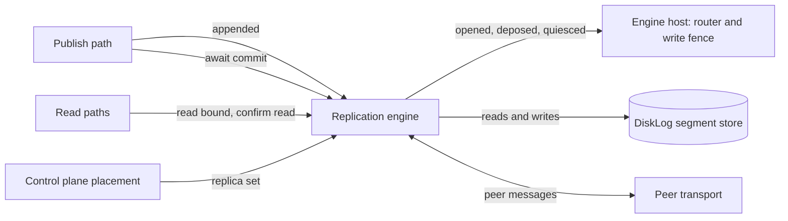

# The replication engine interface

Felix replicates each shard with a protocol of its own, described in
[`replication-design.md`](replication-design.md). Release 0.8 tests whether a
standard protocol, per-shard Raft, would do the same job with less code we
have to prove correct ourselves (issue #2154). The plan ends with one
protocol in the tree, not two options.

To compare the two fairly, both have to sit behind the same boundary. This
page defines that boundary: the replication engine. It says what the engine
does, what stays outside it, how today's code maps onto it, how a Raft engine
would fit, and how we will decide between them. The refactor that introduces
the boundary changes no behaviour. A second track moves the control plane's
Raft log onto the same segment store, whatever the shard decision.

## What the engine is

A shard is one ordered log of records. Its replica set is the brokers that
hold a copy. One of them, the leader, takes writes. The engine is the part of
a broker that keeps those copies in agreement. It answers five questions for
the rest of the broker:

1. **Append.** The leader made a batch durable on its own disk. Get it to the
   followers.
2. **Commit mark.** Which offset is held by enough replicas that no later
   leader can lose it? A `Quorum` write is acknowledged once the mark passes
   it.
3. **Leadership and fencing.** Which broker may take writes for a shard, at
   which generation (the hybrid's word for a Raft term), and when must a
   broker stop?
4. **Membership change.** The control plane moved a shard to a new replica
   set. Switch without losing an acknowledged record.
5. **Read bound.** How far may a reader see, and is this broker still the
   leader when it answers?

Everything else is outside the engine:

- **Placement.** The control plane decides which brokers hold which shards,
  plans moves and throttles them. Both engines take the replica set as input.
- **Storage.** The segment store in `felix-storage` (`DiskLog`) holds the
  records, the generation list, the ballot and the replica state. Both
  engines write through it. See "Raft log on the segment store" below.
- **The write path.** Decoding, the commit order (`begin_append` then
  `commit`), fanout and subscriber queues stay in the broker.
- **Routing.** The ingress router and the write fence that admits a write to
  a shard stay in the broker service. The engine tells them what changed.
- **The peer transport.** `felix-replication/src/peer/` carries both
  engines' messages.



## Where today's code sits

Paths are relative to `crates/server/felix-replication/src/` unless they start
with `services/` or `crates/`. Line numbers are as of the commit that added
this page.

### The seams that already exist

The crate does not depend on the broker service. What it needs comes in
through traits the service implements:

| Seam | Defined | Implemented by | What it gives the engine |
| --- | --- | --- | --- |
| `quorum::ShardServing` | `quorum.rs:991` | `IngressRouter`, `services/felix-broker-service/src/shards/routing.rs:534` | Is the shard replicated, which generation do I serve, is my lease valid |
| `driver::WriteFence` | `driver.rs:296` | `ShardFence`, `services/felix-broker-service/src/shards/lifecycle/fence.rs:444` | Is the shard quiet; callbacks for serving without the lease, deposed, withheld, probed |
| `reporter::Credential` | `reporter.rs:121` | `NodeCredential`, `services/felix-broker-service/src/cluster/credential.rs:62` | The bearer token a replica report carries |
| `promotion::PromotionGate` | `promotion.rs:65` | `LifecycleGate`, `services/felix-broker-service/src/shards/lifecycle/promotion.rs:46` | Whether a promoted shard may open |
| `confirmed::ConfirmedRoutes` | `confirmed.rs:49` | `ControlPlaneRoutes`, `services/felix-broker-service/src/shards/confirmed.rs:77` | An assignment read no older than the control plane's last acknowledged write |
| `quorum::LeadershipCheck` | `quorum.rs:92` | `leadership::ReadIndex`, `leadership.rs:90` | A read round: does a majority still answer at my generation |

### Wiring

`services/felix-broker-service/src/node/cluster.rs` builds the engine:
`ReplicaHandler::new` for the follower side (`:269`), the promotion gate
(`:389`, `:401`), `election::Elections::new` (`:444`), `driver::spawn` with the
shard fence as its `WriteFence` (`:491`, `:495`), `reporter::Reporter::spawn`
(`:509`) and `suspicion::spawn` (`:539`). `node/startup.rs:252` installs
`ReadIndex` as the read check, and `node/peer_dispatch.rs` hands peer requests
to the `ReplicaHandler`. The simulator builds nodes through the same service
code (`services/felix-broker-service/src/node/sim.rs`).

### 1. Append

The broker's publish path takes offsets before it waits on durability
(`crates/server/felix-broker/src/broker/publish.rs:257`, `begin_append`), then
`Completion::commit` makes the batch durable and marks the shard in
`AppendedShards` (`crates/server/felix-broker/src/broker/publish/completion.rs:293`,
`crates/server/felix-broker/src/broker/appended.rs:18`). That wakes the
driver, which ships each follower one batch from its cursor (`driver.rs:167`,
`ship.rs:20` `ship_once`, `follower.rs:24` `FollowerCursor`). The follower
stores it at the leader's offsets (`replica.rs:624` `apply`, through
`crates/server/felix-broker/src/durable.rs:506` `append_pending_at`).

### 2. Commit mark

The driver computes a majority offset over the cursors (`quorum.rs:1777`
`quorum_offset`, `driver/shard.rs:479`), counted only from the leader's own
generation start (`quorum.rs:1959` `counted_offset`), and publishes it to
`QuorumMarks` (`quorum.rs:37`, `:618`). Writers wait in `await_quorum`
(`quorum.rs:1018`), called from the service:

- QUIC publish: `serving/quic/handlers/publish/worker.rs:508` and `:591`,
  `serving/quic/handlers/publish/direct.rs:202`
- MQTT: `serving/mqtt/writes.rs:276`
- Kafka: `serving/kafka.rs:235`
- Atomic commits: `serving/commit_ops.rs:227`
- Forwarded writes: `serving/forward/owner.rs:195`

Caches and counters have their own waits: `await_cache_quorum`
(`quorum.rs:1140`), `cache_write_at` (`quorum.rs:1673`) and
`await_counter_quorum` (`quorum.rs:1295`), called from
`serving/cache_routing.rs` and `serving/forward/owner.rs`.

### 3. Leadership and fencing

The control plane assigns a leader and a generation. A promoted leader runs
the fence before it opens: `promotion.rs:167` `fence_shard` asks a majority to
promise the generation (the follower answers in `replica.rs:1172` `fence`),
catches up, appends a generation-start record, and the driver opens it
(`driver.rs:665` `open_promoted`). A follower refuses a stale leader with
`FencedEpoch` (`replica.rs:1943` `check_shard_fence`). The engine tells the
broker through `WriteFence` callbacks (`driver.rs:296` onward): `deposed`,
`withheld`, `serve_without_lease`, `passed`.

Around that core sit the parts that make it safe across crashes and lost
disks: ballots (`crates/server/felix-storage/src/disk_log/ballot.rs:110`),
vouching and copy trust (`replica.rs:1764` `record_vouch`, `follower.rs:107`),
unclean starts (`unclean.rs`), reclaim (`reclaim.rs`), and opt-in election
without the control plane (`election.rs:31`, `election/candidate.rs:403`,
`replica/election.rs`), switched on by `FELIX_INTERNAL_ELECTION`
(`services/felix-broker-service/src/config/membership.rs:166`).

### 4. Membership change

The control plane picks the new set. A promotion across a set change runs a
joint fence that needs answers from both the old and the new set
(`promotion/joint.rs:216` `JointSets`, `replica.rs:2394` `joint_fence`). A new
replica joins as a learner that ships but does not count toward the mark
(`ship.rs:665`, `driver/shard.rs:746`), and a follower too far behind is
rebuilt (`rebuild.rs:40`). The driver learns of a change when the router
notifies `routes_changed` (`driver.rs:176`).

### 5. Read bound

`read_bound` (`quorum.rs:1250`) and `committed_bound` (`quorum.rs:1404`) give
the highest offset a reader may see; `CommittedReads` (`quorum.rs:1443`)
answers the broker's `ReadBounds` trait
(`crates/server/felix-broker/src/stream/committed.rs:58`). A reader confirms
the broker still leads either by its control-plane lease or by a read round
(`leadership.rs:34` `ReadIndex`, chosen by `FELIX_QUORUM_READS`).
`confirm_state_read` (`quorum.rs:1566`) and `read_skips_lease`
(`quorum.rs:1545`) are the entry points. Callers: `serving/kafka.rs:257`,
`serving/group_ops.rs:370`, `serving/commit_ops.rs:305`,
`serving/quic/handlers/cache_watch.rs:515`.

## The proposed interface

Two traits. `Engine` is what the broker asks of replication. `EngineHost` is
what replication asks of the broker, and folds together the seams above.

```rust
/// What the broker asks of a shard's replication.
pub trait Engine: Send + Sync {
    /// A durable append landed on this leader's log for `key`.
    fn appended(&self, key: &ShardKey);

    /// Wait until the batch written at `generation` is committed: no later
    /// leader can lose it. Errors when this broker cannot say so in time.
    fn await_commit(&self, key: &ShardKey, written: Written, generation: u64, timeout: Duration)
        -> impl Future<Output = Result<(), CommitError>> + Send;

    /// One past the highest offset a reader of `key` may see, or `None` when
    /// the shard is not bounded (not replicated, not `Quorum`).
    fn read_bound(&self, key: &ShardKey) -> Result<Option<u64>, Unreadable>;

    /// Confirm this broker still leads `key` at `generation` for a read.
    fn confirm_read(&self, key: &ShardKey, generation: u64)
        -> impl Future<Output = Result<(), CommitError>> + Send;

    /// The control plane placed `key` on a new replica set.
    fn placement_changed(&self, key: &ShardKey);

    /// A peer's replication request, follower side.
    fn handle(&self, from: &PeerIdentity, request: InternalMessage)
        -> impl Future<Output = InternalMessage> + Send;
}

/// What the engine needs from the broker, and the events it reports.
pub trait EngineHost: Send + Sync {
    fn generation(&self, key: &ShardKey) -> Option<u64>;
    fn replicated(&self, key: &ShardKey) -> bool;
    fn quiesced(&self, key: &ShardKey) -> bool;
    /// `key` may take writes at `generation`, admitted as `serves` says.
    fn opened(&self, key: &ShardKey, generation: u64, serves: Serves);
    /// A newer leader exists than `generation`: stop taking writes.
    fn deposed(&self, key: &ShardKey, generation: u64);
}

/// How an opened leader is admitted.
pub enum Serves {
    /// Only while its control-plane lease is valid (hybrid, `Leader` shards).
    ByLease,
    /// By its followers' acknowledgements, with no lease.
    ByFollowers,
}
```

Caches and counters get the same `await_commit` and `read_bound` with a log
kind argument. The exact signatures settle as each refactor step routes its
callers through them; the shape above is the target.

The hybrid engine implements `Engine` with the code it has today. The host is
the existing `IngressRouter` plus `ShardFence`. Their extra hybrid callbacks
(`withheld`, `gave_up_at`, `refused_at`, `probed`, `opened_since`,
`promoting`) stay on the hybrid's own host trait, which extends
`EngineHost`, because no other engine has those states.

## A per-shard Raft engine behind the same traits

One Raft group per shard, with openraft or an equivalent library. The
control plane still places replicas and chooses the set. Raft elects the
leader, and its term is the generation. Reads use a Raft read index or a
leader lease.

- `appended` feeds the Raft leader's replication. `await_commit` waits on the
  Raft commit index, which is the same thing as the quorum mark.
- `opened` and `deposed` come from Raft's role changes. Every opened leader
  is `ByFollowers`.
- `placement_changed` turns into a Raft membership change toward the new set,
  with joint consensus covering what the joint fence covers today.
- `confirm_read` is a read-index round, the same round `ReadIndex` sends
  today.
- `handle` routes AppendEntries, Vote and InstallSnapshot over the existing
  peer transport. Heartbeats are batched per broker pair, since a broker can
  hold thousands of groups.

### Raft log on the segment store

Raft runs on the segment store, not beside it. A separate Raft log applied to
segments would write every record twice. Here is how decoupled that leaves the
Raft log from Felix's write path and format.

**Durability stays where it is.** Fsync modes (`FsyncMode`,
`crates/server/felix-storage/src/log/config.rs:347`), group commit
(`disk_log/sync.rs`, one flush serves every waiter), the flush itself
(`disk_log/flush.rs:26`), the io_uring flusher (`io/uring_fsync.rs`),
`F_FULLFSYNC` on macOS (`io.rs:254`) and preallocation (`io.rs:141`) all live
under `DiskLog`. These `disk_log` and `io` paths are in
`crates/server/felix-storage/src/`. Nothing in `felix-replication` writes a
file itself: a follower stores records through the broker's `DurableLog`
(`crates/server/felix-broker/src/durable.rs:506`), which calls `DiskLog`. An
engine that writes through `DiskLog` keeps all of them.

**openraft's `RaftLogStorage` maps onto `DiskLog`** (paths in
`crates/server/felix-storage/src/`):

| Raft storage operation | `DiskLog` today |
| --- | --- |
| `append`, then `LogFlushed` | `append_pending_at` / `append_claimed_at` (`disk_log.rs:365`, `:340`), then `wait_durable` (`disk_log.rs:414`). Group commit is kept: the callback fires when the shared flush covers the offset. |
| `truncate` an uncommitted suffix | The truncation path (`disk_log.rs:1227`), refused below the commit offset with `BelowCommit` (`disk_log.rs:1242`). `restore_to` (`disk_log.rs:560`) is the offline variant. |
| `purge` a committed prefix | `trim_before` (`disk_log.rs:495`) and retention (`disk_log/retention.rs`). |
| Install a snapshot | `reset_to` (`disk_log.rs:513`), which also refuses to drop committed records with `BelowCommit`, then catch-up as a rebuild does today. |
| Term of each entry | The generation list in `disk_log/epochs.rs`: one `(generation, start offset)` per leader (`epochs.rs:71`). The term of an offset is the generation of the last start at or before it. No per-record field is needed. |
| `save_vote` / `read_vote` | The accepted generation in `disk_log/replica_state.rs` and the accepted leader in `disk_log/ballot.rs` (`accept_generation`, `ballot.rs:110`). |
| `save_committed` | The commit offset in `replica_state.rs` (`advance_commit_offset`, `disk_log.rs:703`). |

The offset is the Raft index. The segment format, the startup scan, the
torn-tail rule and the derived indexes do not change.

**The awkward part is entries that are not records.** Raft appends two kinds
of entry no client wrote: a blank entry when a leader starts its term, and
membership entries. Each would take a shard offset. Consumers see offsets, and
a jump in offsets is how a subscriber detects a drop, so these cannot be
ordinary records.

The blank entry already exists. The hybrid writes a generation-start record
when a leader opens, for the same reason Raft writes its no-op (Raft's Figure
8, see `replication-design.md`, "The generation-start record"). It takes an
offset, readers skip it (`crates/server/felix-broker/src/broker/read.rs:86`),
and a client that negotiated `skipped_before` does not count it as a drop
(`docs/protocol.md`, Event batch offsets). The Raft engine writes its blank
entry as that record, with no format change.

Membership has two options:

- **Keep membership in the control plane, outside the Raft log.** No format
  change. But openraft keeps membership as log entries, so this needs a
  library that accepts its configuration from outside, or a group restarted at
  a new term for each set change. That is close to what the hybrid's joint
  fence does today, and it brings back part of the code Raft was meant to
  retire.
- **A typed membership record that readers skip, like the generation-start
  record.** The control plane still chooses the set; the Raft leader commits
  it. The cost is a format change: a new record kind, a new segment version
  (9), and a fleet feature so no broker writes it before every broker can read
  it. As with versions 4 to 8, a broker that predates version 9 refuses a
  segment holding one, so rollback is blocked once one is written.

We recommend the typed membership record. It is the standard Raft algorithm
with one new record kind, where the first option keeps a bespoke
reconfiguration path alive. Set changes are rare, so the skipped offsets cost
nothing measurable.

### One log adapter for shard groups and the control plane

The control plane already runs openraft (0.9) for its metadata, on redb
(`services/felix-controlplane-service/src/raft/store.rs`). Felix will have one
Raft log storage, not two: a single `RaftLogStorage` adapter over `DiskLog`,
used by every shard group and by the control plane, tested once.

- **Where it lives.** In `felix-storage`, as a `raft_log` module behind a
  cargo feature that pulls in openraft. The control plane must not depend on
  the broker, and `felix-replication` depends on `felix-broker`, so the
  adapter cannot live there. `felix-storage` depends on neither.
- **One implementation for both.** Every entry is a record. A blank leader
  entry is a generation-start record and a membership entry is the typed
  membership record above, for both users, so the term of any index comes from
  `epochs.rs` and nothing else is needed per record. The control plane's log
  has no subscribers, but using the same kinds keeps one code path.
- **One set of tests.** openraft's storage conformance suite
  (`openraft::testing::Suite`, run today against redb in
  `services/felix-controlplane-service/src/raft/store/tests.rs:44`) runs
  against the adapter, alongside `felix-storage`'s existing torn-tail,
  power-loss and fault-injection tests.
- **Truncation is allowed.** `store.rs` says the segment store forbids
  truncating an uncommitted suffix. It does not: records are never rewritten
  in place, but dropping a suffix above the commit offset is a supported
  operation (`disk_log.rs:1227`, and "Divergence and truncation" in
  `replication-design.md`). That comment is corrected when the adapter lands.

### Many groups on one broker

A broker can lead thousands of shards. One Raft group each means thousands of
election timers and, by default, thousands of heartbeat streams per broker
pair. Multi-Raft systems such as TiKV found two fixes, and Felix needs both:

- **Coalesce heartbeats per node pair.** One message per peer per interval
  carries every group's heartbeat. The hybrid already does this kind of
  batching for ships per follower.
- **Let idle groups sleep.** A group with no writes stops heartbeating, and
  its followers do not start an election on silence alone. They start one
  when node-level liveness says the leader's broker is gone. Felix has that
  signal already in its broker heartbeats and suspicion (`suspicion.rs`).

openraft runs each group as its own task with its own timers. It has no
built-in coalescing or hibernation, but it can be driven from outside: its
config can turn off the internal heartbeat and election timers
(`enable_heartbeat`, `enable_elect`, already used in
`services/felix-controlplane-service/src/raft/handle.rs:76`), and its trigger
handle starts a heartbeat or an election on demand. A per-broker driver owns
the timers for all groups, sends one coalesced heartbeat per peer, and wakes
an election only on a liveness signal. The network layer then has to accept
one batched message and fan it out to each group. Whether thousands of
openraft tasks cost too much memory or scheduling is the first thing the
prototype measures; if they do, that is a reason to pick a different library,
not to give up the design.

## Control-plane storage on the segment log

This track is worth doing whatever the shard decision is, and is ordered so
it does not hold up the engine refactor. It replaces redb in the control
plane with a `DiskLog`, so a Felix node has one storage engine with one set
of durability rules (fsync modes, `F_FULLFSYNC`, torn-tail repair).

- **The log.** The control plane's Raft log is a `DiskLog` in its data
  directory, through the shared adapter. Each command is one record.
- **The state machine.** It is in memory today and rebuilt from the snapshot
  plus log replay (`store.rs`), so it does not change. Felix's cache does the
  same thing (a projection rebuilt from its log, `felix-storage/src/cache/`).
- **Snapshots.** A snapshot is a file written to a temporary name, fsynced and
  renamed into place, the same pattern `replica_state.rs` uses. It carries its
  last index, and is installed only if that is past the current one. After it
  is durable, the log is trimmed behind it with `trim_before`. This replaces
  redb's "check and write in one transaction": the rename is the commit, and
  the one-writer rule comes from a lock in the adapter.
- **The vote.** The ballot file (`disk_log/ballot.rs`) already holds a
  generation and the leader it was given to in one checksummed file, written
  to a temporary name, fsynced and renamed. That is Raft's `(term,
  voted_for)`, saved atomically.
- **What replaces redb transactions.** Raft needs three atomic writes: a log
  append, the vote, and a snapshot. The first is a record (checksummed, with
  a torn tail repaired on open), the other two are rename-into-place files.
  Nothing needs a multi-key transaction.
- **Migration.** None. Felix is alpha, so a fresh start is acceptable: an
  existing control-plane data directory is not read. Operators start the control plane
  fresh, or import a snapshot export (the import path in
  `metadata-raft-design.md` reads one). A control plane that finds a redb
  file refuses to start with a message saying so, rather than silently
  starting empty.

### Why redb was chosen, and why that no longer holds

`store.rs` and `metadata-raft-design.md` ("Library") give two reasons for redb.

**"The segment store's never-rewritten rule forbids Raft truncation."** It
does not, today. The rule is that bytes are never rewritten in place, so
recovery can trust that valid bytes end at EOF. Cutting a suffix off is a
separate, supported operation: `DiskLog`'s truncate
(`crates/server/felix-storage/src/disk_log.rs:1227`) cuts the log back to an
offset under the append and segment locks, and refuses with `BelowCommit` only
when the cut would reach below the commit offset (`disk_log.rs:1242`). A
diverged follower already uses it, and `restore_to` (`disk_log.rs:560`) goes
through the same path. Raft truncates only entries that are not committed,
so the guard never refuses a correct Raft truncation; it is a backstop
against a wrong one.

**"Consensus durability plumbing is the last place to be inventive."** Agreed,
and this plan does not invent a new mechanism. Each of the three writes Raft
needs reuses one Felix already depends on for acknowledged data:

- Log entries are segment records: checksummed, appended, made durable by the
  same group commit as every acknowledged publish, with a torn tail repaired
  and interior damage refused on open.
- The vote and the snapshot metadata are small files written the way
  `replica_state.rs:108` writes replica state: a temporary file, fsynced,
  renamed over the old one, then the directory fsynced (`sync_dir`), so a
  crash leaves the old one or the new one and never neither. The ballot file
  is written the same way.
- The snapshot data is written the same way, before its metadata, and the log
  is trimmed only after both are durable.

**What evidence makes it as trustworthy as redb.** All of the following pass
before the control plane switches:

1. openraft's storage conformance suite against the adapter, the same suite
   the redb store passes now.
2. Crash-point tests with the power-loss model
   (`crates/server/felix-storage/src/io/power_loss.rs`), which drops unsynced
   pages and directory entries at random: a crash at every step of an append,
   a vote save, a snapshot install and a purge leaves a state that opens and
   never shows a lost vote, a lost acknowledged entry, or a snapshot behind
   the purged log.
3. The same in the simulator's in-memory filesystem
   (`crates/server/felix-storage/src/fs/mem.rs`), with a control-plane
   restart after the crash, across the nightly seed sweep.
4. The control plane's existing chaos test
   (`services/felix-controlplane-service/tests/raft_chaos.rs`) unchanged
   on the new store.

The control plane's version of the known crash window (log purged before a
received snapshot is written, `metadata-raft-design.md`, "Snapshots,
compaction, recovery") goes away if the adapter purges only after the
snapshot file is renamed into place.

### Hybrid behaviour that does not fit cleanly

- **Control-plane leases.** A `Leader` shard (no `Quorum` acknowledgements)
  serves only while the broker's lease is valid. Raft has no such mode. The
  interface keeps the lease on the host side (`Serves::ByLease`), since it also
  admits unreplicated shards. A Raft engine never returns `ByLease`, so
  `Leader` consistency under Raft means "the Raft leader, durable locally".
- **Vouching, copy trust and ballots on a wiped disk.** A copy that lost its
  storage must not vote. Raft has the same problem when a node loses its vote
  file. Both engines handle it internally with the storage identity; the
  interface does not carry it.
- **Quorum mark semantics.** `counted_offset` is Raft's current-term commit
  rule. The mark is also kept per incarnation and leaves learners out. Those
  are engine internals; `await_commit` hides them.
- **Separate counter and cache logs.** A cache shard has its own counter log
  with its own mark (`QuorumMarks::counters`). Raft has one log per group, so
  counters need either their own group or a place in the shard's log. This is
  a design call for the prototype.
- **Confirmed reads through the control plane.** `confirmed.rs` reads the
  assignment from the control plane. Under Raft the leader is not assigned,
  so this becomes a read-index round and the code goes away.
- **Halting on conflict.** The hybrid halts a follower on `LogConflict`. Raft
  truncates the uncommitted suffix and continues. Both still refuse to drop a
  committed record (`BelowCommit`). Halted replicas stay an operator status
  only.

## Decision criteria

Written before any numbers exist. These decide the shard side only; the
control-plane storage track above goes ahead either way. Raft for shards is
adopted only if it meets all of them; otherwise the hybrid stays, the prototype is deleted, and the reason is
recorded in `docs/`.

1. **Correctness.** No history-checker violation, and no simulator stall the
   hybrid does not also have on the same seed.
2. **Throughput** within 10% of the hybrid in every A/B cell.
3. **p99 latency** within 20% of the hybrid in every A/B cell.
4. **Failover time** no worse than the hybrid in any cell.
5. **Control plane down.** A leader crash while the control plane is down
   still fails over and keeps serving.
6. **Size.** Lines of replication code and TLA+ specs and configs we would
   keep. Baseline today: `felix-replication/src` has about 26,000 lines of
   non-test code, and `docs/formal/FelixShard*.tla` is about 8,000 lines across
   425 configs. Raft should cut both substantially; if it does not, the
   simplification case fails even with the other criteria met.

### The test set

Both engines run the same tests, on the same commit, on the same runners:

- **A/B cells** (`perf-env-ab.yml` and the release A/B): single node, RF 3
  steady, RF 3 promotion burst, each at 1 KiB and 64 KiB payloads.
- **Simulator** (`dst-nightly.yml`): 2000 seeds in each mode (`off`,
  `clocks`, `placement`, `power-loss`).
- **History checker** (`history.yml`): the process, all-faults, adversarial
  and election nemeses, including the control plane down.
- **Failover scale** (`scale-nightly.yml`) and felixd at its scale.

## Refactor plan

Each step is one small pull request that changes no behaviour. The existing
unit, integration and simulator seed tests pass unchanged after each.

1. Add `felix-replication/src/engine.rs` with the `Engine` trait holding
   `await_commit` and `read_bound`, and a `Hybrid` implementation that calls
   `quorum::await_quorum` and `quorum::read_bound`. Route the Kafka adapter
   (`serving/kafka.rs`) through it.
2. Route the other stream callers (QUIC publish, MQTT, atomic commits,
   forwarded writes, group reads) through one `Hybrid` built in the node
   wiring, in place of the `marks` and `ingress` pairs they thread today.
3. Cache and counter waits (`await_cache_quorum`, `cache_write_at`,
   `await_counter_quorum`, `read_skips_lease`, `await_readable`) as engine
   methods.
4. Read confirmation: `confirm_state_read` and the `ReadIndex` setup in
   `node/startup.rs` behind `confirm_read`.
5. `EngineHost`: one trait over `ShardServing` and the generic part of
   `WriteFence`, with the hybrid-only callbacks on an extension trait.
6. Construction: one `Hybrid::start` that owns what `node/cluster.rs` spawns
   today (driver, replica handler, reporter, elections, suspicion), and
   `peer_dispatch.rs` routes replication requests to `Engine::handle`.
7. Narrow `pub` items that only the engine now uses to `pub(crate)`.

After step 7 the Raft prototype can land as a second implementation behind a
build-time switch that no release enables.

The control-plane storage track runs alongside, in its own pull requests,
none of which touch the engine:

1. The `raft_log` adapter in `felix-storage`, passing openraft's storage
   suite, with no users yet.
2. The control plane switches from redb to the adapter, with snapshots as
   files and a refusal to start on an old redb directory.
3. Remove redb from the workspace.

The shard Raft prototype then uses the same adapter.
