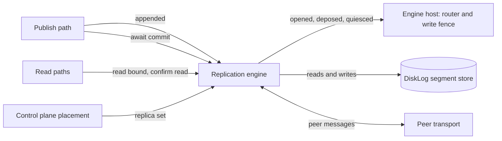

# The replication engine interface

Release 0.8 simplifies Felix around one storage engine, the `felix-storage`
segment log, and one consensus protocol, Raft through openraft (issue #2167).
Today shards replicate with a protocol of Felix's own, described in
[`replication-design.md`](replication-design.md), and the control plane keeps
its Raft log in redb. This page is the design for the first four tracks of
that work:

1. **The replication engine interface.** One boundary between the broker and
   shard replication, with today's protocol as its first implementation and
   no change in behaviour.
2. **Raft log storage on `DiskLog`.** One openraft log adapter over the
   segment store, shared by shard groups and the control plane.
3. **The control plane on the segment store.** redb goes.
4. **Per-shard Raft** behind the engine interface.

Before the bespoke protocol is deleted, Raft must pass a no-regression gate
against it, written down below before any numbers exist.

## What the engine is

A shard is one ordered log of records. Its replica set is the brokers that
hold a copy. One of them, the leader, takes writes. The engine is the part of
a broker that keeps those copies in agreement. It answers five questions for
the rest of the broker:

1. **Append.** The leader made a batch durable on its own disk. Get it to the
   followers.
2. **Commit mark.** Which offset is held by enough replicas that no later
   leader can lose it? A `Quorum` write is acknowledged once the mark passes
   it.
3. **Leadership and fencing.** Which broker may take writes for a shard, at
   which generation (the hybrid's word for a Raft term), and when must a
   broker stop?
4. **Membership change.** The control plane moved a shard to a new replica
   set. Switch without losing an acknowledged record.
5. **Read bound.** How far may a reader see, and is this broker still the
   leader when it answers?

Everything else is outside the engine:

- **Placement.** The control plane decides which brokers hold which shards,
  plans moves and throttles them. Both engines take the replica set as input.
- **Storage.** The segment store in `felix-storage` (`DiskLog`) holds the
  records, the generation list, the ballot and the replica state. Both
  engines write through it. See "Raft log on the segment store" below.
- **The write path.** Decoding, the commit order (`begin_append` then
  `commit`), fanout and subscriber queues stay in the broker.
- **Routing.** The ingress router and the write fence that admits a write to
  a shard stay in the broker service. The engine tells them what changed.
- **The peer transport.** `felix-replication/src/peer/` carries both
  engines' messages.



## Where today's code sits

Paths are relative to `crates/server/felix-replication/src/` unless they start
with `services/` or `crates/`. Line numbers are as of the commit that added
this page.

### The seams that already exist

The crate does not depend on the broker service. What it needs comes in
through traits the service implements:

| Seam | Defined | Implemented by | What it gives the engine |
| --- | --- | --- | --- |
| `quorum::ShardServing` | `quorum.rs:991` | `IngressRouter`, `services/felix-broker-service/src/shards/routing.rs:534` | Is the shard replicated, which generation do I serve, is my lease valid |
| `driver::WriteFence` | `driver.rs:296` | `ShardFence`, `services/felix-broker-service/src/shards/lifecycle/fence.rs:444` | Is the shard quiet; callbacks for serving without the lease, deposed, withheld, probed |
| `reporter::Credential` | `reporter.rs:121` | `NodeCredential`, `services/felix-broker-service/src/cluster/credential.rs:62` | The bearer token a replica report carries |
| `promotion::PromotionGate` | `promotion.rs:65` | `LifecycleGate`, `services/felix-broker-service/src/shards/lifecycle/promotion.rs:46` | Whether a promoted shard may open |
| `confirmed::ConfirmedRoutes` | `confirmed.rs:49` | `ControlPlaneRoutes`, `services/felix-broker-service/src/shards/confirmed.rs:77` | An assignment read no older than the control plane's last acknowledged write |
| `quorum::LeadershipCheck` | `quorum.rs:92` | `leadership::ReadIndex`, `leadership.rs:90` | A read round: does a majority still answer at my generation |

### Wiring

`services/felix-broker-service/src/node/cluster.rs` builds the engine:
`ReplicaHandler::new` for the follower side (`:269`), the promotion gate
(`:389`, `:401`), `election::Elections::new` (`:444`), `driver::spawn` with the
shard fence as its `WriteFence` (`:491`, `:495`), `reporter::Reporter::spawn`
(`:509`) and `suspicion::spawn` (`:539`). `node/startup.rs` binds the read
rounds through `engine::bind_read_rounds`, and `node/peer_dispatch.rs` hands peer requests
to the `ReplicaHandler`. The simulator builds nodes through the same service
code (`services/felix-broker-service/src/node/sim.rs`).

### 1. Append

The broker's publish path takes offsets before it waits on durability
(`crates/server/felix-broker/src/broker/publish.rs:257`, `begin_append`), then
`Completion::commit` makes the batch durable and marks the shard in
`AppendedShards` (`crates/server/felix-broker/src/broker/publish/completion.rs:293`,
`crates/server/felix-broker/src/broker/appended.rs:18`). That wakes the
driver, which ships each follower one batch from its cursor (`driver.rs:167`,
`ship.rs:20` `ship_once`, `follower.rs:24` `FollowerCursor`). The follower
stores it at the leader's offsets (`replica.rs:624` `apply`, through
`crates/server/felix-broker/src/durable.rs:506` `append_pending_at`).

### 2. Commit mark

The driver computes a majority offset over the cursors (`quorum.rs:1777`
`quorum_offset`, `driver/shard.rs:479`), counted only from the leader's own
generation start (`quorum.rs:1959` `counted_offset`), and publishes it to
`QuorumMarks` (`quorum.rs:37`, `:618`). Writers wait in `await_quorum`
(`quorum.rs:1018`), called from the service:

- QUIC publish: `serving/quic/handlers/publish/worker.rs:508` and `:591`,
  `serving/quic/handlers/publish/direct.rs:202`
- MQTT: `serving/mqtt/writes.rs:276`
- Kafka: `serving/kafka.rs:235`
- Atomic commits: `serving/commit_ops.rs:227`
- Forwarded writes: `serving/forward/owner.rs:195`

Caches and counters have their own waits: `await_cache_quorum`
(`quorum.rs:1140`), `cache_write_at` (`quorum.rs:1673`) and
`await_counter_quorum` (`quorum.rs:1295`), called from
`serving/cache_routing.rs` and `serving/forward/owner.rs`.

### 3. Leadership and fencing

The control plane assigns a leader and a generation. A promoted leader runs
the fence before it opens: `promotion.rs:167` `fence_shard` asks a majority to
promise the generation (the follower answers in `replica.rs:1172` `fence`),
catches up, appends a generation-start record, and the driver opens it
(`driver.rs:665` `open_promoted`). A follower refuses a stale leader with
`FencedEpoch` (`replica.rs:1943` `check_shard_fence`). The engine tells the
broker through `WriteFence` callbacks (`driver.rs:296` onward): `deposed`,
`withheld`, `serve_without_lease`, `passed`.

Around that core sit the parts that make it safe across crashes and lost
disks: ballots (`crates/server/felix-storage/src/disk_log/ballot.rs:191`),
vouching and copy trust (`replica.rs:1764` `record_vouch`, `follower.rs:107`),
unclean starts (`unclean.rs`), reclaim (`reclaim.rs`), and opt-in election
without the control plane (`election.rs:31`, `election/candidate.rs:403`,
`replica/election.rs`), switched on by `FELIX_INTERNAL_ELECTION`
(`services/felix-broker-service/src/config/membership.rs:166`).

### 4. Membership change

The control plane picks the new set. A promotion across a set change runs a
joint fence that needs answers from both the old and the new set
(`promotion/joint.rs:216` `JointSets`, `replica.rs:2394` `joint_fence`). A new
replica joins as a learner that ships but does not count toward the mark
(`ship.rs:665`, `driver/shard.rs:746`), and a follower too far behind is
rebuilt (`rebuild.rs:40`). The driver learns of a change when the router
notifies `routes_changed` (`driver.rs:176`).

### 5. Read bound

`read_bound` (`quorum.rs:1298`) and `committed_bound` (`quorum.rs:1452`) give
the highest offset a reader may see; `engine::CommittedReads` answers the
broker's `ReadBounds` trait
(`crates/server/felix-broker/src/stream/committed.rs:58`) from
`Engine::committed_bound`. A reader confirms the broker still leads either by
its control-plane lease or by a read round (`leadership.rs:34` `ReadIndex`,
chosen by `FELIX_QUORUM_READS`). `confirm_state_read` (`quorum.rs:1574`) and
`read_skips_lease` (`quorum.rs:1553`) are the entry points. Callers: `serving/kafka.rs:257`,
`serving/group_ops.rs:221` and `:321`, `serving/commit_ops.rs:308`,
`serving/quic/handlers/cache_watch.rs:515`.

## The proposed interface

Two traits. `Engine` is what the broker asks of replication. `EngineHost` is
what replication asks of the broker, and folds together the seams above.

```rust
/// What the broker asks of a shard's replication.
pub trait Engine: Send + Sync {
    /// A durable append landed on this leader's log for `key`.
    fn appended(&self, key: &ShardKey);

    /// Wait until the batch written at `generation` is committed: no later
    /// leader can lose it. Errors when this broker cannot say so in time.
    fn await_commit(&self, key: &ShardKey, written: Written, generation: u64, timeout: Duration)
        -> impl Future<Output = Result<(), CommitError>> + Send;

    /// One past the highest offset a reader of `key` may see: the commit
    /// offset, at every consistency level. `None` only for a shard with no
    /// replicas, whose commit is the local durable append.
    fn read_bound(&self, key: &ShardKey) -> Result<Option<u64>, Unreadable>;

    /// Confirm this broker still leads `key` at `generation` for a read.
    fn confirm_read(&self, key: &ShardKey, generation: u64)
        -> impl Future<Output = Result<(), CommitError>> + Send;

    /// The control plane placed `key` on a new replica set.
    fn placement_changed(&self, key: &ShardKey);

    /// A peer's replication request, follower side.
    fn handle(&self, from: &PeerIdentity, request: InternalMessage)
        -> impl Future<Output = InternalMessage> + Send;
}

/// What the engine needs from the broker, and the events it reports.
pub trait EngineHost: Send + Sync {
    fn generation(&self, key: &ShardKey) -> Option<u64>;
    fn replicated(&self, key: &ShardKey) -> bool;
    fn quiesced(&self, key: &ShardKey) -> bool;
    /// `key` may take writes at `generation`, admitted as `serves` says.
    fn opened(&self, key: &ShardKey, generation: u64, serves: Serves);
    /// A newer leader exists than `generation`: stop taking writes.
    fn deposed(&self, key: &ShardKey, generation: u64);
}

/// How an opened leader is admitted.
pub enum Serves {
    /// Only while its control-plane lease is valid (hybrid, `Leader` shards).
    ByLease,
    /// By its followers' acknowledgements, with no lease.
    ByFollowers,
}
```

Caches and counters get the same `await_commit` and `read_bound` with a log
kind argument. The exact signatures settle as each refactor step routes its
callers through them; the shape above is the target.

The hybrid engine implements `Engine` with the code it has today. The host is
the existing `IngressRouter` plus `ShardFence`. Their extra hybrid callbacks
(`withheld`, `gave_up_at`, `refused_at`, `probed`, `opened_since`,
`promoting`) stay on the hybrid's own host trait, which extends
`EngineHost`, because no other engine has those states.

## Per-shard Raft behind the same traits

One Raft group per shard, with openraft or an equivalent library. The
control plane still places replicas and chooses the set. Raft elects the
leader, and its term is the generation. Reads use a Raft read index or a
leader lease.

- `appended` feeds the Raft leader's replication. `await_commit` waits on the
  Raft commit index, which is the same thing as the quorum mark.
- `opened` and `deposed` come from Raft's role changes. Every opened leader
  is `ByFollowers`.
- `placement_changed` turns into a Raft membership change toward the new set,
  with joint consensus covering what the joint fence covers today.
- `confirm_read` is a read-index round, the same round `ReadIndex` sends
  today.
- `handle` routes AppendEntries, Vote and InstallSnapshot over the existing
  peer transport. Heartbeats are batched per broker pair, since a broker can
  hold thousands of groups.

The leader's own append is the hardest fit. Felix's publish path appends
first and then tells replication (`begin_append`, then `commit`, then
`appended`), which keeps the commit order and the single encode per batch.
openraft expects to append the leader's entries itself, through
`client_write` and its log storage. The prototype has two ways to square
this: the adapter's leader-side `append` finds the entries already durable at
those indexes and returns at once, so the broker's write path stays as it is;
or the publish path hands the batch to `client_write` and the adapter calls
`begin_append` and `commit` from inside it. The first keeps the hot path
untouched and is what the prototype tries first. If openraft cannot accept
entries it did not append, the second is the fallback, and its cost shows up
in the gate's latency cells. Decided: adopt first, see Decisions, 2.

### Raft log on the segment store

Raft runs on the segment store, not beside it. A separate Raft log applied to
segments would write every record twice. Here is how decoupled that leaves the
Raft log from Felix's write path and format.

**Durability stays where it is.** Fsync modes (`FsyncMode`,
`crates/server/felix-storage/src/log/config.rs:347`), group commit
(`disk_log/sync.rs`, one flush serves every waiter), the flush itself
(`disk_log/flush.rs:26`), the io_uring flusher (`io/uring_fsync.rs`),
`F_FULLFSYNC` on macOS (`io.rs:254`) and preallocation (`io.rs:141`) all live
under `DiskLog`. These `disk_log` and `io` paths are in
`crates/server/felix-storage/src/`. Nothing in `felix-replication` writes a
file itself: a follower stores records through the broker's `DurableLog`
(`crates/server/felix-broker/src/durable.rs:506`), which calls `DiskLog`. An
engine that writes through `DiskLog` keeps all of them.

**openraft's `RaftLogStorage` maps onto `DiskLog`** (paths in
`crates/server/felix-storage/src/`):

| Raft storage operation (openraft 0.10) | `DiskLog` today |
| --- | --- |
| `append`, then `IOFlushed` (`LogFlushed` in 0.9, which the control plane uses until it moves) | `append_pending_at` / `append_claimed_at` (`disk_log.rs:365`, `:340`), then `wait_durable` (`disk_log.rs:414`). Group commit is kept: the callback fires when the shared flush covers the offset. |
| `truncate_after(Option<LogId>)`, cutting everything after the given id (0.9's `truncate(log_id)` cut from it) | The truncation path (`disk_log.rs:1227`), refused below the commit offset with `BelowCommit` (`disk_log.rs:1242`). `restore_to` (`disk_log.rs:560`) is the offline variant. |
| `purge(log_id)` of a committed prefix | `trim_before` (`disk_log.rs:495`) and retention (`disk_log/retention.rs`). |
| `install_snapshot` on the state machine | `reset_to` (`disk_log.rs:513`), which also refuses to drop committed records with `BelowCommit`, then catch-up as a rebuild does today. |
| Term of each entry (`LogId` with `leader_id_std::LeaderId`) | A generation field in every record's header, added in segment version 9 (see "Format version 9" under Decisions). The generation list in `disk_log/epochs.rs` stays a hint for finding truncation points and is never read as the term. |
| `save_vote` / `read_vote` (`Vote` with its `committed` flag) | Two files, as today: the ballot (`disk_log/ballot.rs`, generation and leader) is written first and the replica state (`replica_state.rs`, generation) second, each by rename (`ballot.rs:250-263`). The open takes the higher generation, so a crash between them never lowers the vote. openraft's `committed` flag on the vote is a new field in the ballot file, which bumps the ballot format (see Format version 9). Storage errors reach openraft as `io::Error`. |
| `save_committed` / `read_committed` | The commit offset in `replica_state.rs` (`advance_commit_offset`, `disk_log.rs:703`). |

The offset is the Raft index: one record is one entry. The startup scan, the
torn-tail rule and the derived indexes keep working as they do; version 9
adds the generation field to the record header and the record kinds below.

**The awkward part is entries that are not records.** Raft appends two kinds
of entry no client wrote: a blank entry when a leader starts its term, and
membership entries. Each would take a shard offset. Consumers see offsets, and
a jump in offsets is how a subscriber detects a drop, so these cannot be
ordinary records.

The blank entry already exists. The hybrid writes a generation-start record
when a leader opens, for the same reason Raft writes its no-op (Raft's Figure
8, see `replication-design.md`, "The generation-start record"). It takes an
offset, readers skip it (`crates/server/felix-broker/src/broker/read.rs:86`),
and a client that negotiated `skipped_before` does not count it as a drop
(`docs/protocol.md`, Event batch offsets). The Raft engine writes its blank
entry as that record, with no format change.

Membership has two options:

- **Keep membership in the control plane, outside the Raft log.** No format
  change. But openraft keeps membership as log entries, so this needs a
  library that accepts its configuration from outside, or a group restarted at
  a new term for each set change. That is close to what the hybrid's joint
  fence does today, and it brings back part of the code Raft was meant to
  retire.
- **A typed membership record that readers skip, like the generation-start
  record.** The control plane still chooses the set; the Raft leader commits
  it. The cost is a format change: a new record kind, a new segment version
  (9), and a fleet feature so no broker writes it before every broker can read
  it. As with versions 4 to 8, a broker that predates version 9 refuses a
  segment holding one, so rollback is blocked once one is written.

Decided: the typed membership record (see Decisions, 1). It is the standard
Raft algorithm with one new record kind, where the first option keeps a bespoke
reconfiguration path alive. Set changes are rare, so the skipped offsets cost
nothing measurable.

Neither the blank entry nor a membership record reaches a consumer: readers
skip both, and the batch's `skipped_before` covers the offsets they hold. A
client that did not negotiate event offsets (`0x0800`) still sees a gap at
each one, as it does at a generation-start record today.

### One log adapter for shard groups and the control plane

The control plane already runs openraft (0.9) for its metadata, on redb
(`services/felix-controlplane-service/src/raft/store.rs`). Felix will have one
Raft log storage, not two: a single `RaftLogStorage` adapter over `DiskLog`,
used by every shard group and by the control plane, tested once.

- **Where it lives.** In `felix-storage`, as a `raft_log` module behind a
  cargo feature that pulls in openraft. The control plane must not depend on
  the broker, and `felix-replication` depends on `felix-broker`, so the
  adapter cannot live there. `felix-storage` depends on neither.
- **One implementation for both.** Every entry is a record. A blank leader
  entry is a generation-start record and a membership entry is the typed
  membership record above, for both users, and every record carries its
  term in its header. The control plane's log has no subscribers, but using
  the same kinds keeps one code path.
- **One set of tests.** openraft's storage conformance suite
  (`openraft::testing::Suite`, run today against redb in
  `services/felix-controlplane-service/src/raft/store/tests.rs:44`) runs
  against the adapter, alongside `felix-storage`'s existing torn-tail,
  power-loss and fault-injection tests.
- **Truncation is allowed.** `store.rs` says the segment store forbids
  truncating an uncommitted suffix. It does not: records are never rewritten
  in place, but dropping a suffix above the commit offset is a supported
  operation (`disk_log.rs:1227`, and "Divergence and truncation" in
  `replication-design.md`). That comment is corrected when the adapter lands.

### openraft version

The adapter targets openraft 0.10, currently `0.10.0-alpha.38`, pinned to an
exact version in `Cargo.toml` and `Cargo.lock`. The control plane runs 0.9.25
today (`services/felix-controlplane-service/Cargo.toml:69`) and moves to the
same pinned version as part of its storage track, so the workspace has one
openraft. 0.10 is in alpha and may still change. This work lands over weeks,
so it is designed against the 0.10 API, and a version change is a reviewed
update, never a side effect of refreshing the lockfile.

**Release rule (decided).** Everything is built and tested on the pinned
0.10 alpha. A Felix release ships a control plane on 0.10 only if 0.10 is
final by then, or the pinned alpha has passed the full control-plane
simulator, crash-point and history checks. Otherwise that release keeps the
control plane on 0.9.25, and everything else stays on 0.10. The control
plane's openraft types stay inside `src/raft/` either way, so switching it
between the two versions touches only that module.

What the adapter absorbs from 0.9 to 0.10:

- The `single-term-leader` feature is gone. The type config sets
  `LeaderId = leader_id_std::LeaderId`, which gives a log id of term and
  index, the term being the record's generation.
- `truncate(log_id)` becomes `truncate_after(Option<LogId>)`, which keeps the
  named entry and cuts everything after it. The adapter maps it to `DiskLog`'s
  truncate at the next offset.
- `LogFlushed` becomes `IOFlushed`, and storage errors are `io::Error`.
- `Vote` keeps its `committed` flag, stored in the ballot file.
- The trigger handle gains `transfer_leader`, which the engine uses for a
  graceful hand-off on drain and rebalance, and `elect` takes a `pre_vote`
  choice.
- Neither version steps a leader down when it loses its majority (Decisions,
  5), so the write fence's check at acknowledgement time is Felix's own.

0.10 also has opt-in local lease reads. They could replace `Quorum` read
rounds and save a round trip per read. That is a later option, taken only
after it is measured and after our own simulator and crash tests cover it.
No safety rule rests on behaviour only an alpha has unless one of our tests
pins it.

The adapter stays thin: openraft types do not leave `felix-storage::raft_log`
and the engine module that drives it, so an API change is contained there.
The control plane already keeps openraft types inside `src/raft/` for the
same reason (`services/felix-controlplane-service/Cargo.toml:62`).

A member that rejoins after its volume was wiped reports a log that went
backwards. Without permission for that, the leader trips over the reverted
log, which is the error the control plane's chaos test caught
(`Cargo.toml:63-68`). On 0.9 the `loosen-follower-log-revert` feature allows
it, and the control plane keeps that feature until it moves. On 0.10 the
feature is deprecated in favour of `Config::allow_log_reversion`, which the
adapter sets for every group.

Checklist for each openraft version change:

1. Pin the exact version in `Cargo.toml` and `Cargo.lock`.
2. Allow log reversion: `allow_log_reversion` on 0.10, the
   `loosen-follower-log-revert` feature on 0.9.
3. Check the follower-side leader lease still equals `election_timeout_max`,
   and that a follower still refuses votes for that long, since the lease
   margin depends on both (Decisions, 5).
4. Check that openraft types still stay inside `felix-storage::raft_log` and
   the engine module.
5. Run openraft's storage suite, the crash-point tests, the control-plane
   chaos test and the history nemeses on the new version.

### Many groups on one broker

A broker can lead thousands of shards. One Raft group each means thousands of
election timers and, by default, thousands of heartbeat streams per broker
pair. Multi-Raft systems such as TiKV found two fixes, and Felix needs both:

- **Coalesce heartbeats per node pair.** One message per peer per interval
  carries every group's heartbeat. The hybrid already does this kind of
  batching for ships per follower.
- **Let idle groups sleep.** A group with no writes stops heartbeating, and
  its followers do not start an election on silence alone. They start one
  when node-level liveness says the leader's broker is gone. Felix has that
  signal already in its broker heartbeats and suspicion (`suspicion.rs`).
  A sleeping group's lease lapses, which is safe, because the lease is
  checked when a write is acknowledged, not kept alive in the background
  (Decisions, 5). The first write after a group wakes runs one quorum round
  before it is acknowledged. That costs one round trip on the first write
  after idle, and nothing on later ones.

openraft runs each group as its own task with its own timers. It has no
built-in coalescing or hibernation, but it can be driven from outside: its
config can turn off the internal heartbeat and election timers
(`enable_heartbeat`, `enable_elect`, already used in
`services/felix-controlplane-service/src/raft/handle.rs:76`), and its trigger
handle starts a heartbeat or an election on demand. A per-broker driver owns
the timers for all groups, sends one coalesced heartbeat per peer, and wakes
an election only on a liveness signal. The network layer then has to accept
one batched message and fan it out to each group. Whether thousands of
openraft tasks cost too much memory or scheduling is the first thing the
prototype measures; if they do, that is a reason to pick a different library,
not to give up the design.

### Hybrid behaviour that does not fit cleanly

- **Control-plane leases.** A `Leader` shard (no `Quorum` acknowledgements)
  serves only while the broker's lease is valid. Raft has no such mode. The
  interface keeps the lease on the host side (`Serves::ByLease`), since it also
  admits unreplicated shards. A Raft engine never returns `ByLease`; it
  bounds `Leader` writes with a Raft leader lease instead, and delivers only
  committed records (Decisions, 5).
- **Vouching, copy trust and ballots on a wiped disk.** A copy that lost its
  storage must not vote. Raft has the same problem when a node loses its vote
  file. Both engines handle it internally with the storage identity; the
  interface does not carry it.
- **Quorum mark semantics.** `counted_offset` is Raft's current-term commit
  rule. The mark is also kept per incarnation and leaves learners out. Those
  are engine internals; `await_commit` hides them.
- **Separate counter and cache logs.** A cache shard has its own counter log
  with its own mark (`QuorumMarks::counters`). Raft has one log per group, so
  counters fold into the shard's one group (Decisions, 4).
- **Confirmed reads through the control plane.** `confirmed.rs` reads the
  assignment from the control plane. Under Raft the leader is not assigned,
  so this becomes a read-index round and the code goes away.
- **Halting on conflict.** The hybrid halts a follower on `LogConflict`. Raft
  truncates the uncommitted suffix and continues. Both still refuse to drop a
  committed record (`BelowCommit`). Halted replicas stay an operator status
  only.

## Decisions

These were open design calls on this page and are now decided. Each has a
note on what it costs in performance and what it risks for safety, and on
what the gate measures to check it. A safety review then added the format
section below and refined decision 5, and both were approved.

### Format version 9, shared by both tracks

**What it adds.** A generation field (8 bytes) in every record header, the
membership record kind, the counter record kinds of decision 4, and the vote's
`committed` flag in the ballot file. The last raises the ballot format from
version 1 to 2 (`crates/server/felix-storage/src/disk_log/ballot.rs:41`), and
only a committed vote is written as version 2. A ballot
that does not decode fails the open (`ballot.rs:15-16`), so a broker that
predates the new ballot cannot open a shard that has one. It falls under the
same fleet gate and rollback rule as the segment format. With
openraft's `single-term-leader` feature turned on, a log id is just
`(term, index)`: the term is the record's generation and the index its
offset. The leader of a term is kept in the ballot, as today.

**Why the term goes in the record.** A Raft voter compares its last entry's
term with the candidate's, so a wrong term can elect a leader that lacks
committed entries. The term must therefore come from the log itself. The
generation list in `disk_log/epochs.rs` cannot provide it: an absent or
unreadable file loads as empty (`epochs.rs:204-228`), it keeps at most 512
entries (`epochs.rs:34`), ranges that arrive after a cut are tracked only in
memory (`epochs.rs:46-48`), and a truncation syncs the segments before it
stores the list (`disk_log.rs:1642-1656`). That is fine for a hint, and it
stays one. Making it safety state would need ordering and crash rules for
every one of those paths. A header field is checksummed with the record, cut
with the record on a torn tail, and needs no rules of its own.

**Performance.** 8 bytes per record: under 1% of a 1 KiB record and nothing
measurable at 64 KiB. The 1 KiB cells of the gate measure it.

**Safety.** A torn header is a torn tail and is cut off. A header whose
checksum fails in the middle of a log stops the open, like any interior
damage. A record's generation must never be below the generation of the
record before it; the scan checks this, and a log that breaks the rule is
corrupt.

**Rollout.** Brokers write version 9 only after a fleet feature,
`record_generations`, says every broker reads it (it cannot be finalized until a record's writing generation travels to followers), and a broker that predates it refuses a version 9 segment,
so a broker cannot roll back once it has written one. The control plane
starts fresh (decision 7) and only control-plane members read its log, so its
log is version 9 from the first record, with no fleet gate and no rollback
concern.

**Checked by.** Crash-point tests with the power-loss model for a torn
header and a torn generation field. Format fuzz over the new header. A
rollback test where a version 8 reader refuses the segment.

### 1. Membership is a typed record that readers skip

**Decision.** The Raft leader commits a replica-set change as a new record
kind in the shard's log. The control plane still chooses the set. Readers
skip the record the way they skip a generation-start record.

**Performance.** The skip is one check of the record's mark, made on records
already decoded for the read. Today that check sits at several read sites:
`crates/server/felix-broker/src/durable.rs:588`, `crates/server/felix-broker/src/queue/reader.rs:363`,
and in the Kafka layer at `felix-kafka/src/records.rs:43` and
`api/list_offsets.rs:140`. One predicate on `RecordMark` (in
`crates/server/felix-storage/src/log.rs`) replaces those checks, so a new kind
cannot be missed at one site. Set changes are rare, so the bytes and skipped
offsets do not show in any A/B cell.

Drop detection stays exact. A delivered batch's `skipped_before`
(`crates/server/felix-broker/src/stream/delivery.rs:38`) counts offsets that
hold no event. A membership record is one of those, so a client using event
offsets still reads any other jump as a drop. A client without event offsets
(`0x0800`) sees a gap there, as it already does at a generation-start record
(`docs/protocol.md`, Event batch offsets).

**Safety.** All four record-kind bits are in use
(`crates/server/felix-storage/src/segment/format.rs:290-297`). The new kind
takes an unused pair, the way the trim record did in version 7, as part of
version 9 (above), with the same fleet gate and rollback rule.

A membership record cut short by a crash is a torn tail. The open-time scan
(`crates/server/felix-storage/src/segment/scan.rs`) cuts it off, and the
replica's configuration reverts to the previous record. That is safe, because
Raft treats an uncommitted configuration entry as one that can be truncated.
A damaged membership record in the middle of a log is interior corruption and
stops the open, like any other record. openraft reads the latest
configuration back from the log on start, so the adapter keeps a derived list
of membership offsets, rebuilt by the same scan. That keeps opening a log from
reading it in full.

**Checked by.** The storage format fuzz and crash-recovery tests
(`crates/server/felix-storage/tests/format_fuzz.rs`, `crash_recovery.rs`) with
the new kind. A test that no client read path returns it. A rollback test
where a version 8 reader refuses the segment.

### 2. The leader's entries are adopted from disk first

**Decision.** The broker keeps appending on the leader (`begin_append`, then
`commit`). openraft adopts entries already durable at their offsets. If
openraft cannot do that cleanly, the fallback is `client_write`.

**Safety.** Every entry needs the right term. The broker writes only while its
write fence is open at the generation it serves
(`services/felix-broker-service/src/shards/lifecycle/fence.rs`). The engine
opens that fence only on Raft's leader event for that term, and closes it on
step-down. So a record's generation in `disk_log/epochs.rs` is the term of the
leader that wrote it. When the adapter adopts an entry, it checks the
`(term, index)` openraft names against the generation list and the tail, and
stops the group on any mismatch rather than guessing.

A crash between the broker's append and openraft's adoption leaves records
past the last index openraft knew. On restart openraft reads the log's last
`(term, index)` from storage, so those records are uncommitted entries of
that term. A new leader keeps them or truncates them. Either way no client
was told they were committed, because `await_commit` returned only on the
commit index. Truncation goes through `DiskLog`'s truncate, which refuses to
go below the commit offset (`disk_log.rs:1242`). Raft never asks it to, so a
refusal there is a bug to stop on, not a case to handle.

One ordering rule matters. The broker and openraft must agree on the next
index, so the leader's blank entry and membership entries also go through the
broker's commit order (`CommitSequencer`). They do not get their own path.

**Performance.** The hot path stays as it is: one encode, one group-commit
fsync and one fanout per batch. What adoption adds is a call into the Raft
task per batch. One record is one entry, so the offset stays the Raft index
and each record's term is in its own header. A batch of many records is many
entries handed to openraft in one call, so the Raft core's cost per record is
what the prototype measures. The gate's single-node and RF 3 steady cells at
1 KiB, where per-record cost shows most, decide.

With the `client_write` fallback the payload `Bytes` move into the entry by
reference, so nothing is copied. The adapter's `append` calls the same
`append_claimed_at` and `wait_durable` (`disk_log.rs:340`, `:414`), so group
commit is kept and there is no second fsync. The costs are a channel hop to
the group's Raft task before the append, and openraft's single task per group
setting the order in place of `CommitSequencer`. The gate's p99 cells measure
that.

### 3. The adapter lives in `felix-storage`, behind a feature

**Decision.** A `raft_log` module in `felix-storage`, compiled only with a
`raft` cargo feature that brings in openraft.

**Performance and build.** `felix-broker` does not turn on the feature, so the
broker library builds without openraft. The control plane and
`felix-replication` turn it on. Cargo merges features across a binary, so the
broker binary links openraft once the Raft engine lands, and does not before.
Nothing in `DiskLog`'s append, flush or read path changes when the feature is
on. The adapter calls `DiskLog`'s methods from inside the crate, including
`pub(crate)` ones such as `trim_before` (`disk_log.rs:495`), and changes none
of them.

**Safety.** The control plane gains a dependency on `felix-storage`, never on
the broker. One adapter means one storage suite run and one set of
crash-point tests for both users.

### 4. Counter and cache logs fold into one group per shard

**Decision.** A cache shard's Raft group has one log, holding cache puts and
deletes and counter adds. Stream shards already have one log and do not
change (`ShardKind`, `crates/server/felix-replication/src/shard.rs:18`).

**Performance.** Today a cache shard writes two logs, the cache log and the
counter log, each with its own group commit, fsync and quorum mark
(`QuorumMarks::counters`, `quorum.rs:37`). One log means one fsync per group
commit for both kinds of write. Under mixed load that is fewer fsyncs per
write, never more. Write amplification does not rise as long as the counter
store becomes a projection of the group log, rebuilt from a snapshot plus the
log the way the cache index already is (`crates/server/felix-storage/src/cache/log_cache.rs`).
It does not rise as a second durable log. Cache compaction already copies
live records forward to the tail (`docs/cache-on-log.md`, "Compaction"). Under
Raft those copies are entries the leader proposes, and dropping the old
segments is Raft's purge. A follower no longer compacts on its own. The
copies cost what they cost today. The gate adds a cache cell with mixed puts
and counter adds, to measure the fsync count.

Counters need more than a move. A counter record is a signed delta, and
the counter log compacts deltas into a checkpoint of running sums
(`crates/server/felix-storage/src/counter_log.rs:1-13`), not into the newest
record per key as the cache does. Folding them into the cache shard's log
needs two record kinds in version 9, a counter delta and a counter
checkpoint, and a compaction rule per kind: the newest record per key for
cache entries, and one checkpoint holding each key's sum for counters, which
the leader proposes like any other compaction copy. The counter log was kept
apart so that a build without counters could still read the cache's logs
(`counter_log.rs:9-13`). Version 9's fleet gate and rollback rule now cover
that.

**Safety.** Puts and counter adds on one shard get one total order, where
today they are ordered separately. That is a stronger guarantee, and nothing
relied on the two being independent. One commit index replaces two marks,
which removes the case where counters and cache data were acknowledged at
different points after a failover.

### 5. `Leader` acknowledges locally, subscribers get only committed records

**Decision.** Three parts, all decided.

1. **A Raft leader lease bounds `Leader` writes.** A leader that has not heard
   a majority within the lease period steps down and closes its write fence.
   Followers do not start or grant an election until an election timeout
   longer than the lease plus a clock-drift margin has passed. The
   control-plane lease goes: lease reads (`FELIX_QUORUM_READS=lease`) and
   lease admission for `Leader` shards are removed.
2. **One delivery rule.** Readers receive only committed records, on
   `Leader` streams as well as `Quorum` ones, through every read path. A
   `Leader` publisher is still acknowledged as soon as the leader has the
   batch on its own disk.
3. **The term is in the record.** Each record's generation is in its version
   9 header, so it comes from the log and never from `epochs.rs` (see
   "Format version 9" above).

**Why.** Today a `Leader` stream reads `ReadBound::Unbounded`
(`crates/server/felix-broker/src/stream/committed.rs:28-31`), so its records
are delivered before any replica has them. A leader that loses its group
could then deliver records the next leader writes over at the same offsets,
and a subscriber would hold two records at one offset with no jump to show
it. Delivering only committed records removes that case outright. The lease
covers what remains: an old leader must stop acknowledging before a new one
can be elected, which is the job the control-plane lease does today.

**Every read path goes through `read_bound`.** Today the bound applies only
to `Quorum` streams: the broker asks for it only for `Quorum`
(`crates/server/felix-broker/src/stream/committed.rs:15-16`), and
`quorum::read_bound` returns unbounded for any other level
(`crates/server/felix-replication/src/quorum.rs:1256`). Under the new rule
`Engine::read_bound` returns the commit offset for every consistency level on
a replicated shard, and the local durable tail on an RF 1 shard. Each read
path takes its bound from it:

- QUIC subscribe fanout and cursor replay, through the broker's commit hold
  (`crates/server/felix-broker/src/stream/committed.rs`).
- Kafka fetch and list-offsets (`services/felix-broker-service/src/serving/kafka.rs:251-262`).
- Cache watch (`services/felix-broker-service/src/serving/quic/handlers/cache_watch.rs:509`).
- Group reads and atomic-commit state reads, which already use it for `Quorum`
  (`serving/group_ops.rs:221` and `:321`, `serving/commit_ops.rs:308`).

The refactor routes these callers through `Engine::read_bound` first (plan
steps 1 to 4), so the rule changes in one place when the Raft engine lands.

**How the lease is checked.** At acknowledgement time, not by a background
poll. A `Leader` write is acknowledged only if

    now < last_quorum_ack_sent + lease

where `last_quorum_ack_sent` is when the leader sent the heartbeat or append
that a majority last acknowledged. openraft reports the time since then
(`millis_since_quorum_ack`, measured from the acknowledged message's send
time). If the check fails, the write fence closes and the write is refused
with leadership lost; a group that has been idle first runs one quorum round
(see "Many groups on one broker"). The check reads the same lease clock as
today (`CLOCK_BOOTTIME` on Linux, see "The clock assumption, stated
precisely" in `replication-design.md`).

**The margin.** Followers refuse to vote for `election_timeout_max` after they
last heard the leader. openraft 0.10 sets its follower-side `leader_lease` to
`election_timeout_max` (`engine/engine_config.rs:59`; `:56` in 0.9) and refuses
a vote while that lease is live (`engine/engine_impl.rs:393`; `:282` in 0.9).
The value is the same in both versions. Clocks drift in rate by at most `ρ`, so the
leader's lease must satisfy

    lease * (1 + ρ) / (1 - ρ) <= election_timeout_max

so that the leader stops before any follower can vote for someone else. The
engine uses the same `ρ` the control-plane lease uses today and sets the lease
from it. The config refuses a lease that breaks the inequality.

**openraft settings.** `heartbeat_interval`, `election_timeout_min` and
`election_timeout_max`, plus the follower-side vote refusal above. Neither
0.9 nor 0.10 steps a leader down when it loses its majority. 0.10's
`quorum_loss_probe_interval` only pauses heartbeats and replication after
the lease runs out, and `removed_leader_step_down` covers only a leader
removed from membership. So Felix's write fence closes on the failed check
above.

**Performance.** `Leader` acknowledgements stay local, so publish latency
and throughput do not change. Delivery on a replicated `Leader` stream waits
for commit, which is about one replication round trip after the local append.
An RF 1 stream pays nothing, because its commit is the local append. The
gate measures delivered latency on an RF 3 `Leader` stream. A gap of much
more than one replication round trip over today is a bug to fix, not a cost
to document. `Quorum` reads already confirm leadership with a shared read
round (`crates/server/felix-replication/src/leadership.rs:15`), so a
deployment that opted into lease reads now pays one majority round trip per
round. The gate's `Quorum` read p99 measures it. The lease adds no messages
on a busy group, where appends and heartbeats renew it. The first write after
a group sleeps pays one quorum round. Lease and election timeout together set
the failover time, which the gate's failover cells measure.

**Safety.** Offset jumps stay an exact drop signal, because no subscriber is
ever given a record that a failover can take back. The control-plane lease
goes, and with it the class of bug where a broker that has not heard the
control plane confirms a `Quorum` read by its lease (issue #2161). A clock
assumption stays, but only between members of one group: bounded drift
between the lease and the election timeout, as Raft leader leases assume. It
is stated next to the lease in the code and in the TLA+ model. `Leader`
publishers keep the documented loss window ("The `Leader` loss window,
precisely" in `replication-design.md`): an acknowledged batch no follower had
is lost at a failover. It is no longer delivered first.

**User-visible change.** For the 0.8 changelog and upgrade notes: on a
replicated `Leader` stream, subscribers see a record about one replication
round trip later than before, and never see one that a failover later
discards. Publisher acknowledgements are unchanged. `FELIX_QUORUM_READS=lease`
is removed.

**Checked by.** A delivered-latency cell for an RF 3 `Leader` stream. A
history-checker nemesis that partitions a `Leader` stream's leader from its
group while it takes writes, with a QUIC subscriber, a Kafka consumer and a
cache watcher reading, and checks that none of them holds two records at one
offset across the failover. The simulator's `clocks` mode with drift up to
the margin. A test that a sleeping group's first write runs a quorum round
before it is acknowledged.

### 6. Code size is reported, not a criterion

The gate reports lines of replication code and TLA+ kept for each protocol,
and does not pass or fail on them. See the gate below.

### 7. The control plane starts fresh and refuses an old redb directory

**Decision.** No migration. A control plane that finds a redb store in its
data directory refuses to start. The message names the file and says to move
it aside, or to start from a snapshot export.

**Safety.** The check runs before anything writes to the directory: before
`DiskLog` opens there, because opening creates files. Today the store is opened
with redb's `Database::create`
(`services/felix-controlplane-service/src/raft/store.rs:120`), which creates
the file if it is missing. The new open path tests for that file first and
returns the error with the directory untouched. A test checks that the
directory's listing is identical before and after the refusal. redb also holds
the control plane's cluster id claim and its vote-withheld flag
(`store.rs:83`, `:103`). Both move to small rename-into-place files with the
vote, so a fresh start does not lose the rule that a wiped member does not vote.

**Performance.** One file-existence check at start.

## Control-plane storage on the segment log

This track does not depend on the shard side, and is ordered so it does not
hold up the engine refactor. It replaces redb in the control
plane with a `DiskLog`, so a Felix node has one storage engine with one set
of durability rules (fsync modes, `F_FULLFSYNC`, torn-tail repair).

- **The log.** The control plane's Raft log is a `DiskLog` in its data
  directory, through the shared adapter. Each command is one record.
- **The state machine.** It is in memory today and rebuilt from the snapshot
  plus log replay (`store.rs`), so it does not change. Felix's cache does the
  same thing (a projection rebuilt from its log, `felix-storage/src/cache/`).
- **Snapshots.** A snapshot is a file written to a temporary name, fsynced and
  renamed into place, the same pattern `replica_state.rs` uses. It carries its
  last index, and is installed only if that is past the current one. After it
  is durable, the log is trimmed behind it with `trim_before`. This replaces
  redb's "check and write in one transaction": the rename is the commit, and
  the one-writer rule comes from a lock in the adapter.
- **The vote.** Saved as shard replicas save it today, in two files: the
  ballot (`disk_log/ballot.rs`, the generation and the leader it was given to)
  is written first and the replica state second, each to a temporary name,
  fsynced and renamed (`ballot.rs:250-263`). The open takes the higher
  generation, so a crash between the two never lowers the vote. It is not one
  atomic file, and it does not need to be. openraft's `committed` flag is
  added to the ballot file, so it is saved in the same rename as the leader.
- **What replaces redb transactions.** Raft needs three atomic writes: a log
  append, the vote, and a snapshot. The first is a record (checksummed, with
  a torn tail repaired on open), the other two are rename-into-place files.
  Nothing needs a multi-key transaction.
- **Migration.** None. Felix is alpha, so a fresh start is acceptable: an
  existing control-plane data directory is not read. Operators start the control plane
  fresh, or import a snapshot export (the import path in
  `metadata-raft-design.md` reads one). A control plane that finds a redb
  file refuses to start, before it writes anything, with a message saying so
  (Decisions, 7).

### Why redb was chosen, and why that no longer holds

`store.rs` and `metadata-raft-design.md` ("Library") give two reasons for redb.

**"The segment store's never-rewritten rule forbids Raft truncation."** It
does not, today. The rule is that bytes are never rewritten in place, so
recovery can trust that valid bytes end at EOF. Cutting a suffix off is a
separate, supported operation: `DiskLog`'s truncate
(`crates/server/felix-storage/src/disk_log.rs:1227`) cuts the log back to an
offset under the append and segment locks, and refuses with `BelowCommit` only
when the cut would reach below the commit offset (`disk_log.rs:1242`). A
diverged follower already uses it, and `restore_to` (`disk_log.rs:560`) goes
through the same path. Raft truncates only entries that are not committed,
so the guard never refuses a correct Raft truncation; it is a backstop
against a wrong one.

**"Consensus durability plumbing is the last place to be inventive."** Agreed,
and this plan does not invent a new mechanism. Each of the three writes Raft
needs reuses one Felix already depends on for acknowledged data:

- Log entries are segment records: checksummed, appended, made durable by the
  same group commit as every acknowledged publish, with a torn tail repaired
  and interior damage refused on open.
- The vote and the snapshot metadata are small files written the way
  `replica_state.rs:108` writes replica state: a temporary file, fsynced,
  renamed over the old one, then the directory fsynced (`sync_dir`), so a
  crash leaves the old one or the new one and never neither. The ballot file
  is written the same way.
- The snapshot data is written the same way, before its metadata, and the log
  is trimmed only after both are durable.

**What evidence makes it as trustworthy as redb.** All of the following pass
before the control plane switches:

1. openraft's storage conformance suite against the adapter, the same suite
   the redb store passes now.
2. Crash-point tests with the power-loss model
   (`crates/server/felix-storage/src/io/power_loss.rs`), which drops unsynced
   pages and directory entries at random: a crash at every step of an append,
   a vote save, a snapshot install and a purge leaves a state that opens and
   never shows a lost vote, a lost acknowledged entry, or a snapshot behind
   the purged log.
3. The same in the simulator's in-memory filesystem
   (`crates/server/felix-storage/src/fs/mem.rs`), with a control-plane
   restart after the crash, across the nightly seed sweep.
4. The control plane's existing chaos test
   (`services/felix-controlplane-service/tests/raft_chaos.rs`) unchanged
   on the new store.

The control plane's version of the known crash window (log purged before a
received snapshot is written, `metadata-raft-design.md`, "Snapshots,
compaction, recovery") goes away if the adapter purges only after the
snapshot file is renamed into place.

Raft on the segment store becomes the control plane's one production
metadata backend. The Postgres backend (`store/postgres`, the `sqlx`
dependency, its contract-test runs, its configuration and its docs) is
removed. The in-memory backend stays, for tests only.

## The no-regression gate

Written before any numbers exist. Raft is the target, and this gate is what
it must pass before the bespoke shard protocol and its models are deleted
(issue #2167, track 5). It applies to the shard side only; the control-plane
storage track goes ahead regardless. If Raft misses a criterion, the gap is
fixed in the Raft engine, or the decision is reopened with the numbers in
`docs/`. Until it passes, the hybrid stays the protocol that ships.

1. **Correctness.** No history-checker violation, and no simulator stall the
   hybrid does not also have on the same seed.
2. **Throughput** within 10% of the hybrid in every A/B cell.
3. **p99 latency** within 20% of the hybrid in every A/B cell.
4. **Failover time** no worse than the hybrid in any cell.
5. **Control plane down.** A leader crash while the control plane is down
   still fails over and keeps serving.
6. **Size, reported only.** Lines of replication code and TLA+ specs and
   configs each protocol keeps. Baseline today: `felix-replication/src` has
   about 26,000 lines of non-test code, and `docs/formal/FelixShard*.tla` is
   about 8,000 lines across 425 configs. This is reported with the results and
   is not pass or fail.

### The test set

Both engines run the same tests, on the same commit, on the same runners:

- **A/B cells** (`perf-env-ab.yml` and the release A/B): single node, RF 3
  steady, RF 3 promotion burst, each at 1 KiB and 64 KiB payloads.
- **Simulator** (`dst-nightly.yml`): 2000 seeds in each mode (`off`,
  `clocks`, `placement`, `power-loss`).
- **History checker** (`history.yml`): the process, all-faults, adversarial
  and election nemeses, including the control plane down.
- **Failover scale** (`scale-nightly.yml`) and felixd at its scale.
- **Cache cell** with mixed puts and counter adds, reporting fsyncs per write
  (Decisions, 4), and `Quorum` read p99 (Decisions, 5).
- **Delivered latency** on an RF 3 `Leader` stream, against today (Decisions,
  5). More than about one replication round trip over today fails.
- **Duplicate-offset nemesis** in the history checker: a `Leader` stream's
  leader is partitioned while it takes writes; no QUIC subscriber, Kafka
  consumer or cache watcher may hold two records at one offset (Decisions, 5).

## Refactor plan

Each step is one small pull request that changes no behaviour. The existing
unit, integration and simulator seed tests pass unchanged after each.

1. Add `felix-replication/src/engine.rs` with the `Engine` trait holding
   `await_commit` and `read_bound`, and a `Hybrid` implementation that calls
   `quorum::await_quorum` and `quorum::read_bound`. Route the Kafka adapter
   (`serving/kafka.rs`) through it.
2. Route the other stream callers (QUIC publish, MQTT, atomic commits,
   forwarded writes, group reads) through one `Hybrid` built in the node
   wiring, in place of the `marks` and `ingress` pairs they thread today.
   Done as built: each caller holds a `Hybrid` (`StreamEngine`) in place of
   `marks`, built once per publish context (`build_tracked_publish_context`),
   `BrokerWrites` and
   `ForwardingHandler` from the `(ingress, marks)` inputs they still take.
   `ClusterContext` also still takes them.
3. Cache and counter waits (`await_cache_quorum`, `cache_write_at`,
   `await_counter_quorum`, `read_skips_lease`, `await_readable`) as engine
   methods.
   Done as built: `Hybrid` implements each by calling the function of the
   same name with its own marks and router, so a caller no longer passes
   either. The cache and counter handlers (`cache_routing.rs`,
   `direct_cache.rs`, forwarded cache ops, cache watches and the simulator's
   direct cache client) take a `StreamEngine` in place of the marks.
   `Hybrid::marks()` stays for the reads and group waits that are not behind
   `Engine` yet (step 4).
4. Read confirmation and bounds: `confirm_state_read` and the `ReadIndex`
   setup in `node/startup.rs` behind `confirm_read`, and the broker's
   `ReadBounds` answer (`CommittedReads`, `quorum.rs:1443`) behind
   `read_bound`, so every read path takes its bound from the engine.
   Done as built: `Engine::confirm_read` calls `confirm_state_read`, and atomic
   commits, group reads and the simulator's state reads call it.
   `engine::bind_read_rounds` builds the `ReadIndex` that `node/startup.rs`
   used to build. The broker's `ReadBounds` answer is a separate method,
   `Engine::committed_bound`, because it adds the lease check that the commit
   hold relies on. A broker that may not serve the shard gets `ReadBound::Refused`
   from it, where `read_bound` returns `Unreadable::NotServed`. `engine::CommittedReads`
   asks `committed_bound`. The two merge into one `read_bound` with the delivery
   rule of decision 5, which is a behaviour change of its own. Bounds and lease
   rules are unchanged.
5. `EngineHost`: one trait over `ShardServing` and the generic part of
   `WriteFence`, with the hybrid-only callbacks on an extension trait.
   Done as built: `engine::EngineHost` holds `generation`, `replicated`,
   `quiesced` and `deposed`; `engine::HybridHost` extends it with the lease
   and the fence's other callbacks (`withheld`, `gave_up_at`, `refused_at`,
   `probed`, `opened_since`, `promoting`, `serve_without_lease`,
   `sessions_without_lease`, `passed`, `record_ack_refusal`). `engine::Host`
   pairs an `IngressRouter` with a `ShardFence` and implements both traits, and
   `ShardServing` and `WriteFence`, by delegating, so those two traits and their
   implementors are unchanged. `node/cluster.rs` hands the driver the `Host`
   as its fence. The `opened(key, generation, serves)` event of the sketch above is
   not built: today it is three separate fence calls whose order matters.
6. Construction: one `Hybrid::start` that owns what `node/cluster.rs` spawns
   today (driver, replica handler, reporter, elections, suspicion), and
   `peer_dispatch.rs` routes replication requests to `Engine::handle`.
7. Narrow `pub` items that only the engine now uses to `pub(crate)`.
8. One shared engine: `node.rs` builds a single `Arc<StreamEngine>` and hands
   it to `ClusterContext`, `BrokerWrites`, `ForwardingHandler` and Kafka. This
   removes the `(ingress, marks)` inputs on those constructors and the test
   literals that set `marks` on `ClusterContext`, `BrokerWrites::new` and
   `ForwardingHandler::new`.

After step 7 the Raft prototype can land as a second implementation behind a
build-time switch that no release enables.

Segment format version 9 (the generation field, the membership record and
the counter kinds) is a prerequisite of both the control-plane track and the
shard Raft prototype, and lands as its own stage with its own checks. Brokers
do not write it until its fleet feature is finalized. The control plane uses
it from its first record.

The control-plane storage track runs alongside, in its own pull requests,
none of which touch the engine:

1. Remove the Postgres metadata backend and its tests, configuration and
   docs (done). It did not depend on anything else here, so it went first.
2. Format version 9 in `felix-storage`, read and written, gated for brokers.
3. The `raft_log` adapter in `felix-storage`, passing openraft's storage
   suite, with no users yet.
4. The control plane switches from redb to the adapter, with snapshots as
   files and a refusal to start on an old redb directory.
5. Remove redb from the workspace.

The shard Raft prototype then uses the same adapter.

### Performance and safety checks per stage

Each stage is held to the checks that can see what it changes. "A/B" means
the cells in the test set above, run against the commit before the stage.

| Stage | Benchmark cells | Simulator, history, TLA+ |
| --- | --- | --- |
| Engine steps 1 to 7 (behaviour-neutral) | Per-PR perf subset (`perf-pr.yml`); single node and RF 3 steady at 1 KiB must not move | Per-PR seeds and history run; nightly sweep unchanged; TLA+ unaffected (no protocol change) |
| Remove the Postgres backend | None (no data path) | Control-plane tests on the in-memory and Raft backends |
| `raft_log` adapter | `felix-storage` group-commit and fan-in tests (`crates/server/felix-storage/tests/group_commit_fanin.rs`) unchanged | openraft storage suite; power-loss crash points at every append, vote, snapshot and purge step; format fuzz |
| Control plane on the adapter | Metadata write latency and control-plane failover time no worse than redb | `raft_chaos.rs`; history control-plane-down nemesis; simulator restart-after-crash seeds |
| Format version 9 (prerequisite of both tracks) | 1 KiB single-node and RF 3 steady cells for the 8-byte header field | Power-loss crash points for a torn header and a torn generation field; format fuzz; scan check that generations never fall; rollback refusal by a version 8 reader; no client read returns a membership or counter-checkpoint record |
| Per-shard Raft prototype | Every A/B cell, the cache mixed cell, `Quorum` read p99, RF 3 `Leader` delivered latency and failover time with the Raft lease, against the gate | 2000 seeds in every simulator mode, `clocks` with drift up to the lease margin; every history nemesis, plus the `Leader` partition nemesis for two records at one offset, read by a QUIC subscriber, a Kafka consumer and a cache watcher; `scale-nightly.yml`; a standard Raft TLA+ model with Felix's log mapping and the leader lease in place of the `FelixShard*` set |
| Delete the bespoke protocol | Same cells, no change from the prototype result | Same as above; `FelixShard*` specs and configs retired |
