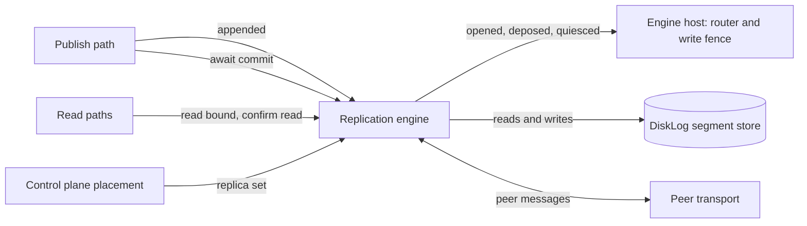
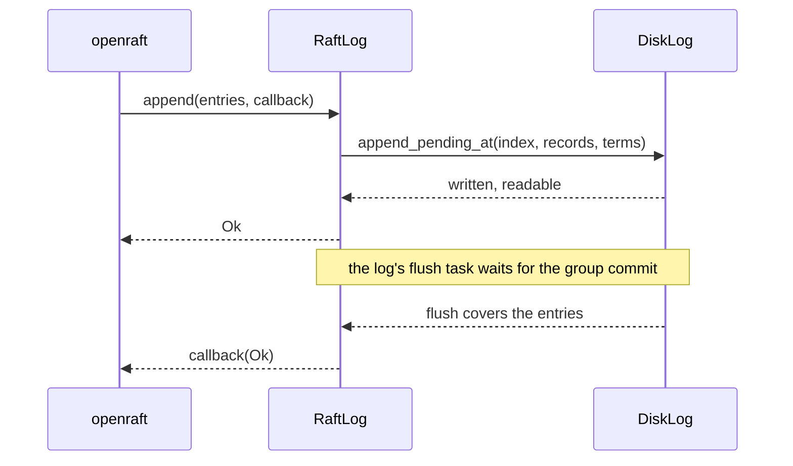
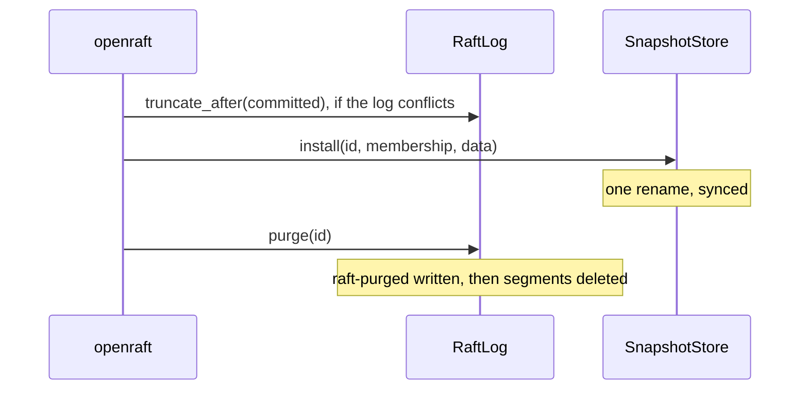

# The replication engine interface

Release 0.8 simplifies Felix around one storage engine, the `felix-storage`
segment log, and one consensus protocol, Raft through openraft (issue #2167).
Today shards replicate with a protocol of Felix's own, described in
[`replication-design.md`](replication-design.md). The control plane kept its
Raft log in redb until 0.8 and now keeps it on the segment store. This page is the design for the first four tracks of
that work:

1. **The replication engine interface.** One boundary between the broker and
   shard replication, with today's protocol as its first implementation and
   no change in behaviour.
2. **Raft log storage on `DiskLog`.** One openraft log adapter over the
   segment store, shared by shard groups and the control plane.
3. **The control plane on the segment store.** redb goes (done in 0.8).
4. **Per-shard Raft** behind the engine interface.

Before the bespoke protocol is deleted, Raft must pass a no-regression gate
against it, written down below before any numbers exist.

Track 4 has its own page, [`per-shard-raft.md`](per-shard-raft.md): the node
ticker, heartbeat coalescing, sleep and wake, the switch from the hybrid, the
tests and the pull request split.

## What the engine is

A shard is one ordered log of records. Its replica set is the brokers that
hold a copy. One of them, the leader, takes writes. The engine is the part of
a broker that keeps those copies in agreement. It answers five questions for
the rest of the broker:

1. **Append.** The leader made a batch durable on its own disk. Get it to the
   followers.
2. **Commit mark.** Which offset is held by enough replicas that no later
   leader can lose it? A `Quorum` write is acknowledged once the mark passes
   it.
3. **Leadership and fencing.** Which broker may take writes for a shard, at
   which generation (the hybrid's word for a Raft term), and when must a
   broker stop?
4. **Membership change.** The control plane moved a shard to a new replica
   set. Switch without losing an acknowledged record.
5. **Read bound.** How far may a reader see, and is this broker still the
   leader when it answers?

Everything else is outside the engine:

- **Placement.** The control plane decides which brokers hold which shards,
  plans moves and throttles them. Both engines take the replica set as input.
- **Storage.** The segment store in `felix-storage` (`DiskLog`) holds the
  records, the generation list, the ballot and the replica state. Both
  engines write through it. See "Raft log on the segment store" below.
- **The write path.** Decoding, the commit order (`begin_append` then
  `commit`), fanout and subscriber queues stay in the broker.
- **Routing.** The ingress router and the write fence that admits a write to
  a shard stay in the broker service. The engine tells them what changed.
- **The peer transport.** `felix-replication/src/peer/` carries both
  engines' messages.



## Where today's code sits

Paths are relative to `crates/server/felix-replication/src/` unless they start
with `services/` or `crates/`. Line numbers are as of the commit that added
this page.

### The seams that already exist

The crate does not depend on the broker service. What it needs comes in
through traits the service implements:

| Seam | Defined | Implemented by | What it gives the engine |
| --- | --- | --- | --- |
| `quorum::ShardServing` | `quorum.rs:991` | `IngressRouter`, `services/felix-broker-service/src/shards/routing.rs:534` | Is the shard replicated, which generation do I serve, is my lease valid |
| `driver::WriteFence` | `driver.rs:296` | `ShardFence`, `services/felix-broker-service/src/shards/lifecycle/fence.rs:444` | Is the shard quiet; callbacks for serving without the lease, deposed, withheld, probed |
| `reporter::Credential` | `reporter.rs:121` | `NodeCredential`, `services/felix-broker-service/src/cluster/credential.rs:62` | The bearer token a replica report carries |
| `promotion::PromotionGate` | `promotion.rs:65` | `LifecycleGate`, `services/felix-broker-service/src/shards/lifecycle/promotion.rs:46` | Whether a promoted shard may open |
| `confirmed::ConfirmedRoutes` | `confirmed.rs:49` | `ControlPlaneRoutes`, `services/felix-broker-service/src/shards/confirmed.rs:77` | An assignment read no older than the control plane's last acknowledged write |
| `quorum::LeadershipCheck` | `quorum.rs:92` | `leadership::ReadIndex`, `leadership.rs:90` | A read round: does a majority still answer at my generation |

### Wiring

`services/felix-broker-service/src/node/cluster.rs` wires the engine: the
follower side through `engine::replica_handler` when the peer listener binds,
the promotion gate, `engine::elections`, and `Hybrid::start`, which spawns the
reporter, driver, suspicion heartbeat and election driver (step 6 below).
`node/startup.rs` binds the read rounds through `engine::bind_read_rounds`, and
`node/peer_dispatch.rs` hands peer replication requests to `Engine::handle`. The
simulator builds nodes through the same service
code (`services/felix-broker-service/src/node/sim.rs`).

### 1. Append

The broker's publish path takes offsets before it waits on durability
(`crates/server/felix-broker/src/broker/publish.rs:257`, `begin_append`), then
`Completion::commit` makes the batch durable and marks the shard in
`AppendedShards` (`crates/server/felix-broker/src/broker/publish/completion.rs:293`,
`crates/server/felix-broker/src/broker/appended.rs:18`). That wakes the
driver, which ships each follower one batch from its cursor (`driver.rs:167`,
`ship.rs:20` `ship_once`, `follower.rs:24` `FollowerCursor`). The follower
stores it at the leader's offsets (`replica.rs:624` `apply`, through
`crates/server/felix-broker/src/durable.rs:506` `append_pending_at`).

### 2. Commit mark

The driver computes a majority offset over the cursors (`quorum.rs:1777`
`quorum_offset`, `driver/shard.rs:479`), counted only from the leader's own
generation start (`quorum.rs:1959` `counted_offset`), and publishes it to
`QuorumMarks` (`quorum.rs:37`, `:618`). Writers wait in `await_quorum`
(`quorum.rs:1018`), called from the service:

- QUIC publish: `serving/quic/handlers/publish/worker.rs:508` and `:591`,
  `serving/quic/handlers/publish/direct.rs:202`
- MQTT: `serving/mqtt/writes.rs:276`
- Kafka: `serving/kafka.rs:235`
- Atomic commits: `serving/commit_ops.rs:227`
- Forwarded writes: `serving/forward/owner.rs:195`

Caches and counters have their own waits: `await_cache_quorum`
(`quorum.rs:1140`), `cache_write_at` (`quorum.rs:1673`) and
`await_counter_quorum` (`quorum.rs:1295`), called from
`serving/cache_routing.rs` and `serving/forward/owner.rs`.

### 3. Leadership and fencing

The control plane assigns a leader and a generation. A promoted leader runs
the fence before it opens: `promotion.rs:167` `fence_shard` asks a majority to
promise the generation (the follower answers in `replica.rs:1172` `fence`),
catches up, appends a generation-start record, and the driver opens it
(`driver.rs:665` `open_promoted`). A follower refuses a stale leader with
`FencedEpoch` (`replica.rs:1943` `check_shard_fence`). The engine tells the
broker through `WriteFence` callbacks (`driver.rs:296` onward): `deposed`,
`withheld`, `serve_without_lease`, `passed`.

Around that core sit the parts that make it safe across crashes and lost
disks: ballots (`crates/server/felix-storage/src/disk_log/ballot.rs:191`),
vouching and copy trust (`replica.rs:1764` `record_vouch`, `follower.rs:107`),
unclean starts (`unclean.rs`), reclaim (`reclaim.rs`), and opt-in election
without the control plane (`election.rs:31`, `election/candidate.rs:403`,
`replica/election.rs`), switched on by `FELIX_INTERNAL_ELECTION`
(`services/felix-broker-service/src/config/membership.rs:166`).

### 4. Membership change

The control plane picks the new set. A promotion across a set change runs a
joint fence that needs answers from both the old and the new set
(`promotion/joint.rs:216` `JointSets`, `replica.rs:2394` `joint_fence`). A new
replica joins as a learner that ships but does not count toward the mark
(`ship.rs:665`, `driver/shard.rs:746`), and a follower too far behind is
rebuilt (`rebuild.rs:40`). The driver learns of a change when the router
notifies `routes_changed` (`driver.rs:176`).

### 5. Read bound

`read_bound` (`quorum.rs:1298`) and `committed_bound` (`quorum.rs:1452`) give
the highest offset a reader may see; `engine::CommittedReads` answers the
broker's `ReadBounds` trait
(`crates/server/felix-broker/src/stream/committed.rs:58`) from
`Engine::committed_bound`. A reader confirms the broker still leads either by
its control-plane lease or by a read round (`leadership.rs:34` `ReadIndex`,
chosen by `FELIX_QUORUM_READS`). `confirm_state_read` (`quorum.rs:1574`) and
`read_skips_lease` (`quorum.rs:1553`) are the entry points. Callers: `serving/kafka.rs:257`,
`serving/group_ops.rs:221` and `:321`, `serving/commit_ops.rs:308`,
`serving/quic/handlers/cache_watch.rs:515`.

## The proposed interface

Two traits in `crates/server/felix-replication/src/engine.rs`. `Engine` is
what the broker asks of replication. `EngineHost` (`engine/host.rs`) is what
replication asks of the broker, and folds together the seams above.

The trait is built. It holds what per-shard Raft needs and, until the hybrid
is deleted, what only the hybrid needs. The Raft pull requests add to it and
change no method that is there. It narrows once, when the hybrid is deleted.

| Question | `Engine` method | How the hybrid answers |
| --- | --- | --- |
| Append | `appended(shard, Written)` | Marks the shard for a driver pass, the same mark the broker core makes when a publish becomes durable. The driver ships from its own cursors, so the position is not used |
| Commit mark | `await_commit(handle, shard, outcome, generation, timeout)` | `quorum::await_quorum`: at once for a `Leader` stream, on the mark and then the lease for `Quorum` |
| Commit mark | `admit_local_ack(shard, generation)` | Always yes. The hybrid checks the lease when a write enters the write fence, and has no second check when it acknowledges |
| Read bound | `read_bound(consistency, shard)` | `quorum::read_bound`: the mark at the served generation, for `Quorum` only |
| Read bound | `committed_bound(shard)` | `quorum::committed_bound`: the same mark plus the lease check, for the broker core's readers |
| Leadership for a read | `confirm_read(shard)` | The lease, or a read round |
| Membership change | `placement_changed(shard, Placement)` | Wakes the driver, which reads the new set from the routing table, as the routing feed's wake does |
| Peer messages | `handle(from, caller, request)` | The replica handler |

`Written` is where a write landed: `end`, one past its last record, and the
`generation` it was written at. `Written::of` builds it from a publish
outcome. `Placement` is the brokers the control plane placed the shard on.
`CommitError` is `quorum::QuorumError` under the name the engine uses.

Five more methods exist only for the hybrid and go when it does:
`cache_write_at`, `await_cache_quorum`, `await_counter_quorum`,
`read_skips_lease` and `await_readable`. `committed_bound` merges into
`read_bound` at the same time. [`per-shard-raft.md`](per-shard-raft.md), "The
engine interface", says why each is safe to drop then and not before.

`EngineHost` has five methods:

| Method | Meaning | Hybrid |
| --- | --- | --- |
| `generation(shard)` | The generation this broker serves the shard at | The ingress router |
| `replicated(shard)` | Whether the shard has followers | The ingress router |
| `quiesced(shard)` | The write fence is closed with no write inside | `ShardFence` |
| `opened(shard, generation)` | This broker leads the shard and may take writes | Never called. A promoted leader asks the broker to open through `PromotionGate::open`, which writes the generation-start record and can refuse |
| `deposed(shard, generation)` | A newer leader exists: stop taking writes | `ShardFence` |

`opened` reaches the broker as `WriteFence::opened`, which does nothing by
default. The hybrid's other callbacks (`withheld`, `gave_up_at`,
`refused_at`, `probed`, `opened_since`, `promoting`, the lease) stay on
`HybridHost`, which extends `EngineHost`, because no other engine has those
states.

### What calls the new methods

Nothing on a shipping path yet. `appended`, `admit_local_ack`,
`placement_changed` and `opened` were added so that the Raft engine has them
from its first pull request. The hybrid implements each with what it already
does, so calling one changes nothing:

- The broker core still marks the shard itself when a publish becomes
  durable (`Completion::commit`), and the routing feed still wakes the
  driver. `Hybrid::wake_driver` hands the engine the same two wakes when
  replication starts. On a broker with no driver, `appended` and
  `placement_changed` do nothing.
- The publish order is unchanged: `begin_append`, then `commit`, then the
  commit wait, then fanout.

### What later pull requests add

The rest of per-shard Raft fits without changing a method:

- **Sleep and wake.** Every event that wakes a group already enters through
  the trait: a write through `appended`, a read round through
  `confirm_read`, a placement change through `placement_changed`, and a Raft
  message through `handle`. The node ticker, the audit timer and the sleep
  handshake are inside the engine.
- **Store liveness.** The liveness heartbeat is a peer message and arrives
  through `handle`. It replaces `suspicion.rs`, which the hybrid starts
  itself.
- **Closing the fence for a membership step.** `EngineHost` gains one
  method that closes a shard without deposing it. The engine waits on
  `quiesced` and reopens with `opened` at the same generation.
- **The switch from the hybrid.** `Placement` gains the shard's engine, its
  base and its voters. It is `non_exhaustive` for that reason.

## Per-shard Raft behind the same traits

One Raft group per shard, with openraft or an equivalent library. The
control plane still places replicas and chooses the set. Raft elects the
leader, and its term is the generation. Reads use a Raft read index or a
leader lease.

- `appended` feeds the Raft leader's replication. `await_commit` waits on the
  Raft commit index, which is the same thing as the quorum mark.
- `opened` and `deposed` come from Raft's role changes.
- `placement_changed` turns into a Raft membership change toward the new set,
  with joint consensus covering what the joint fence covers today.
- `confirm_read` is a read-index round, the same round `ReadIndex` sends
  today.
- `handle` routes AppendEntries, Vote and InstallSnapshot over the existing
  peer transport. Heartbeats are batched per broker pair, since a broker can
  hold thousands of groups.

The leader's own append is the hardest fit. Felix's publish path appends
first and then tells replication (`begin_append`, then `commit`, then
`appended`), which keeps the commit order and the single encode per batch.
openraft expects to append the leader's entries itself, through
`client_write` and its log storage. The prototype has two ways to square
this: the adapter's leader-side `append` finds the entries already durable at
those indexes and returns at once, so the broker's write path stays as it is;
or the publish path hands the batch to `client_write` and the adapter calls
`begin_append` and `commit` from inside it. The first keeps the hot path
untouched and is what the prototype tries first. If openraft cannot accept
entries it did not append, the second is the fallback, and its cost shows up
in the gate's latency cells. Decided since (issue #2167): 0.8 takes the
second, see Decisions, 2.

### Raft log on the segment store

Raft runs on the segment store, not beside it. A separate Raft log applied to
segments would write every record twice. Here is how decoupled that leaves the
Raft log from Felix's write path and format.

**Durability stays where it is.** Fsync modes (`FsyncMode`,
`crates/server/felix-storage/src/log/config.rs:347`), group commit
(`disk_log/sync.rs`, one flush serves every waiter), the flush itself
(`disk_log/flush.rs:26`), the io_uring flusher (`io/uring_fsync.rs`),
`F_FULLFSYNC` on macOS (`io.rs:254`) and preallocation (`io.rs:141`) all live
under `DiskLog`. These `disk_log` and `io` paths are in
`crates/server/felix-storage/src/`. Nothing in `felix-replication` writes a
file itself: a follower stores records through the broker's `DurableLog`
(`crates/server/felix-broker/src/durable.rs:506`), which calls `DiskLog`. An
engine that writes through `DiskLog` keeps all of them.

**openraft's `RaftLogStorage` maps onto `DiskLog`** (paths in
`crates/server/felix-storage/src/`):

| Raft storage operation (openraft 0.10) | `DiskLog` today |
| --- | --- |
| `append`, then `IOFlushed` (`LogFlushed` in 0.9, which the control plane uses until it moves) | `append_pending_at` / `append_claimed_at` (`disk_log.rs:377`, `:348`), then `wait_durable` (`disk_log.rs:429`). Group commit is kept: the callback fires when the shared flush covers the offset. |
| `truncate_after(Option<LogId>)`, cutting everything after the given id (0.9's `truncate(log_id)` cut from it) | The truncation path (`disk_log.rs:1361`), refused below the commit offset with `BelowCommit` (`disk_log.rs:1376`). `restore_to` (`disk_log.rs:575`) is the offline variant. |
| `purge(log_id)` of a committed prefix | `trim_before` (`disk_log.rs:510`) and retention (`disk_log/retention.rs`). |
| `install_snapshot` on the state machine | `reset_to` (`disk_log.rs:528`), which also refuses to drop committed records with `BelowCommit`, then catch-up as a rebuild does today. |
| Term of each entry (`LogId` with `leader_id_std::LeaderId`) | A generation field in every record's header, added in segment version 9 (see "Format version 9" under Decisions). The generation list in `disk_log/epochs.rs` stays a hint for finding truncation points and is never read as the term. |
| `save_vote` / `read_vote` (`Vote` with its `committed` flag) | Two files, as today: the ballot (`disk_log/ballot.rs`, generation and leader) is written first and the replica state (`replica_state.rs`, generation) second, each by rename (`ballot.rs:250-263`). The open takes the higher generation, so a crash between them never lowers the vote. openraft's `committed` flag on the vote is a new field in the ballot file, which bumps the ballot format (see Format version 9). Storage errors reach openraft as `io::Error`. |
| `save_committed` / `read_committed` | The commit offset in `replica_state.rs` (`save_committed`, `disk_log.rs:1500`), written at most once a second on a Raft log. |

The offset is the Raft index: one record is one entry. The startup scan, the
torn-tail rule and the derived indexes keep working as they do; version 9
adds the generation field to the record header and the record kinds below.

**What is built.** The adapter is in
`crates/server/felix-storage/src/raft_log.rs`, behind the `raft` feature.
`RaftLog` implements all of openraft's `RaftLogStorage`: `append` with its
`IOFlushed` callback, `truncate_after`, `purge`, `save_vote` and the
committed id. `LogReader` implements `RaftLogReader` (entries and the
vote). `SnapshotStore` keeps a group's snapshot for the state machine that
runs beside the log. Inside the crate, `DiskLog::writer_at` and
`DiskLog::last_writer` give the generation in a record's header without
reading its payload. The adapter passes openraft's whole storage suite
(`Suite::test_all`, in `raft_log/tests/suite.rs`). No engine runs on it
yet.

**A Raft log is opened as one.** `LogConfig::raft_log` makes a log v9 from
its first segment, lets it take membership records, and refuses retention
bounds, since retention deleting head segments would look like a purge
nothing asked for. `RaftLog::new` refuses a log opened without it.

**Append returns before the flush.** openraft wants `append` to return once
the entries can be read and to hear through the callback once they are
durable:



The append checks that the first entry is the next index under the same
lock that assigns offsets, so a hole is refused with nothing written. The
callback fires from a task that waits on the log's group commit, once per
append. A flush covers a prefix of the log, so when the callback fires
every entry below is durable too. The wait is a real flush, because a Raft
log is always `FsyncMode::OnCommit`: `RaftLog::new` refuses a log opened
under any other mode (#2248). Under the other modes the callback would fire
before the fsync, and a follower would acknowledge an entry that a power
cut can still take, so an entry could commit on fewer than a majority of
disks. A flush that fails reaches the callback as an error, which openraft treats as
fatal for the node.

**A proposer can hear where its entry was written.** openraft answers a
write only once the entry is applied. A caller that acknowledges earlier
puts a `WrittenToken` on its command, and the codec hands it over through
`EntryCodec::written_token`. Once the whole append is written, and before
the flush, the adapter moves the log's written position and then resolves
each token with its own entry's index and term. The token lives in memory
only: the codec does not encode it, so an entry read back, or one a
follower was sent, has none. An append that fails resolves no token, which
the caller reads as an unknown outcome. Written is not durable: a power
cut after the token resolved can take the entry. Only an acknowledgement
that the stream's fsync policy allows may rest on it. Votes, a follower's
answer and the commit index wait for the callback. How the publish path
uses the token is in `per-shard-raft.md`, "Writing through openraft". An
append reports all of its entries or none: when a later batch of a large
append fails, the tokens on the batches already written stay unresolved.

> `raft_log/tests/written.rs`,
> `a_token_resolves_once_written_and_before_the_flush`,
> `a_token_on_an_append_of_several_batches_resolves_with_its_own_index`,
> `a_failed_append_resolves_no_token_as_written`,
> `a_failure_on_a_later_batch_resolves_no_token`, `a_token_is_never_stored`
> and `a_cut_after_written_and_before_the_flush_can_take_the_entry`.

**One task per log waits for flushes.** An append that has to wait puts
its callback on the log's flush queue (`raft_log/flush_queue.rs`) and
returns. One task per log takes everything queued, waits once for the
newest append, and then fires every callback in the order the appends
were made. Nothing is spawned per append. If the flush fails, each queued
append is asked about on its own, so every callback gets the error. An
append with nothing to wait for fires its callback before it returns, but
only when the queue is empty, so a callback never overtakes an earlier
one.

If the task stops (a callback panics, or its runtime shuts down, even
before the task first runs), it fails every callback it still held, and
the next append that has to wait starts a new task. The log is not
poisoned: no flush failed, so nothing on disk is in doubt. The task holds
its own handle to the log, so appends still queued when the last user of
the log goes are answered with their real flush.

> `raft_log/tests/flush_queue.rs`, `one_flush_answers_every_waiting_append`,
> `a_failed_flush_fails_every_waiting_append`,
> `an_append_after_the_task_stopped_is_flushed`,
> `a_task_dropped_before_it_ran_fails_what_was_sent` and
> `a_queued_append_outlives_the_log`.

**The newest entries are read from memory.** Replication reads an entry
right after it is appended. The adapter keeps the last 4 MiB of records it
appended, as the `Bytes` the appender handed in, and a read that starts
among them is served from there with no read of a segment
(`raft_log/tail_cache.rs`). An older start is read from the segments.

The cache must never return an entry the log no longer holds. `DiskLog`
counts its cuts: a truncation, a removed head segment and a reset each
add one. The cache remembers the count from before its oldest record was
written and is read only while the log still reports that count, so any
cut, by the adapter or under it, turns it off until the next append
starts it again. `truncate_after` also empties it before it cuts. A read
never starts below the purged id, in memory or on disk. The cache is not
kept across a restart, and the log's state (`get_log_state`) never comes
from it.

> `raft_log/tests/tail.rs`, `a_cut_entry_is_never_read_again`,
> `a_cut_made_under_the_adapter_is_seen` and
> `a_purged_entry_is_never_read_again`.

**A failed flush.** A failed fsync or directory sync poisons the log it
happened on (`docs/durable-storage.md`, "A failed fsync poisons the log"):
the log refuses every later append, flush and state write with
`StorageError::Poisoned` until it is reopened. The rule for a replicated
shard is the same under either engine, and it follows from that one error:

- **A follower does not acknowledge.** Its append or its flush fails, so it
  answers the leader with an error and its copy stops counting toward a
  quorum. It cannot save a vote or a set either, so it promises nothing new.
- **A leader stops leading.** It cannot append, so it acknowledges nothing
  more. It does not keep the role on the strength of what it holds in
  memory: the records it acknowledged may no longer be on its disk.
- **The broker says so.** `/ready` answers 503 and names each poisoned log
  with what stopped it. That is broker-wide for now. The decided behaviour is
  per shard ([#2300](https://github.com/GetFelix/felix/issues/2300)): the
  leader of the poisoned shard steps down, the broker stays ready for its
  healthy shards, and the poisoned log shows in metrics and status. The log
  stays poisoned until the broker restarts; `docs/durable-storage.md` says
  when a restart is safe. A per-shard Raft copy does not come back with
  that log: it restarts as a new copy with an empty log
  (`docs/per-shard-raft.md`, "Group and member identity").

On the hybrid, a poisoned process attests no trusted copy to a fence, and a
promotion does not let it continue as leader, so another copy takes over
through the usual fence. Under Raft the adapter passes the error on
unchanged: the `IOFlushed` callback of the append carries it, and
`save_vote`, `append` and `truncate_after` return it from then on. openraft
treats a storage error as fatal and stops that group's node, which stops
its heartbeats, and the other members elect a leader. Nothing engine
specific decides when a log is poisoned, so an engine built on the adapter
inherits the rule.

> `raft_log/tests/writes.rs`, `a_failed_flush_fails_the_callback` and
> `a_failed_flush_stops_every_later_write`.

**Truncation waits for those callbacks.** `truncate_after` first waits for
the flush queue to empty, so every earlier append's callback has fired,
then cuts. Cutting first would leave a
flush waiting on entries that no longer exist; it would give up and report
the append failed. The cut itself removes whole segments newest first and
syncs the directory after each, then cuts the surviving segment, so a crash
part way leaves a longer log and never a gap. `truncate_after` also checks
the id it is given: if the log holds an entry of another term at that
index, the caller is describing a different log and the cut is refused.
The cut is on disk when `truncate_after` returns, so the callback of an
append after it cannot fire ahead of the cut.

**A vote only moves forward.** `save_vote` writes the ballot and returns
once it is on disk. It accepts a higher term, or a committed vote over an
uncommitted one of the same term, and saving the held vote again writes
nothing. The committed vote may name another node: a member that voted for
a candidate that lost, itself included, follows the leader the majority
elected in that term, and openraft saves that leader's vote. A lower term,
a second uncommitted vote in a term, a second committed leader in a term,
or a committed vote going back to uncommitted is refused with nothing
written.

**The committed id is never past the log.** `save_committed` keeps the id
as the log's commit offset, which is written behind the call, so after a
crash the id read back may be older. It must never be newer than the log:
openraft can save a committed id whose entry is appended here but not yet
flushed, and a power cut can then take the entry and keep the id. An open
of a Raft log lowers a stored commit offset to the end of the recovered
log and writes that back before anything is appended. Without the
write-back, entries a later leader puts at the lost indexes would count as
committed after the next crash, and a legal truncation of them would be
refused.

**The committed id names an entry, not an index.** The id's term is saved
beside the commit offset, as a generation, in the same write. An open of a
Raft log reads the record just below the offset and compares generations.
If they differ, the log holds some other entry at that index, one that was
never committed. The open then takes nothing in the log as committed: it
lowers the commit offset to the log's first index, writes that back, and
`read_committed` returns nothing until the leader sends an id again. When
the open has already lowered the offset to the log's end, the record there
is an earlier entry, so its generation may be lower than the saved one but
never higher. The lowered offset and that entry's generation go to disk in
one write. `read_committed` makes the same comparison on every call and
fails on a mismatch. Nothing can cause one on an open log: the commit
offset of a Raft log moves only with a term, so
`DiskLog::advance_commit_offset` is refused and `note_commit_offset` does
nothing there. A durable `truncate_after` is what
keeps a cut tail off the disk. This check is for the case where the disk
comes back with it anyway.

These rules, and the one above about a cut and later callbacks, were found
by model checking
([#2221](https://github.com/GetFelix/felix/issues/2221)).

**Purge.** `purge(id)` drops every entry up to and including `id`. It
first writes the id to a small file, `raft-purged`, and only then deletes
anything. From that write on, the log starts right after the id. Segments
are deleted whole, oldest first, each unlink made durable before the next,
so records at or below the id can remain in a segment that also holds
later entries. They are no longer entries: no read returns them. The file
is needed because the segments alone cannot say where a purge stopped, and
because a purge can go past the log's end, where no entry is left to carry
the id.

openraft asks for a purge past the end at startup, when the state machine
is ahead of the log (a snapshot was installed and the power went before
the log was purged). The log is then empty and its last id is the purged
id. The next append must be the entry right after it. If the power goes
between the file write and the delete, the next open sees the same thing:
the first index is above every record, and the next append restarts the
segments there.

A purge is refused when the log holds another term's entry at that index.
`truncate_after` never reaches below the purged id: naming the purged id
cuts every entry, and an id below it, or below the start of a log that
purged nothing, is refused. `read_committed` never returns less than the
purged id, since only committed entries are purged.

**Snapshots.** `SnapshotStore` keeps one snapshot in one file,
`raft-snapshot`: the id of the last entry it covers, the caller's metadata
(the membership) and the data, under one checksum. It is replaced by one
rename, so a crash leaves the old snapshot or the new one. Two files, one
for the data and one for the id, could tear: the model's
`SnapshotTwoRenames` knob shows new data read under the old id
([#2221](https://github.com/GetFelix/felix/issues/2221)). A snapshot never
goes back: one that covers less than the stored one is not written. A file
that does not decode fails the open, because the log below it may already
be purged.

A log must not be purged past its stored snapshot when the state machine
cannot rebuild what was dropped. That is the control plane, whose state
machine is in memory, and a shard, whose state machine is the log.
`RaftLog::purge_within(&snapshots)` turns the rule on: a purge past the
snapshot is refused, and so is a log that is already purged past it.
openraft purges only up to a snapshot it built or installed, so the check
refuses nothing openraft asks for. It is there for a snapshot that did not
reach disk.

A follower installs a leader's snapshot in three calls, in this order:



A power cut after any step of any of the three leaves a directory that
opens. Before the install, the follower is on its old snapshot with every
committed entry. After it, the snapshot is ahead of the log, and openraft's
startup purges up to it. The purged id is never past the snapshot.

### Sending a snapshot

A snapshot that goes to another member is streamed. The transfer never
holds it whole in memory on either side, and neither side gives up on a
transfer that is still moving. What the install holds is up to the group,
below. The rules live in `felix-storage` (`raft_log::transfer`), so
every group that sends snapshot data follows them. Only the transport
differs: the control plane uses one HTTP request on `/internal/raft/v2`.
A stream shard sends no snapshot body at all. Its state is its log, so a
member that is behind is sent entries or copied segments
([per-shard Raft](per-shard-raft.md), "Group runtime").

**The body.** A form byte, the head's length, the data's length, the head,
the data, then a crc32 of the data:

```text
form u8 | head_len u32 | data_len u64 | head | data | crc u32
```

The head belongs to the transport. For the control plane it is JSON
holding the sender's vote and the snapshot's last log id and membership.
An unknown form byte is refused, never guessed at. Later changes to the
body get a new form byte.

**The receiver decides from the head.** It reads at most 64 KiB of head
before any data, and then, in this order:

1. A sender whose vote is behind this member's gets this member's vote
   back, and none of its data is read. This check only saves the data's
   trip. openraft checks the vote again when it installs, and that check
   is the one that counts.
2. A data length over the member's cap is refused with 413. The cap is
   `FELIX_RAFT_SNAPSHOT_MAX_BYTES`, 1 GiB by default.
3. The member's one install slot is taken. A second sender gets 503 at
   once instead of waiting with its body open. A sender with a newer vote
   than the one installing stops that transfer and takes the slot, so a
   stale leader that trickles bytes cannot hold off the real one.

**The cap comes from configuration, never from `felix-storage`.** The
shared code takes the cap from its caller on every transfer and has no
default of its own. A group's cap must be at least the largest snapshot it
can build, or a learner can never be caught up: for the control plane that
is `FELIX_RAFT_SNAPSHOT_MAX_BYTES`, and a group whose snapshot carries data
(such as a cache group) must size its cap from its own configured limits,
for example the largest cache shard, not from a fixed number.

**The data goes to a file.** `SnapshotStore::begin_receive` writes
`raft-snapshot.recv` in the stored snapshot's own format while the data
arrives, keeping the crc as it goes. Bytes past the declared length, a
missing byte or a wrong crc fail the transfer. When the data is whole, the
file is synced and read back, and its crc is checked. A commit refuses a
file that was not read back to its end and checked. The file is then renamed over
`raft-snapshot`, under the same rule as a local install: a snapshot never
goes back. A receive that fails or is dropped deletes its file, except one
dropped while its file is still being created: that file stays until the next
receive truncates it or the next open deletes it. A crash before the rename
leaves the old snapshot, and the next open deletes the leftover.

**Memory at install.** A group can read the staged file back whole
(`StagedSnapshot::read`) or a piece at a time (`StagedSnapshot::next_chunk`).
The control plane reads it whole, because its state machine restores from
one byte slice. So it holds one copy of the snapshot at install, up to the
cap. A group whose state can be larger than memory, such as a cache group,
must read in pieces. Its peak is then a piece, not the snapshot.

A blocking call that works on the receive file by its name (the create,
the rename) holds the receive slot itself. A caller that goes away during
one cannot free the name for the next receive while the call still runs.

A sender reads the stored file the same way, a piece at a time
(`SnapshotStore::open_current`). It keeps the descriptor it opened, so an
install that replaces the file meanwhile does not change what it sends. A
file whose crc does not match fails the send instead of reaching a peer.

**Timeouts follow progress.** A transfer fails when no bytes move for 30 s,
on either side. After the last byte the receiver gets 30 s plus 1 s per
16 MiB to install before the sender gives up. A large snapshot that keeps
moving always lands. openraft passes an install timeout to the network but
does not enforce it, and the network does not use it.

**Closing the store.** A close tells a receive in flight to stop and waits
for it to delete its file before the store's lock is let go of. If it does
not stop within 10 s, the close fails and keeps the lock.

A built snapshot past half the cap is logged as an error, and
`felix_meta_raft_snapshot_bytes` shows its size. A snapshot over the cap
can never be installed by a follower, so that has to be visible well before
it happens.

**Three smaller rules.**

- A command stored as a trim record is refused. A trim sets a floor the
  log deletes below on its own timer, and only a purge may delete a Raft
  log's entries. Trims on a shard group need their own design
  ([#2253](https://github.com/GetFelix/felix/issues/2253)).
- One `append` larger than a segment is written a segment's worth at a
  time. The log puts a batch into one segment whole, so the adapter splits
  the entries into batches; the callback fires once the last is flushed.
- The adapter keeps no list of membership offsets. openraft finds the
  latest membership by reading the log backwards from its end, 64 entries
  at a time, down to the last applied entry, so an open reads only the
  unapplied tail. A list would have no caller.

**Crash points.** Each write has power-loss tests on the simulator's
filesystem (`raft_log/tests/crash_points.rs`,
`raft_log/tests/install_crash_points.rs`,
`disk_log/tests/vote_crash_points.rs`): an append cut before its flush,
inside the write and after its callback; several appends that share one
flush, cut before it and after it; a truncation cut after each
unlink, after it returns and after a later append's callback; a committed
id saved ahead of the flush; a vote save cut at every step. What reopens
holds every entry whose callback fired, is a gap-free prefix of what was
written, is never shorter than a truncation was asked to keep, and has the
old vote or the new one. A purge, a snapshot write and a follower's
snapshot install are each stopped at every step they have (each step of a
file write, each unlink). What reopens then has no gap above the purged
id, holds one whole snapshot, is never purged past it, and is accepted by
openraft's own startup (`StorageHelper::get_initial_state`), after which
the install can be finished and the log takes the next entry.

**The term is the generation minus one.** openraft's `initialize` writes the
first membership entry at term 0, and generation 0 in a record header means
"writer unknown" (see "Unknown writers and the switch to Raft"). The adapter
stamps a record with its entry's term plus one, and the ballot's generation
is the vote's term plus one, so term 0 is stored as generation 1 and no
entry is ever stored as 0. The shift is one exported pair,
`raft_log::generation_of` and `raft_log::term_of_generation`, and the engine
that drives the adapter calls the same pair when it opens the write fence at
a term.

**An empty log can start at any index.** openraft's storage suite appends to
an empty store at index 1. The adapter takes the log's first index from
where its oldest segment starts, and the first append to an empty log
restarts it at that entry's index, so the log holds nothing below it. A log
that holds entries takes an append only at its tail.

**A read is one log's.** A read that spans several pages restarts if the log
is truncated under it, so it never joins entries from before a truncation to
ones written after.

**The awkward part is entries that are not records.** Raft appends two kinds
of entry no client wrote: a blank entry when a leader starts its term, and
membership entries. Each would take a shard offset. Consumers see offsets, and
a jump in offsets is how a subscriber detects a drop, so these cannot be
ordinary records.

The blank entry already exists. The hybrid writes a generation-start record
when a leader opens, for the same reason Raft writes its no-op (Raft's Figure
8, see `replication-design.md`, "The generation-start record"). It takes an
offset, readers skip it (`crates/server/felix-broker/src/broker/read.rs:86`),
and a client that negotiated `skipped_before` does not count it as a drop
(`docs/protocol.md`, Event batch offsets). The Raft engine writes its blank
entry as that record, with no format change.

Membership has two options:

- **Keep membership in the control plane, outside the Raft log.** No format
  change. But openraft keeps membership as log entries, so this needs a
  library that accepts its configuration from outside, or a group restarted at
  a new term for each set change. That is close to what the hybrid's joint
  fence does today, and it brings back part of the code Raft was meant to
  retire.
- **A typed membership record that readers skip, like the generation-start
  record.** The control plane still chooses the set; the Raft leader commits
  it. The cost is a format change: a new record kind, a new segment version
  (9), and a fleet feature so no broker writes it before every broker can read
  it. As with versions 4 to 8, a broker that predates version 9 refuses a
  segment holding one, so rollback is blocked once one is written.

Decided: the typed membership record (see Decisions, 1). It is the standard
Raft algorithm with one new record kind, where the first option keeps a bespoke
reconfiguration path alive. Set changes are rare, so the skipped offsets cost
nothing measurable.

Neither the blank entry nor a membership record reaches a consumer: readers
skip both, and the batch's `skipped_before` covers the offsets they hold. A
client that did not negotiate event offsets (`0x0800`) still sees a gap at
each one, as it does at a generation-start record today.

### One log adapter for shard groups and the control plane

The control plane runs openraft for its metadata, on this adapter since 0.8
(`services/felix-controlplane-service/src/raft/store.rs`; it was on redb
before). Felix has one Raft log storage, not two: a single `RaftLogStorage` adapter over `DiskLog`,
used by every shard group and by the control plane, tested once.

- **Where it lives.** In `felix-storage`, as a `raft_log` module behind a
  cargo feature that pulls in openraft. The control plane must not depend on
  the broker, and `felix-replication` depends on `felix-broker`, so the
  adapter cannot live there. `felix-storage` depends on neither.
- **One implementation for both.** Every entry is a record. A blank leader
  entry is a generation-start record and a membership entry is the typed
  membership record above, for both users, and every record carries its
  term in its header. The control plane's log has no subscribers, but using
  the same kinds keeps one code path.
- **One set of tests.** openraft's storage conformance suite
  (`openraft::testing::Suite`, run in
  `services/felix-controlplane-service/src/raft/store/tests.rs`) runs
  against the adapter, alongside `felix-storage`'s existing torn-tail,
  power-loss and fault-injection tests.
  The suite drives a whole store, so it runs in full only once purge and
  snapshots exist. Until then
  `crates/server/felix-storage/src/raft_log/tests/suite.rs` runs the 13
  cases that need only reads, appends, truncation and the vote, all through
  the adapter.
- **One model.** What the adapter must guarantee to openraft is model-checked
  in `docs/formal/FelixRaft.tla`: when the flush callback may fire, what a
  crash may leave of the log, the vote and the snapshot, and what the
  committed index read back may be. See "One engine: Raft on the segment
  log" in [`docs/formal/README.md`](formal/README.md).
- **Truncation is allowed.** The redb store's comments said the segment
  store forbids truncating an uncommitted suffix. It does not: records are never rewritten
  in place, but dropping a suffix above the commit offset is a supported
  operation (`disk_log.rs:1361`, and "Divergence and truncation" in
  `replication-design.md`).

### openraft version

The adapter targets openraft 0.10, pinned to an exact version in
`Cargo.toml` and `Cargo.lock`. 0.10.0 is released (2026-11-10).
`[workspace.dependencies]` pins one commit of openraft's main branch,
`30c947ef38` (2026-11-12), past the 0.10.0 tag, for changes that ship
in 0.10.1. The node ticker needs `Trigger::tick()` (`docs/per-shard-raft.md`,
"One timer for every group"). openraft#2313 (issue #2312) resets a drained
queue to its start, so an idle member stops touching every page of its
queues, and openraft#2314 starts those queues at 64 slots instead of
reserving room for 4,096 commands and 1,024-slot response buffers, so a member's
resident memory stays small. The others are a `#[non_exhaustive]` on some name enums,
benchmark changes, and one change to the state-machine worker: it merges
`Apply` commands that are already queued into one `apply()` call. That
call still gets the committed entries in log order, each once, with each
entry's responder, which is all `apply()` in Felix relies on.
`openraft-multi` is pinned to the
same commit, and `deny.toml` allows that one git source. `felix-storage` and
`felix-replication` use the pin behind their `raft` features, and the
control plane uses it too
(`services/felix-controlplane-service/Cargo.toml:61`), so the workspace has
one openraft. The pin goes back to a released version, `=0.10.1`, when that
is out. A version change is a reviewed update, never a side effect of
refreshing the lockfile.

**Release rule (decided).** A Felix release ships a control plane on 0.10
only if 0.10 is final, or the pinned version has passed the full
control-plane simulator, crash-point and history checks. With 0.10.0 final
the first condition holds. The control plane's openraft types stay inside `src/raft/`, so a
version change touches only that module.

**What 0.10.0 adds that this design uses.** Each needs checking against the
release before the design relies on it:

- `openraft-multi` routes every group's RPCs through one shared router,
  tagged with a group id (`examples/multi-raft-kv`). It shares connections,
  but each group still sends its own heartbeats, so coalescing per peer
  (below) is still Felix's to build, and a candidate to contribute upstream.
- Pipelined replication (`RaftNetworkV2::stream_append`), and consecutive
  appends merged into one storage write. Both bear on the per-record cost of
  Decision 2.
- Lease admission: a leader past its lease refuses new proposals
  (openraft#1898), and `quorum_loss_probe_interval` stops its heartbeats so a
  connected majority can elect (openraft#2080, #2166).
- Pre-vote, leadership transfer, and lease reads that skip the core task
  (`get_local_read_linearizer`).
- `openraft-rt-sim`, a runtime for simulation, to evaluate for the felix-sim
  harness.
- Startup refuses a store whose state machine misses purged logs
  (openraft#2222), next to the purge-then-snapshot crash window in Felix
  issue #1931.

**Limits found in openraft are fixed upstream.** Felix files an openraft
issue with the measured numbers and, where the fix is clear, sends the pull
request. Felix does not switch libraries or keep a private fork. The likely
first one is coalescing heartbeats per peer in `openraft-multi`
(openraft#1959 reported high p99 from groups ticking together and noted
batching as the real fix). A lease backed by broker liveness goes to the
open LeaseGuard issue (openraft#1651) once the TLA+ model (issue #2198)
covers it.

What the adapter absorbs from 0.9 to 0.10:

- The `single-term-leader` feature is gone. The type config sets
  `LeaderId = leader_id_std::LeaderId`, which gives a log id of term and
  index, the term being the record's generation minus one. The adapter's
  `LogTypes` bound accepts no other leader id.
- `truncate(log_id)` becomes `truncate_after(Option<LogId>)`, which keeps the
  named entry and cuts everything after it. The adapter maps it to `DiskLog`'s
  truncate at the next offset.
- `LogFlushed` becomes `IOFlushed`, and storage errors are `io::Error`.
- `Vote` keeps its `committed` flag, stored in the ballot file.
- The trigger handle gains `transfer_leader`, which the engine uses for a
  graceful hand-off on drain and rebalance, and `elect` takes a `pre_vote`
  choice.
- 0.9 does not step a leader down when it loses its majority, so the write
  fence's check at acknowledgement time is Felix's own (Decisions, 5). 0.10.0
  adds lease admission (above). The fence check stays until a test pins
  0.10.0's behaviour.

0.10 also has opt-in local lease reads. They could replace `Quorum` read
rounds and save a round trip per read. That is a later option, taken only
after it is measured and after our own simulator and crash tests cover it.
No safety rule rests on behaviour only an alpha has unless one of our tests
pins it.

The adapter stays thin: openraft types do not leave `felix-storage::raft_log`
and the engine module that drives it, so an API change is contained there.
The control plane already keeps openraft types inside `src/raft/` for the
same reason (`services/felix-controlplane-service/Cargo.toml:60`).

A member that rejoins after its volume was wiped reports a log that went
backwards. Without permission for that, the leader trips over the reverted
log, which is the error the control plane's chaos test caught. On 0.10 the
permission is `Config::allow_log_reversion`, which the control plane sets
(`services/felix-controlplane-service/src/raft/handle.rs`). Shard groups
leave it off: a copy that lost records comes back under a new copy id
instead (`docs/per-shard-raft.md`, "Group and member identity").

Checklist for each openraft version change:

1. Pin the exact version in `Cargo.toml` and `Cargo.lock`.
2. Allow log reversion for the control plane's group with
   `Config::allow_log_reversion`. Shard groups keep it off.
3. Check the follower-side leader lease still equals `election_timeout_max`,
   and that a follower still refuses votes for that long, since the lease
   margin depends on both (Decisions, 5).
4. Check that openraft types still stay inside `felix-storage::raft_log` and
   the engine module.
5. Run openraft's storage suite, the crash-point tests, the control-plane
   chaos test and the history nemeses on the new version.

### Many groups on one broker

A broker can lead thousands of shards. One Raft group each means thousands of
election timers and, by default, thousands of heartbeat streams per broker
pair. Multi-Raft systems such as TiKV found two fixes, and Felix needs both:

- **Coalesce heartbeats per node pair.** One message per peer per interval
  carries every group's heartbeat. The hybrid already does this kind of
  batching for ships per follower.
- **Let idle groups sleep.** A group with no writes stops heartbeating, and
  its followers do not start an election on silence alone. They start one
  when node-level liveness says the leader's broker is gone. Felix has that
  signal already in its broker heartbeats and suspicion (`suspicion.rs`).
  A sleeping group's lease lapses, which is safe, because the lease is
  checked when a write is acknowledged, not kept alive in the background
  (Decisions, 5). The first write after a group wakes runs one quorum round
  before it is acknowledged. That costs one round trip on the first write
  after idle, and nothing on later ones.

openraft runs each group as its own task with its own timers. It has no
built-in coalescing or hibernation, but it can be driven from outside: its
config can turn off the internal heartbeat and election timers
(`enable_heartbeat`, `enable_elect`, already used in
`services/felix-controlplane-service/src/raft/handle.rs:76`), and its trigger
handle starts a heartbeat or an election on demand. A per-broker driver owns
the timers for all groups, sends one coalesced heartbeat per peer, and wakes
an election only on a liveness signal. The network layer then has to accept
one batched message and fan it out to each group. Whether thousands of
openraft tasks cost too much memory or scheduling is the first thing the
prototype measures; if they do, that is a reason to pick a different library,
not to give up the design.

#### What other multi-Raft systems learned

CockroachDB (a group per range), TiKV (per region) and YugabyteDB (per
tablet) all run thousands of groups per node. Both fixes above are what they
do. They also learned four things the design takes on:

1. **Liveness is peer to peer and tied to the disk.** CockroachDB first kept
   every node's liveness in one central range. It was a single point of
   failure, and a node whose disk stalled kept its leases. Its replacement,
   store liveness, is one support exchange per pair of stores, a heartbeat
   counts only after a disk write, and support is granted for an epoch with
   an expiry. Felix's liveness signal follows the same rule: it comes from
   the brokers, never from the control plane, or a control-plane outage
   would stop failover. Today's `suspicion.rs` pings peers directly but
   reports what it finds through the control-plane heartbeat and writes
   nothing to disk, so it does not meet the rule yet.
2. **Liveness keeps leases, not per-group heartbeats.** In CockroachDB's
   leader leases, a group's lease stays valid while its leader's store has
   support from a quorum of the group's stores, and followers promise not to
   campaign until a future time. A sleeping group then keeps its lease: no
   quorum round on the first write after idle, and no election storm when
   the groups of a broker that died wake together. They report up to 85%
   less CPU on lease upkeep at scale. This replaces "a sleeping group's lease
   lapses" above if the TLA+ model (issue #2198) checks it; CockroachDB's
   model of it is public.
3. **No task per group.** CockroachDB moved from a task per range to a few
   per store, and TiKV drives regions from a small thread pool. openraft
   runs a task per group, so the first step of per-shard Raft measures
   memory, idle CPU and scheduling with 5,000 groups on one broker (and
   10,000 as a stress run), before other work builds on it. Felix stays on openraft. If the
   measurement finds a limit, it is fixed in openraft: Felix files the
   problem upstream with the numbers and, where the fix is clear, sends the
   pull request, rather than switching libraries or keeping a private fork.
   Fewer groups per broker (point 4) is the interim lever while an upstream
   fix lands.
4. **Fewer groups is the first fix.** Each system's first advice for an
   overloaded node is fewer groups (TiKV merges regions, YugabyteDB
   measured about 2.8% of a CPU per 100 tablets before batching). Folding
   cache and counters into the shard's group (Decisions, 4) already does
   this. The prototype also sets and tests a per-broker group budget at
   felixd's 1,000-workload scale.

#### How many groups a broker carries

A broker holds about `shards × RF / brokers` Raft members, a third of them
leaders at RF 3. Three brokers with 300 streams of 4 shards carry 1,200
members each; 2,000 small per-entity streams on three brokers carry 2,000.
Kafka brokers usually run 1,000 to 4,000 partitions.

- **Design point: 2,000 members per broker.** Defaults and docs assume this.
- **Gate: 5,000 members per broker**, idle, with idle CPU near zero and
  resident memory under 1 GB for Raft state (perf gate, criterion 6).
- **10,000 is a stress run**, used to find limits to fix upstream. It is not
  a supported size.
- **`max_shards` caps a broker.** Past it, placement answers `at_capacity`
  instead of the broker slowing down.

Measured on openraft 0.10.0 (one process leading every group, stub
followers, a 4-vCPU runner): about 180 KB and 10 tasks per leader member
and 145 KB and 6 tasks per follower, whatever the timers. Idle CPU comes
from each member's tick: 86% of a core per 1,000 members with the default
timers, 0 with `enable_tick=false`. One node timer driving
`Raft::trigger().tick()` (openraft 0.10.1) removes it, and is built
(`docs/per-shard-raft.md`, "Group runtime"). The other upstream
asks (heartbeat coalescing per peer, idle groups that sleep, fewer tasks per
member) are tracked in #2215.

If per-entity streams push a broker past the gate, many small streams can
share one Raft group, the way one CockroachDB range covers many keys, with
groups splitting when hot and merging when cold. Nothing is built for this
yet, but the engine interface must not assume one group per stream.

Sleep and wake also get their own simulator nemesis: both CockroachDB and
TiKV shipped bugs where idle groups failed to sleep or failed to wake.
The nemesis is specified in [`per-shard-raft.md`](per-shard-raft.md), "Simulator: the sleep nemesis".

### Hybrid behaviour that does not fit cleanly

- **Control-plane leases.** A `Leader` shard (no `Quorum` acknowledgements)
  serves only while the broker's lease is valid. Raft has no such mode. The
  interface keeps the lease on the host side (`Serves::ByLease`), since it also
  admits unreplicated shards. A Raft engine never returns `ByLease`; it
  bounds `Leader` writes with a Raft leader lease instead, and delivers only
  committed records (Decisions, 5).
- **Vouching, copy trust and ballots on a wiped disk.** A copy that lost its
  storage must not vote. Raft has the same problem when a node loses its vote
  file. Both engines handle it internally with the storage identity; the
  interface does not carry it.
- **Quorum mark semantics.** `counted_offset` is Raft's current-term commit
  rule. The mark is also kept per incarnation and leaves learners out. Those
  are engine internals; `await_commit` hides them.
- **Separate counter and cache logs.** A cache shard has its own counter log
  with its own mark (`QuorumMarks::counters`). Raft has one log per group, so
  counters fold into the shard's one group (Decisions, 4).
- **Confirmed reads through the control plane.** `confirmed.rs` reads the
  assignment from the control plane. Under Raft the leader is not assigned,
  so this becomes a read-index round and the code goes away.
- **Halting on conflict.** The hybrid halts a follower on `LogConflict`. Raft
  truncates the uncommitted suffix and continues. Both still refuse to drop a
  committed record (`BelowCommit`). Halted replicas stay an operator status
  only.

## Decisions

These were open design calls on this page and are now decided. Each has a
note on what it costs in performance and what it risks for safety, and on
what the gate measures to check it. A safety review then added the format
section below and refined decision 5, and both were approved.

### Format version 9, shared by both tracks

**What it adds.** A generation field (8 bytes) in every record header, the
membership record kind, the counter record kinds of decision 4, and the vote's
`committed` flag in the ballot file. The last raises the ballot format from
version 1 to 2 (`crates/server/felix-storage/src/disk_log/ballot.rs:41`), and
only a committed vote is written as version 2. A ballot
that does not decode fails the open (`ballot.rs:15-16`), so a broker that
predates the new ballot cannot open a shard that has one. It falls under the
same fleet gate and rollback rule as the segment format. With
openraft's `single-term-leader` feature turned on, a log id is just
`(term, index)`: the term is the record's generation and the index its
offset. The leader of a term is kept in the ballot, as today.

**Why the term goes in the record.** A Raft voter compares its last entry's
term with the candidate's, so a wrong term can elect a leader that lacks
committed entries. The term must therefore come from the log itself. The
generation list in `disk_log/epochs.rs` cannot provide it: an absent or
unreadable file loads as empty (`epochs.rs:204-228`), it keeps at most 512
entries (`epochs.rs:34`), ranges that arrive after a cut are tracked only in
memory (`epochs.rs:46-48`), and a truncation syncs the segments before it
stores the list (`disk_log.rs:1784-1795`). That is fine for a hint, and it
stays one. Making it safety state would need ordering and crash rules for
every one of those paths. A header field is checksummed with the record, cut
with the record on a torn tail, and needs no rules of its own.

**Performance.** 8 bytes per record: under 1% of a 1 KiB record and nothing
measurable at 64 KiB. The 1 KiB cells of the gate measure it.

**Safety.** A torn header is a torn tail and is cut off. A header whose
checksum fails in the middle of a log stops the open, like any interior
damage. A record's generation must never be below the generation of the
record before it; the scan checks this, and a log that breaks the rule is
corrupt.

**Rollout.** Brokers write version 9 only after a fleet feature,
`record_generations`, says every broker reads it and every peer negotiates `WRITER_GENERATIONS`, which carries the generation that wrote each record to followers. An operator finalizes it; a new cluster does not. A broker that predates it refuses a version 9 segment,
so a broker cannot roll back once it has written one. The control plane
starts fresh (decision 7) and only control-plane members read its log, so its
log is version 9 from the first record, with no fleet gate and no rollback
concern.

**Unknown writers and the switch to Raft.** A record copied from a
pre-version-9 segment carries generation 0, "writer unknown", because no
replica can say for sure which generation wrote it. Replicas roll segments at
different offsets, so one replica can hold 0 at an offset where another holds
the real generation. Raft needs every replica to agree on each entry's term,
so these records never become Raft entries:

- When a shard switches to Raft, the leader takes the shard's committed end
  as the snapshot point. Every record before it, 0s included, is the
  snapshot base. Raft never compares terms below a snapshot, so the
  disagreement is never read. Uncommitted tails are dropped at the switch.
- The snapshot's term is above every generation the shard has used, so a
  later entry always compares newer than the base.
- Records are not rewritten to fix their generations. Recovery trusts that
  valid bytes end at the end of the file, and that only holds while records
  are never rewritten.
- The `raft_log` adapter treats a generation-0 record, or any record below
  the Raft log's first index, as an error, never as a term-0 entry: openraft
  uses term 0 for its initial state, so a stray 0 would read as valid.

The TLA+ model of the one engine (issue #2198) models the switch as a
snapshot install, with a twin that compares terms below the base and must
fail.

**Checked by.** Crash-point tests with the power-loss model for a torn
header and a torn generation field. Format fuzz over the new header. A
rollback test where a version 8 reader refuses the segment.

### 1. Membership is a typed record that readers skip

**Decision.** The Raft leader commits a replica-set change as a new record
kind in the shard's log. The control plane still chooses the set. Readers
skip the record the way they skip a generation-start record.

**Performance.** The skip is one check of the record's mark, made on records
already decoded for the read. Today that check sits at several read sites:
`crates/server/felix-broker/src/durable.rs:588`, `crates/server/felix-broker/src/queue/reader.rs:363`,
and in the Kafka layer at `felix-kafka/src/records.rs:43` and
`api/list_offsets.rs:140`. One predicate on `RecordMark` (in
`crates/server/felix-storage/src/log.rs`) replaces those checks, so a new kind
cannot be missed at one site. Set changes are rare, so the bytes and skipped
offsets do not show in any A/B cell.

Drop detection stays exact. A delivered batch's `skipped_before`
(`crates/server/felix-broker/src/stream/delivery.rs:38`) counts offsets that
hold no event. A membership record is one of those, so a client using event
offsets still reads any other jump as a drop. A client without event offsets
(`0x0800`) sees a gap there, as it already does at a generation-start record
(`docs/protocol.md`, Event batch offsets).

**Safety.** All four record-kind bits are in use
(`crates/server/felix-storage/src/segment/format.rs:290-297`). The new kind
takes an unused pair, the way the trim record did in version 7, as part of
version 9 (above), with the same fleet gate and rollback rule.

A membership record cut short by a crash is a torn tail. The open-time scan
(`crates/server/felix-storage/src/segment/scan.rs`) cuts it off, and the
replica's configuration reverts to the previous record. That is safe, because
Raft treats an uncommitted configuration entry as one that can be truncated.
A damaged membership record in the middle of a log is interior corruption and
stops the open, like any other record. openraft reads the latest
configuration back from the log on start, backwards from the end and no
further than the last applied entry, so opening a log does not read it in
full and the adapter keeps no list of membership offsets.

**Checked by.** The storage format fuzz and crash-recovery tests
(`crates/server/felix-storage/tests/format_fuzz.rs`, `crash_recovery.rs`) with
the new kind. A test that no client read path returns it. A rollback test
where a version 8 reader refuses the segment.

### 2. The leader's entries are adopted from disk first

**Decided since (issue #2167).** 0.8 does not adopt. A write goes through
`client_write` and the adapter appends, which is the fallback named below.
Adoption comes back only if the gate's latency cells need it, and only
after it is modelled. See [`per-shard-raft.md`](per-shard-raft.md),
"Writing through openraft". The rest of this decision is kept as the
design for that later step.

**Decision.** The broker keeps appending on the leader (`begin_append`, then
`commit`). openraft adopts entries already durable at their offsets. If
openraft cannot do that cleanly, the fallback is `client_write`.

**Safety.** Every entry needs the right term. The broker writes only while its
write fence is open at the generation it serves
(`services/felix-broker-service/src/shards/lifecycle/fence.rs`). The engine
opens that fence only on Raft's leader event for that term, and closes it on
step-down. So a record's generation in `disk_log/epochs.rs` is the term of the
leader that wrote it. When the adapter adopts an entry, it checks the
`(term, index)` openraft names against the generation list and the tail, and
stops the group on any mismatch rather than guessing.

A crash between the broker's append and openraft's adoption leaves records
past the last index openraft knew. On restart openraft reads the log's last
`(term, index)` from storage, so those records are uncommitted entries of
that term. A new leader keeps them or truncates them. Either way no client
was told they were committed, because `await_commit` returned only on the
commit index. Truncation goes through `DiskLog`'s truncate, which refuses to
go below the commit offset (`disk_log.rs:1376`). Raft never asks it to, so a
refusal there is a bug to stop on, not a case to handle.

One ordering rule matters. The broker and openraft must agree on the next
index, so the leader's blank entry and membership entries also go through the
broker's commit order (`CommitSequencer`). They do not get their own path.

**Performance.** The hot path stays as it is: one encode, one group-commit
fsync and one fanout per batch. What adoption adds is a call into the Raft
task per batch. One record is one entry, so the offset stays the Raft index
and each record's term is in its own header. A batch of many records is many
entries handed to openraft in one call, so the Raft core's cost per record is
what the prototype measures. The gate's single-node and RF 3 steady cells at
1 KiB, where per-record cost shows most, decide.

With the `client_write` fallback the payload `Bytes` move into the entry by
reference, so nothing is copied. The adapter's `append` calls the same
`append_claimed_at` and `wait_durable` (`disk_log.rs:348`, `:429`), so group
commit is kept and there is no second fsync. The costs are a channel hop to
the group's Raft task before the append, and openraft's single task per group
setting the order in place of `CommitSequencer`. The gate's p99 cells measure
that.

### 3. The adapter lives in `felix-storage`, behind a feature

**Decision.** A `raft_log` module in `felix-storage`, compiled only with a
`raft` cargo feature that brings in openraft.

**Performance and build.** `felix-broker` does not turn on the feature, so the
broker library builds without openraft. The control plane and
`felix-replication` turn it on. Cargo merges features across a binary, so the
broker binary links openraft once the Raft engine lands, and does not before.
Nothing in `DiskLog`'s append, flush or read path changes when the feature is
on. The adapter calls `DiskLog`'s methods from inside the crate, including
`pub(crate)` ones such as `trim_before` (`disk_log.rs:510`), and changes none
of them.

**Safety.** The control plane gains a dependency on `felix-storage`, never on
the broker. One adapter means one storage suite run and one set of
crash-point tests for both users.

### 4. Counter and cache logs fold into one group per shard

**Decision.** A cache shard's Raft group has one log, holding cache puts and
deletes and counter adds. Stream shards already have one log and do not
change (`ShardKind`, `crates/server/felix-replication/src/shard.rs:18`).

**Performance.** Today a cache shard writes two logs, the cache log and the
counter log, each with its own group commit, fsync and quorum mark
(`QuorumMarks::counters`, `quorum.rs:37`). One log means one fsync per group
commit for both kinds of write. Under mixed load that is fewer fsyncs per
write, never more. Write amplification does not rise as long as the counter
store becomes a projection of the group log, rebuilt from a snapshot plus the
log the way the cache index already is (`crates/server/felix-storage/src/cache/log_cache.rs`).
It does not rise as a second durable log. Cache compaction already copies
live records forward to the tail (`docs/cache-on-log.md`, "Compaction"). Under
Raft there are no copies: each member snapshots the state it has applied and
purges its log behind the snapshot (`docs/per-shard-raft.md`, "Cache and
counters"). The snapshot rewrites the live state once per snapshot, which is
what the copies cost today. The gate adds a cache cell with mixed puts
and counter adds, to measure the fsync count.

Counters need more than a move. A counter record is a signed delta, and
the counter log compacts deltas into a checkpoint of running sums
(`crates/server/felix-storage/src/counter_log.rs:1-13`), not into the newest
record per key as the cache does. Folding them into the cache shard's log
needs a counter delta record kind in version 9. The sums live in the
member's snapshot beside the cache records, so the group log needs no
checkpoint entry. The counter log was kept
apart so that a build without counters could still read the cache's logs
(`counter_log.rs:9-13`). Version 9's fleet gate and rollback rule now cover
that.

**Safety.** Puts and counter adds on one shard get one total order, where
today they are ordered separately. That is a stronger guarantee, and nothing
relied on the two being independent. One commit index replaces two marks,
which removes the case where counters and cache data were acknowledged at
different points after a failover.

### 5. `Leader` acknowledges locally, subscribers get only committed records

**Decision.** Three parts, all decided.

1. **A Raft leader lease bounds `Leader` writes.** A leader that has not heard
   a majority within the lease period steps down and closes its write fence.
   Followers do not start or grant an election until an election timeout
   longer than the lease plus a clock-drift margin has passed. The
   control-plane lease goes: lease reads (`FELIX_QUORUM_READS=lease`) and
   lease admission for `Leader` shards are removed.
2. **One delivery rule.** Readers receive only committed records, on
   `Leader` streams as well as `Quorum` ones, through every read path. A
   `Leader` publisher is still acknowledged as soon as the leader has the
   batch on its own disk.
3. **The term is in the record.** Each record's generation is in its version
   9 header, so it comes from the log and never from `epochs.rs` (see
   "Format version 9" above).

**Why.** Today a `Leader` stream reads `ReadBound::Unbounded`
(`crates/server/felix-broker/src/stream/committed.rs:28-31`), so its records
are delivered before any replica has them. A leader that loses its group
could then deliver records the next leader writes over at the same offsets,
and a subscriber would hold two records at one offset with no jump to show
it. Delivering only committed records removes that case outright. The lease
covers what remains: an old leader must stop acknowledging before a new one
can be elected, which is the job the control-plane lease does today.

**Every read path goes through `read_bound`.** Today the bound applies only
to `Quorum` streams: the broker asks for it only for `Quorum`
(`crates/server/felix-broker/src/stream/committed.rs:15-16`), and
`quorum::read_bound` returns unbounded for any other level
(`crates/server/felix-replication/src/quorum.rs:1256`). Under the new rule
`Engine::read_bound` returns the commit offset for every consistency level on
a replicated shard, and the local durable tail on an RF 1 shard. Each read
path takes its bound from it:

- QUIC subscribe fanout and cursor replay, through the broker's commit hold
  (`crates/server/felix-broker/src/stream/committed.rs`).
- Kafka fetch and list-offsets (`services/felix-broker-service/src/serving/kafka.rs:251-262`).
- Cache watch (`services/felix-broker-service/src/serving/quic/handlers/cache_watch.rs:509`).
- Group reads and atomic-commit state reads, which already use it for `Quorum`
  (`serving/group_ops.rs:221` and `:321`, `serving/commit_ops.rs:308`).

The refactor routes these callers through `Engine::read_bound` first (plan
steps 1 to 4), so the rule changes in one place when the Raft engine lands.

**How the lease is checked.** At acknowledgement time, not by a background
poll. A `Leader` write is acknowledged only if

    now < last_quorum_ack_sent + lease

where `last_quorum_ack_sent` is when the leader sent the heartbeat or append
that a majority last acknowledged. openraft reports it as an instant
(`last_quorum_acked`, the acknowledged message's send time; 0.10 deprecates
the older `millis_since_quorum_ack`). If the check fails, the write waits for its commit and the shard stays
open. The check measures on the monotonic clock and compares it with
`CLOCK_BOOTTIME` on Linux to see a suspend. As built:
`per-shard-raft.md`, "Acknowledging a write".

**The margin.** Followers refuse to vote for `election_timeout_max` after they
last heard the leader. openraft 0.10 sets its follower-side `leader_lease` to
`election_timeout_max` (`engine/engine_config.rs:59`; `:56` in 0.9) and refuses
a vote while that lease is live (`engine/engine_impl.rs:393`; `:282` in 0.9).
The value is the same in both versions. Clocks drift in rate by at most `ρ`, so the
leader's lease must satisfy

    lease * (1 + ρ) / (1 - ρ) <= election_timeout_max

so that the leader stops before any follower can vote for someone else. The
engine uses the same `ρ` the control-plane lease uses today and sets the lease
from it. The config refuses a lease that breaks the inequality.

**openraft settings.** `heartbeat_interval`, `election_timeout_min` and
`election_timeout_max`, plus the follower-side vote refusal above. Neither
0.9 nor 0.10 steps a leader down when it loses its majority. 0.10's
`quorum_loss_probe_interval` only pauses heartbeats and replication after
the lease runs out, and `removed_leader_step_down` covers only a leader
removed from membership. So Felix's write fence closes on the failed check
above.

**Performance.** `Leader` acknowledgements stay local, so publish latency
and throughput do not change. Delivery on a replicated `Leader` stream waits
for commit, which is about one replication round trip after the local append.
An RF 1 stream pays nothing, because its commit is the local append. The
gate measures delivered latency on an RF 3 `Leader` stream. A gap of much
more than one replication round trip over today is a bug to fix, not a cost
to document. `Quorum` reads already confirm leadership with a shared read
round (`crates/server/felix-replication/src/leadership.rs:15`), so a
deployment that opted into lease reads now pays one majority round trip per
round. The gate's `Quorum` read p99 measures it. The lease adds no messages
on a busy group, where appends and heartbeats renew it. The first write after
a group sleeps pays one quorum round. Lease and election timeout together set
the failover time, which the gate's failover cells measure.

**Safety.** Offset jumps stay an exact drop signal, because no subscriber is
ever given a record that a failover can take back. The control-plane lease
goes, and with it the class of bug where a broker that has not heard the
control plane confirms a `Quorum` read by its lease (issue #2161). A clock
assumption stays, but only between members of one group: bounded drift
between the lease and the election timeout, as Raft leader leases assume. It
is stated next to the lease in the code and in the TLA+ model. `Leader`
publishers keep the documented loss window ("The `Leader` loss window,
precisely" in `replication-design.md`): an acknowledged batch no follower had
is lost at a failover. It is no longer delivered first.

**User-visible change.** For the 0.8 changelog and upgrade notes: on a
replicated `Leader` stream, subscribers see a record about one replication
round trip later than before, and never see one that a failover later
discards. Publisher acknowledgements are unchanged. `FELIX_QUORUM_READS=lease`
is removed.

**Checked by.** A delivered-latency cell for an RF 3 `Leader` stream. A
history-checker nemesis that partitions a `Leader` stream's leader from its
group while it takes writes, with a QUIC subscriber, a Kafka consumer and a
cache watcher reading, and checks that none of them holds two records at one
offset across the failover. The simulator's `clocks` mode with drift up to
the margin. A test that a sleeping group's first write runs a quorum round
before it is acknowledged.

### 6. Code size is reported, not a criterion

The gate reports lines of replication code and TLA+ kept for each protocol,
and does not pass or fail on them. See the gate below.

### 7. The control plane starts fresh and refuses an old redb directory

**Decision.** No migration. A control plane that finds a redb store in its
data directory refuses to start. The message names the file, says nothing
was changed, and says to keep the group on 0.7 or start it over.

**Safety.** The check runs before anything writes to the directory: before
`DiskLog` opens there, because opening creates files. The open path tests
for the file first and returns the error with the directory untouched. A test checks that the
directory's listing is identical before and after the refusal. redb also holds
the control plane's cluster id claim and its vote-withheld flag
(`store.rs:83`, `:103`). Both move to small rename-into-place files with the
vote, so a fresh start does not lose the rule that a wiped member does not vote.

**Performance.** One file-existence check at start.

**As built (0.8).** The refusal is `decide_start` in
`felix-storage/src/metadata_store.rs`, run before the store is opened, and
`tests/raft_runtime.rs` starts the service on a directory v0.7.1 wrote and
checks that nothing changed. The cluster id claim and the vote-withheld
flag are in the member file. The message points at the docs-site upgrades
page, which says to keep the group on 0.7 or start it over on empty
directories; there is no snapshot export.

**Proposed change.** `metadata-raft-design.md`
("[Upgrading an existing cluster](metadata-raft-design.md#upgrading-an-existing-cluster)")
proposes a separate tool that converts a stopped member's redb store
([#2234](https://github.com/GetFelix/felix/issues/2234)). The refusal
above stays either way. The tool is not planned for 0.8, so this decision
stands.

## Control-plane storage on the segment log

This track does not depend on the shard side, and is ordered so it does not
hold up the engine refactor. It replaces redb in the control
plane with a `DiskLog`, so a Felix node has one storage engine with one set
of durability rules (fsync modes, `F_FULLFSYNC`, torn-tail repair).

- **The log.** The control plane's Raft log is a `DiskLog` in its data
  directory, through the shared adapter. Each command is one record.
- **The state machine.** It is in memory today and rebuilt from the snapshot
  plus log replay (`store.rs`), so it does not change. Felix's cache does the
  same thing (a projection rebuilt from its log, `felix-storage/src/cache/`).
- **Snapshots.** A snapshot is a file written to a temporary name, fsynced and
  renamed into place, the same pattern `replica_state.rs` uses. It carries its
  last index, and is installed only if that is past the current one. After it
  is durable, the log is trimmed behind it with `trim_before`. This replaces
  redb's "check and write in one transaction": the rename is the commit, and
  the one-writer rule comes from a lock in the adapter.
- **The vote.** Saved as shard replicas save it today, in two files: the
  ballot (`disk_log/ballot.rs`, the generation and the leader it was given to)
  is written first and the replica state second, each to a temporary name,
  fsynced and renamed (`ballot.rs:250-263`). The open takes the higher
  generation, so a crash between the two never lowers the vote. It is not one
  atomic file, and it does not need to be. openraft's `committed` flag is
  added to the ballot file, so it is saved in the same rename as the leader.
- **What replaces redb transactions.** Raft needs three atomic writes: a log
  append, the vote, and a snapshot. The first is a record (checksummed, with
  a torn tail repaired on open), the other two are rename-into-place files.
  Nothing needs a multi-key transaction.
- **Migration.** None in 0.8. Felix is alpha, so a fresh start is
  acceptable: an existing control-plane data directory is not read, and
  operators start the group over (no shipped tool writes a snapshot export
  to import). A control plane that finds a redb file refuses to start,
  before it writes anything, with a message saying so (Decisions, 7). A
  conversion tool is proposed in `metadata-raft-design.md`
  ([#2234](https://github.com/GetFelix/felix/issues/2234)).

### Why redb was chosen, and why that no longer holds

The redb store and `metadata-raft-design.md` ("Library") gave two reasons
for redb.

**"The segment store's never-rewritten rule forbids Raft truncation."** It
does not, today. The rule is that bytes are never rewritten in place, so
recovery can trust that valid bytes end at EOF. Cutting a suffix off is a
separate, supported operation: `DiskLog`'s truncate
(`crates/server/felix-storage/src/disk_log.rs:1361`) cuts the log back to an
offset under the append and segment locks, and refuses with `BelowCommit` only
when the cut would reach below the commit offset (`disk_log.rs:1376`). A
diverged follower already uses it, and `restore_to` (`disk_log.rs:575`) goes
through the same path. Raft truncates only entries that are not committed,
so the guard never refuses a correct Raft truncation; it is a backstop
against a wrong one.

**"Consensus durability plumbing is the last place to be inventive."** Agreed,
and this plan does not invent a new mechanism. Each of the three writes Raft
needs reuses one Felix already depends on for acknowledged data:

- Log entries are segment records: checksummed, appended, made durable by the
  same group commit as every acknowledged publish, with a torn tail repaired
  and interior damage refused on open.
- The vote and the snapshot metadata are small files written the way
  `replica_state.rs:108` writes replica state: a temporary file, fsynced,
  renamed over the old one, then the directory fsynced (`sync_dir`), so a
  crash leaves the old one or the new one and never neither. The ballot file
  is written the same way.
- The snapshot data is written the same way, before its metadata, and the log
  is trimmed only after both are durable.

**What evidence makes it as trustworthy as redb.** All of the following pass
before the control plane switches:

1. openraft's storage conformance suite against the adapter, the same suite
   the redb store passes now.
2. Crash-point tests with the power-loss model
   (`crates/server/felix-storage/src/io/power_loss.rs`), which drops unsynced
   pages and directory entries at random: a crash at every step of an append,
   a vote save, a snapshot install and a purge leaves a state that opens and
   never shows a lost vote, a lost acknowledged entry, or a snapshot behind
   the purged log.
3. The same in the simulator's in-memory filesystem
   (`crates/server/felix-storage/src/fs/mem.rs`), with a control-plane
   restart after the crash, across the nightly seed sweep.
4. The control plane's existing chaos test
   (`services/felix-controlplane-service/tests/raft_chaos.rs`) unchanged
   on the new store.

The control plane's version of the known crash window (log purged before a
received snapshot is written, `metadata-raft-design.md`, "Snapshots,
compaction, recovery") goes away if the adapter purges only after the
snapshot file is renamed into place.

Raft on the segment store becomes the control plane's one production
metadata backend. The Postgres backend (`store/postgres`, the `sqlx`
dependency, its contract-test runs, its configuration and its docs) is
removed. The in-memory backend stays, for tests only.

## The no-regression gate

What each criterion must prove, with the fault matrix, the perf cells and
where each check runs, is in [`release-gate.md`](release-gate.md).

Written before any numbers exist. Raft is the target, and this gate is what
it must pass before the bespoke shard protocol and its models are deleted
(issue #2167, track 5). It applies to the shard side only; the control-plane
storage track goes ahead regardless. If Raft misses a criterion, the gap is
fixed in the Raft engine, or the decision is reopened with the numbers in
`docs/`. Until it passes, the hybrid stays the protocol that ships.

1. **Correctness.** No history-checker violation, and no simulator stall the
   hybrid does not also have on the same seed.
2. **Throughput** within 10% of the hybrid in every A/B cell.
3. **p99 latency** within 20% of the hybrid in every A/B cell.
4. **Failover time** no worse than the hybrid in any cell.
5. **Control plane down.** A leader crash while the control plane is down
   still fails over and keeps serving.
6. **Groups per broker.** 5,000 idle members on one broker with idle CPU
   near zero and Raft resident memory under 1 GB (see
   [How many groups a broker carries](#how-many-groups-a-broker-carries)).
7. **Size, reported only.** Lines of replication code and TLA+ specs and
   configs each protocol keeps. Baseline today: `felix-replication/src` has
   about 26,000 lines of non-test code, and `docs/formal/FelixShard*.tla` is
   about 8,000 lines across 425 configs. This is reported with the results and
   is not pass or fail.

### The test set

Both engines run the same tests, on the same commit, on the same runners:

- **A/B cells** (`perf-env-ab.yml` and the release A/B): single node, RF 3
  steady, RF 3 promotion burst, each at 1 KiB and 64 KiB payloads.
- **Simulator** (`dst-nightly.yml`): 2000 seeds in each mode (`off`,
  `clocks`, `placement`, `power-loss`).
- **History checker** (`history.yml`): the process, all-faults, adversarial
  and election nemeses, including the control plane down.
- **Failover scale** (`scale-nightly.yml`) and felixd at its scale.
- **Cache cell** with mixed puts and counter adds, reporting fsyncs per write
  (Decisions, 4), and `Quorum` read p99 (Decisions, 5).
- **Delivered latency** on an RF 3 `Leader` stream, against today (Decisions,
  5). More than about one replication round trip over today fails.
- **Duplicate-offset nemesis** in the history checker: a `Leader` stream's
  leader is partitioned while it takes writes; no QUIC subscriber, Kafka
  consumer or cache watcher may hold two records at one offset (Decisions, 5).

### How to run the gate

Everything runs in GitHub Actions, never on a laptop. Start **Gate - no-regression
report** (`gate.yml`) with "Run workflow", pick the `engine` (`hybrid` or `raft`)
and leave the sizes at their defaults for the real gate. It calls four parts
and writes one report:

| Workflow | Criterion | What it runs |
|---|---|---|
| `gate-history.yml` | 1 | 2000 simulator seeds in each of `off`, `clocks`, `placement` and `power-loss`, split across jobs of at most 50 seeds, then the history campaigns `all`, `adversarial` and `election` (leaders killed while the control plane is down) |
| `gate-perf.yml` | 2, 3 | RF 1 on one broker and RF 3 on three, 1 KiB and 64 KiB, batch 64 for throughput and batch 1 for p50 and p99, the baseline tag against this commit on one runner |
| `gate-failover.yml` | 4, 5 | The failover-heal scale test on both sides, then the `replica_election::` control-plane-down tests on this commit (one test is skipped until #2272 is understood) |
| `gate-groups.yml` | 6 | 5,000 idle members on one broker. A stub until the Raft engine exists |

Each part also runs alone with its own "Run workflow" button. Small sizes make
a dry run: for example `seeds: 8`, `shards: 2`, `modes: off`,
`nemeses: all`, `duration_secs: 60` for `gate-history.yml`, and `seconds: 5`
for `gate-perf.yml` (it always starts with six rounds).

The perf and failover parts build the baseline (default `v0.7.1`, the last
v0.7.x release) and this commit, then alternate the two sides trial by trial
with the baseline running on both sides of the head in turn, so runner drift
lands on both. The perf part also runs the baseline a second time each round
for the A/A validity check. Both sides use this commit's `felix-cluster`
harness and `felix-loadgen`; only `felix-broker` differs.

`scripts/ci/gate_perf.py` applies the paired rule of
[`release-gate.md`](release-gate.md), section 3. Each round gives one
candidate/baseline ratio. The figure for a cell is the median ratio with its
exact interval over 6, 12 or 24 rounds (undecided cells get more rounds).
Throughput passes when the interval's lower end is above 0.97, p99 when its
upper end is under 1.10, and failover when baseline over candidate is above
0.95. A cell with no results, or a missing or partial round, fails. The
engine A/B rule (0.90 and 1.20 on medians) is `--mode engine` and is not wired
into the workflows yet. The `failover_slack` input is gone. On hosted runners
the p99 cells are expected to come out void on the A/A check, so a hosted run
cannot clear a release; the gate needs the dedicated runner
(`vars.FELIX_LARGE_RUNNER`).

The last job, `report`, assembles `gate-report.md` (also in the run summary and
in the `gate-report-<engine>` artifact): one row per criterion with pass, fail
or "unavailable", the tables, the failing seeds with replay commands, and the
code size of criterion 7. The workflow is red only when a criterion fails. With
`engine: raft` before the engine exists, each part writes "unavailable" and the
report says NOT AVAILABLE.

The history part lists simulator stalls but does not fail on them, and the
report does not yet compare stalls between engines; the stall rule of
criterion 1 is judged by hand until #2298 lands. Replay any seed with the command in the failing shard's summary
([simulation](simulation.md)).

The history campaigns use the same runners as `history.yml`. A hosted-runner
perf run is noisy; for numbers that go in the write-up, set `FELIX_LARGE_RUNNER`
to a dedicated runner label so both sides share one machine.

## Refactor plan

Each step is one small pull request that changes no behaviour. The existing
unit, integration and simulator seed tests pass unchanged after each.

1. Add `felix-replication/src/engine.rs` with the `Engine` trait holding
   `await_commit` and `read_bound`, and a `Hybrid` implementation that calls
   `quorum::await_quorum` and `quorum::read_bound`. Route the Kafka adapter
   (`serving/kafka.rs`) through it.
2. Route the other stream callers (QUIC publish, MQTT, atomic commits,
   forwarded writes, group reads) through one `Hybrid` built in the node
   wiring, in place of the `marks` and `ingress` pairs they thread today.
   Done as built: each caller holds a `Hybrid` (`StreamEngine`) in place of
   `marks`, built once per publish context (`build_tracked_publish_context`),
   `BrokerWrites` and
   `ForwardingHandler` from the `(ingress, marks)` inputs they still take.
   `ClusterContext` also still takes them.
3. Cache and counter waits (`await_cache_quorum`, `cache_write_at`,
   `await_counter_quorum`, `read_skips_lease`, `await_readable`) as engine
   methods.
   Done as built: `Hybrid` implements each by calling the function of the
   same name with its own marks and router, so a caller no longer passes
   either. The cache and counter handlers (`cache_routing.rs`,
   `direct_cache.rs`, forwarded cache ops, cache watches and the simulator's
   direct cache client) take a `StreamEngine` in place of the marks.
   `Hybrid::marks()` stays for the reads and group waits that are not behind
   `Engine` yet (step 4).
4. Read confirmation and bounds: `confirm_state_read` and the `ReadIndex`
   setup in `node/startup.rs` behind `confirm_read`, and the broker's
   `ReadBounds` answer (`CommittedReads`, `quorum.rs:1443`) behind
   `read_bound`, so every read path takes its bound from the engine.
   Done as built: `Engine::confirm_read` calls `confirm_state_read`, and atomic
   commits, group reads and the simulator's state reads call it.
   `engine::bind_read_rounds` builds the `ReadIndex` that `node/startup.rs`
   used to build. The broker's `ReadBounds` answer is a separate method,
   `Engine::committed_bound`, because it adds the lease check that the commit
   hold relies on. A broker that may not serve the shard gets `ReadBound::Refused`
   from it, where `read_bound` returns `Unreadable::NotServed`. `engine::CommittedReads`
   asks `committed_bound`. The two merge into one `read_bound` with the delivery
   rule of decision 5, which is a behaviour change of its own. Bounds and lease
   rules are unchanged.
5. `EngineHost`: one trait over `ShardServing` and the generic part of
   `WriteFence`, with the hybrid-only callbacks on an extension trait.
   Done as built: `engine::EngineHost` holds `generation`, `replicated`,
   `quiesced` and `deposed`; `engine::HybridHost` extends it with the lease
   and the fence's other callbacks (`withheld`, `gave_up_at`, `refused_at`,
   `probed`, `opened_since`, `promoting`, `serve_without_lease`,
   `sessions_without_lease`, `passed`, `record_ack_refusal`). `engine::Host`
   pairs an `IngressRouter` with a `ShardFence` and implements both traits, and
   `ShardServing` and `WriteFence`, by delegating, so those two traits and their
   implementors are unchanged. `node/cluster.rs` hands the driver the `Host`
   as its fence.
6. Construction: one `Hybrid::start` that owns what `node/cluster.rs` spawns
   today (driver, replica handler, reporter, elections, suspicion), and
   `peer_dispatch.rs` routes replication requests to `Engine::handle`.
   Done as built: `Hybrid::start` spawns, in this order, the replica reporter
   (when the broker is a cluster member), the driver, the suspicion heartbeat
   and the election driver, and returns the driver's handle. The order is the
   one `node/cluster.rs` had: the driver is handed the reporter, and the
   election driver reads the suspicions. Two pieces stay outside it because
   they must exist earlier. `engine::elections` builds the elected-leadership
   table before the routing feed starts, since the feed reads it, and
   `engine::replica_handler` builds the follower side when the peer listener
   binds, before the shard tasks run. `Hybrid::set_replica` hands that
   handler to the engine, and `Engine::handle` answers every replication
   request with it. `BrokerPeerHandler` keeps forwarded writes and sends the
   fifteen replication kinds to `handle`. The tasks and their arguments are
   unchanged.
7. Narrow `pub` items that only the engine now uses to `pub(crate)`.
   Done as built: 228 `pub` items in `felix-replication` are now `pub(crate)`.
   What stayed `pub` is what the broker service, the cluster harness or the
   simulator names, or what a `pub` signature exposes. Items that only tests
   call are `#[cfg(test)]`. `Elections::local_node_id`, `MarkTable::wait_for`
   and the `CATCH_UP_BOUND`, `EngineHost` and `HybridHost` re-exports had no
   user and are removed. No logic changed. No demo uses the crate.
8. One shared engine: `node.rs` builds a single `Arc<StreamEngine>` and hands
   it to `ClusterContext`, `BrokerWrites`, `ForwardingHandler`, Kafka, the
   committed-read bounds and the peer handler.
   Done as built: the `(ingress, marks)` inputs on `BrokerWrites::new`,
   `ForwardingHandler::new` and `BrokerCluster::new` are gone, and
   `ClusterContext` carries the engine in place of `ingress` and `marks`. The
   replica needs the broker, `unclean` and the confirmed routes, which exist
   only after the client listeners are built, so `Hybrid` holds it in a
   `OnceLock` and `cluster.rs` `peer_handler` sets it with `set_replica` once
   the peer listener binds. A second set is an error. Until then
   `Engine::handle` refuses a replication request as `Unavailable`, which a
   peer retries.

9. The additions per-shard Raft needs: `appended`, `Written`,
   `admit_local_ack` and `placement_changed` on `Engine`, and `opened` on
   `EngineHost`. Nothing is removed.
   Done as built: see "The proposed interface". `Hybrid::appended` marks the
   shard in `AppendedShards`, `Hybrid::placement_changed` notifies the
   driver's `routes_changed`, and `Hybrid::admit_local_ack` always admits.
   `node/cluster.rs` binds the two wakes with `Hybrid::wake_driver` where it
   starts the driver. `EngineHost::opened` forwards to a new
   `WriteFence::opened` that defaults to nothing. No caller moved, so every
   lease check and bound is where it was.

After step 7 the Raft prototype can land as a second implementation behind a
build-time switch that no release enables.

Segment format version 9 (the generation field, the membership record and
the counter kinds) is a prerequisite of both the control-plane track and the
shard Raft prototype, and lands as its own stage with its own checks. Brokers
do not write it until its fleet feature is finalized. The control plane uses
it from its first record.

The control-plane storage track runs alongside, in its own pull requests,
none of which touch the engine:

1. Remove the Postgres metadata backend and its tests, configuration and
   docs (done). It did not depend on anything else here, so it went first.
2. Format version 9 in `felix-storage`, read and written, gated for brokers.
3. The `raft_log` adapter in `felix-storage`, passing openraft's storage
   suite, with no users yet.
4. The control plane switches from redb to the adapter, with snapshots as
   files and a refusal to start on an old redb directory (done, 0.8).
5. Remove redb from the workspace (done, 0.8).

The shard Raft prototype then uses the same adapter.

### Performance and safety checks per stage

Each stage is held to the checks that can see what it changes. "A/B" means
the cells in the test set above, run against the commit before the stage.

| Stage | Benchmark cells | Simulator, history, TLA+ |
| --- | --- | --- |
| Engine steps 1 to 7 (behaviour-neutral) | Per-PR perf subset (`perf-pr.yml`); single node and RF 3 steady at 1 KiB must not move | Per-PR seeds and history run; nightly sweep unchanged; TLA+ unaffected (no protocol change) |
| Remove the Postgres backend | None (no data path) | Control-plane tests on the in-memory and Raft backends |
| `raft_log` adapter | `felix-storage` group-commit and fan-in tests (`crates/server/felix-storage/tests/group_commit_fanin.rs`) unchanged | openraft storage suite; power-loss crash points at every append, vote, snapshot and purge step; format fuzz |
| Control plane on the adapter | Metadata write latency and control-plane failover time no worse than redb | `raft_chaos.rs`; history control-plane-down nemesis; simulator restart-after-crash seeds |
| Format version 9 (prerequisite of both tracks) | 1 KiB single-node and RF 3 steady cells for the 8-byte header field | Power-loss crash points for a torn header and a torn generation field; format fuzz; scan check that generations never fall; rollback refusal by a version 8 reader; no client read returns a membership or counter-checkpoint record |
| Per-shard Raft prototype | Every A/B cell, the cache mixed cell, `Quorum` read p99, RF 3 `Leader` delivered latency and failover time with the Raft lease, against the gate | 2000 seeds in every simulator mode, `clocks` with drift up to the lease margin; every history nemesis, plus the `Leader` partition nemesis for two records at one offset, read by a QUIC subscriber, a Kafka consumer and a cache watcher; `scale-nightly.yml`; a standard Raft TLA+ model with Felix's log mapping and the leader lease in place of the `FelixShard*` set |
| Delete the bespoke protocol | Same cells, no change from the prototype result | Same as above; `FelixShard*` specs and configs retired |
