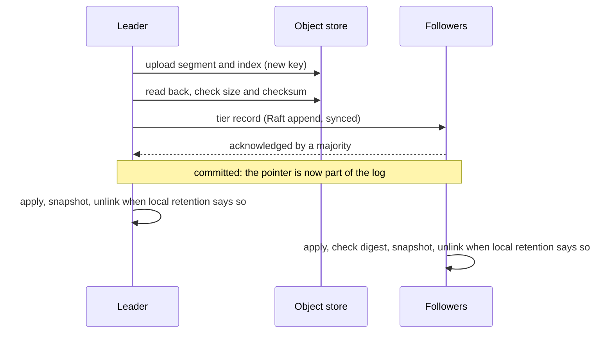

# Tiered storage design

This page is the design for tiered storage in Felix 0.8
([#172](https://github.com/GetFelix/felix/issues/172)): sealed segments of
durable streams move to an object store, and reads below what a broker keeps
on local disk are served from there. Nothing here is built yet, except the
offload step described under "What exists".

It builds on [`per-shard-raft.md`](per-shard-raft.md), called "the Raft page"
here, and on [`durable-storage.md`](durable-storage.md) and
[`storage-format.md`](storage-format.md). Read the Raft page's summary first.
The design assumes every stream shard is one Raft group, the offset is the
Raft index, and the hybrid is gone.

## Summary

A stream with tiering on keeps its recent records on every copy's local disk
and its older records once, in an object store. The store is anything that
speaks the S3 API, or a local directory for tests and single-node setups.

Five rules carry the design:

1. Only sealed segments whose records are all committed are tiered. The
   active segment never is.
2. The leader uploads. One object per range of offsets is shared by every
   copy of the shard.
3. The pointer to an object is a record in the shard's own log, committed
   through Raft. A copy deletes a local record only when an object named
   by a pointer it has applied holds that record.
4. An object is written once under a key nothing else uses, and a recorded
   object is never rewritten.
5. The publish path never touches the object store. An outage there slows
   or fails old reads and grows local disks. It never fails a write and
   never loses a record.

## What exists

`disk_log/offload.rs` (pull request #1070) copies each sealed segment to a
directory through the `object_store` crate, reads the copy back, records it
in a local `offload.manifest`, and makes retention wait for that record
before deleting. `tiered.rs` declares a `TieredStore` trait that nothing
implements. Reads below the local base still return `Trimmed`.

That step is per broker. Every copy uploads its own segments under its own
node id and keeps its own manifest, so an RF 3 stream is stored three times
and no copy can use another's objects. This design replaces it for Raft
shards and keeps its order of operations: upload, verify, record, then
delete.

## What gets tiered, and who uploads it

**The unit is a sealed segment of the leader.** The object is the segment
file as it is on disk, bytes unchanged. Records are never rewritten locally
and they are not rewritten on the way to the store either, so the reader and
its checks are the ones the local path already uses. The segment's sparse
index is uploaded as a second object next to it. Like the local index it is
derived and never trusted: a wrong index can only send a read to the wrong
position, where the record checksums refuse it.

A segment is eligible when it is sealed and its last offset is at or below
the commit index. The active segment is never uploaded, so a shard keeps at
least the records since its last roll on local disk. Cache, counter and
consumer group logs never tier. They are compacted, not aged out.

**Only the leader uploads.** Copies roll segments at different offsets, so
there is no "segment 12" that all copies agree on. What they agree on is
offsets: under Raft every copy holds the same committed record at each
offset. So an object is described by the offsets it covers, not by a
segment id, and one object serves all copies. Having every copy upload
would cost RF times the storage and the requests, for no added safety: the
object store is the durable copy once the pointer is recorded.

Safety does not rest on who uploads. An object is correct if it holds
committed records and its checksum matches, whoever wrote it. Leadership
only decides who does the work, so two brokers that both believe they lead
waste an upload and nothing else. The one thing tied to the uploader is
the term in the object's key, which exists for cleanup (see "Keys").

**The tier state** of a shard is a list of objects and one offset,
`retained_from`. Each object has the range of offsets it is recorded for.
The ranges never overlap and have no gaps, so together they cover one run
of offsets, from `tier_start` (the start of the oldest range) to `tier_end`
(the end of the newest). A new shard has no objects, no `tier_start` and no
`tier_end`, and `retained_from` is 0. Nothing is covered until the first
tier record applies, and that record sets both ends to its own range.

Three record kinds change the state. Each is applied the same way on every
copy, and one that does not fit is a no-op everywhere:

| Record | Fits when | Effect |
| --- | --- | --- |
| Tier add | There are no objects, or its range starts exactly at `tier_end + 1` | Adds the object at the end |
| Tier prepend | Its range ends exactly at `tier_start - 1` | Adds the object at the start. Used only for records older than the first object (Questions, 6) |
| Tier drop | Its offset is above `retained_from` and at most `tier_end + 1` | Sets `retained_from`. Objects whose range lies wholly below it leave the list |

All three also need the object's key to carry the group epoch and term of
the log entry that names it (see "Keys"). A record that fails that is a
no-op too. An entry's term is in its record header. Its epoch is the one it
was written in. This depends on a rule track 4 must add (#2250): a member
makes its re-form base snapshot, tier state included, durable before it
takes part in the new epoch. Then nothing at or below a base is applied
again, and the current base plus the epoch before it tells which epoch an
entry belongs to. Terms alone cannot, since a lost term can be reused in the
next epoch.

The range a record names can start inside its object. After a leader change
the new leader's segments do not line up with the old ones, so its first
segment usually begins below `tier_end`. It uploads the whole file and
records it for the part from `tier_end + 1` on. The earlier bytes of the
object are never read.

**Keys.**
`<prefix>/<stream id>-<incarnation>/<shard>/<first>-<last>.<epoch>.<term>.<upload id>.log`,
and the same with `.index`. The incarnation keeps a deleted and recreated
stream away from the old stream's objects. The epoch is the group epoch of
the Raft page ("Re-forming a group") and the term is the uploader's term.
The upload id is random and new for every attempt, so no attempt ever
writes to a key another attempt used.

An object can only be named by an entry of the epoch and term it was
uploaded in. A leader that is deposed forgets its uploads, and if it leads
again it uploads again under its new term. This is what lets cleanup decide
from a key alone that an object can never be named (see "Orphan cleanup").

## Ordering and crash safety

For each eligible segment, oldest first, the leader:

1. **Uploads** the segment and its index. While reading the segment it
   checks every record's checksum, so local damage is found before it is
   copied. A record that fails stops the upload and is handled as interior
   corruption is today.
2. **Verifies** the object: reads it back and compares its size and
   checksum with what was computed from the local file.
3. **Records** it: proposes a tier add through Raft and waits for it to
   commit. The record carries the key, the range, the object's size and
   checksum, a digest of the records in the range (see "Integrity"), and
   the oldest and newest record timestamps.
4. **Deletes locally**, later and separately, on every copy including the
   leader. A copy may unlink a local segment only when all of these hold:
   - every record in the segment lies inside `[tier_start, tier_end]` of
     the copy's own applied tier state, so a named object holds each one;
   - the copy has checked the range digest for those records, or installed
     them as part of a snapshot;
   - the segment lies at or below the last log id of the copy's own
     durable snapshot, which is Raft's rule for a purge;
   - local retention selects it.

The tier records are record kinds of their own, like a trim or a membership
record. Readers skip them and `skipped_before` counts them.

**Tier records are synced in every fsync mode**, on the leader and on each
follower, before the append is acknowledged. Trim records and votes already
work this way. So a committed tier record is on a majority of disks, not
only in a majority of page caches.

**The tier state lives in the snapshot, not in a file of its own.** A copy
holds it in memory. At start it is the state in the copy's snapshot plus
the committed tier records in the log above it. Those records are still
local, because a copy never purges past its snapshot. Two orders keep this
sound:

- A snapshot is made durable only after the copy's log is synced through
  the snapshot's last log id. A copy's snapshot is therefore never ahead
  of its durable log.
- A segment is unlinked only behind a durable snapshot. So when a record
  leaves a copy's disk, the pointer that covers it is in that copy's
  durable snapshot and in its durable log.

The pointer in a snapshot is safe to rely on only because tier records are
synced. A sync through a tier record's offset covers everything before it
in the log, the earlier sealed segments included. So a copy that holds the
pointer durably also holds every record the pointer stands for, until it
unlinks them itself.

Every crash point, and what is left:

| Crash or failure | State left | What happens next |
| --- | --- | --- |
| During the upload | Parts of a multipart upload, never visible as an object | The leader aborts it. A bucket lifecycle rule removes what a crash leaves |
| After the upload, before the verify | An unrecorded object | The next pass uploads again under a new key. The old object is an orphan |
| The verify fails | An unrecorded, wrong object | Deleted, counted, uploaded again. Nothing local was touched |
| After the verify, before the propose | An unrecorded object | Same as above |
| Proposed, and the leader is deposed or crashes before commit | The record is in some logs | A later leader either commits it as an entry of its original term, and the object is valid, or cuts it, and the object is an orphan. The old leader never proposes that object again |
| Committed, before a copy applies it or takes a snapshot | Local segments and the object | The copy applies the record again from its log at start. Nothing was unlinked |
| Snapshot durable, before or during the unlink | Local segments and the object | The retention timer unlinks, oldest first with a directory sync after each, as retention does today |
| After the unlink | The object, named by a record in the copy's snapshot | Reads use the object |
| A follower is behind | It still holds the records locally | It deletes only after it applies the record itself |
| A majority loses power under relaxed fsync | Tier records are synced, so every copy that acknowledged one still has it and the records before it | Covered under "Re-forming a group" below |

At every point each committed record at or above the readable base is in a
copy's local log or in an object that a committed record names. The rule
that carries this is the same as today's: never delete local data before
the remote copy is verified and recorded. "Recorded" now means committed
through Raft and held in the deleting copy's own durable snapshot.

## Reads below the local base

Only the leader serves reads, as today. A read is planned under the segment
lock and runs without it. A range below the leader's local base becomes a
third kind of span in the plan, next to sealed and active.

**The path.** The tier state gives the object for an offset with no I/O. The
index object, fetched once and cached, gives a byte position. The read then
asks the store for a byte range sized from the read's own budget, and
checks each record's checksum as it decodes. A read never downloads a whole
segment to return one page. The cold part of a plan is async. Today's plan
runs on a blocking thread, which a network round trip must not hold, so the
plan is split into a blocking local part and an async cold part.

A range that spans the tier and the local log is served in offset order
from both. Where they overlap, the local copy is used only for a range
whose digest this copy has checked against the tier record. For any range
it failed to match or never checked, the tier is read. So from `tier_start`
up every leader returns the same bytes.

`offset_for_time` uses the timestamps in the tier state to pick one object
without touching the store, then searches inside it.

**Caching.** Each broker has one cold cache directory with a byte bound.
It holds index objects and fixed-size chunks of segment objects, evicted
least recently used. Sequential reads fetch one chunk ahead. The cache is
not durable state: it is emptied at start, and a damaged chunk is dropped
and fetched again. Cached bytes are still checked record by record when
read.

**Admission.** Cold reads have their own concurrency limit per broker and
per tenant, apart from hot reads, so one long replay of old data cannot use
up the read path of live subscribers. A cold read that waits too long for a
slot is answered as an outage is, below.

**Latency budget.** These are targets for the gate, not measurements.

| Read | Target |
| --- | --- |
| Hot read, tiering on or off | Unchanged. Planning adds one lookup in the tier state, in memory |
| Cold read, chunk cached | Within 2 ms of the same read from a local sealed segment |
| Cold read, first page, nothing cached | p99 under 500 ms against a store in the same region: one index fetch and one range request |
| Cold sequential replay | At least 50 MiB/s per reader after the first page |

Each store request has a timeout (start: 5 s) and is retried with backoff
inside the read's deadline (start: 15 s).

**When the object store is down.** The log stays open and takes publishes.
Reads at or above the local base are unaffected. Reads below it fail, and
the client is told to retry:

| Request | Answer |
| --- | --- |
| `stream_read` below the local base | `error` with code `storage`, retry class `retry`, `detail.reason` = `tier_unavailable` |
| `subscribe` whose cursor is below the local base | The same `error` instead of a subscription. Not `subscribe_cursor_error` |
| A subscription already replaying from the tier | The broker retries inside the deadline. Then it ends the event stream with the same error. The client subscribes again from its last offset |
| An object that the tier state names and the store says is missing or shorter than recorded, or bytes that fail a checksum after a fresh fetch | `storage`, class `fatal`, `detail.reason` = `tier_corrupt`. The broker raises a metric and logs the key |
| A read that finds its object gone because a tier drop committed after the read was planned | `too_old` with the new readable base, as for any read below the base. The read checks the tier state again before it reports a missing object |

Two answers are never given for an outage. `too_old` would tell the client
the records are gone, and a client that sees it often jumps to `earliest`.
Skipping ahead to the local base would hide records a durable stream still
holds, and `skipped_before` only ever counts offsets that hold no event.

The `storage` code and its `retry` class for reads exist in
`docs/protocol.md` already. The two `detail.reason` values are the only
protocol addition. A client that did not offer `FEATURE_ERROR_CODES` gets
the `error` frame with `message` only, the same bytes an older broker would
send for a storage failure. It has no retry class to act on, so the message
says the read can be retried. It is never sent `too_old` for an outage
either.

## Retention, trims, snapshots and rebuild

**Two retention bounds.** With tiering on, a stream has:

- *local retention*: how much each copy keeps on disk (bytes, age). It
  deletes only segments whose records all lie inside
  `[tier_start, tier_end]`, under the four conditions in "Ordering and
  crash safety". It is evaluated by each copy on its own timer.
- *total retention*: the stream's existing `retention_bytes` and
  `retention_age`, now over local and tiered data together. Left unset, the
  stream keeps its history in the tier for good.

**Dropping tiered data** runs in the opposite order to adding it: record,
then delete. The leader proposes a tier drop. Once it commits,
`retained_from` moves on every copy and reads below it answer `too_old`.
Only then does the leader delete the objects whose ranges lie wholly below
it, and each copy deletes its local segments that lie wholly below it. A
crash in between leaves objects that nothing names, which the cleanup
removes. Deleting first would leave a committed pointer to nothing.

**The readable base.** On a copy it is the highest of the trim floor,
`retained_from`, and the oldest offset the copy can serve without a gap:
its local start if that is below `tier_start`, otherwise `tier_start`.
With no objects it is the local start, as today.

So everything from the highest of the trim floor, `retained_from` and
`tier_start` upward is readable on every copy, and that offset comes from
committed records alone. Below `tier_start` it is as it is today: a copy
serves the older records it happens to hold, and a failover can change
what is readable there. The first tier add hides nothing. It sets
`tier_start` to the start of its range, and a copy that holds older records
keeps them and keeps serving them. Local retention never deletes below
`tier_start`, because no object holds those records. Total retention ages
them out on each copy as it does now, and a tier prepend can move them into
the tier (Questions, 6).

**Head trims.** `trim_before` works as it does now: a trim record sets a
logical floor and reads below it answer `too_old` with the trim's headers.
After the trim commits, the leader proposes a tier drop for the objects
wholly below the floor. The object that holds the floor-setting trim record
is kept while that record is the floor's source, as the local segment is
today, so the headers can still be read back.

**Raft purge and snapshots.** A stream shard's state machine is small: the
trim floor, the producer table, the membership, and now the tier state. The
records themselves are the log. A snapshot with last log id `A` is that
state as of `A`, plus the records up to `A` that a receiver needs and
cannot get elsewhere. Three things are fixed by this design:

- *The tier state in a snapshot is exact.* It is the state after applying
  every entry up to `A` and nothing above it: the objects, `retained_from`,
  and so `tier_start` and `tier_end`. Two copies at the same applied index
  have the same tier state, whether they got there by applying entries or
  by installing a snapshot.
- *Purge.* A copy deleting head segments is Raft's purge. It runs only
  behind the copy's own durable snapshot, and with tiering on only inside
  `[tier_start, tier_end]`. Without tiering the bound is retention's, as
  the Raft page says.
- *The record part is every record that no object holds.* A sender
  includes its local records up to `A` that lie outside
  `[tier_start, tier_end]`: the older ones from its local start up to
  `tier_start`, and the newer ones from `tier_end + 1` to `A`. With no
  objects that is its whole local log. Records inside the tier's range are
  not sent, because the receiver reads them from the tier. Leaving out the
  older part would drop history that only local disks hold each time a
  copy is rebuilt.

Raft's log compaction and tiering are therefore the same deletion seen from
two sides. Purge may remove a record from a copy because an object holds
it, and the snapshot is what tells the next copy where to find it.

**A follower that fell behind the purge point** gets a snapshot instead of
entries. It receives the tier state and the record part and makes both
durable. Only then does it drop its own old records up to `A`, so a crash
part way leaves it with what it had. Then it takes entries from `A + 1`.
It never downloads cold data. Its readable base afterwards is the
sender's.

**A wiped copy** joins as a learner with a new member id, as the Raft page
says, and catches up the same way. The rebuild copies only the
leader's local records that no object holds, which local retention bounds
once the history is in the tier, and not the stream's whole history. This
is what makes a rebuild cheap (#172, first comment). A copy does not need any tiered record on its own disk to become
leader: it serves old reads through the tier state.

**Re-forming a group.** A re-form (Raft page, "Re-forming a group") picks a
base from the copies' reports and can cut records that were committed, when
a majority on relaxed fsync lost power. Tiering has to hold across that:

- Tier records are synced, and a copy's snapshot is never ahead of its
  durable log. So a copy that deleted local records on the strength of a
  tier record `T` still has `T`, and every record before it, in its durable
  snapshot or log. Its report's last log id is at or above `T`. If it
  reports, the base is at or above `T` and the pointer survives.
- At the base, a member's tier state is its snapshot's tier state plus
  every tier record in its log up to the base. A tier record that was
  uncommitted in the old epoch and lies at or below the base is applied
  like the other records there, since the base makes them all committed.
- A copy whose snapshot is above the base holds state the new epoch does
  not have. It is not a voter, and it is replaced as a wiped copy is.
- An object named only by records above the base is unnamed in the new
  epoch. Its key carries the old epoch, so the new leader's cleanup removes
  it. The copies in the new epoch never deleted anything because of it:
  any copy that did would have reported a log id above the base.
- If an operator forces a re-form without a copy that had deleted local
  records, the records are still in the object, and no pointer to it
  survives. That is inside the loss the operator is told about ("records
  only they held are lost"). The command's output says that tiered records
  above the new base are lost with it.

**Leader changes.** A new leader starts uploading only after the blank
entry of its term commits and it has applied everything up to it. At that
point every tier record that will ever commit from an earlier term is in
its tier state, so it continues the chain from the right `tier_end`.

**Sleeping groups.** An upload is local work and does not need the group
awake. Proposing the tier record wakes the group for one round.

**Deleting a stream** deletes the stream's key prefix after the delete is
committed in the control plane, as offloaded copies are deleted today. The
incarnation in the key means a stream created again under the same name
never sees the old objects.

**The bridge and the upgrade.** Tiering is a fleet feature,
`tiered_storage`. It can be finalized only after `hybrid_retired`, so no
hybrid shard and no bridge build ever writes or applies a tier record. A
broker that does not know the record kind never receives one.

A 0.7 cluster that used `FELIX_DURABLE_OFFLOAD_DIR` arrives with per-broker
copies and local `offload.manifest` files. Those are left as they are.
Recovery keeps honouring the local manifest for a head gap, nothing reads
the old copies, and the shard's tier state starts empty. Uploads start at
the shard's Raft base. Records from before it are Questions, 6.

## Consistency of the object store

**What is assumed.**

- *Read after write for a new key.* Once an upload returns success, a read
  of that key returns the whole object. S3 and the open source
  S3-compatible stores (MinIO, Ceph's object gateway, Garage) document
  this.
- *Uploads are all or nothing.* A failed or abandoned upload never appears
  as a shorter object. Multipart uploads have this property.
- *Deletes can be repeated.*

Nothing else is assumed. Listing may lag, because it is used only by the
cleanup, which waits. Overwrite behaviour does not matter, because keys are
never reused. Where the store supports a conditional write ("only if the
key does not exist") the upload uses it as a second guard. The verify step
reads the object back, so a store that broke the first assumption would be
caught before the pointer is recorded.

**Integrity.** There are three checks, each for a different failure.

- *Per record.* Every record keeps its header and body checksums and its
  own offset. They are checked on every read from the tier, as on every
  local read. This is what catches damage that happens after the upload on
  the range-read path: a flipped bit fails a checksum, and bytes from the
  wrong place fail the offset the read expects. The tier state knows the
  object's size, so an object that has become shorter shows as a range the
  store cannot serve, and is reported as `tier_corrupt`.
- *Per object.* The tier record holds the object's size and a SHA-256 of
  its bytes, computed by Felix from the local file. It is checked at the
  verify step and on any full download. It catches an upload that stored
  the wrong bytes in a form the per-record checks could read as a clean,
  shorter segment.
- *Per range.* The tier record holds a digest over the records in its
  range: offset, term and record checksum of each, independent of how
  segments are cut. The leader computes it while uploading. A follower
  computes it over its own records when it applies the tier record, while
  it still holds them, and does not wait for retention to pick the
  segment. A mismatch means the copy and the object disagree about
  committed records. The copy stops and deletes nothing. A follower that
  received the range through a snapshot install has no local records to
  compare and skips the check. See Questions, 3.

An object that fails a check on read is never returned as data.

**Orphan cleanup.** An orphan is an object under the shard's prefix that
the tier state does not name: a crashed upload, an upload whose record was
cut, an object whose delete after a tier drop did not finish. The leader
lists its shard's prefix on a slow timer (start: once a day) and deletes
orphans, under these rules:

1. It runs only after the leader has committed a cleanup marker of its own
   term and applied up to it. The marker is an empty record that readers
   skip, synced in every fsync mode like a tier record, and proposed once
   per term before the first delete. From then on the leader's tier state
   holds every tier record of an earlier term that will ever be committed.
   The marker has to be synced, and the blank entry of the term is not
   enough. Under relaxed fsync a majority power loss could drop the whole
   term, and a re-form could then pick a base from an older leader's log
   that holds a tier record this leader never saw. With the marker on a
   majority of disks, any base a re-form picks is at or above it.
2. It deletes only objects whose key carries an epoch and term below its
   own. Such an object can only be named by an entry of that earlier term,
   and rule 1 says every such entry that counts is already applied. So if
   the tier state does not name it, nothing ever will.
3. It never deletes an object of a higher epoch or term. Seeing one means
   this broker has been deposed, and the pass ends.
4. Objects of its own term are deleted only by the upload that made them,
   when the verify fails or the proposal is refused. What a crash leaves is
   removed by a later leader under rule 2.
5. Between the listing and the deletes it confirms that it still leads
   with a read-index round. A broker that cannot confirm deletes nothing.
   This only saves a deposed leader the work. It proves leadership, not
   durability, which is rule 1's job.

Safety rests on rules 1 to 3, which depend only on keys and on what is
durable in the log. A grace period (start: 24 hours, objects younger than it are
skipped) is kept on top. It is not what makes cleanup safe. It gives an
operator time to look at an object before it goes.

Incomplete multipart uploads are invisible to listing in most stores. The
ops page will tell operators to set a lifecycle rule that aborts them.

## Configuration and operations

**Per stream.** Tiering is a stream setting, off by default: the existing
`tiered_storage` flag in the control plane, which nothing reads today, plus
the local retention bounds. A stream with tiering on in a cluster with no
store configured is refused at create.

**Per broker.** The store is configured on the broker: endpoint, bucket,
prefix, region, the cold cache directory and its size, the upload and cold
read concurrency. Every broker that holds a copy of a tiered stream needs
the same store, since any copy can become leader. A broker reports its
store's identity (endpoint, bucket, prefix) to the control plane, which
refuses to place a tiered shard on a broker that differs. Names follow the
existing `FELIX_DURABLE_*` variables and are fixed in the pull request that
adds them.

**Credentials.** Read from the standard places for the backend: the
environment, a credentials file, or the instance or workload identity. They
are never stored in the control plane, sent between brokers, or logged. A
credentials file is re-read when it changes, so rotation needs no restart.
The broker needs get, put, delete and list on its prefix, and permission to
abort multipart uploads. Nothing else.

**Encryption.** TLS to the store is required. Plain HTTP is accepted only
for an endpoint the operator marks as insecure, which exists for local test
stores. At rest, Felix asks the store for server-side encryption, with the
store's own keys by default or a named key when configured. Felix does not
encrypt objects itself in 0.8 (Questions, 7).

**Cost.** What an operator pays for, and what bounds it:

| Item | Driver | Bound |
| --- | --- | --- |
| Stored bytes | One copy of the history, not RF copies | Total retention |
| Upload requests | A few per segment: parts of 32 MiB, so 8 parts and a completion for a 256 MiB segment | Segment size |
| Verify | One full read of each object after upload | Free of transfer charges when the store is in the same region. See Questions, 4 |
| Cold reads | One range request per uncached chunk | The cold cache and read-ahead |
| Listing | One listing per shard per cleanup interval | The interval |
| Local disk | Local retention plus the active segment, per copy | Local retention |

A shard whose active segment never fills never rolls, and so tiers nothing
and deletes nothing. See Questions, 5.

**When uploads fail**, local retention keeps the segments, as retention
does with offload today, and local disk grows at the publish rate. The
existing held-bytes and failing-logs metrics carry over, and a full disk
still refuses writes as any full disk does. New metrics: uploaded segments
and bytes, upload failures, upload lag (oldest sealed and committed offset
not yet recorded), cold read requests, bytes and latency, cache hits,
misses and evictions, cold read errors by reason, orphans deleted.

## The TLA+ model

`FelixRaft.tla` (pull request #2220) gets a tier extension. It lands before
the uploader does.

**State.** The object store as a set of objects, each with a key (epoch,
term, upload id), a range and the records it holds. The three tier record
kinds as log entry kinds. Per member: a local start, a durable snapshot
with its tier state, and an applied tier state.

**Steps.** Upload a range at or below the commit index under a fresh key.
Propose a tier add, prepend or drop. Apply a committed one. Take a snapshot
at the applied index. Delete local records inside `[tier_start, tier_end]`
and behind the snapshot. Delete an object below the applied
`retained_from`. Clean up an unnamed object. Install a snapshot on a behind
or empty member. Crash and restart at any step. Lose the unsynced tail of a
majority and re-form at a base. The store being unreachable only removes
steps, so it matters for liveness and not safety.

**Checks.**

- `NoTieredLoss`: for every member, every committed offset from its
  readable base up to its commit index is in its local log, or in an object
  that exists, that its tier state names, and that holds exactly the
  committed record at that offset. It must also hold across a re-form, for
  every offset at or below the new base.
- `NoDanglingPointer`: on a leader whose term has opened, every object the
  tier state names exists.
- `TierStateAgreement`: any two members at the same applied index have the
  same tier state, whether they applied entries or installed a snapshot.
- `InstallKeepsHistory`: after a snapshot install the receiver's readable
  base is the sender's.
- `TierBaseAgrees`: the highest of the trim floor, `retained_from` and
  `tier_start` is a function of the applied index alone, and no member's
  readable base is above it.
- The existing FelixRaft checks, unchanged, with the new steps enabled.

**Twins that must fail.**

- Local delete after the propose and before the commit, with the leader
  deposed and the record cut.
- A follower that deletes when it appends the tier record, not when it
  applies it.
- Local delete gated on "at or below `tier_end`" alone, with records below
  `tier_start` that no object holds.
- Upload of a sealed segment above the commit index, then a truncation
  that commits a different record at that offset.
- Apply that accepts a record whose key term differs from the entry's
  term: a leader of term 5 uploads and is deposed, the leader of term 6
  cleans the object up, and the first leads again in term 7 and proposes
  it.
- Cleanup that deletes objects of a higher term: a deposed leader removes
  the current leader's fresh upload before its record commits.
- Cleanup before the leader's term has opened, deleting the object of a
  record that then commits.
- Cleanup on a read-index round alone, with no synced marker: an older
  leader holds an unseen tier add, the cleaning leader deletes its object,
  a majority loses its unsynced term, and the re-form base commits the
  add.
- A snapshot record part that leaves out local records below
  `tier_start`: a rebuilt member then leads and cannot read an offset the
  sender served, though no trim, drop or retention removed it.
- A leader that serves local records inside the tier's range without a
  matching digest, so two leaders return different bytes for one offset.
- Tier records left unsynced, or a snapshot ahead of the durable log: a
  copy unlinks, a majority loses power, the re-form base is below the tier
  record, and the object is cleaned up.
- Object delete before the tier drop commits.
- A snapshot whose tier state includes records above its last log id.
- A snapshot without the tier state, installed on an empty member.
- A key used twice for different ranges.

## Pull request split

Each pull request is safe alone. Until the fleet feature is finalized no
tier record is written, and until a stream turns tiering on nothing is
uploaded. All of it depends on stream shards running on Raft (#2233) and on
the adapter's purge and snapshot.

| # | Issue | Pull request | Depends on | Why it is safe alone |
| --- | --- | --- | --- | --- |
| 1 | #2282 | TLA+: the tier extension of `FelixRaft`, with its twins | #2220 | Spec only |
| 2 | #2283 | The store seam: `TieredStore` over `object_store` with the local directory and S3 backends, broker config, credentials, TLS and encryption settings, and the simulated store with faults | | Nothing calls it |
| 3 | #2284 | The tier records and tier state: the add, prepend and drop kinds with their fit rules and the epoch and term check, synced in every fsync mode, the `tiered_storage` fleet feature, the tier state in the stream snapshot (exact at its last log id, never ahead of the durable log), the readable base, and the tier state at a re-form base | 1 | No uploader exists, so no tier record is ever proposed outside tests |
| 4 | #2285 | The leader's uploader: upload, verify, propose, the range digest checked at apply, local delete under its four conditions, the idle roll on every copy, metrics. The offload pass in `disk_log/offload.rs` and `FELIX_DURABLE_OFFLOAD_DIR` are removed, since stream logs were its only users and they are all Raft shards by then. Recovery keeps reading an existing `offload.manifest` for the head gap of an upgraded directory | 2, 3 | Reads below the local base still answer `too_old`, so a stream that turns tiering on in this state keeps local retention off |
| 5 | #2286 | Cold reads: the async cold span, range requests, the index object, the cold cache, admission, the `tier_unavailable` and `tier_corrupt` answers, the answer to a client without error codes, `too_old` for a read that lost a race with a drop, `offset_for_time` through the tier state | 4 | Read path only. Local retention may now be set |
| 6 | #2287 | Total retention, trims and cleanup: proposing tier drops, object deletion, stream delete by prefix, the synced cleanup marker, orphan cleanup under its five rules | 4 | Deletes only what a committed drop released, or what the key rules prove can never be named |
| 7 | #2288 | Rebuild from the tier: snapshot install on a behind follower and a wiped copy, a record part of every local record no object holds, a re-form with tiered data, with simulator and cluster tests | 3, 4 | Uses the snapshot path of the Raft track. No new deletion |
| 8 | #2289 | Upgrade and shipping: the 0.7 offload directory, tier prepend for records below the first object, the ops page, the status rows, and the gate cells (cold read latency, upload lag under load, rebuild time with and without tiering) | 5, 6, 7 | Prepend adds coverage and deletes nothing that an object does not hold |

The status rows in `what-felix-is-for.md` and the offload section of
`durable-storage.md` move with pull requests 4 and 5, when the behaviour
they describe changes.

## Test plan

**A simulated object store** in `felix-sim`, behind the same seam as the
real backends, seeded like the rest of the simulator. Its faults:

- a request fails before it takes effect, or after it took effect with the
  answer lost;
- a request is slow, or hangs past its timeout;
- the store is down for a period, for one broker or for all;
- an upload is abandoned part way, leaving nothing visible;
- a stored object is truncated or has a bit flipped;
- a listing is stale, missing recent objects or showing deleted ones;
- a read after a write returns "not found" (a store that breaks the
  assumption, used only by twins that must be caught at the verify step).

**Simulator checkers**, on top of the existing history checks:

- every acknowledged record is readable at its offset with its payload,
  from whichever broker leads, across upload, local delete, failover,
  wipe and rebuild;
- a read never returns `too_old` at or above the readable base, and never
  skips an offset that holds an event;
- the readable base never moves backwards, and from `tier_start` up it is
  the same after a failover;
- a leader that is deposed and elected again never gets a pointer
  committed to an object another leader cleaned up, and a deposed leader's
  cleanup never removes a newer leader's upload;
- after a majority power loss on relaxed fsync and a re-form, every record
  at or below the new base is still readable;
- after the faults stop, no orphan outlives the grace period and no
  tier state names a missing object.

**Storage tests** in `felix-storage`: a power loss at every step of the
upload and of the local delete, as `a_power_loss_at_any_offload_step_loses_nothing`
does for offload today; reads that span the tier and the local log; a
corrupt index object; cache eviction under a small bound; a cold read's
memory staying within the read budget.

**Cluster tests**, run in Actions: a leader change in the middle of an
upload; a wiped copy rebuilt while most of the stream is tiered; the store
down during publishes and during a replay; a stream delete with tiered
data.

**Backends.** The local directory backend runs in every suite. The S3
backend is tested in CI against MinIO in a container. No test talks to a
cloud provider.

**Fuzzing.** The tier record and snapshot tier state decoders join the existing
storage fuzz targets.

## Prior art

Only open source systems are cited.

- **Apache Kafka** (KIP-405, tiered storage). The partition leader copies
  inactive segments to remote storage, and the remote segment metadata is
  kept in an internal topic that followers read. A follower that is far
  behind builds its state from that metadata and does not copy old
  segments. Felix takes the same split of work. It differs by putting the
  pointer in the shard's own Raft log, so there is no second log to keep
  in step with the first.
- **Apache Pulsar** (ledger offload). Closed ledgers are copied to an
  object store, the offload is recorded in the managed ledger's metadata,
  and the copy in BookKeeper is deleted after a configured lag. Felix
  takes the "record, then delete after a lag" order, and local retention
  plays the part of the lag.
- **Thanos** (blocks in object storage). Blocks are immutable, uploads
  that never completed are removed by the compactor after a delay, and
  deletion is marked first and done later. Felix's orphan cleanup with a
  grace period, and its "record the drop, then delete" order, follow it.
- **MinIO, Ceph and Garage** are the S3-compatible stores whose documented
  semantics the consistency assumptions were read against. MinIO is the
  planned test store.

## Questions

Each has a recommendation.

1. **Does the leader upload, or every copy?** Recommended: the leader
   only, with one shared object per range. Per-copy uploads triple the
   cost and keep copies from using each other's objects, which is what
   makes a rebuild cheap.

2. **Is the object the leader's segment file, or a file re-cut at agreed
   offsets?** Recommended: the segment file as it is, recorded for the
   part above `tier_end`. Re-cutting would rewrite records on the way out,
   which the format has never done, to save a few unread megabytes at
   each leader change.

3. **Do followers check the range digest, and when?** Recommended: yes,
   when the tier record is applied. The follower still holds the records
   then, and they are usually still in the page cache. Waiting until
   retention picks the segment would leave a divergence unnoticed for as
   long as local retention lasts. The check runs off the publish path, and
   local delete waits for it. A follower that got the range from a
   snapshot install skips it. A mismatch is a stop, which is how the
   project treats a follower that holds different committed records. If
   the gate shows the read cost matters, make it sampled, not absent.

4. **Is the verify step a full read back, or trust in the store's own
   upload checksum?** Recommended: a full read back in 0.8, as offload
   does today. It is the only check that also covers the read-after-write
   assumption. Revisit with numbers from the gate: stores that verify a
   checksum sent with the upload make the read back mostly redundant.

5. **Should tiering force a roll of an idle active segment?** A shard
   that writes little never fills a segment and never tiers. Recommended:
   every copy, leader or follower, rolls its active segment when its
   oldest record is older than the local retention age and it holds at
   least a minimum size (start: 8 MiB). It has to be every copy. Copies
   roll on their own, and a follower that did not roll would keep those
   records in its active segment for good, however much the leader
   tiered. A smaller shard stays local on every copy. Many tiny objects
   cost more in requests than they save in disk.

6. **Are records from before a shard's Raft base tiered?** The switch
   proves nothing about records below the base, copies can start at
   different offsets there, and their generation fields can differ.
   Recommended: yes, in the last pull request, through the tier prepend
   record. Until then a switched shard tiers from its Raft base, and older
   records stay local on each copy, readable as today and aged out by
   total retention. With prepend, a leader that holds records below
   `tier_start` uploads them newest first, each range ending where the
   tier starts. Its digest is the switch's digest, which leaves the
   generation out, and it is carried per chunk of offsets (start: every
   4,096 offsets), because a follower may hold only part of the range. A
   follower compares each chunk it holds in full. Where a chunk matches it
   may delete those records and may serve them from local disk. Where a
   chunk does not match, or it holds only part of one, it keeps the
   records and reports it, does not stop, because nothing was ever proven
   about those records, and reads that range from the tier. So from the
   new `tier_start` up, every leader returns what the object holds. A follower's records below the oldest object stay where
   they are until a prepend covers them or total retention removes them.
   An add can never do this job: a range at or below `tier_end` does not
   fit, which is why prepend is a kind of its own and is defined with the
   other two from the start.

7. **Does Felix encrypt objects itself?** Recommended: not in 0.8.
   Server-side encryption covers data at rest in the store, and client
   side keys bring key rotation and loss handling that deserve their own
   design. File it for later if a user needs the store not to see
   plaintext.

8. **Is the whole-object checksum CRC-32 or SHA-256?** Recommended:
   SHA-256 in the tier record, computed by Felix over the bytes it reads
   at upload and again at the read back. The object leaves the machine,
   and a 32-bit sum is weak for telling two valid-looking objects apart.
   The cost is paid once per segment off the publish path. It is not
   chosen for store-side checking: for a multipart upload S3 returns only
   a composite SHA-256 of the parts, and its full-object checksums are
   CRC kinds. Per-part checksums are sent where a store takes them, as a
   guard on the transfer. Records keep their CRC-32.

9. **Can a follower serve cold reads?** It has the tier state and the
   committed records are the same everywhere. Recommended: no in 0.8.
   Only the leader answers reads today, and follower reads are a larger
   question about the read bound that tiering should not decide.

10. **Is there one bucket per cluster, or per tenant?** Recommended: one
    store per cluster in 0.8, with the stream id in the key. Per-tenant
    stores need per-tenant credentials on every broker and a placement
    rule, and nothing has asked for them yet.

11. **What happens to a stream when tiering is turned off?** Recommended:
    uploads stop, the tiered records stay readable, and total retention
    keeps aging them out. Pulling records back to local disk is not
    offered, since no copy has room reserved for it.
