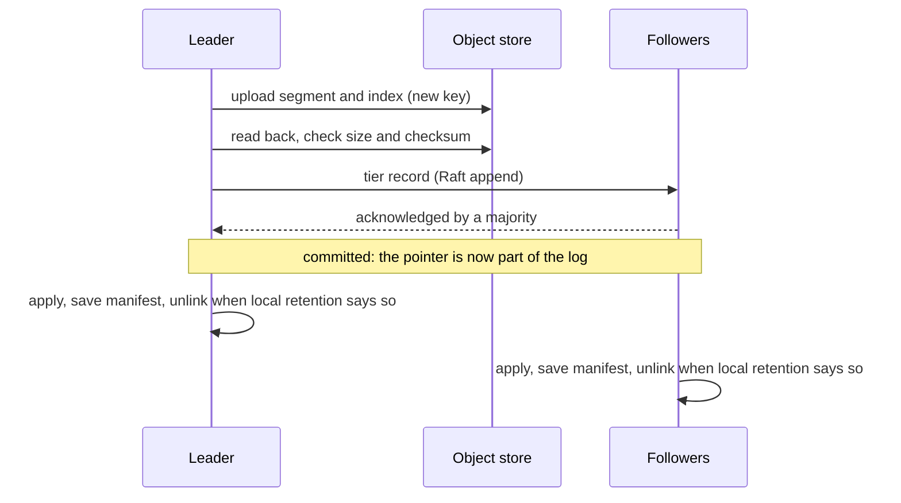

# Tiered storage design

This page is the design for tiered storage in Felix 0.8
([#172](https://github.com/GetFelix/felix/issues/172)): sealed segments of
durable streams move to an object store, and reads below what a broker keeps
on local disk are served from there. Nothing here is built yet, except the
offload step described under "What exists".

It builds on [`per-shard-raft.md`](per-shard-raft.md), called "the Raft page"
here, and on [`durable-storage.md`](durable-storage.md) and
[`storage-format.md`](storage-format.md). Read the Raft page's summary first.
The design assumes every stream shard is one Raft group, the offset is the
Raft index, and the hybrid is gone.

## Summary

A stream with tiering on keeps its recent records on every copy's local disk
and its older records once, in an object store. The store is anything that
speaks the S3 API, or a local directory for tests and single-node setups.

Five rules carry the design:

1. Only sealed segments whose records are all committed are tiered. The
   active segment never is.
2. The leader uploads. One object per range of offsets is shared by every
   copy of the shard.
3. The pointer to an object is a record in the shard's own log, committed
   through Raft. A copy deletes local data only below a pointer it has
   applied.
4. An object is written once under a key nothing else uses, and a recorded
   object is never rewritten.
5. The publish path never touches the object store. An outage there slows
   or fails old reads and grows local disks. It never fails a write and
   never loses a record.

## What exists

`disk_log/offload.rs` (pull request #1070) copies each sealed segment to a
directory through the `object_store` crate, reads the copy back, records it
in a local `offload.manifest`, and makes retention wait for that record
before deleting. `tiered.rs` declares a `TieredStore` trait that nothing
implements. Reads below the local base still return `Trimmed`.

That step is per broker. Every copy uploads its own segments under its own
node id and keeps its own manifest, so an RF 3 stream is stored three times
and no copy can use another's objects. This design replaces it for Raft
shards and keeps its order of operations: upload, verify, record, then
delete.

## What gets tiered, and who uploads it

**The unit is a sealed segment of the leader.** The object is the segment
file as it is on disk, bytes unchanged. Records are never rewritten locally
and they are not rewritten on the way to the store either, so the reader and
its checks are the ones the local path already uses. The segment's sparse
index is uploaded as a second object next to it. Like the local index it is
derived and never trusted: a wrong index can only send a read to the wrong
position, where the record checksums refuse it.

A segment is eligible when it is sealed and its last offset is at or below
the commit index. The active segment is never uploaded, so a shard keeps at
least the records since its last roll on local disk. Cache, counter and
consumer group logs never tier. They are compacted, not aged out.

**Only the leader uploads.** Copies roll segments at different offsets, so
there is no "segment 12" that all copies agree on. What they agree on is
offsets: under Raft every copy holds the same committed record at each
offset. So an object is described by the offsets it covers, not by a
segment id, and one object serves all copies. Having every copy upload
would cost RF times the storage and the requests, for no added safety: the
object store is the durable copy once the pointer is recorded.

Safety does not rest on who uploads. An object is correct if it holds
committed records and its checksum matches, whoever wrote it. Leadership
only decides who does the work, so two brokers that both believe they lead
waste an upload and nothing else.

**Coverage is a chain.** The shard's tier state is `tier_start`, `tier_end`
and a list of objects. Each object names its first and last offset. A new
object must start at or below `tier_end + 1` and end above `tier_end`.
After a leader change the new leader's segments do not line up with the old
ones, so its first object usually overlaps the last recorded one. Overlap is
harmless, because both hold the same committed records, and a read uses the
newest object that covers the offset.

**Keys.**
`<prefix>/<stream id>-<incarnation>/<shard>/<first>-<last>.<term>.<upload id>.log`,
and the same with `.index`. The incarnation keeps a deleted and recreated
stream away from the old stream's objects. The upload id is random and new
for every attempt, so no attempt ever writes to a key another attempt used.

## Ordering and crash safety

For each eligible segment, oldest first, the leader:

1. **Uploads** the segment and its index. While reading the segment it
   checks every record's checksum, so local damage is found before it is
   copied. A record that fails stops the upload and is handled as interior
   corruption is today.
2. **Verifies** the object: reads it back and compares its size and
   checksum with what was computed from the local file.
3. **Records** it: proposes a tier record through Raft and waits for it to
   commit. The record carries the key, the first and last offset, the size,
   the checksum, a digest of the records it covers (see "Integrity"), and
   the oldest and newest record timestamps.
4. **Deletes locally**, later and separately. Each copy, the leader
   included, applies the committed record to its tier manifest, makes the
   manifest durable, and only then may unlink local segments that lie
   wholly at or below `tier_end`.

The tier record is a record kind of its own, like a trim or a membership
record. Readers skip it and `skipped_before` counts it. Applying it is
deterministic: a record that does not extend the chain (it ends at or below
`tier_end`, or starts above `tier_end + 1`) is a no-op on every copy.

The manifest is state derived from committed tier records, kept in a small
file written by rename, as `offload.manifest` is today. It is applied only
up to the commit index, so a tier record that Raft later cuts never reaches
it. Committed records are never truncated, so a recorded object never
describes records that went away. This replaces today's rule that a
truncation drops manifest entries.

Every crash point, and what is left:

| Crash or failure | State left | What happens next |
| --- | --- | --- |
| During the upload | Parts of a multipart upload, never visible as an object | The leader aborts it. A bucket lifecycle rule removes what a crash leaves |
| After the upload, before the verify | An unrecorded object | The next pass uploads again under a new key. The old object is an orphan |
| The verify fails | An unrecorded, wrong object | Deleted, counted, uploaded again. Nothing local was touched |
| After the verify, before the propose | An unrecorded object | Same as above |
| Proposed, and the leader is deposed or crashes before commit | The record is in some logs | The new leader either commits it, and the object is valid, or cuts it, and the object is an orphan. It decides nothing until its own term has opened |
| Committed, before a copy saves its manifest | Local segments and the object | The copy applies the record again from its log at start |
| Manifest saved, before or during the unlink | Local segments and the object | The retention timer unlinks, oldest first with a directory sync after each, as retention does today |
| After the unlink | The object, named by a committed record | Reads use the object |
| A follower is behind | It still holds the records locally | It deletes only after it applies the record itself |

At every point each committed record at or above the readable base is in a
copy's local log or in an object that a committed record names. The rule
that carries this is the same as today's: never delete local data before
the remote copy is verified and recorded. "Recorded" now means committed
through Raft, not written to one broker's disk.

A copy whose manifest file is present and does not decode stops, as today.
It is replaced the way a wiped copy is.

## Reads below the local base

Only the leader serves reads, as today. A read is planned under the segment
lock and runs without it. A range below the leader's local base becomes a
third kind of span in the plan, next to sealed and active.

**The path.** The manifest gives the object for an offset with no I/O. The
index object, fetched once and cached, gives a byte position. The read then
asks the store for a byte range sized from the read's own budget, and
checks each record's checksum as it decodes. A read never downloads a whole
segment to return one page. The cold part of a plan is async. Today's plan
runs on a blocking thread, which a network round trip must not hold, so the
plan is split into a blocking local part and an async cold part.

A range that spans the tier and the local log is served in offset order
from both. Where they overlap the local copy wins, because it is cheaper.

`offset_for_time` uses the timestamps in the manifest to pick one object
without touching the store, then searches inside it.

**Caching.** Each broker has one cold cache directory with a byte bound.
It holds index objects and fixed-size chunks of segment objects, evicted
least recently used. Sequential reads fetch one chunk ahead. The cache is
not durable state: it is emptied at start, and a damaged chunk is dropped
and fetched again. Cached bytes are still checked record by record when
read.

**Admission.** Cold reads have their own concurrency limit per broker and
per tenant, apart from hot reads, so one long replay of old data cannot use
up the read path of live subscribers. A cold read that waits too long for a
slot is answered as an outage is, below.

**Latency budget.** These are targets for the gate, not measurements.

| Read | Target |
| --- | --- |
| Hot read, tiering on or off | Unchanged. Planning adds one manifest lookup in memory |
| Cold read, chunk cached | Within 2 ms of the same read from a local sealed segment |
| Cold read, first page, nothing cached | p99 under 500 ms against a store in the same region: one index fetch and one range request |
| Cold sequential replay | At least 50 MiB/s per reader after the first page |

Each store request has a timeout (start: 5 s) and is retried with backoff
inside the read's deadline (start: 15 s).

**When the object store is down.** The log stays open and takes publishes.
Reads at or above the local base are unaffected. Reads below it fail, and
the client is told to retry:

| Request | Answer |
| --- | --- |
| `stream_read` below the local base | `error` with code `storage`, retry class `retry`, `detail.reason` = `tier_unavailable` |
| `subscribe` whose cursor is below the local base | The same error instead of a subscription |
| A subscription already replaying from the tier | The broker retries inside the deadline. Then it ends the event stream with the same error. The client subscribes again from its last offset |
| An object or chunk that fails its checksum after a fresh fetch | `storage`, class `fatal`, `detail.reason` = `tier_corrupt`. The broker raises a metric and logs the key |

Two answers are never given for an outage. `too_old` would tell the client
the records are gone, and a client that sees it often jumps to `earliest`.
Skipping ahead to the local base would hide records a durable stream still
holds, and `skipped_before` only ever counts offsets that hold no event.
The `storage` code and its `retry` class for reads exist in
`docs/protocol.md` already. The two `detail.reason` values are the only
protocol addition, and an old client that ignores them still retries
correctly.

## Retention, trims, snapshots and rebuild

**Two retention bounds.** With tiering on, a stream has:

- *local retention*: how much each copy keeps on disk (bytes, age). It only
  ever deletes segments wholly at or below `tier_end`. It is evaluated by
  each copy on its own timer, as retention is today.
- *total retention*: the stream's existing `retention_bytes` and
  `retention_age`, now over local and tiered data together. Left unset, the
  stream keeps its history in the tier for good.

**Dropping tiered data** runs in the opposite order to adding it: record,
then delete. The leader proposes a record that advances `tier_start`. Once
it commits, every copy's readable base moves, and reads below it answer
`too_old` with the new base. Only then does the leader delete the objects
that lie wholly below `tier_start`. A crash in between leaves objects that
nothing names, which the cleanup removes. Deleting first would leave a
committed pointer to nothing.

**The readable base** becomes the highest of the trim floor and
`tier_start`, where it was the trim floor and the local base. It is the
same on every copy, because both parts come from committed records. Today a
failover can change the oldest readable offset, since copies delete on
their own clocks. With tiering on it cannot.

**Head trims.** `trim_before` works as it does now: a trim record sets a
logical floor and reads below it answer `too_old` with the trim's headers.
After the trim commits, the leader advances `tier_start` to drop the
objects wholly below the floor. The object that holds the floor-setting
trim record is kept while that record is the floor's source, as the local
segment is today, so the headers can still be read back.

**Raft purge and snapshots.** A stream shard's state machine is small: the
trim floor, the producer table, the membership, and now the tier manifest.
The records themselves are the log. Two things change:

- *Purge.* A copy deleting head segments is Raft's purge. With tiering on,
  a copy purges only up to `tier_end` and only behind its own durable
  snapshot. Without tiering the bound is retention's, as the Raft page
  says.
- *The snapshot carries the manifest.* A snapshot taken at a purge point
  `P` holds the manifest with every object that covers offsets at or below
  `P`. Tier records above `P` are still in the log and are applied again
  on top. Applying is idempotent: adding an object the manifest has, or
  moving `tier_start` to where it is, changes nothing.

Raft's log compaction and tiering are therefore the same deletion seen from
two sides. Purge is allowed to remove a record from a copy because the tier
holds it, and the snapshot is what tells the next copy where to find it.

**A follower that fell behind the purge point** gets the snapshot instead
of entries. It installs the manifest, drops its own local records at or
below `P` (the tier has them all, since `P` is at or below `tier_end`), and
takes entries from `P + 1`. It never downloads cold data.

**A wiped copy** joins as a learner with a new member id, as the Raft page
says, and catches up the same way: the snapshot with the manifest, then the
leader's local records. The rebuild copies the leader's local data only,
which local retention bounds, and not the stream's whole history. This is
what makes a rebuild cheap (#172, first comment). A copy does not need any
tiered record on its own disk to become leader: it serves old reads through
the manifest.

**Leader changes.** A new leader starts uploading only after the blank
entry of its term commits and it has applied everything up to it. At that
point every tier record that will ever commit from an earlier term is in
its manifest, so it continues the chain from the right `tier_end`.

**Sleeping groups.** An upload is local work and does not need the group
awake. Proposing the tier record wakes the group for one round.

**Deleting a stream** deletes the stream's key prefix after the delete is
committed in the control plane, as offloaded copies are deleted today. The
incarnation in the key means a stream created again under the same name
never sees the old objects.

**The bridge and the upgrade.** Tiering is a fleet feature,
`tiered_storage`. It can be finalized only after `hybrid_retired`, so no
hybrid shard and no bridge build ever writes or applies a tier record. A
broker that does not know the record kind never receives one.

A 0.7 cluster that used `FELIX_DURABLE_OFFLOAD_DIR` arrives with per-broker
copies and local `offload.manifest` files. Those are left as they are.
Recovery keeps honouring the local manifest for a head gap, nothing reads
the old copies, and the Raft tier manifest starts empty. Uploads start with
the leader's oldest local sealed segment. Whether that includes records
from before the shard's Raft base is Questions, 6.

## Consistency of the object store

**What is assumed.**

- *Read after write for a new key.* Once an upload returns success, a read
  of that key returns the whole object. S3 and the open source
  S3-compatible stores (MinIO, Ceph's object gateway, Garage) document
  this.
- *Uploads are all or nothing.* A failed or abandoned upload never appears
  as a shorter object. Multipart uploads have this property.
- *Deletes can be repeated.*

Nothing else is assumed. Listing may lag, because it is used only by the
cleanup, which waits. Overwrite behaviour does not matter, because keys are
never reused. Where the store supports a conditional write ("only if the
key does not exist") the upload uses it as a second guard. The verify step
reads the object back, so a store that broke the first assumption would be
caught before the pointer is recorded.

**Integrity.** There are three checks, each for a different failure.

- Every record keeps its own checksums, which are checked on every read
  from the tier, as on every local read.
- The tier record holds the object's size and a whole-object checksum.
  They are checked at the verify step and on any full download. This
  catches a short or reordered object, which per-record checks alone could
  read as a clean, shorter segment.
- The tier record holds a digest over the records in the range it covers:
  offset, term and record checksum of each, independent of how segments
  are cut. Before a follower deletes local records below a new `tier_end`
  it computes the same digest over its own copy of that range. A mismatch
  means the copy and the object disagree about committed records. The copy
  stops and deletes nothing. This is a divergence check that costs one
  sequential read of data that is about to be deleted. See Questions, 3.

An object that fails a check on read is never returned as data.

**Orphan cleanup.** An orphan is an object under the shard's prefix that
the manifest does not name: a crashed upload, an upload whose record was
cut, an object below `tier_start` whose delete did not finish. The leader
lists its shard's prefix on a slow timer (start: once a day) and deletes
orphans, under three rules:

1. It runs only after the leader's term has opened and it has applied up
   to its blank entry. From then on no record from an earlier term can
   still commit, so an object from an earlier term that the manifest does
   not name will never be named.
2. It skips objects of its own term that it is still uploading or has
   proposed and not yet seen applied.
3. It skips anything younger than a grace period (start: 24 hours). This
   is not needed for safety. It covers clock and listing lag and gives an
   operator time to look.

Incomplete multipart uploads are invisible to listing in most stores. The
ops page will tell operators to set a lifecycle rule that aborts them.

## Configuration and operations

**Per stream.** Tiering is a stream setting, off by default: the existing
`tiered_storage` flag in the control plane, which nothing reads today, plus
the local retention bounds. A stream with tiering on in a cluster with no
store configured is refused at create.

**Per broker.** The store is configured on the broker: endpoint, bucket,
prefix, region, the cold cache directory and its size, the upload and cold
read concurrency. Every broker that holds a copy of a tiered stream needs
the same store, since any copy can become leader. A broker reports its
store's identity (endpoint, bucket, prefix) to the control plane, which
refuses to place a tiered shard on a broker that differs. Names follow the
existing `FELIX_DURABLE_*` variables and are fixed in the pull request that
adds them.

**Credentials.** Read from the standard places for the backend: the
environment, a credentials file, or the instance or workload identity. They
are never stored in the control plane, sent between brokers, or logged. A
credentials file is re-read when it changes, so rotation needs no restart.
The broker needs get, put, delete and list on its prefix, and permission to
abort multipart uploads. Nothing else.

**Encryption.** TLS to the store is required. Plain HTTP is accepted only
for an endpoint the operator marks as insecure, which exists for local test
stores. At rest, Felix asks the store for server-side encryption, with the
store's own keys by default or a named key when configured. Felix does not
encrypt objects itself in 0.8 (Questions, 7).

**Cost.** What an operator pays for, and what bounds it:

| Item | Driver | Bound |
| --- | --- | --- |
| Stored bytes | One copy of the history, not RF copies | Total retention |
| Upload requests | A few per segment: parts of 32 MiB, so 8 parts and a completion for a 256 MiB segment | Segment size |
| Verify | One full read of each object after upload | Free of transfer charges when the store is in the same region. See Questions, 4 |
| Cold reads | One range request per uncached chunk | The cold cache and read-ahead |
| Listing | One listing per shard per cleanup interval | The interval |
| Local disk | Local retention plus the active segment, per copy | Local retention |

A shard whose active segment never fills never rolls, and so tiers nothing.
See Questions, 5.

**When uploads fail**, local retention keeps the segments, as retention
does with offload today, and local disk grows at the publish rate. The
existing held-bytes and failing-logs metrics carry over, and a full disk
still refuses writes as any full disk does. New metrics: uploaded segments
and bytes, upload failures, upload lag (oldest sealed and committed offset
not yet recorded), cold read requests, bytes and latency, cache hits,
misses and evictions, cold read errors by reason, orphans deleted.

## The TLA+ model

`FelixRaft.tla` (pull request #2220) gets a tier extension. It lands before
the uploader does.

**State.** The object store as a set of objects, each with a key, a range
and the records it holds. A tier record as a log entry kind. Per member: a
local base and an applied manifest (`tier_start`, `tier_end`, objects).

**Steps.** Upload a range at or below the commit index under a fresh key.
Propose a tier record. Apply a committed tier record. Delete local records
at or below the applied `tier_end`. Propose and apply a `tier_start`
advance. Delete an object below the applied `tier_start`. Clean up an
unnamed object. Take a snapshot at the purge point and install it on a
behind or empty member. Crash and restart at any step. The store being
unreachable only removes steps, so it matters for liveness and not safety.

**Checks.**

- `NoTieredLoss`: for every member, every committed offset from the
  readable base up to its commit index is in its local log, or in an object
  that exists, that its manifest names, and that holds exactly the
  committed record at that offset.
- `NoDanglingPointer`: on a leader whose term has opened, every object the
  manifest names at or above `tier_start` exists.
- `ManifestAgreement`: any two members' manifests, at the same applied
  index, are equal.
- `ReadableBaseAgrees`: the readable base is a function of the applied
  index alone.
- The existing FelixRaft checks, unchanged, with the new steps enabled.

**Twins that must fail.**

- Local delete after the propose and before the commit, with the leader
  deposed and the record cut.
- A follower that deletes when it appends the tier record, not when it
  applies it.
- Upload of a sealed segment above the commit index, then a truncation
  that commits a different record at that offset.
- Cleanup before the leader's term has opened, deleting the object of a
  record that then commits.
- Object delete before the `tier_start` record commits.
- A snapshot without the manifest, installed on an empty member.
- A key used twice for different ranges.

## Pull request split

Each pull request is safe alone. Until the fleet feature is finalized no
tier record is written, and until a stream turns tiering on nothing is
uploaded. All of it depends on stream shards running on Raft (#2233) and on
the adapter's purge and snapshot.

| # | Issue | Pull request | Depends on | Why it is safe alone |
| --- | --- | --- | --- | --- |
| 1 | #2282 | TLA+: the tier extension of `FelixRaft`, with its twins | #2220 | Spec only |
| 2 | #2283 | The store seam: `TieredStore` over `object_store` with the local directory and S3 backends, broker config, credentials, TLS and encryption settings, and the simulated store with faults | | Nothing calls it |
| 3 | #2284 | The tier record and manifest: record kind, `tiered_storage` fleet feature, deterministic apply, the manifest file, the manifest in the stream snapshot, the readable base from `tier_start` | 1 | No uploader exists, so no tier record is ever proposed outside tests |
| 4 | #2285 | The leader's uploader: upload, verify, propose, the range digest, local retention gated on the applied manifest, purge bound, metrics. `disk_log/offload.rs` stays for logs outside Raft only | 2, 3 | Reads below the local base still answer `too_old`, so a stream that turns tiering on in this state keeps local retention off |
| 5 | #2286 | Cold reads: the async cold span, range requests, the index object, the cold cache, admission, the `tier_unavailable` and `tier_corrupt` answers, `offset_for_time` through the manifest | 4 | Read path only. Local retention may now be set |
| 6 | #2287 | Total retention, trims and cleanup: the `tier_start` record, object deletion, stream delete by prefix, orphan cleanup | 4 | Deletes only what a committed record released, or what rule 1 of the cleanup proves is unnamed |
| 7 | #2288 | Rebuild from the tier: snapshot install on a behind follower and a wiped copy, with simulator and cluster tests of both | 3, 4 | Uses the snapshot path of the Raft track. No new deletion |
| 8 | #2289 | Upgrade and shipping: the 0.7 offload directory, records below the Raft base, the ops page, the status rows, and the gate cells (cold read latency, upload lag under load, rebuild time with and without tiering) | 5, 6, 7 | Docs, workflows and the upgrade case |

The status rows in `what-felix-is-for.md` and the offload section of
`durable-storage.md` move with pull requests 4 and 5, when the behaviour
they describe changes.

## Test plan

**A simulated object store** in `felix-sim`, behind the same seam as the
real backends, seeded like the rest of the simulator. Its faults:

- a request fails before it takes effect, or after it took effect with the
  answer lost;
- a request is slow, or hangs past its timeout;
- the store is down for a period, for one broker or for all;
- an upload is abandoned part way, leaving nothing visible;
- a stored object is truncated or has a bit flipped;
- a listing is stale, missing recent objects or showing deleted ones;
- a read after a write returns "not found" (a store that breaks the
  assumption, used only by twins that must be caught at the verify step).

**Simulator checkers**, on top of the existing history checks:

- every acknowledged record is readable at its offset with its payload,
  from whichever broker leads, across upload, local delete, failover,
  wipe and rebuild;
- a read never returns `too_old` at or above the readable base, and never
  skips an offset that holds an event;
- the readable base never moves backwards and is the same after a
  failover;
- after the faults stop, no orphan outlives the grace period and no
  manifest names a missing object.

**Storage tests** in `felix-storage`: a power loss at every step of the
upload and of the local delete, as `a_power_loss_at_any_offload_step_loses_nothing`
does for offload today; reads that span the tier and the local log; a
corrupt index object; cache eviction under a small bound; a cold read's
memory staying within the read budget.

**Cluster tests**, run in Actions: a leader change in the middle of an
upload; a wiped copy rebuilt while most of the stream is tiered; the store
down during publishes and during a replay; a stream delete with tiered
data.

**Backends.** The local directory backend runs in every suite. The S3
backend is tested in CI against MinIO in a container. No test talks to a
cloud provider.

**Fuzzing.** The manifest and tier record decoders join the existing
storage fuzz targets.

## Prior art

Only open source systems are cited.

- **Apache Kafka** (KIP-405, tiered storage). The partition leader copies
  inactive segments to remote storage, and the remote segment metadata is
  kept in an internal topic that followers read. A follower that is far
  behind builds its state from that metadata and does not copy old
  segments. Felix takes the same split of work. It differs by putting the
  pointer in the shard's own Raft log, so there is no second log to keep
  in step with the first.
- **Apache Pulsar** (ledger offload). Closed ledgers are copied to an
  object store, the offload is recorded in the managed ledger's metadata,
  and the copy in BookKeeper is deleted after a configured lag. Felix
  takes the "record, then delete after a lag" order, and local retention
  plays the part of the lag.
- **Thanos** (blocks in object storage). Blocks are immutable, uploads
  that never completed are removed by the compactor after a delay, and
  deletion is marked first and done later. Felix's orphan cleanup with a
  grace period, and its "record the drop, then delete" order, follow it.
- **MinIO, Ceph and Garage** are the S3-compatible stores whose documented
  semantics the consistency assumptions were read against. MinIO is the
  planned test store.

## Questions

Each has a recommendation.

1. **Does the leader upload, or every copy?** Recommended: the leader
   only, with one shared object per range. Per-copy uploads triple the
   cost and keep copies from using each other's objects, which is what
   makes a rebuild cheap.

2. **Is the object the leader's segment file, or a file re-cut at agreed
   offsets?** Recommended: the segment file as it is, with overlap allowed
   in the chain. Re-cutting would rewrite records on the way out, which
   the format has never done, to save a few duplicate megabytes at each
   leader change.

3. **Do followers check the range digest before deleting?** Recommended:
   yes. It reads data once just before deleting it, on the retention
   timer and off the publish path. It turns "a follower silently held
   different committed records" into a stop, which is the failure the
   project treats as worst. If the gate shows the read cost matters, make
   it sampled, not absent.

4. **Is the verify step a full read back, or trust in the store's own
   upload checksum?** Recommended: a full read back in 0.8, as offload
   does today. It is the only check that also covers the read-after-write
   assumption. Revisit with numbers from the gate: stores that verify a
   checksum sent with the upload make the read back mostly redundant.

5. **Should tiering force a roll of an idle active segment?** A shard
   that writes little never fills a segment and never tiers. Recommended:
   roll the active segment when its oldest record is older than the local
   retention age and it holds at least a minimum size (start: 8 MiB). A
   smaller shard stays local. Many tiny objects cost more in requests than
   they save in disk.

6. **Are records from before a shard's Raft base tiered?** The switch
   proves nothing about records below the base, and copies can start at
   different offsets there. Recommended: yes, in the last pull request.
   The leader uploads what it holds from its own log start, without the
   follower digest check below the base, and the tier then becomes the
   one copy every later leader serves. That is stricter than today, where
   the oldest readable offset can change at a failover. Until that pull
   request, a switched shard tiers from its Raft base and keeps older
   records local under retention.

7. **Does Felix encrypt objects itself?** Recommended: not in 0.8.
   Server-side encryption covers data at rest in the store, and client
   side keys bring key rotation and loss handling that deserve their own
   design. File it for later if a user needs the store not to see
   plaintext.

8. **Is the whole-object checksum CRC-32 or SHA-256?** Recommended:
   SHA-256 in the tier record. The object leaves the machine and may be
   handled by other tools, S3-compatible stores can verify it natively on
   upload, and the cost is paid once per segment off the publish path.
   Records keep their CRC-32.

9. **Can a follower serve cold reads?** It has the manifest and the
   committed records are the same everywhere. Recommended: no in 0.8.
   Only the leader answers reads today, and follower reads are a larger
   question about the read bound that tiering should not decide.

10. **Is there one bucket per cluster, or per tenant?** Recommended: one
    store per cluster in 0.8, with the stream id in the key. Per-tenant
    stores need per-tenant credentials on every broker and a placement
    rule, and nothing has asked for them yet.

11. **What happens to a stream when tiering is turned off?** Recommended:
    uploads stop, the tiered records stay readable, and total retention
    keeps aging them out. Pulling records back to local disk is not
    offered, since no copy has room reserved for it.
